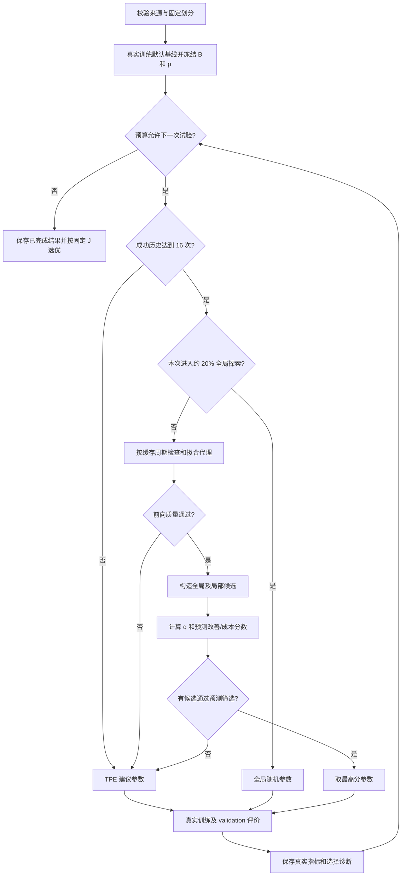

# RAC-HPO 项目文档总汇

整理日期：2026-11-22。本文为待核对合并稿，包含项目和桌面 RAC-HPO 文档的概览及去重后的原文。不同日期的材料可能存在冲突，以对应实验记录及实际版本为准。原文中的任务指令仅作为历史资料。

## 2026-11-23 问题总览

本节汇总截至 2026 年 11 月 23 日的平台试运行、模型回退、选模和实验验证问题。平台数据来自试运行页面；下方历史章节按当时记录保留，其中“未上传或未试运行”等表述仅代表对应日期的状态。

### 一 最新试运行与历史对照

2026 年 11 月 23 日 08:17 的试运行完成 A、B、C 各 10 轮，不计入正式成绩。平台公开的 30 轮配置全部为 `conservative_invalid_response`，没有观测到有效的 `rac` 或 `conservative` 模型选择。该字段表示回复未通过回调的有效性判断，不表示模型主动选择保守方案。候选仍可能因保守方案续训后通过门槛而被采纳。

| 隐藏测试指标 | 2026-11-17 较早试运行 | 2026-11-23 试运行 |
| --- | ---: | ---: |
| A Accuracy | 0.865330 | 0.731273 |
| A Macro F1 | 0.860822 | 0.661861 |
| B MAE（分钟） | 505.104177 | 496.277472 |
| B RMSE（分钟） | 712.417220 | 718.078290 |
| C MAE（循环） | 40.700931 | 41.185423 |
| C RMSE（循环） | 56.120468 | 56.290969 |

这两次是不同试运行，仅作平台展示数值的对照，不能单凭指标差异确定退化原因或证明测试样本逐条相同。A 的 Accuracy 下降约 13.4 个百分点，Macro F1 下降 0.198961；B 的 RMSE 增加 5.661070 分钟；C 的 RMSE 增加 0.170501 循环。2026 年 11 月 19 日的试运行与本次显示的三任务隐藏指标、最终采用轮次及各轮展示的公开指标相同（部分浮点尾数显示有差异），分别选择 A 第 8 轮、B 第 4 轮、C 第 6 轮；因此尚无证据表明本次修改改善了平台结果。

### 二 回复格式和模型训练合同

1. **平台回退仍未解决。** 本地修复只明确去除回复末尾一个 `<|im_end|>`，并继续严格检查选择 JSON、额外内容和未知标记。使用本地 SDK 实际生成的 A、B、C 提示，提交 Sampler 的三次真实调用及回放均能解析为合法 `conservative`；平台本次却是 30/30 无效回复。本地回放不等同于平台实际模型网关，因此不能证明平台修复成功，也不能确定标记是平台问题根因。
2. **缺少平台原始回复。** 试运行页面的候选详情显示选项配置、参数和指标，但没有显示原始模型文本、完整回执、结束原因或逐次 token 数。平台汇总输出 token 为 3,840，数值恰好等于 30 × 128，值得检查是否存在长度截断，但汇总值不能证明每轮均触及上限。下一步需获得真实网关回复、`finish_reason`、请求参数及逐次 token，再按真实输入重现。
3. **微调目标与当前选择合同不同。** 现有 LoRA 使用的历史训练脚本以训练参数 JSON 为目标；当前回调要求选择 `RAC`、`conservative`，或包含 `selected_option`、`reason_codes` 和 `risk` 的 JSON。提交训练记录只有 4 个训练样本、1 个留出样本，不能证明格式可靠或决策有效。不能把任意参数 JSON 宽松推断成某个选择；应先收集可靠样本并统一训练和推理合同。

### 三 镜像、选模与数据证据

1. **平台运行到镜像的关联未核实。** 2026-11-22 上传了显示为“镜像 4”的可用镜像，归档大小与本地修复包相符；2026-11-23 创建了 v3 提交并使用原 Sampler。试运行报告没有显示可核验的运行到镜像摘要对应关系，不能仅凭时间和大小断定实际执行了哪个归档。应关联上传文件 SHA-256、平台镜像 ID、提交版本和运行 ID。本地修复归档 SHA-256 为 `6b00156891e086784da163efc317687b22672c941ab3dfe31d03a094de0df414`。
2. **平台部分轮次展示和采纳理由尚待对账。** 例如 A 第 1 轮显示 Macro F1 0.718735，第 3 轮显示 0.703200，页面却显示第 3 轮被采纳并称主指标改善。当前页面未明确各展示值与父模型、候选、同一验证投影的对应关系，不能据此认定选择代码错误。需要逐轮父/候选 checkpoint、平台原始回执和验证投影重新计算。
3. **本地 B 轴承门槛能拒绝局部退化。** 带公开轴承元数据的本地真实回复回放中，总体 RMSE 从 681.159833 降至 667.083721 分钟，但 Bearing1_4 从 241.9808 升至 260.4258，候选被拒绝。它证明该本地分支在该样本中生效，不证明平台当时具有相同轴承元数据。
4. **公开验证与隐藏测试不能混为一谈。** 公开验证被多次用于候选选择，存在选择偏差；不能将其与隐藏测试直接相减宣称同集提升，也不能由总体 Macro F1 推断某个稀有类别的 F1。C 的 NASA 非对称评分与 RMSE 是不同指标，平台计算及聚合口径仍需独立核对。

### 四 算法收益与实验边界

- 阶段三本地固定预算对照为每任务四组、每组一个种子；A/B/C 预算分别为 4/9/60 秒，各完成 10 轮。代理和迁移实际使用均为 0，成本模式关闭，三任务各组最终公开指标相同。因此这些结果不能支持代理、迁移或成本机制产生收益的结论。
- 旧阶段二的三种子实验使用不同的旧版迁移和成本设置，观察到排序变化，但最终公开指标变化方向不一致；不能把该结果直接归因于当前镜像。进一步验证应冻结同样的起点、验证投影、预算、种子和选模规则，记录机制是否真正改变候选排序和真实训练结果。
- 工程中的工况权重与数据量有边界：CNC 验证每工况仅两把物理刀具，可信工况权重为 0；没有足够证据证明可靠性分支的实证收益。树模型离散度及残差重采样是未校准近似。

### 五 已完成验证与下一步

- 本地竞赛核心测试 59 项中 58 项通过、1 项跳过；SDK 回调测试 21 项通过。对历史本地对照的 120 轮核验选模门槛、目标值和父子摘要未发现不一致；抽取 6 轮、12 个检查点直接重算公开验证指标，与记录一致。这些测试均不能代替平台真实回执。
- 优先顺序：核实平台运行镜像 → 获取模型原始回复和结束信息 → 本地按真实请求重放并修复合同 → 重新运行受控平台试验 → 在机制确实触发后开展多种子等预算收益验证。当前不应仅依据本地单轮通过就宣称平台回退已修复。
- Git 提交前应审阅当前已删除的历史 Markdown；这些删除来自此前文档合并，提交会同时删除仓库中的 README、架构和其他原文。当前文档总汇保留历史内容，但旧链接和实验清单中的原路径可能失效。模型归档和本地数据未纳入 Git；源码与模型镜像需分别核验一致。

## 项目与数据

智训引擎提供工业模型训练和超参数优化，支持 CLI、PySide6 和 SQLite，核心算法独立于界面与数据库。原工程接入 LightGBM、Random、TPE、鲁棒 TPE 和 RAC-HPO；竞赛工程接入 Harness SDK，对已有模型执行续训和验证。

钢铁能耗按时间划分；CNC Milling 2025 按整把物理刀具划分，预测剩余周期，排除身份字段和未来寿命标签。工业分类覆盖 AI4I、SECOM、Paderborn 等数据，AI4I 是合成基准，各数据来源及许可记录见附录。训练和搜索使用训练集与验证集，显式最终评估才读取测试集。离线闭环是本地模拟，不能称生产部署。

## 算法与工程

每个工况的归一化误差 r_g=E_g/(B_g+ε)，固定目标 J=0.7×Σ(p_g×r_g)+0.3×max(r_g)，其中 p_g 是验证样本占比，J 越小越好。TPE 暖启动积累真实试验；ExtraTrees 性能与成本代理预测候选的改善和成本，按前向质量门槛决定是否辅助排序；不合格回退 TPE。最终候选必须真实训练并验证，符合约定的主指标、鲁棒目标及工况门槛才予采纳。树间离散度和残差重采样是未校准近似。CNC 每工况只有两把验证刀具，可信工况关注权重为零，不能声称已证明该分支收益。

原项目 CNC 三种子各 10 秒试跑中，RAC 平均 J=0.7370、MAE=23.0989 cycles，普通 TPE 为 0.7396、22.8992；J 略好但 MAE 略差。AI4I 差异很小，SECOM 的故障召回为零，Paderborn 小子集 Random 表现较好，不能据此宣称普遍优势。

竞赛阶段二在 A/B/C 分别 4/9/60 秒的 worker CPU 硬预算下按三个搜索种子对照。C 的 G1 三种子 RMSE 优于固定参数，但完整代理未触发；不能把结果归因于代理。阶段三对照未实际触发代理、迁移和成本惩罚，性能代理默认 shadow，跨父迁移与成本项默认关闭。真实 PyTRIO 本地单轮验证仅支持当次协议可用，不证明普遍收益。

## 首次平台试运行

以下为根据用户截图整理的非正式试运行记录，尚未用平台原始回执独立核验；公开验证和隐藏测试分别报告，不可混作同集前后对照。

| 任务 | 隐藏样本 | 隐藏测试结果 | 最终候选 |
| --- | ---: | --- | --- |
| A 气体识别 | 4886 | Accuracy 0.865330、Macro-F1 0.860822 | 第 9 轮候选 1 |
| B 轴承剩余寿命 | 200 | MAE 505.104177、RMSE 712.417220 分钟 | 第 2 轮候选 1 |
| C 发动机剩余寿命 | 9687 | MAE 40.700931、RMSE 56.120468 cycles | 第 10 轮候选 1 |

本地公开 A 原始模型的 109 条乙醛样本均未被正确识别；最终乙醛单类 F1 不能由总体 Macro-F1 推算。B/C 的公开基线与隐藏结果不属于已确认的同集对照。C 的 NASA 评分精确公式、平台聚合和逐轮采纳差异仍需核对。PPT 的 LightGBM 与竞赛续训文档中的 MLP 底座有差异，需核实实际版本。1D-CNN 属于待验证计划。

## 术语与后续

Accuracy 是全部样本的正确比例；Precision 是预测为某类时的正确比例；Recall 是真实某类被找出的比例；Macro-F1 对各类别的 F1 等权平均。MAE 是平均绝对误差，RMSE 对大误差更敏感。RUL 是剩余使用寿命，checkpoint 保存模型及所需状态。

后续应核对官方回执和评分口径，增加独立设备及外部工况，在相同预算下扩展多种子和消融，并验证模型替换、历史恢复和各工况安全门槛。项目规则、完整方法、实验、数据许可、命令、答辩稿与历史记录均保留在下面的去重原文中。

## 2026-11-22 问题梳理与下一步核查

本轮沿用单文档整理方式，基于现有源码和本地数据开展核查，未发起平台评测、远程推理或新模型搜索。以下结果是本次执行记录，不改写历史报告。

1. **平台采纳差异仍待解释。** 历史试运行截图记录 A 第 8 轮和 C 第 9 轮的采纳与当前严格主指标门槛存在疑点。当前源码同时核对平台与本地父/候选主指标，要求主指标与固定 J 改善，并在有真实轴承分组时执行 B 工况保护；缺少当时实际镜像、逐轮候选回执和父检查点，不能推断差异原因。优先收集这些证据及实际验证投影和各轮选中 artifact，再按同一口径核对。
2. **完整 RAC 机制收益尚未证明。** 同预算实验中存在代理、成本和迁移没有接管的运行，不可将改善归因于未触发的机制。下一步应先验证真实接管和前向预测质量，再冻结同目标、同资源预算及多种子方案；CNC 可信权重仍受独立刀具数量限制。
3. **实验材料完整性受到文档合并影响。** 对阶段二 artifact-manifest 的 2314 项进行只读 SHA-256 检查：2311 项存在且匹配，3 项 Markdown 因上轮经用户确认的清理而缺失，包括阶段二报告、阶段二发布决策和该实验的 README。原文保存在本文附录中，但原路径不存在，历史文件清单不再全部通过完整性校验。
4. **指标与数据口径需保持分离。** 本地公开基线与平台隐藏测试结果不能直接算改善率；A 的总体 Macro-F1 不能证明乙醛类别 F1，B/C 的时间和误差归因需真实逐样本或逐设备证据。获取平台回执之前，沿用已核实的事实和边界。

本次检查：`.venv-contest/bin/python -m unittest discover -s tests/contest -v` 共 58 项，57 项通过、1 项显式 CPU 集成测试跳过；使用本地缓存 SDK 源运行 `official_submission/tests`，19 项通过。部分测试使用真实本地权重执行小规模续训；未运行完整工程、GUI、平台或隐藏测试。本轮未修改算法实现或产生新的正式实验结果。

## 2026-11-22 PyTRIO 决策回复格式排查

用户授权真实 PyTRIO 调用，本轮遵循先分析、不修改训练与选模代码。平台原始模型回复、当时上传的确切镜像和逐轮完整回执尚不可得。测试只使用模拟重建的公开任务上下文，不代表平台原始 prompt，也不读取隐藏标签。

旧本地提交候选回调要求回复经 strip 和 casefold 后精确为 `rac` 或 `conservative`，其余归为 `conservative_invalid_response`。本地历史真实调用 03/04 的 JSON 回复末尾包含 `<|im_end|>`，导致当前结构化解析判无效；05 使用 tokenizer 去掉特殊标记后解析为 conservative。相关历史调用并非本次平台运行。

本轮使用提交的 `rac-hpo-lora-20261117` 权重及其基座 Qwen/Qwen3.5-4B，在模拟 A/C 两个提示上各调用一次，temperature=0、seed=42、max_tokens=128、stop=`<|im_end|>`。四次均返回原始文本 `RAC<|im_end|>`，经 tokenizer `decode(skip_special_tokens=True)` 得到 `RAC`：旧严格解析原文 0/4 有效，解码后 4/4 有效。四次完成调用共输入 660 token、输出 12 token，记录在 `experiments/pytrio-diagnostics-20261122-01/responses.jsonl`。这是小样本格式诊断，不是模型效果或算法收益比较。请求重建与平台真实提示和传输路径可能不同，不能确定它是平台 29 次回退的实际原因。

未设置 stop 的额外对照在首个采样等待超过约一分钟后由本地中断，未收到结果；远端是否完成及费用未知，不将其计入四次成功调用。当前仍需平台原始回复及实际镜像摘要确认线上因果。建议后续先在离线测试中覆盖明确允许的结束标记、合法选择、无效 JSON、额外内容和未知 token，同时保留非法回复回退及真实候选验收。用户此前要求暂不修改代码，因此本轮仅做排查。

## RAC-HPO 问题排查清单

排查顺序：先让合法模型回复进入正确分支，再核对父模型与候选指标，最后验证搜索机制是否有收益。勾选代表已有证据或达到该项验收标准。

### P0：PyTRIO 回复解析与保守回退

- [x] **确认现象。** 平台这次 30 轮中，29 轮记录为 `conservative_invalid_response`，1 轮为 `conservative`，0 轮为 `rac`。
- [x] **保留复现样本。** 提交的 Sampler 和基础模型在重建的 A/C 提示上共完成 4 次真实调用，原文均为 `RAC<|im_end|>`；旧解析器原文 0/4 通过，去除 tokenizer 特殊标记后 4/4 通过。无停止词对照未返回结果。查看[采样记录](experiments/pytrio-diagnostics-20261122-01/responses.jsonl)。
- [ ] **对齐生产入口的回复约定。** 核对实际 `rnd.model` 提示和解析器：旧候选接受 `RAC` 或 `conservative`，当前回调还接受经校验的选择 JSON，LoRA 训练使用的是参数 JSON。验收：提示与解析器使用同一约定，参数提案不能被宽松匹配为选项。
- [x] **先补失败测试，再修复和回放。** 覆盖 `RAC<|im_end|>`、`conservative<|im_end|>`、带末尾标记的合法选择 JSON，以及未知标记、额外正文、缺字段和非法选项。验收：允许的末尾标记按明确规则处理，四条保存回复均进入 `rac`，不合规回复继续走保守分支。
- [x] **用实际入口验证决策。** 在本地 SDK 用真实采样或已保存回复跑 A/B/C，记录可脱敏的归一化前后回复、解析结果、`model_action` 及实际训练参数。验收：合法 `RAC` 对应 RAC 参数，合法 `conservative` 对应保守参数；模型选项只决定本轮试用参数，候选仍经真实指标与鲁棒门槛验收。

### P1：镜像身份与选模指标对账

- [ ] **建立运行、上传归档和源码的对应关系。** 平台镜像标识为 `428bde81fdd8d5757c8c9ed4323925d6`。本地根目录 `harness.tar`（`aca6e07e…`）是竞赛 CLI 镜像，`release/upload/harness.tar`（`80d5cbe8…`）含官方 SDK 回调。验收：用同一次运行关联的上传摘要、构建清单或运行时版本指纹确认归档。旧运行原始证据无法取得时，标记为无法追溯，下一次运行记录指纹。
- [ ] **逐轮核对父、候选和选中产物。** 优先核对这次试运行的 A 第 3 轮、B 第 4/5/8 轮和 C 第 4/7 轮。为每轮记录父及候选的 artifact ID、checkpoint 摘要、验证投影摘要、`current_validation`、候选提交回执、实际选中 ID 和理由。验收：同一验证投影上每个主指标可对应到准确的产物与阶段。旧回执不可取时，用下一次受控运行验证字段映射，历史异常保持待定。
- [ ] **复核门槛与拒绝原因。** A 用 Macro-F1（越高越好），B/C 用 RMSE（越低越好）。核对主指标方向、固定 J、适用的 B 逐轴承保护及拒绝后是否继承原父模型。验收：输入指标可重算且原因与实际分支一致；同一产物在同一投影上的结果可对账。C 的 NASA Score 作为单独指标记录，评分口径未确认前不自行纳入门槛。

### P2：上线验证与收益验证

- [ ] **固定一个小规模平台试运行。** 先完成本地回放与 SDK 检查，再选择明确记录镜像摘要和 Sampler 版本的试运行，报告有效回复数、各决策分支次数、采纳数和调用耗时。验收：平台日志能解释每次回退，明确区分有效保守选择和解析失败。
- [ ] **验证搜索机制是否真正参与决策。** 在相同数据投影、起始模型和 CPU 预算下，记录代理、迁移和成本项何时实际改变候选排序，以及真实验证结果。验收：报告机制触发次数、同预算对照和未触发情况；公开验证与隐藏评估分别报告。

## 2026-11-22 清单实施记录

- 在当前 `stage3_controls.py` 中只去除回复末尾一个已知 `<|im_end|>` 标记，继续严格验证允许的选项及 JSON 字段。未知标记、多余内容、非法选项保持保守回退；SDK 审计新增归一化回复，与原文同时记录。
- 先新增失败测试并观察 3 项失败，再完成修复。已有 4 条真实采样回复重放均识别为 RAC。竞赛测试 59 项中 58 通过、1 跳过；本地 SDK 回调测试 20 项通过。
- 以保存的真实采样回复和模拟合法/非法回复，在本地 SDK 宿主及真实公开 checkpoint 上进行 A/B/C 共 9 个独立单轮回放。记录保存在 `experiments/pytrio-diagnostics-20261122-02/replay/`。C 的 RAC 候选主指标改善但固定 J 未改善，故未采纳；其他结果以各审计为准。该实验不代表线上试运行或模型收益。
- 用已核验的本地阶段三镜像为基础，离线创建 `industrial-rac-hpo:parser-fix-20261122-01`；只读、禁网、非 root 容器运行 4 个 SDK 合同测试通过，其中包括 A/B/C 三种回复、真实权重续训与宿主指标不一致时拒绝。完整离线从基础镜像构建因依赖缓存缺失失败，改用已存在的阶段三父镜像，不覆盖旧镜像。
- 导出独立单镜像 linux/amd64 归档 `experiments/pytrio-diagnostics-20261122-02/harness-parser-fix.tar`，SHA-256 `6b00156891e086784da163efc317687b22672c941ab3dfe31d03a094de0df414`；父镜像 ID、测试及源码清单见同目录 `build-validation.json` 和 `source-files.json`。未上传、未运行平台试验。
- 使用提交 Sampler 的本地 SDK 实时三任务核验在 A 任务等待 120 秒后超时，未得到任何结果，远端费用未知；此前 4 次真实采样和上述 9 次记录回放不能冒充三任务实时连通。历史平台运行的准确镜像与逐轮父/候选回执仍不可得，指标差异原因未证实。模型的参数 JSON 微调目标与回调的 RAC/conservative 选择目标仍不一致，实际效果待新验证；代理和成本机制的受控收益验证仍未完成。

## 2026-11-22 清单继续实施记录

- 已核对当前 SDK 回调的选择合同：请求要求 `selected_option`、`reason_codes`、`risk`，解析器严格检查这三个字段；旧式精确 `RAC` 和 `conservative` 也受支持。新增真实 SDK 回调测试覆盖 A/B/C：合法选择 JSON 进入 RAC，参数提案 JSON 触发 `conservative_invalid_response`。不把参数 JSON 猜测转换成选项。提交 Sampler 的训练回执显示 4 个训练样本、1 个留出样本，训练脚本的目标是超参数 JSON，因此训练任务与当前选择任务仍未统一；不凭这一次结果声称训练有效或无效。
- 从真实本地 SDK 回调分别捕获 A/B/C 的首轮提示，通过 PyTRIO 0.2.9 对提交 Sampler 各调用一次，均返回带单个 `<|im_end|>` 的合法 JSON，选择均为 `conservative`。这三条真实回复逐一回放到内容和参数完全相同的 SDK 提示，均通过解析且实际使用保守训练参数；无工况元数据的单轮本地回放中三项均被采纳。采样启用了停止词；这是本地公开数据与已保存回复回放，不是原平台的在线日志，也不能解释原平台 29 次无效回复。原始提示、响应、token 与审计见 `experiments/pytrio-diagnostics-20261122-03/`。
- 带公开轴承元数据时，额外捕获真实 B 回调提示并对同一 Sampler 调用一次，合法选择 `conservative`；回放同提示后，总体 RMSE 从 681.159833 降到 667.083721，但 Bearing1_4 的 RMSE 从 241.9808 升至 260.4258，轴承门槛失败且固定 J 从 1.0 升至 1.03845，候选被拒绝、继承父模型。报告理由首先指向轴承门槛，两个门槛均未通过。
- 独立重算 2026-11-18 已完成的配对试验：12 组、120 轮，检查候选文件 SHA、父子选择链、公开验证投影摘要、父/候选固定 J、主指标方向、本地/宿主指标一致性、B 的逐轴承门槛、选择结果和优先拒绝理由，0 项不一致。审计文件不等同于重新计算所有 checkpoint 的原始预测，也不能证明平台历史结果。过程和机器可读结果见 `experiments/pytrio-diagnostics-20261122-03/verify_history.py` 与 `history-verification-v2.json`。
- 该历史试验每任务仅一个种子，四组在 A/B/C 的最终公开指标分别相同：Macro-F1 为 0.726366，B 的 RMSE 为 669.136435，C 的 RMSE 为 52.189980；每组均完成 10 轮，实际代理使用 0 次、迁移 TPE 使用 0 次，所有组的成本模式均关闭，故无法据此证明这些机制对排序或收益有作用。该结果使用本地模型替身和此前冻结源码，仅作回顾，不是修复镜像的新对照或隐藏集成绩。
- 本次核验当前两处运行时代码 SHA-256 与本地修复镜像的 `source-files.json` 一致；本地归档 SHA-256 为 `6b00156891e086784da163efc317687b22672c941ab3dfe31d03a094de0df414`。平台标识 `428bde81fdd8d5757c8c9ed4323925d6` 与旧上传归档仍缺少关联证据；新镜像尚未上传或试运行。

### 继续核验补充

- 从历史 R3 本地实验选取 A 第 3 轮、B 第 4/5/8 轮、C 第 4/7 轮，分别加载父模型与候选模型共 12 个 checkpoint，在相同公开验证投影上重新预测和计算主指标，同时核对文件 SHA；6 轮全部与审计一致。结果见 `experiments/pytrio-diagnostics-20261122-03/recomputed-checkpoints.json`，这些是本地历史轮次，与平台截图中的同编号轮次不是同一次运行。
- 竞赛核心测试 59 项通过、其中 1 项跳过；完整 SDK 回调测试 21 项通过。第一次 SDK 全套测试因使用了缺少模板入口的目录而有 1 项环境错误；改用含模板且 SDK 模块与原目录一致的本地副本后全部通过，日志见 `experiments/pytrio-diagnostics-20261122-03/sdk-tests.log`。
- 补充查阅较早阶段二的三种子、同预算配对：G2/G3 均开启旧版迁移，G3 另外启用成本项。历史记录中 G3 的候选配对排序逆转计数在 A/B/C 三个种子上分别合计 60/84/144；该计数不是选中方案改变的轮数。与 G2 比较，三个种子的最终公开主指标仅 A 的 2 个种子及 C 的 1 个种子发生差异，方向不一致，B 三个种子未变。该版本的迁移和门槛与当前阶段三不同，且样本只有三个种子，不能作为当前镜像的收益证明；具体配对见 `experiments/pytrio-diagnostics-20261122-03/stage2-cost-pairs.json`。

## 去重原文与来源清单

按文件 SHA-256 去重，每份不同的内容保留完整原文及全部对应路径。缓存、虚拟环境和其他个人项目未纳入。原文链接、冲突标记、历史数据及历史指令按原样保留。

### 原文 001

- SHA-256：`61e7a3215437f3aeb7972ba85871b4dd55a2678de2f36802ee0b9bb5d4c7d5d7`
- 来源：`AGENTS.md`
- 来源：`workspace/contest-publish/AGENTS.md`

````text
# RAC-HPO 工程规则

开始任务时阅读 README.md、ARCHITECTURE.md；完整技术规范位于 docs/RAC-HPO_Implementation_Architecture_v1.md，当前实施边界与进度见 PLAN.md。

- 中文沟通；代码、命令、日志字段和变量名使用英文。
- 本目录为独立工程。优先复用已有模块，只改当前任务涉及文件。
- 核心算法独立于 Qt 与 SQLite；GUI / CLI 通过 application 服务运行真实任务。
- 训练与搜索只使用 train / validation；显式最终评估才读取 test，保留固定时间划分与数据校验。
- 工况由推理前可获得的元数据定义；日期块不是独立机床、刀具或生产批次。来源、许可与字段依据真实数据记录。
- 历史实验只追加保存，关键文件原子写入；变更数据库前先备份并验证兼容性。
- 修复 bug 先增加失败测试，再修复；运行与修改相称的检查，明确报告失败和未验证事项。
- 同步更新 CHANGELOG.md；结构或公开接口变化时更新 ARCHITECTURE.md。每阶段报告真实实验、修改文件、测试与下一步。
- 不硬编码密钥、不提交 .env、不记录敏感信息。未授权的破坏性操作、对外不兼容更改、真实数据迁移、对外发送、发布或收费先确认。
- 所有临时文件、环境、数据与实验产物放在本工作目录；结束后删除不再需要的临时文件。
- 阶段 0–3 已实现：钢铁能耗与 CNC Milling 2025、LightGBM、Random / TPE / 鲁棒 TPE / RAC-HPO。当前 App 0.3.0，RAC 算法 rac-hpo-0.2.0，Schema 1；真实验收见 docs/PHASE_2_3_REPORT.md。
- CNC 按整把物理刀具划分，排除未来寿命标签和身份字段；每个验证工况只有两把刀具，默认可信工况权重为 0，不声称已证明可靠性分支的实证收益。
- 代理树离散度与前向残差重采样只作未校准的搜索近似；最终 J 固定，代理不合格明确回退 TPE。阶段 4 的全面算法证明和阶段 5 发布尚未完成。
````

### 原文 002

- SHA-256：`75817c3050094bbadb8a151514241afb53b11d0360bbb1406d9e9bbd6cafc130`
- 来源：`ARCHITECTURE.md`

````text
# 智训引擎技术规范与实施架构

<<<<<<< HEAD
## 2026-11-09 macOS 运行环境

macOS 使用项目内 `.venv`、`.python` 和 `.cache`；Apple Silicon 的 LightGBM 依赖 Homebrew libomp。macOS 依赖 PySide6-Essentials 6.9.3（项目使用的 QtCore、QtGui、QtWidgets 和 QtTest 均包含在内），其他平台仍依赖原 PySide6 6.9.3；环境快照兼容两种发行包并保留 `PySide6` 键。原生界面验证脚本不再强制 Windows 平台插件：`--native` 由 Qt 自动选择当前系统平台，默认仍使用 offscreen。回归 GUI 恢复与后端一致的 Grid、Successive Halving 和 Hyperband 入口。安装不隐式下载数据。
=======
## 2026-11-18 竞赛代理与迁移安全门槛

SDK 回调通过 `RAC_TRANSFER_MODE=off|legacy|gated`、`RAC_SURROGATE_MODE=off|shadow|active`、`RAC_COST_MODE=off|transfer|acquisition|both` 和 `RAC_BEARING_FEASIBILITY=off|shadow|active` 控制搜索；默认分别为 off、shadow、off、off。历史兼容开关 `RAC_TRANSFER_HISTORY=1` 显式选择 legacy，不能作为可信迁移证据。gated 要求匹配投影、时间、工况距离、足够观察及不同父模型，并要求既往配对证据；当前 SDK 尚不提供可信证据载入，因此不会自动启用。

工况代理分别前向核验性能和可变训练 CPU 成本；成本失败仅关闭成本惩罚。active 必须有相同父模型、真实训练过且严格早于当前轮的影子候选质量证据，否则实际使用 shadow。B 的最近邻可行性仅记录影子判断，真实逐轴承硬门槛不变。结构化模型回复只能选择合法方案，仍由平台主指标、固定 J 和真实轴承误差共同决定是否采纳；非法回复保守回退。CPU 分段、SHA、历史门槛及模型回执写入逐轮审计。详细证据和未完成事项见 [阶段三决策](docs/RAC_HPO_STAGE3_RELEASE_DECISION.md)。

## 2026-11-18 竞赛硬 CPU 预算对照

独立实验驱动 `experiments/ablation/hard_budget.py` 保留既有 SDK 回调与选择规则，按冻结协议在每个单线程 worker 进程施加 `RLIMIT_CPU`，以 `wait4` 记录 user/system CPU。预先冻结 A/B/C 上限 4/9/60 秒，软限额提前 1 秒，最终已完成轮、未完成轮资源、阶段计时和峰值内存分别留痕。候选和 state 写完后原子提交轮次；恢复前核对父 SHA、审计和累计 attempt CPU，无法核算的中断安全拒绝恢复。controller 的解压与调度 CPU 单独报告。模型服务仅本地替身，结果不代表赛事平台。三种子对照、局限和未触发模块见 [阶段二报告](docs/RAC_HPO_STAGE2_REPORT.md)。

## 2026-11-18 竞赛消融实验接口

`ContestRACPolicy` 增加有界 `transfer_cost_weight` 选项，默认 0.05 不变；传入当前轮时拒绝本轮及未来轮历史，并记录 TPE 暖启动阈值、观察数和是否已进入拟合。离线 `experiments/ablation/run.py` 以 SDK 替身宿主、相同父链与选模合同运行 G0–G3；G1/G2 关闭 RAC acquisition 和迁移 TPE 的成本惩罚，G3 开启两处，三组保留相同代理成本质量门槛。源代码更改尚未写入历史镜像。首阶段单种子结果与预算限制见 [消融报告](docs/RAC_HPO_ABLATION_REPORT.md)。

## 2026-11-18 竞赛逐轮搜索审计

正式 SDK 回调的 `contest-sdk-history-v2` 状态将训练、验证及工况元数据投影摘要、主指标合同与连续的已选父 SHA 链绑定。同父记录供完整 `RACSearchPolicy` 使用；跨父记录不进入其代理，而是在同父历史不足时默认供独立 TPE 启发式使用，可通过 `RAC_TRANSFER_HISTORY=0` 关闭。旧状态或口径、链条不一致的记录保存在隔离归档，不进入新搜索。跨父目标是各轮候选 J / 父 J，再加 `0.05 * clip(log(训练秒数 / 中位训练秒数), -2, 2)`；这是有界软惩罚，不是硬性限时或完整成本代理。相对 J 不能消除父模型变化带来的不可比性。当时旧的无成本迁移在 A/B/C 三种子对照中未优于原策略；后续对照见本页阶段二记录。

SDK 的 `selection-audit.jsonl` 和状态逐轮保存 RAC 推荐、模型回复及合法性、`fit_epochs` 实际参数和采样策略、训练秒数、父与候选摘要、主指标和 J 门槛、选择理由与历史使用。宿主是否长期保存历史 artifact 仍待核实。独立本地修复镜像与原候选并存，详见 [竞赛审计报告](docs/CONTEST_CORE_AUDIT_20261118.md)。

## 2026-11-18 竞赛选择链与审计

新建本地 RAC 续训从上一轮已选 checkpoint 出发，固定 J 仍以原始模型为基准，仅将同父观察提供给搜索；已有无 `parent_mode` 标记的 RAC 运行继续按原固定父模型协议恢复。正式 SDK 始终使用宿主父产物，主指标严格改善与原有 J、可用的 B 逐轴承门槛同时生效。父/候选平台主指标还须与使用同一公开投影和 checkpoint 本地重算结果在相对 `1e-7`、绝对 `1e-8` 容差内一致，且本地值也严格改善；否则保留父模型。连续轮次的宿主父摘要若与已保存的上一轮选中摘要不一致，则停止本轮并报告，避免继续污染选择链。旧 state 无审计历史时不能作此跨轮核验。

每轮本地运行和 SDK state 中的 `selection-audit.jsonl` 记录父、候选、选中模型摘要、主指标、J、各门槛与原因；SDK 的路径是 artifact 内相对路径，能否长期恢复由宿主持久化合同决定。仅记录摘要和 ID 不保证历史 artifact 永久可用。本地已提交轮次可在日志写入中断后重建缺失的末尾审计记录。详见 [模型选择审计](docs/model_selection_audit.md)。

## 2026-11-17 竞赛提交候选与消融

竞赛基准脚本可选择 `rac_no_forward_gate` 或 `rac_bearing_constraint`。前者保留前向质量记录并绕过质量判定，后者在 B 的 TPE 提议中优先使用满足逐轴承 RMSE 边界的历史候选。真实 SDK 入口按默认设置保留代理质量回退和既有候选排序。当前提交候选依据比赛页面要求，在 Linux/amd64 构建并使用 `docker save` 导出单镜像未压缩 tar。

## 2026-11-17 跨父历史研究选项

当时的 SDK 回调默认关闭跨父迁移，显式 `RAC_TRANSFER_HISTORY=1` 才启用相对 J 暖启动 TPE。三种子实验证据未支持该方案，详见 [实验报告](docs/CONTEST_TRANSFER_EXPERIMENT.md)。现行源码的后续变化见上方 2026-11-18 记录。

## 2026-11-17 Harness SDK 容器装配

`official_submission/prepare_context.py` 校验 SDK 压缩包与三份基线运行源码摘要，生成独立 Docker 上下文和源文件清单。容器安装锁定 Python 依赖及实际 SDK 1.0.2，入口使用原 SDK 模板。官方镜像入口与既有本地 `Dockerfile.harness` 续训镜像分别构建。ARM64 本机门禁在只读根文件系统、禁网、单 CPU 和非 root 用户下验证。

## 2026-11-17 Harness SDK 1.0.2 适配

`official_submission/contest_submission.py` 实现官方模板调用的 `train(rnd)` 和 `predict(sample, model_dir)`。每轮校验官方父 NPZ 摘要，按固定特征合同从本轮公开训练投影续训，使用 SDK 模型回执在 RAC 与保守候选之间选择。训练后的候选由宿主测量，主指标缺失或门槛失败时保留合法父产物。状态只在 `/workspace` 副本保存，按父摘要及公开划分摘要限制可比较搜索历史。B/C 无验证组元数据时使用整体验证 MAE 作为内部 J 的唯一分量，关闭独立单元加权；即使如此，宿主的主指标仍为 RMSE。

## 2026-11-17 竞赛 V2 的 RAC 历史与成本门槛

本地竞赛新运行使用 `contest-rac-hpo-v2`。候选历史必须匹配固定搜索域和验证样本计数，能重算固定 J，并具有有限的实测正训练耗时。无效或重复记录的轮次和排除原因写入决策记录。A 类别 F1 缺少每类独立批次证据时，可信权重为零。竞赛启用成本前向门槛，以逐时间前缀的中位数 log 秒数为对照。性能或成本代理质量失败时回退 Optuna TPE。既有 V1 运行按保存的协议恢复，通用回归的默认代理门槛沿用原设置。

## 2026-11-17 RAC-HPO 决策模型训练

`scripts/train_contest_sampler.py` 在 Conda `industrial` 中使用 PyTRIO LoRA SFT，复用竞赛 Sampler 的提示投影及参数校验。默认本地核对数据，`--train` 启动云端训练并使用 SwanLab 在线记录。A/B 训练任务缺少已采纳样本时才使用显式补充历史，C 留出始终取自主要历史。记录训练 loss、监督 token 数、留出格式通过率和 Sampler URI。使用方式见 [竞赛续训镜像](docs/CONTEST_HARNESS.md#在-conda-industrial-中训练决策模型)。

## 2026-11-17 RAC-HPO 竞赛续训接入

- `contest/rac_policy.py` 将固定父检查点的候选记录适配到共享 `RACSearchPolicy` 和固定目标 J。A 以类别 F1 损失分组，B 以轴承 MAE 分组，C 以发布子集 MAE 分组并保留发动机级误差统计。现有 RAC 核心复用 ExtraTrees 分组和成本代理、前向质量检查、全局探索及成本归一化采集函数。
- 第一轮执行基准参数续训，之后用 Optuna TPE 及其随机启动填充历史。第 9、10 轮可触发代理排序或全局探索，代理未通过质量检查则回退 TPE。按已提交轮次重建决策状态，配置、候选、实测训练耗时与代理诊断原子保存。
- RAC 策略从各任务原始检查点训练每个候选。采纳需同时改善主验证指标与 J，B 还执行原有逐轴承基线 RMSE 门槛。历史规则和 PyTRIO 策略使用其原有的选中父模型协议。Linux amd64 镜像的默认策略为 `rac_hpo`，实验和启动命令见 [竞赛续训镜像](docs/CONTEST_HARNESS.md)。

## 2026-11-17 Sampler 效果对照

新增 pytrio_base 策略，与 pytrio_sampler 共享同一采样适配器、响应解析、参数范围和采纳规则。基础模式要求空 Sampler 路径，微调模式要求已保存的 URI。

## 2026-11-17 PyTRIO Sampler 接入

新增 contest/sampler.py，以投影后的公开验证历史请求 PyTRIO，并对模型提出的训练参数做白名单校验。服务的 pytrio_sampler 策略复用原训练、重放及采纳门槛，并将采样证据写入轮次目录。

## 2026-11-16 竞赛续训镜像

新增 contest/continuation 在公开训练数据上组织定向或按轴承均衡采样，沿用原模型结构、标准化与 Adam 实现。task_aware_v3 通过子进程训练和重放，A 记录分类别 F1，B 按验证轴承设置相对原始检查点的门槛。原有本地 CLI 策略仍可读取历史运行。Dockerfile.harness 仅封装竞赛模块和固定 NumPy 依赖，默认运行三任务，每任务 10 轮。运行和预测接口见 [竞赛续训镜像](docs/CONTEST_HARNESS.md)。

## 2026-11-16 竞赛本地模拟

新增 contest/packages 负责原始 ZIP、检查点和文件摘要核验，contest/worker 在独立进程内调用各包训练／评估模块，contest/policy 提供有界的本地验证历史策略，contest/service 负责逐轮执行、原子提交与恢复。CLI 入口为 python -m rac_hpo.contest，使用 NumPy 1.26.4 独立环境。复用 _io 原子写入，不依赖 Qt 或 SQLite。输出在独立 workspace/contest_simulation，原始 A/B/C 包逐项隔离。当前支持 macOS／Linux 进程锁。PyTRIO 与正式 Harness 待官方协议接入。

## 2026-11-07 训练诊断、限时与评估一致性

- `TrainingResult.diagnostics` 为兼容的可选字典。回归训练记录训练 MAE、验证 MAE、差值、实际评估轮数及逐迭代验证曲线。统一 evaluator 增加 `overall_p95_absolute_error` 和工况 `p95_absolute_error`，采用样本绝对误差的线性插值 95% 分位数。最终 J 定义沿用现有实现。
- `optimization.trial_timeout_seconds` 默认为 null。应用服务传给回归 `train(..., timeout_seconds=None)`，包含基线和每个候选的构建、拟合及评估。取消优先于超时，树迭代前后和评估边界检查。超时抛出 `TrainingTimeout`，保存 failed、`failure_kind=training_timeout`、预算、实际耗时、超时量和完成轮数。基线超时终止实验，候选超时继续下一候选。单次原生调用可能超过限时。分类服务和固定轮数最终重训沿用各自预算语义。
- 每次完成的回归 trial 保存 `training_diagnostics`。实验顶层只对应实际选中模型，并额外原子保存可导出的 `training_diagnostics.json`。训练页绘制真实验证曲线和已选迭代，详情抽屉显示摘要，历史缺失字段显示空态。
- `finalize_experiment` 在准备数据前独占原子创建 `finalization_claim.json`。并发调用及中断后的重复调用在读取 test 前阻断，旧实验若已有孤立测试报告也阻断。执行标记失败后保留，已保存的报告和模型可供人工核查，应用不会自动重复评估。
- 回归和分类 evaluator 在字符串转换前检查工况/分组缺失值，拒绝空白标签。`environment_snapshot` 增加实际导入包的路径和源码哈希，独立输出工作区也能追溯实际实现。
- 二分类 `time_oof` 在原有 0.01–0.5 网格和训练期前向折外预测上保存 `working_points`，包含 FN、FP、两类错误率、召回、已选与网格内 Pareto 标记。选择规则和概率校准状态沿用现有协议，工业训练页只展示保存值。

Config / SQLite Schema 仍为 1，新增数据保存到兼容 JSON 字段及独立产物。真实实验和验证详见 `docs/PROJECT_IMPROVEMENT_20261107.md`。
>>>>>>> 20aa64b (完成RAC-HPO阶段三算法优化)

## 2026-11-04 总结文档与 Mac 对齐

`optimization/baselines` 增加惰性三档粗网格与资源策略。统一回归优化器增加 grid / successive_halving / hyperband；资源方法用随机候选、固定 study_name、Optuna 分层剪枝，runner 增加第三参数 report，仅此两种方法使用。`training.train` 增加可选 resource_callback(step, validation_mae)，其余调用兼容。完成记录与剪枝记录分别保存，剪枝不参与最佳选择；资源控制以模型 n_estimators 为上限，独立保留单模型早停。Config Schema 1 兼容增加 min_resource/reduction_factor，数据库不变。

`data/quality_audit` 只用 train 数值特征拟合 IQR，审计 train/validation，保存源行标记，不变更数据、manifest 或特征。两类应用服务保存独立质量产物；数据页和工业页展示真实审计。分类评价增加各类别漏报/误报率，原指标不变。CLI/GUI 回归提供新方法，工业分类不增加资源剪枝。

本机 Apple M5 / 10 核 / 16 GiB，CPU 原生 arm64；回归 4 线程、串行 trial。Mac Setup/Run-GUI.command 使用工程内环境与缓存、显式数据获取。详细边界及验证见 docs/SUMMARY_ALIGNMENT.md。

## 2026-10-31 工业数据与分类训练增量

实施计划见 `docs/INDUSTRIAL_TRAINING_PLAN.md`，真实结果见 `docs/INDUSTRIAL_TRAINING_REPORT.md`。沿用 PreparedDataset，新增数据契约在 manifest 明确 task_type、data_origin、source_files、split_fingerprint；不改变旧回归对象与 SQLite Schema。

- `data/industrial/{uci,bearings,local,common}`：AI4I / SECOM / Paderborn 各自来源和特征契约；XJTU-SY 完整寿命回归本地审计，联想/Pneumatic 带来源与授权/动作标签的本地规范化表入口。归档导入拒绝路径穿越、链接、超额数据与覆盖；按归档哈希在工程内原子建立解压缓存，复用前核对全部文件及链接，记录输入归档哈希，审计后训练不再重复解压。Paderborn 小样本显式保存官方归档字节范围和实际 MAT 哈希。
- `training/classification`：三种表格分类器、训练折中位数/独热编码、固定类别、取消和可重载模型。学习曲线来自真实boosting迭代；Random Forest明确无逐轮验证曲线。
- `evaluation/classification`：balanced accuracy、macro F1、log loss、类别计数/召回、分工况及真实轴承分组。少量类别和缺失类别显式提示；未知/合成行组不形成独立单元证据。
- `optimization/classification`：三方法同固定 J，balanced error = 1 - balanced accuracy；沿用 normalized_objective 与 RACSearchPolicy。旧策略数值字段通过内部 loss 适配，不向外保存伪 MAE。基线 trial -1 不占搜索预算；代理不合格回退 TPE，树离散度和轴承重采样仍未校准。
- `application/industrial_service`：`audit/fetch/run/list_runs/get_run/compare`，每次运行独立 `workspace/industrial_runs/IND-*`，原子配置/manifest/模型/指标/日志/曲线，失败与中断保留；死进程仅关闭状态，不自动重训。`compare` 分别给出描述可比与公平 HPO 可比证明；公平比较检查来源/划分/模型/seed/预算/资源/目标/空间。
- CLI `industrial` 和工作台第七页共用服务及既有独立任务进程。分类活动/历史结果与原回归快照隔离；工业worker不初始化原回归数据库。图表和表格只显示实际保存指标；模型参数与来源不匹配时不排名。
- `scripts/run_industrial_benchmarks.py`：真实三模型基线、三方法多种子同预算对照，完整种子与试验且条件一致才生成 fair_comparisons；不完整部分只保留描述统计。不会下载或访问 test。

当前分类服务拒绝 XJTU 回归训练；它的未来训练应复用回归评价，禁止与故障分类合并排名。1D-CNN/LSTM、新来源的漂移与连续演化尚未接入。本增量未做生产部署或发布。

统一规范为 [完整总纲](docs/RAC-HPO_Implementation_Architecture_v1.md)。该文件保留用户提供的 V1 原文。本文件记录实际实施接口与后续维护边界。

2026-10-31 新方向：以训练/HPO 为核心，增加受控单轮离线优化闭环。旧总纲是历史设计来源；新增协议与当前接口以本文件及 [CONTROLLED_LOOP](docs/CONTROLLED_LOOP.md) 为准，执行边界记录在 PLAN.md。

## 新增受控单轮闭环

- `data/loop_views` 定义固定 CNC 整刀角色、稳定回放顺序、整刀标签释放与不可变训练视图。复用 PreparedDataset，只有 train/validation，保存源行映射；门禁和 test 不传入训练器。视图摘要与源 SHA-256 均在重载时验证。
- `domain/loop_policy` 固定授权策略、预算和工具白名单；`monitoring/drift` 只计算质量/分布事件和工程门禁，不导入 Qt 或 SQLite。
- `application/loop_service` 编排初始训练、回放、后验诊断、一次 HPO、候选冻结、一次门禁、人工模拟切换及回滚；`loop_models` 校验实际模型哈希、特征顺序和有限预测，使用统一 evaluator。
- `ApplicationService.run_experiment(..., dataset_view_id=None)` 新增可选视图；原调用不变。视图实验附带 data_mode，环境同时记录工作区及实际实现源码指纹。finalize 对视图实验在准备数据前拒绝。优化目标 J 和旧训练器不改。
- `infrastructure/loop_repository` 使用独立 lifecycle.sqlite3 / Schema 1；BEGIN IMMEDIATE 事务覆盖建表/版本、状态/审批/审计/活动模型引用。gate_uses 按源文件及门禁行指纹唯一，不能靠换会话重试其他候选。先保存模型与清单，后提交引用；旧实验库 Schema 1 不迁移。
- 会话进程租约阻止同一会话并发执行，revision 阻止过期审批。中断训练/门禁标记 INTERRUPTED，不自动重训；失败、中间试验及已消费门禁保留。模型切换仅更新本会话本地槽位，无生产服务部署。
- CLI `loop` 与第六页自主优化共用服务，GUI 沿用独立进程、80ms 队列与更新合并；loop session 与原 experiment 的活动/查看状态分开。保留固定56px导航及原五页。

本轮默认回归任务、单次候选门禁、q=0；一次工程门禁不构成算法可靠性或跨机床泛化证据。新数据、分类、连续多轮、LLM 和发布未实施。

## 当前实现：阶段 0–3

`interfaces` → `application` → `data / training / optimization / evaluation`；`infrastructure` 为应用服务提供配置、SQLite 和产物存储。核心模块只通过 domain 数据结构传递信息，不导入 GUI 或数据库。

- `domain/schemas.py`：PreparedDataset、TrainingResult、OptimizationResult 与取消异常。
- `data/loader.py`：UCI 钢铁能耗适配器，验证来源、固定特征和按日时间划分。
- `runtime.py`：决定工作区位置。源码运行用检出目录；打包的 macOS 应用用 `~/Library/Application Support/RAC-HPO`，读取构建时写入的 `build_info.json`。核心算法不依赖它。`packaging/macos/` 含 PyInstaller spec、构建与自检脚本，不属于运行时包。
- `data/cnc_milling.py`：作者 CNC Milling 2025 文件校验、分号/小数逗号解析、物理刀具分组与固定切深工况；`data/registry.py` 统一下载、识别和适配器分派。
- `training/lightgbm_trainer.py`：训练折拟合模型、验证折早停，不读取测试集。
- `training/model_export.py`：通过 UTF-8 文本加载模型，兼容 Windows 中文路径；最终重训复用 training.build_regressor 保持参数一致。
- `evaluation/evaluator.py` 与 `domain/metrics.py`：总体 MAE、分工况原始 MAE 和固定鲁棒目标的唯一实现；向量化 normalized_objective 同时供真实评分与代理候选评分使用。
- `evaluation/uncertainty.py`：保留独立单元误差和样本数；只对足量物理刀具/独立运行执行分组重采样，日期块和不足分组不生成区间。
- `optimization/base.py`：统一 optimize(config, trial_runner, progress_callback, cancel_check)，支持 random / tpe / tpe_robust / rac_hpo，所有算法共享真实训练、预算、取消与持久化路径。
- `optimization/rac_hpo`：surrogate 维护多输出性能/对数成本代理和前向检验；regime_priority 计算有界可信关注；acquisition 计算改善/成本分数；search 组合候选、全局探索、缓存和显式 TPE 回退，不直接训练模型或访问 GUI/数据库。
- `application/experiment_service.py`：prepare_dataset、run_experiment、list_experiments、get_experiment、export_results、finalize_experiment。
- `infrastructure`：版本化 YAML、SQLite 元数据、原子文件写入、模型 / 图表 / 配置 / 环境快照。
- `_io.py`：数据清单与实验文件共用的原子 writer；不可变清单使用独占提交，数据层保持独立于数据库实现。Windows 临时访问/共享锁错误有限次退避重试，永久错误仍抛出并保留旧文件。
- `interfaces/gui`：Qt 主线程绘制，独立进程调用应用服务，队列传递真实进度与结果，Event 请求取消。

## 数据与评价边界

本轮基线研究任务为已知日历条件下的钢铁用电量回归，并非完整生产功率预测。输入仅日历元数据；Load_Type 和同时刻电气量不参与训练。工况先验定义为工作日与周末；日期仅用于相关时间块计数，未声明独立生产批次。数据按时间顺序划分为 train / validation / test，并保留日期边界间隔。

CNC 任务使用当前周期传感器聚合与已知工艺元数据，预测 CycleToFailure（cycles）。身份、周期序号和两个未来寿命标签排除；单机床 14 把刀具按整把工具固定分层划分，442/400/126 行。ADOC=5/10 mm 是先验工况。验证集每工况只有两把刀具，默认 minimum_independent_groups=5，因此区间为空、q=0；不得以周期行数或文件数代替独立证据。来源、许可、字段顺序、真实工具 ID 与索引均保存在独占创建的 manifest。

每次搜索先运行默认基线，固定其分工况验证 MAE 作为 B_g；权重由验证样本占比预先固定，alpha 与 epsilon 从运行快照读取。基线初始化耗时、搜索耗时和总耗时分别保存。搜索预算在下一次试验开始前检查，已开始的单次试验允许完成，可能超过时间上限一个 trial。测试集只在显式 finalize 流程使用，搜索与界面排名使用验证指标。

## 持久化与版本

App 0.3.0；RAC Algorithm rac-hpo-0.2.0，其余基线保留各自算法标识；Config / DB Schema 1。新增数据和诊断使用兼容的配置/JSON 字段，没有数据库迁移。每次实验 UUID 唯一目录，不覆盖旧实验。SQLite 保存 experiments、trials、regime_metrics、artifacts、schema_version；文件保存 config.yaml、manifest.json、environment.json、trials.jsonl、metrics.json、模型和曲线。未知数据库版本明确阻断，不自动迁移。

RAC 默认暖启动/最少历史均为 16，48 棵 ExtraTrees、128 个候选（全局/局部各半），20% 全局探索；基于过去前缀预测最后 5 个历史试验，性能 MAE 不高于前缀均值基线的 1.25 倍且排序相关不为负才启用代理。默认每新增 4 个完成试验重拟合，缓存至多落后 3 次，记录训练历史大小和年龄。候选使用树离散度及配对前向残差重采样近似改善概率，分数为 (EI_J + beta·sum(q_g·EI_g))/(cost+t0)^gamma，beta=gamma=0.5、t0=0.01。q 上限 0.5，经 n/(n+5) 收缩且必须满足独立证据条件；最终真实 J 不随 q 改变。代理检验、覆盖诊断与总体误差筛选均不构成已校准统计保证。

每次决策保存 method、reason、candidate_seed、前向检验、预测、q、代理年龄、选择耗时；汇总保存回退次数与原因。预算包含候选选择开销，收敛图累计选择与实际训练耗时。默认基线初始化仍单独计时。导出使用目标真实单位与分组定义，不硬编码 kWh 或日期。

## 实验工作区 UI

五页保留PySide6/QPainter及独立任务进程。主窗顶部上下文栏与导航均56逻辑像素，导航仅显示单个Tooltip。后台任务和当前观察实验分开，历史查看不改变新任务输入。

`workspace_state`承载纯展示状态与Trial映射；`workspace_widgets`复用指标、Section、可选紧凑多选表及详情；`workbench_widgets`负责响应式双栏/列表对话框和只读并排查看；`parallel_coordinates`根据保存的参数空间绘图并发出观察/brush事件。GUI不新增存储或训练接口。

优化页Trials与图表共用搜索/状态/brush交集；完整历史保留累计最优，其他分析标明过滤范围。观察行和勾选独立，稳定ID为experiment_id:number，基线-1不进入搜索统计。最佳objective与最佳MAE各自标识Trial，缺失和非有限值显示—。

MainWindow继续按experiment_id隔离活动/查看快照、number去重、80ms合并渲染与终态完整替换。详情和最大化绑定对应实验，保留焦点、滚动和过滤。最大化关闭先脱离父控件再deleteLater，避免父子析构的重入。

Runs/Trials宽屏默认280/320px、可调280–440px；窗口<1024px时使用覆盖列表。工作区面板按900px容器断点重排；最小720×560。跨Run缺少split及目标/特征版本证明，仅并排呈现真实结果，不排名。未提供的重要性、样本预测、质量与过程数据明确空态。

详细约定见UI_DESIGN.md，当前交付见docs/UI_WORKBENCH_V2_REPORT.md，旧UI_REFACTOR_REPORT记录上一轮实现。

## 算法证据与后续

工业分类可显式选择 `model_config.decision_mode=time_oof`。训练分区按已审计时间戳的唯一值进行前向分折，每折独立拟合预处理和分类器；合并训练侧折外概率，以平衡准确率在固定网格上选阈值，同分取较高阈值。折内保留时间边界和行索引哈希，结果保存阈值、类别召回、误报率、平均精确率与折样本数；概率未校准。该策略要求二分类、可靠的时间顺序和足够的折外正负样本，拒绝跨时间折或训练／验证划分的已知分组重叠；物理轴承任务拒绝使用并要求后续实现组感知验证。缺失设备或批次 ID 时无法证明这些未知实体没有重叠。为确保折外与最终拟合可比，固定树数并禁用早停，成本高于原默认训练；不能将不同策略的计时当成同资源对照。模型携带阈值，旧模型和 `native` 保留原行为。RAC 单工况代理以一维目标训练，消除 sklearn 目标形状告警，不改变代理质量门槛。具体实验与限制见 `docs/INDUSTRIAL_ALGORITHM_OPTIMIZATION_REPORT.md`。

阶段 2、3 的实现和三种子 10 秒小预算对照已完成，结果及全部 ID 见 docs/PHASE_2_3_REPORT.md。该对照只验证初步效果：平均 J 与总体 MAE 的排序不同，可信工况分支在当前真实数据中未被激活。阶段 4 仍需扩大独立样本、外部验证和消融；阶段 5 发布未实施。
````

### 原文 003

- SHA-256：`d2d331953bdbebf7847479401ee417273b547b11e27331cfc4a818afb395433f`
- 来源：`CHANGELOG.md`

````text
# Changelog

- 新增项目文档总汇草稿，整合项目与桌面 RAC-HPO 文档，并保留去重来源原文供核对。

- 新增 [RAC-HPO 成果口播与术语](docs/defense/RAC-HPO_成果口播与术语.md)，补充 A/B/C 三页的指标解释与比赛结果口径核对。

- 新增 [RAC-HPO 无框架构图](docs/defense/RAC-HPO-architecture-no-frames.png)，去掉文字外框和底色，保留公式和流程箭头。

- 新增 [RAC-HPO 架构简版](docs/defense/RAC-HPO-architecture-slim.png)，精简说明文字并明确质量门禁的回退方向。

- 新增 [答辩用 RAC-HPO 架构图](docs/defense/RAC-HPO-architecture.png)，提供可直接插入演示文稿的 16:9 高清 PNG。

- 新增 [RAC-HPO 答辩讲稿](docs/defense/RAC-HPO_答辩演讲稿.md)，按 16 页 PPT 编排，详解鲁棒目标、代理搜索、动态门禁，并附逐页技术注释。

<<<<<<< HEAD
## 仓库材料整理
=======
## 未发布 — 竞赛跨父迁移与代理门槛（2026-11-18）

- 独立记录性能与成本代理的前向质量，成本不合格时成本项归零，性能代理仍按自身门槛判断；新增 shadow 审计和必须由同父、严格过去的实际训练结果支持的 active 门槛。
- 新增基于工况距离和历史来源的跨父筛选；因尚无可复核的过去配对证据，SDK 默认关闭迁移且 gated 模式保持保守回退。B 的逐轴承可行性预测仅作影子诊断，原真实门槛不变。
- SDK 增加结构化模型决策和 CPU 分段审计；保留非法回复回退、真实回执、既有父链和选择门槛。新增硬预算对照与真实 PyTRiO 本地决策证据，详见 [阶段三决策](docs/RAC_HPO_STAGE3_RELEASE_DECISION.md)。

## 未发布 — 竞赛硬 CPU 预算对照（2026-11-18）

- 新增冻结协议、单线程进程级 CPU 限额、软限额余量、可核验的中断恢复与原子轮次提交；分阶段 CPU、未完成轮、内存和完整 checkpoint 父链独立记录。不修改正式 SDK 回调和两个既有镜像。
- 预先固定 A/B/C 硬预算 4/9/60 秒，seed 101/202/303、G0–G3 串行轮换，共完成 36 组、357 轮；3 个未完成轮由 CPU 软限额中断并计费，0 个硬预算超量、0 个训练/回调失败。详见 [报告](docs/RAC_HPO_STAGE2_REPORT.md)。
- G1 在 C 三种子总体 RMSE 均优于 G0，但该任务完整代理未触发；迁移及成本惩罚没有跨任务稳定收益。NASA Score 仍未核实，不将公开验证称为官方成绩；决策见 [发布边界](docs/RAC_HPO_STAGE2_RELEASE_DECISION.md)。

## 未发布 — 竞赛消融第一阶段（2026-11-18）

- 新增可复现的 G0/G1/G2/G3 SDK 离线消融、同 CPU 截止前缀、成本排序及配对汇总工具。显式区分两处成本惩罚与所有组共同保留的成本代理质量门槛。
- 竞赛策略新增迁移成本权重开关、TPE 暖启动诊断，并在指定轮次时排除本轮/未来历史；先以失败测试复现缺口。默认正式回调策略不变，两个历史镜像不变。
- 完成 A/B/C 各组单种子十轮（共 120 轮），无训练失败；A/C 的迁移组低于无迁移 G1，B 未发生父变化。存在一批因开关设置不完整而主动中止的实验，已保留且排除。三种子、实际固定 CPU 预算和平台 NASA Score 仍待验证；结论见 [报告](docs/RAC_HPO_ABLATION_REPORT.md)。

## 未发布 — 竞赛核心搜索与逐轮审计（2026-11-18）

- 正式 SDK 回调对模型推荐、原始回复和实际训练参数分别留痕，补充训练耗时、搜索历史使用和口径摘要；未改历史 checkpoint。
- 将验证投影、元数据、指标合同及完整父链绑定搜索历史；不兼容旧状态隔离留存，不进入新搜索。正式回调默认启用跨父相对 J TPE，并加入有界相对成本软惩罚，可设置 `RAC_TRANSFER_HISTORY=0` 关闭；完整 RAC 代理仍只使用同父记录。新启发式没有等预算收益证据，旧迁移对照 A/C 均值退化。
- 新增本地 SDK 10 轮闭环、三种模型回复、实际训练调用、元数据改变、断链及历史隔离测试。基于原镜像离线构建独立 `submission-audit-amd64`，禁网、只读、非 root 回归 6 项通过，原候选标签不变。未调用收费模型或平台。

## 未发布 — 模型选择工作总结（2026-11-18）

- 新增模型选择审计与修复完成总结，整理修改、测试、证据边界及待办。

## 未发布 — 竞赛模型选择审计与修复（2026-11-18）

- 新建本地 RAC 运行从已选 checkpoint 继续，已有固定原始父模型的历史运行保持原恢复规则；同父历史才用于搜索，记录各轮 JSONL 决策链。
- SDK 回调核对宿主与本轮公开数据本地重算的主指标及父产物继承链，保持主指标与鲁棒性联合门槛；不一致时保留父模型或中止，并保存 SHA-256、指标和门槛审计。
- 新增 A/C 主指标退化、错误回执、拒绝后父模型不变和恢复的回归测试；未推断截图中实际异常的根因。

## 未发布 — 首次试运行审计（2026-11-18）

- 增加模型选择审计、公开数据基线诊断及按预算排序的 V2 实验计划；未修改训练、SDK 接口或平台评分，平台逐轮回执和 NASA 具体公式仍待核验。

## 竞赛源码交接（2026-11-17）

- 补充参赛源码构建说明与镜像源文件摘要，提供可按清单暂存的仓库补充包。

## 竞赛作品文档修订（2026-11-17）

- 提交目录的技术报告改为两页，删去装饰性页眉和重复说明，保留实验数据、来源与复现信息。已重新渲染检查并更新提交指南及文件校验值。
- 提交目录提供同一版技术报告的可编辑 Markdown，并纳入文件校验清单。

## 未发布 — 竞赛提交候选验证（2026-11-17）

- 新增六种子代理门禁和逐轴承 TPE 约束消融，480 次候选续训完成。保留原竞赛策略，记录了门禁回退次数和未采纳候选的训练 CPU 耗时。
- 按赛事页面要求构建并导出 Linux/amd64 单镜像未压缩归档，附可复现源码、实验记录、技术报告和演示视频。

## 未发布 — 竞赛跨父历史实验（2026-11-17）

- 增加可选跨父历史归一化 TPE、检查点继承链和数据摘要校验，覆盖旧状态兼容及显式关闭。A/B/C 各三种子配对实验中 A 退化、B 持平、C 均值退化，默认保留原搜索策略。详见 [实验记录](docs/CONTEST_TRANSFER_EXPERIMENT.md)。

## 未发布 — 竞赛 V2 实施 P4（2026-11-17）

- 新增原 SDK 模板的独立镜像构建路径、版本锁与源码摘要、只读非 root 禁网容器验收。整理首次试运行核对项、技术报告草稿和演示提纲。

## 未发布 — 竞赛 V2 实施 P3（2026-11-17）

- 新增三任务同父检查点七方法对照脚本，完成三种子 630 个候选的真实公开验证。记录固定目标、工况门槛、消融、计时及逐轮回退。

## 未发布 — 竞赛 V2 实施 P2（2026-11-17）

- 新增 SDK 1.0.2 参赛回调与本地宿主合同测试，覆盖真实父检查点续训、公开验证回执采纳、状态继承及 A/B/C 流式预测。SDK 样例与 A/B/C 适配器均完成 PyTRIO 真实调用验证。

## 未发布 — 竞赛 V2 实施 P1（2026-11-17）

- 竞赛 RAC-HPO 历史校验与去重、成本代理前向质量门槛、独立批次证据降级和 V1 运行恢复兼容。记录 A/B/C 真实续训和同长度历史回放结果。

## 未发布 — 竞赛 V2 实施 P0（2026-11-17）

- 重新核验 Harness SDK 1.0.2 压缩包、竞赛锁定环境与 A/B/C 检查点，官方 SDK 离线测试 15 项通过。记录本地续训接口与平台 SDK 合同的映射。

## 未发布 — RAC-HPO 决策模型训练入口（2026-11-17）

- LoRA SFT 复用竞赛 Sampler 的提示与响应校验。新增缺失训练任务的显式补充历史及按任务记录来源，支持 Conda `industrial` 中使用 PyTRIO 0.2.9 与 SwanLab 0.10.5。
- 已完成 Qwen3.5-4B LoRA 两步训练和 Sampler 保存。SwanLab 私有实验已同步，C 留出一次格式校验中基座通过，LoRA 未通过。

## 未发布 — RAC-HPO 竞赛续训接入（2026-11-17）

- 竞赛 CLI 新增 `rac_hpo` 策略，Linux amd64 镜像默认启用。复用固定鲁棒目标、分组性能和训练成本代理、前向门槛及 TPE 回退。
- 各候选共享原始父检查点。逐轮保存决策、分组误差、真实成本、验证门槛与重放证据。原有规则与 PyTRIO 策略继续可选。见 [运行与验收](docs/CONTEST_HARNESS.md)。

## 未发布 — 竞赛答辩方案与素材（2026-11-17）

- 依据用户的三步答辩结构融合《总结与展望》，补充工厂需求、数据审计、RAC-HPO、资源控制、门禁、真实结果与后续计划。

- 根据项目定位，补充以 RAC-HPO 为竞赛主体的答辩主线及待实施的十轮适配方案；标明已有规则实验并未接入 RAC-HPO。

- 新增竞赛四个问题与任务算法详解，按现有实现说明 MLP/Adam、重采样、分轴承门槛、学习率调整和 PyTRIO 边界。

- 按“聚焦问题—我们是怎么做的—我们的成果”补充可用于 PPT 的三部分文案、讲解词和真实决策案例。

- 新增竞赛方案优化文档和逐页 PPT 提纲，整理本地续训、决策链、PyTRIO 对照、局限及后续验收计划；明确区分本地结果与官方评测。

## 2026-11-17 Sampler 效果对照

新增 PyTRIO 基础模型决策模式用于成对对照。C 任务三组各三轮真实续训，LoRA 未优于基座或规则策略。详细记录见 [Sampler 对照](docs/CONTEST_SAMPLER_COMPARISON.md)。

## 2026-11-17 PyTRIO Sampler 接入

新增可配置的 PyTRIO Sampler 决策入口、响应诊断和最多一次格式重试。真实采样通过四条 C 留出样本，C 单轮继续训练及回退已验证。

## 未发布 — PyTRIO 微调验证准备（2026-11-17）

- 修复 SwanLab 0.10.5 取得在线实验链接时报错的问题，优先读取当前运行的 URL。已先复现报错，再通过本地回归测试，未启动云端微调。
- 新增独立的 4B LoRA 试跑脚本，复用竞赛公开验证的已采纳决策，以 A/B 训练，整项留出 C。默认只核对本地样本。显式启动后记录 SwanLab 实验、保存 Sampler，并比较基座和微调模型的合法输出比例。
- 本地样本检查和 PyTRIO 0.2.9 接口签名核对通过。云端训练、采样和记录链接尚未验证。

## 未发布 — 竞赛优化镜像（2026-11-16）

- A 新增弱分类定向重采样。B 新增轴承均衡采样与逐轴承 RMSE 门槛。C 按历史回退并缩小训练步长。保留已采纳检查点及独立 Adam 状态重放校验。
- 新增轻量 linux/amd64 竞赛镜像、输入／输出挂载和 JSONL 预测入口。操作见 [竞赛续训镜像](docs/CONTEST_HARNESS.md)。

## 未发布 — 竞赛模拟实训（2026-11-16）

- 新增独立 A/B/C 检查点续训 CLI、包与数据核验、历史驱动本地决策、验证采纳／回退、原子记录和中断恢复。
- 三任务各 10 轮真实 CPU 训练，30 轮权重与 Adam 状态连续重放一致；完成后 resume 保持记录不变。新增 5 项测试通过，随包 A/C 各 9 项通过，B 10 项通过、2 项因缺少打包脚本失败。
- 完整指标、实验目录和平台待接入事项见 docs/CONTEST_SIMULATION_REPORT.md。

## 未发布 — Docker 镜像归档（2026-11-16）

- 用当前工作区代码和 `uv.lock` 构建 `zhixun-harness:latest`（`linux/amd64`），加入实验记录依赖的 Git 和读取 RAR 所需的 bsdtar。`docker save` 生成 `harness.tar`，并用 `docker load` 验证。
- 容器 CLI 和 Qt 离屏窗口启动通过。只读挂载 UCI 钢铁能耗数据，完成 5 棵树的 LightGBM 基线训练，验证 MAE 为 25.33 kWh。未执行最终测试评估。原始数据和本地实验目录不随镜像打包。

## 未发布 — 赛事数据本地续训（2026-11-14）

- 对工程内三个赛事数据包的原始检查点分别续训 5 个 epoch，使用各包公开训练集和验证集。A 的 Macro-F1 从 0.7140 升至 0.7258，B 的 RMSE 从 681.1598 降至 666.8810 分钟，C 的 RMSE 从 52.8686 降至 52.3677 cycles。B 的 MAE 从 563.1058 增至 563.8644 分钟。
- 产物位于 `workspace/contest_training/20261114/` 的各赛道 `round-1` 目录。已核对输入和检查点摘要，重载检查点后复算验证指标，检查预测有限且与独立矩阵运算一致。训练环境为 Python 3.11.18、NumPy 2.2.6、macOS arm64；矩阵乘法出现浮点警告，成因尚未确定。结果为本地开发验证，尚未进行平台评测。

## 未发布 — 训练诊断与实验可靠性改进（2026-11-07）

- 回归新增训练/验证 MAE 差距、P95 绝对误差、真实学习曲线、选中模型诊断产物及 GUI 展示。
- CLI / GUI 新增可选单次训练限时，覆盖回归基线和候选，保存协作式超时原因、完成轮数及实际超时量。
- 最终评估增加并发和中断保护，防止同一实验重复读取 test。工况/分组缺失值在转字符串前校验，避免错误形成独立单元证据。隔离工作区环境快照增加实际加载包源码指纹。
- 分类时序阈值策略新增训练期漏报/误报工作点与网格 Pareto 标记，工业训练页可直接查看。
- CNC 五组单参数/树数对照共完成 360 次搜索，默认平均验证 MAE 24.6020 cycles，仅限制树深为 24.5212 cycles，其他范围未体现总体改善。详细实验、测试、限制和下一步见 `docs/PROJECT_IMPROVEMENT_20261107.md`。

## 未发布 — LightGBM 后续实施方案（2026-11-07）

- 新增 `docs/LIGHTGBM_NEXT_STEPS_PLAN.md`，按现有回归与分类能力整理实验协议、数据审计、小样本搜索、分类阈值、最终评估与现场验证的分阶段方案；业务指标和验收条件仍待确定。
- 新增 `scripts/run_cnc_small_data_probe.py` 和 `docs/CNC_SMALL_DATA_PROBE_REPORT.md`，执行 CNC 整刀数据审计、默认基线及 144 次搜索试验。收窄空间的平均验证 MAE 高于默认空间，本轮保留默认配置。48 项定向测试通过。

## 未发布 — 总结文档与 M5 Mac 对齐（2026-11-04）
>>>>>>> 20aa64b (完成RAC-HPO阶段三算法优化)

- 将答辩备忘录和七张未被当前文档引用的旧截图移出版本控制，保留本地文件并添加忽略规则。

## 2026-11-15 — macOS 双击即用应用（.app / .dmg）

- 新增 `packaging/macos/`：PyInstaller 打包为 `智训引擎.app`（arm64，macOS 14+，约 221 MB）和 `.dmg`（约 97 MB）；`Build-macOS-App.command` 双击构建。图标构建时由 Qt 渲染，不入库。
- 新增 `rac_hpo/runtime.py`：打包后工作区放 `~/Library/Application Support/RAC-HPO`（可用 `RAC_HPO_HOME` 覆盖），首次运行复制 `configs/default.yaml`；源码运行行为不变。CLI `--root` 默认值改为 `default_root()`。
- 打包后的环境快照不再调用 git（未装命令行工具的 Mac 会弹安装窗口），改记录构建时的提交与源码哈希，并写入 `distribution`。
- OpenMP：LightGBM / XGBoost 的 wheel 只在 `/opt/homebrew`、`/opt/local` 找 libomp，换机必崩。构建时改 rpath 指向 scikit-learn 自带的 libomp，包内只留一份，并检查没有指向 `/opt`、`/usr/local`、`/Users` 的外部引用。
- 数据页新增「下载官方数据」（后台进程，复用 SHA-256 校验）；数据集默认路径改为工作区内绝对路径，不再依赖 cwd（Finder 启动时 cwd 为 `/`）。
- 测试：新增 `test_runtime.py`、`test_worker_fetch.py` 与 3 个 GUI 测试（成功 / 校验失败不覆盖 / 默认路径）；全量 291 通过，13 失败 + 4 错误与改动前基线完全一致，均因缺 CNC 数据（见下）。
- 实测：全新工作区、`env -i` 干净环境、cwd=`/`、带隔离属性的副本中，应用内真实完成钢铁数据导入（35,040 行）、基线训练与 2 次 TPE；运行时只加载包内 libomp。
- 未验证 / 限制：未做 Apple 签名与公证；未在另一台没有 Homebrew 的 Mac 上实测；Intel Mac 与 macOS 14 以下不支持；CNC 数据因 Figshare 对本机返回 403 未下载，相关功能与 17 个测试未能在本机验证；尚未人工点击验证 Finder 双击后的窗口。

## 2026-11-15 — 署名与许可整理

- LICENSE 补齐 Apache-2.0 版权署名；`pyproject.toml` 增加 authors / maintainers 与仓库链接；README 增加「作者与许可」小节。
- 新增 `.gitattributes`：文本统一 LF，`.cmd` / `.bat` / `.ps1` 保留 CRLF，`.command` 保留 LF，二进制资源不做行尾转换；`.gitignore` 增补 `.DS_Store` 与 `dist/`。
- 未修改代码、配置默认值和算法行为；未重新训练。

## 2026-11-09 — macOS 环境与验证脚本

- README 补充 macOS 环境安装、启动和显式数据获取说明。
- macOS 使用同版本 PySide6-Essentials，Windows 保留完整 PySide6；环境验证与实验快照兼容两种发行包。
- 两个 Qt 界面验证脚本的 `--native` 改为使用当前系统原生平台，避免在 macOS 加载 Windows 插件失败；默认离屏模式保持不变。
- 恢复 GUI 中已有后端支持的 Grid、Successive Halving 和 Hyperband 算法入口。
- 新增平台选择回归检查；本机环境和测试结果见 `docs/MAC_SETUP_REPORT.md`。

## 2026-11-04 — 输入防误触与手册配图

- 「搜索配置」默认展开，改算法和次数不必先点开面板。
- 新增 `widgets.WheelGuard`：`QSpinBox` / `QDoubleSpinBox` / `QComboBox` 需**指针停留 500 ms** 后才响应滚轮；快速划过时把滚轮透传给所在页面的滚动区，既不误改数值也不会卡住页面。判定只依据停留时间、**不依据焦点**——Qt 会在窗口显示或 Tab 切换时自动把焦点交给输入框，用焦点判断会让守卫形同虚设。500 ms 取 Baymard / NN-g 建议的 300–500 ms 区间上端。实测：控件有焦点但刚划过时数值保持 100、页面从 300 滚到 360；停留 0.6 秒后 100→99。
- `docs/PRACTICAL_GUIDE.md` 换用 10 张当前界面截图，覆盖全部七个页面与优化分析、运行日志、自主优化、工业训练；换种子命令修正为 `scripts/run_steel_seeds.py`，并补入三种子结论；新增滚轮防误触的操作说明与常见问题条目。
- 导航、工作区、优化工作台与 GUI 共 35 项回归通过。

## 2026-11-04 — 界面提示与默认页修正

- 启动默认页从「超参数优化」改为「数据管理」；启动时加载最近搜索只填充内容、不再抢走落地页。
- 对比页：卡片标题改为「当前观察 · 验证 MAE / 固定 J」并加空态说明；表头「已选模型验证 MAE」改为「验证 MAE」；勾选 2–8 条后**自动**显示并排对比，无需再点按钮；页头写明「横向滚动 / 点行 / 勾选」三种操作的区别。
- 优化页：RAC-HPO 提示改为显式计算「暖启动 16 次 / 实际由 RAC 决策的次数」；手动把次数压到 32 以下会明确警告结果不可比。切换算法时仍自动补到 48。
- 训练页：显示工作区已有基线条数，提示重复训练只会新增雷同记录。
- 新增 `docs/PRACTICAL_GUIDE.md` 实操手册（带界面截图），README 增加入口；导航、工作区、工作台与 GUI 共 67 项回归通过。

## 2026-11-04 — 启动页改为数据管理

- `MainWindow` 启动默认页从「超参数优化」（第 3 页）改为「数据管理」（第 1 页），与“先校验数据、再训练、再搜索”的实际顺序一致。
- `open_workspace` 新增 `navigate` 参数：启动时加载最近的搜索只填充内容、不再抢走落地页；最近实验仍可一键打开。
- 同步调整 `test_startup_opens_latest_search_including_failed` 的断言，导航、侧栏与 GUI 共 23 项回归通过。

## 2026-11-04 — 缺少 git 时的环境快照修复

- 修复 `infrastructure/artifacts.environment_snapshot` 在 PATH 中没有 `git` 时抛 `FileNotFoundError` 的问题：改为捕获 `OSError` 并回退 `code_commit="unversioned"`，与原有非零返回码行为保持一致。
- 先增加 `tests/unit/test_environment_snapshot.py`，覆盖 git 缺失与 git 可用两条路径。
- 影响：未把 git 加入 PATH 的 Windows 机器上，GUI 与 CLI 的训练/搜索不再在环境快照阶段失败。

## 2026-11-04 — GitHub 仓库同步

- 将当前项目源码、配置、测试和文档纳入版本管理，保留远端许可证与提交历史。
- 排除测试临时目录；数据、实验产物、虚拟环境和环境密钥文件继续由忽略规则排除。

## 未发布 — 工业分类训练与 RAC 实验（2026-10-31）

- 针对 SECOM 零召回，新增可选的训练期时序折外阈值：逐折独立预处理，固定树数，保存阈值来源、时间边界、样本量、召回和误报；轴承分组、无可靠时间或不足样本明确拒绝。针对其他物理工件跨折或跨训练／验证分组的风险，先写失败测试，再加入明确拒绝。原默认预测保持不变。
- 分类指标增加平均精确率；工业工作台和 CLI 可选择策略并查看类别及工况诊断，独立追加实验与模型。
- 先复现单工况代理目标形状告警并补充失败测试，再按 sklearn 一维目标契约修复；多工况目标及代理启用门槛保持不变。
- 真实实验、预算、测试、Paderborn 官方源连接限制及效果边界见 `docs/INDUSTRIAL_ALGORITHM_OPTIMIZATION_REPORT.md`。

## 未发布 — 用户手册与算法说明（2026-10-31）

- 新增中文用户手册，覆盖七页工作台、环境启动、回归/分类训练与搜索、离线闭环、存储导出、最终评估边界和故障排查。
- 新增算法详解，按当前源码解释固定 J、TPE 与 RAC、代理前向门槛、可信工况关注、改善/成本公式和未校准近似；加入教学算例及已有真实实验的局限。
- README 增加入口；只修改文档，未运行训练、下载、门禁或最终测试评估。

## 未发布 — 工业数据接入与分类训练（2026-10-31）

- 增量添加六个独立数据入口：AI4I 明确合成，SECOM 按时间划分，Paderborn 按真实轴承整组；其他来源保留本地授权/原始结构/任务限制。来源、日期、版本、文件哈希、固定划分均可审计。
- 新增 Random Forest / XGBoost / LightGBM 分类与训练折预处理，三方法同固定分类 J 的公平 HPO；复用现有 RAC 数值策略，保留代理门槛与回退，不将分类误差标为 MAE。
- 新增 industrial CLI、独立追加实验文件及第七页工业训练，保留原六页和数据库。支持真实指标、工况/少数类提示、学习/搜索曲线、历史比较、模型文件、失败日志、取消和中断恢复。
- 增加固定版本 ucimlrepo 0.0.7、XGBoost 3.1.1；原锁定包版本不变。下载镜像、网络失败和环境恢复记录见报告。
- 先失败测试后修复来源哈希受绝对路径污染、ucimlrepo实际字段/日期差异、失败实验比较、预算/目标不同比较、中断仍显示运行及工业worker触碰原DB的问题。
- 先失败测试后修复外部归档审计后无法重复训练及解压写到源文件旁的问题；按原归档哈希存储到工程内，复用前检查所有文件、拒绝缓存篡改和链接，并记录归档 SHA-256。
- 实际训练、预算、完整回归和限制见 `docs/INDUSTRIAL_TRAINING_REPORT.md`。未实施CNN/LSTM、分类漂移/连续闭环、真实授权数据迁移或发布。

## 未发布 — 智训引擎受控单轮闭环（2026-10-31）

- 项目增加CNC离线回放、质量/特征/工况/后验误差诊断、会话授权下真实HPO、一次候选门禁、人工本地模拟切换与回滚；保留RAC-HPO和原五页，增加自主优化页。
- 固定整刀会话角色和20行批次，整刀结束才释放寿命标签；不可变train/validation视图及源行映射不包含gate/test。run_experiment新增可选dataset_view_id；闭环实验禁止finalize，原调用保持兼容。
- 新增独立lifecycle.sqlite3 / Schema1，事务保存状态/审批/槽位/审计，按源及门禁行指纹限制一次门禁。支持预算/取消、进程租约、过期审批拒绝、已提交门禁恢复；重启中断训练不重跑，关联子实验关闭并保留实际记录。
- REPLAY/SIMULATED传播到模型实验、监测、预测、日志和导出；实际实现源码指纹与隔离工作区指纹分别记录。CLI增加loop命令组，GUI继续使用独立进程和80ms更新合并。
- 先失败测试后修复视图重载缺少源路径、SQLite脚本隐式提交并发空窗、隔离环境缺少实现指纹及死进程重启仍显示运行的问题。真实候选总体MAE改善但10mm工况退化，门禁拒绝，未自动切换。
- 交付测试、真实实验ID、截图、原生200%大窗口桌面限制和恢复依据见docs/CONTROLLED_LOOP_REPORT.md。未增加第三方依赖，旧实验DB/算法版本/安装包保持原状。

## 未发布 — 五页工作台 V2（2026-10-30）

- 固定56px图标导航、单Tooltip、顶部查看上下文；图标按实际DPR绘制。
- 五页按职责重排；优化Trials/对比Runs双栏，窄窗口覆盖列表，Section与详情响应式布局。
- 真实平行坐标、鼠标/键盘参数刷选、统一过滤、独立观察/勾选、2–8条显式并排查看；KPI标明各自最优Trial。
- 跨Run仅展示现有证据，不排名；重要性、预测/残差、质量和过程序列缺口使用明确空态。
- 先失败测试后修复非有限值显示、宽屏默认列宽及最大化父子控件/闭包销毁冲突；保留训练、取消、导出和历史隔离。
- 完整189项回归通过；Windows原生100%/200%、真实基线/四种搜索/取消/导出及1000Trial选择通过。关闭导航移除全局事件过滤，避免隐藏窗口继续接收事件。
- 真实验收、截图、测试和恢复依据见docs/UI_WORKBENCH_V2_REPORT.md。App/算法/Schema版本与依赖保持原值，未发布安装包。

## 0.3.0 — 2026-10-30，阶段 3

- 实现 RAC-HPO ExtraTrees 分工况性能/成本代理、前向质量门槛、有界可信关注、全局探索、改善/成本排序与明确 TPE 回退；复用原有 Optuna 训练循环，GUI/CLI 接入真实后端。
- 增加逐次候选决策、代理年龄、前向诊断、选择耗时与回退原因；固定最终 J，时间预算及曲线计入代理决策开销。
- RAC 算法从 rac-hpo-0.1.0 更新至 rac-hpo-0.2.0：每 4 个完成试验重拟合代理。真实同预算三种子试跑中决策耗时平均下降约 36.8%，完成试验数增加约 51.4%，平均 J 较逐次拟合略差，完整结果保留。
- 先补回归再修复树均值抽样改善全零、重复拟合开销、Windows 短暂文件锁、CNC 导出单位硬编码等问题。
- 完成真实 CNC 同预算 TPE / 鲁棒 TPE / RAC-HPO 对照。平均固定 J 改善不等于总体 MAE 改善；当前数据每工况只有两把验证刀具，q=0，不宣称可信权重分支已有实证收益。
- 维护规则、架构、说明、计划与阶段报告同步更新。阶段 4 全面验证与阶段 5 发布尚未完成；未迁移数据库或覆盖历史。

## 0.2.0 — 2026-10-30，阶段 2

- 在线核验公开制造数据及各自许可，下载核验作者 CNC Milling 2025 聚合 CSV 与 NASA Milling；实际训练只接入前者，未将仿真数据作为真实成果。
- 新增统一数据注册入口和 CNC 适配器；968 周期/14 把物理刀具，整把工具划分、先验切深工况、排除身份及未来标签，保留原钢铁流程。
- 增加独立单元误差与分组重采样；独立样本不足明确不给区间，默认 q=0。数据页可选择两种真实数据，指标与导出保留实际单位。
- 阶段 2 全量检查 113 项通过；阶段 3 首轮 136 项通过。当前整合后回归与真实实验详见 docs/PHASE_2_3_REPORT.md。

## UI 工作区 — 2026-10-30

- 重排五页为本地实验工作区，统一主题、指标卡、12 列响应式图表和覆盖式导航；保留当前实际支持的全部搜索方法。
- 拆分搜索配置、四个真实 QPainter 图表、分页筛选排序表格与结构化详情抽屉；支持悬停、放大、键盘关闭和导出。
- 启动加载最近真实搜索；活动任务与历史查看按 ID 隔离，实时最佳试验、基线耗时与终态均来自真实记录和事件。
- 修复失败结果提示、导入失败污染上一实验、排序后详情 ID、重复选中无法重开、曲线色块填充和详情刷新丢失阅读位置等问题，先增加失败回归再修复。
- 日志增量追加与手动滚动；MAE 使用实际目标单位，J 无量纲，基线试验不计入搜索次数。
- UI 设计、真实任务、截图、完整测试与改动范围见 UI_DESIGN.md 和 docs/UI_REFACTOR_REPORT.md；未修改算法、数据划分、数据库或依赖版本。

## 0.1.0 — 2026-10-30

- 从空目录搭建独立 Python 3.11 工程，保存用户提供的统一总纲与分阶段计划。
- 核验并导入 UCI 真实钢铁能耗数据，保存许可引用、SHA-256、整日时间划分和保守日历特征。
- 实现脱离 GUI 的 LightGBM 回归、Random、Optuna TPE 与固定鲁棒目标；隔离测试集。
- 增加 SQLite 实验 / 试验 / 分工况 / 产物记录，真实模型、曲线和配置环境快照导出。
- 增加 Apple 风格白色 PySide6 五页基础窗口，通过独立进程调用真实应用服务。
- 增加核心、数据与端到端测试；实际结果及限制见 docs/PHASE_0_1_REPORT.md。
- 修复 Python 3.11 在中文 Windows 目录读取 editable 路径时的 GBK 启动错误，Setup 使用 ASCII 路径转义，无需改系统编码。
- 修复 CLI 重定向编码、中文路径模型重载、取消确认、进程结束事件竞争、基线 MAE 混入 J 曲线、导入来源误标、清单并发覆盖、SQLite 连接关闭与最终评估快照同步，并加入对应回归测试。
- 预算在首次试验前耗尽时明确失败，保留空试验与原因；Qt 离屏环境使用本机已安装字体保证中文可读。
- 全量真实数据的四组正式实验已按相同种子再次运行，模型参数与全部验证指标逐值一致；普通 TPE 验证 MAE 13.1916779588 kWh，单次实验不作为算法领先证据。
- 阶段 2–5 尚未实施；RAC-HPO 代理、可靠性推断、同预算多种子研究和发布不在本轮完成声明内。

## 未发布 — 折叠侧边栏导航

- 左侧导航改为动态折叠侧边栏：默认 60px 仅图标，悬停 / 键盘焦点展开到 200px，离开 90ms 后收起，动画 240ms。
- 展开为覆盖式，`QStackedWidget` 几何不变；图标横坐标在动画全程固定，文字随进度淡入并位移 8px。
- 新增导航色 token（`nav_text` / `nav_selected_bg` / `nav_selected`），不改动全局 accent，其余页面视觉不受影响。
- 尊重系统「减少动画」偏好；触摸设备点按先展开，顶部箭头按钮可显式展开/收起。
- 页面路由、应用服务与训练/搜索逻辑未改动；新增 11 项侧边栏测试，全量 112 项通过。细节见 docs/SIDEBAR_COLLAPSE_UI.md。

# 2026-11-17 SDK 1.0.2 本地核验（未完成正式适配）

- 核对 SDK 实物和本地规则，记录 SDK 与既有本地模拟的接口差异、15 项 SDK 离线测试结果和首次试运行未完成门禁。
- 在独立竞赛环境安装缺失的 Optuna 等依赖，保留 NumPy 1.26.4；保存环境版本快照。14 项竞赛测试通过，含两轮真实本地续训及恢复测试。
- 从既有 Linux amd64 实验记录生成 A/B/C 逐轮主指标、工况和耗时表；未修改历史实验及原始检查点。此表不是官方成绩或同预算算法公平对照。
- 正式 SDK 入口、真实模型参与 RAC 的逐轮决策、正式镜像及相关端到端门禁仍未实现；未上传或调用收费测试。
````

### 原文 004

- SHA-256：`1c5478aec0e2ae41df79252da02e7a3b6534ecc272294562b725c9080d61698b`
- 来源：`PLAN.md`

````text
# RAC-HPO 分阶段实施计划与执行记录

## 2026-11-18 竞赛第三阶段执行记录

- 已完成性能/成本代理门槛拆分、同父影子质量门槛、保守跨父筛选和 B 可行性影子审计，原主指标、J、轴承硬门槛及父链不变。SDK 默认跨父/成本关闭、代理 shadow。
- 已完成历史回放、A/B/C 单轮 smoke 和预注册单种子硬 CPU 对照；由于未取得实际机制接管与质量证据，三种子扩展及成本收益结论继续等待。真实 PyTRiO 在本地同父对照取得有效回复，不代表平台成绩。详见 `docs/RAC_HPO_STAGE3_RELEASE_DECISION.md`。


## 2026-11-18 竞赛硬 CPU 预算阶段二

- 冻结 G0–G3、原始 checkpoint、公开投影和 101/202/303 搜索种子；A/B/C worker 硬 CPU 上限分别为 4/9/60 秒，采用提前一秒的软信号余量，controller CPU 另计。
- 本地完成 36 组、357 个完整轮和 3 个按预算中断的未完成轮；完整性审计覆盖所有已提交候选，未进行付费模型调用或平台试运行。G1 在 C 三种子总体 RMSE 均改善，但完整代理未参与；迁移和成本机制无跨任务稳定收益。详见 [阶段二报告](docs/RAC_HPO_STAGE2_REPORT.md)。
- 后续先确认赛事 NASA Score、实际验证投影和 state/父产物语义；若继续检验优势，应增加独立训练初始化、真实独立数据来源，并分别消融成本门槛及两个排序项。

## 2026-11-17 竞赛提交候选优化

- 整理已上传镜像的 GitHub 源码补充包和精确的暂存清单。从干净源码快照重建 Docker 构建上下文，逐文件与已上传镜像的源码清单比较。用户在本地终端提交和推送。

- 按反馈重写作品文档，改为两页技术报告，并提供同内容的可编辑 Markdown。已核对正文、表格、PDF 排版与提交目录全部校验值。
- 比较逐轴承约束提前进入 TPE 和代理质量门禁消融。六种子共完成 480 次真实续训。B 约束版均值较差，绕过代理门禁的最终指标逐种子持平。保留默认 RAC 搜索与质量回退。见 [提交候选实验](docs/CONTEST_SUBMISSION_OPTIMIZATION.md)。
- 在平台核对上传格式和队伍余额，已按单镜像 Linux/amd64 导出未压缩 `harness.tar`。AMD64 容器 8 项合同测试通过，A/B/C 各十轮父摘要与历史引用验证通过。源码、来源声明、实验记录、3 页技术报告和 1 分 37 秒演示随候选交付。用户在平台提交。见 [首次试运行预检](docs/submission_preflight.md)。

## 2026-11-17 竞赛冷启动及跨父历史实验

- 建立可选跨父归一化 TPE 暖启动与状态继承校验，保留同父前向代理门槛。A/B/C 各三种子、每组 10 轮的原策略与迁移策略共完成 180 次真实续训。
- A Macro-F1 均值从 0.726366 降至 0.719956，B RMSE 均值均为 670.909080，C RMSE 均值从 51.687371 升至 51.841292。跨父方案默认关闭，逐轮证据见 [实验报告](docs/CONTEST_TRANSFER_EXPERIMENT.md)。
- 代码变更后已重建 Linux ARM64 SDK 镜像，禁网只读容器 8 项合同测试通过。仍需研究将父模型状态差异纳入建模，再进行独立配对评估。

## 2026-11-17 V2 竞赛接入 P4 / P5 准备

- 核验后的原始 SDK 与基线运行源码已装配为 Linux ARM64 本地镜像，六项只读挂载、禁网容器合同测试通过。A/B/C 各跑通 10 个 SDK 轮次，逐轮父摘要与状态均核对通过。
- 已整理 [首次试运行预检](docs/submission_preflight.md) 和 [技术报告草稿](docs/CONTEST_SUBMISSION_DRAFT.md)。实际平台合同、提交架构、账户信息、正式源码提交和材料终稿待核对。首次官方试运行待用户在赛事页面触发。

## 2026-11-17 V2 竞赛接入 P3

- 已完成 63 组同预算搜索和 630 个真实候选，训练失败 0 次。A 的最高公开验证均值出现在 Random，B/C 的最低 RMSE 均值出现在标准 TPE。真实闭环、工况/成本消融和副本恢复见 [P3 验收](docs/CONTEST_V2_P3_REPORT.md) 与 [P1 验收](docs/CONTEST_V2_P1_REPORT.md)。
- 下一阶段用干净容器验证实际 SDK 入口、只读挂载和预测合同，目标提交架构仍待主办页面确认。

## 2026-11-17 V2 竞赛接入 P2

- 官方模板 `describe`、真实权重上的 A/B/C `train` 和逐行 `predict` 在本地 SDK 宿主通过验证。增加父摘要失败、父变更、状态继承和缺少平台测量的回退测试。
- PyTRIO 真实调用通过 SDK 自带冒烟。A/B/C 适配器本地宿主均收到真实 PyTRIO 回执并按模型回复选用 RAC 提议。平台冻结合同、镜像和首次试运行仍待核验。见 [P2 验收](docs/CONTEST_V2_P2_REPORT.md)。

## 2026-11-17 V2 竞赛接入 P0

- 已通过本地 P0 门禁。原始 SDK 1.0.2 SHA-256 与方案所附截图值一致，离线 SDK 测试 15 项通过，A/B/C ZIP 和父检查点重新核验通过。
- CPU 实验使用项目内 `.venv-contest`。工作区状态、运行时差异、本地模块到 SDK 的接口映射和仍待平台确认事项见 [SDK 核验记录](docs/official_contract_v1_0_2.md)。
- P0 的竞赛回归 14 项通过。当前官网页面版本、冻结合同与账号试运行信息仍待确认。

## 2026-11-17 V2 竞赛接入 P1

- 新建实验使用 `contest-rac-hpo-v2`。先排除损坏或重复的历史观测，再分别检查误差和成本代理的前向表现。历史 V1 可继续按原协议回放和恢复。
- 本地 A/B/C 各完成 10 轮真实 CPU 续训及回放，选中验证指标分别为 Macro-F1 0.725015、RMSE 681.159833 分钟和 RMSE 51.890822 循环。相同历史长度的回放中，A/B 的 RAC 提议随真实历史替换而变化，B 排序也随成本惩罚开关而变化。16 项竞赛测试和 20 项 RAC 通用测试通过。
- P1 证据、限制与实验路径见 [P1 验收](docs/CONTEST_V2_P1_REPORT.md)。下一阶段使用实际 SDK 接入正式回调，并在本地宿主替身中验证轮次、产物和逐行预测。

## 2026-11-17 PyTRIO 和 SwanLab 训练

- 在 Conda `industrial` 核对 PyTRIO 0.2.9、SwanLab 0.10.5 和本地登录。完成 `train_contest_sampler.py` 的 RAC-HPO 记录接入，预检得到 3 条 A、1 条 B 训练样本和 1 条 C 留出样本。B 采用历史规则的已采纳决策，采纳门槛保留。
- 用户确认后完成两个优化步、一次权重保存和两次留出采样。SwanLab 私有实验已在线核实为 `FINISHED`，两步 loss 为 2.6210 和 1.8694。C 留出参数校验为基座 1/1、LoRA 0/1。产物、日志与验收数据位于 `workspace/contest_sampler/rac-hpo-lora-20261117/`。
- 训练准备阶段的竞赛回归 12 项通过，2 项 NumPy 1.26.4 实训测试按环境跳过。进一步验证需要更多留出历史及真实候选续训，本次只检查提案能否执行。

## 2026-11-17 RAC-HPO 竞赛续训接入

- 实现并验证 `rac_hpo` 策略，复用既有分组和成本代理、前向门槛、采集函数及固定 J。新增 `contest/rac_policy.py`，更新续训服务、CLI、Dockerfile 和竞赛依赖。三项任务都采用固定原始父检查点，使用各自公开训练和验证集。
- macOS arm64 和禁网 Linux amd64 各完成三任务 × 10 轮。60 个候选均通过权重和 Adam 状态重放，A/B 在第 9、10 轮实际启用代理，C 回退 TPE。Linux 最终 A Macro-F1 0.71827、B RMSE 681.16 分钟、C RMSE 51.89 循环。镜像归档已重新加载，三个任务共 9 条 JSONL 预测通过，恢复前后 96 项记录和检查点摘要一致。
- 全工程 334 项通过、2 项按 NumPy 版本跳过；竞赛独立环境 13 项全部通过，覆盖上述 2 项。更新了 README、架构、变更记录、运行指南和竞赛答辩主线。实验路径及归档摘要见 [竞赛续训镜像](docs/CONTEST_HARNESS.md)。
- 后续验证依赖赛事平台启动协议和隐藏评测。同父检查点、同采纳条件下的等预算消融待开展。

## 2026-11-17 Sampler 效果对照

完成 C 任务基座、LoRA 和原规则各三轮真实对照。最终 RMSE 分别为 52.301、52.869、51.934。12 项测试通过。扩大对照至更多任务、更多初始状态及独立评估仍待实施。

## 2026-11-17 PyTRIO Sampler 接入

接入 PyTRIO Sampler 与显式运行时配置。已有权重在四条留出提示上均通过验证格式，C 单轮真实续训完成并按公开验证结果保留原模型。赛事平台注入协议及隐藏评测待验证。

## 2026-11-16 竞赛镜像优化

完成 A 弱分类定向重采样、B 分轴承门槛和 C 的回退搜索。每个任务执行 10 轮并独立重放续训。使用 Linux 容器重复运行并导出 Docker 归档，运行方式见 [竞赛续训镜像](docs/CONTEST_HARNESS.md)。平台启动协议与 PyTRIO 接入仍处于待确认状态。

## 2026-11-16 竞赛本地模拟实训

按用户实施说明及“先模拟实训”指示完成包核验、独立 NumPy 环境、三任务调度和各 10 轮真实 CPU 续训。已完成父摘要、Adam 连续性、分组隔离、模型重载、故障恢复和预测入口验收。A Macro-F1 0.714030→0.726366，B RMSE 681.159833→647.239490，C RMSE 52.868573→51.580089。B 两项随包打包测试缺少原包脚本依赖，详情见 docs/CONTEST_SIMULATION_REPORT.md。下一阶段为确认平台协议并接入 PyTRIO，再进行正式镜像和材料交付。

## 2026-11-07 限时改进执行

- 已完成回归训练诊断、P95 与学习曲线、单次训练协作式限时及 CLI/GUI 接入，真实 CNC 单参数/树数五组对照各三种子、24 trial，共 360 次。
- 已复现并修复最终评估并发/中断重入、工况和分组缺失值转换、隔离工作区实现指纹缺失，以及全部搜索失败时误展示基线诊断的问题。
- 已增加分类训练期阈值工作点及工业页展示。代码与实验的具体检查结果记录于[本轮报告](docs/PROJECT_IMPROVEMENT_20261107.md)。
- 后续仍按实际业务约束确定验收目标，并增加独立刀具/外部机床证据。当前真实 CNC 探索均使用 train / validation。

## 2026-11-07 LightGBM 后续方案首轮执行

- 以 CNC 剩余周期回归为探索任务，先保存协议，再校验作者源文件和整刀隔离，复现默认基线验证 MAE 31.31 cycles。
- 三种子、同随机搜索、每组每种子 24 次的对照已完成。默认与收窄空间的平均验证 MAE 分别为 24.60 和 25.61 cycles。收窄空间改善 10 mm 工况，5 mm 工况退化。本轮保留默认空间。
- 新增可复现脚本和[执行报告](docs/CNC_SMALL_DATA_PROBE_REPORT.md)，记录实验 ID、分工况误差、模型重载和本机推理耗时。48 项定向测试通过，test 分区保持封存。
- 下一步先补业务工况门槛和现场基线，再设计单项复杂度对照并增加独立刀具证据。正式最终评估条件待定。

## 2026-10-31 工业数据与分类训练

本次任务先审计与最小链路，再完成独立数据适配、三类表格模型、同预算多工况 HPO 和工作台显示。架构与顺序先写入 `docs/INDUSTRIAL_TRAINING_PLAN.md`，执行中持续更新；不重建项目，不迁移既有数据库，不改变回归/受控闭环语义。实际来源与可用范围见 `datasets/INDUSTRIAL_SOURCES.md`，最终实验与检查见 `docs/INDUSTRIAL_TRAINING_REPORT.md`。

- 已完成原工程审计、三模型分类内核/评价、Random/TPE/RAC固定分类J、来源适配、独立原子存储、CLI与第七页。
- AI4I/SECOM已通过ucimlrepo官方下载；实际字段与混合日期格式差异已先失败测试后修复。AI4I三模型基线和三方法三种子24-trial正式运行完成，test封存。
- XJTU保留完整run的RUL回归导入，不改为故障分类；联想不绕过授权，Pneumatic只接受原动作语义的带证据本地表，尚未验证其原生数据结构。
- Paderborn真实小批次18条测量、9把物理轴承、2工况已核验。AI4I、SECOM、Paderborn共完成9个固定参数基线及27次正式搜索，每次24 trial、3种子、同资源；36个保存模型重载及固定配置重训预测一致。
- 结果显示SECOM少数故障类召回率为0，Paderborn验证外圈损伤召回率为0；仅是极小样本验证，不能作生产应用或算法全面领先的证据。完整回归271项通过；之后修复归档重复导入及缓存安全，相关数据/服务/基准42项与界面/分类20项分别通过。
- 实际指标、每工况和失败/限制见交付报告。后续时序网络、分类漂移与持续演化不预先宣称完成。

日期：2026-10-30。工作区为空；不涉及 Astrspire 或其他工程。

## 本轮架构

采用 src/rac_hpo 模块化单体。GUI / CLI 只调用 application 服务；data 负责数据契约、固定时间划分和来源核验；training / optimization / evaluation 不依赖 Qt 或 SQLite；infrastructure 负责配置、SQLite 和原子文件写入。GUI 长任务使用独立进程，应用服务发出真实进度事件。

PreparedDataset 保存实际数据、特征顺序、目标、工况、独立日期组、固定划分和来源校验。TrainingResult 保存验证指标、实际模型、耗时和迭代数。优化器通过统一 trial_runner 获取真实训练结果；测试集仅显式 finalize 命令评估，搜索过程不读取测试标签。

## 顺序与验收

1. 阶段 0：核验环境，配置项目内虚拟环境及锁定依赖；保存总纲；建立 CLI / GUI 入口、规则、文档与测试入口。验收：入口帮助、基础窗口、测试可运行。
2. 阶段 1：核验并获取 UCI Steel Industry Energy Consumption；排除未证实推理可用的电量和 Load_Type 字段；日历工况仅由日期预先确定；按日期顺序 60/20/20 划分，保留边界间隔；实现 LightGBM、Random、Optuna TPE、固定鲁棒目标、SQLite、导出及真实 GUI 操作。
3. 验证：核心数据 / 评分 / 预算 / 持久化测试；真实全量数据 CLI 基线和搜索；GUI 后台训练 / 搜索 / 取消与导出；生成阶段报告与截图。

## 边界与记录

训练结果来自原始测量。时间记录数不视为独立设备或加工批次，日期组仅用于时间块统计并明确局限。阶段 2 的可靠性推断、阶段 3 的 RAC-HPO 代理与候选排序、本轮均不宣称实现。所有失败与检查范围写入阶段报告；历史实验保持独立目录。

## 执行记录

- 初检：目录为空；git status 返回非 Git 仓库；系统没有 py 命令，优先使用 uv 管理项目内 Python 3.11 环境。
- 阶段 0：Python 3.11.15、43 个锁定包安装完成；修复中文路径 editable 启动兼容；10 项初始环境 / 配置 / 持久化检查通过。CLI 帮助、Qt 五页基础窗口可运行，未修改其他仓库。
- 阶段 1：UCI 35,040 条真实数据核验、固定划分、LightGBM、Random / TPE / 固定鲁棒目标、SQLite、模型与结果导出、真实后台 GUI 闭环完成。
- 正式真实实验 seed=42 / 300 树上限 / 16 次搜索 / 120 秒上限；四组重新运行后指标与参数逐值复现，最佳 TPE 验证 MAE=13.1916779588 kWh。测试集未用于正式实验选择。
- 核心 53 项、数据 20 项、GUI 7 项分别通过；统一最终检查与全部交付文件见 docs/PHASE_0_1_REPORT.md。
- 统一最终验收：97 passed in 23.41s，JUnit 与完整输出保存在 workspace/verification。已清理测试夹具、截图与排查临时文件；保留依赖缓存、原始数据和历史实验。
- 下一步：阶段 2 优先核验含真实工艺条件与独立加工运行的数据，补充可信工况、分组证据与固定目标对照；阶段 3 才实施 RAC-HPO 代理与候选排序。

## 2026-10-30 阶段 2 / 3（用户已确认）

目标：在线核验公开真实制造测量，优先含工艺条件和加工运行标识的数据；复用现有训练、评价和应用服务，完成新数据接入、可信工况与固定鲁棒目标验证，再实现 RAC-HPO。

1. 数据研究：读取官方页面、许可、文件目录和实际字段；优先核验总纲候选 NASA Milling / 多机床磨损 / CNC Power。记录不可用、仿真、未知许可等限制；选择可合法下载且适合回归的最小真实数据。
2. 数据与评价：新增单一适配器，固定独立单元划分和工况，训练折预处理；保留钢铁适配器及历史记录。新增基于真实分组证据的可靠性、小样本提示与固定目标对照。
3. RAC-HPO：历史分工况性能表、ExtraTrees 性能 / 成本代理、前向质量门槛、有界可信工况关注、全局探索、改善 / 成本候选排序。证据或代理不合格时明确回退 TPE，最终 J 固定。
4. 应用与验收：新算法复用统一 runner 与持久化；GUI 只显示真实功能与诊断。执行单元 / 集成 / 真实新数据训练搜索，多种子小预算对照如实记录优势或退化；更新维护文档和分阶段报告。

范围：不做发布、设备操作或私有数据迁移；不因数据文件数而虚构独立实验数。先完成阶段 2 测试，再完成阶段 3 测试；临时研究文件保存在本项目。

### 阶段 2 / 3 执行完成

- 来源：核验 CNC Milling 2025 的作者论文、数据许可与文件 MD5，真实下载 968 周期/14 把刀具的聚合数据；NASA Milling 下载并检查 MAT 结构，尚未接入训练。其他候选与下载失败如实记录于 datasets/SOURCES.md。
- 阶段 2：CNC 适配器、整把刀具固定划分、分组误差和可靠性基础完成；基线 EXP-29473e1b82a649da 的验证 MAE=31.3078474553 cycles；113 项测试通过。
- 阶段 3：真实 RAC-HPO、代理前向门槛、候选排序/成本、全局探索、回退与 GUI/CLI 连接完成；首轮 136 项测试通过。后续界面整合的最终测试结果见 docs/PHASE_2_3_REPORT.md。
- 实际优化：代理每 4 个完成试验重拟合，算法版本 rac-hpo-0.2.0；3 个种子、各 10 秒墙钟预算、3 种算法的 9 次正式试跑全部完成。RAC 平均 MAE=23.0989472661 cycles、J=0.7370145648；普通 TPE 为 22.8992290088 / 0.7395820594。测试集保持封存。
- 局限：每工况 2 把验证刀具，q=0；不能把本轮对照作为可信加权实证或算法全面领先证明。失败历史保留，不混入正式均值。详细 ID、文件与下一步见阶段报告。
- 下一步阶段 4：补足独立工具与外部工况，扩大多种子公平预算研究，对代理缓存、成本、可信工况做消融与校准；阶段 5 打包发布另行实施。

## 2026-10-30 五页实验工作区 UI 重构

按 UI_DESIGN.md 实施：先保存设计与数据映射，再统一外壳/主题，重排五页与四图，接入稳定 ID 表格/详情抽屉，最后验证响应式与真实任务。复用现有 PySide6/QPainter/application/工作进程，不修改算法、数据划分或数据库。启动显示最近真实搜索；历史与活动任务隔离；MAE、J、耗时分别展示。图表只做响应式与最大化，不做自由编排。最终测试、截图和修改清单见 docs/UI_REFACTOR_REPORT.md。

### UI 验收完成

- 五页工作区、真实四图、稳定 ID 分页表和详情抽屉完成；保留全部当前算法和任务行为。
- 完整 pytest 175 项通过，GUI 编译与 Windows 原生启动、三种响应式尺寸检查通过。
- 真实基线、四种搜索、导出和取消在工程内隔离目录验证；核心源文件指纹未改变。交付清单、截图、测试命令与限制见 docs/UI_REFACTOR_REPORT.md。

## 2026-10-30 五页工作台 V2（用户确认实施）

保留 PySide6/QPainter/application/独立任务进程，五页全面重排。最小720x560，顶部56px，固定56px导航+单Tooltip；优化页Trials左列，对比页Runs左列；宽屏列表280–440px，窄屏覆盖面板。数据/训练/日志按职责组织Section。

纯展示状态统一上下文、筛选、观察行、多选、brush与面板；观察行和后台active_experiment_id分开。搜索/状态/brush交集后分页，历史保留全量，分布与平行坐标使用筛选集合。KPI分别追踪objective与MAE最优Trial，基线-1不参与搜索统计。2–8条显式对比，跨Run仅并排查看、不排名，缺口面板明确空态。应用API、算法、配置、CLI、Schema保持原语义。

实施顺序：源码备份/指纹与基线截图 → 固定导航/公共布局与状态 → 五页/平行坐标/刷选/并排查看 → 测试/隔离真实任务/原生及高DPI截图/文档。每阶段更新本节。现有33项相关回归已通过。

验收：导航Tooltip/焦点；选择与筛选隔离；迟到事件；缺失值与参数轴；完整pytest/编译；隔离真实导入、基线、四种搜索、取消和导出，不finalize；720x560/800x600/1280x800/1440x900/1920x1080与100%/200%；1000Trial响应目标200ms。缺失数据不补算；两张效果图未取得，像素一致未验证。

回退：使用本轮source-backup.zip按文件清单恢复UI/测试/文档，新增文件单独记录；不清空工作区或删除历史数据。

- 阶段P0：源码备份与指纹已保存到 workspace\verification\ui-workbench-v2\delivery-1793359371819555400；基线截图待执行。

- P0完成：源码ZIP/指纹及改造前22张截图已保存；当前Git文件均未跟踪，回退依赖本轮备份。
- P1–P3完成：固定导航、五页Section、响应式双栏、统一展示状态、平行坐标与brush、独立勾选和并排查看；34项相关回归通过，Qt销毁异常已有组合回归覆盖。
- P4进行中：完整pytest已启动；五种尺寸38张最终截图、隔离真实基线/四种搜索/取消/导出全部通过。核心文件指纹与四个请求函数AST一致。Windows原生及DPI验证继续进行。

### 五页工作台V2实施完成

- 全部五页、固定56px导航/上下文、双栏与窄屏列表、平行坐标/键盘及鼠标brush、独立观察/勾选、真实并排查看和缺口面板已完成。
- 最终完整pytest：189 passed，0失败/错误/跳过，102.73s；GUI和验证脚本编译通过。期间185项版本也通过，但以pytest-delivery.xml的189项为最终依据。
- Windows原生DPR1五种尺寸、DPR2两种尺寸及真实交互通过；1000Trial高DPI选择从216–226ms降为10.9–19.6ms；没有采样统计。
- 隔离真实基线、Random/TPE/robust/RAC、取消和五次导出通过；测试集未finalize。核心源指纹与四个请求入口AST一致。
- 已同步UI_DESIGN、ARCHITECTURE、README、CHANGELOG与交付报告，旧侧栏文档标为历史；清理17个本轮临时目录，无失败。保留源码备份、最终JUnit、真实实验/导出和最终截图。
- 真实证据、修改清单、失败修复、空态范围及回退依据见docs/UI_WORKBENCH_V2_REPORT.md。阶段4算法研究、阶段5发布仍未完成，本轮不扩展这些边界。


## 2026-10-31 智训引擎受控优化闭环（用户确认实施）

目标：在现有 Python/LightGBM/PySide6/SQLite 上增量交付 CNC 单轮离线闭环：回放 → 分离质量/分布/有标签诊断 → 会话授权下真实 RAC-HPO → 一次候选门禁 → 人工模拟切换 → 配对观察与人工回滚。保留原五页，增加自主优化入口；不引入 LLM、分类模型、新数据、生产部署或安装包。

协议：初始训练工具 2/6/105/10/7/11（341行）；固定验证4/103（101行）；回放5→8（167行）；门禁9/101（233行）；原test102/3（126行）封存。新会话视图独立且不可变，原manifest不变。回放20行一批，周期与源行稳定排序，整刀完成才释放寿命标签。候选只加入已释放回放，q=0、不输出CI。REPLAY与SIMULATED显式标识。历史模型不可作为新协议未见门禁冠军。

接口：run_experiment可选dataset_view_id，训练对象只包含train/validation；闭环实验在数据准备前拒绝finalize。新LoopService提供create/run/get/list/promote/rollback/export；CLI loop命令及GUI后台worker共用。独立生命周期SQLite记录状态、事件、审批、门禁与槽位，旧实验库Schema1不改。不可变文件先原子落盘，再事务提交引用及状态。

规则：质量错误阻断；无标签分布变化只建议观察。传感器归一化Wasserstein/IQR，20行起，>20%特征距离>0.5触发；工况TV>0.25触发。整刀标签释放后，同工况MAE>冠军验证参考1.2倍生成提案；未触发可显式manual_demo。默认seed42、RAC48 trials/120s，基线另计，会话训练总预算300s，动作与树迭代检查并记录超时；一次HPO。门禁整体MAE<=冠军1.02倍+1e-8、各工况<=1.05倍+1e-8，校验模型哈希/顺序/可加载/有限预测。绑定来源划分指纹，仅一次候选，不因换会话重置。通过后人工批准本地槽位；拒绝保留冠军。tool8保存配对预测，整刀标签释放才评价、建议回滚；人工回滚恢复标识、哈希和预测。审批防重复/过期，并发不重复执行；中断训练明确保留，重启不自动重训。

顺序：源码/数据库快照 → 数据视图与隔离测试 → 监测/存储/服务与CLI → 第六页 → 真实CNC隔离验收、完整pytest和原生100%/200%三尺寸验证 → 更新架构/说明/UI/变更及交付报告。门禁工程阈值不作统计或生产保证；旧数据曾经历史实验使用，仅会话内隔离。自然结果允许拒绝，不编造提升或上线。

验收：数据角色/标签/未来行/test隔离；未授权/非法工具/预算/取消/一次门禁；正负门禁、哈希/过期/重复/事务/中断恢复及回滚预测；真实基线、回放、HPO、门禁；UI任务隔离和三尺寸DPI；完整pytest。所有产物与临时文件留在本工程。

执行记录：P0源码与旧实验数据库快照已创建；实施与验证继续记录于此。

- P1：受限不可变数据视图、源映射、整刀标签释放、纯监测与固定门禁完成；训练器不接收gate/test，闭环finalize拒绝。
- P2：独立生命周期存储、会话授权/预算、真实HPO、门禁指纹、审批/本地槽位/回滚、导出与CLI完成。未迁移旧实验库或修改RAC目标。
- P3：自主优化第六页、固定导航、真实状态/证据/模型/审计、独立loop活动/历史和后台worker完成；首轮GUI真实任务通过。
- P4：首轮完整210项通过（151.94s）；真实48次复现模型哈希一致，因10mm工况退化门禁拒绝；原生100%三尺寸、200%两尺寸及离屏200%三尺寸通过。原生200%的1920×1080受桌面尺寸限制，实际1502×951，未宣称通过。
- 收尾：补实际子进程异常退出测试，修复启动恢复及关联实验终态；已提交门禁只恢复保存结果、不重读。最终回归与完整证据见交付报告。

- 最终验收：213 passed，0失败/错误/跳过，157.98s；实际子进程异常退出、已提交门禁无重读恢复、GUI活动/历史隔离均通过。真实48-trial复现冠军/候选哈希一致，门禁拒绝，未解封CNC test。交付报告已同步；清理本轮临时测试目录，保留快照/真实实验/JUnit/日志/截图。

## 2026-10-31 工业分类与 RAC-HPO 优化

- 已按 `docs/INDUSTRIAL_ALGORITHM_OPTIMIZATION_PLAN.md` 复现 SECOM 与 Paderborn 零召回，新增仅训练期前向折选阈值的可选策略、跨组泄漏防护与各类别指标；旧默认行为保持不变。
- SECOM 三种方法、三个种子、各 24 次试验已完成且资源一致；RAC 与 TPE 的最终结果相同，检出部分失效的同时误报较多。两个 Paderborn 工况仍受每工况只有 3 把验证轴承限制，官方额外数据请求超时；不声称已满足生产验收。
- 完整工程回归 283 项通过，test 继续封存；原有及新增 45 个模型的哈希、重载和按配置重训验证预测一致。实验详情与限制见 `docs/INDUSTRIAL_ALGORITHM_OPTIMIZATION_REPORT.md`。

## 2026-11-04 总结文档对齐与本机 Mac 适配

- 按《总结与展望.md》核对真实接口；补粗网格、Successive Halving、Hyperband 回归对照和数值特征独立审计；分类增加漏报/误报率。文档中扰动训练、自动加入异常特征及性能领先不作为已实现事实。
- 本机确认 Apple M5、10 核、16 GiB、macOS 26.6；配置原生 arm64 CPU，回归默认 4 线程、候选串行。增加 Mac 安装/启动脚本，保留 Windows 入口。
- Python 3.11.18 原生环境及 libomp 已就绪。46项定向检查通过；修复原GUI方法数硬编码与Mac字体首项假设后，最终完整296项通过（81.29秒）。真实CNC七法各24候选完成，资源剪枝生效但MAE退化，test封存。原生1280×800 Retina窗口验证通过；完整证据与下一步见 docs/SUMMARY_ALIGNMENT.md。
````

### 原文 005

- SHA-256：`8eab661f7802ae1aaf6099b7c0041e69345f2e52a8dabada005c6f84833fba81`
- 来源：`PRACTICAL_GUIDE.md`
- 来源：`docs/PRACTICAL_GUIDE.md`
- 来源：`workspace/contest-publish/PRACTICAL_GUIDE.md`
- 来源：`workspace/contest-publish/docs/PRACTICAL_GUIDE.md`

````text
# 智训引擎 · 跟着做

这份手册不讲原理，只讲**你现在该点哪里、会看到什么、数字多少算正常**。每一步都在这台机器上实际跑通过。

读完大约 10 分钟，动手做完大约 20 分钟。

---

## 第 0 步：打开程序

双击项目根目录的 `Run-GUI.cmd`。

**会看到**：一个白色窗口，左侧一竖排图标，默认停在第一页「数据管理」。

**如果打不开**：说明 `.venv` 不存在。在项目目录打开终端跑一次：

```powershell
cd "D:\BUCT\Industrial-RAC-HPO-main\Industrial-RAC-HPO-main"
.venv\Scripts\python.exe -m rac_hpo --help
```

能打印出命令列表就说明环境正常，问题出在启动脚本；打印报错就说明环境需要重建。

---

## 第 1 步：确认数据（1 分钟）

**你现在在「数据管理」页。**


*界面实拍。认准「真实记录数 35,040」和「输入特征数 5」这两个数，对得上说明数据是好的。*

这一页只做体检，不需要点任何按钮。看上面五个数字：

| 卡片 | 钢铁数据应该是 | 意思 |
|---|---|---|
| 当前数据集 | `steel_energy` | 现在用的是哪批数据 |
| 真实记录数 | `35040` | 两年、每小时一条 |
| 输入特征数 | `5` | 电脑只看 5 个日历特征 |
| 预测目标 | `Usage_kWh` | 要预测的是用电量 |
| 目标单位 | `kWh` | 度 |

下面「固定数据划分」应该看到 **20832 / 6912 / 7104**。

这三个数字是**学习 / 调校 / 考试**的份数。最后那 7104 是**封存的考卷**，程序在调参数时绝不会偷看。这是这个软件的底线，不要试图绕过。

> 如果你的数字是 `968 / 442 / 400 / 126`，说明你选的是 CNC 机床数据，不是钢铁数据。两者都对，只是任务不同——CNC 预测"刀具还能加工几次"，钢铁预测"用多少电"。

**这一页没有问题就往下走。**

---

## 第 2 步：跑出第一个数字（2 分钟）

点左侧第二个图标「**模型训练**」。


*「开始基线训练」是那个蓝色大按钮。配置区下面那行灰字会告诉你工作区里已有几条基线记录。*

看到「训练配置」里有三行：模型 `LightGBM Regressor`、最大树数量 `300`、随机种子 `42`。

**什么都别改**，直接点蓝色大按钮「**开始基线训练**」。

等十几秒。会看到：

- 顶部出现实验编号，形如 `EXP-xxxxxxxxxxxxxxxx · completed`
- 四个数字卡片亮起来

### 这四个数字怎么读

**① 验证 MAE ≈ 20.7 kWh** ← 最重要

意思是：**平均猜错 20.7 度电**。钢铁厂一天用几千度，这个误差约等于一小时用量的偏差。

正常范围：**19 ~ 22**。低于 19 算运气好，高于 23 说明数据或配置被改动过。

**② 固定鲁棒目标 J = 1**

不要奇怪为什么正好是 1。这个分数是"跟及格线比"，而基线**自己就是及格线**，自己跟自己比永远是 1.00。

它的价值在后面：等你跑完搜索，这个数字会变成 0.7 之类，**越小越好**。

**③ 实际基线训练耗时 ≈ 0.1 秒**

单次训练就是这么点时间。如果显示几十秒，说明你的机器在同时跑别的东西。

**④ 最优迭代数**

电脑自己长树，长到某一棵发现没进步就停。数字在 30~60 之间都正常。

### 这一页的意义

**你现在有了一把尺子。** 后面所有算法都要跟这个 20.7 比，看能压低多少。

---

## 第 3 步：让程序自己找参数（3 分钟）

点左侧第三个图标「**超参数优化**」。


*「搜索配置」现在默认就是展开的，算法和次数直接改，改完点左下角「开始真实搜索」。*

这一步是程序的核心。要做的是：让电脑自动试几十种参数组合，挑出最好的一套。

### 操作

1. 「搜索算法」选 `rac_hpo`（选了会自动把次数补到 48）
2. 确认「次数上限」是 `48`
3. 其他不用动，点「**开始真实搜索**」

> **改数字之前先让鼠标停一下。** 次数上限、随机种子、算法下拉这几个框都有防误触设计：
> **鼠标在上面停留约 0.5 秒，滚轮才会调它**；鼠标快速划过时，滚轮滚的是页面。
>
> 这么做是因为：滚动页面时光标路过输入框，值会被悄悄改掉，界面上没有任何提示，
> 但你的对比结论已经作废了。宁可多停半秒，也不要跑出一组来路不明的数字。

### 为什么是 48 次

这是最容易踩的坑：

> **RAC-HPO 的前 16 次是"暖启动"，这段时间它老实按普通方法试，只是在熟悉情况。从第 17 次才开始用自己的判断。**

所以：

- 填 16 次 → 等于跑了个普通搜索，你会以为 RAC 没用
- 填 48 次 → 有 32 次真正由 RAC 决策，才看得出差别

**少于 32 次没有意义。**

### 会看到什么

跑完大约十秒（钢铁数据很快），出现：

- 「最佳搜索目标」**13 ~ 15** 左右
- 「已保存搜索试验」`48 / 48`
- 左边 Trials 表列出 48 行，每行一次尝试

**含义**：13.5 对比及格线 20.7，误差降低了约 **35%**。

下面的图和表：

| 位置 | 内容 | 怎么用 |
|---|---|---|
| 优化历史 | 灰点＝每次成绩，蓝线＝至今最好 | 蓝线走平＝该停了 |
| 各试验目标分布 | 柱子＝落在该区间的次数 | 柱子集中在左边＝搜索有效 |
| 平行坐标 | 一条折线＝一次试验的 6 个参数 | 拖拽某根轴可筛选 |
| 超参数重要性 | 可能显示"尚未提供" | 正常，程序没算就不编 |


*平行坐标里一条折线＝一次试验的六个参数。拖拽某根轴上的区间，就能筛出符合条件的那批试验。*


*左边蓝线是「至今最好」，走平就该停了；右边柱子集中在左边，说明大多数尝试都接近最好成绩。*

### 如果搜索失败

看「运行日志」页。常见原因是搜索配置里的次数被设成 0，或者时间预算太小导致一次都没跑完。

---

## 第 4 步：做一次公平对比（5 分钟）

这是整个软件想让你看见的东西。**先补一组对照**，否则没得比。

### 补跑 tpe

回到「超参数优化」页，把算法改成 `tpe`，次数**同样填 48**，跑一次。

> 为什么次数必须一样：对比页会检查"预算是否一致"，48 次和 12 次不允许直接比。

### 去对比页

点左侧第四个图标「**实验对比**」。


*上面这排卡片是「看单条」，点左侧的行才填；并排对比在下方表格里。*

这一页有三层操作，很容易搞混，**看清楚**：

| 你做什么 | 会发生什么 |
|---|---|
| **横向滚动**左边的列表 | 直接看到每条实验的「已选模型验证 MAE」和「固定 J」← **最省事** |
| **点**某一行（点文字） | 上方四个卡片填这一条的信息 |
| **勾**每行最左边的方框 2–8 条 | 下方出现「所选记录并排查看」长表格 |

> 上方四个卡片是空的？因为你没**点行**，只勾了方框。这两件事是分开的。
>
> 勾了方框却看不到 MAE？「所选记录并排查看」表格很长，**指标在靠下的行，要往下滚**。

### 你会看到什么

勾一个 `tpe` 和一个 `rac_hpo`，然后看两列数字：

| 算法 | 验证 MAE | 固定 J |
|---|---|---|
| `tpe` | **更低**（约 13.1） | 更高（约 0.93） |
| `rac_hpo` | 略高（约 13.6） | **更低**（约 0.83） |


*勾满 2 条，下方自动出现这张表。指标较多，**往下滚**才看得到验证 MAE 和固定 J。*

**按平均误差排是一个冠军，按 J 排是另一个冠军。**

### 为什么会这样

`tpe` 发现周末的样本只占 27.8%，于是把周末"牺牲"掉换取工作日更准——平均下来更划算。

`rac_hpo` 的评分公式里有一项专门惩罚"最差的那个工况"，所以它不敢放弃周末。

**工厂里通常更怕后者。** 一个周末预测差 32% 的模型，周末排产就会出事。

### 但别当结论

这是**单次、单种子**的对比。换三个种子重复：

```powershell
.venv\Scripts\python.exe scripts\run_steel_seeds.py --seeds 42 71 103
```

跑完你会看到一个更硬的事实：RAC 相对 TPE 的平均 J 优势，从单次的 2.4% 缩到 **1.4%**，而且三个种子里有一次是输的。

所以**不要声称 RAC 显著更优**。站得住的只有两条：

- 按 J 排，`rac_hpo` 平均第一
- 它的 J 波动最小（标准差 0.0068，TPE 是 0.0126）——「每次都差不多」本身就是工业价值

反过来，`random` 的平均误差其实是全组最低的（13.39），但它的 J 垫底。**这就是为什么不能只看平均误差。**

---

## 第 5 步：把结果拿出来（1 分钟）

在训练页或优化页右上角点「**导出本次实验**」。

导出目录里有：

- `manifest.json` 数据来源与划分
- `trials.csv` 每一次尝试的完整记录
- `metrics.json` 最终指标
- `model.txt` 训练好的模型
- `config.yaml` 这次用的全部配置

**发给同事时带上整个目录**，对方才能复现。

---

## 三个数字，记住就够

| 名字 | 一句话解释 | 好的方向 |
|---|---|---|
| **验证 MAE** | 平均猜错多少个单位 | 越小越好 |
| **固定 J** | 综合分，惩罚最差工况 | 越小越好，1.0 是及格线 |
| **试验数** | 试了多少种参数组合 | 至少 32 才有意义 |

**判断一个实验好不好，先看 J，再看 MAE，两者排序不同时以 J 为准。**

---

## 进阶：另外三页

### 自主优化（第 6 页）

模拟"发现异常 → 自动调参 → 验收 → 决定换不换"的完整闭环。

- 必须勾选**授权**才能开始
- 只允许一次候选、一次门禁，不会自动切换
- 切换只是**本地模拟槽位**，不影响任何生产系统


*左侧是固定协议与预算，右侧是会话状态。要勾选最下面两个授权框才能开始。*

适合演示"自动化"长什么样，不适合当成生产工具。

### 工业训练（第 7 页）

做"合格/不合格"的分类任务，不是预测数值。

先下载数据：

```powershell
.venv\Scripts\python.exe -m rac_hpo industrial fetch --dataset secom
```

三种数据：`ai4i_2020`（官方合成基准，不能当真实数据）、`secom`（半导体）、`paderborn`（轴承）。


*左侧选数据、模型和方法；右侧是分类指标。没跑过时全部显示「—」，这是正常的。*

注意：这几批数据样本很少，结果**不能作为生产依据**，程序自己也会在报告里写明。

### 运行日志（第 5 页）


*每次试验、每次回退、每条报错都在这里。搜索失败时先看它。*

所有任务的过程记录都在这里。**出任何问题先看这一页**，报错原文比界面提示详细。

---

## 卡住了怎么办

**Q：命令提示"无法加载模块 .venv"**
你在别的目录。先 `cd` 到项目根目录，或用绝对路径。

**Q：滚页面时鼠标划过数字框，会不会把值改了？**
不会。输入框需要鼠标停留约 0.5 秒才接受滚轮，快速划过时滚轮直接滚页面。
这个时长取的是业界建议（Baymard / NN-g 的 300–500 毫秒）区间上端。
嫌慢可以改 `src/rac_hpo/interfaces/gui/widgets.py` 里的 `DWELL_MS`，改成 `400` 就是区间中位。

**Q：对比页什么都没有**
先勾选 2–8 条，然后往下滚表格。「当前观察 Run」那四个卡片要点**行**才填。

**Q：RAC 和 TPE 结果一模一样**
试验数不够。前 16 次是暖启动，必须跑到 32 次以上。

**Q：搜索报错退出**
看「运行日志」页的原文。多数是次数设成了 0 或时间预算太小。

**Q：想用测试集看看真实水平**
```powershell
.venv\Scripts\python.exe -m rac_hpo finalize EXP-编号
```
**慎用**。测试集只能用一次，用过之后所有对比都会失去公平性。程序不会阻止你，但会记录下来。

**Q：不小心改了数据文件**
会立刻报 `checksum changed` 并拒绝加载。这是保护机制，不是故障。把文件恢复原样即可。

---

## 一条底线

这个程序有个刻意的设计：**它宁可说"我不知道"，也不给你编一个漂亮数字**。

所以你会看到大量这样的提示——"证据不足"、"尚未提供"、"不构成保证"。看到它们不是程序坏了，是它在守规矩。

在工业场景里，一个诚实的 0.83 比一个吹出来的 0.99 值钱得多。
````

### 原文 006

- SHA-256：`ff0647af9d7ad2059cb336bbdc3db7d5725082d4214f220458e41f38088e566e`
- 来源：`README.md`

````text
# 智训引擎 · 工业模型训练与超参数优化

<<<<<<< HEAD
使用指南：[跟着做（实操手册）](docs/PRACTICAL_GUIDE.md) · [中文用户手册](docs/USER_MANUAL.md) · [RAC-HPO 算法详解](docs/ALGORITHM_GUIDE.md)。覆盖当前七页工作台、回归与分类训练、CLI、离线闭环和结果解读。
=======
竞赛 V2 已接入官方 Harness SDK 1.0.2 的训练和预测回调。提交候选按赛事要求使用 Linux/amd64 单镜像未压缩 tar，已完成本地真实模型联调、公开验证对照和禁网容器验收。赛事宿主实际结果以用户发起的试运行为准。见 [首次试运行预检](docs/submission_preflight.md)。

竞赛续训已接入 `--policy rac_hpo`，支持 A/B/C 每项最多 10 轮 CPU 续训。Linux amd64 续训镜像默认启用 RAC-HPO，运行说明和公开验证结果见 [竞赛续训镜像](docs/CONTEST_HARNESS.md)。

竞赛续训支持显式配置 PyTRIO Sampler，见 [运行与挂载说明](docs/CONTEST_HARNESS.md#pytrio-sampler-模式)。

竞赛续训镜像的构建、输入挂载与预测命令见 [竞赛续训镜像](docs/CONTEST_HARNESS.md)。

初版 A/B/C 本地规则模拟实训各完成 10 轮真实检查点续训，使用独立 NumPy 1.26.4 环境。正式赛事平台启动和隐藏评测协议待核验。见 [初版运行指南](docs/CONTEST_SIMULATION.md) 和 [实训报告](docs/CONTEST_SIMULATION_REPORT.md)。

使用指南：[中文用户手册](docs/USER_MANUAL.md) · [RAC-HPO 算法详解](docs/ALGORITHM_GUIDE.md)。覆盖当前七页工作台、回归与分类训练、CLI、离线闭环和结果解读。
>>>>>>> 20aa64b (完成RAC-HPO阶段三算法优化)

2026-11-07 增量增加回归训练/验证 MAE 差距、总体及工况 P95 绝对误差、真实验证学习曲线，以及可选的单次训练限时。CLI `train` / `optimize` 使用 `--trial-timeout 10`，GUI 训练和优化页提供同一控制。限时包括基线，按树迭代和评估边界协作检查，可能超过设定值并保存超时量。分类 `time_oof` 新增 50 个训练期阈值工作点及网格内 Pareto 标记。最终评估增加持久化的一次性执行保护，中断后保留执行标记。实测与限制见[本轮改进报告](docs/PROJECT_IMPROVEMENT_20261107.md)。

新增工业数据审计与分类训练入口：工作台第七页“工业训练”和 CLI `industrial`。支持 AI4I / SECOM / Paderborn 独立适配，Random Forest / XGBoost / LightGBM，以及同目标、同预算的 Random / TPE / RAC-HPO。AI4I 为官方合成基准，不能称真实生产数据；SECOM 没有已核验工艺工况。当前交付范围与实际实验见 [工业训练报告](docs/INDUSTRIAL_TRAINING_REPORT.md)，其他来源的授权、本地导入和任务限制见 [来源审计](datasets/INDUSTRIAL_SOURCES.md)。

```powershell
.venv\Scripts\python.exe -m rac_hpo industrial fetch --dataset ai4i_2020
.venv\Scripts\python.exe -m rac_hpo industrial fetch --dataset secom
.venv\Scripts\python.exe -m rac_hpo industrial fetch --dataset paderborn
.venv\Scripts\python.exe -m rac_hpo industrial audit --dataset secom
.venv\Scripts\python.exe -m rac_hpo industrial audit --dataset paderborn --data path\to\local.zip
.venv\Scripts\python.exe -m rac_hpo industrial train --dataset secom --model xgboost --threads 2
.venv\Scripts\python.exe -m rac_hpo industrial train --dataset secom --model lightgbm --decision-mode time_oof --threads 2
.venv\Scripts\python.exe -m rac_hpo industrial optimize --dataset paderborn --model lightgbm --algorithm rac_hpo --max-trials 24 --threads 2
.venv\Scripts\python.exe scripts\run_industrial_benchmarks.py --datasets ai4i_2020 secom paderborn --seeds 42 71 103 --trials 24 --threads 2
```

`time_oof` 是可选的二分类时序阈值策略：只用训练分区内部的前向预测选阈值，额外训练三个折并固定树数；原有默认决策不变。它不支持轴承分组数据，不保证改善失效召回或误报，具体实验见 [算法优化报告](docs/INDUSTRIAL_ALGORITHM_OPTIMIZATION_REPORT.md)。工作台“工业训练”页可选择决策策略，详情中保留阈值、折的时间与类别指标。

分类实验追加保存到 `workspace/industrial_runs/IND-*`，配置、固定划分、模型、曲线和日志齐全；不修改原实验 SQLite。分类界面和比较不会将 balanced accuracy / macro F1 / log loss 混为回归 MAE。训练不隐式下载，不用 test 选参；单独基线的 balanced error 与搜索 J 不混排。Paderborn / XJTU 归档解压至工程内 `datasets/processed/industrial`，重复审计与训练复用前校验原归档和解压文件哈希。当前不新增分类最终测试入口。XJTU-SY 保留 RUL 回归导入审计，尚未接本分类训练器；联想须授权，Pneumatic 须按真实操作动作标签提供带来源证明的本地表。1D-CNN/LSTM 与新数据的漂移、持续优化属于后续阶段。

项目新增受控单轮离线闭环：CNC 整刀回放 → 质量/分布/有标签诊断 → 会话授权下真实 HPO → 一次候选门禁 → 人工确认本地模拟切换 → 配对观察与人工回滚。RAC-HPO 仍是核心算法，现有五页工作台保留，新增第六页“自主优化”。App 元数据仍为 0.3.0，本轮为未发布增量，未制作安装包。

协议、CLI、状态与限制见 [闭环说明](docs/CONTROLLED_LOOP.md)，真实结果与验证见 [交付报告](docs/CONTROLLED_LOOP_REPORT.md)。首次使用在 GUI 的“自主优化”页核对固定协议与预算，勾选授权再开始；候选即使总体 MAE 改善，也必须满足各工况门禁。仅有本地模拟槽位，没有生产部署。

当前 App 0.3.0，阶段 0–3 已接入真实 UCI 钢铁能耗与 CNC Milling 2025 数据，支持 LightGBM、Random、Optuna TPE、固定鲁棒 TPE 和 RAC-HPO，配有 SQLite 实验记录及 PySide6 白色桌面工作区。算法可独立通过 CLI 运行。

阶段 2、3 的真实验收见 [交付报告](docs/PHASE_2_3_REPORT.md)。CNC 同预算三种子试跑中，RAC-HPO 平均固定目标 J 略优于普通 TPE，但总体 MAE 略差；每个验证工况只有两把刀具，可信薄弱工况加权分支尚无实证收益证明。

统一规范见 [ARCHITECTURE.md](ARCHITECTURE.md)，原始总纲保存在 [docs](docs/RAC-HPO_Implementation_Architecture_v1.md)。实施记录见 [PLAN.md](PLAN.md)。

## 环境与启动

项目支持 Windows 和 macOS，使用 Python 3.11；依赖版本由 pyproject.toml 和 uv.lock 固定。

### macOS 双击即用（免安装版）

Apple Silicon、macOS 14 及以上。把 `智训引擎-<版本>-macOS-arm64.dmg` 里的应用拖进「应用程序」，双击打开。不需要 Python、uv、Homebrew 或终端；LightGBM 所需的 OpenMP 已内置。

- 首次打开：应用未做 Apple 开发者签名与公证（仅 ad-hoc 签名）。若提示“无法验证开发者”，在应用上右键 → 打开，或到「系统设置 → 隐私与安全性」点“仍要打开”，只需一次。
- 数据：打开「数据管理」，点「下载官方数据」，再点「导入并校验数据」。下载走官方地址并校验 SHA-256。
- 工作区位置：`~/Library/Application Support/RAC-HPO`（配置、数据、实验历史、SQLite），升级或删除应用不会丢失；可用环境变量 `RAC_HPO_HOME` 指向别处。
- 命令行（可选）：`"/Applications/智训引擎.app/Contents/MacOS/RAC-HPO"` 只启动界面；完整 CLI 仍使用下面的开发环境。

自行构建安装包：在 Finder 双击 `Build-macOS-App.command`，或运行 `./packaging/macos/build_app.sh`，产物在 `dist/`。构建用独立环境，不影响 `.venv`；首次需联网。

### macOS 开发环境

首次使用需要联网、`uv` 和 LightGBM 依赖的 OpenMP 运行库。Apple Silicon 用户可先通过 Homebrew 安装：

```bash
brew install uv libomp
```

在项目目录运行一次安装脚本，再启动界面：

```bash
./Setup.command
./Run-GUI.command
```

也可在 Finder 中双击这两个 `.command` 文件；若没有执行权限，在项目目录执行 `chmod +x Setup.command Run-GUI.command`。安装脚本使用项目内的 `.venv`、`.python` 和 `.cache`，会根据锁文件安装依赖；不自动下载数据。macOS 安装同版本的 PySide6 Essentials，包含程序使用的 Qt 核心、图形和控件，不下载未用到的 Qt 附加组件；Windows 依赖保持 PySide6 不变。已有项目内 `.cache/bootstrap/bin/uv` 时无需另行安装全局 uv。训练命令使用 `.venv/bin/python -m rac_hpo --help` 查看；数据通过 CLI 显式获取或在界面中导入。图形运行需 macOS 桌面会话，首次启动可能需要一些时间。

### Windows

已配置的本地环境可以直接双击 `Run-GUI.cmd`，或在项目目录运行：

```powershell
.venv\Scripts\python.exe main.py
```

新环境先安装 uv，再运行 `Setup.cmd`。该脚本将 Python、依赖缓存、临时文件和虚拟环境保存在本项目，按锁文件安装并显式下载官方公开数据。不会隐式升级全部依赖。

Python 3.11 的 Windows editable 安装需要处理中文目录编码，Setup 已自动运行 `python -S scripts/configure_environment.py`。手动重新安装 editable 包后也请运行此命令。系统编码无需更改。

```powershell
.venv\Scripts\python.exe scripts\verify_environment.py
.venv\Scripts\python.exe -m rac_hpo --help
.venv\Scripts\python.exe -m rac_hpo fetch
.venv\Scripts\python.exe -m rac_hpo import
.venv\Scripts\python.exe -m rac_hpo train --seed 42 --estimators 300
.venv\Scripts\python.exe -m rac_hpo optimize --algorithm tpe --max-trials 16 --timeout 120
.venv\Scripts\python.exe -m rac_hpo optimize --algorithm random --max-trials 16 --timeout 120
.venv\Scripts\python.exe -m rac_hpo optimize --algorithm tpe_robust --max-trials 16 --timeout 120
.venv\Scripts\python.exe -m rac_hpo fetch --dataset cnc_milling_2025
.venv\Scripts\python.exe -m rac_hpo import --dataset cnc_milling_2025
.venv\Scripts\python.exe -m rac_hpo train --dataset cnc_milling_2025 --seed 42
.venv\Scripts\python.exe -m rac_hpo optimize --dataset cnc_milling_2025 --algorithm rac_hpo --max-trials 48 --timeout 120
.venv\Scripts\python.exe scripts\run_cnc_benchmarks.py --seconds 10 --seeds 42 71 103
.venv\Scripts\python.exe -m rac_hpo list
.venv\Scripts\python.exe -m rac_hpo show EXP-ID
.venv\Scripts\python.exe -m rac_hpo export EXP-ID
```

`--root` 可指定包含 configs/default.yaml 的其他工作目录，放在子命令之前。训练与搜索无 Qt 依赖，运行中不会下载数据。缺失文件与非法配置明确失败；CLI 失败返回非零退出码。

## 数据、工况与限制

数据来自 [UCI Steel Industry Energy Consumption](https://archive.ics.uci.edu/dataset/851/steel+industry+energy+consumption)，许可 CC BY 4.0，DOI 10.24432/C52G8C。真实 CSV 有 35,040 条记录、11 列，目标 Usage_kWh，单位 kWh。来源、引用和字段说明见 [datasets/SOURCES.md](datasets/SOURCES.md)。原始数据默认不纳入版本管理，可按官方下载并核验 SHA-256。

本轮任务为日历条件下的能耗回归，使用 hour、minute、day_of_week、month、is_weekend。排除 Load_Type、CO2、同时刻无功功率、功率因数等未证明预测时可获得的输入。工况为预先确定的 weekday / weekend。日期块仅反映时间相关性；数据没有已核验的独立机床、刀具或加工批次标识。

按日期排序，在训练 / 验证 / 测试边界各留 1 天间隔，再按固定约 60% / 20% / 20% 整日划分。manifest 保存源行映射、所有划分索引、日期、特征顺序和源文件校验。模型只在训练集拟合，验证集早停和选参，测试集封存。预处理无填补、缩放或目标编码，日历派生不拟合统计量。

CNC 数据来自 [作者 Figshare 发布集](https://doi.org/10.6084/m9.figshare.28589216.v1)，许可 CC BY 4.0；968 个真实加工周期、14 把物理刀具，使用作者的 120 个信号聚合特征及 5 项工艺元数据，预测剩余加工周期 CycleToFailure（cycles）。观测当前周期信号后才预测；身份、周期序号及未来寿命标签均不作为输入。按整把刀具固定划分为 442 / 400 / 126 行，工况为预先设置的 5 mm / 10 mm 切深。每个验证工况仅两把刀具，默认最少五个独立单元的要求不满足，因此不输出工况置信区间，可信关注权重 q=0。不能据此证明跨机床泛化或可信加权的收益。另已下载核验 NASA Milling，尚未接入训练；详情见来源记录。

## 训练、搜索与存储

LightGBM 使用默认的六项模型参数，显式统一最多 300 棵树、30 轮早停、4 个线程，固定 seed。所有搜索复用同一训练器、六维搜索空间及划分。TPE 默认前 10 次为随机暖启动；12 次以上才覆盖 TPE 驱动的选参。

每次搜索先训练默认基线并固定各工况 B_g；工况权重由固定验证样本占比确定。固定目标 J 的 alpha=0.3、epsilon=1e-8 均写入快照。Random / TPE 按总体 MAE 选择，tpe_robust / rac_hpo 按 J 选择，所有方法同时保存两类指标。可靠性默认至少需要 5 个真实独立单元；日期块不会被升级为独立实验，独立单元充分时的分组 bootstrap 仍是近似区间。

RAC-HPO 默认前 16 次使用 TPE 暖启动，之后用 ExtraTrees 分工况性能与成本代理、前向质量检查、全局探索和改善/成本排序。代理不合格或异常时明确回退 TPE；建议至少 32–48 次试验，短任务可能全部处于暖启动。代理每 4 个已完成试验重拟合，缓存年龄、选择耗时、预测、工况权重和回退原因逐次记录。树离散度与前向残差重采样未校准，预测总体退化筛选不构成真实误差硬保证；最终报告始终保留固定 J 与原始 MAE。

`max_trials` 不包含默认基线预跑（trial -1），初始化、搜索和总耗时分别记录。时间预算在新试验启动前检查；已运行的单次试验可完成，超时量单独保存。取消请求经工作进程与树迭代回调确认后才显示 cancelled，已完成试验继续保留。失败试验保存原因并按搜索策略继续。

每次实验在 workspace/experiments/EXP-... 中独立保存 manifest、完整配置、依赖锁与环境、trials.jsonl、指标、日志、真实模型及真实收敛图；SQLite 保存同一实验和试验元数据。导出生成新目录，包含 JSON / CSV / Markdown / PNG / 模型及复现快照。未知数据库版本会阻断并要求显式备份迁移，不隐式改变旧记录。

在中文路径重载模型时，使用 `rac_hpo.training.model_export.load_model(path)`。它先以 UTF-8 读取文本再交给 LightGBM，已验证重载预测与原模型一致；LightGBM 的原生文件路径接口在当前 Windows 环境不能读取中文路径。

搜索完成后可按既定流程显式最终评估一次：

```powershell
.venv\Scripts\python.exe -m rac_hpo finalize EXP-ID
```

该流程固定已选超参数和验证早停轮数，合并训练与验证集重训，再读取测试集；结果单独保存。不要用测试结果再次选择方法或参数。旧实验的测试记录不会覆盖。

## GUI 已接入功能

五页采用固定56px图标导航和顶部上下文栏。导航只显示当前图标Tooltip；宽屏优化页为Trials+分析区，对比页为Runs+概览/并排查看，小窗口通过按钮打开列表。最小720×560，图表按容器宽度重排。

数据管理保留真实导入、来源/字段/工况/固定划分。模型训练保留配置、基线、验证工况、取消、结果和导出。超参数优化提供当前四种方法、四项真实KPI、平行坐标与参数刷选、完整优化历史、过滤分布/参数散点、状态与RAC诊断。

列表搜索、状态筛选和brush统一联动，排序后分页。行点击高亮，勾选独立控制2–8条并排查看，详情通过显式按钮打开；过滤隐藏的勾选保留并提示。最佳objective和最佳MAE分别注明Trial，MAE使用目标真实单位，J无量纲。基线-1不进入搜索统计。

启动显示最近真实搜索（含失败/取消）并标为历史。查看历史不改变新任务文件、算法、预算或种子；全局任务栏取消当前后台任务，“返回当前任务”切回活动实验。所有长任务使用独立进程，进度按实验ID隔离。

跨Run并排表展示已选模型指标与数据、单位、预算和固定目标；当前接口缺少固定split及目标/特征版本证明，因此不生成排名。参数重要性、逐样本预测、残差、质量和过程统计缺少接口时显示清楚空态，不补造数据。日志页显示当前会话事件，支持搜索、复制、导出、手动滚动与清空显示。

维护规范见[UI_DESIGN.md](UI_DESIGN.md)，当前验收见[五页工作台V2交付报告](docs/UI_WORKBENCH_V2_REPORT.md)。重现验证使用`scripts/verify_ui_workspace.py`：默认在隔离目录显示真实历史；`--exercise`执行真实训练、搜索、导出和取消；`--native`使用当前系统的原生 Qt；`--scale 2`验证双倍缩放。验证不调用finalize。

## 测试与后续

```powershell
.venv\Scripts\python.exe -m pytest --basetemp .cache\pytest
```

测试包含评分与非法配置、时间划分与来源、训练 / 搜索 / SQLite / 模型 / 导出，以及离屏 Qt 真实后台任务。仅针对边界规则的单元测试构造输入，不把这些输入或指标当作工业训练成果。

阶段 0、1 历史验收见 [原报告](docs/PHASE_0_1_REPORT.md)；既有算法实验见 [阶段 2、3 报告](docs/PHASE_2_3_REPORT.md)。后续仍需增加独立刀具与外部工况，扩大同预算多种子对照并做代理、成本、可信权重消融。多轮持续优化与 LLM 未实施；macOS 免安装包已可构建，但未做 Apple 签名与公证，Windows 打包未实施。新增工业数据与分类模型的范围见本文顶部。

## 作者与许可

作者 / 维护者：Yraguo。代码以 Apache License 2.0 发布，见 [LICENSE](LICENSE)。数据集本身不随仓库分发，各来源的许可与引用要求见 [数据来源](datasets/SOURCES.md)。
````

### 原文 007

- SHA-256：`cde469f4d03c76219f03ebea462d2e6eeef667a092ed32389455b22525ba5a6e`
- 来源：`UI_DESIGN.md`
- 来源：`workspace/contest-publish/UI_DESIGN.md`

````text
# 智训引擎实验工作台 UI 规范

日期：2026-10-31。基础为五页工作台 V2，本轮增加第六页“自主优化”，技术栈为 PySide6/QPainter，App 仍为 0.3.0（未发布增量）。本文件取代旧 60/200px 展开导航规范。

## 第六页：自主优化

界面名称改为智训引擎，包名与既有命令不改。保留原五页顺序、56px固定导航和单Tooltip，第六个图标表示离线优化闭环；不扩成七模块，不增加悬停子菜单。

自主优化页使用现有MetricsGrid/PanelGrid：模式、已回放周期、实际训练耗时和门禁四项真实KPI；新会话授权与预算、会话历史与本地模型槽位双面板；底部审计时间轴、诊断门禁、模型参数与数据划分四标签。容器900px断点单/双列，720×560时通过纵向滚动访问操作，无横向页面溢出。空态不伪造曲线。

初始授权复选框默认关闭，预算可见，授权后才可启动。REPLAY/SIMULATED在状态、KPI、记录与导出中传播。整刀结束前不展示误差退化结论；门禁拒绝明确显示、保留冠军。通过后人工按钮确认模拟切换，回滚也需确认，并提交所见revision阻止过期操作。

loop_active_session_id与原active_experiment_id分开，进度按session_id合并更新。活动任务期间可查看其他会话，终态不覆盖所查看历史；返回当前任务切回活动会话。原训练/优化的启动按钮在任何后台长任务期间禁用；全局取消可取消闭环。新会话输入不随历史查看改变。

启动识别死进程训练为INTERRUPTED并关闭关联子实验，不自动重训；已提交门禁从保存结果恢复，不重新读取门禁数据。模型槽位只表示本地模拟引用，不使用生产上线措辞。原五页规范在下文保留。

## 外壳与页面

顶部上下文栏固定56个Qt逻辑像素，展示查看中的数据集、模型、实验和状态；全局后台任务栏独立控制取消与返回当前任务。导航固定56逻辑像素，图标点击直接切页，悬停和焦点不改变主区宽度。共享一个非布局Tooltip：悬停250ms出现，移离图标及浮层100ms关闭；焦点可显示、Escape关闭。图标缓存包含DPR，减少动画设置下行为一致。全局Escape过滤仅在Tooltip显示期间注册，隐藏或关闭时移除。

最小窗口720×560。Runs/Trials使用原生QSplitter：窗口≥1440px默认320px，1024–1439px默认280px，可调整280–440px；用户调整后保留宽度。小于1024px使用覆盖对话框，Escape关闭并归还焦点。工作区单一纵向滚动，列表独立滚动。面板容器≥900px双列，否则单列。详情在窗口<1024px时覆盖完整内容区；宽屏为480px。

- 数据管理：紧凑导入/校验，数据概览，固定划分与工况，字段/来源/限制，折叠完整manifest，单一质量与工艺数据缺口说明。
- 模型训练：四项验证总览、训练配置与始终可用的启动/取消入口、真实验证结果、工况和参数Section、预测诊断与解释缺口、完整结果与导出。
- 超参数优化：Trials左列；四项KPI（最佳objective、最佳验证MAE、保存/完成数、状态），紧凑耗时说明、配置、优化分析、诊断与所选Trial并排表。优化分析包含平行坐标、重要性空态、完整历史、分布、参数散点和状态。
- 实验对比：Runs左列；观察行概览、参数/固定目标与详情；2–8条显式并排查看，独立保留原导出/进入优化工作区能力。
- 运行日志：当前会话范围、紧凑收到/匹配数量、搜索/自动滚动/复制/导出/清空显示与填充剩余高度的日志区域。清空不删除后端日志或实验。

## 状态与数据契约

核心继续为interfaces → application → data/training/optimization/evaluation；GUI不访问数据库、模型或原始训练数据来补计算。应用服务API、CLI、配置、Schema和依赖保持原语义。

`WorkspaceViewState`仅承载展示上下文、观察行、勾选、筛选、brush和面板状态；后台`active_experiment_id`语义不变。`RecordTable`的工作台模式是可选项，原详情内单击下钻保留。工作台行点击只观察，复选框独立勾选，显式按钮打开详情；最多8条，隐藏勾选保留并显示数量。切换实验清空跨上下文选择、搜索和brush。

Trial稳定ID为experiment_id:number；排除基线-1并按真实number去重。搜索、状态和各轴范围取交集，再排序、分页。列表和可筛选图共用同一ID集合。总览KPI始终基于完整实验，MAE最优和objective最优分别标出Trial；当前所有算法均minimize。历史曲线保留完整任务累计最优，仅高亮过滤集合；分布和参数图使用过滤集合。状态面板标明完整任务已保存试验，不代表时间百分比。

平行坐标轴只读取保存的search_space和params，支持当前数值、整数与log标记。缺参断线，非有限值和非法log值不补0；颜色按稳定Trial ID分配，目标方向及范围有文字说明。支持鼠标轴刷选和键盘范围输入，清除按钮恢复通用筛选。平行坐标缓存未变化的背景曲线，选择仅重绘高亮；数据、过滤、尺寸或DPR变化时刷新缓存，不采样统计。最大化绑定打开时实验，保留对应展示状态；关闭时先解除父子关系再延迟释放，避免Qt父子析构与信号闭包冲突。

当前数据接口没有完整split/target/feature版本比较证据，跨Run只读并排查看，不排名、不标赢家；每列保留数据SHA、单位、模型、预算、参数和固定目标定义。展示的是该Run已选模型的MAE/J，不能冒充搜索中的最低MAE。相同Run内Trial可按真实目标排序。

日期解析原offset再显示Asia/Singapore；无offset明确提示时区未记录。缺失/NaN/Infinity显示—，不补造Trial起止时间、等待/剪枝行、tags、设备、班次或Study实体。取消等待后端确认；80ms进度合并、历史/活动快照隔离、增量抽屉与稳定滚动行为继续保留。

## 数据缺口

超参数重要性/Correlation没有统计产物；代理rank_correlation不作替代。预测/残差缺少已落盘的sampleId、评估集、模型版本与对齐预测；不为UI读取test或重推理。模型文件含重要性信息，但没有application读取契约，本轮保持空态。校验通过不等于质量统计；缺覆盖率分母、异常规则和过程序列时只显示缺口说明。历史日志没有应用读取方法，本轮日志页是当前会话。

## 验证与恢复

新行为使用固定测试夹具，夹具不会存入正式工作区。真实验收脚本通过只读复制历史记录和独立运行根目录执行导入、基线、四种搜索、取消与导出；不finalize。脚本支持`--native`、`--scale`和`--sizes`，记录实际DPR、截图、外层溢出、固定尺寸与1000Trial响应。

实施备份及核心指纹位于workspace/verification/ui-workbench-v2，详细测试、截图、真实实验、缺口清单和恢复说明见[交付报告](docs/UI_WORKBENCH_V2_REPORT.md)。两张效果图尚未取得，像素一致性未验证。
# 2026-10-31 工业分类训练增量

保留原六页，增加第七页“工业训练”。数据源、来源审计和模型/搜索配置位于左侧，真实分类指标、分工况结果、搜索记录、学习曲线、模型配置、日志与历史对比位于右侧；最小窗口继续使用滚动区域。AI4I 合成数据与 SECOM 缺少工况的限制须明确展示，少数类过少和无真实迭代曲线须显示原因。分类的 balanced accuracy、macro F1、log loss 与原回归 MAE 分开；来源、划分、模型、种子或资源缺少可比证明时只并排展示、不排名。长任务继续走独立工作进程，历史观察不覆盖现有任务状态。
````

### 原文 008

- SHA-256：`1a032b149c738b5c2bc4e38fcf4585777257957797b64fd57c2c43946cd9ca3f`
- 来源：`datasets/INDUSTRIAL_SOURCES.md`
- 来源：`workspace/contest-publish/datasets/INDUSTRIAL_SOURCES.md`

````text
# 工业数据来源与接入审计

核验日期：2026-10-31。不同来源始终使用独立适配器、数据版本、标签语义与固定划分，不合并标签训练。真实获取状态以各数据目录的 `source.json` / `download_failure.json` 和实验 manifest 为准；本文不以构造测试输入作为训练证据。

| 数据集 | 官方事实、许可 | 本轮预测任务与接入方式 | 边界 |
| --- | --- | --- | --- |
| AI4I 2020 | [UCI 601](https://archive.ics.uci.edu/dataset/601/ai4i+2020+predictive+maintenance+dataset)，10,000 行，**合成数据**，CC BY 4.0，DOI 10.24432/C5HS5C | 优先 `ucimlrepo.fetch_ucirepo(id=601)`；机器失效二分类，Type 与五项传感器；固定原始顺序 60/20/20 | 排除 UDI/UID、Product ID、TWF/HDF/PWF/OSF/RNF 及目标。Type 是推理可知质量类别。没有真实设备 ID；合成行不能称为独立设备或真实工厂生产。 |
| SECOM | [UCI 179](https://archive.ics.uci.edu/dataset/179/secom)，1,567 个生产实体，匿名半导体工艺测量，存在缺失值，CC BY 4.0，DOI 10.24432/C54305 | 优先 `ucimlrepo.fetch_ucirepo(id=179)`；-1 pass / +1 fail 映射成 0/1；按实际测量时间稳定排序后 60/20/20 | 时间戳只作划分，不进特征；匿名传感器无可信工况语义，因此工况为 overall，不把日期段解释为不同设备/批次。缺失填补和常量处理只许在训练折拟合。 |
| Paderborn | [官方说明与许可](https://mb.uni-paderborn.de/en/kat/research/bearing-datacenter)，[原始 RAR 目录](https://groups.uni-paderborn.de/kat/BearingDataCenter/)，CC BY-NC 4.0；真实实验台测量，6 个健康状态、26 个损伤状态，含人工损伤和加速寿命损伤 | 健康/外圈/内圈三分类；按官方 MAT 名读取 N/M/F 预设工况与物理轴承编码；聚合振动、两相电流的统计/频带特征，固定每条记录 8 个不重叠窗口 | 整个物理轴承的所有工况、记录和窗口只属于一个划分。窗口不是独立轴承。小规模子集每类仅 3 轴承，每折每类 1 轴承，不作校准可靠性结论；商业使用需提供方许可。 |
| XJTU-SY | [作者官方说明](https://biaowang.tech/xjtu-sy-bearing-datasets/)，15 把轴承完整加速寿命、3 工况×5 轴承，采样频率 25.6kHz，每分钟记录 32,768 点；作者允许验证寿命预测算法并要求引用，未核验标准许可证 | 支持本地 ZIP/TAR 解包或已解压目录。自然任务是当前振动观测后的剩余寿命回归，单位 minute；按物理轴承分组，记录按序号读取。须在 `source.json.complete_runs` 明确每轴承最后记录号及已观察最终失效 | 不把工况编号当故障标签，不把当前运行序号、完整寿命或未来数据放入特征。缺失/截断 run 拒绝。此次分类训练服务拒绝把其回归分数混入分类对照；未获取原始归档，不宣称完成真实训练。 |
| 联想智能工厂 | [国家基础学科公共科学数据中心条目](https://nbsdc.cn/general/dataDetail?id=67d510b0195d260905af9dcc&type=1) | 只提供已授权本地规范化表格导入契约；`authorized_local_use=true`、实际许可/版本/字段、物理分组、目标语义和哈希必须明确 | 无申请、登录或权限绕过。未获得原始文件与授权，来源字段/任务未核验，不宣称原生解析或真实训练完成。 |
| Pneumatic Pressure | [Mendeley V3](https://data.mendeley.com/datasets/ypzswhhzh9/3)，2024-05-21，CC BY 4.0，DOI 10.17632/ypzswhhzh9.3；真实离散制造现场约 7 日、150 件产品，压力/电流按状态机动作预分段 | 语义是操作动作分类；提供显式规范化表格的来源/字段/工件分组契约，`prediction_task=operation_action_classification` | 未获得原始文件并验证内部结构；此导入契约不是已完成官方原始格式解析。动作标签不得描述为故障标签。 |

## Paderborn 小规模协议

官方每个完整 RAR 约 152–178 MB。为先验证解析与训练，不下载整库；读取官方公开 HTTP 服务器的 RAR4 头部，通过 HTTP Range 跳过未选择记录，仅取以下 9 个物理轴承在两个预先指定工况的首个遇到记录：

- 健康：K001、K002、K003。
- 外圈损伤：KA04、KA15、KA16。
- 内圈损伤：KI04、KI14、KI16。
- 工况：[官方定义](https://mb.uni-paderborn.de/en/kat/research/bearing-datacenter/operating-conditions) N15_M07_F10（1,500 rpm / 0.7 Nm / 1,000 N）、N09_M07_F10（900 rpm / 0.7 Nm / 1,000 N）。

压缩条目按原始字节复制后交给系统 RAR4 解压器，无合成/重采样/补造信号；每条记录文件保存 SHA-256、原 RAR URL 和字节起止位置。选取依据仅轴承与预设工况，不看信号或性能。物理轴承按类别内编码稳定分配 train / validation / test，最小子集每折每类 1 轴承。最终 test 保留在 manifest，训练与 HPO 只读取 train / validation。

本环境第一次 HTTPS 请求因证书链校验失败，未关闭 TLS 校验；官方同域公开 HTTP 服务支持 206 范围请求。源数据由公开 HTTP 获取，哈希只用于本次文件完整性/复现，不冒称与发布方独立公布哈希核对。本地 ZIP/TAR 与非 solid、未加密的 RAR4 可在系统可信 `tar` 支持 RAR 时导入；RAR5、solid、加密、多卷等变体需先用可信工具解压，再导入 MAT 目录。导入拒绝路径穿越、链接、已存在文件覆盖和超过大小上限的展开。

Paderborn 与 XJTU 的本地归档按源归档 SHA-256 解压到工程内 `datasets/processed/industrial`，记录归档及解压文件哈希；重复审计、训练复用前核验全部文件，篡改或出现链接时拒绝读取。不会在工程外的原归档旁创建解压文件。

## 本地规范化表格契约

联想及 Pneumatic 的本地 `data.csv` 必须同目录包含 `source.json`，至少记录：`dataset_key`、`dataset_version`、`source_url`、`license`、`acquired_at`、CSV 的 `sha256`、`target_column`、`group_column`、`regime_column`、明确的数值 `feature_columns` 与整数 `classes` 语义。标签、物理身份与工况标识不能被暗中拼成预测特征；工况对应实际推理前已知元数据。联想另需 `authorized_local_use=true`；Pneumatic 另需已核验动作目标声明。任何缺项、哈希不符、未知许可或未经授权均明确失败。

XJTU-SY 的 `source.json` 需包含 `dataset_key=xjtu_sy`、官方 `source_url`、`acquired_at`、实际许可说明和 `complete_runs`，例如 `{"Bearing1_1":{"last_record":123,"failure_observed":true}}`；数字必须来自完整原始 run 的核验，不使用示例数字作为真实寿命。需每个接入工况至少三把完整物理轴承，才提供不重叠的 train / validation / test。

获取失败保存 `download_failure.json` 的时间、来源、错误类型与原因，并显式记 `substitution_used=false`；训练过程不会隐式联网下载，也不会用测试夹具替代工业数据。

## 实际文件核验

- AI4I 的 `ucimlrepo` 返回表被保存为 CSV 快照，使用 `UID` 和不带单位的传感器列名；适配器将官方别名固定映射到含单位名称，保留快照不变，并在 manifest 记录映射与单位依据。保留 Type 和五个传感器，不保留 ID 或任何故障原因标签。哈希针对保存的快照，不宣称它与 UCI 原始文件逐字节一致。
- SECOM 的 `ucimlrepo` 返回表保存为 CSV 快照，使用 `class,timestamp,Attribute 1,...,Attribute 590`，因此实际预测输入为 590 项数值传感器；页面列出的 591 项不能被误解为额外造出一列传感器。真实文件有 1,567 行、104 fail、1,463 pass。时间从 2008-07-19 11:55:00 到 2008-10-17 06:07:00；文件存在可选秒与单数字日期混排，按 day-first 逐行解析后稳定排序。固定划分为 train 940 / validation 313 / test 314。
- 构造输入测试只验证字段剔除、时间排序、未拟合缺失处理、整轴承隔离、档案安全与失败日志；所有性能必须来自真实获取文件的独立实验产物。
````

### 原文 009

- SHA-256：`8791500ee8684a703c36098a8953d7755cef504083acfa08e629fe5014d91bed`
- 来源：`datasets/SOURCES.md`
- 来源：`workspace/contest-publish/datasets/SOURCES.md`

````text
# 数据来源与使用范围

## UCI Steel Industry Energy Consumption

- 官方入口：https://archive.ics.uci.edu/dataset/851/steel+industry+energy+consumption
- 官方 ZIP：https://archive.ics.uci.edu/static/public/851/steel+industry+energy+consumption.zip
- DOI：https://doi.org/10.24432/C52G8C
- 许可：CC BY 4.0，https://creativecommons.org/licenses/by/4.0/legalcode 。使用、改编或再分发须保留归属说明。
- 官方引用：V E, S., Shin, C., & Cho, Y. (2021). Steel Industry Energy Consumption [Dataset]. UCI Machine Learning Repository. https://doi.org/10.24432/C52G8C.
- 核验日期：2026-10-30。页面经 Firecrawl 读取；原始 CSV 经 Python urllib 的 TLS 下载，没有禁用证书检查。
- 原始来源：韩国光阳 DAEWOO Steel Co. Ltd 的工业能耗记录；官方标注 35,040 条、无缺失值。
- 原文件：`raw/steel_energy/Steel_industry_data.csv`，2.6 MB 左右；SHA-256：`9b1cee6f9cb9cd9df2b95814ca90a9a2ff15b7f5f1fba0fae3c643e82072eacc`。

原文件 11 列：`date`、`Usage_kWh`、`Lagging_Current_Reactive.Power_kVarh`、`Leading_Current_Reactive_Power_kVarh`、`CO2(tCO2)`、`Lagging_Current_Power_Factor`、`Leading_Current_Power_Factor`、`NSM`、`WeekStatus`、`Day_of_week`、`Load_Type`。官方页面将 Usage_kWh 标为特征，并将 Load Type 列为分类标签；本项目明确选择 `Usage_kWh` 为回归目标，单位为 kWh，不声称复现官方分类任务。官方对 CO2 单位的说明为 ppm，而列名含 tCO2；这里不自行解释或使用此列。

本阶段只使用预测前已知的日历特征：`hour`、`minute`、`day_of_week`、`month`、`is_weekend`，固定上述顺序。不输入同期无功电量、功率因数、CO2 或 `Load_Type`，因为尚未证实它们在预测时可获得且与目标独立。`NSM` 和文本日历字段由解析后的日期重新生成。日历基线体现可复现流程，不代表可用于生产预测的充分工艺信息。

只有与上述官方 SHA-256 完全一致的文件才标记为已核验 UCI 来源并采用 CC BY 4.0 归属。其他符合字段契约的本地 CSV 标记为 `user_supplied` / `unverified`，许可为 `unknown`；适配器参考来源保留在独立的 `adapter_reference` 元数据中，不推断导入文件的来源或再分发权利。

工况预先固定为 `weekday` / `weekend`，只由日期决定，不使用目标、模型误差或 `Load_Type` 定义。`date_group` 是时间相关的日历块，不是独立加工运行、批次、刀具或机床。该公开文件没有这些独立单元的标识，不能把 35,040 行或 365 天报告为独立加工批次数。

CSV 每日的 `00:00` 行放在当日末尾。导入按官方日期文字解析后稳定排序，保留源行映射，不猜测该行应移至次日。按完整日期分配约 60% / 20% / 20% 保留天数，在 train/validation 和 validation/test 两个边界各排除一天。固定索引、日期清单、工况计数、特征顺序、SHA-256 保存在 `manifests/steel_calendar_v1_<sha-prefix>.json`。所有预处理均为固定日历运算，不从全量数据拟合统计量。

搜索仅使用 train 与 validation。测试标签只在显式最终评估时使用。当前日期组不能支撑独立加工批次的可靠性推断，后续阶段仍须寻找含真实加工运行和工艺条件的数据。

## 获取与重建清单

在项目环境安装完成后运行：

```powershell
.venv\Scripts\python.exe scripts/download_steel.py
```

下载函数只接受已核验 SHA-256 的官方 CSV。已有文件校验不符会明确失败，避免覆盖原数据；若官方更新，必须先核验并记录新版本。

## CNC Milling Process Dataset（2025，已接入）

- 作者数据：[Figshare DOI 10.6084/m9.figshare.28589216.v1](https://doi.org/10.6084/m9.figshare.28589216.v1)；[公开元数据 API](https://api.figshare.com/v2/articles/28589216)。
- 原始研究：[Piecuch, G. & Żabiński, T., Scientific Data 12, 650 (2025)](https://www.nature.com/articles/s41597-025-04923-y)。
- 数据元数据明确许可 CC BY 4.0（不以论文许可替代数据许可）；保留作者及 DOI 归属。
- 实际文件：[FeatureAndMetadata_Milling.csv](https://ndownloader.figshare.com/files/52968974)，1,797,280 字节；发布者 MD5 `cbcad3f9631e0be6c4f71ff27749108c` 已匹配；本地 SHA-256 `e125471f983e98ae326e2c47e15f633bb30738e285b9ad6e54b5e364d4d66dbc`。
- 文件不是普通逗号 CSV：分号分隔，第一行 Column1…Column131，第二行才是真实列名，部分工艺元数据使用小数逗号。实查 968 个加工周期、131 列、0 缺失值、14 个 TollIndex。
- 任务：观测当前加工周期的传感器统计后，估计剩余周期 CycleToFailure，单位 cycles。使用作者发布的 120 个信号聚合特征，加 MillingToolType、ADOC、RDOC、HardnessMean、ToolHolderLength，共 125 个输入。未下载约 25.35 GB 原始信号压缩包，没有声称独立复算这些统计特征。
- FileName、NumberOfCycle、SampleIndex、TollIndex、CycleToFailure、CycleToFailureNormalized 全部不作为输入。剩余寿命可用未来失效时间生成训练标签，但未来失效信息不得作为特征。
- 工况固定为 ADOC=5 mm / 10 mm；每种切深有 7 把工具。TollIndex 是源字段的实际拼写，代表物理刀具；文件名 F 标签不能擅自当作全局刀具编号。
- 固定 seed=42、仅按刀具和切深分配：train 8 把 / 442 行，validation 4 把 / 400 行，test 2 把 / 126 行。同一把刀具的全部周期在同一集合。测试不参与搜索。
- 训练刀具 10、7、103、11、2、6、105、4；验证刀具 5、101、9、8；测试刀具 3、102。保留仅一个周期便失效的刀具 11，不因误差或稀有性删除。
- 一个切深工况只有 2 把验证刀具；默认最少 5 个独立单元的阈值不满足，置信区间与可信薄弱工况权重不会伪造。RAC 可运行全局固定 J / 成本候选排序，但本数据不能证明可信薄弱工况加权分支的实证收益。
- 单机床、14 把刀具限制外推；物理刀具是本任务的保守分组单位，不等于不同工厂、机床或材料批次的独立复制实验。

## NASA Milling（已核验并下载，暂不接入训练）

- [NASA 数据页](https://data.nasa.gov/dataset/milling-wear) 的 legacy/mill.zip 在本机连接超时；[NASA PCoE 官方仓库页面](https://www.nasa.gov/intelligent-systems-division/discovery-and-systems-health/pcoe/pcoe-data-set-repository/) 提供的 [S3 下载](https://phm-datasets.s3.amazonaws.com/NASA/3.+Milling.zip) 已成功下载。
- 本地 datasets/raw/nasa_milling/milling.zip，14,731,306 字节，SHA-256 `bdba8d52ec1a1baab24c2be58480e6ac62508c8cc1f8219f47ebde8fc9ebc474`；外层包含 mill.zip，内层含 Readme.pdf 和 mill.mat。
- 许可目录为 other-license-specified，指向美国政府作品说明；数据由 UC Berkeley BEST Lab 提供。保留 Agogino / Goebel / BEST Lab 归属，不直接标记为 CC BY 或认定所有第三方材料均为公共领域。
- MAT 实查 167 条记录、146 个 VB 标签、16 个 case。case/run 标识仍需核对实验说明才能等同于独立工具，不能凭切片数计算独立批次。实际结构清单见 [参考快照](../docs/references/nasa-milling-file-inventory.json)。

## 其他官方候选（已在线核验，未用于实验）

| 候选 | 已核验信息 | 当前限制 |
|---|---|---|
| [多机床磨损 zpxs87bjt8 v3](https://data.mendeley.com/datasets/zpxs87bjt8/3) | CC BY 4.0；3 台机床、9 把刀具、6,418 个文件，VB 测量标签 | 独立刀具少；机床域与加工工况不同；本轮未批量下载 |
| [Digital Twin CNC Power](https://data.mendeley.com/datasets/4m9n7zzvwk/1) | CC BY 4.0；5 种切深、变转速进给，包含实验与仿真 | 本机整包下载返回 HTTP 403；需要分清 ADT/实测；未以它生成训练结果 |
| [JUST_CAS_milling](https://data.mendeley.com/datasets/8jk3kyxmbn/1) | CC BY 4.0；115 组、多材料/切深/切宽/转速/进给；约 424 MB | 不把高频行数当独立实验；当前未下载或接入 |

核验日期：2026-10-30。直接 Figshare API / 普通前台页在本机返回 HTTP 403，公开元数据由 Firecrawl 读取成功；发布者 ndownloader 原始文件可直接下载并经 MD5 匹配。所有数据源在各自适配器内独立训练，不拼接异构设备数据。
````

### 原文 010

- SHA-256：`ca6dac39f59d07bb96e9ef548108c82e71492b2b8427ffb58a2ad3199310a673`
- 来源：`docs/ALGORITHM_GUIDE.md`
- 来源：`workspace/contest-publish/docs/ALGORITHM_GUIDE.md`

````text
# RAC-HPO 算法详解

日期：2026-10-31。对应当前实现 rac-hpo-0.2.0。配套[用户手册](USER_MANUAL.md)。本文解释项目实际代码；原始架构总纲中的设想不自动视为已实现。

## 1. 算法究竟在优化什么

需要区分两层模型：

- 业务模型：LightGBM 等，输入日历、加工信号或传感器，输出能耗、寿命或故障类别。
- 搜索代理：ExtraTrees，输入一组超参数，预测业务模型在各工况上的验证误差和训练耗时。

HPO 的工作是选择超参数。每个 Trial 都要真实训练和验证业务模型，再把结果加入历史。代理只负责建议下一组参数，不能用代理预测替代最终真实成绩。当前没有 LLM。

例如 LightGBM 的学习率、叶子数、树深度控制模型复杂度。回归默认搜索六维：learning_rate、num_leaves、max_depth、min_child_samples、feature_fraction、lambda_l2。分类按模型使用各自搜索空间，不能直接套用回归范围。

数据始终分三份：train 拟合；validation 早停、选参和代理历史；test 封存，只有适用的显式最终评估流程才使用。反复搜索 validation 也会对其过拟合，因此需要独立最终评估，不能把验证成绩当真实部署性能。

## 2. 工况与误差

工况 g 必须由推理前可获得的元数据定义，例如 CNC 的切深、AI4I 的质量类型、Paderborn 的转速/载荷。不允许看见误差后临时分组，再把分组当独立证据。SECOM 没有已核验工况，只报告 overall。

回归对工况 g 计算：

$$E_g(\theta)=\frac{1}{n_g}\sum_{i\in g}|y_i-\hat y_i(\theta)|.$$

这是 MAE，越小越好，与目标同单位。钢铁为 kWh，CNC 为 cycles。

分类用：

$$BA_g=\frac{1}{K}\sum_{k=1}^{K}Recall_{g,k},\qquad E_g=1-BA_g.$$

BA 是 balanced accuracy。少量类别或缺失类别须结合评价输出的提示阅读，不能忽视每类样本数。分类误差不能标成 MAE。总体 BA 通常也不等于按工况样本占比加权的 BA，因为各工况类别比例可以不同。

## 3. 固定目标 J

搜索开始前，先训练默认参数基线，冻结各工况基线误差 B_g 和验证样本占比 p_g。候选的归一化误差为：

$$r_g(\theta)=\frac{E_g(\theta)}{B_g+\epsilon},\qquad p_g=\frac{n_g}{\sum_h n_h}.$$

最终固定目标：

$$J(\theta)=(1-\alpha)\sum_g p_g r_g(\theta)+\alpha\max_g r_g(\theta).$$

默认 alpha=0.3，epsilon=1e-8。第一项重视整体，第二项惩罚相对于自身基线最弱的工况。J 无量纲，越小越好；基线通常接近 1，分母含 epsilon，因此不保证严格等于 1。基线接近零时比值会敏感，记录会给出 near-zero 提示。

J 不会随搜索关注权重 q 改变。p 是冻结的评价权重，q 是后面用于挑选候选的关注权重，二者职责不同。不同数据、模型基线或划分下的 J 不能直接排名。

### 一个算得出的例子

假设两工况基线 MAE 都为 10，验证占比为 0.8/0.2。忽略极小的 epsilon：

| 候选 | 两工况 MAE | 总体 MAE | 误差比 | J |
| --- | --- | ---: | --- | ---: |
| A | 5、15 | 7.0 | 0.5、1.5 | 0.7×0.7+0.3×1.5=0.94 |
| B | 8、8 | 8.0 | 0.8、0.8 | 0.7×0.8+0.3×0.8=0.80 |

A 平均误差更低，但最弱工况比基线更差。J 会选择 B。这是目标的明确取舍，并不意味着 B 在所有指标上都更好。

## 4. 搜索方法的区别

| 方法 | 下一组参数如何产生 | 原回归选优目标 | 工业分类选优目标 |
| --- | --- | --- | --- |
| Random | 随机抽样 | 总体 MAE | 固定 J |
| Grid | 每维三档粗网格，固定顺序遍历 | 总体 MAE | 未接入 |
| Successive Halving | 随机候选，按迭代验证 MAE 跨候选分层剪枝 | 总体 MAE | 未接入 |
| Hyperband | 随机候选，多个资源 bracket 分层剪枝 | 总体 MAE | 未接入 |
| TPE | Optuna 根据好/差历史的参数分布建议参数 | 总体 MAE | 固定 J |
| 固定鲁棒 TPE | TPE，评分换为 J | 固定 J | 当前无此独立入口 |
| RAC-HPO | TPE 暖启动、全局探索、代理筛选与改善/成本排序 | 固定 J | 固定 J |

资源剪枝与单模型早停分别工作。默认从10轮开始、缩减系数3、上限等于模型树数；剪枝试验只保留中间误差与资源，不作为完整模型参加选优。Grid 不是连续空间穷举，短预算可能只覆盖少数维度。实现与本机实验见 [对齐记录](SUMMARY_ALIGNMENT.md)。

TPE 可直观理解为：观察哪些参数更常出现在较好的试验里，再偏向这些区域采样，同时保留探索。RAC 增加分工况代理、可信薄弱工况关注和成本考虑。

要研究“候选策略本身是否更好”，应对齐目标、模型、划分、空间、种子和资源。旧回归普通 TPE 与 RAC 目标不同，对照中不能把全部差异归因于代理策略。分类三方法已统一 J，但仍需核对完整公平比较条件。

## 5. RAC-HPO 的完整流程



默认基线不算 16 次成功历史。失败 Trial 不构成成功代理历史，所以“运行了 16 次”不保证马上启用代理。全局探索比例是每次决策概率，有限次实验不保证刚好占 20%。

### 5.1 代理学什么

将数值超参数缩放到 [0,1]，对数参数先取对数。ExtraTrees 学习每个工况的归一化误差；另一代理学习 log(训练耗时)，预测后还原正数成本。默认 48 棵树，使用已有成功试验。

每新增 4 个成功试验重新拟合，缓存最多落后 3 次成功试验。这样减少每次选择都重新训练代理的开销。日志记录代理历史大小、缓存年龄和选择耗时。

### 5.2 先检查代理是否有用

按历史顺序，用较早的试验预测最近 5 个位置；每个位置只用它前面的历史，不随机打散。默认要求：

- 归一化预测绝对误差不超过“前缀均值预测”误差的 1.25 倍；
- 对预测与真实 J 的 Spearman 排序相关不为负，且相关值有效。

不通过就回退 TPE。此检查检验搜索历史上的短期预测能力，不是业务数据的最终测试，也不是统计可靠性认证。

### 5.3 关注哪些薄弱工况

以当前 J 最优的成功试验为参照。若某工况有至少 5 个真实独立单元，且分组记录完整，才计算关注度。令 n_g 为独立单元数，参考误差比为各工况误差比的 p 加权平均：

$$s_g=\frac{n_g}{n_g+5},\qquad \tilde r_g=s_g r_g+(1-s_g)\sum_h p_h r_h.$$

对独立单元误差做 200 次分组 bootstrap，近似估计 P_g=Pr(r_g>1)，再计算：

$$q_g=\operatorname{clip}\big(\max(0,\tilde r_g-1)P_g,\ 0,\ 0.5\big).$$

样本少就向参考值收缩，证据不足直接 q=0。日期块、同一轴承的多个窗口不能冒充独立机床或独立轴承。

当前 CNC 每工况只有两把验证刀具，Paderborn 每工况只有三把验证轴承，均不满足默认门槛。q=0 不会关闭整个 RAC：分工况固定 J、代理、成本排序和探索仍可运行，但不能宣称可信关注分支已得到实证验证。

### 5.4 候选从哪里来

默认每次构造 128 个候选。一半在全局空间抽样，一半围绕历史 J 最好的 5 次参数做局部扰动；局部扰动在归一化空间的标准差为 0.15，越界截断，整数参数还原取整。

代理预测各工况误差与成本。先排除已完成过的参数组合，并排除预测总体误差高于默认基线 1.1 倍的候选。这里参照默认基线，不是当前最优试验。分类适配中的此项为预测加权工况 balanced error，不等同于总体 balanced error。预测筛选不保证真实训练后也满足该限制；所有候选均被排除时回退 TPE。

### 5.5 怎样给候选打分

对树成员预测加入配对的、中心化的前向残差重采样，得到搜索用预测样本。设当前真实最优目标为 J*，工况误差比为 r*_g：

$$EI_J(\theta)\approx \frac1M\sum_{m=1}^{M}\max(J^*-J^{(m)}(\theta),0),$$

$$EI_g(\theta)\approx \frac1M\sum_{m=1}^{M}\max(r^*_g-r_g^{(m)}(\theta),0).$$

候选分数：

$$A(\theta)=\frac{EI_J(\theta)+\beta\sum_g q_g EI_g(\theta)}{(\hat c(\theta)+t_0)^\gamma}.$$

默认 beta=0.5、gamma=0.5、t0=0.01 秒。分子衡量整体目标改善与有证据的薄弱工况改善；分母适度偏好低训练成本。gamma=0.5 表示除以成本平方根，不是直接除以秒数。

例如两个候选的分子均为 0.1，预测训练时间分别为 1 秒和 4 秒，则分数约为 0.0995 和 0.0499，会优先选较快者。这里只是公式示例，不是真实实验成绩。

最后选最高分参数进行真实训练，再计算实际 J 和误差。代理选择开销也计入搜索预算。q 只影响选哪组参数，真实评价始终使用第 3 节的固定 J。

## 6. 搜索、漂移监测与门禁的关系

三者分别回答不同问题：

- 搜索：在固定 train/validation 下，下一组超参数是什么？
- 监测：回放数据的质量、分布或有标签误差是否发生变化？
- 门禁：冻结候选是否满足相对于冠军的固定工程阈值？

CNC 闭环中，分布变化本身不证明误差退化。有标签整刀误差达到触发条件才形成提案；门禁仍独立检查总体与各工况。搜索 J 变好并不保证门禁通过。一次门禁也不证明跨机床泛化或统计可靠性。该闭环为受控单轮离线工程流程，不是持续在线自主演化算法。

## 7. 已有实验能说明什么

以下是已有报告中的验证成绩，未在本次文档任务重跑：

| 对照 | 结果 | 可以得出的结论 |
| --- | --- | --- |
| CNC，三种子、各 10 秒 | RAC 平均 J=0.7370、MAE=23.0989 cycles；普通 TPE 为 0.7396、22.8992 | J 略好但平均 MAE 略差，不能说所有指标领先 |
| AI4I，三种子、各 24 次 | RAC 平均 J=0.9908；TPE=0.9912 | 差异很小，而且数据为合成基准 |
| SECOM，同协议 | 三方法 BA 均为 0.5，故障召回为 0 | 当前模型未识别验证故障；不能证明 RAC 收益 |
| Paderborn 小子集，同协议 | Random 平均 J=0.6792；RAC/TPE=0.6930 | 本次 Random 较好，样本太小不能作普遍排序 |

依据：[阶段 2/3 报告](PHASE_2_3_REPORT.md)、[工业训练报告](INDUSTRIAL_TRAINING_REPORT.md)。不同数据行之间不可直接比较 J。

树离散度、前向残差重采样和分组 bootstrap 都是未校准近似，不能写成“95% 可靠保证”。接下来需要更多独立刀具/轴承、外部工况、更多种子，以及去掉成本项、代理和 q 项的消融，才能判断各组成部分带来的收益。

## 8. 从哪里看实现与诊断

| 内容 | 源码位置（相对工程根目录） |
| --- | --- |
| 固定 J 唯一定义 | `src/rac_hpo/domain/metrics.py` |
| RAC 流程与默认参数 | `src/rac_hpo/optimization/rac_hpo/search.py` |
| 超参数编码、代理与前向检查 | `src/rac_hpo/optimization/rac_hpo/surrogate.py` |
| 可信工况关注 q | `src/rac_hpo/optimization/rac_hpo/regime_priority.py` |
| 改善/成本公式 | `src/rac_hpo/optimization/rac_hpo/acquisition.py` |
| 分类误差适配与同目标搜索 | `src/rac_hpo/optimization/classification.py` |

读取每次决策的 method、reason、forward_validation、regime_priorities、surrogate_age_trials、预测成本和选择耗时，才能知道这次究竟是暖启动、全局探索、代理采集还是回退。算法名为 RAC-HPO，不代表每个 Trial 都由代理产生。
````

### 原文 011

- SHA-256：`fca974624bc32db940ba4cdd8a5b1ce7a014accd23fdebc9bdec312d99e87226`
- 来源：`docs/CNC_SMALL_DATA_PROBE_REPORT.md`

````text
# CNC 小样本搜索空间探索报告

2026-11-07。按[后续实施方案](LIGHTGBM_NEXT_STEPS_PLAN.md)启动首轮探索。主任务暂选 CNC Milling 2025 剩余加工周期回归，主指标为固定验证集的总体 MAE，单位为 cycles。现场旧模型、人工基线、可接受的工况误差和端到端延迟上限待确定，本轮状态为离线探索。

## 数据与实验协议

- 本地作者发布的 CSV 通过固定 SHA-256 校验。模型在当前周期结束后使用 120 项信号聚合与 5 项工艺元数据，排除文件、采样、刀具身份、周期序号及两项寿命标签。沿用适配器的数据字典和固定整刀切分，未重新计算作者的原始信号聚合，也未做现场标签复核。
- 训练 442 行、8 把刀具，验证 400 行、4 把刀具。10 mm 工况训练／验证为 200／135 行，5 mm 为 242／265 行。每工况训练 4 把、验证 2 把刀具。对三个分区的源行索引和物理刀具 ID 检查了两两重叠，结果均为空。
- 训练拟合的 IQR 审计覆盖训练和验证 842 行，发现 705 行至少有一项数值被标记为极端，非有限值计数为 0。保留全部数据。统计标记的比例不能解释为真实故障率或错标率。
- 两组均用随机搜索，按验证 MAE 选模型，同分取先完成的 trial。每组每种子 24 次，120 秒搜索上限，使用种子 42、71、103，4 个训练线程、300 棵树上限、30 轮早停。每次搜索额外运行一次默认基线，耗时单列。探索组把 `num_leaves` 从 8–64 收窄到 8–16、`max_depth` 从 3–10 收窄到 4–5、`min_child_samples` 从 20–150 收窄到 25–80。其余三个维度与默认组相同。
- 协议和代码指纹先于训练保存。复用应用服务和固定划分。适配器对完整源文件执行结构校验并生成切分元数据，运行时拦截训练和指标复核请求的 test 分区访问，未运行 `finalize`。

## 真实结果

| 种子 | 搜索空间 | 验证 MAE | 验证 P95 绝对误差 | 10 mm MAE | 5 mm MAE | 实验 ID |
| --- | --- | ---: | ---: | ---: | ---: | --- |
| 42 | 默认模型基线 | 31.31 | 75.75 | 16.40 | 38.90 | `EXP-96c495057ba547ce` |
| 42 | 默认 | 25.09 | 63.74 | 15.65 | 29.90 | `EXP-dcff1f2ad385418a` |
| 42 | 收窄 | 26.19 | 71.10 | 14.48 | 32.15 | `EXP-646dda5b2e68425d` |
| 71 | 默认 | 23.90 | 64.85 | 13.08 | 29.41 | `EXP-298f0908b9964a26` |
| 71 | 收窄 | 24.78 | 72.91 | 11.68 | 31.46 | `EXP-8a3fc80677ac44b9` |
| 103 | 默认 | 24.82 | 64.40 | 15.22 | 29.70 | `EXP-44e05fd4ef094321` |
| 103 | 收窄 | 25.85 | 70.35 | 13.86 | 31.95 | `EXP-a2daa34378bc4798` |
| 均值 | 默认 | 24.60 | 64.33 | 14.65 | 29.67 | — |
| 均值 | 收窄 | 25.61 | 71.45 | 13.34 | 31.85 | — |

全部 144 次搜索试验成功。收窄空间在三个种子上均改善了 10 mm 工况，但总体 MAE 和 5 mm 工况均退化。平均训练 MAE 从 3.16 降到 1.75，验证 MAE 则从 24.60 升到 25.61。本次结果不支持采用这组范围缓解过拟合。三项范围同时变化，不能把差异归因于某一个参数。三个种子共享相同的四把验证刀具，工况差异和总体排序仍需独立数据检验。

两个搜索空间平均搜索时间分别为 0.872 和 0.939 秒，均远未达到 120 秒上限。默认搜索选中模型有 227–299 棵树，收窄组为 289–298 棵，三个配对种子中收窄组的模型文件均更大。重载模型在本机单线程、批大小 1 的推理探针中，每模型预热 20 次后计时 1,200 次，七个模型的 P95 为 0.009–0.014 ms。该时间涵盖进程内 LightGBM 调用，输入为已提取的特征，现场端到端延迟、资源上限和生产合格率待验证。

## 复现与下一步

```sh
MPLCONFIGDIR="$PWD/.cache/matplotlib" .venv/bin/python scripts/run_cnc_small_data_probe.py
```

本次产物位于本地 `workspace/verification/cnc-small-data-e35d8322ad54`，含 `protocol.json`、`summary.json`、7 个模型、每次试验的快照和独立 SQLite。七个模型均通过重载树数和验证 MAE 校验，CNC 数据、搜索、审计及集成定向测试共 48 项通过。

本轮保留现有默认搜索空间。下一轮如继续验证小样本过拟合，先确定 5 mm 与 10 mm 工况的误差上限和现场基线，再预注册单项对照，把树数上限纳入比较，并争取增加独立刀具或外部机床数据。最终评估等待协议、候选模型和验收条件冻结。
````

### 原文 012

- SHA-256：`497d2ee26b7745b15fb5e7e3ef6ebd247286ff475d63340781e69a25ed7c3d3a`
- 来源：`docs/CONTEST_CORE_AUDIT_20261118.md`

````text
# 首次试运行：核心搜索与模型选择审计

日期：2026-11-18。范围包括提交候选镜像内源码、工作区 SDK 回调和竞赛策略、既有本地实验及本次离线回归。不调用收费模型，不调用平台，不覆盖历史 checkpoint。

## 证据与范围

- 本地 `industrial-rac-hpo:submission-candidate-amd64` 是 Linux/amd64 镜像，image ID 为 `sha256:0d193d1b34831dede3bd29b8939ff6eb61ec494ab41c3185470048c2a201eced`。只读提取其 `/app/source-files.json`；镜像内 `contest_submission.py` 摘要为 `61513ed7de1cae00ee68165632e0891332bab2abd01670ecd5df459c0b7d8df7`，与本地 `workspace/verification/submission-optimization.d4qVhmUe/release/context/app/contest_submission.py` 一致。镜像中的竞赛 RAC 策略和共享搜索器摘要与本次修改前源码一致。无法由此证明赛事平台实际使用了这个镜像。
- 原镜像中的回调并未包含工作区此前增加的本地指标对账、父链及 JSONL 选模审计。已基于原镜像离线构建独立 `industrial-rac-hpo:submission-audit-amd64`，image ID `sha256:3bcfb7b4e94b9ce17ba7bf6edc41eacee982907406c04a6cba9c1edbc33a2687`，替换回调、竞赛 RAC 策略、续训模块及源码清单；原镜像和导出的归档未覆盖。清单中 `derived_from_image` 标记基础镜像；这不是新上传的比赛制品。
- 用户给出的汇总显示 A 第 8 轮 Macro-F1 相对第 7 轮从 0.964337 降至 0.963501、C 第 9 轮 RMSE 相对第 8 轮从 51.436545 升至 51.658574，均标记采用。若这些值对应相同投影，且第 7、8 轮分别是下一轮真实父模型，这与镜像内的主指标严格改善门槛矛盾。缺少逐轮父 SHA、完整回执、平台实际镜像和投影，不能确定上述前提或异常原因，不能归咎于 J、平台展示或回滚。详见 [既有审计](model_selection_audit.md)。

## 实际执行链

`train` 从 SDK 提供的父 NPZ 及公开训练/验证投影构建 `ContestRACPolicy`，其 `propose` 实际实例化工程共享的 `RACSearchPolicy`，不是同名空壳。共享搜索器包含工况代理、成本代理、前向验证、全局探索及不合格回退。竞赛参数空间是学习率 1e-5–0.01、batch size 16–512、epoch 1–5、采样级别 A 为 1–16，B/C 为 1–2；B/C 没有合法训练单元元数据时限制为 1。

代理需至少 8 条有效且不同的同父候选，前向检查至少 5 条训练和 3 条留出；有全局探索或质量不合格回退，因此十轮不会保证触发代理，更不保证质量达标。A 以类别 `1-F1` 为工况误差；B/C 以合法来源单元或子集的 MAE 为工况误差，缺组元数据退化为总体 MAE。A 类别与 B 单元缺少独立单元可靠性依据时，不能声称可信工况权重产生经验收益。

| 模型回复 | 实际训练配置 |
| --- | --- |
| `rac`，大小写及首尾空白归一化 | 使用搜索推荐的 epoch、学习率、batch size；采样级别 1 为 uniform，A 大于 1 为弱类 `class_focus`，B/C 大于 1 为 `unit_balanced`。 |
| `conservative` | epoch 1，学习率为推荐值一半且不低于 1e-5，batch size 沿用推荐值，uniform 采样。 |
| 其他或缺少文本 | 明确记录为无效回复，执行与 conservative 相同的配置。 |

无同父/迁移历史时，参考父 checkpoint 的学习率及 batch size，训练 2 epoch、uniform。回调将学习率、batch size 写入恢复的模型元数据后，把实际 epoch 和 proposal 传入 `fit_epochs`；后者用原模型 `fit` 实际训练。每轮具体值由投影、历史、模型回复及父模型共同决定；没有此次平台逐轮日志，不能回填本次试运行真实每轮参数。

## 历史与成本

原镜像的 `record_from_state` 以父 SHA、训练和验证摘要全等为条件；接受候选后父 SHA 改变，同父历史归零。`transfer_from_state` 可保留逐轮档案，但镜像默认 `RAC_TRANSFER_HISTORY` 关闭，因此接受后的历史不会默认进入 TPE；仅连续拒绝且同父时可积累历史。模型每轮回复 conservative 或无效也会导致实际训练参数偏离 RAC 推荐。原代码保存的是实际参数而未完整保存原始推荐和回复。由此已证实闭环存在缺口；不能据此推断平台当时每轮具体选择。

本次正式回调默认启用有界迁移 TPE；`RAC_TRANSFER_HISTORY=0` 可关闭。状态以数据及有序工况元数据摘要、任务指标口径、历史协议和连续已选 SHA 父链限制来源；旧状态、投影变化、跳轮或断链的记录隔离留存，不进入搜索。同父代理仍只使用同父记录，跨父数据不冒充相同固定目标的工况代理。跨父 TPE 使用各轮候选 J / 父 J，加入 `0.05 * clip(log(seconds / median_seconds), -2, 2)`。训练秒数来自实际 `fit_epochs` 的单轮墙钟时间；这只是相对成本软惩罚，不是硬性时间约束或完整 RAC acquisition。相对 J 的口径一致也不能消除父模型变化造成的分布差异。

已有无成本迁移配对实验中 A 三种子均退化、B 持平、C 均值退化；见 [实验](CONTEST_TRANSFER_EXPERIMENT.md)。本次成本启发式权重未经过等预算调优或效果对照，不能声称提升成绩。正式平台是否继承 state、给出元数据、回执是否匹配及其运行时长仍未知。

## 选模与审计

`current_validation` 是回调从 `rnd.frame` 读取的宿主字段，代码把其主指标解释为本轮父模型的验证结果；`new` 来自候选 `submit_candidate` 的 `summary`。SDK 示例并未证明实际宿主两者均是同一公开投影及同一指标定义。当前源码用同一公开验证投影分别重算父和保存后候选的主指标，检查预处理一致，核对两个宿主指标（相对容差 1e-7、绝对 1e-8）；任何不一致或缺失都保留父模型，连续轮父 SHA 与上轮选中 SHA 不符则中止。数值一致仍不能证明平台内部全部实现一致；容差或口径不匹配可能导致保守拒绝。

现有接纳仍要求平台和本地主指标严格改善、父候选指标对账、固定于本轮父模型的 J 改善，以及有真实 B 轴承元数据时逐轴承门槛通过。拒绝时选择平台父 artifact、保存父 SHA；下一轮审计核对继承。J 的分母随父模型改变，跨轮绝对 J 不直接比较。

状态副本中 `selection-audit.jsonl` 逐轮记录原始推荐、模型原始文本和合法性、最终 proposal、训练时间、父/候选/选中 artifact 与 SHA、平台和本地主指标、工况诊断、J、所有门槛、理由、历史条数与使用轮次及搜索 trace。状态中的不兼容历史保留在 `retired_archives`，它们不作为新训练观察。是否可在未来轮恢复历史 artifact 取决于宿主，不由 SHA 记录保证。

## 验证与下一步

本地回归使用 SDK 1.0.2 代码和公开包、真实 NPZ checkpoint，以本地替身宿主和模型回复运行。SDK 回调 18 项和竞赛测试 19 项通过；独立 amd64 镜像在禁网、只读根、非 root、单 CPU 下的 6 项测试通过，包含 A/B/C 回调与 A 任务连续 10 轮续训，验证历史反馈及父链。首次派生镜像漏装工作区已修改的 `continuation.py` 而启动失败，补入后以上回归通过。不存在新的平台试运行，也没有进行付费模型调用。

下一步应先确认平台使用的镜像、`current_validation` 的来源、投影摘要、逐轮完整候选回执、被选 artifact 和父 SHA；在相同公开预算及多种子下，对照新成本迁移和关闭迁移的策略，再决定是否用于正式提交。修复镜像尚未导出上传，也没有进行平台验收。
````

### 原文 013

- SHA-256：`4cda74c13ec4f4f121a356ab2e285748007670f7b113629e6e4096f374a49ed1`
- 来源：`docs/CONTEST_HARNESS.md`

````text
# 竞赛续训镜像

RAC-HPO 镜像标签为 `zhixun-harness:rac-hpo`，目标平台为 `linux/amd64`。入口默认运行 A/B/C 各 10 轮 CPU 续训，使用 NumPy 1.26.4。输入目录包含三个原始 CPU ZIP，按下例只读挂载。默认输入为 `/input`，默认输出为 `/output/run`。可用 `HARNESS_PACKAGES`、`HARNESS_OUTPUT` 或 `--packages`、`--output` 指定路径。

```sh
docker load -i workspace/contest_optimization/rac-hpo-20261117/harness-rac.tar
mkdir -p workspace/harness_run
docker run --rm --network none --platform linux/amd64 \
  --mount "type=bind,source=$PWD/训练集,target=/input,readonly" \
  --mount "type=bind,source=$PWD/workspace/harness_run,target=/output" \
  zhixun-harness:rac-hpo
```

重复运行使用新输出目录，恢复使用相同挂载和 --resume。每项任务在输出内写入审计、轮次记录、候选权重及 summary.json。用已选检查点预测时，向 stdin 传入原包协议的 JSONL，每行仅包含 inputs 与可选 task。下面以 A 为例。

```sh
docker run --rm -i --network none --platform linux/amd64 \
  --mount "type=bind,source=$PWD/workspace/harness_run,target=/output,readonly" \
  zhixun-harness:rac-hpo predict --run /output/run --task A < predictions-input.jsonl
```

本地复现和镜像构建可运行以下命令。

```sh
uv pip install --python .venv-contest/bin/python -r requirements-contest.txt
PYTHONPATH=src .venv-contest/bin/python -m rac_hpo.contest \
  --packages 训练集 --output workspace/contest_optimization/new-run \
  --policy rac_hpo

docker buildx build --platform linux/amd64 --load --provenance=false --sbom=false \
  -f Dockerfile.harness -t zhixun-harness:rac-hpo .
```

## RAC-HPO 续训协议

2026-11-18 起新建本地 RAC 运行每轮从上一轮已选检查点恢复权重、标准化和 Adam 状态，只用公开训练集更新模型；旧运行继续保持其固定原始父模型协议。首轮使用检查点学习率和批量均匀续训 2 个 epoch，后续搜索学习率、批量、epoch 和采样参数，搜索历史限于同一父摘要。A 可对原始模型 F1 最低类别定向采样，B/C 可按训练轴承或发动机均衡采样。本地固定 J 对各组误差做原始基线归一化，组合 70% 加权均值和 30% 最差组；记录于 `selection-audit.jsonl`。正式 SDK 入口的 J 按本轮宿主父模型归一化，见 [模型选择审计](model_selection_audit.md)。

| 任务 | 搜索分组及误差 | J 平均项权重 | 采纳条件 |
| --- | --- | --- | --- |
| A | 类别，`1 - F1` | 类别等权 | Macro-F1 上升且 J 下降 |
| B | 验证轴承，MAE | 样本数 | 总体 RMSE 与 J 均下降，新本地 RAC 运行各验证轴承 RMSE 不超过已选父模型，旧运行对照原始模型 |
| C | C-MAPSS 发布子集 FD001–FD004，MAE | 样本数 | 总体 RMSE 与 J 均下降 |

固定父历史实验中首轮为参考候选，TPE 在历史不足四轮时采用随机启动，完成八轮后 ExtraTrees 代理最多在第 9、10 轮参与决策。新逐轮父模型模式只使用同父历史，父模型变化后有效历史减少，10 轮内可能没有足够观察启用代理。按时间顺序检查留出预测，保留全局探索，代理质量不足时明确回退 TPE。代理用按样本加权的分组误差作筛选，最终采纳使用表中实测规则。A 的类别共用一个验证来源批次，B 每组只有一根验证轴承，可信关注权重为 0。C 在发布子集内使用真实发动机级误差，近似诊断未校准。

`rac_config.json` 保存协议及固定目标，`round-NN.json` 保存候选真实指标、采纳结论和训练耗时，轮次子目录中的 `rac.json` 保存搜索分支、前向门槛、决策耗时及可用的预测。恢复按已提交历史重建搜索状态。赛事平台的启动协议、外部模型调用要求和隐藏评测待核验。

## RAC-HPO 公开验证

| 任务 | 原始检查点 | macOS arm64 | Linux amd64 |
| --- | ---: | ---: | ---: |
| A Macro-F1 | 0.71403 | 0.72501 | 0.71827 |
| B RMSE（分钟） | 681.16 | 681.16 | 681.16 |
| C RMSE（循环） | 52.87 | 51.89 | 51.89 |

两个环境中，A、B 第 9、10 轮均调用 RAC 代理排序。A 第 10 轮在两个环境选择了不同的候选，搜索包含在各环境实测的候选训练成本。Linux 上 A 的 J 从约 1 降至 0.85932，乙醛类别 F1 仍为 0。B 第 8 轮通过 RMSE 门槛，总体降至 662.37 分钟，但 J 升至 1.00202，因此保留原始模型。C 的第 9、10 轮前向排序质量未达标，回退 TPE，最终采用第 2 轮检查点，J 为 0.98600。

公开验证集用于选参，结果是开发验证。历史规则策略使用持续推进的父检查点及不同的采纳条件，两组结果只作描述性比较。

本机运行与容器日志、候选和检查点位于 `workspace/contest_optimization/rac-hpo-20261117/`。`harness-rac.tar` 为已重新加载的 Linux amd64 镜像，223,560,192 字节，SHA-256 为 `51725eecd2d4e0e605938768550d79fe01195edd35d398630906ed718b2c175e`。

macOS 与禁网 Linux 各完成 30 个候选，均通过权重和 Adam 状态重放。容器重新加载后完成三个任务共 9 条 JSONL 预测，`--resume` 前后 96 份轮次、摘要、搜索日志和检查点的 SHA-256 一致。全工程 334 项通过，两项 NumPy 版本限定的实训测试在工程环境跳过，在 NumPy 1.26.4 环境随 13 项竞赛检查全部通过。

## 历史规则策略

使用 `--policy task_aware_v3` 可运行历史规则。A 前四轮普通续训，之后对最弱类别定向采样。B 试验轴承均衡采样及不同批量、学习率和 epoch，执行逐轴承 RMSE 门槛。C 在候选未改善时保留已选模型并缩小学习率。

| 任务 | 原始检查点 | 上一版最优 | 新版最优 |
| --- | ---: | ---: | ---: |
| A Macro-F1 | 0.71403 | 0.72637 | 0.73637 |
| B RMSE（分钟） | 681.16 | 647.24 | 656.70 |
| C RMSE（循环） | 52.87 | 51.58 | 51.58 |

A 乙醛类 F1 从 0 增至 0.05310，仍是最弱类别。B 总体 RMSE 相对原始模型下降 3.59%，三根验证轴承各自从 241.98、390.82、710.81 降至 231.04、328.52、686.04 分钟。新版通过分轴承门槛实现了这一取舍。C 保留了可复现的同等表现。

本地开发在公开验证集上比较了均衡采样强度、批量、学习率和 epoch，并据此定版。各候选仅在训练分区上更新参数。公开集经过多轮选择，表中数值是开发结果。最终策略单次运行固定每任务 10 轮。三任务的记录和权重保存在 workspace/contest_optimization/v3，Linux 容器记录在 workspace/contest_optimization/container-v3。

竞赛单元与集成测试 7 项通过。既有 B 原包测试仍有两项依赖原包缺失的打包脚本，详见初版实训报告。

Docker Desktop 的 linux/amd64 容器离线完成 A/B/C 各 10 轮，与本地最终指标一致。30 个候选通过权重及 Adam 状态重放核验。重新加载镜像后，三个任务共 9 条 JSONL 预测通过，恢复运行未改写已提交轮次。一次并行构建重试截断了容器标准输出，完整的逐轮原子记录、训练日志和检查点均已核对。

初版离线镜像的归档为 70,114,816 字节，历史归档保存在 workspace/contest_sampler/export-20261117/previous-local-harness.tar。

## PyTRIO Sampler 模式

### 在 Conda `industrial` 中训练决策模型

PyTRIO 对 Qwen3.5-4B 执行 LoRA SFT，SwanLab 私有项目记录训练 loss、监督 token 数和 C 留出提案的格式通过率。工业 MLP 的权重更新仍由各任务 CPU 续训器执行。传给 PyTRIO 的样本包含公开验证汇总、最近最多三轮的合法参数及已采纳决策。

```sh
PYTHONPATH=src conda run --no-capture-output -n industrial python scripts/train_contest_sampler.py \
  --history workspace/contest_optimization/rac-hpo-20261117/linux-amd64 \
  --supplement-history workspace/contest_optimization/v3 \
  --project industrial-rac-hpo-sft \
  --name rac-hpo-lora-20261117 \
  --output workspace/contest_sampler/rac-hpo-lora-20261117/submission.json
```

以上命令在本地核对样本和调用量。A 使用 RAC-HPO 第 1、9、10 轮已采纳决策，B 使用历史规则第 1 轮已采纳决策，C 仅以 RAC-HPO 第 2 轮作留出检查。确认费用后，在同一命令末尾加 `--train`，执行 2 个 LoRA 优化步、1 次保存、2 次留出采样。训练后 `submission.json` 保存 Sampler URI、SwanLab 实验链接及样本来源。留出仅检验能否生成合法参数。

本次训练已完成。SwanLab 在线核验为 `FINISHED`，项目可见性为 `PRIVATE`。两步训练 loss 分别为 2.6210、1.8694，监督 token 数分别为 102、118。C 留出格式校验为基座 1/1、LoRA 0/1。运行回执、训练日志和在线指标核验保存在 `workspace/contest_sampler/rac-hpo-lora-20261117/`。

### 在续训容器中调用 Sampler

向容器注入有权调用指定 Sampler 的 PYTRIO_API_KEY，并设置 HARNESS_SAMPLER_PATH 为完整 trio:// 路径。只要路径变量已设置，容器默认启用 pytrio_sampler。也可显式传 --policy pytrio_sampler --sampler-path。当前支持 Qwen/Qwen3.5-4B。镜像首次调用需联网下载 tokenizer 并连接 PyTRIO。

PyTRIO 收到任务和轮次、公开验证基线与选中指标、最近三轮的训练参数与汇总指标。数据文件、检查点及诊断细目由本地训练器处理。密钥在运行时注入，每轮的 sampler.json 保存采样结果、停止原因和校验结论。模型输出不合规时最多重试一次，两次均失败则结束本轮并保留失败记录。候选模型仍按原有验证规则采纳或回退。

以下命令假定已在当前终端设置 PYTRIO_API_KEY 和 HARNESS_SAMPLER_PATH。镜像读取挂载的三个原始 CPU ZIP 并写入独立输出目录。

```sh
mkdir -p workspace/harness_sampler_run
docker run --rm --platform linux/amd64 \
  -e PYTRIO_API_KEY -e HARNESS_SAMPLER_PATH \
  --mount "type=bind,source=$PWD/训练集,target=/input,readonly" \
  --mount "type=bind,source=$PWD/workspace/harness_sampler_run,target=/output" \
  zhixun-harness:latest --tasks C --rounds 1
```

本次复测使用现有 LoRA 权重，4 条 C 留出历史均生成合法候选，其中 1 条在重试后通过。已验证的真实续训中，C 候选 RMSE 为约 53.11 循环，原始检查点为约 52.87，因此保留原始检查点。格式通过率仅衡量候选能否执行。

Linux amd64 镜像联网调用了同一 Sampler，并完成 C 单轮续训、Adam 状态重放和拒绝退化候选。新版归档已通过 docker load 验证，共 152,795,136 字节，SHA-256 为 aca6e07eb33c1a1ea1e081f1662094ba16e950d11efb5b8b8b0e0ebc24b0550e。
````

### 原文 014

- SHA-256：`a54e37593f0ffc64aecfbf57b4fbcf04b58340fb827fdbf1bb4426c98f1e8eab`
- 来源：`docs/CONTEST_HISTORICAL_ROUNDS.md`

````text
# 历史 RAC-HPO 逐轮记录

这些是既有 Linux amd64 本地模拟的公开验证结果，不是 SDK 平台测量或官方成绩。各候选从原始检查点续训；训练耗时与整轮耗时分别列示。工况为原本地数据中的类别、轴承或发动机，正式投影未必提供这些元数据。

## A：macro_f1

基线：0.714030；父检查点 SHA-256：`fd1e08b2aad08b2e9754f9b2dfdc029481c0da7ecdedca0abb0ec6fcc818c757`。

| 轮 | 主指标 | J | 采纳 | 训练秒 | 整轮秒 | 工况指标（样本数） |
|---:|---:|---:|:---:|---:|---:|---|
| 1 | 0.716641 | 0.980690 | 是 | 0.0114 | 2.0397 | Acetaldehyde: F1=0.0000 (n=109); Acetone: F1=0.9962 (n=532); Ammonia: F1=0.9950 (n=100); Ethanol: F1=0.6915 (n=164); Ethylene: F1=0.9505 (n=334); Toluene: F1=0.6667 (n=5) |
| 2 | 0.714030 | 0.999999 | 否 | 0.0116 | 2.0415 | Acetaldehyde: F1=0.0000 (n=109); Acetone: F1=0.9962 (n=532); Ammonia: F1=0.9950 (n=100); Ethanol: F1=0.6840 (n=164); Ethylene: F1=0.9423 (n=334); Toluene: F1=0.6667 (n=5) |
| 3 | 0.701033 | 1.422909 | 否 | 0.0302 | 2.0468 | Acetaldehyde: F1=0.0508 (n=109); Acetone: F1=0.9924 (n=532); Ammonia: F1=1.0000 (n=100); Ethanol: F1=0.6529 (n=164); Ethylene: F1=0.8947 (n=334); Toluene: F1=0.6154 (n=5) |
| 4 | 0.712293 | 0.985756 | 否 | 0.0166 | 2.0404 | Acetaldehyde: F1=0.0000 (n=109); Acetone: F1=0.9972 (n=532); Ammonia: F1=0.9950 (n=100); Ethanol: F1=0.6726 (n=164); Ethylene: F1=0.9422 (n=334); Toluene: F1=0.6667 (n=5) |
| 5 | 0.715438 | 1.093048 | 否 | 0.0181 | 2.0598 | Acetaldehyde: F1=0.0000 (n=109); Acetone: F1=0.9953 (n=532); Ammonia: F1=0.9950 (n=100); Ethanol: F1=0.6885 (n=164); Ethylene: F1=0.9472 (n=334); Toluene: F1=0.6667 (n=5) |
| 6 | 0.605042 | 1.883219 | 否 | 0.0138 | 2.0514 | Acetaldehyde: F1=0.0168 (n=109); Acetone: F1=0.9943 (n=532); Ammonia: F1=0.9950 (n=100); Ethanol: F1=0.6772 (n=164); Ethylene: F1=0.9469 (n=334); Toluene: F1=0.0000 (n=5) |
| 7 | 0.714030 | 0.999999 | 否 | 0.0180 | 1.9384 | Acetaldehyde: F1=0.0000 (n=109); Acetone: F1=0.9962 (n=532); Ammonia: F1=0.9950 (n=100); Ethanol: F1=0.6840 (n=164); Ethylene: F1=0.9423 (n=334); Toluene: F1=0.6667 (n=5) |
| 8 | 0.709788 | 5.082836 | 否 | 0.0189 | 2.0068 | Acetaldehyde: F1=0.0331 (n=109); Acetone: F1=0.9915 (n=532); Ammonia: F1=0.9479 (n=100); Ethanol: F1=0.6724 (n=164); Ethylene: F1=0.9472 (n=334); Toluene: F1=0.6667 (n=5) |
| 9 | 0.717688 | 0.973021 | 是 | 0.0103 | 2.1126 | Acetaldehyde: F1=0.0000 (n=109); Acetone: F1=0.9962 (n=532); Ammonia: F1=0.9950 (n=100); Ethanol: F1=0.6945 (n=164); Ethylene: F1=0.9537 (n=334); Toluene: F1=0.6667 (n=5) |
| 10 | 0.718272 | 0.859324 | 是 | 0.0110 | 2.0038 | Acetaldehyde: F1=0.0000 (n=109); Acetone: F1=0.9962 (n=532); Ammonia: F1=1.0000 (n=100); Ethanol: F1=0.6945 (n=164); Ethylene: F1=0.9522 (n=334); Toluene: F1=0.6667 (n=5) |

## B：rmse

基线：681.159833；父检查点 SHA-256：`c7d819fcee9d25459c583b5ffdb35593d4a47b524ed152d0226bf81a283314b4`。

| 轮 | 主指标 | J | 采纳 | 训练秒 | 整轮秒 | 工况指标（样本数） |
|---:|---:|---:|:---:|---:|---:|---|
| 1 | 656.351785 | 1.088143 | 否 | 0.0248 | 3.7125 | Bearing1_4: MAE=232.678, RMSE=282.418 (n=122); Bearing2_4: MAE=286.310, RMSE=347.184 (n=42); Bearing3_4: MAE=578.276, RMSE=683.862 (n=1515) |
| 2 | 673.097414 | 1.015019 | 否 | 0.0161 | 4.1166 | Bearing1_4: MAE=187.548, RMSE=248.549 (n=122); Bearing2_4: MAE=315.044, RMSE=378.878 (n=42); Bearing3_4: MAE=593.041, RMSE=702.246 (n=1515) |
| 3 | 688.814519 | 1.158689 | 否 | 0.1373 | 3.9666 | Bearing1_4: MAE=234.009, RMSE=320.284 (n=122); Bearing2_4: MAE=452.617, RMSE=526.994 (n=42); Bearing3_4: MAE=621.116, RMSE=714.050 (n=1515) |
| 4 | 706.249581 | 1.098854 | 否 | 0.0280 | 3.8189 | Bearing1_4: MAE=181.278, RMSE=270.547 (n=122); Bearing2_4: MAE=394.666, RMSE=440.297 (n=42); Bearing3_4: MAE=632.066, RMSE=735.876 (n=1515) |
| 5 | 682.353833 | 1.000991 | 否 | 0.0218 | 3.7482 | Bearing1_4: MAE=173.651, RMSE=240.301 (n=122); Bearing2_4: MAE=328.021, RMSE=390.317 (n=42); Bearing3_4: MAE=601.831, RMSE=712.134 (n=1515) |
| 6 | 685.857295 | 1.003943 | 否 | 0.0478 | 3.8384 | Bearing1_4: MAE=168.037, RMSE=235.236 (n=122); Bearing2_4: MAE=327.274, RMSE=388.335 (n=42); Bearing3_4: MAE=604.809, RMSE=716.020 (n=1515) |
| 7 | 688.019999 | 1.005425 | 否 | 0.0214 | 3.8228 | Bearing1_4: MAE=165.083, RMSE=232.436 (n=122); Bearing2_4: MAE=327.680, RMSE=388.111 (n=42); Bearing3_4: MAE=606.303, RMSE=718.393 (n=1515) |
| 8 | 662.373026 | 1.002020 | 否 | 0.1702 | 4.1763 | Bearing1_4: MAE=187.955, RMSE=238.962 (n=122); Bearing2_4: MAE=275.502, RMSE=351.063 (n=42); Bearing3_4: MAE=581.909, RMSE=691.532 (n=1515) |
| 9 | 684.396699 | 0.995213 | 否 | 0.0681 | 4.1672 | Bearing1_4: MAE=166.424, RMSE=228.616 (n=122); Bearing2_4: MAE=311.772, RMSE=378.387 (n=42); Bearing3_4: MAE=600.014, RMSE=714.790 (n=1515) |
| 10 | 664.945108 | 1.000941 | 否 | 0.0523 | 3.9092 | Bearing1_4: MAE=187.742, RMSE=241.996 (n=122); Bearing2_4: MAE=299.670, RMSE=377.688 (n=42); Bearing3_4: MAE=580.063, RMSE=693.790 (n=1515) |

## C：rmse

基线：52.868573；父检查点 SHA-256：`98ec6e30e38aee56ca15b7d624a8f412226d46fe97b170667a567601c700bc4e`。

| 轮 | 主指标 | J | 采纳 | 训练秒 | 整轮秒 | 工况指标（样本数） |
|---:|---:|---:|:---:|---:|---:|---|
| 1 | 52.740936 | 1.027267 | 否 | 0.3493 | 24.2416 | FD001/71: MAE=19.428, RMSE=26.482 (n=208); FD001/72: MAE=35.241, RMSE=40.583 (n=213); FD001/73: MAE=30.335, RMSE=37.448 (n=213); FD001/74: MAE=30.272, RMSE=36.155 (n=166); FD001/75: MAE=32.806, RMSE=39.915 (n=229); FD001/76: MAE=29.215, RMSE=39.371 (n=210); FD001/77: MAE=24.232, RMSE=30.421 (n=154); FD001/78: MAE=27.891, RMSE=33.742 (n=231); FD001/79: MAE=31.363, RMSE=37.084 (n=199); FD001/80: MAE=22.580, RMSE=31.122 (n=185); FD001/81: MAE=34.216, RMSE=47.094 (n=240); FD001/82: MAE=21.905, RMSE=27.472 (n=214); FD001/83: MAE=38.702, RMSE=47.792 (n=293); FD001/84: MAE=53.076, RMSE=69.253 (n=267); FD001/85: MAE=25.850, RMSE=30.809 (n=188); FD002/183: MAE=27.818, RMSE=34.930 (n=207); FD002/184: MAE=19.553, RMSE=25.553 (n=171); FD002/185: MAE=25.529, RMSE=32.038 (n=162); FD002/186: MAE=25.864, RMSE=31.775 (n=194); FD002/187: MAE=58.286, RMSE=65.783 (n=168); FD002/188: MAE=44.460, RMSE=51.227 (n=148); FD002/189: MAE=32.014, RMSE=39.275 (n=209); FD002/190: MAE=34.609, RMSE=42.580 (n=257); FD002/191: MAE=25.138, RMSE=31.894 (n=219); FD002/192: MAE=64.154, RMSE=68.699 (n=133); FD002/193: MAE=24.847, RMSE=30.728 (n=172); FD002/194: MAE=58.429, RMSE=63.975 (n=148); FD002/195: MAE=23.003, RMSE=29.602 (n=190); FD002/196: MAE=45.386, RMSE=59.800 (n=239); FD002/197: MAE=32.064, RMSE=38.580 (n=154); FD002/198: MAE=36.176, RMSE=45.895 (n=205); FD002/199: MAE=23.396, RMSE=30.115 (n=219); FD002/200: MAE=29.752, RMSE=39.139 (n=227); FD002/201: MAE=35.595, RMSE=43.455 (n=191); FD002/202: MAE=27.973, RMSE=37.115 (n=197); FD002/203: MAE=48.557, RMSE=63.028 (n=269); FD002/204: MAE=40.959, RMSE=53.471 (n=237); FD002/205: MAE=27.803, RMSE=35.188 (n=198); FD002/206: MAE=28.501, RMSE=34.877 (n=221); FD002/207: MAE=25.945, RMSE=31.603 (n=184); FD002/208: MAE=41.169, RMSE=48.202 (n=150); FD002/209: MAE=27.398, RMSE=34.559 (n=201); FD002/210: MAE=30.480, RMSE=37.464 (n=184); FD002/211: MAE=22.960, RMSE=29.078 (n=214); FD002/212: MAE=67.861, RMSE=73.236 (n=149); FD002/213: MAE=28.395, RMSE=34.066 (n=196); FD002/214: MAE=35.549, RMSE=42.328 (n=146); FD002/215: MAE=27.101, RMSE=32.981 (n=226); FD002/216: MAE=29.273, RMSE=35.619 (n=229); FD002/217: MAE=61.798, RMSE=67.279 (n=162); FD002/218: MAE=33.245, RMSE=45.476 (n=237); FD002/219: MAE=34.023, RMSE=40.918 (n=156); FD002/220: MAE=29.049, RMSE=37.074 (n=234); FD002/221: MAE=21.876, RMSE=28.189 (n=178); FD003/71: MAE=57.121, RMSE=75.247 (n=409); FD003/72: MAE=33.072, RMSE=39.258 (n=232); FD003/73: MAE=72.966, RMSE=82.943 (n=215); FD003/74: MAE=20.685, RMSE=27.625 (n=193); FD003/75: MAE=47.996, RMSE=56.704 (n=259); FD003/76: MAE=32.606, RMSE=37.878 (n=153); FD003/77: MAE=29.722, RMSE=39.083 (n=255); FD003/78: MAE=25.970, RMSE=34.816 (n=221); FD003/79: MAE=30.232, RMSE=35.987 (n=166); FD003/80: MAE=30.782, RMSE=36.492 (n=147); FD003/81: MAE=42.806, RMSE=56.810 (n=347); FD003/82: MAE=35.819, RMSE=49.319 (n=285); FD003/83: MAE=18.836, RMSE=23.882 (n=181); FD003/84: MAE=43.258, RMSE=51.914 (n=226); FD003/85: MAE=29.265, RMSE=36.243 (n=266); FD004/175: MAE=26.317, RMSE=32.907 (n=156); FD004/176: MAE=42.529, RMSE=50.157 (n=180); FD004/177: MAE=34.685, RMSE=46.116 (n=242); FD004/178: MAE=30.260, RMSE=36.569 (n=170); FD004/179: MAE=109.063, RMSE=130.469 (n=435); FD004/180: MAE=48.603, RMSE=64.347 (n=344); FD004/181: MAE=41.687, RMSE=48.598 (n=134); FD004/182: MAE=41.242, RMSE=49.288 (n=205); FD004/183: MAE=30.481, RMSE=37.896 (n=190); FD004/184: MAE=75.677, RMSE=94.773 (n=379); FD004/185: MAE=39.429, RMSE=49.512 (n=259); FD004/186: MAE=44.596, RMSE=51.731 (n=163); FD004/187: MAE=45.075, RMSE=53.936 (n=273); FD004/188: MAE=33.436, RMSE=44.804 (n=254); FD004/189: MAE=45.134, RMSE=58.373 (n=239); FD004/190: MAE=53.867, RMSE=63.818 (n=381); FD004/191: MAE=39.566, RMSE=49.566 (n=297); FD004/192: MAE=23.733, RMSE=30.193 (n=190); FD004/193: MAE=22.483, RMSE=29.163 (n=197); FD004/194: MAE=44.078, RMSE=51.316 (n=145); FD004/195: MAE=31.552, RMSE=38.445 (n=159); FD004/196: MAE=28.570, RMSE=36.010 (n=174); FD004/197: MAE=31.497, RMSE=38.424 (n=170); FD004/198: MAE=33.910, RMSE=42.072 (n=164); FD004/199: MAE=40.050, RMSE=47.831 (n=176); FD004/200: MAE=53.785, RMSE=63.345 (n=225); FD004/201: MAE=81.103, RMSE=104.482 (n=378); FD004/202: MAE=43.562, RMSE=53.141 (n=241); FD004/203: MAE=55.214, RMSE=76.236 (n=324); FD004/204: MAE=25.214, RMSE=31.113 (n=211); FD004/205: MAE=38.561, RMSE=51.135 (n=242); FD004/206: MAE=33.378, RMSE=40.541 (n=263); FD004/207: MAE=62.279, RMSE=84.977 (n=379); FD004/208: MAE=37.998, RMSE=50.860 (n=290); FD004/209: MAE=26.137, RMSE=33.039 (n=161); FD004/210: MAE=24.661, RMSE=31.951 (n=167); FD004/211: MAE=20.476, RMSE=26.717 (n=146) |
| 2 | 51.890822 | 0.985996 | 是 | 0.1561 | 20.0008 | FD001/71: MAE=18.565, RMSE=24.963 (n=208); FD001/72: MAE=39.099, RMSE=44.546 (n=213); FD001/73: MAE=30.181, RMSE=36.091 (n=213); FD001/74: MAE=35.193, RMSE=41.621 (n=166); FD001/75: MAE=33.218, RMSE=39.296 (n=229); FD001/76: MAE=27.662, RMSE=36.178 (n=210); FD001/77: MAE=29.233, RMSE=35.481 (n=154); FD001/78: MAE=31.577, RMSE=38.266 (n=231); FD001/79: MAE=36.937, RMSE=43.087 (n=199); FD001/80: MAE=20.417, RMSE=28.123 (n=185); FD001/81: MAE=31.865, RMSE=43.057 (n=240); FD001/82: MAE=25.495, RMSE=31.854 (n=214); FD001/83: MAE=39.458, RMSE=47.240 (n=293); FD001/84: MAE=47.547, RMSE=64.247 (n=267); FD001/85: MAE=29.193, RMSE=34.920 (n=188); FD002/183: MAE=23.951, RMSE=29.898 (n=207); FD002/184: MAE=18.701, RMSE=23.251 (n=171); FD002/185: MAE=22.430, RMSE=26.949 (n=162); FD002/186: MAE=22.586, RMSE=27.615 (n=194); FD002/187: MAE=53.711, RMSE=60.116 (n=168); FD002/188: MAE=40.303, RMSE=45.997 (n=148); FD002/189: MAE=29.534, RMSE=35.326 (n=209); FD002/190: MAE=34.607, RMSE=42.979 (n=257); FD002/191: MAE=23.678, RMSE=29.211 (n=219); FD002/192: MAE=58.530, RMSE=62.798 (n=133); FD002/193: MAE=21.828, RMSE=27.019 (n=172); FD002/194: MAE=53.054, RMSE=58.384 (n=148); FD002/195: MAE=20.121, RMSE=26.073 (n=190); FD002/196: MAE=45.033, RMSE=60.714 (n=239); FD002/197: MAE=27.833, RMSE=32.506 (n=154); FD002/198: MAE=33.189, RMSE=43.067 (n=205); FD002/199: MAE=22.511, RMSE=29.562 (n=219); FD002/200: MAE=28.886, RMSE=38.069 (n=227); FD002/201: MAE=32.041, RMSE=38.412 (n=191); FD002/202: MAE=26.847, RMSE=36.435 (n=197); FD002/203: MAE=48.668, RMSE=64.890 (n=269); FD002/204: MAE=43.018, RMSE=55.583 (n=237); FD002/205: MAE=25.398, RMSE=31.043 (n=198); FD002/206: MAE=26.952, RMSE=32.153 (n=221); FD002/207: MAE=23.035, RMSE=28.137 (n=184); FD002/208: MAE=35.777, RMSE=41.891 (n=150); FD002/209: MAE=26.062, RMSE=33.507 (n=201); FD002/210: MAE=25.368, RMSE=31.079 (n=184); FD002/211: MAE=22.258, RMSE=27.250 (n=214); FD002/212: MAE=63.071, RMSE=68.255 (n=149); FD002/213: MAE=25.653, RMSE=30.619 (n=196); FD002/214: MAE=30.727, RMSE=35.681 (n=146); FD002/215: MAE=25.168, RMSE=30.713 (n=226); FD002/216: MAE=26.926, RMSE=32.125 (n=229); FD002/217: MAE=55.986, RMSE=61.305 (n=162); FD002/218: MAE=33.971, RMSE=46.799 (n=237); FD002/219: MAE=30.219, RMSE=35.950 (n=156); FD002/220: MAE=26.954, RMSE=34.962 (n=234); FD002/221: MAE=19.149, RMSE=24.436 (n=178); FD003/71: MAE=57.936, RMSE=74.229 (n=409); FD003/72: MAE=36.520, RMSE=43.478 (n=232); FD003/73: MAE=78.938, RMSE=88.842 (n=215); FD003/74: MAE=18.218, RMSE=24.083 (n=193); FD003/75: MAE=52.916, RMSE=62.199 (n=259); FD003/76: MAE=36.962, RMSE=42.514 (n=153); FD003/77: MAE=29.820, RMSE=37.708 (n=255); FD003/78: MAE=24.934, RMSE=31.982 (n=221); FD003/79: MAE=35.769, RMSE=41.942 (n=166); FD003/80: MAE=36.915, RMSE=42.621 (n=147); FD003/81: MAE=43.010, RMSE=55.023 (n=347); FD003/82: MAE=34.704, RMSE=46.473 (n=285); FD003/83: MAE=21.492, RMSE=26.951 (n=181); FD003/84: MAE=48.727, RMSE=57.798 (n=226); FD003/85: MAE=30.913, RMSE=37.451 (n=266); FD004/175: MAE=21.733, RMSE=27.031 (n=156); FD004/176: MAE=38.097, RMSE=44.541 (n=180); FD004/177: MAE=34.547, RMSE=47.237 (n=242); FD004/178: MAE=26.186, RMSE=31.414 (n=170); FD004/179: MAE=108.875, RMSE=131.752 (n=435); FD004/180: MAE=49.152, RMSE=65.833 (n=344); FD004/181: MAE=36.865, RMSE=42.492 (n=134); FD004/182: MAE=36.771, RMSE=43.809 (n=205); FD004/183: MAE=26.434, RMSE=32.209 (n=190); FD004/184: MAE=77.759, RMSE=96.827 (n=379); FD004/185: MAE=38.417, RMSE=48.414 (n=259); FD004/186: MAE=41.143, RMSE=47.522 (n=163); FD004/187: MAE=42.629, RMSE=50.159 (n=273); FD004/188: MAE=32.378, RMSE=43.956 (n=254); FD004/189: MAE=45.380, RMSE=59.206 (n=239); FD004/190: MAE=52.757, RMSE=62.936 (n=381); FD004/191: MAE=37.852, RMSE=47.164 (n=297); FD004/192: MAE=20.826, RMSE=26.794 (n=190); FD004/193: MAE=19.850, RMSE=26.092 (n=197); FD004/194: MAE=38.786, RMSE=44.761 (n=145); FD004/195: MAE=27.413, RMSE=33.253 (n=159); FD004/196: MAE=25.499, RMSE=31.180 (n=174); FD004/197: MAE=26.646, RMSE=32.024 (n=170); FD004/198: MAE=30.357, RMSE=37.247 (n=164); FD004/199: MAE=36.558, RMSE=43.520 (n=176); FD004/200: MAE=50.529, RMSE=59.711 (n=225); FD004/201: MAE=82.983, RMSE=105.878 (n=378); FD004/202: MAE=40.981, RMSE=49.304 (n=241); FD004/203: MAE=55.179, RMSE=76.715 (n=324); FD004/204: MAE=23.805, RMSE=30.016 (n=211); FD004/205: MAE=39.717, RMSE=52.876 (n=242); FD004/206: MAE=31.357, RMSE=37.774 (n=263); FD004/207: MAE=62.542, RMSE=86.670 (n=379); FD004/208: MAE=37.046, RMSE=51.424 (n=290); FD004/209: MAE=21.723, RMSE=27.932 (n=161); FD004/210: MAE=22.212, RMSE=27.583 (n=167); FD004/211: MAE=17.633, RMSE=22.319 (n=146) |
| 3 | 51.693140 | 0.993593 | 否 | 1.7540 | 21.6446 | FD001/71: MAE=16.679, RMSE=22.846 (n=208); FD001/72: MAE=40.732, RMSE=46.620 (n=213); FD001/73: MAE=26.992, RMSE=32.933 (n=213); FD001/74: MAE=35.196, RMSE=41.438 (n=166); FD001/75: MAE=29.246, RMSE=35.872 (n=229); FD001/76: MAE=26.873, RMSE=34.486 (n=210); FD001/77: MAE=33.679, RMSE=39.183 (n=154); FD001/78: MAE=31.917, RMSE=38.243 (n=231); FD001/79: MAE=38.081, RMSE=43.792 (n=199); FD001/80: MAE=17.792, RMSE=25.827 (n=185); FD001/81: MAE=31.727, RMSE=42.520 (n=240); FD001/82: MAE=20.731, RMSE=26.570 (n=214); FD001/83: MAE=39.703, RMSE=47.303 (n=293); FD001/84: MAE=44.230, RMSE=61.090 (n=267); FD001/85: MAE=31.943, RMSE=38.063 (n=188); FD002/183: MAE=24.615, RMSE=30.297 (n=207); FD002/184: MAE=19.488, RMSE=23.336 (n=171); FD002/185: MAE=25.082, RMSE=29.926 (n=162); FD002/186: MAE=21.416, RMSE=26.243 (n=194); FD002/187: MAE=58.341, RMSE=64.814 (n=168); FD002/188: MAE=44.802, RMSE=50.450 (n=148); FD002/189: MAE=31.299, RMSE=37.291 (n=209); FD002/190: MAE=34.355, RMSE=41.747 (n=257); FD002/191: MAE=22.804, RMSE=27.805 (n=219); FD002/192: MAE=63.516, RMSE=68.134 (n=133); FD002/193: MAE=24.143, RMSE=29.285 (n=172); FD002/194: MAE=59.925, RMSE=65.395 (n=148); FD002/195: MAE=19.112, RMSE=24.495 (n=190); FD002/196: MAE=41.315, RMSE=56.545 (n=239); FD002/197: MAE=32.009, RMSE=37.229 (n=154); FD002/198: MAE=31.833, RMSE=39.960 (n=205); FD002/199: MAE=20.724, RMSE=27.380 (n=219); FD002/200: MAE=27.043, RMSE=35.392 (n=227); FD002/201: MAE=34.997, RMSE=41.318 (n=191); FD002/202: MAE=24.136, RMSE=32.804 (n=197); FD002/203: MAE=44.923, RMSE=60.158 (n=269); FD002/204: MAE=38.803, RMSE=51.721 (n=237); FD002/205: MAE=25.741, RMSE=31.385 (n=198); FD002/206: MAE=24.466, RMSE=29.717 (n=221); FD002/207: MAE=25.383, RMSE=30.118 (n=184); FD002/208: MAE=41.572, RMSE=47.206 (n=150); FD002/209: MAE=25.094, RMSE=31.155 (n=201); FD002/210: MAE=27.852, RMSE=33.458 (n=184); FD002/211: MAE=20.504, RMSE=25.411 (n=214); FD002/212: MAE=70.103, RMSE=75.402 (n=149); FD002/213: MAE=23.242, RMSE=27.765 (n=196); FD002/214: MAE=36.744, RMSE=41.617 (n=146); FD002/215: MAE=22.836, RMSE=27.861 (n=226); FD002/216: MAE=28.446, RMSE=33.276 (n=229); FD002/217: MAE=59.063, RMSE=64.332 (n=162); FD002/218: MAE=30.435, RMSE=42.722 (n=237); FD002/219: MAE=33.967, RMSE=39.760 (n=156); FD002/220: MAE=26.360, RMSE=33.231 (n=234); FD002/221: MAE=19.105, RMSE=24.000 (n=178); FD003/71: MAE=55.724, RMSE=68.545 (n=409); FD003/72: MAE=38.938, RMSE=45.383 (n=232); FD003/73: MAE=89.819, RMSE=98.678 (n=215); FD003/74: MAE=16.549, RMSE=23.481 (n=193); FD003/75: MAE=59.165, RMSE=68.224 (n=259); FD003/76: MAE=34.552, RMSE=40.752 (n=153); FD003/77: MAE=30.376, RMSE=37.323 (n=255); FD003/78: MAE=26.447, RMSE=33.959 (n=221); FD003/79: MAE=35.401, RMSE=41.597 (n=166); FD003/80: MAE=37.339, RMSE=43.046 (n=147); FD003/81: MAE=41.410, RMSE=51.843 (n=347); FD003/82: MAE=34.615, RMSE=45.228 (n=285); FD003/83: MAE=22.553, RMSE=27.740 (n=181); FD003/84: MAE=53.948, RMSE=62.062 (n=226); FD003/85: MAE=31.897, RMSE=37.763 (n=266); FD004/175: MAE=24.928, RMSE=30.524 (n=156); FD004/176: MAE=42.192, RMSE=48.343 (n=180); FD004/177: MAE=30.022, RMSE=42.506 (n=242); FD004/178: MAE=30.133, RMSE=35.904 (n=170); FD004/179: MAE=106.924, RMSE=128.124 (n=435); FD004/180: MAE=47.829, RMSE=63.146 (n=344); FD004/181: MAE=41.126, RMSE=46.907 (n=134); FD004/182: MAE=40.253, RMSE=47.552 (n=205); FD004/183: MAE=28.762, RMSE=35.087 (n=190); FD004/184: MAE=73.970, RMSE=92.945 (n=379); FD004/185: MAE=37.174, RMSE=47.310 (n=259); FD004/186: MAE=46.315, RMSE=52.522 (n=163); FD004/187: MAE=44.617, RMSE=52.785 (n=273); FD004/188: MAE=30.495, RMSE=40.461 (n=254); FD004/189: MAE=42.183, RMSE=55.637 (n=239); FD004/190: MAE=53.651, RMSE=63.531 (n=381); FD004/191: MAE=37.963, RMSE=45.983 (n=297); FD004/192: MAE=20.396, RMSE=25.701 (n=190); FD004/193: MAE=20.383, RMSE=25.459 (n=197); FD004/194: MAE=45.249, RMSE=50.945 (n=145); FD004/195: MAE=31.389, RMSE=37.360 (n=159); FD004/196: MAE=23.716, RMSE=28.431 (n=174); FD004/197: MAE=27.364, RMSE=33.634 (n=170); FD004/198: MAE=31.886, RMSE=38.840 (n=164); FD004/199: MAE=42.939, RMSE=50.018 (n=176); FD004/200: MAE=54.497, RMSE=63.693 (n=225); FD004/201: MAE=84.341, RMSE=107.601 (n=378); FD004/202: MAE=43.431, RMSE=52.127 (n=241); FD004/203: MAE=52.339, RMSE=73.831 (n=324); FD004/204: MAE=22.033, RMSE=28.501 (n=211); FD004/205: MAE=35.259, RMSE=47.941 (n=242); FD004/206: MAE=31.753, RMSE=37.598 (n=263); FD004/207: MAE=59.455, RMSE=82.653 (n=379); FD004/208: MAE=35.145, RMSE=49.401 (n=290); FD004/209: MAE=24.699, RMSE=31.505 (n=161); FD004/210: MAE=21.009, RMSE=26.327 (n=167); FD004/211: MAE=19.376, RMSE=24.222 (n=146) |
| 4 | 52.600937 | 0.989220 | 否 | 0.4798 | 19.4735 | FD001/71: MAE=17.676, RMSE=23.588 (n=208); FD001/72: MAE=41.768, RMSE=47.399 (n=213); FD001/73: MAE=29.482, RMSE=35.036 (n=213); FD001/74: MAE=32.206, RMSE=38.166 (n=166); FD001/75: MAE=33.109, RMSE=39.054 (n=229); FD001/76: MAE=27.381, RMSE=36.174 (n=210); FD001/77: MAE=29.317, RMSE=35.503 (n=154); FD001/78: MAE=28.989, RMSE=35.607 (n=231); FD001/79: MAE=34.639, RMSE=40.683 (n=199); FD001/80: MAE=20.936, RMSE=28.508 (n=185); FD001/81: MAE=32.682, RMSE=44.668 (n=240); FD001/82: MAE=20.164, RMSE=26.121 (n=214); FD001/83: MAE=38.746, RMSE=46.641 (n=293); FD001/84: MAE=47.748, RMSE=63.929 (n=267); FD001/85: MAE=29.353, RMSE=35.279 (n=188); FD002/183: MAE=25.869, RMSE=33.066 (n=207); FD002/184: MAE=18.888, RMSE=24.297 (n=171); FD002/185: MAE=21.663, RMSE=27.194 (n=162); FD002/186: MAE=19.106, RMSE=24.262 (n=194); FD002/187: MAE=51.408, RMSE=58.516 (n=168); FD002/188: MAE=38.603, RMSE=44.567 (n=148); FD002/189: MAE=30.135, RMSE=37.446 (n=209); FD002/190: MAE=34.882, RMSE=43.817 (n=257); FD002/191: MAE=21.341, RMSE=26.873 (n=219); FD002/192: MAE=58.188, RMSE=62.765 (n=133); FD002/193: MAE=20.732, RMSE=25.502 (n=172); FD002/194: MAE=53.303, RMSE=59.337 (n=148); FD002/195: MAE=21.520, RMSE=27.972 (n=190); FD002/196: MAE=49.078, RMSE=64.189 (n=239); FD002/197: MAE=27.313, RMSE=33.614 (n=154); FD002/198: MAE=37.234, RMSE=47.578 (n=205); FD002/199: MAE=23.797, RMSE=31.213 (n=219); FD002/200: MAE=30.411, RMSE=40.041 (n=227); FD002/201: MAE=28.962, RMSE=36.055 (n=191); FD002/202: MAE=29.368, RMSE=38.840 (n=197); FD002/203: MAE=50.918, RMSE=66.110 (n=269); FD002/204: MAE=46.912, RMSE=58.460 (n=237); FD002/205: MAE=26.436, RMSE=33.148 (n=198); FD002/206: MAE=22.495, RMSE=28.325 (n=221); FD002/207: MAE=21.868, RMSE=27.504 (n=184); FD002/208: MAE=35.388, RMSE=41.939 (n=150); FD002/209: MAE=27.412, RMSE=35.182 (n=201); FD002/210: MAE=26.018, RMSE=32.436 (n=184); FD002/211: MAE=20.822, RMSE=27.566 (n=214); FD002/212: MAE=63.374, RMSE=68.816 (n=149); FD002/213: MAE=20.574, RMSE=25.754 (n=196); FD002/214: MAE=29.574, RMSE=35.709 (n=146); FD002/215: MAE=22.752, RMSE=29.179 (n=226); FD002/216: MAE=26.603, RMSE=33.000 (n=229); FD002/217: MAE=53.379, RMSE=58.637 (n=162); FD002/218: MAE=36.268, RMSE=48.695 (n=237); FD002/219: MAE=27.991, RMSE=34.161 (n=156); FD002/220: MAE=27.818, RMSE=36.411 (n=234); FD002/221: MAE=20.489, RMSE=26.533 (n=178); FD003/71: MAE=55.242, RMSE=69.846 (n=409); FD003/72: MAE=36.383, RMSE=43.340 (n=232); FD003/73: MAE=84.857, RMSE=94.708 (n=215); FD003/74: MAE=20.220, RMSE=26.724 (n=193); FD003/75: MAE=55.588, RMSE=65.332 (n=259); FD003/76: MAE=40.629, RMSE=46.178 (n=153); FD003/77: MAE=28.873, RMSE=37.111 (n=255); FD003/78: MAE=25.394, RMSE=34.195 (n=221); FD003/79: MAE=32.249, RMSE=38.169 (n=166); FD003/80: MAE=33.940, RMSE=39.530 (n=147); FD003/81: MAE=40.936, RMSE=52.534 (n=347); FD003/82: MAE=33.690, RMSE=45.693 (n=285); FD003/83: MAE=19.590, RMSE=24.913 (n=181); FD003/84: MAE=50.510, RMSE=59.489 (n=226); FD003/85: MAE=30.064, RMSE=36.590 (n=266); FD004/175: MAE=22.628, RMSE=28.789 (n=156); FD004/176: MAE=35.137, RMSE=41.713 (n=180); FD004/177: MAE=37.702, RMSE=49.516 (n=242); FD004/178: MAE=26.477, RMSE=32.414 (n=170); FD004/179: MAE=109.422, RMSE=133.347 (n=435); FD004/180: MAE=49.786, RMSE=67.717 (n=344); FD004/181: MAE=36.102, RMSE=42.835 (n=134); FD004/182: MAE=36.298, RMSE=43.145 (n=205); FD004/183: MAE=25.310, RMSE=31.226 (n=190); FD004/184: MAE=80.419, RMSE=99.160 (n=379); FD004/185: MAE=39.665, RMSE=49.376 (n=259); FD004/186: MAE=39.919, RMSE=46.855 (n=163); FD004/187: MAE=41.429, RMSE=49.208 (n=273); FD004/188: MAE=33.731, RMSE=45.791 (n=254); FD004/189: MAE=48.689, RMSE=62.468 (n=239); FD004/190: MAE=52.488, RMSE=63.152 (n=381); FD004/191: MAE=38.412, RMSE=48.510 (n=297); FD004/192: MAE=21.788, RMSE=28.488 (n=190); FD004/193: MAE=20.997, RMSE=27.438 (n=197); FD004/194: MAE=38.678, RMSE=45.724 (n=145); FD004/195: MAE=26.626, RMSE=33.583 (n=159); FD004/196: MAE=20.300, RMSE=25.508 (n=174); FD004/197: MAE=29.165, RMSE=36.314 (n=170); FD004/198: MAE=28.082, RMSE=35.734 (n=164); FD004/199: MAE=35.424, RMSE=43.033 (n=176); FD004/200: MAE=47.750, RMSE=57.119 (n=225); FD004/201: MAE=91.178, RMSE=113.414 (n=378); FD004/202: MAE=38.954, RMSE=47.803 (n=241); FD004/203: MAE=57.896, RMSE=79.567 (n=324); FD004/204: MAE=21.983, RMSE=30.532 (n=211); FD004/205: MAE=41.531, RMSE=54.525 (n=242); FD004/206: MAE=30.464, RMSE=38.276 (n=263); FD004/207: MAE=63.882, RMSE=88.006 (n=379); FD004/208: MAE=39.004, RMSE=54.536 (n=290); FD004/209: MAE=21.788, RMSE=27.818 (n=161); FD004/210: MAE=18.381, RMSE=23.964 (n=167); FD004/211: MAE=18.112, RMSE=22.757 (n=146) |
| 5 | 51.943382 | 0.974234 | 否 | 0.1598 | 18.8926 | FD001/71: MAE=19.122, RMSE=25.914 (n=208); FD001/72: MAE=36.451, RMSE=41.782 (n=213); FD001/73: MAE=30.282, RMSE=36.933 (n=213); FD001/74: MAE=32.465, RMSE=38.625 (n=166); FD001/75: MAE=32.869, RMSE=39.586 (n=229); FD001/76: MAE=28.444, RMSE=37.939 (n=210); FD001/77: MAE=26.217, RMSE=32.427 (n=154); FD001/78: MAE=29.556, RMSE=35.747 (n=231); FD001/79: MAE=33.850, RMSE=39.767 (n=199); FD001/80: MAE=21.633, RMSE=29.775 (n=185); FD001/81: MAE=33.015, RMSE=45.182 (n=240); FD001/82: MAE=23.396, RMSE=29.479 (n=214); FD001/83: MAE=38.948, RMSE=47.430 (n=293); FD001/84: MAE=50.676, RMSE=67.228 (n=267); FD001/85: MAE=27.114, RMSE=32.355 (n=188); FD002/183: MAE=23.634, RMSE=30.038 (n=207); FD002/184: MAE=18.471, RMSE=23.258 (n=171); FD002/185: MAE=21.022, RMSE=25.305 (n=162); FD002/186: MAE=21.207, RMSE=26.045 (n=194); FD002/187: MAE=50.620, RMSE=57.153 (n=168); FD002/188: MAE=37.408, RMSE=43.137 (n=148); FD002/189: MAE=28.687, RMSE=34.741 (n=209); FD002/190: MAE=34.429, RMSE=43.553 (n=257); FD002/191: MAE=23.013, RMSE=28.413 (n=219); FD002/192: MAE=55.215, RMSE=59.672 (n=133); FD002/193: MAE=20.682, RMSE=25.602 (n=172); FD002/194: MAE=49.759, RMSE=55.281 (n=148); FD002/195: MAE=20.632, RMSE=27.000 (n=190); FD002/196: MAE=47.078, RMSE=62.870 (n=239); FD002/197: MAE=25.556, RMSE=30.109 (n=154); FD002/198: MAE=34.120, RMSE=44.767 (n=205); FD002/199: MAE=22.969, RMSE=30.762 (n=219); FD002/200: MAE=29.899, RMSE=39.643 (n=227); FD002/201: MAE=29.592, RMSE=35.925 (n=191); FD002/202: MAE=28.306, RMSE=38.213 (n=197); FD002/203: MAE=50.808, RMSE=67.171 (n=269); FD002/204: MAE=45.473, RMSE=57.997 (n=237); FD002/205: MAE=24.983, RMSE=30.863 (n=198); FD002/206: MAE=26.111, RMSE=31.250 (n=221); FD002/207: MAE=21.645, RMSE=26.898 (n=184); FD002/208: MAE=32.995, RMSE=39.193 (n=150); FD002/209: MAE=26.633, RMSE=34.739 (n=201); FD002/210: MAE=24.489, RMSE=29.879 (n=184); FD002/211: MAE=21.786, RMSE=27.404 (n=214); FD002/212: MAE=59.637, RMSE=65.055 (n=149); FD002/213: MAE=24.282, RMSE=29.085 (n=196); FD002/214: MAE=27.998, RMSE=33.039 (n=146); FD002/215: MAE=24.502, RMSE=30.416 (n=226); FD002/216: MAE=26.045, RMSE=31.764 (n=229); FD002/217: MAE=52.861, RMSE=58.265 (n=162); FD002/218: MAE=35.642, RMSE=48.870 (n=237); FD002/219: MAE=28.057, RMSE=33.562 (n=156); FD002/220: MAE=27.029, RMSE=35.722 (n=234); FD002/221: MAE=19.522, RMSE=24.913 (n=178); FD003/71: MAE=57.916, RMSE=75.446 (n=409); FD003/72: MAE=34.597, RMSE=41.074 (n=232); FD003/73: MAE=74.825, RMSE=84.849 (n=215); FD003/74: MAE=19.370, RMSE=25.826 (n=193); FD003/75: MAE=49.865, RMSE=58.813 (n=259); FD003/76: MAE=33.756, RMSE=39.130 (n=153); FD003/77: MAE=29.746, RMSE=38.391 (n=255); FD003/78: MAE=25.257, RMSE=33.275 (n=221); FD003/79: MAE=32.692, RMSE=38.716 (n=166); FD003/80: MAE=33.578, RMSE=39.246 (n=147); FD003/81: MAE=43.009, RMSE=56.212 (n=347); FD003/82: MAE=35.311, RMSE=48.028 (n=285); FD003/83: MAE=19.879, RMSE=25.139 (n=181); FD003/84: MAE=45.456, RMSE=54.355 (n=226); FD003/85: MAE=30.012, RMSE=36.737 (n=266); FD004/175: MAE=20.403, RMSE=25.433 (n=156); FD004/176: MAE=35.374, RMSE=41.837 (n=180); FD004/177: MAE=36.605, RMSE=49.360 (n=242); FD004/178: MAE=24.493, RMSE=29.382 (n=170); FD004/179: MAE=109.598, RMSE=133.727 (n=435); FD004/180: MAE=49.670, RMSE=67.382 (n=344); FD004/181: MAE=34.224, RMSE=39.791 (n=134); FD004/182: MAE=34.658, RMSE=41.455 (n=205); FD004/183: MAE=24.867, RMSE=30.331 (n=190); FD004/184: MAE=80.340, RMSE=99.385 (n=379); FD004/185: MAE=39.125, RMSE=49.036 (n=259); FD004/186: MAE=38.392, RMSE=44.667 (n=163); FD004/187: MAE=41.246, RMSE=48.434 (n=273); FD004/188: MAE=33.296, RMSE=45.740 (n=254); FD004/189: MAE=47.137, RMSE=61.372 (n=239); FD004/190: MAE=52.195, RMSE=62.884 (n=381); FD004/191: MAE=37.742, RMSE=47.660 (n=297); FD004/192: MAE=21.063, RMSE=27.601 (n=190); FD004/193: MAE=19.852, RMSE=26.681 (n=197); FD004/194: MAE=35.792, RMSE=41.932 (n=145); FD004/195: MAE=25.647, RMSE=31.364 (n=159); FD004/196: MAE=23.785, RMSE=29.218 (n=174); FD004/197: MAE=26.012, RMSE=31.419 (n=170); FD004/198: MAE=28.464, RMSE=35.100 (n=164); FD004/199: MAE=34.061, RMSE=40.858 (n=176); FD004/200: MAE=47.939, RMSE=56.926 (n=225); FD004/201: MAE=85.760, RMSE=108.402 (n=378); FD004/202: MAE=39.326, RMSE=47.402 (n=241); FD004/203: MAE=56.881, RMSE=78.851 (n=324); FD004/204: MAE=23.699, RMSE=30.437 (n=211); FD004/205: MAE=41.644, RMSE=55.070 (n=242); FD004/206: MAE=30.696, RMSE=37.673 (n=263); FD004/207: MAE=64.081, RMSE=88.857 (n=379); FD004/208: MAE=37.979, RMSE=53.155 (n=290); FD004/209: MAE=20.319, RMSE=26.154 (n=161); FD004/210: MAE=20.660, RMSE=25.897 (n=167); FD004/211: MAE=17.229, RMSE=21.651 (n=146) |
| 6 | 52.144619 | 0.970379 | 否 | 0.5502 | 18.9052 | FD001/71: MAE=19.508, RMSE=26.508 (n=208); FD001/72: MAE=35.301, RMSE=40.575 (n=213); FD001/73: MAE=30.460, RMSE=37.491 (n=213); FD001/74: MAE=31.397, RMSE=37.430 (n=166); FD001/75: MAE=32.843, RMSE=39.891 (n=229); FD001/76: MAE=28.937, RMSE=38.824 (n=210); FD001/77: MAE=24.946, RMSE=31.141 (n=154); FD001/78: MAE=28.773, RMSE=34.758 (n=231); FD001/79: MAE=32.548, RMSE=38.350 (n=199); FD001/80: MAE=22.178, RMSE=30.563 (n=185); FD001/81: MAE=33.649, RMSE=46.180 (n=240); FD001/82: MAE=22.753, RMSE=28.669 (n=214); FD001/83: MAE=38.858, RMSE=47.692 (n=293); FD001/84: MAE=52.101, RMSE=68.572 (n=267); FD001/85: MAE=26.326, RMSE=31.329 (n=188); FD002/183: MAE=23.487, RMSE=30.294 (n=207); FD002/184: MAE=18.542, RMSE=23.528 (n=171); FD002/185: MAE=20.216, RMSE=24.315 (n=162); FD002/186: MAE=20.392, RMSE=25.144 (n=194); FD002/187: MAE=48.379, RMSE=54.957 (n=168); FD002/188: MAE=35.434, RMSE=41.123 (n=148); FD002/189: MAE=28.215, RMSE=34.489 (n=209); FD002/190: MAE=34.503, RMSE=44.261 (n=257); FD002/191: MAE=22.640, RMSE=28.086 (n=219); FD002/192: MAE=52.709, RMSE=57.322 (n=133); FD002/193: MAE=20.017, RMSE=24.833 (n=172); FD002/194: MAE=47.306, RMSE=53.000 (n=148); FD002/195: MAE=21.215, RMSE=27.824 (n=190); FD002/196: MAE=48.662, RMSE=64.544 (n=239); FD002/197: MAE=24.029, RMSE=28.460 (n=154); FD002/198: MAE=34.799, RMSE=45.997 (n=205); FD002/199: MAE=23.440, RMSE=31.811 (n=219); FD002/200: MAE=30.719, RMSE=40.838 (n=227); FD002/201: MAE=27.878, RMSE=34.166 (n=191); FD002/202: MAE=29.423, RMSE=39.614 (n=197); FD002/203: MAE=52.376, RMSE=68.906 (n=269); FD002/204: MAE=47.274, RMSE=59.751 (n=237); FD002/205: MAE=24.838, RMSE=30.924 (n=198); FD002/206: MAE=25.664, RMSE=30.773 (n=221); FD002/207: MAE=20.766, RMSE=26.234 (n=184); FD002/208: MAE=31.008, RMSE=37.206 (n=150); FD002/209: MAE=27.181, RMSE=35.768 (n=201); FD002/210: MAE=23.899, RMSE=29.130 (n=184); FD002/211: MAE=21.665, RMSE=27.823 (n=214); FD002/212: MAE=57.122, RMSE=62.718 (n=149); FD002/213: MAE=23.434, RMSE=28.163 (n=196); FD002/214: MAE=25.987, RMSE=31.081 (n=146); FD002/215: MAE=24.150, RMSE=30.438 (n=226); FD002/216: MAE=25.477, RMSE=31.711 (n=229); FD002/217: MAE=50.537, RMSE=55.989 (n=162); FD002/218: MAE=36.997, RMSE=50.492 (n=237); FD002/219: MAE=26.596, RMSE=31.823 (n=156); FD002/220: MAE=27.331, RMSE=36.451 (n=234); FD002/221: MAE=19.745, RMSE=25.368 (n=178); FD003/71: MAE=58.048, RMSE=76.209 (n=409); FD003/72: MAE=33.819, RMSE=40.116 (n=232); FD003/73: MAE=72.827, RMSE=82.898 (n=215); FD003/74: MAE=19.927, RMSE=26.618 (n=193); FD003/75: MAE=48.512, RMSE=57.244 (n=259); FD003/76: MAE=32.340, RMSE=37.586 (n=153); FD003/77: MAE=29.853, RMSE=38.864 (n=255); FD003/78: MAE=25.554, RMSE=33.944 (n=221); FD003/79: MAE=31.489, RMSE=37.410 (n=166); FD003/80: MAE=32.181, RMSE=37.847 (n=147); FD003/81: MAE=43.208, RMSE=56.945 (n=347); FD003/82: MAE=35.744, RMSE=48.867 (n=285); FD003/83: MAE=19.334, RMSE=24.519 (n=181); FD003/84: MAE=44.045, RMSE=52.791 (n=226); FD003/85: MAE=29.746, RMSE=36.619 (n=266); FD004/175: MAE=19.712, RMSE=24.441 (n=156); FD004/176: MAE=33.443, RMSE=39.830 (n=180); FD004/177: MAE=38.131, RMSE=50.991 (n=242); FD004/178: MAE=23.398, RMSE=28.019 (n=170); FD004/179: MAE=110.082, RMSE=135.183 (n=435); FD004/180: MAE=50.169, RMSE=68.681 (n=344); FD004/181: MAE=32.352, RMSE=37.804 (n=134); FD004/182: MAE=33.244, RMSE=39.811 (n=205); FD004/183: MAE=23.764, RMSE=29.045 (n=190); FD004/184: MAE=82.271, RMSE=101.274 (n=379); FD004/185: MAE=39.732, RMSE=49.581 (n=259); FD004/186: MAE=36.527, RMSE=42.714 (n=163); FD004/187: MAE=40.363, RMSE=47.298 (n=273); FD004/188: MAE=34.042, RMSE=47.069 (n=254); FD004/189: MAE=48.495, RMSE=62.964 (n=239); FD004/190: MAE=51.828, RMSE=62.997 (n=381); FD004/191: MAE=37.663, RMSE=48.102 (n=297); FD004/192: MAE=21.405, RMSE=28.344 (n=190); FD004/193: MAE=19.987, RMSE=27.238 (n=197); FD004/194: MAE=33.651, RMSE=39.814 (n=145); FD004/195: MAE=24.501, RMSE=30.072 (n=159); FD004/196: MAE=22.592, RMSE=27.840 (n=174); FD004/197: MAE=25.509, RMSE=31.065 (n=170); FD004/198: MAE=27.189, RMSE=33.613 (n=164); FD004/199: MAE=32.294, RMSE=39.002 (n=176); FD004/200: MAE=46.016, RMSE=54.928 (n=225); FD004/201: MAE=87.788, RMSE=110.253 (n=378); FD004/202: MAE=38.107, RMSE=46.061 (n=241); FD004/203: MAE=58.190, RMSE=80.409 (n=324); FD004/204: MAE=23.777, RMSE=30.992 (n=211); FD004/205: MAE=43.164, RMSE=56.790 (n=242); FD004/206: MAE=30.286, RMSE=37.779 (n=263); FD004/207: MAE=65.355, RMSE=90.497 (n=379); FD004/208: MAE=38.770, RMSE=54.526 (n=290); FD004/209: MAE=19.506, RMSE=25.008 (n=161); FD004/210: MAE=19.794, RMSE=24.927 (n=167); FD004/211: MAE=17.038, RMSE=21.322 (n=146) |
| 7 | 52.306596 | 0.972616 | 否 | 1.7439 | 21.5638 | FD001/71: MAE=19.514, RMSE=26.942 (n=208); FD001/72: MAE=34.558, RMSE=39.738 (n=213); FD001/73: MAE=31.077, RMSE=38.231 (n=213); FD001/74: MAE=31.036, RMSE=36.729 (n=166); FD001/75: MAE=33.481, RMSE=40.635 (n=229); FD001/76: MAE=29.416, RMSE=39.447 (n=210); FD001/77: MAE=24.267, RMSE=30.306 (n=154); FD001/78: MAE=28.246, RMSE=33.754 (n=231); FD001/79: MAE=30.998, RMSE=36.680 (n=199); FD001/80: MAE=21.694, RMSE=30.596 (n=185); FD001/81: MAE=34.442, RMSE=47.074 (n=240); FD001/82: MAE=23.291, RMSE=28.360 (n=214); FD001/83: MAE=39.701, RMSE=48.942 (n=293); FD001/84: MAE=52.243, RMSE=69.207 (n=267); FD001/85: MAE=26.266, RMSE=30.841 (n=188); FD002/183: MAE=23.687, RMSE=30.449 (n=207); FD002/184: MAE=18.447, RMSE=23.305 (n=171); FD002/185: MAE=20.578, RMSE=24.647 (n=162); FD002/186: MAE=20.697, RMSE=25.311 (n=194); FD002/187: MAE=47.422, RMSE=53.898 (n=168); FD002/188: MAE=35.048, RMSE=40.742 (n=148); FD002/189: MAE=28.342, RMSE=34.555 (n=209); FD002/190: MAE=34.980, RMSE=44.860 (n=257); FD002/191: MAE=23.158, RMSE=28.719 (n=219); FD002/192: MAE=51.779, RMSE=56.435 (n=133); FD002/193: MAE=20.281, RMSE=25.018 (n=172); FD002/194: MAE=46.413, RMSE=52.020 (n=148); FD002/195: MAE=21.612, RMSE=28.149 (n=190); FD002/196: MAE=47.711, RMSE=63.774 (n=239); FD002/197: MAE=24.280, RMSE=28.483 (n=154); FD002/198: MAE=34.339, RMSE=45.421 (n=205); FD002/199: MAE=23.536, RMSE=32.145 (n=219); FD002/200: MAE=30.789, RMSE=41.053 (n=227); FD002/201: MAE=27.549, RMSE=33.493 (n=191); FD002/202: MAE=28.879, RMSE=39.315 (n=197); FD002/203: MAE=52.278, RMSE=69.117 (n=269); FD002/204: MAE=46.330, RMSE=59.457 (n=237); FD002/205: MAE=25.054, RMSE=31.213 (n=198); FD002/206: MAE=27.117, RMSE=31.825 (n=221); FD002/207: MAE=21.109, RMSE=26.367 (n=184); FD002/208: MAE=30.742, RMSE=36.819 (n=150); FD002/209: MAE=27.358, RMSE=36.105 (n=201); FD002/210: MAE=24.123, RMSE=29.285 (n=184); FD002/211: MAE=22.218, RMSE=28.233 (n=214); FD002/212: MAE=55.904, RMSE=61.434 (n=149); FD002/213: MAE=24.187, RMSE=28.618 (n=196); FD002/214: MAE=26.058, RMSE=31.020 (n=146); FD002/215: MAE=24.932, RMSE=31.040 (n=226); FD002/216: MAE=25.927, RMSE=32.142 (n=229); FD002/217: MAE=49.491, RMSE=55.003 (n=162); FD002/218: MAE=36.754, RMSE=50.590 (n=237); FD002/219: MAE=26.994, RMSE=32.115 (n=156); FD002/220: MAE=27.861, RMSE=37.013 (n=234); FD002/221: MAE=19.571, RMSE=25.268 (n=178); FD003/71: MAE=59.122, RMSE=78.548 (n=409); FD003/72: MAE=33.494, RMSE=39.484 (n=232); FD003/73: MAE=69.018, RMSE=79.033 (n=215); FD003/74: MAE=19.766, RMSE=26.804 (n=193); FD003/75: MAE=46.573, RMSE=54.594 (n=259); FD003/76: MAE=31.570, RMSE=36.603 (n=153); FD003/77: MAE=30.446, RMSE=39.837 (n=255); FD003/78: MAE=25.973, RMSE=34.758 (n=221); FD003/79: MAE=30.995, RMSE=36.592 (n=166); FD003/80: MAE=31.438, RMSE=36.965 (n=147); FD003/81: MAE=44.417, RMSE=58.997 (n=347); FD003/82: MAE=36.827, RMSE=50.320 (n=285); FD003/83: MAE=18.959, RMSE=24.117 (n=181); FD003/84: MAE=42.133, RMSE=50.514 (n=226); FD003/85: MAE=30.189, RMSE=37.229 (n=266); FD004/175: MAE=19.619, RMSE=24.366 (n=156); FD004/176: MAE=32.959, RMSE=39.265 (n=180); FD004/177: MAE=37.718, RMSE=51.002 (n=242); FD004/178: MAE=23.382, RMSE=27.881 (n=170); FD004/179: MAE=110.130, RMSE=135.765 (n=435); FD004/180: MAE=51.319, RMSE=69.922 (n=344); FD004/181: MAE=32.279, RMSE=37.499 (n=134); FD004/182: MAE=32.864, RMSE=39.160 (n=205); FD004/183: MAE=23.594, RMSE=28.759 (n=190); FD004/184: MAE=82.470, RMSE=101.977 (n=379); FD004/185: MAE=40.011, RMSE=49.929 (n=259); FD004/186: MAE=35.877, RMSE=41.995 (n=163); FD004/187: MAE=40.336, RMSE=47.087 (n=273); FD004/188: MAE=34.525, RMSE=47.663 (n=254); FD004/189: MAE=48.062, RMSE=62.637 (n=239); FD004/190: MAE=52.570, RMSE=64.284 (n=381); FD004/191: MAE=38.505, RMSE=49.098 (n=297); FD004/192: MAE=21.624, RMSE=28.647 (n=190); FD004/193: MAE=20.243, RMSE=27.607 (n=197); FD004/194: MAE=33.427, RMSE=39.279 (n=145); FD004/195: MAE=24.958, RMSE=30.276 (n=159); FD004/196: MAE=23.012, RMSE=28.080 (n=174); FD004/197: MAE=25.586, RMSE=30.915 (n=170); FD004/198: MAE=27.649, RMSE=33.767 (n=164); FD004/199: MAE=32.090, RMSE=38.630 (n=176); FD004/200: MAE=45.080, RMSE=53.773 (n=225); FD004/201: MAE=87.311, RMSE=110.375 (n=378); FD004/202: MAE=38.181, RMSE=45.820 (n=241); FD004/203: MAE=58.308, RMSE=80.743 (n=324); FD004/204: MAE=24.923, RMSE=31.747 (n=211); FD004/205: MAE=42.690, RMSE=56.662 (n=242); FD004/206: MAE=30.801, RMSE=38.427 (n=263); FD004/207: MAE=66.478, RMSE=91.912 (n=379); FD004/208: MAE=39.600, RMSE=55.267 (n=290); FD004/209: MAE=19.830, RMSE=25.225 (n=161); FD004/210: MAE=20.312, RMSE=25.134 (n=167); FD004/211: MAE=17.329, RMSE=21.718 (n=146) |
| 8 | 52.369595 | 0.971852 | 否 | 0.5626 | 18.7401 | FD001/71: MAE=19.678, RMSE=27.114 (n=208); FD001/72: MAE=34.232, RMSE=39.405 (n=213); FD001/73: MAE=30.912, RMSE=38.278 (n=213); FD001/74: MAE=31.163, RMSE=37.023 (n=166); FD001/75: MAE=33.137, RMSE=40.478 (n=229); FD001/76: MAE=29.400, RMSE=39.491 (n=210); FD001/77: MAE=24.166, RMSE=30.293 (n=154); FD001/78: MAE=28.571, RMSE=34.253 (n=231); FD001/79: MAE=31.601, RMSE=37.350 (n=199); FD001/80: MAE=21.939, RMSE=30.801 (n=185); FD001/81: MAE=34.169, RMSE=46.815 (n=240); FD001/82: MAE=23.714, RMSE=29.026 (n=214); FD001/83: MAE=39.268, RMSE=48.421 (n=293); FD001/84: MAE=52.632, RMSE=69.467 (n=267); FD001/85: MAE=26.045, RMSE=30.722 (n=188); FD002/183: MAE=23.740, RMSE=30.740 (n=207); FD002/184: MAE=18.520, RMSE=23.755 (n=171); FD002/185: MAE=20.106, RMSE=24.113 (n=162); FD002/186: MAE=20.542, RMSE=25.171 (n=194); FD002/187: MAE=47.087, RMSE=53.601 (n=168); FD002/188: MAE=34.686, RMSE=40.285 (n=148); FD002/189: MAE=28.222, RMSE=34.578 (n=209); FD002/190: MAE=34.821, RMSE=44.896 (n=257); FD002/191: MAE=22.924, RMSE=28.392 (n=219); FD002/192: MAE=51.218, RMSE=55.805 (n=133); FD002/193: MAE=20.113, RMSE=24.861 (n=172); FD002/194: MAE=45.703, RMSE=51.448 (n=148); FD002/195: MAE=21.755, RMSE=28.543 (n=190); FD002/196: MAE=49.007, RMSE=65.058 (n=239); FD002/197: MAE=23.554, RMSE=27.831 (n=154); FD002/198: MAE=35.135, RMSE=46.455 (n=205); FD002/199: MAE=23.672, RMSE=32.374 (n=219); FD002/200: MAE=31.067, RMSE=41.473 (n=227); FD002/201: MAE=27.314, RMSE=33.349 (n=191); FD002/202: MAE=29.675, RMSE=40.116 (n=197); FD002/203: MAE=53.076, RMSE=69.771 (n=269); FD002/204: MAE=47.319, RMSE=60.107 (n=237); FD002/205: MAE=24.969, RMSE=31.221 (n=198); FD002/206: MAE=26.393, RMSE=31.295 (n=221); FD002/207: MAE=20.679, RMSE=26.168 (n=184); FD002/208: MAE=30.108, RMSE=36.254 (n=150); FD002/209: MAE=27.537, RMSE=36.270 (n=201); FD002/210: MAE=23.845, RMSE=29.047 (n=184); FD002/211: MAE=22.055, RMSE=28.333 (n=214); FD002/212: MAE=55.369, RMSE=60.969 (n=149); FD002/213: MAE=23.924, RMSE=28.446 (n=196); FD002/214: MAE=25.278, RMSE=30.276 (n=146); FD002/215: MAE=24.767, RMSE=30.989 (n=226); FD002/216: MAE=25.578, RMSE=32.030 (n=229); FD002/217: MAE=49.239, RMSE=54.709 (n=162); FD002/218: MAE=37.495, RMSE=51.188 (n=237); FD002/219: MAE=26.149, RMSE=31.267 (n=156); FD002/220: MAE=27.707, RMSE=37.154 (n=234); FD002/221: MAE=19.976, RMSE=25.766 (n=178); FD003/71: MAE=58.860, RMSE=77.969 (n=409); FD003/72: MAE=33.485, RMSE=39.571 (n=232); FD003/73: MAE=69.947, RMSE=80.005 (n=215); FD003/74: MAE=19.728, RMSE=26.632 (n=193); FD003/75: MAE=47.060, RMSE=55.301 (n=259); FD003/76: MAE=30.925, RMSE=35.974 (n=153); FD003/77: MAE=30.269, RMSE=39.590 (n=255); FD003/78: MAE=25.789, RMSE=34.350 (n=221); FD003/79: MAE=31.189, RMSE=36.937 (n=166); FD003/80: MAE=31.621, RMSE=37.215 (n=147); FD003/81: MAE=44.031, RMSE=58.411 (n=347); FD003/82: MAE=36.517, RMSE=49.958 (n=285); FD003/83: MAE=19.127, RMSE=24.335 (n=181); FD003/84: MAE=42.570, RMSE=51.091 (n=226); FD003/85: MAE=29.982, RMSE=37.017 (n=266); FD004/175: MAE=19.541, RMSE=24.219 (n=156); FD004/176: MAE=32.516, RMSE=38.836 (n=180); FD004/177: MAE=38.548, RMSE=51.664 (n=242); FD004/178: MAE=22.903, RMSE=27.363 (n=170); FD004/179: MAE=110.371, RMSE=136.120 (n=435); FD004/180: MAE=50.977, RMSE=69.871 (n=344); FD004/181: MAE=31.504, RMSE=36.876 (n=134); FD004/182: MAE=32.679, RMSE=39.008 (n=205); FD004/183: MAE=23.407, RMSE=28.601 (n=190); FD004/184: MAE=83.193, RMSE=102.419 (n=379); FD004/185: MAE=40.117, RMSE=49.931 (n=259); FD004/186: MAE=35.538, RMSE=41.650 (n=163); FD004/187: MAE=40.016, RMSE=46.764 (n=273); FD004/188: MAE=34.773, RMSE=48.080 (n=254); FD004/189: MAE=48.802, RMSE=63.373 (n=239); FD004/190: MAE=52.117, RMSE=63.704 (n=381); FD004/191: MAE=38.042, RMSE=48.841 (n=297); FD004/192: MAE=21.852, RMSE=28.963 (n=190); FD004/193: MAE=20.238, RMSE=27.723 (n=197); FD004/194: MAE=32.542, RMSE=38.599 (n=145); FD004/195: MAE=24.158, RMSE=29.615 (n=159); FD004/196: MAE=22.653, RMSE=27.799 (n=174); FD004/197: MAE=25.464, RMSE=31.027 (n=170); FD004/198: MAE=26.927, RMSE=33.211 (n=164); FD004/199: MAE=31.334, RMSE=37.943 (n=176); FD004/200: MAE=44.757, RMSE=53.529 (n=225); FD004/201: MAE=88.009, RMSE=110.821 (n=378); FD004/202: MAE=37.581, RMSE=45.353 (n=241); FD004/203: MAE=58.909, RMSE=81.294 (n=324); FD004/204: MAE=24.532, RMSE=31.641 (n=211); FD004/205: MAE=43.687, RMSE=57.539 (n=242); FD004/206: MAE=30.519, RMSE=38.299 (n=263); FD004/207: MAE=66.517, RMSE=91.860 (n=379); FD004/208: MAE=39.630, RMSE=55.430 (n=290); FD004/209: MAE=19.404, RMSE=24.682 (n=161); FD004/210: MAE=20.158, RMSE=25.202 (n=167); FD004/211: MAE=17.117, RMSE=21.412 (n=146) |
| 9 | 52.029896 | 0.974837 | 否 | 1.5304 | 20.8063 | FD001/71: MAE=19.923, RMSE=27.505 (n=208); FD001/72: MAE=33.465, RMSE=38.622 (n=213); FD001/73: MAE=30.987, RMSE=38.669 (n=213); FD001/74: MAE=29.273, RMSE=34.749 (n=166); FD001/75: MAE=33.248, RMSE=40.844 (n=229); FD001/76: MAE=30.031, RMSE=40.577 (n=210); FD001/77: MAE=22.833, RMSE=28.688 (n=154); FD001/78: MAE=26.872, RMSE=32.171 (n=231); FD001/79: MAE=29.084, RMSE=34.575 (n=199); FD001/80: MAE=22.579, RMSE=31.660 (n=185); FD001/81: MAE=35.393, RMSE=48.596 (n=240); FD001/82: MAE=21.416, RMSE=26.379 (n=214); FD001/83: MAE=39.567, RMSE=49.335 (n=293); FD001/84: MAE=54.070, RMSE=70.783 (n=267); FD001/85: MAE=25.251, RMSE=29.649 (n=188); FD002/183: MAE=24.089, RMSE=30.355 (n=207); FD002/184: MAE=18.405, RMSE=23.045 (n=171); FD002/185: MAE=21.586, RMSE=25.841 (n=162); FD002/186: MAE=21.176, RMSE=25.878 (n=194); FD002/187: MAE=49.761, RMSE=56.315 (n=168); FD002/188: MAE=37.136, RMSE=43.008 (n=148); FD002/189: MAE=29.130, RMSE=35.069 (n=209); FD002/190: MAE=34.569, RMSE=43.660 (n=257); FD002/191: MAE=23.389, RMSE=28.828 (n=219); FD002/192: MAE=54.542, RMSE=58.896 (n=133); FD002/193: MAE=21.094, RMSE=25.777 (n=172); FD002/194: MAE=49.342, RMSE=54.571 (n=148); FD002/195: MAE=20.885, RMSE=27.438 (n=190); FD002/196: MAE=46.049, RMSE=61.671 (n=239); FD002/197: MAE=26.253, RMSE=30.614 (n=154); FD002/198: MAE=34.092, RMSE=44.257 (n=205); FD002/199: MAE=23.183, RMSE=30.988 (n=219); FD002/200: MAE=29.927, RMSE=40.028 (n=227); FD002/201: MAE=29.358, RMSE=35.240 (n=191); FD002/202: MAE=27.595, RMSE=37.528 (n=197); FD002/203: MAE=50.649, RMSE=67.051 (n=269); FD002/204: MAE=44.107, RMSE=57.270 (n=237); FD002/205: MAE=25.331, RMSE=31.175 (n=198); FD002/206: MAE=27.311, RMSE=32.024 (n=221); FD002/207: MAE=22.346, RMSE=27.159 (n=184); FD002/208: MAE=33.275, RMSE=39.210 (n=150); FD002/209: MAE=27.014, RMSE=34.679 (n=201); FD002/210: MAE=25.377, RMSE=30.517 (n=184); FD002/211: MAE=21.925, RMSE=27.411 (n=214); FD002/212: MAE=58.631, RMSE=63.846 (n=149); FD002/213: MAE=24.505, RMSE=28.947 (n=196); FD002/214: MAE=28.578, RMSE=33.687 (n=146); FD002/215: MAE=24.887, RMSE=30.553 (n=226); FD002/216: MAE=26.554, RMSE=32.351 (n=229); FD002/217: MAE=52.108, RMSE=57.471 (n=162); FD002/218: MAE=34.929, RMSE=48.604 (n=237); FD002/219: MAE=28.663, RMSE=34.193 (n=156); FD002/220: MAE=27.494, RMSE=36.080 (n=234); FD002/221: MAE=19.812, RMSE=25.071 (n=178); FD003/71: MAE=59.142, RMSE=79.125 (n=409); FD003/72: MAE=32.881, RMSE=38.756 (n=232); FD003/73: MAE=67.483, RMSE=77.560 (n=215); FD003/74: MAE=20.995, RMSE=28.343 (n=193); FD003/75: MAE=45.541, RMSE=53.315 (n=259); FD003/76: MAE=30.066, RMSE=34.961 (n=153); FD003/77: MAE=30.555, RMSE=40.383 (n=255); FD003/78: MAE=26.575, RMSE=36.121 (n=221); FD003/79: MAE=29.090, RMSE=34.393 (n=166); FD003/80: MAE=29.297, RMSE=34.742 (n=147); FD003/81: MAE=44.616, RMSE=59.683 (n=347); FD003/82: MAE=37.215, RMSE=51.143 (n=285); FD003/83: MAE=18.311, RMSE=23.231 (n=181); FD003/84: MAE=40.995, RMSE=49.154 (n=226); FD003/85: MAE=30.060, RMSE=37.265 (n=266); FD004/175: MAE=20.665, RMSE=25.744 (n=156); FD004/176: MAE=35.140, RMSE=41.543 (n=180); FD004/177: MAE=35.919, RMSE=49.028 (n=242); FD004/178: MAE=24.426, RMSE=29.303 (n=170); FD004/179: MAE=109.598, RMSE=133.996 (n=435); FD004/180: MAE=51.188, RMSE=68.536 (n=344); FD004/181: MAE=34.393, RMSE=39.793 (n=134); FD004/182: MAE=34.483, RMSE=40.959 (n=205); FD004/183: MAE=25.029, RMSE=30.329 (n=190); FD004/184: MAE=80.027, RMSE=99.776 (n=379); FD004/185: MAE=39.485, RMSE=49.453 (n=259); FD004/186: MAE=37.631, RMSE=43.785 (n=163); FD004/187: MAE=41.353, RMSE=48.484 (n=273); FD004/188: MAE=34.166, RMSE=46.627 (n=254); FD004/189: MAE=46.223, RMSE=60.782 (n=239); FD004/190: MAE=53.311, RMSE=64.516 (n=381); FD004/191: MAE=39.179, RMSE=49.163 (n=297); FD004/192: MAE=21.523, RMSE=28.127 (n=190); FD004/193: MAE=20.363, RMSE=27.170 (n=197); FD004/194: MAE=36.042, RMSE=41.955 (n=145); FD004/195: MAE=26.411, RMSE=31.916 (n=159); FD004/196: MAE=24.050, RMSE=29.268 (n=174); FD004/197: MAE=26.671, RMSE=31.737 (n=170); FD004/198: MAE=29.739, RMSE=36.112 (n=164); FD004/199: MAE=33.987, RMSE=40.651 (n=176); FD004/200: MAE=47.147, RMSE=55.865 (n=225); FD004/201: MAE=85.416, RMSE=108.861 (n=378); FD004/202: MAE=39.942, RMSE=47.717 (n=241); FD004/203: MAE=56.926, RMSE=78.971 (n=324); FD004/204: MAE=24.637, RMSE=30.909 (n=211); FD004/205: MAE=40.967, RMSE=54.381 (n=242); FD004/206: MAE=31.370, RMSE=38.505 (n=263); FD004/207: MAE=65.306, RMSE=90.167 (n=379); FD004/208: MAE=38.625, RMSE=53.787 (n=290); FD004/209: MAE=20.991, RMSE=26.665 (n=161); FD004/210: MAE=20.838, RMSE=25.764 (n=167); FD004/211: MAE=18.276, RMSE=22.522 (n=146) |
| 10 | 52.360604 | 0.971796 | 否 | 0.5135 | 19.0561 | FD001/71: MAE=19.690, RMSE=27.130 (n=208); FD001/72: MAE=34.224, RMSE=39.399 (n=213); FD001/73: MAE=30.919, RMSE=38.291 (n=213); FD001/74: MAE=31.097, RMSE=36.947 (n=166); FD001/75: MAE=33.148, RMSE=40.495 (n=229); FD001/76: MAE=29.421, RMSE=39.528 (n=210); FD001/77: MAE=24.120, RMSE=30.247 (n=154); FD001/78: MAE=28.513, RMSE=34.192 (n=231); FD001/79: MAE=31.519, RMSE=37.262 (n=199); FD001/80: MAE=21.986, RMSE=30.844 (n=185); FD001/81: MAE=34.208, RMSE=46.876 (n=240); FD001/82: MAE=23.596, RMSE=28.921 (n=214); FD001/83: MAE=39.269, RMSE=48.442 (n=293); FD001/84: MAE=52.695, RMSE=69.515 (n=267); FD001/85: MAE=26.016, RMSE=30.691 (n=188); FD002/183: MAE=23.764, RMSE=30.733 (n=207); FD002/184: MAE=18.540, RMSE=23.845 (n=171); FD002/185: MAE=20.131, RMSE=24.170 (n=162); FD002/186: MAE=20.496, RMSE=25.161 (n=194); FD002/187: MAE=47.194, RMSE=53.714 (n=168); FD002/188: MAE=34.771, RMSE=40.385 (n=148); FD002/189: MAE=28.271, RMSE=34.626 (n=209); FD002/190: MAE=34.814, RMSE=44.846 (n=257); FD002/191: MAE=22.904, RMSE=28.332 (n=219); FD002/192: MAE=51.358, RMSE=55.902 (n=133); FD002/193: MAE=20.105, RMSE=24.870 (n=172); FD002/194: MAE=45.882, RMSE=51.612 (n=148); FD002/195: MAE=21.662, RMSE=28.497 (n=190); FD002/196: MAE=49.029, RMSE=65.082 (n=239); FD002/197: MAE=23.615, RMSE=27.950 (n=154); FD002/198: MAE=35.195, RMSE=46.459 (n=205); FD002/199: MAE=23.684, RMSE=32.329 (n=219); FD002/200: MAE=31.034, RMSE=41.469 (n=227); FD002/201: MAE=27.389, RMSE=33.430 (n=191); FD002/202: MAE=29.637, RMSE=40.048 (n=197); FD002/203: MAE=53.048, RMSE=69.700 (n=269); FD002/204: MAE=47.255, RMSE=59.983 (n=237); FD002/205: MAE=24.981, RMSE=31.212 (n=198); FD002/206: MAE=26.265, RMSE=31.211 (n=221); FD002/207: MAE=20.713, RMSE=26.212 (n=184); FD002/208: MAE=30.216, RMSE=36.346 (n=150); FD002/209: MAE=27.461, RMSE=36.102 (n=201); FD002/210: MAE=23.885, RMSE=29.128 (n=184); FD002/211: MAE=21.976, RMSE=28.285 (n=214); FD002/212: MAE=55.502, RMSE=61.083 (n=149); FD002/213: MAE=23.838, RMSE=28.392 (n=196); FD002/214: MAE=25.408, RMSE=30.406 (n=146); FD002/215: MAE=24.664, RMSE=30.897 (n=226); FD002/216: MAE=25.616, RMSE=32.066 (n=229); FD002/217: MAE=49.344, RMSE=54.803 (n=162); FD002/218: MAE=37.460, RMSE=51.115 (n=237); FD002/219: MAE=26.110, RMSE=31.235 (n=156); FD002/220: MAE=27.652, RMSE=37.093 (n=234); FD002/221: MAE=20.008, RMSE=25.750 (n=178); FD003/71: MAE=58.822, RMSE=77.946 (n=409); FD003/72: MAE=33.415, RMSE=39.497 (n=232); FD003/73: MAE=69.890, RMSE=79.947 (n=215); FD003/74: MAE=19.783, RMSE=26.701 (n=193); FD003/75: MAE=46.992, RMSE=55.229 (n=259); FD003/76: MAE=30.934, RMSE=35.985 (n=153); FD003/77: MAE=30.260, RMSE=39.611 (n=255); FD003/78: MAE=25.810, RMSE=34.406 (n=221); FD003/79: MAE=31.117, RMSE=36.854 (n=166); FD003/80: MAE=31.540, RMSE=37.135 (n=147); FD003/81: MAE=44.015, RMSE=58.422 (n=347); FD003/82: MAE=36.521, RMSE=50.000 (n=285); FD003/83: MAE=19.100, RMSE=24.299 (n=181); FD003/84: MAE=42.488, RMSE=51.003 (n=226); FD003/85: MAE=29.943, RMSE=36.992 (n=266); FD004/175: MAE=19.587, RMSE=24.299 (n=156); FD004/176: MAE=32.583, RMSE=38.904 (n=180); FD004/177: MAE=38.518, RMSE=51.624 (n=242); FD004/178: MAE=22.904, RMSE=27.400 (n=170); FD004/179: MAE=110.379, RMSE=136.079 (n=435); FD004/180: MAE=50.937, RMSE=69.813 (n=344); FD004/181: MAE=31.553, RMSE=36.962 (n=134); FD004/182: MAE=32.774, RMSE=39.088 (n=205); FD004/183: MAE=23.479, RMSE=28.684 (n=190); FD004/184: MAE=83.193, RMSE=102.399 (n=379); FD004/185: MAE=40.097, RMSE=49.914 (n=259); FD004/186: MAE=35.616, RMSE=41.718 (n=163); FD004/187: MAE=39.997, RMSE=46.761 (n=273); FD004/188: MAE=34.782, RMSE=48.056 (n=254); FD004/189: MAE=48.775, RMSE=63.342 (n=239); FD004/190: MAE=52.103, RMSE=63.637 (n=381); FD004/191: MAE=38.019, RMSE=48.806 (n=297); FD004/192: MAE=21.849, RMSE=28.955 (n=190); FD004/193: MAE=20.218, RMSE=27.656 (n=197); FD004/194: MAE=32.641, RMSE=38.747 (n=145); FD004/195: MAE=24.122, RMSE=29.647 (n=159); FD004/196: MAE=22.632, RMSE=27.813 (n=174); FD004/197: MAE=25.576, RMSE=31.122 (n=170); FD004/198: MAE=26.931, RMSE=33.266 (n=164); FD004/199: MAE=31.368, RMSE=38.031 (n=176); FD004/200: MAE=44.764, RMSE=53.568 (n=225); FD004/201: MAE=88.027, RMSE=110.843 (n=378); FD004/202: MAE=37.604, RMSE=45.436 (n=241); FD004/203: MAE=58.935, RMSE=81.284 (n=324); FD004/204: MAE=24.413, RMSE=31.571 (n=211); FD004/205: MAE=43.667, RMSE=57.470 (n=242); FD004/206: MAE=30.509, RMSE=38.276 (n=263); FD004/207: MAE=66.446, RMSE=91.770 (n=379); FD004/208: MAE=39.554, RMSE=55.367 (n=290); FD004/209: MAE=19.458, RMSE=24.742 (n=161); FD004/210: MAE=20.182, RMSE=25.246 (n=167); FD004/211: MAE=17.114, RMSE=21.373 (n=146) |

此表是对已存在记录的只读整理，并非与 Random、TPE、固定鲁棒 TPE 在相同条件下的新对照。工况计数不等于独立样本量；耗时受执行环境影响，不包含官方模型调用成本。
````

### 原文 015

- SHA-256：`6b76d358b504bdc73bd18f868c55ef270e14c7d8d681fed58169be6fc034fa83`
- 来源：`docs/CONTEST_SAMPLER_COMPARISON.md`

````text
# C 任务基础模型、LoRA 与规则对照

2026-11-17 在 Mac 上执行三组真实 C 任务续训。三组从同一个原始检查点启动，使用同一份训练和公开验证数据、同一单线程训练器、各三轮候选及相同采纳标准。每轮允许 1–5 个 epoch，实际训练量由策略输出决定。基础模型与 LoRA 使用同一 Qwen/Qwen3.5-4B 基座、提示、温度 0、种子 42、响应校验和最多一次格式重试。

| 策略 | 第 1 / 2 / 3 轮候选 RMSE | 最终 RMSE | 相对原始模型改善 | 采纳 / 退化 | 总 epoch / Adam 步数 | 训练及逐 epoch 验证耗时 | 三轮端到端耗时 |
| --- | --- | ---: | ---: | --- | --- | ---: | ---: |
| 原规则 | 52.741 / 51.934 / 52.813 | 51.934 | 1.77% | 2 / 1 | 6 / 2652 | 0.37 秒 | 24.78 秒 |
| 基础模型 | 52.984 / 52.301 / 52.344 | 52.301 | 1.07% | 1 / 2 | 9 / 2212 | 0.72 秒 | 29.35 秒 |
| LoRA Sampler | 53.113 / 53.113 / 53.113 | 52.869 | 0.00% | 0 / 3 | 6 / 5304 | 0.63 秒 | 186.23 秒 |

RMSE 单位为循环，原始检查点为 52.868573。退化以各轮运行前保留的检查点为参照。端到端耗时按已记录的每轮时长相加，包含采样等待、训练、重放核验和落盘，初始输入核验与审计耗时在表外。网络时长仅反映这次运行。

两组模型各三条提案均在首次采样通过参数校验。LoRA 三轮重复 0.001 学习率、128 批量、2 epoch、按设备均衡采样，父检查点和重放结果也一致。基础模型在首轮退化后把学习率降到 0.0005、批量提高到 512，并在第二轮采纳候选。该对照在 C 公开验证集上未观察到 LoRA 增益，当前证据只覆盖单任务、三轮和一组固定种子。

原始运行位于 workspace/contest_sampler/comparison-20261117-c。各组保留逐轮报告和检查点，两组 PyTRIO 另有原始采样记录。9 个候选均通过连续重放核验，起点检查点与两份数据摘要跨组一致。竞赛测试 12 项通过。命令从项目根目录运行，以下的输出目录应为新目录。

```sh
PYTHONPATH=src .cache/contest-pytrio/bin/python -m rac_hpo.contest \\
  --packages 训练集 --output workspace/contest_sampler/new-comparison/base \\
  --tasks C --rounds 3 --threads 1 --policy pytrio_base
```

对照另外两组时使用不同输出目录，策略分别为 task_aware_v3 和 pytrio_sampler。LoRA 组需传入 --sampler-path。通过 PyTRIO 的运行仅发送已授权的公开验证汇总与候选参数。
````

### 原文 016

- SHA-256：`d79c9308d9abf44db61ce5f6d23a68ae198e5c1fd15ff113ddf2bfe448caeb71`
- 来源：`docs/CONTEST_SIMULATION.md`

````text
# 竞赛本地模拟运行

使用项目内独立环境，依赖文件为 requirements-contest.txt。在工程根目录运行以下命令。每次新实验指定新输出目录，恢复时使用同一路径和 --resume。

    PYTHONPATH=src .venv-contest/bin/python -m rac_hpo.contest --packages 训练集 --output workspace/contest_simulation/new-run --rounds 10 --threads 1
    PYTHONPATH=src .venv-contest/bin/python -m rac_hpo.contest --packages 训练集 --output workspace/contest_simulation/new-run --rounds 10 --threads 1 --resume
    PYTHONPATH=src .venv-contest/bin/python -m unittest discover -s tests/contest -v

三个 ZIP 自动分别解压到运行目录的 A/B/C/package。每项任务有 audit.json、10 个 round-NN.json、各轮独立训练目录和 summary.json。summary 的 checkpoint 路径相对运行根目录，可与该任务原始 baselines.predict 配合使用。

当前验收使用 Python 3.11 与 NumPy 1.26.4。调度器通过子进程调用原始训练代码，复用项目原子写入函数。完整约定见 experiment_protocol.md，官方资料和未决接口见 official_requirements.md 与 open_questions.md。

最新竞赛镜像默认执行 RAC-HPO 续训，可按 [挂载与运行说明](CONTEST_HARNESS.md) 执行。本文命令用于复现初版本地规则。
````

### 原文 017

- SHA-256：`e12e4de8126e16846f5bf2dbe00ff8393cef1cf0f14eb84a1bca1662ded06bee`
- 来源：`docs/CONTEST_SIMULATION_REPORT.md`

````text
# 竞赛本地模拟实训报告

2026-11-16，按用户“先模拟实训”的要求完成 A/B/C 各 10 轮，共 30 次真实 CPU 续训。每个候选训练 2 个 epoch，采用 NumPy 1.26.4、Python 3.11.18、macOS arm64、单线程。输入来自工程内原始三个 ZIP。

## 结果

| 任务 | 主指标 | 原始检查点 | 最终选中 | 相对改善 | 采纳轮数 | 候选训练总秒数 |
| --- | --- | --- | --- | --- | --- | --- |
| A | macro_f1 | 0.714030 | 0.726366 | 1.73% | 4/10 | 0.03 |
| B | rmse | 681.159833 | 647.239490 | 4.98% | 2/10 | 0.09 |
| C | rmse | 52.868573 | 51.580089 | 2.44% | 4/10 | 1.10 |

A 使用 Macro-F1，B 的 RMSE 单位为分钟，C 为循环。相对改善按各任务主指标方向计算。选中结果均来自真实公开验证集。B/C 各轮的 MAE 与 A 的 Accuracy 保存在原始训练报告。这里只报告开发验证结果，隐藏测试表现尚待评估。

## 实现与实验追溯

新增 src/rac_hpo/contest 的包核验、独立任务工作进程、历史驱动策略、应用服务和 CLI。使用原始训练器与预测器，保留完整参数、Adam 状态、随机种子、输入标准化和目标缩放。

每轮先读取已提交历史，记录下一项参数及理由，运行真实续训，再根据验证结果决定采纳或回退。三个任务各有 10 条完整记录。策略为本地确定性规则，尚未使用 PyTRIO 大模型。首轮沿用原始学习率，未改善后从已采纳检查点降学习率重试，协议见 experiment_protocol.md。

完整产物位于 workspace/contest_simulation/20261116。每个任务保存原始包、文件摘要、审计、逐轮配置／命令／日志／检查点、独立重放校验和 summary。summary 的 checkpoint 字段相对本次运行根目录。implementation 保留本次实训时的调度源码快照，后续仅修复了解压中断的原子提交并清理未接入的采样适配草稿。

## 验证与限制

- 所有 30 轮校验父检查点 SHA-256、累计步数与 epoch、标准化和目标缩放不变。独立连续重放与每轮产物的权重、Adam 一阶／二阶矩精确相等，重载复算指标一致。
- 固定 train/validation 样本 ID 和真实分组无交集。仅训练分区更新参数。
- 完成后再次 --resume，30 个提交记录的摘要完全一致，无新增训练。
- 三个最终模型通过原始 baselines.predict 输入协议运行，共 9 条输出。A 六类输出完整，B/C 为非负值。
- 新增调度测试 5/5 通过，覆盖非法决策、历史退化、归档路径穿越、失败恢复、完成重入和产物篡改。解压中断测试先复现失败，再改用临时目录与原子提交，复测通过。
- 随包测试 A 9/9、C 9/9、B 10/12 通过。B 的两项 ERROR 均由包内缺少 scripts.package_baselines 引起，属于原包打包测试依赖缺失。日志保留在 workspace/verification/contest/baseline-B.log。
- 每轮墙钟耗时包含独立重放验收。表中候选训练时间取随包 training.json，不包含重放、进程启动、数据加载和审计。本轮未采样峰值内存与 CPU 利用率。
- 正式 Harness 入口、PyTRIO 实际调用、模型准入、官方评分、完整技术报告和视频仍待平台规范。已有 harness.tar 是此前的 RAC-HPO 镜像，本轮没有将它标为竞赛已验收镜像。

## 本轮命令

    PYTHONPATH=src .venv-contest/bin/python -m rac_hpo.contest --packages 训练集 --output workspace/contest_simulation/20261116 --rounds 10
    PYTHONPATH=src .venv-contest/bin/python -m rac_hpo.contest --packages 训练集 --output workspace/contest_simulation/20261116 --rounds 10 --resume
    PYTHONPATH=src .venv-contest/bin/python -m unittest discover -s tests/contest -v

各任务包目录分别运行 python -m unittest discover -s baselines/tests -v。所用解释器为工程内 .venv-contest/bin/python。完整操作方式见 CONTEST_SIMULATION.md。

## 逐轮记录

| 任务 | 轮次 | 学习率 | 候选主指标 | 决策 | 含校验墙钟秒数 |
| --- | --- | --- | --- | --- | --- |
| A | 1 | 0.00300000 | 0.716641 | 采纳 | 0.75 |
| A | 2 | 0.00300000 | 0.717688 | 采纳 | 0.76 |
| A | 3 | 0.00300000 | 0.718272 | 采纳 | 0.74 |
| A | 4 | 0.00300000 | 0.726366 | 采纳 | 0.76 |
| A | 5 | 0.00300000 | 0.714093 | 回退 | 0.75 |
| A | 6 | 0.00150000 | 0.718272 | 回退 | 0.70 |
| A | 7 | 0.00075000 | 0.718272 | 回退 | 0.75 |
| A | 8 | 0.00037500 | 0.726366 | 回退 | 0.70 |
| A | 9 | 0.00018750 | 0.726366 | 回退 | 0.71 |
| A | 10 | 0.00009375 | 0.726366 | 回退 | 0.75 |
| B | 1 | 0.00300000 | 656.351785 | 采纳 | 1.34 |
| B | 2 | 0.00300000 | 647.239490 | 采纳 | 1.36 |
| B | 3 | 0.00300000 | 691.852389 | 回退 | 1.36 |
| B | 4 | 0.00150000 | 681.653072 | 回退 | 1.35 |
| B | 5 | 0.00075000 | 669.429169 | 回退 | 1.35 |
| B | 6 | 0.00037500 | 668.477167 | 回退 | 1.36 |
| B | 7 | 0.00018750 | 669.024331 | 回退 | 1.35 |
| B | 8 | 0.00009375 | 666.564069 | 回退 | 1.37 |
| B | 9 | 0.00004688 | 661.016679 | 回退 | 1.36 |
| B | 10 | 0.00002344 | 655.100722 | 回退 | 1.35 |
| C | 1 | 0.00200000 | 52.740936 | 采纳 | 7.93 |
| C | 2 | 0.00200000 | 51.933885 | 采纳 | 7.99 |
| C | 3 | 0.00200000 | 52.813032 | 回退 | 7.97 |
| C | 4 | 0.00100000 | 51.615968 | 采纳 | 7.93 |
| C | 5 | 0.00100000 | 51.623141 | 回退 | 7.94 |
| C | 6 | 0.00050000 | 51.580089 | 采纳 | 7.92 |
| C | 7 | 0.00050000 | 51.820305 | 回退 | 7.89 |
| C | 8 | 0.00025000 | 51.607791 | 回退 | 7.89 |
| C | 9 | 0.00012500 | 51.640667 | 回退 | 7.83 |
| C | 10 | 0.00006250 | 51.694323 | 回退 | 7.86 |
````

### 原文 018

- SHA-256：`c2b34fe201327f66290d03a6a427699fbb7d9b78b03faf2d8f7cd95170767484`
- 来源：`docs/CONTEST_SUBMISSION_DRAFT.md`

````text
# RAC-HPO 工业续训技术报告草稿

## 问题与方法

三项工业任务需要在有限轮次内从平台父检查点继续训练。A 为六类气体识别，评估 Macro-F1。B 和 C 分别预测轴承剩余分钟数、发动机剩余循环数，评估 RMSE。三项任务沿用原检查点网络、归一化与 Adam 状态，梯度仅使用本轮公开训练投影。

RAC-HPO 将各工况验证损失归一化到该轮参考父模型。内部目标由加权平均和最差工况归一化损失组成。历史不足时用 TPE。样本达到前向验证要求后，性能与训练成本分别接受时间有序检验。合格代理在历史优解邻域和全局候选中按预计改善和成本排序。独立设备或批次证据不足时，可信权重为零。预测改善与成本近似只用于搜索。

每轮 SDK 适配器调用 PyTRIO，由模型在 RAC 提议和低学习率、单 epoch 提议之间选择。只有宿主公开主指标与内部鲁棒目标均改善时才采纳新候选。B 有审核过的轴承元数据时同时检查逐轴承 RMSE。平台测量缺失时保留父模型。每轮状态保存模型回执、历史引用、父候选摘要、计时和采纳理由。

## 实验证据

本地实验用相同原始父检查点、公开训练/验证划分、候选域和单线程预算，完成七种方法、三个种子、三任务的 630 个候选。RAC-HPO 选中模型的三种子均值为 A Macro-F1 0.717534、B RMSE 670.909080 分钟、C RMSE 51.868682 循环。Random 的 A 均值为 0.719636。标准 TPE 的 B/C 均值分别为 670.713729 和 51.751985。B 中去成本配置的均值为 674.893853。C 的 RAC 性能代理未通过，采用全局探索和 TPE 回退。

真实 PyTRIO 在本地 SDK 宿主完成 A/B/C 各一轮建议。三次模型回复均选择 RAC。宿主执行本地真实公开测量，A/B 采纳候选，C 因内部目标未改善而保留父产物。各结果及证据路径见 [多种子对照](CONTEST_V2_P3_REPORT.md) 和 [SDK 本地验收](CONTEST_V2_P2_REPORT.md)。

## 来源与复现

参赛模型、公开数据与特征合同依据赛题下发的 A/B/C CPU 基线包和 Harness SDK 1.0.2。A 来自气体传感器阵列漂移任务，B 来自滚动轴承时序剩余寿命任务，C 来自涡扇发动机剩余寿命任务。具体来源、样本划分和原文件摘要以赛题随包说明和核验记录为准。项目复用基线 NumPy 模型与 Adam 源码，自研部分包括工况/成本搜索、合法候选验证、适配和实验分析。镜像只封装已核验的 SDK、模型运行源码和项目代码，数据与父权重由宿主挂载。见 [SDK 和 A/B/C 摘要](official_contract_v1_0_2.md)。

首次试运行后补填经核验的赛事平台回执、正式模型身份、源码提交和实验记录链接。持久 Sampler 或基础模型资格、构建架构、上传格式及材料字段以实时平台页面为准。最终上传版需核验版式及页数。

## 演示提纲

| 时间 | 画面与说明 |
| --- | --- |
| 00:00–00:30 | 三任务、改进目标、平台父检查点 |
| 00:30–01:45 | 从一条真实历史展示工况与成本代理、门槛与 TPE 回退 |
| 01:45–02:45 | 展示 SDK 模型回执、CPU 续训、候选测量和采纳 |
| 02:45–03:50 | 对照结果和局限，说明 B 的成本消融与 C 的回退 |
| 03:50–04:30 | 禁网容器的逐行预测、产物摘要和复现命令 |
````

### 原文 019

- SHA-256：`c775f4749f25201ad0e8b4f319bbfea9ff5d50174f11f8eda168a629774a80c2`
- 来源：`docs/CONTEST_SUBMISSION_OPTIMIZATION.md`

````text
# 提交候选版搜索策略对照

2026-11-17 使用 A/B/C 公开训练与验证数据开展固定父检查点实验。每种配置使用种子 42、71、103、137、181、223，每个种子训练 10 个候选，CPU 单线程。训练使用公开训练分区，选参和采纳使用公开验证分区。两个实验共完成 480 次真实续训，训练失败 0 次。

## B 的逐轴承约束

约束版在 TPE 排序中优先使用满足各轴承 RMSE 边界的历史候选，再按固定鲁棒目标 J 排序。未满足约束时按最大相对超限程度排序。两组最终采用同样的逐轴承采纳门槛。原策略的六种子均值为 672.479 分钟，约束版为 677.236 分钟。两组均采纳 5 次。原策略用于提交候选，约束版保留在基准实验中。

## 代理质量门禁

受控消融在两组均计算前向质量报告。绕过组在质量不过关时允许代理参与排序，候选筛选和最终采纳规则一致。门禁组出现 9 次性能或成本质量回退。绕过组出现 8 次由未过门禁的代理直接生成提议。两组最终选中指标在所有任务和种子上相同。

| 任务 | 最终验证指标，两组相同 | 门禁开启平均训练 CPU 秒 | 绕过门禁平均训练 CPU 秒 | 未采纳候选 CPU 秒，开启 / 绕过 |
| --- | ---: | ---: | ---: | ---: |
| A Macro-F1 ↑ | 0.722283 | 0.0234 | 0.0227 | 0.0204 / 0.0198 |
| B RMSE 分钟 ↓ | 672.479 | 0.2256 | 0.2148 | 0.1978 / 0.1873 |
| C RMSE 循环 ↓ | 52.003 | 3.8357 | 3.7845 | 3.5433 / 3.4913 |

固定父检查点下，代理仅在暖启动完成后有机会排序，而且部分轮次由全局探索占用。门禁有可核对的回退记录。本实验未测得门禁带来的指标改善或训练耗时下降。提交候选保留门禁作为候选调度保护。

逐轮数据保存在 `workspace/verification/submission-optimization.d4qVhmUe/` 下的 `bearing` 和 `forward`。复现实验可用 `scripts/run_contest_benchmarks.py`，轴承对照指定 `--tasks B --methods rac_hpo rac_bearing_constraint`，门禁对照指定 `--tasks A B C --methods rac_hpo rac_no_forward_gate`，均指定 `--seeds 42 71 103 137 181 223` 和新输出目录。CPU 统计来自每轮 `time.process_time()`，数值会随环境变化。
````

### 原文 020

- SHA-256：`a2bea23d318c253f06f423e80782466f92201b33dc45fcbfd1f72692423bbaa8`
- 来源：`docs/CONTEST_TRANSFER_EXPERIMENT.md`

````text
# 跨父检查点搜索实验

2026-11-17 在 SDK 1.0.2 本地宿主运行 A/B/C 配对实验，每个任务使用搜索种子 42、71、103，每种策略各 10 轮，共 180 次真实 CPU 续训。两组使用相同公开训练和验证投影、父检查点、候选域、采纳门槛和单线程配置。每轮按上轮选择的检查点续训。模型调用由本地宿主固定回复 RAC，以隔离搜索策略的影响。

跨父历史方案将每轮候选的鲁棒目标除以该轮父模型基准，使用这些相对结果在暖启动阶段拟合 TPE。只有同数据摘要、可追溯父检查点继承链的记录可进入迁移。常规代理仍只使用同一父模型的历史，并沿用原前向检验。前两条迁移观测采用随机启动，此后使用 TPE。跨父归一化是未经校准的启发式，不能消除不同父模型状态的差异。

| 任务及指标 | 原策略三种子均值 | 跨父历史三种子均值 | 原策略 / 跨父历史平均训练墙钟秒 |
| --- | ---: | ---: | ---: |
| A Macro-F1 ↑ | 0.726366 | 0.719956 | 0.0253 / 0.0242 |
| B RMSE 分钟 ↓ | 670.909080 | 670.909080 | 0.1831 / 0.1878 |
| C RMSE 循环 ↓ | 51.687371 | 51.841292 | 2.9367 / 3.5882 |

A 三个种子均退化。B 三个种子的最终值相同。C 两个种子退化、一个改善。跨父 TPE 在 A 三个种子分别出现 9 次，在 B 分别出现 0、3、0 次，在 C 各出现 8 次。时间仅包括模型梯度更新，未包含数据读取、验证、模型调用和搜索。初期另有一次并行排查运行，表格采用随后串行配对运行。

按此证据，跨父历史仅作为研究选项保留。默认不启用，显式设置 `RAC_TRANSFER_HISTORY=1` 后才进入该分支。A 类别定向采样只在历史目标类别与当前弱类一致时迁移。旧状态中缺少父基准目标的记录仍可按原同父规则使用，不能用作跨父归一化观测。

逐轮参数、历史 ID、父模型摘要、训练时长、测量和接受决定保存在 `workspace/verification/contest-transfer-paired.IqGXRml4/`。本轮未改变线上竞赛资格判断，也没有触发官方试运行。

本机回归通过 8 项 SDK 回调测试和 16 项竞赛测试。新建 Linux ARM64 镜像在禁网、只读根文件系统、非 root 用户下通过 8 项 SDK 容器测试，证据在 `workspace/verification/contest-transfer-image.rfMQ3Fre/`。赛事平台实际合同和提交架构仍需核验。
````

### 原文 021

- SHA-256：`f75d5ec2e4ef71800aa737132b28f5f1b9362e49aa80bb6ae878c05db380b133`
- 来源：`docs/CONTEST_V2_P1_REPORT.md`

````text
# 竞赛 V2 · P1 本地验收

2026-11-17，Apple Silicon、Python 3.11.18、NumPy 1.26.4、Optuna 4.5.0。以原始 A/B/C 检查点分别作为各自 10 轮搜索的共同父权重，随机基种 42，每轮候选使用一个 CPU 线程，子进程时限 600 秒。梯度仅使用公开训练分区。公开验证用于固定 J、主指标和采纳门槛。

| 任务 | 主指标 | 原始检查点 | 选中检查点 |
| --- | --- | ---: | ---: |
| A | Macro-F1 ↑ | 0.714030 | 0.725015 |
| B | RMSE（分钟）↓ | 681.159833 | 681.159833 |
| C | RMSE（循环）↓ | 52.868573 | 51.890822 |

30 个候选的权重及 Adam 状态全部通过独立续训回放。B 第 1 轮 RMSE 为 656.351785，未通过项目采纳门槛，最终保留原始检查点。C 第 9、10 轮性能代理均回退 TPE。以上结果来自单次开发运行。多种子、同预算的性能对照属于 P3。

## 真实历史回放

复用上一次 macOS 实训的真实参数、验证诊断和计时。固定种子 50，分别用第 1–8 轮和第 1–7、9 轮拟合并提议，两个前缀各 8 条。回放两次逐值一致。

- A 两个前缀均通过代理门槛，提议的 batch size 从 315 变为 237，学习率 0.01，均为 2 epochs。固定原前缀的 TPE 对照提议 batch 207。
- B 两个前缀均通过代理门槛，提议从 batch 113、4 epochs 变为 batch 204、1 epoch。固定原前缀，把成本惩罚指数从 0.5 设为 0，提议改为 batch 16、5 epochs。TPE 对照提议 batch 224、3 epochs。
- C 两个前缀的性能代理均未通过，按 TPE 回退。三个任务保留完整的前向切分、质量、候选参数及排序分数。

新运行的 A/B 第 9、10 轮均进入成本感知排序。B 第 9 轮预测 0.01249 秒，实测 0.02251 秒。该差值来自训练阶段的墙钟计量，整个轮次另包含读包校验和重放。A 的类别 F1 缺少分批次独立证据，B 每个轴承工况只有一把轴承，二者的可信薄弱工况权重均为零。当前证据覆盖历史与成本改变提议、固定工况损失参与 J、主指标与工况门禁，可信权重的增量收益尚无证据。

## 证据与改动

- `workspace/contest_optimization/v2-p1.HGT9trYJ/` 保存运行参数、逐轮训练和检查点、训练日志及 `history-replay.json`。真实运行启动后补充了重复历史过滤；该运行三个任务各 10 条参数均唯一。历史回放与回归在过滤版本上复核。
- `contest/rac_policy.py` 校验并去重已测历史，`contest/service.py` 根据保存的版本恢复历史运行。`optimization/rac_hpo/surrogate.py` 对训练成本按时间前缀验证并输出 log 秒绝对误差和中位数基线。
- 竞赛回归 16 项、通用 RAC 20 项通过。既有 V1 三任务的 30 轮运行在副本中以 `--resume` 重新校验，恢复成功并返回原选中检查点摘要。
````

### 原文 022

- SHA-256：`c073e7bdcff06628b36f1759627c5f113bc90521d22489aeb9bd3f3bbf390583`
- 来源：`docs/CONTEST_V2_P2_REPORT.md`

````text
# 竞赛 V2 · P2 SDK 本地验收

官方 SDK 1.0.2 模板以 `contest_submission` 导入本工程的参赛回调，声明 `classification` 和 `regression`。适配器使用平台本轮 NPZ 的权重、归一化和 Adam 状态。合法提案由 RAC 搜索生成，并提供一个降低学习率、仅续训一个 epoch 的保守选项。每轮通过 `rnd.model()` 获取实际回复和调用号。回复格式无效时记录并使用保守选项。训练只对公开训练记录执行梯度更新。候选只含一个继续训练的 NPZ。

选择依据包括宿主公开测量的 A Macro-F1 或 B/C RMSE、固定内部 J 和可用时的 B 逐轴承 RMSE 门槛。候选和父模型需都有可比较的平台测量，缺失时保留父产物。状态记录包含模型与历史引用、父/候选摘要、实测计时、工况诊断及采纳结果。只有父检查点、训练和验证投影摘要一致时才复用先前试验来拟合代理。

SDK 1.0.2 样例使用 `candidate_response.summary.metrics`，样例 `current_validation` 为空。测试宿主为两者填入同一公开验证上的实测值，实际平台回执结构仍待核对。发布前还需在容器中以只读数据、父和状态挂载复验。

## 真实 PyTRIO 与本地宿主

用户已授权收费的真实 PyTRIO 调用。SDK 自带用例通过，确认宿主只附加一次固定提示。首次 A/B/C 适配器接线沿用了 SDK 样例的 32-token 模型包装器，三次回复均触发保守策略，证据在 `workspace/verification/contest-p2-live-144593cba9e8/`。修正本地宿主转发 SDK 请求参数后，`Qwen/Qwen3.5-4B` 的三次真实回复均选择 RAC，真实调用号和结果在 `workspace/verification/contest-p2-live-14d68c5b8500/`。

| 任务 | 本地父公开指标 | 本地候选公开指标 | 采纳 |
| --- | ---: | ---: | --- |
| A Macro-F1 | 0.714030 | 0.716641 | 候选 |
| B RMSE 分钟 | 681.159833 | 656.351785 | 候选 |
| C RMSE 循环 | 52.868573 | 52.740936 | 父产物，固定内部 J 门槛失败 |

本批宿主将工况源元数据标为不可用，B 的内部 J 使用整体验证 MAE，逐轴承门槛未启用。这解释了该轮与 P1 本地完整工况实验的 B 采纳差异。上述公开测量均由本地测试宿主执行，真实回执来自 PyTRIO 服务。

## 复验

用 [已核验的 SDK 压缩包](official_contract_v1_0_2.md) 解压到仓库内临时目录后，指定解压目录并运行：

```sh
CONTEST_SDK_SOURCE=<extracted-sdk-directory> PYTHONPATH=src \
  .venv-contest/bin/python -m unittest discover -s official_submission/tests -v
```

测试使用原始 A/B/C 包的公开数据及真实检查点，覆盖父摘要和状态、回执、缺少测量回退、变更父检查点，以及在 stdin 保持开启时逐行收到预测结果。容器禁网与真实挂载验证属于 P4。
````

### 原文 023

- SHA-256：`283d3976dee2424031f0c38da812739110c093d049814d315d974a5736065e60`
- 来源：`docs/CONTEST_V2_P3_REPORT.md`

````text
# 竞赛 V2 · P3 同预算实验

三任务 × 七种搜索配置 × 三个种子（42、71、103）× 10 轮，630 个真实 CPU 候选完成，训练失败 0 次。每组使用同一冻结公开划分、同一原始父检查点、同一四维参数域、同一单线程上限和同一采纳门槛。各组首轮均从检查点默认学习率和批量开始，续训 2 epochs。后续候选可选 1–5 epochs，每组的训练 CPU 时间随提案变化。

标准 TPE 的搜索目标是 A 的 `1 - Macro-F1` 或 B/C 的 RMSE。鲁棒 TPE、完整 RAC 与相关消融使用相同的固定 J，去工况消融在搜索中把 J 的分量换成总体主指标损失。所有方法最终都通过同样的主指标、完整固定 J、B 逐轴承门槛选择产物。去成本关闭成本门槛及成本分母，去可信权重关闭加权改善项。P3 的 Optuna TPE 从四条初始观测后开始建模。Hyperband 留作可选的资源分配实验。

| 搜索 | A Macro-F1 ↑ | B RMSE 分钟 ↓ | C RMSE 循环 ↓ | A / B / C 平均训练 CPU 秒 |
| --- | ---: | ---: | ---: | ---: |
| Random | 0.719636 ± 0.005186 | 675.105291 ± 10.486774 | 51.868682 ± 0.035079 | 0.030 / 0.200 / 3.444 |
| TPE | 0.716641 ± 0.000000 | 670.713729 ± 7.750008 | 51.751985 ± 0.188882 | 0.029 / 0.200 / 4.666 |
| 鲁棒 TPE | 0.716990 ± 0.000604 | 676.226544 ± 7.157378 | 51.868682 ± 0.035079 | 0.022 / 0.187 / 3.695 |
| RAC-HPO | 0.717534 ± 0.000826 | 670.909080 ± 9.154143 | 51.868682 ± 0.035079 | 0.022 / 0.192 / 3.364 |
| 去工况 | 0.716641 ± 0.000000 | 671.444301 ± 8.930570 | 51.840265 ± 0.042010 | 0.027 / 0.187 / 4.246 |
| 去成本 | 0.717534 ± 0.000826 | 674.893853 ± 6.592388 | 51.868682 ± 0.035079 | 0.022 / 0.213 / 3.366 |
| 去可信权重 | 0.717534 ± 0.000826 | 670.909080 ± 9.154143 | 51.868682 ± 0.035079 | 0.022 / 0.189 / 3.355 |

表中是三种子均值和样本标准差。A 的最高均值来自 Random，B/C 的最低均值来自标准 TPE。完整 RAC 在 B 的配对结果中比去成本配置的 RMSE 低约 3.98 分钟，组内标准差较大。C 的三个种子均未发生代理排序，第 9/10 轮累计三次全局探索和三次误差代理回退。去可信权重没有改变三任务最终均值。

## 可复核的决策链

- A，seed 42，第 8 轮 0.709788 被拒。第 9 轮读入第 1–8 轮，以代理排序选择候选，0.717688 采纳。第 10 轮将第 9 轮纳入历史重新拟合，0.718272 采纳。
- B，seed 42，第 8 轮进入下一轮历史。第 9、10 轮各由合格性能及成本代理排序，仍未越过相同的工况和 J 采纳条件。保留初始父模型。
- C，seed 103，第 9 轮全局探索生成 51.924269 的候选，未替换已选候选。第 10 轮纳入第 9 轮实测反馈，前向误差代理失败后回退 TPE，52.471120 被拒。

`workspace/contest_optimization/v2-p3.7RDRHY5x/campaign/` 按任务、方法和种子保存配置、每轮历史和测量、父与候选摘要、逐轮采纳、最差组及原始模型。可在新目录复验：

```sh
.venv-contest/bin/python scripts/run_contest_benchmarks.py --output workspace/contest_optimization/v2-p3-new
```

候选成本使用真实训练墙钟计时，同种子不同运行的计时波动可能改变接近的排序。这里的同预算是同候选次数及单线程约束，表中的训练 CPU 秒不含读取数据、搜索和验证。
````

### 原文 024

- SHA-256：`cfa7797e9ceb1ccc6fa1db2b1b20450bc49cf31824a3ef4df65604de524e430d`
- 来源：`docs/CONTROLLED_LOOP.md`
- 来源：`workspace/contest-publish/docs/CONTROLLED_LOOP.md`

````text
# 智训引擎：受控单轮离线闭环

日期：2026-10-31。当前在 App 0.3.0 上增量实现，包名 `rac_hpo`、RAC 算法 `rac-hpo-0.2.0`、原实验 DB Schema 1 保持兼容。本文为已批准的新方向与实现约定，不是官方评分标准。

## 数据协议

只接收已钉住 SHA-256 的作者 CNC Milling 2025 聚合 CSV，不自动下载或替换数据。

| 角色 | 物理工具 ID | 行数 |
|---|---|---:|
| 基础训练 | 2、6、105、10、7、11 | 341 |
| 固定调参验证 | 4、103 | 101 |
| 回放 | 5 → 8 | 51 + 116 |
| 一次门禁 | 9、101 | 233 |
| 原 test，完全不参与闭环评分 | 102、3 | 126 |

初始模型只用新协议训练与验证。历史最佳模型用过原 validation，不作为本协议未见门禁的冠军。旧 manifest、原固定划分和历史实验保留。

20 行一批，末批保留11/16行。回放按 NumberOfCycle、源行号稳定排序，以 FileName 和源行映射识别样本；周期号不保证全数据唯一，不补缺失周期、不制造时间戳。CycleToFailure 为后验寿命信息，整刀结束才释放；tool5释放后可加入候选训练，tool8未来信息不进入选参。tool8仅作后续观察，整刀结束后比较活动模型与初始冠军在相同行上的预测，不与其他刀具误差混比。

训练视图内容寻址并独占提交，保存 source_row_indices 和重映射 train/validation 索引。训练对象不包含门禁或 test 行；闭环实验 finalize 明确失败。读取完整源文件用于适配不等于将保留标签用于训练或评分。

## 固定策略与门禁

初始基线 + 最多一次 HPO，默认 seed=42 / RAC-HPO / 48 trials / 搜索120秒。搜索沿用六维空间、固定 J 和代理质量回退；基线另计。会话训练总预算300秒，在动作与树迭代边界检查，保存实际耗时和超时。初始登记冠军属于会话训练授权，候选模拟切换及回滚需要额外人工操作。

质量异常进入 DATA_REVIEW；无标签的特征/工况分布变化只建议观察。至少20行才计算特征告警：训练IQR归一化Wasserstein距离大于0.5的传感器比例超过20%；工况TV距离大于0.25单独告警。整刀标签释放后，同工况MAE超过初始冠军验证参考值1.2倍，形成可能退化提案，不声称归因确定。无自然触发时可显式 manual_demo。

候选冻结模型、冠军模型、协议、策略与阈值哈希后，门禁只读一次：整体MAE不超过冠军1.02倍+1e-8，各工况不超过1.05倍+1e-8，模型须可加载、哈希匹配、特征顺序一致且预测有限。门禁按源SHA和门禁行指纹全工作区唯一，不因修改会话ID、路径、预算或场景而重置。门禁中断也不允许换候选重试；成功记录只可返回原结果。工作区内已消费门禁时，新会话运行会明确拒绝，并指出原会话。

通过进入 WAITING_RELEASE，人工批准只切换本地会话槽位；可选择保留冠军。失败继续用冠军回放。tool8结束后若活动候选MAE超过初始冠军在相同行上的MAE的1.05倍+1e-8，提出回滚建议；也允许用户在已切换后主动回滚。回滚恢复初始冠军引用，核验哈希与预测。

## CLI 与 GUI

```powershell
.venv\Scripts\python.exe -m rac_hpo loop create --authorize-training
.venv\Scripts\python.exe -m rac_hpo loop run LOOP-ID
.venv\Scripts\python.exe -m rac_hpo loop show LOOP-ID
# 若无自然优化触发，可在 AWAITING_OPTIMIZATION 状态显式运行：
.venv\Scripts\python.exe -m rac_hpo loop run LOOP-ID --manual-demo
# 先 show 查看当前 revision；仅门禁通过时允许批准：
.venv\Scripts\python.exe -m rac_hpo loop promote LOOP-ID --expected-revision REVISION
.venv\Scripts\python.exe -m rac_hpo loop run LOOP-ID
.venv\Scripts\python.exe -m rac_hpo loop rollback LOOP-ID --expected-revision REVISION
.venv\Scripts\python.exe -m rac_hpo loop export LOOP-ID
```

`LOOP-ID`、`REVISION` 替换为真实值。`loop decline` 拒绝切换；`loop list` 列出会话。`create --data PATH --policy policy.json` 可显式指定原始文件和严格JSON策略；允许字段为 seed、algorithm、max_trials、timeout_seconds、training_budget_seconds、scenario。超限、未知字段/工具均拒绝。没有 `--authorize-training` 的会话不能运行。

终态失败/中断/质量异常/预算耗尽返回非零，取消返回130；门禁拒绝属于已完成的有效结果。已有命令默认行为不变。`--root WORKSPACE` 仍放在子命令之前。

GUI 保留五页并增加“自主优化”。授权前不能启动；查看其他会话不改变活动任务；全局取消针对后台任务。门禁通过后“批准模拟切换”和“人工回滚”各有明确确认，审批携带页面所见revision，过期或重复操作失败。历史面板、诊断、模型、策略和划分来自服务，缺少结果保持空态。

## 持久化与恢复

独立 `workspace/database/lifecycle.sqlite3` 保存 sessions、events、gate_uses、leases，Schema 1；旧 experiments.sqlite3 不迁移。新文件、模型、清单先原子落盘再事务提交引用；活动槽位、审批、审计在同一事务中提交。应用不覆盖原模型文件或旧试验。

同一会话执行有进程租约；死进程释放租约后，TRAINING_INITIAL / TRAINING_CANDIDATE / EVALUATING 转 INTERRUPTED，不重新执行训练或门禁。终态和待审批状态重读不重训。租约用本机进程存活判断，适用于单机桌面；不是分布式调度器。

原始回放为 REPLAY。missing_sensor、feature_shift 为 SIMULATED，扰动只作用副本，模式传播到训练视图、实验、进度、预测、会话和导出。缺失场景阻断候选训练；偏移场景按训练IQR对前30个传感器加3倍偏移。模拟数据不可宣传为真实在线漂移。

## 验证与限制

```powershell
.venv\Scripts\python.exe -m pytest --basetemp workspace/verification/controlled-loop/pytest -o cache_dir=workspace/verification/controlled-loop/pytest-cache
.venv\Scripts\python.exe scripts/verify_controlled_loop.py --native --scale 1
# 对同一验收工作区重画，不重复训练或消费门禁：
.venv\Scripts\python.exe scripts/verify_controlled_loop.py --render-root ACCEPTANCE-DIR --native --scale 2 --sizes 720x560,1280x800
.venv\Scripts\python.exe scripts/verify_controlled_loop.py --render-root ACCEPTANCE-DIR --scale 2
```

真实验收不自动批准切换。正向切换、负向门禁、事务失败、损坏模型和回滚由隔离自动化测试覆盖。1920×1080逻辑窗口在200%原生环境可能超过桌面可用尺寸，须报告实际尺寸，不以被约束窗口冒充指定尺寸通过。

门禁仅会话内隔离，历史研究已见过这些数据；各验证/门禁工况一把刀具，q=0、不输出CI。工程阈值不证明统计非退化、算法全面领先或生产可用性。本轮不接真实设备，不提供生产推理服务，不做多轮RSI、自修改代码、LLM、分类或新数据接入。
````

### 原文 025

- SHA-256：`87fb56a1a2ed782607c7e0c46309a97759d9bf2c60e8848a68df66084988a4db`
- 来源：`docs/CONTROLLED_LOOP_REPORT.md`
- 来源：`workspace/contest-publish/docs/CONTROLLED_LOOP_REPORT.md`

````text
# 智训引擎受控闭环交付报告

日期：2026-10-31。范围为已批准的单轮 CNC 离线软件闭环；不包含生产部署、新数据、分类模型、LLM、多轮持续优化或安装包。

## 已完成行为

- 现有五页保留，新增“自主优化”第六页与CLI loop命令组；沿用Python、LightGBM、PySide6、SQLite，未新增依赖。
- 不可变train/validation视图、源行映射、整刀回放与标签释放；独立生命周期库、授权预算、真实HPO、候选冻结、一次门禁、人工本地切换/回滚、审计与导出。
- 未授权、非法参数/工具、过期审批、重复门禁、模型损坏、取消、预算耗尽、并发执行和中断均有明确结果。
- 启动恢复死进程，将会话标为INTERRUPTED并关闭关联运行中子实验；已提交门禁恢复已有结果，不再读取数据或重训。审批与模型引用/审计在同一事务提交，注入事务失败时全部回退。

协议、接口、运行命令及数据限制见 [CONTROLLED_LOOP.md](CONTROLLED_LOOP.md)。实际文件清单、原数据库一致性和受保护源码验证保存在 `workspace/verification/controlled-loop/delivery-audit.json`。

## 真实实验

最终实测目录：`workspace/verification/controlled-loop/acceptance-1793421856206707800`。

会话：`LOOP-61baace896474f1b`；48个实际搜索trial（候选实验另含默认基线），seed=42、RAC-HPO，固定分组、目标和预算。初始及候选训练总墙钟4.9042264秒；完整回放167周期，状态COMPLETED。触发依据为tool5整刀标签释放后的ADOC_10mm误差退化，不是虚构告警或manual_demo替代。

| 门禁指标（cycles） | 初始冠军 | 候选 | 结果 |
|---|---:|---:|---|
| 总体MAE | 40.9661224403 | 33.9288729156 | 通过总体上限 |
| ADOC_5mm MAE | 54.3902848847 | 40.6060663789 | 通过工况上限 |
| ADOC_10mm MAE | 17.1542152472 | 22.0848035583 | 超过1.05倍上限，拒绝 |

门禁正确拒绝，活动槽位保持初始冠军，没有人工或自动切换。原CNC test未用于此次训练、搜索、诊断或门禁；没有调用finalize。未为得到通过结果修改阈值、划分或搜索空间。

初次验收位于 `acceptance-1793421620781393500`，补充实际源码指纹后按同一固定协议复现。两次冠军与候选模型文件SHA-256分别一致，不将第二次当作独立外部验证。最终实验、模型、策略、逐批预测、门禁、完整审计及导出位置均在实测目录的 `acceptance.json` 中。

正向模拟切换/回滚由隔离自动化测试覆盖：以相同实际模型作为非退化候选，检验审批、原子提交、恢复和预测一致性；该夹具不是HPO改善证据。负向案例包含本次真实候选工况退化及单元测试中的零误差/缺失工况保护。

## 测试与UI检查

本轮先运行失败测试，再实现或修复。完整210项检查曾通过；随后补充死进程启动恢复、已提交门禁恢复与GUI历史隔离，最终结果由下面自动汇总和JUnit记录。

```powershell
.venv\Scripts\python.exe -m pytest --basetemp workspace/verification/controlled-loop/pytest-final -o cache_dir=workspace/verification/controlled-loop/pytest-cache --junitxml=workspace/verification/controlled-loop/pytest-final.xml
.venv\Scripts\python.exe scripts/verify_controlled_loop.py --native --scale 1
.venv\Scripts\python.exe scripts/verify_controlled_loop.py --render-root workspace/verification/controlled-loop/acceptance-1793421856206707800 --native --scale 2 --sizes 720x560,1280x800
.venv\Scripts\python.exe scripts/verify_controlled_loop.py --render-root workspace/verification/controlled-loop/acceptance-1793421856206707800 --scale 2
```

Windows原生100%：720×560、1280×800、1920×1080，实际尺寸匹配，无页面横向溢出。原生200%：720×560、1280×800匹配；离屏200%：三尺寸匹配。最终目录保存8张截图和三份几何JSON，已人工查看1280×800常规及720×560双倍截图，文字/布局可读，窄窗口纵向滚动。

原生200%的1920×1080请求曾失败：Windows把逻辑窗口限制为1502×951。失败检查和实际截图保留在初次验收目录，未声称此原生尺寸通过；对应大尺寸仅有离屏验证。

完整回归覆盖旧数据、训练、四种搜索、导出、取消、原GUI、平行坐标、原子写入及Windows启动。既有finalize测试仍按原协议显式评估其隔离测试数据，不代表闭环解封CNC test。

## 失败与修复记录

| 发现 | 失败证据 | 处理 |
|---|---|---|
| 新模块/第六页尚未实现 | ModuleNotFoundError、页面数5≠6 | 按测试实现视图、服务、UI |
| 视图清单缺少源路径 | KeyError: source_path | 保存源路径并验证摘要、源与协议 |
| 并发初始化看到空版本表 | Unsupported lifecycle schema | 移除executescript隐式提交，建表/版本同事务 |
| 隔离工作区缺少实际源码指纹 | KeyError: implementation_source_sha256 | 分别记录工作区和实际实现指纹及源码快照 |
| 异常退出后仍显示训练中 | TRAINING_INITIAL ≠ INTERRUPTED | 实际退出码7子进程测试，启动恢复并终止关联实验状态 |
| 200%大窗口被桌面约束 | actual 1502×951 ≠ 1920×1080 | 区分原生可显示尺寸与离屏大尺寸，不伪报通过 |

普通沙箱进程曾无法启动（helper_unknown_error），使用获审查的执行方式完成本工程内读写与测试。最初旧pytest缓存出现访问权限警告，后续改用本轮工作区缓存，最终结果单独记录。一次文档补丁上下文不匹配，检查文件未变化后按实际文本重做。

## 兼容性、局限与恢复

旧算法、训练、评价等18个受保护文件与实施前快照一致；原实验库schema_version、experiments、trials、regime_metrics、artifacts逐项比较一致，包含30个实验、3069条trial、6138条工况记录和58个产物。旧库未迁移，旧模型/清单未覆盖。

源码和旧实验库的实施前快照位于 `workspace/verification/controlled-loop/delivery-1793420984275843400`。恢复应按变更文件清单从源码ZIP逐项恢复、新文件逐项移除；不要清空工作区、恢复覆盖原实验数据库或删除历史数据。本轮独立验收目录可单独保留或归档。交付源码快照与最终文件指纹在验证目录中保存。

这些门禁行曾被历史研究使用；验证和门禁每工况各一把刀具，q=0，无置信区间。漂移阈值和误差上限只是工程规则，不是因果、统计非退化、跨机床泛化或生产可靠性证明。App元数据仍为0.3.0，本轮为未发布增量。

下一阶段需新增独立刀具/设备数据，再研究多轮协议、公平多种子对照、可靠性分支及消融。正式赛题规则、指定平台与发布仍需独立核验，本轮未把附件建议当作官方要求。

## 最终验证汇总

最终完整 pytest：**213 passed，0失败/错误/跳过，157.972秒**。完整输出：`workspace/verification/controlled-loop/pytest-final.log`；JUnit：同目录 `pytest-final.xml`。

初始冠军实验：`EXP-735e163088204c0b`；候选实验：`EXP-8baed53dc9eb4fd7`。

冠军SHA-256：`a0180279bc265afe861b1d51c8f4eec12fb411b77edbfac622a412c38e7a65ac`。候选SHA-256：`e452bed04a16a6456d207a04f4ee678d468cc7d98bcf654d0f47fdc9822cee75`。

真实验收后仅补充启动恢复及门禁证据核对；训练与搜索实现未再改变。实测时源码快照见验收目录的implementation.zip，交付源码另保存在验证目录delivery-source.zip。
````

### 原文 026

- SHA-256：`71d31ea5ec49cb3880a776065ab5e8554ca6dcdb4ed80681e5b301f8edab8688`
- 来源：`docs/INDUSTRIAL_ALGORITHM_OPTIMIZATION_PLAN.md`
- 来源：`workspace/contest-publish/docs/INDUSTRIAL_ALGORITHM_OPTIMIZATION_PLAN.md`

````text
# 工业训练与 RAC-HPO 优化计划

日期：2026-10-31。目标是在现有工程中，通过可复现的真实实验改善模型训练和多工况超参数优化，同时明确区分效果、成本与证据限制。

## 事实与边界

- 既有 SECOM 外部验证集 11 个失效件均漏判，Paderborn 每验证工况只有三把物理轴承且外圈损伤召回为 0；这些是需要解释和尝试改善的实际现象，不预设它们一定是代码错误。
- 不覆盖已有实验、原始数据、固定划分、SQLite 历史或模型。训练和选参不使用 test；不以测试集挑选方法。AI4I 继续标明合成，SECOM 无工况元数据时不构造工况。
- Paderborn 现有每类训练轴承只有一把，信号窗口不能当作独立轴承。优先核实是否能按官方来源追加更多真实训练轴承；网络、许可或独立组不足时明确记录，不能虚构工业可靠性或绕过获取限制。
- 不擅自生产部署或改变现有功能的默认语义。新增方法必须显式配置、保存版本、模型/预处理/种子/资源/阈值与完整日志。

## 执行顺序

1. 读取当前规范与实验，复现真实零召回；建立快速反馈和基线指标，并记录可证伪的原因及限制。
2. 只在训练分区内部进行适合时间顺序或物理分组的验证，优先检验类别失衡、概率阈值与模型偏差；阈值和预处理只使用训练侧统计。未满足时间或分组要求时明确降级或拒绝，不使用窗口级随机拆分冒充独立验证。
3. 选择有证据的最小实现，补充失败测试、兼容性与数据泄漏回归；复用既有 RAC-HPO 服务、实验记录和工作台。
4. 在固定数据划分、相同搜索空间、相同预算、线程和种子下比较 Random/TPE/RAC；同时报告各工况与类别召回、误报、稳定性和耗时。真实验证集已被上轮观察，结果仅作开发验证，不宣称独立泛化；test 继续封存。
5. 更新架构、变更及可复现实验报告；明确已改善、未改善及仍需现场数据的项目。保留正式实验与证据，清理本轮临时文件。

## 执行记录

- 已读取当前工程规则、README、架构与上轮工业实验报告；默认命令沙箱初始化失败，沿用可用的授权执行通道。
- 已在固定验证划分复现 SECOM 失效召回为零和 Paderborn 外圈损伤召回为零；使用训练分区内部前向折比较阈值与类别权重，新增显式可选时序阈值。
- 已修复单工况 RAC 代理目标形状告警；阈值策略、泄漏防护和旧默认行为均有自动化测试。原始 SECOM 验证集的固定参数模型仍然漏掉 11 个失效件并产生 5 个误报。
- Paderborn 官方 K004 数据请求在当前连接超时，保留 `workspace/verification/industrial-optimization/paderborn-source-probe.json`；未添加或伪造额外轴承数据。
- 同预算三种子 SECOM 真实对比已完成：RAC 与 TPE 的三个选中结果相同；召回和误报均有明显变化，仍不足生产判定。完整回归 283 项通过，原有及新增 45 个模型的哈希、重载和按原配置重训验证预测均一致；test 继续封存。
````

### 原文 027

- SHA-256：`2b378d965b81999b4fc629d6988c8671c0317021eafa27c8aa7a177b316d6945`
- 来源：`docs/INDUSTRIAL_ALGORITHM_OPTIMIZATION_REPORT.md`
- 来源：`workspace/contest-publish/docs/INDUSTRIAL_ALGORITHM_OPTIMIZATION_REPORT.md`

````text
# 工业训练与 RAC-HPO 优化实验报告

日期：2026-10-31。现有工程增量实现，实验使用原始数据和原有固定划分，不覆盖历史实验。本文结果是开发验证结果，不是现场验收，也不证明模型可用于生产。

## 做了什么

1. 重载并校验原模型、来源哈希和固定划分，复现 SECOM 失效样本全漏判，以及 Paderborn 外圈损伤全漏判。可执行 `scripts/reproduce_industrial_weakness.py` 重现；传入 `--require-positive-recall` 时，实际为零召回会返回非零状态。
2. 仅在 SECOM 原训练分区内部按时间划出较早的 660 行和较晚的 280 行（其中失效 10 行）进行开发探针。未加权默认阈值召回 0/10；用更早训练数据的前向折外预测选出的 0.04 阈值召回 2/10、该 280 行中误报为 0。训练侧折外结果的误报率约 8.4%，不能据此保证新数据的误报率。类别权重方案在这个开发探针上召回 1/10，因此没有设为默认。具体配置、结果和警告见 `workspace/verification/industrial-optimization/imbalance_probe.{py,json,log}`。
3. 新增可选 `time_oof` 策略：只用训练分区的三个严格前向折拟合预处理和模型，再用折外概率选平衡准确率最高的阈值，同分取较高阈值；最终拟合固定树数并禁用早停。原 `native` 行为保持默认。概率没有校准，阈值不代表已验证的生产成本最优值。前向验证和阈值选择的相关背景见 scikit-learn 的 [TimeSeriesSplit](https://scikit-learn.org/stable/modules/generated/sklearn.model_selection.TimeSeriesSplit.html) 和[阈值选择示例](https://scikit-learn.org/stable/auto_examples/model_selection/plot_cost_sensitive_learning.html)。
4. 明确拒绝跨时序折、训练和外部验证集的已知分组重叠；物理轴承和缺少可靠时间或足够类别样本的任务不支持该策略。SECOM 未提供设备或批次 ID，无法确认未知设备或批次之间是否重叠。
5. 单工况 RAC 代理训练此前触发 sklearn 单列目标形状告警；先以失败测试重现，改为一维目标后警告消失，多工况预测和代理质量门槛不变。新增平均精确率、类别召回与混淆矩阵的工作台查看入口，以及阈值、每折时间边界和行索引哈希记录。

主要修改文件：`src/rac_hpo/training/threshold.py`、`training/classification.py`、`evaluation/classification.py`、`optimization/rac_hpo/surrogate.py`、`application/industrial_service.py`、`interfaces/cli.py`、`interfaces/gui/pages/industrial_page.py`；基准脚本、相关测试、README、ARCHITECTURE、PLAN 和 CHANGELOG 同步更新。新增的重现、消融与证据提取脚本保存在 `scripts/reproduce_industrial_weakness.py` 和 `workspace/verification/industrial-optimization/`。未迁移数据库、覆盖旧模型或新增依赖。

## 真实 SECOM 搜索对照

数据集原训练／验证／测试分别为 940／313／314 行，验证集包括 11 个 fail 与 302 个 pass；数据来源、版本和哈希见实验清单。原验证集已在前一轮被观察过，本轮又用于搜索选参，因此这些结果只反映该开发验证集，不能当作新的独立泛化证明。测试样本未参与训练或选参，也没有用于本报告的评估。

三种方法均使用 LightGBM、相同固定训练／验证划分、相同搜索空间和归一化 J、`time_oof` 三折、120 棵树、2 线程，种子 42／71／103；各搜索最多 24 次、墙钟上限 300 秒，基线初始化单独计时。九组均完成 24 次且公平性校验通过。数值为三个种子的均值 ± 样本标准差；这些种子共用一份验证集，不能视为三个独立数据集。误报率的分母是 302 个正常件。

| 方法 | 平衡准确率 | 固定目标 J，越低越好 | 失效召回率 | 正常件误报率 | 搜索耗时均值 |
| --- | ---: | ---: | ---: | ---: | ---: |
| Random Search | 0.5506 ± 0.0141 | 0.8842 ± 0.0278 | 24.24% | 14.13% | 27.36 s |
| Optuna TPE | 0.5897 ± 0.0477 | 0.8073 ± 0.0939 | 36.36% | 18.43% | 32.91 s |
| RAC-HPO | 0.5897 ± 0.0477 | 0.8073 ± 0.0939 | 36.36% | 18.43% | 33.16 s |

按种子查看，RAC 与 TPE 的选中模型结果完全相同：种子 42 检出 4/11、误报 75/302；种子 71 检出 3/11、误报 42/302；种子 103 检出 5/11、误报 50/302。对应报警精确率分别为 4/79、3/45 和 5/55。这些漏检和误报仍然很高，不能用于实际自动判定。

72 次 RAC 候选选择包含 54 次 TPE 回退、5 次全局探索、13 次代理采集；本次代理分支有运行，但没有让最终选中结果超越 TPE。SECOM 的工况只有 `overall`，不能据此评估多工况可信加权或声称自适应分支有效。

作为背景，上一轮默认策略的三方法九个选中模型均漏掉 11/11 失效件且误报 0/302。本轮单次固定参数 `time_oof` 基线仍漏掉 11/11 且误报 5/302。历史默认策略使用早停，本轮阈值策略使用三个额外折和固定树数，两轮不是同计算量的严格消融，不能将差异全部归因于阈值，更不能据此承诺未来收益。

另对本轮九个已选模型做同一模型的阈值消融：在内存中切换回模型默认阈值时，九个模型均漏掉 11/11 且误报 0/302；切回各自训练侧阈值后，检出和误报为上表所示。这个对照固定了模型与数据，但模型本身已经按同一验证集的 `time_oof` 结果选出，不能当作独立性能或不同方法在相同计算成本下的证明。逐模型对照见 `workspace/verification/industrial-optimization/campaign-623f3c44f469-paired-threshold-ablation.json`。

完整运行、每种子参数、各工况指标、阈值和模型路径见 `workspace/industrial_benchmarks/campaign-623f3c44f469/campaign.json`。分类结果提取见 `workspace/verification/industrial-optimization/campaign-623f3c44f469-secom-outcomes.json`，单次固定参数基线为 `IND-6037f530601e49f8`。每个 `IND-*` 目录包含配置、模型、来源与划分、搜索记录及日志。

## Paderborn 与多工况限制

沿用上一轮真实 Paderborn 小集：9 把物理轴承、两个预先定义的转速／载荷工况，每个验证工况仅 3 把独立轴承，每类 1 把。两个工况里外圈损伤召回均为零；整段信号切出的窗口不是独立轴承。详细分工况结果及模型见 [上一轮工业训练报告](INDUSTRIAL_TRAINING_REPORT.md)。

本轮尝试从官方来源读取额外 K004 轴承归档时请求超时，记录见 `workspace/verification/industrial-optimization/paderborn-source-probe.json`。未伪造或拼接新轴承。现有验证工况均不足最低 5 个独立组，RAC 的可信工况权重为 0；要评价多工况自适应机制，需要更多可核验且划分独立的轴承或现场设备数据。

## 可复现操作

在工程目录中运行：

```powershell
.venv\Scripts\python.exe -m rac_hpo industrial train --dataset secom --model lightgbm --decision-mode time_oof --seed 42 --estimators 120 --threads 2
.venv\Scripts\python.exe scripts\run_industrial_benchmarks.py --datasets secom --seeds 42 71 103 --trials 24 --seconds 300 --estimators 120 --threads 2 --decision-mode time_oof --skip-baselines
```

工作台入口为项目根目录的 `Run-GUI.cmd`，进入“工业训练”页选择数据集、模型、方法和“训练期时序阈值”。使用该策略必须核对误报、漏检和分组条件；如数据不符合要求，实验会失败并保存日志。不同随机种子会追加产生新的实验目录，运行时间受机器负载影响。

## 验证与后续

本轮新增的两项跨工件分组检查和单工况代理告警检查均先出现预期的失败，再实施修复。一次人工读取 CLI 输出时误按 UTF-16 解码失败，随后按实际 UTF-8 成功读取；一次查找不存在的 `optimizer.py` 命令失败，随后读取现有 `search.py`，不影响训练。默认沙箱进程初始化曾失败，后续通过已授权执行通道完成。官方 Paderborn 请求超时按前述记录保留。

完整工程回归：283 项通过，0 项失败，耗时 232.41 秒；日志和 JUnit 位于 `workspace/verification/industrial-optimization/full-suite.{log,xml}`。原两轮的 36 个模型和本轮 9 个模型共 45 个，全部通过来源／划分与模型哈希核验、模型重载，以及同配置重训的验证预测一致性检查；记录 `workspace/verification/industrial-model-replay-0b7db962ea1c.json`。重训检查不使用测试集选参或评估。

后续需要更多真实独立工件或设备、预先冻结的独立外部验证集、业务误报与漏报成本，以及有标注的现场漂移证据，才能继续评估生产可用性。尚未声称完成工业部署、CNN／LSTM、分类漂移监测或分类自主演化闭环。
````

### 原文 028

- SHA-256：`97f9e66bba9527cfe516926e3ac48e2348c6a834cfd6bd6f49d2903ff2fa88e2`
- 来源：`docs/INDUSTRIAL_TRAINING_PLAN.md`
- 来源：`workspace/contest-publish/docs/INDUSTRIAL_TRAINING_PLAN.md`

````text
# 工业数据接入与分类训练实施计划

日期：2026-10-31。基于现有工程增量实现，保留回归、受控闭环与历史实验。

## 架构与边界

- `data/industrial`：各来源独立适配器；原始文件、来源许可、版本、获取日期与哈希；固定划分和防泄漏检查。
- `training/classification`、`evaluation/classification`：Random Forest / XGBoost / LightGBM 分类，预处理仅拟合训练集，训练与搜索不访问 test。
- `optimization/classification`：同划分、同空间、同试验预算、同线程的 Random / TPE / RAC-HPO；固定分类目标 J，保留各工况原始指标及代理回退。
- `application/industrial_service`：独立追加实验目录与原子文件、模型/配置/环境/日志/曲线；不迁移既有 SQLite Schema。
- CLI 与新增工业训练页共用服务，后台独立进程；分类结果明确标注，避免进入旧回归 MAE 排名。

## 实施顺序

1. 审计现有模块和六个官方来源，落实 AI4I/SECOM 真实获取与最小分类链路。
2. 实施 Paderborn 小规模真实轴承整组多工况验证及安全本地归档解析；其他来源按实际可获取与许可状态接入，不以伪造数据替代。
3. 保存三种模型的真实运行和同预算多种子 HPO 对照；实际不足、失败和无收益均如实记录。
4. 接入工作台审计、日志、分类指标、曲线、搜索记录与可比性核对；运行相称回归检查。
5. 更新来源说明、架构、变更、复现命令和真实交付报告。

## 验收约束

AI4I 明确为合成数据；SECOM 时间顺序；轴承按物理轴承分组且不能将窗口数视作独立样本数。禁止跨来源混合标签。test 封存。联想不绕过授权。大型下载先小样本。第二阶段时序模型、漂移监测和持续演化必须在最小链路证据之后推进；本计划不预先宣称完成。

## 执行记录

- 已读取 README、ARCHITECTURE、PLAN 与现有数据/训练/优化/服务接口。默认命令沙箱初始化失败，已通过授权执行通道恢复读取。
- 三个并行工作项：数据适配与审计、分类训练/HPO、工作台增量入口；主任务负责服务、CLI、依赖、真实运行和报告。
- 第一阶段验收：AI4I、SECOM、Paderborn 的 9 个模型基线和 27 次同预算搜索完成；各搜索 24 次试验、3 种子，test 未参与训练选参。36 个模型在最终代码下完成哈希、重载和固定配置预测一致性验证。
- 全量回归 271 项通过；随后归档复用与链接防护相关 42 项、界面与分类相关 20 项分别通过。失败记录、逐工况结果和实际限制见 `docs/INDUSTRIAL_TRAINING_REPORT.md`。
- SECOM 故障召回率为 0，Paderborn 外圈损伤召回率为 0，暂不能用于生产判定。XJTU-SY 回归训练、1D-CNN/LSTM、新数据漂移及持续演化属于后续工作；联想须获得授权。
````

### 原文 029

- SHA-256：`1970df72a9fac75d448edf01fbac2f73b3edc4d0190f5de79c5b5183ed043351`
- 来源：`docs/INDUSTRIAL_TRAINING_REPORT.md`
- 来源：`workspace/contest-publish/docs/INDUSTRIAL_TRAINING_REPORT.md`

````text
# 工业数据接入与分类训练报告

日期：2026-10-31。按固定数据划分完成分阶段验证；此文中的指标均来自所列正式实验，构造输入只用于自动测试。

## 数据审计与划分

- [AI4I 2020](https://archive.ics.uci.edu/dataset/601/ai4i+2020+predictive+maintenance+dataset)：UCI 明确标为**合成数据**，共 10,000 行；机器故障二分类，保留质量类型及五项传感器，排除 ID 和五项故障原因标签。按原始行顺序划分为 train/validation/test 6,000/2,000/2,000；产品质量 Type L/M/H 是工况，不存在已验证的物理设备分组。不能把结果描述为真实工厂性能。
- [SECOM](https://archive.ics.uci.edu/dataset/179/secom)：真实半导体工艺数据，1,567 个生产实体、590 项匿名传感器，104 fail、1,463 pass。按真实测量时间稳定排序，train/validation/test 为 940/313/314。缺失值处理只在训练集拟合；工况仅标记 overall，因为没有足以支持独立工况划分的元数据。
- [Paderborn](https://mb.uni-paderborn.de/en/kat/research/bearing-datacenter)：真实实验台信号，许可 CC BY-NC 4.0。小规模子集取 9 把轴承的两个已知转速/负载工况，各一条记录；每条分 8 个不重叠窗口，共 144 个窗口。每折 3 把物理轴承、48 窗口，分别覆盖健康、外圈和内圈三类；所有窗口和工况按轴承整体分组。每个验证工况只有 3 把独立轴承，不能把窗口当独立样本或得出可靠性证明。
- XJTU-SY 支持已核验完整寿命运行的本地导入和 RUL 回归审计，未纳入此次分类训练；联想需授权，本轮未取得授权；Pneumatic 的规范化本地契约保留动作分类语义，尚未核验其原始文件格式。详细来源、许可、下载失败与本地格式见 [来源审计](../datasets/INDUSTRIAL_SOURCES.md)。

数据加载和审计会校验源文件及预先划分；模型训练、早停、HPO 和汇总只使用 train/validation，未对 test 做最终评估。数据来源不混合标签。各次实验目录保留源文件哈希、划分、版本、配置、模型、日志和指标。

## 分类训练与比较协议

三种模型为 Random Forest、XGBoost 和 LightGBM，评价使用 balanced accuracy、macro F1、log loss 与各工况分类指标；它们不会与旧回归任务的 MAE 混排。默认参数基线与搜索分别保存，基线不计入搜索 trial。

三种搜索方法使用相同 LightGBM 搜索空间、固定划分、分类目标和线程数：Random Search、Optuna TPE、RAC-HPO。正式比较使用种子 42、71、103，每次最多 24 trial、300 秒、120 棵树上限、2 线程；每个算法各自的默认基线另计。相同种子下工况基线和权重固定，以验证集 `1 - balanced accuracy` 计算归一化目标 J：`0.7 × 加权平均工况误差比 + 0.3 × 最差工况误差比`，越小越好。每种方法按同一 J 选择，不用测试集选参。只有所有种子和试验完成且控制条件相符时，汇总才标记公平可比。

## AI4I 实测结果：合成基准

固定参数基线的验证 balanced accuracy：Random Forest 0.7654、XGBoost 0.7545、LightGBM 0.7434；各为 seed 42 的单次结果。

| 方法 | 验证 balanced accuracy，3 种子均值 ± 标准差 | J，3 种子均值 ± 标准差 | 平均实验耗时 / 秒 |
| --- | ---: | ---: | ---: |
| Random | 0.7399 ± 0.0167 | 1.0193 ± 0.0666 | 3.97 |
| TPE | 0.7474 ± 0.0069 | 0.9912 ± 0.0152 | 3.84 |
| RAC-HPO | 0.7476 ± 0.0067 | 0.9908 ± 0.0148 | 4.00 |

分工况 balanced accuracy 均值：

| 验证工况 | 样本数 / 故障样本数 | Random | TPE | RAC-HPO |
| --- | ---: | ---: | ---: | ---: |
| H | 181 / 2 | 0.4972 | 0.4972 | 0.4972 |
| L | 1,208 / 33 | 0.7621 | 0.7671 | 0.7673 |
| M | 611 / 10 | 0.7158 | 0.7328 | 0.7331 |

此次三个 RAC 搜索共记录 16 次代理采集、5 次全局探索、51 次 TPE 回退；包含暖启动。RAC 与 TPE 的结果非常接近，本次小预算、单数据划分和三种子不足以证明普遍领先。AI4I H 工况最弱，验证故障样本仅 2 个，三个方法的故障召回率均为 0；其分工况结果只能作描述性观察。

正式实验及可比性证据：`workspace/industrial_benchmarks/campaign-51a07f897106/campaign.json`。最终代码对 36 个正式模型（含 12 个 AI4I 模型）的哈希、重载及固定配置重训预测一致性检查全部通过，证据 `workspace/verification/industrial-model-replay-7548a10db693.json`。

## SECOM 实测结果：真实半导体数据

固定参数基线的验证 balanced accuracy：Random Forest 0.4967、XGBoost 0.5000、LightGBM 0.5000；各为 seed 42 单次结果。

| 方法 | 验证 balanced accuracy，3 种子均值 ± 标准差 | Macro F1 均值 | J 均值 | 平均实验耗时 / 秒 |
| --- | ---: | ---: | ---: | ---: |
| Random | 0.5000 ± 0.0000 | 0.4911 | 1.0000 | 10.65 |
| TPE | 0.5000 ± 0.0000 | 0.4911 | 1.0000 | 10.09 |
| RAC-HPO | 0.5000 ± 0.0000 | 0.4911 | 1.0000 | 10.60 |

三个方法在各个种子的选中模型都把验证集 11 个 fail 样本判为 pass，fail 召回率为 0；302 个 pass 全部识别。该结果显示模型在当前固定验证划分上没有识别出失效件，不能用于生产判定。SECOM 缺少可靠工况元数据，只报告 overall；不能将时间段伪造为不同工况。RAC 的 72 次选择中 67 次使用 TPE 回退、5 次全局探索，代理没有产生采集选择，本次不能证明自适应收益。

## Paderborn 实测结果：真实轴承实验台

固定参数基线的验证 balanced accuracy：Random Forest 0.1458、XGBoost 0.0000、LightGBM 0.0625；各为 seed 42 单次结果。它们表明在所选的整轴承划分上，默认模型不能可靠泛化。

| 方法 | 验证 balanced accuracy，3 种子均值 ± 标准差 | Macro F1 均值 | J，3 种子均值 ± 标准差 | 平均实验耗时 / 秒 |
| --- | ---: | ---: | ---: | ---: |
| Random | 0.3681 ± 0.0318 | 0.2396 | 0.6792 ± 0.0350 | 3.18 |
| TPE | 0.3542 ± 0.0361 | 0.2045 | 0.6930 ± 0.0402 | 3.14 |
| RAC-HPO | 0.3542 ± 0.0361 | 0.2045 | 0.6930 ± 0.0402 | 3.30 |

分工况 balanced accuracy 均值：

| 验证工况 | 每类窗口数 / 独立轴承总数 | Random | TPE | RAC-HPO |
| --- | ---: | ---: | ---: | ---: |
| N09_M07_F10：900 rpm，0.7 Nm，1,000 N | 8 / 3 | 0.3889 | 0.3611 | 0.3611 |
| N15_M07_F10：1,500 rpm，0.7 Nm，1,000 N | 8 / 3 | 0.3472 | 0.3472 | 0.3472 |

两工况中 N15 的平均结果较弱或持平；三个方法、三个种子的选中模型在两个工况上的外圈损伤召回率均为 0。每工况每类仅 1 把验证轴承，窗口高度相关，该差异只是小样本描述。RAC 共 7 次代理采集、5 次全局探索、60 次 TPE 回退；验证工况仅 3 把轴承，低于 5 把的独立证据门槛，可信关注权重 q=0。此次 Random 的平均 J 低于 RAC，但不足以推断总体算法排序。

三数据源各方法完整的每种子 ID、参数、指标、各类别召回和工况记录见 `workspace/industrial_benchmarks/campaign-51a07f897106/campaign.json` 与 `workspace/industrial_benchmarks/campaign-73ab094af4b8/campaign.json`；便于阅读的逐项汇总见 `workspace/verification/industrial-results-summary.log`。两个真实数据源的正式搜索共 18 次，全部各完成 24 trial；公平汇总未发现缺失种子或不匹配条件。SECOM 与 Paderborn 共 24 个正式模型也包含在最终 36 模型重载与重训检查中。

## 检查与失败记录

完整工程回归：271 项通过，0 失败；JUnit 为 `workspace/verification/industrial-full2.xml`。随后补充 RAR4 本地归档、重复导入、工程内缓存、篡改和链接拒绝等检查，数据/服务/公平汇总 42 项通过（`workspace/verification/industrial-archive-final.xml`），界面/分类 20 项通过（`workspace/verification/industrial-interface-final.xml`）。另将未修改的真实 Paderborn MAT 包装进本地构造的 RAR4，导入后哈希一致且信号结构解析通过，证据为 `workspace/verification/industrial-rar-local.json`；这个本地构造的归档不能称为原始官方 RAR。工业 GUI 另完成真实 AI4I 小预算训练、搜索和取消，保留截图、模型与日志，目录为 `workspace/verification/industrial-gui/session-1793425866151102200`。原有六页功能及受控闭环回归包含在完整测试中。

已发生并保留的异常包括：初次 PyPI 官方源下载超时，随后使用公开镜像安装相同锁定版本；UCI 实际字段名及 SECOM 日期格式与预期不同，均先增加失败测试再修复；Paderborn HTTPS 证书链校验失败后使用官方同域公开 HTTP 范围请求，未关闭证书校验。HTTP 获取的 SHA-256 用于后续完整性与复现，不能视为与官方独立公布的校验值匹配。额外重取一条官方归档压缩条目时发生 HTTPS 跳转及 TLS 握手超时，记录见 `workspace/verification/industrial-rar-real.json`；前述本地构造归档验证未冒称复核了官方压缩条目。SECOM 单工况 RAC 代理训练出现 scikit-learn 单列目标数组警告，搜索完成且该日志未被隐藏；其代理最终未产生采集选择。一次收集测试列表时管道提前关闭导致输出错误，未影响完整测试。全量测试首轮日志输出缓冲曾被误判为停滞，实际 266 项通过；新增检查后的第二轮 271 项通过。

当前 `uv.lock` 中包下载地址使用清华公开镜像，原有依赖版本未升级；`uv lock --check --offline` 已通过。新增 2 个归档缓存缺陷均先用失败测试复现，再修复并完成上述专项回归。本轮 44 项临时测试目录及临时脚本已清理，0 项清理失败；实验、数据、模型、JUnit 和运行日志保留。

## 本轮文件

- 数据：`src/rac_hpo/data/industrial/` 下的 `uci.py`、`bearings.py`、`local.py`、`common.py`、`archives.py` 与分派入口；`datasets/INDUSTRIAL_SOURCES.md`。
- 模型与服务：`training/classification.py`、`evaluation/classification.py`、`optimization/classification.py`、`application/industrial_service.py`；`pyproject.toml`、`uv.lock`。
- 入口：`interfaces/cli.py`、`interfaces/gui/pages/industrial_page.py`、`interfaces/gui/main_window.py`、`interfaces/gui/workers.py`、`interfaces/gui/sidebar.py`。
- 验证：`scripts/run_industrial_benchmarks.py`、`scripts/verify_industrial_models.py`；`tests/unit/test_industrial_data.py`、`test_industrial_benchmark.py`、`test_classification.py`；`tests/integration/test_industrial_service.py`、`test_industrial_gui.py`、`test_gui.py`。
- 文档：`README.md`、`ARCHITECTURE.md`、`PLAN.md`、`CHANGELOG.md`、`UI_DESIGN.md`、`docs/INDUSTRIAL_TRAINING_PLAN.md` 和本报告。

当前 Git 状态下工程文件均为未跟踪文件，不能用 `git diff` 单独生成本轮变更清单；本轮未创建提交。实验目录、原始数据及本地环境按既有忽略规则保留在工程中。

## 后续边界

1D-CNN、LSTM、其他时序网络，以及新分类数据上的漂移监测和持续自主演化尚未实施。原 CNC 受控单轮离线闭环仍有其独立协议，不能把其结果直接外推到新增分类数据。后续需要更多独立轴承及真实现场工况、更多种子和外部验证，再评估代理和可信工况关注的作用；不得以小样本试跑宣称算法性能已被全面证明。
````

### 原文 030

- SHA-256：`4ae63dcb501285c5341568ec813f7a28426fbe7eda456dae8a5bbe0e843cf9cc`
- 来源：`docs/LIGHTGBM_NEXT_STEPS_PLAN.md`

````text
# LightGBM 与工业任务后续实施方案

日期：2026-11-07  
状态：已完成首轮 CNC 探索，并交付训练诊断、限时和单参数对照。详见[首轮报告](CNC_SMALL_DATA_PROBE_REPORT.md)与[后续改进报告](PROJECT_IMPROVEMENT_20261107.md)。正式验收条件待定。

## 1. 目标与实施边界

在现有训练、数据审计和 RAC-HPO 工程上，先冻结具体任务的实验协议，再验证小样本下的模型复杂度、搜索效率和工况表现，最终形成可复现的候选模型与验收报告。回归、分类分别制定指标与决策规则；不将分类阈值用于回归。

本方案不假定已有业务约束、现场基线或可部署数据。业务指标未确定时，允许开展明确标记为探索性的审计和历史结果复核，但不能声称达到业务验收。新的数据获取、现场接入、生产变更、发布和收费须按工程规则另行确认。

训练与搜索只使用 train / validation；test 只在协议、候选模型和决策规则冻结后，通过显式最终评估读取。固定划分、来源校验、历史实验追加、关键文件原子写入和数据库兼容性规则继续有效。工业分类目前没有最终测试入口，不得将其列为已完成。

## 2. 现状与证据

| 项目 | 已有能力与限制 |
| --- | --- |
| 回归 | 钢铁能耗与 CNC Milling 2025；CNC 基线验证 MAE 为 31.3078474553 cycles。CNC 以整把刀具划分，验证集每工况仅两把刀具，可信工况权重默认 q=0。 |
| 工业分类 | AI4I 为合成基准；SECOM 缺少已核验设备 / 批次工况；Paderborn 当前验证集每工况仅三把独立轴承，外圈损伤召回为零。 |
| 搜索 | 回归 LightGBM 已搜索六项参数并使用早停；回归已有 Successive Halving / Hyperband。分类已有 Random / TPE / RAC-HPO，不支持相同的资源剪枝。 |
| 阈值 | 二分类可选 `time_oof`，在训练分区前向折外预测上按 balanced accuracy 选阈值；概率未校准，不等同业务成本最优，轴承分组数据不支持该策略。 |
| 预算 | 搜索墙钟预算在新 trial 启动前检查。回归新增可选单次训练限时，在树迭代和评估边界协作检查，保存实际超时量。 |
| 部署 | 当前只有受控闭环中的本地模拟切换，不代表真实产线部署；缺少端到端延迟和现场业务验收证据。 |

SECOM 历史 `time_oof` 搜索中，三个种子各自选中模型检出 4/11、3/11、5/11 个失效件，正常件误报分别为 75/302、42/302、50/302；它们共用验证集，不是三个独立数据集。RAC 与 TPE 的选中结果相同。这些数据说明仍有明显漏检和误报，不证明该策略适用于生产。

证据来源：[阶段 2/3 报告](PHASE_2_3_REPORT.md)、[工业分类优化报告](INDUSTRIAL_ALGORITHM_OPTIMIZATION_REPORT.md)、[总结文档对齐记录](SUMMARY_ALIGNMENT.md)、[受控闭环说明](CONTROLLED_LOOP.md)。

## 3. 第一阶段：确定协议与业务输入

**先选一个主任务**：CNC / 钢铁回归、SECOM / 其他故障分类，或经授权且来源明确的新数据。其他任务独立建立协议，不混合排名。

在开始正式比较前，记录以下待定项；不得用历史模型结果反推合格线：

| 项目 | 待确定内容 |
| --- | --- |
| 任务与应用 | 数据集、预测对象、预测时点、使用场景及允许输入；异常检测需另定标签和评价协议。 |
| 主指标 | 回归可选 MAE 或预先定义的 P95 绝对误差；分类可选指定故障类 Recall、漏报率或明确的业务代价；同时列出次要指标。 |
| 硬约束 | 如漏报率、误报率、各工况误差、端到端 P95 延迟、单 trial 和总预算；逐项写单位、统计口径、样本条件及目标值，未知项标记待定。 |
| 基线 | 旧规则、人工或旧模型及其同口径结果；不可获得时明确为缺失，不把公开数据基线冒充现场基线。 |
| 数据角色 | 训练、验证、独立外部验证及最终测试的来源、时间边界、实体分组、样本量和数据版本；约定谁有权触发最终评估。 |
| 选择规则 | 固定候选集、预算、指标、硬约束、阈值选择方式、平局规则与失败处理；无满足约束的候选时明确不选模型。 |

**交付与验收**：形成可审阅、版本化的任务协议；数据、指标、约束和基线缺口明确。业务指标与最终验收条件未确定前，不启动正式验收或生产试点。

## 4. 第二阶段：数据、标签与特征审计

1. 核对来源、许可、字段含义、目标生成时间、标签漏标与错标；抽样复核应保留方法和数量。没有可信标签时，不把未发现故障直接等同于正常。
2. 按真实应用检查传感器、PLC、MES 等时间对齐及预测时点可获得性。只使用当时能取得的信息；CNC 继续排除未来寿命标签、身份字段与未经证明可用的输入。
3. 检查实体和时间泄漏：CNC 维持整刀划分；轴承数据维持整轴承划分；时间相关任务按协议使用时间边界及必要间隔。未知设备 / 批次标识要列为证据缺口，日期块不能冒充独立设备或批次。
4. 利用现有训练分区拟合的缺失 / 数值异常审计检查 train / validation；若加入填补、裁剪或窗口统计，只用训练数据拟合，滚动特征只使用预测时已有历史。分工况记录样本数、标签数与分布差异；未核验的工况不虚构。
5. 评估候选特征：时间窗口、工艺差值 / 比值、设备或材料类别等都须先证明来源和推理时可获得。特征重要性仅作探索参考，结合业务知识与独立验证；不要据此认定因果。

**交付与验收**：数据字典、特征可用性表、切分和重叠检查、标签质量与缺失报告、真实工况及独立单元计数。严重泄漏或无法确定预测时点的字段阻断正式训练；缺少标识时如实记录不能证明的事项。

## 5. 第三阶段：建立可复现基线

1. 使用冻结的切分和特征，先复核已有 LightGBM、旧规则 / 旧模型和已有可用模型；记录训练数据版本、代码版本、环境、参数、种子、实际迭代数及各项指标。旧模型无法按同一数据和流程评估时，只作背景，不作公平排名。
2. 回归报告总体及真实工况 MAE、预先定义的误差分位数、独立实体数；分类报告混淆矩阵、每类 Recall、漏报率、误报率和工况样本数。分母为零时报告不可计算，不补造数值。
3. 对误差和工况差异进行样本量说明；有足够真实独立单元时再考虑以实体为单位的近似区间。重复窗口、日期块和不同随机种子不能当作独立设备或数据集。
4. 分别测量模型推理及实际可测的预处理 / 后处理耗时，记录硬件、线程、批量、预热、样本量及 P50 / P95 / P99。采集到 PLC 的真实端到端链路尚不可用时标记未测，不以模型耗时替代。

**交付与验收**：固定划分下的基线报告和可重载模型，包含工况、时间与资源口径；若硬约束或现场数据缺失，只作为离线参考。

## 6. 第四阶段：小数据调参与受预算搜索

1. 以当前六维空间和固定基线为参照，围绕 `num_leaves`、`max_depth`、`min_child_samples`、`learning_rate`、`feature_fraction`、`lambda_l2` 制定有界候选；考虑样本量与真实独立实体数，先粗搜再局部搜索。`min_child_samples` 是当前使用的 LightGBM 参数名，需按有效训练样本和类别分布检查，不能机械地越大越好。
2. 有限深度下优先避免无效的叶数配置，例如将 `num_leaves` 约束在不超过 `2 ** max_depth` 的候选范围；具体上下限先在训练 / 验证内按协议制定，不能保证小树必然更优。必要时单独评估 L1、行采样及其他参数，确认接口支持、激活条件和预算后再扩展，不一次性扩大所有维度。
3. 沿用验证早停及固定树数上限；回归可比较现有 Random、TPE、鲁棒 TPE、RAC-HPO 与资源剪枝方法。比较时预先统一选优目标、候选上限、线程、时间或资源预算并报告实际消耗；按 MAE 与按 J 选优的方法分别解释。
4. 分类资源剪枝、单 trial 限时或成本敏感搜索如需新增，先设计取消和超时语义，保留失败 / 剪枝记录，验证结果可复现与旧实验兼容；墙钟总预算不等于单 trial 硬上限。`time_oof` 使用额外前向折且禁用早停，应将其额外计算量纳入比较。
5. 固定多个搜索种子，仅作为同一划分上搜索稳定性的证据；重复使用验证集会产生选择偏差，正式结论仍需预先冻结的独立外部验证或最终测试。RAC 代理不合格继续回退 TPE；未校准代理离散度不作为误差硬保证。

**交付与验收**：保存每次 trial、失败 / 剪枝原因、参数、耗时、指标和模型；给出同协议对照及无优势或退化结果。缺少足够独立样本时，不宣称解决过拟合或算法普遍领先。

## 7. 第五阶段：分类阈值与校准（仅适用分类）

1. 根据第一阶段协议，在独立于最终 test 的数据上选择阈值。若已明确成本，则固定 `Cost = c_FN × FN + c_FP × FP` 的口径并在可行约束内选点；若成本未知，输出阈值对应的漏报率、误报率、数量及可行工作点 / Pareto 前沿供业务确定。
2. 优先复用符合时序与实体约束的折外预测；分组数据只有在组感知方案经过验证后才使用。分层考虑类别极少、折中缺失类别和工况样本不足，无法可靠估计时标记证据不足。
3. Platt / Isotonic 校准属于可选研究：使用与拟合相隔离且满足时间 / 实体约束的校准数据，检查样本量、校准误差和校准前后指标；小样本下不假定校准一定有效。加权损失同样需要同协议对照，不能保证提升或满足硬约束。
4. 固定模型、校准器、阈值、特征版本和失败处理后再进行最终评估。Paderborn 等多分类任务需先明确类别级决策规则，不直接套用二分类单阈值。

**交付与验收**：可重载的决策规则及选择来源，附误报 / 漏报计数、分母、工况与不确定性限制。没有满足硬约束的工作点时保留无可选模型的结论。

## 8. 第六阶段：冻结与最终评估

1. 正式评估前冻结任务协议、数据指纹、训练方式、候选模型 / 参数、阈值或校准器、指标、硬约束及最终评估权限；记录历史验证数据被反复使用的事实。
2. 回归复用显式 `finalize` 流程：固定已选超参数及验证早停轮数，按现有流程重训并评估测试集。工业分类须先设计并实现独立的最终评估入口，验证数据隔离、冻结策略、模型重载、追加保存和失败恢复；在入口完成前保持 test 封存。
3. 最终测试只作为冻结方案的一次验收，不据此继续调参、选阈值或挑选算法。如结果不合格，记录失败；后续方案须使用新的、独立的评估数据与重新冻结的协议，不能把已揭盲 test 继续当作未见数据。

**交付与验收**：数据与模型指纹、固定配置、评估日志、总体 / 工况结果、约束通过情况和局限；没有最终测试或独立数据时明确标注未验收。

## 9. 第七阶段：效率、影子运行与回退

1. 在目标硬件和真实链路可用后，测量采集、预处理、特征、推理、后处理及 PLC 接口的端到端延迟，记录 P50 / P95 / P99、吞吐、内存、模型大小和加载时间。缺失环节单列，不外推。
2. 若资源不达标，按固定协议评估减树、特征筛选、批处理等措施，并重新验证精度 / 漏报约束；`max_bin` 等参数及蒸馏是否有益须实测，不能视为延迟保证。
3. 完成离线验收和必要授权后，设计不控制生产的影子运行，对照人工 / 旧系统并核实延迟、标签回流与真实工况；灰度范围、人工复核、报警权限和退出条件由业务与现场负责人确定。
4. 建立版本化切换和回退方案，监测输入质量、漂移、延迟与有标签后的漏报 / 误报；数据漂移本身不等同性能退化。现有本地模拟槽位只能作为流程参考，不声称已具备生产一键回退。

**交付与验收**：目标环境实测、影子对照报告、灰度及人工回退演练记录；未经现场授权和实际验证，不进行生产切换。

## 10. 后续研究与执行顺序

阶段 4 算法研究继续补充真实独立刀具 / 轴承及外部工况，开展同目标、同预算、多种子的 RAC 代理、成本和可信权重消融，并检查代理校准；当前数据不能证明可信加权分支收益。阶段 5 发布另行规划与授权。持续优化、分类漂移闭环、时序网络及新数据接入均为后续候选，不计入现有能力。

建议顺序：

1. 确定第一阶段的主任务、指标、约束和基线；并行整理已有数据与实验审计。
2. 针对选定任务完成泄漏 / 工况审计及同口径基线，按结果决定是否需要更多独立实体。
3. 冻结对照协议，开展受预算小数据搜索；分类任务再按协议研究阈值与校准。
4. 实现缺失的评估能力并测试，冻结方案后显式执行最终评估。
5. 满足离线门槛且取得现场授权后，再开展端到端测量、影子验证和回退演练。

每个实施阶段更新 `PLAN.md` 与 `CHANGELOG.md`，报告实际实验 ID、修改文件、测试、失败和下一步。结构或公开接口变化时同步 `ARCHITECTURE.md`。
````

### 原文 031

- SHA-256：`bc1ec66ed94013f6b1ba5afbdc792adb1ea4501b55de84fac6abbaa5c49c9965`
- 来源：`docs/MAC_SETUP_REPORT.md`
- 来源：`workspace/contest-publish/docs/MAC_SETUP_REPORT.md`

````text
# macOS 运行与验证记录（2026-11-09）

## 环境与变更

- 本机 macOS 26.6，Apple Silicon arm64，Python 3.11.18。Python、uv 缓存与虚拟环境保存在工程目录；LightGBM 所需 libomp 23.1.5 通过 Homebrew 安装。
- macOS 使用与原依赖同版本的 PySide6-Essentials 6.9.3，提供本项目使用的 QtCore、QtGui、QtWidgets 与 QtTest；其他平台保留 PySide6 6.9.3。锁文件中各包版本未发生变化。环境快照和运行时检查支持两种发行包。
- 两个验收脚本的原生模式交由 Qt 选择平台；修复 GUI 未列出已在回归后端支持的 Grid、Successive Halving、Hyperband。
- 使用项目 CLI 显式下载 Steel Energy 与 CNC Milling 公开数据；分别保存在 `datasets/raw/steel_energy` 和 `datasets/raw/cnc_milling_2025`。数据不包含在源代码发行中。

## 实际检查

- `./Setup.command` 完成依赖同步和导入检查；`uv pip check` 显示 43 个已安装包兼容。
- macOS 原生 Qt 测试创建实际主窗口：平台为 `cocoa`，窗口 `isVisible=True`，七个页面均已创建。首次沙箱内原生启动因无法连接桌面失败；在可访问桌面的会话中通过。未人工逐一检查全部分辨率与 DPI。
- `QT_QPA_PLATFORM=offscreen .venv/bin/python -m pytest -q --basetemp .cache/pytest-mac-final -o cache_dir=.cache/pytest-state`：301 passed，82.35 秒。包含真实数据的后台导入、训练、搜索与离线闭环测试；不构成生产验证。
- 首次完整测试时公开数据尚未下载，部分数据相关用例失败或跳过；下载数据后发现 GUI 算法列表与已有测试不一致，补回入口后完整测试通过。
- 本次未验证 Windows 平台；原 Windows 依赖声明与启动脚本保留。

## 使用

在工程目录运行 `./Run-GUI.command`，或在 Finder 双击该文件。新机器先按照 README 安装 uv 与 libomp，运行一次 `./Setup.command`。如需其他公开数据，应通过 CLI 或界面显式导入。
````

### 原文 032

- SHA-256：`d85cc9b47a301d4dc43294fda976ff41421176a26fba1e319fd99430b142977d`
- 来源：`docs/PHASE_0_1_REPORT.md`
- 来源：`workspace/contest-publish/docs/PHASE_0_1_REPORT.md`

````text
# RAC-HPO 阶段 0 / 阶段 1 实际交付报告

日期：2026-10-30，UTC+08:00。App 0.1.0 / Algorithm baseline-1.0 / Config 与 DB Schema 1。

## 1. 完成情况与工程范围

阶段 0 与阶段 1 已完成。本次从空工作目录建立独立工程，先检查后实施，没有可复用本地源码；未修改 Astrspire 或其他项目。GitHub 已作同名仓库只读检索，未获得可复用同名仓库；没有初始化远端、提交、推送或发布。

实际目录：`F:\A_LIU_Astrspire\A_competition\工业制造场景下的模型训练与超参数优化系统`。目录当前不是 Git 仓库，实验提交字段明确为 `unversioned`，另保存源代码 SHA-256，未伪造提交号。

阶段 0：建立 Python 虚拟环境、锁定依赖、src 结构、配置验证、测试入口、CLI / GUI 入口和维护文档。初始环境 / 配置 / 持久化 / 中文目录启动检查 10 项通过；最终检查覆盖全部实现。

阶段 1：真实数据接入、无随机时间泄漏的固定划分、LightGBM 基线、Random / TPE / 固定鲁棒目标、分工况指标、SQLite、真实模型与结果导出，以及白色 GUI 基础闭环均已实现。算法可脱离 GUI 独立运行。

## 2. 环境与依赖

本项目内 `.python` / `.venv`，CPython **3.11.15**，64 位 Windows。NumPy 2.2.6、pandas 2.3.3、SciPy 1.16.3、scikit-learn 1.7.2、LightGBM 4.6.0、Optuna 4.5.0、PySide6 6.9.3、matplotlib 3.10.7、pydantic 2.12.3、PyYAML 6.0.3、pytest 8.4.2。

`uv.lock` 固定运行依赖与哈希；每次正式实验另保存完整安装版本、环境和锁文件。`uv pip check` 检查 43 包兼容通过；`uv sync --frozen --offline --extra test` 检查 43 包通过。

## 3. 真实数据核验

来源：[UCI Steel Industry Energy Consumption](https://archive.ics.uci.edu/dataset/851/steel+industry+energy+consumption)，[DOI 10.24432/C52G8C](https://doi.org/10.24432/C52G8C)，许可 [CC BY 4.0](https://creativecommons.org/licenses/by/4.0/legalcode)。官方来源称数据来自韩国光阳 DAEWOO Steel Co. Ltd。

文件：`datasets/raw/steel_energy/Steel_industry_data.csv`，SHA-256：

```text
9b1cee6f9cb9cd9df2b95814ca90a9a2ff15b7f5f1fba0fae3c643e82072eacc
```

实际核验 **35,040 行 / 35,040 唯一时间 / 365 日期 / 每日 96 行**；2018-01-01 00:00 至 2018-12-31 23:45；没有空字段、重复时间或负目标。真实 CSV 的 11 列及许可引用记录于 [SOURCES.md](../datasets/SOURCES.md)。官方分类任务的标签是 Load Type；本工程明确改作 Usage_kWh 回归，不称为复现官方分类任务。CO2 官方单位描述与列名存在歧义，本轮不使用。

预测目标：`Usage_kWh`，单位 kWh。仅使用预测前已知的 `hour`、`minute`、`day_of_week`、`month`、`is_weekend`。排除 Load_Type、同时刻无功电量、功率因数、CO2 等未证明预测时可获得的特征。工况预先固定为 weekday / weekend。

日期组表示相关时间块，**不是已核验的独立生产批次、机床或刀具**。指标契约中的 independent_groups 在此适配器下只是日期块数，可靠性标记仅描述性，不是独立批次推断或已校准置信区间。非官方字节一致文件会标记 user_supplied / license unknown，不继承 UCI 许可声明。

## 4. 固定划分与测试隔离

按真实时间稳定排序，保留原始行映射；同一日期末尾的 00:00 行按提供的日期解释，不擅自移至次日。约 60/20/20 的整日时间划分，在两个边界各排除 1 天。

| 划分 | 日期 | 行数 | 日期块数 | 工作日行 / 周末行 |
|---|---|---:|---:|---:|
| train | 01-01 至 08-05 | 20,832 | 217 | 14,880 / 5,952 |
| validation | 08-07 至 10-17 | 6,912 | 72 | 4,992 / 1,920 |
| test | 10-19 至 12-31 | 7,104 | 74 | 4,992 / 2,112 |
| gap | 08-06、10-18 | 192 | 2 | 不参与训练或评价 |

完整索引清单：`datasets/manifests/steel_calendar_v1_9b1cee6f9cb9.json`。预处理只有固定日历派生，没有在全量数据上拟合填补、缩放或编码统计量。

正式基线与搜索只用 train / validation，**正式全量实验的 test 保持封存，没有最终测试成绩**。`finalize` 的一次性测试协议已在真实测量数据前 90 天的独立测试夹具上验证：固定参数和验证早停轮数，train+validation 重训后测试、重复调用拒绝、导出与数据库快照一致；这些工程测试指标不作为正式工业结果报告。

## 5. 真实训练命令、结果与复现

LightGBM 的六项基线模型参数为 learning_rate=0.1、num_leaves=31、max_depth=-1、min_child_samples=20、feature_fraction=1、lambda_l2=0。统一显式预算为最多 300 棵树、30 轮早停、4 线程、seed=42；这不是完全不作配置的库默认运行。

```powershell
.venv\Scripts\python.exe -m rac_hpo fetch
.venv\Scripts\python.exe -m rac_hpo import
.venv\Scripts\python.exe -m rac_hpo train --seed 42 --estimators 300
.venv\Scripts\python.exe -m rac_hpo optimize --algorithm random --seed 42 --estimators 300 --max-trials 16 --timeout 120
.venv\Scripts\python.exe -m rac_hpo optimize --algorithm tpe --seed 42 --estimators 300 --max-trials 16 --timeout 120
.venv\Scripts\python.exe -m rac_hpo optimize --algorithm tpe_robust --seed 42 --estimators 300 --max-trials 16 --timeout 120
```

上述四组命令由 `scripts/run_benchmarks.py --max-trials 16 --timeout 120` 实际执行两轮。第二轮全部最佳参数及验证指标与第一轮逐值一致；耗时按实际重新记录，不要求一致。每轮四组内部代码指纹一致；第二轮指纹为 `f5263e265f6e9a4054dea1ed053ba30e9e78c97e42aebb427c94a30b24c7adb4`。

| 方法 | 第二轮实验 ID | 验证总体 MAE / kWh | 工作日 MAE | 周末 MAE | 固定 J |
|---|---|---:|---:|---:|---:|
| LightGBM 基线 | EXP-9092a415b8724763 | 20.656475 | 25.557399 | 7.914071 | 1.000000 |
| Random | EXP-1c871e0e93bf4d71 | 13.504241 | 15.327054 | 8.764927 | 0.850790 |
| Optuna TPE | EXP-6777c4f266774f8b | 13.191678 | 15.136409 | 8.135377 | 0.807687 |
| 固定鲁棒目标 TPE | EXP-aa07ddc499e84119 | 13.512944 | 15.389246 | 8.634558 | 0.843875 |

每个搜索为 16 次真实试验，另有 trial -1 默认基线初始化。TPE 前 10 次为随机暖启动，后续 6 次进入 TPE 选参；已通过采样路径测试验证。固定 J 使用基线 B_weekday=25.5573988797、B_weekend=7.9140712690；权重 52/72 和 20/72，alpha=0.3、epsilon=1e-8，开始前固定并保存。基线 J 因 epsilon 略小于 1。

| 方法 | 基线训练 / 秒 | 搜索循环 / 秒 | 实验总耗时 / 秒 | 最佳轮数 |
|---|---:|---:|---:|---:|
| 基线 | 0.040843 | 0 | 0.565659 | 31 |
| Random | 0.044761 | 1.396202 | 1.970943 | 40 |
| TPE | 0.049522 | 1.173069 | 1.787325 | 15 |
| 鲁棒 TPE | 0.045825 | 0.962056 | 1.527615 | 32 |

以上是本机观测耗时，不是资源隔离条件下的正式性能研究。总耗时包括配置 / 持久化 / 绘图等工作，CLI 进程启动耗时另保存在 benchmark JSON。120 秒是上限，本轮由 16 次上限先停止；这不是填满相同时间预算的公平性证明。没有启用剪枝或多保真。

普通 TPE 此次总体 MAE 和 J 均优于鲁棒 TPE；三种搜索的周末 MAE 仍高于基线。只能说明此数据、此种子、此空间下的实测表现，不表述为鲁棒策略获胜或 RAC-HPO 领先。

TPE 最佳参数：

```json
{"learning_rate":0.1915321805725572,"num_leaves":42,"max_depth":3,"min_child_samples":69,"feature_fraction":0.8329314657216306,"lambda_l2":1.0805775981313428}
```

结果与命令逐项保存在 `workspace/verification/benchmark-EXP-9092a415b8724763.json`，原始 CLI JSON / stderr 同目录。实验详情位于 `workspace/experiments/<ID>/`，SQLite 位于 `workspace/database/experiments.sqlite3`。已实际执行新 TPE 实验的 CLI export，输出路径见 `workspace/verification/cli-export.json`。

## 6. GUI 与真实后端

顶部工具栏、窄导航和五页卡片布局；设计 token 集中在 theme.py，使用 #F5F5F7 / #FFFFFF / #007AFF 等规范颜色。字体使用系统已安装 Segoe UI / 微软雅黑，没有分发 Apple 字体。

- 数据管理：选择 CSV、真实导入校验、来源、字段、工况与固定划分。
- 模型训练：真实基线启动、取消确认、原始指标、导出。
- 超参数优化：Random / TPE / 鲁棒 TPE 的实际预算、试验表、收敛、最佳参数与导出。
- 实验对比：真实历史记录、总体与分工况指标、J、耗时和详情。
- 运行日志：真实进度与异常、筛选、复制、导出当前显示日志。

GUI 只调用 ApplicationService，训练与搜索通过 spawn 独立进程执行；Qt 主线程轮询队列，取消需等待实际后端确认，已完成记录保留。没有模拟演示结果或 RAC-HPO 可运行按钮。

截图为真实 Qt 窗口：


另有 training / comparison / logs 同名前缀截图。截图和自动化通过 Qt offscreen 完成；未进行人工原生桌面点击、长时间运行、高 DPI 多屏或全部窗口尺寸验收。

## 7. 自动化测试与实际修复

最终命令：

```powershell
.venv\Scripts\python.exe -m pytest --basetemp .cache\pytest-acceptance-final --junitxml workspace\verification\pytest-acceptance-final.xml -q
```

实际结果：**97 passed in 23.41s**。输出：`workspace/verification/pytest-acceptance-final.log`，JUnit：同名 `.xml`。

覆盖：数据 / 来源 / 划分 / 工况 / 非法字段；固定 J 和近零基线；合法空间与预算；真实 LightGBM 和最佳模型重载；Random / TPE 可复现与 TPE 暖启动；失败与取消；SQLite / 原子文件 / 导出；核心层无 Qt / 数据库依赖；真实 GUI 后台导入、训练、搜索、错误、取消、字体与进程退出。

开发过程中实际出现过失败，均未计为通过：

- 系统无 py 命令，uv 默认 C 盘缓存拒绝访问，改为项目内环境。
- 官方包站下载非常慢，改用镜像下载，但使用官方 uv.lock 中的 SHA-256 逐包校验。一次 uv pip sync 参数写法错误已更正。
- 系统 PowerShell TLS 下载器认证失败，改用 Python urllib 正常 TLS 下载官方数据，没有关闭证书校验。
- Python 3.11 locale 读取中文 editable 路径失败，改用 ASCII 路径转义；CLI JSON 另统一 UTF-8。
- 非官方导入误继承来源 / 许可、清单跨路径冲突 / 并发覆盖、runner 第二参不一致、空基线与非法深度空间、首次预算耗尽误报成功，均补测试后修复。
- GUI 队列结束竞争、默认基线 MAE 混入 J 图表 / 表格、取消确认、离屏字体缺失已复现并修复。
- 中文路径模型原生文件加载失败，通过 Python UTF-8 文本加载解决；SQLite 连接关闭和最终评估快照遗漏也已先复现再修复。

单元测试中的构造输入只用于规则边界，不作为工业实验成果。正式报告所有指标均来自原始 UCI 测量和真实训练。

## 8. 新增 / 修改文件

本目录原为空，以下均为本轮新增；依赖环境、原始数据、历史实验和缓存单独保存在上述目录。

- 根目录：AGENTS.md、ARCHITECTURE.md、README.md、CHANGELOG.md、PLAN.md、pyproject.toml、uv.lock、.gitignore、main.py、Setup.cmd、Run-GUI.cmd。
- configs/default.yaml。
- src/rac_hpo：__init__.py、__main__.py、_io.py。
- domain：schemas.py、metrics.py、__init__.py。
- data：loader.py、validator.py、splitter.py、__init__.py。
- training：lightgbm_trainer.py、model_export.py、__init__.py。
- optimization：base.py、robust_objective.py、__init__.py。Random / TPE 复用一个 ask/tell 循环，没有创建重复优化模块。
- evaluation：evaluator.py、__init__.py。
- application：experiment_service.py、__init__.py。统一编排，不创建没有职责的空服务。
- infrastructure：config_loader.py、database.py、artifacts.py、__init__.py。
- interfaces：cli.py、__init__.py；gui：main_window.py、theme.py、workers.py、widgets.py、__init__.py；pages：data_page.py、train_page.py、optimize_page.py、compare_page.py、logs_page.py、__init__.py。
- scripts：configure_environment.py、download_steel.py、verify_environment.py、run_benchmarks.py。
- tests/unit：test_data.py、test_metrics.py、test_optimization.py、test_config_persistence.py；tests/integration：test_pipeline.py、test_gui.py；tests/regression：test_windows_startup.py。
- datasets/SOURCES.md；docs/RAC-HPO_Implementation_Architecture_v1.md（原文保存）；本报告、docs/references/uci-steel-source.json 官方页面核验快照及 docs/images 下五张 PNG。

临时测试夹具、截图脚本和排查文件在验收后清理；项目环境、可复现依赖缓存、真实数据、固定清单及所有历史实验保留。

## 9. 未实现事项与下一步

阶段 2 先核验含真实切削条件、机床 / 刀具 / 加工运行标识的数据；明确独立单元与相关性后，完善工况可靠性、不确定性、小样本处理及固定鲁棒目标对照。当前工作日 / 周末适合验证管线，不能替代完整制造工况研究。

阶段 3 才实施 ExtraTrees 工况代理、前向质量验证、有界工况优先级、改善 / 成本候选排序与回退。阶段 4 再做同时间预算、多随机种子、多个真实数据集与消融；阶段 5 再开展长期稳定性、迁移与发布。当前未验证真实独立批次泛化、RAC-HPO 优势、生产部署或 EXE 打包。

API 核验参考：[LightGBM 4.6.0 Regressor](https://lightgbm.readthedocs.io/en/v4.6.0/pythonapi/lightgbm.LGBMRegressor.html)、[早停](https://lightgbm.readthedocs.io/en/v4.6.0/pythonapi/lightgbm.early_stopping.html)、[Optuna 4.5.0 ask/tell](https://optuna.readthedocs.io/en/v4.5.0/tutorial/20_recipes/009_ask_and_tell.html)、[TPE](https://optuna.readthedocs.io/en/v4.5.0/reference/samplers/generated/optuna.samplers.TPESampler.html)。
````

### 原文 033

- SHA-256：`54329d882778cceb669d480d6daa3c124f42078a2d84d38204681289a6568e7d`
- 来源：`docs/PHASE_2_3_REPORT.md`
- 来源：`workspace/contest-publish/docs/PHASE_2_3_REPORT.md`

````text
# RAC-HPO 阶段 2、3 交付报告

日期：2026-10-30。当前 App 0.3.0，RAC 算法 rac-hpo-0.2.0，Config / DB Schema 1。复用原有模块化单体、LightGBM、Optuna、应用服务、SQLite 与 PySide6；没有迁移数据库、覆盖历史实验或修改其他项目。

## 实际完成与边界

阶段 2 已完成真实 CNC 数据接入、物理刀具分组检查、先验切深工况、原始/归一化指标、小样本处理，以及普通 TPE 与固定鲁棒 TPE 的真实对照。阶段 3 已完成 ExtraTrees 性能/成本代理、前向验证、有界可信关注、全局探索、改善/成本候选排序、TPE 回退及真实 GUI/CLI 接口。

阶段 2 的检查为 113 项通过；阶段 3 首轮为 136 项通过；随后与已有工作区 UI 整合的当前完整回归为 **175 passed，0 failures，0 errors，0 skipped**。三种子同预算试跑验证了完整搜索链路，但不是阶段 4 的全面算法证明。当前数据每个验证工况只有两把刀具，可信工况权重 q=0，因此不能声称真实实验已证明可信加权分支的收益。

## 公开数据核验

实际训练使用 [Piecuch 与 Żabiński 的 CNC Milling Process Dataset](https://doi.org/10.6084/m9.figshare.28589216.v1)，研究说明见 [Scientific Data 12, 650 (2025)](https://www.nature.com/articles/s41597-025-04923-y)。[Figshare 数据元数据](https://api.figshare.com/v2/articles/28589216) 明确数据许可为 CC BY 4.0；本地保存 [元数据快照](references/cnc-milling-figshare-metadata.json)，不以论文许可替代数据许可。

下载作者发布的 [FeatureAndMetadata_Milling.csv](https://ndownloader.figshare.com/files/52968974)，没有下载约 25.35 GB 的原始信号包，也没有声称独立复算作者特征。

| 核验项 | 实际值 |
|---|---|
| 本地文件 | `datasets/raw/cnc_milling_2025/FeatureAndMetadata_Milling.csv` |
| 文件大小 | 1,797,280 bytes |
| 发布者 MD5，已匹配 | `cbcad3f9631e0be6c4f71ff27749108c` |
| SHA-256 | `e125471f983e98ae326e2c47e15f633bb30738e285b9ad6e54b5e364d4d66dbc` |
| 测量规模 | 968 个周期、14 把物理刀具、单机床、131 列 |
| 输入 | 作者 120 个信号聚合特征 + 5 项工艺元数据，共 125 项 |
| 目标与时点 | 观测当前周期信号后估计 CycleToFailure，单位 cycles |
| 工况 | 推理前已知的 ADOC=5 mm / 10 mm，各 7 把刀具 |

源 CSV 使用分号，第二行才是实际表头，部分元数据为小数逗号；适配器按实际文件解析并严格检查字段、缺失与分组。排除 `FileName`、`NumberOfCycle`、`SampleIndex`、`TollIndex` 和两个未来寿命字段。保留仅一个周期即失效的刀具 11，没有根据目标或误差删除异常样本。

划分使用固定 seed=42，仅按工具身份和切深分层；同把刀具的全部周期只在一个集合：

| 集合 | 刀具数 / 周期数 | TollIndex |
|---|---|---|
| train | 8 / 442 | 10、7、103、11、2、6、105、4 |
| validation | 4 / 400 | 5、101、9、8 |
| test，封存 | 2 / 126 | 3、102 |

验证集 ADOC_10mm 有 135 行、ADOC_5mm 有 265 行，每工况均只有两把工具。默认至少五个独立单元，故输出 `insufficient_independent_groups`、空区间和 q=0。周期行数不当作独立刀具数；物理刀具分组也不等于跨工厂或跨机床复制。

另外从 [NASA 官方 PCoE 仓库](https://www.nasa.gov/intelligent-systems-division/discovery-and-systems-health/pcoe/pcoe-data-set-repository/) 的现行链接下载了 Milling：14,731,306 bytes，SHA-256 `bdba8d52ec1a1baab24c2be58480e6ac62508c8cc1f8219f47ebde8fc9ebc474`。MAT 实查 167 条记录、146 个 VB 标签、16 个 case；case 是否等于物理工具尚未核验，未用于训练。保留 NASA / BEST Lab 归属，不擅自标记 CC BY 或第三方材料均属公共领域。[结构快照](references/nasa-milling-file-inventory.json) 和 [全部候选来源](../datasets/SOURCES.md) 已保存。

下载/解析中实际遇到：NASA legacy 链接超时，改用官方页面的现行 S3 链接；Figshare 普通页面/API 在本机 HTTP 403，Firecrawl 读到公开元数据，原始文件下载与 MD5 核验成功；CNC Power 整包 HTTP 403，且含仿真内容，未用于成果。首次按普通逗号 CSV 解析 CNC 失败，核对真实文件后修正；这些失败没有被伪装成训练成功。

## 固定目标与真实基线

真实基线 `EXP-29473e1b82a649da`：验证 MAE **31.3078474553 cycles**。ADOC_10mm 的 B_g=16.3972959969，ADOC_5mm 的 B_g=38.9037887644；权重分别为 0.3375 / 0.6625。配置固定 alpha=0.3、epsilon=1e-8：

`R_g = MAE_g / (B_g + epsilon)`；`J = 0.7 × sum(p_g × R_g) + 0.3 × max(R_g)`。

六维模型搜索空间、最多 300 棵树、30 轮早停、4 线程保持一致。每次搜索先重新运行默认基线并冻结 B_g；该次初始化计时单列，trial -1 不计入搜索次数。普通 TPE 选择总体 MAE 最小者，鲁棒 TPE 与 RAC 选择固定 J 最小者，同时保存原始指标。q 只影响候选关注，不修改最终 J。

## RAC-HPO 实现与限制

- 默认 16 次 TPE 暖启动；性能代理预测归一化分工况 MAE，成本代理预测对数训练耗时，均使用 ExtraTrees。
- 默认 48 棵树、128 个候选，一半全局、一半围绕前五个真实试验生成；独立保留 20% 全局探索概率。
- 使用历史前缀预测后续最后五个历史试验；代理 MAE 不高于前缀均值基线的 1.25 倍且排序相关不为负才通过。逐次记录前缀大小、误差、排序相关、树区间覆盖诊断。
- 预测抽样组合树离散度和配对前向残差重采样，属于未校准近似；覆盖率只作诊断。不能将其当成经过校准的概率保证。
- 可信关注要求真实独立单元充足，使用分组重采样、n/(n+5) 收缩与 q 上限 0.5；本数据该分支自然关闭。正权重的行为有规则测试，尚无充分工业实证。
- 候选分数 `(EI_J + 0.5 × sum(q_g × EI_g)) / (predicted_cost + 0.01)^0.5`；预测总体误差不超过默认基线的 1.1 倍才进入候选排序。这是预测筛选，不能保证真实总体误差上限。
- 历史不足、前向质量不合格、代理异常或候选不合格时明确回退；同一 Optuna/LightGBM runner 执行真实训练，保留取消、预算及错误状态。
- 算法 0.2.0 默认每新增四个完成试验重拟合；代理最多落后三次，保存 `surrogate_fit_history` 和 `surrogate_age_trials`。优先级、候选与当前最优仍按当前历史计算。

## 同预算真实试跑

三个 seed=42/71/103、每算法搜索墙钟预算 10 秒、次数上限 100000；预算包含候选选择开销，基线初始化单列。已开始的试验可完成，允许少量超时并单独记录。固定工具划分不随搜索 seed 改变；没有读取测试集来选参或评判方法。

最终批次 [完整账本](../workspace/verification/cnc-budget-2026-10-30T061041477295+0000.json) 中九次实验全部 completed，运行代码指纹一致：`cfdf0a64a82a2fad01c1c8dccec6159f27ded76fc9596e3fb095afaf5f4c927a`。当前 UI 后续调整另由最终回归验证；不改写历史指纹。

| seed | 方法 | 实验 ID | 完成试验数 | 验证 MAE（cycles） | 固定 J |
|---|---|---|---:|---:|---:|
| 42 | TPE | EXP-444ca1c540724fc8 | 180 | 23.409947 | 0.763455 |
| 42 | 鲁棒 TPE | EXP-dc4d4365c5d5474a | 187 | 23.460194 | 0.774774 |
| 42 | RAC-HPO | EXP-22037867c8584a0d | 155 | 23.868106 | 0.765639 |
| 71 | TPE | EXP-f7a78286a0644191 | 198 | 22.161990 | 0.704275 |
| 71 | 鲁棒 TPE | EXP-55c80c549a0e4bb4 | 191 | 22.443812 | 0.711336 |
| 71 | RAC-HPO | EXP-2126bb4b2d434a05 | 145 | 22.203128 | 0.706084 |
| 103 | TPE | EXP-4742bb11713a4023 | 194 | 23.125750 | 0.751016 |
| 103 | 鲁棒 TPE | EXP-d0ec1af05d444216 | 164 | 24.444784 | 0.776857 |
| 103 | RAC-HPO | EXP-83e8f3a3d784481d | 148 | 23.225607 | 0.739321 |

| 三种子算术均值 | MAE（cycles） | J | 完成试验数 |
|---|---:|---:|---:|
| TPE | 22.899229 | 0.739582 | 190.67 |
| 鲁棒 TPE | 23.449597 | 0.754322 | 180.67 |
| RAC-HPO | 23.098947 | 0.737015 | 149.33 |

RAC 平均 J 比鲁棒 TPE 低约 2.29%，比普通 TPE 低约 0.35%；总体 MAE 比普通 TPE **高约 0.87%**。seed 42、71 的 J 也未胜过普通 TPE。三个种子和四把验证工具不足以支持显著性或普遍领先结论；反复自适应使用验证集仍有选择偏差风险，正式外部/封存测试应在预先确定研究方案后开展。

RAC 各工况实际误差及回退：

| seed | ADOC_10mm MAE | ADOC_5mm MAE | 最差归一化误差 | RAC 排序 / 全局 / TPE 回退 |
|---|---:|---:|---:|---|
| 42 | 12.623589 | 29.596445 | 0.769858 | 98 / 34 / 23 |
| 71 | 10.924612 | 27.948788 | 0.718408 | 96 / 28 / 21 |
| 103 | 11.591155 | 29.152593 | 0.749351 | 93 / 29 / 26 |

各次回退含 16 次暖启动及 7/5/10 次代理质量不合格。ADOC_5mm 的原始 MAE 始终更大，但 seed 42 的最差归一化误差来自 ADOC_10mm；原始与归一化薄弱工况不可混淆。

### 代理缓存优化的实际代价

保留 [逐次拟合旧账本](../workspace/verification/cnc-budget-2026-10-30T060700442347+0000.json) 和 [自动汇总](../workspace/verification/phase3-delivery-audit.json)。在相同三种子及 10 秒预算下：

| RAC 版本 | 平均候选选择耗时 | 平均试验数 | 平均 J |
|---|---:|---:|---:|
| 0.1.0，每次拟合 | 5.2050 s | 98.67 | 0.735944 |
| 0.2.0，每四次拟合 | 3.2885 s | 149.33 | 0.737015 |

选择耗时下降约 36.8%，试验数增加约 51.4%，但平均 J 略差约 0.15%。这是本机依次运行的小规模工程比较，墙钟预算受负载影响，不构成严格消融或统计证明；保留两批全部实际结果，不只展示较好版本。

## 测试、失败与导出

最终命令：

```powershell
.venv\Scripts\python.exe -m pytest --basetemp .cache\pytest-delivery --junitxml workspace\verification\pytest-delivery.xml -q
.venv\Scripts\python.exe -m rac_hpo export EXP-2126bb4b2d434a05
```

最终 **175 passed in 99.23s**；[完整日志](../workspace/verification/pytest-delivery.log)、[JUnit](../workspace/verification/pytest-delivery.xml)。唯一警告为旧 `.cache/pytest-state` 下缓存目录权限拒绝，不涉及测试断言失败；另用新项目内缓存目录执行收集检查，175 项收集成功、无缓存警告，记录见 [缓存检查](../workspace/verification/pytest-cache-check.log)。没有据此宣称重跑后的全量无警告。

阶段记录：[阶段 2 测试](../workspace/verification/pytest-phase2-final.xml)、[阶段 3 首轮测试](../workspace/verification/pytest-phase3.xml)。覆盖真实 CNC 划分/排除字段、独立单元与区间边界、唯一 J 公式、代理前向门槛、成本与 q 对候选排序的影响、暖启动/质量/异常回退、缓存年龄、真实 24 次 RAC 搜索、封存测试访问拦截、GUI 后台搜索/取消/导出及既有钢铁流程。规则测试的构造输入不作工业训练成果。

曾有真实初次搜索 `EXP-4277eee90ee54a98` 因 Windows 原子替换时短暂锁定而失败，保留 failed 记录，不计入正式均值。增加失败回归后，仅对 WinError 5/32/33 有限退避重试，永久失败仍抛出且旧内容保留。修复后 `EXP-a4abbd9a177a4f2a` 真实完成 40 次，J=0.8013916401。树均值抽样导致改善全零、重复拟合开销、导出误标 kWh 等也先用失败回归复现再修复。

操作中还出现工具启动器 `setup refresh` 错误，改用已授权的工程命令执行通道完成后续读写；另有核对脚本读取了不存在的 CLI/旧测试日志/导出模块路径，随后改按实际文件查验，未作为成功检查。所有正式检查范围以保存的日志为准。

真实导出：[EXP-2126bb4b2d434a05](../workspace/exports/EXP-2126bb4b2d434a05-c91a5ca6/report.md)，包含模型、JSON、CSV、PNG、manifest、配置、固定目标、环境与 uv.lock。报告单位核验为 cycles；命令输出见 [导出记录](../workspace/verification/phase3-export.json)。本轮未调用 CNC finalize，未生成测试集分数。

## 程序、截图与修改文件

双击工程根目录 `Run-GUI.cmd` 可打开实际程序。数据管理选择 CNC Milling 2025 后导入；优化页选择 RAC-HPO，建议至少 32–48 次以越过 16 次暖启动。每次试验详情可查看实际候选决策和代理诊断。训练/搜索核心不导入 Qt/SQLite，CLI 与 GUI 通过同一应用服务执行。

交付时已通过 Explorer 打开实际桌面窗口，进程 37452、窗口句柄 3214012、Responding=true；这是核验时状态，不保证以后进程持续存在。[窗口记录](../workspace/verification/phase3-live-window.json)。

以下截图使用当前真实 Qt 窗口加载已保存的 CNC 基线及 `EXP-2126bb4b2d434a05`，没有构造训练曲线或结果：[截图记录](../workspace/verification/phase3-screenshots.json)。


阶段 2、3 涉及的主要实现文件：

- 数据：`src/rac_hpo/data/cnc_milling.py`、`data/registry.py`；复用原 `data/loader.py` 的钢铁数据契约。
- 评分/训练：`domain/metrics.py`、`evaluation/evaluator.py`、`evaluation/uncertainty.py`、`training/lightgbm_trainer.py`。
- 搜索：`optimization/base.py` 及 `optimization/rac_hpo/{__init__,surrogate,regime_priority,acquisition,search}.py`。
- 应用/持久化：`application/experiment_service.py`、`infrastructure/config_loader.py`、`infrastructure/artifacts.py`、`_io.py`；导出复用应用服务，未改数据库 schema。
- 入口/展示：`interfaces/cli.py`、`interfaces/gui/main_window.py`、`interfaces/gui/pages/{data_page,optimize_page,compare_page}.py`；后续工作区组件/界面改动详见 [UI 报告](UI_REFACTOR_REPORT.md)，已纳入最终 175 项回归。
- 运行：`scripts/run_cnc_benchmarks.py`、`src/rac_hpo/__init__.py`、`pyproject.toml`、`uv.lock`、`.gitignore`。
- 检查：`tests/unit/{test_cnc_data,test_uncertainty,test_rac_hpo,test_metrics,test_config_persistence}.py`、`tests/integration/{test_cnc_pipeline,test_gui}.py`、`tests/regression/test_atomic_retry.py`，并运行现有全套回归。
- 维护：`AGENTS.md`、`ARCHITECTURE.md`、`README.md`、`CHANGELOG.md`、`PLAN.md`、`datasets/SOURCES.md`、本报告、来源快照及真实截图。原阶段报告与实验历史保留。

临时研究目录 `.firecrawl` 已在必要元数据归档后删除，截图/汇总/文档核对辅助脚本和本次最终测试夹具已删除。九个较早的 `.cache/pytest-*` 目录删除时遇到 Windows 权限拒绝，仍保留，未更改其权限；逐项结果见 [清理记录](../workspace/verification/phase3-cleanup.json)。保留真实数据、所有实验、测试日志、依赖缓存与运行环境。[文档链接检查](../workspace/verification/phase3-doc-links.json) 未发现失效本地引用。

## 下一步

阶段 4 优先寻找更多真实独立刀具/加工运行与外部机床数据，先确认许可与输入时点，再冻结验证方案。扩大多种子与公平总资源预算对照，增加可信权重、代理、成本与缓存消融，检验不确定性校准和真实总体退化率。当前仅四把验证刀具，不宜据此提高模型复杂度或承诺生产泛化。阶段 5 安装包、长期运行与发布尚未实施。
````

### 原文 034

- SHA-256：`27e8ee6b32d7c047cc9e639e66b64c96371399fa4dcfbb0e96ecf9d986e60a72`
- 来源：`docs/PROJECT_IMPROVEMENT_20261107.md`

````text
# 2026-11-07 项目改进交付记录

本轮在用户指定的一小时上限内，围绕小数据诊断、训练预算、实验完整性和分类阈值完成增量改进。App 元数据仍为 0.3.0，具体源码以实验环境指纹和本次工作区差异为准。

## 已交付功能

| 改进 | 使用入口与实际行为 |
| --- | --- |
| 回归训练诊断 | 训练页展示训练 MAE、验证减训练 MAE、总体 P95 绝对误差、真实验证学习曲线和已选迭代。工况指标同时增加 P95，详情和导出包含已选模型及各 trial 的诊断。 |
| 单次训练限时 | 回归 CLI `--trial-timeout`、训练/优化页控件和配置 `optimization.trial_timeout_seconds` 共用服务。默认 null。树迭代与评估边界检查，超时保存 failed 与原因、轮数和超时量。 |
| 最终评估一致性 | 在读取数据前原子独占创建一次性执行标记。并发请求、失败重试和数据库缺失但已有报告的情况均阻断重复读取 test。 |
| 分组证据校验 | 回归和分类在字符串转换前检查缺失分组、缺失工况及空白标签，避免将缺失值转换为可计数的标签。 |
| 分类阈值工作点 | 已有二分类 `time_oof` 策略新增 50 个训练期工作点的 FN、FP、错误率、召回及网格内 Pareto 标记。工业训练页直接查看，阈值选择规则保持原协议。 |
| 实现追溯 | 环境快照增加实际导入 Python 包的路径和源码哈希，独立实验输出目录也能识别运行实现。 |

限时覆盖回归基线和候选的构建、训练与评估。超时的基线会终止实验，超时的搜索候选会保留失败记录并继续搜索。取消优先于超时。原生调用可跨过截止时间，实际超时量保留在 `timeout` 字段中。分类训练与最终固定轮数重训当前沿用各自预算语义。

P95 使用样本绝对误差的线性插值 95% 分位数。训练与验证差距是描述性诊断，验证数据也参与早停和选参。全部搜索候选失败时，实验顶层不会显示基线为已选模型，基线诊断保留在 trial -1。

## CNC 单参数与树数实测

沿用首轮作者源文件、整刀划分与验证 MAE 目标。三种子 42、71、103，每组每种子 24 次随机搜索，4 线程、30 轮早停、120 秒搜索上限。默认树数上限为 300。每次搜索额外执行同配置的默认基线，基线耗时单列。五组共 360 次搜索全部成功，生成 16 个保存模型（含单独基线），重载后的验证 MAE 与保存值一致。

| 对照组 | 唯一变化 | 平均训练 MAE | 平均验证 MAE | 平均验证 P95 | 平均搜索秒 |
| --- | --- | ---: | ---: | ---: | ---: |
| 默认 | 当前六维范围 | 3.1597 | 24.6020 | 64.3265 | 0.924 |
| 叶数 | `num_leaves` 8–16 | 3.1597 | 24.6020 | 64.3265 | 0.916 |
| 树深 | `max_depth` 4–5 | 3.0144 | 24.5212 | 64.7883 | 0.831 |
| 叶子样本数 | `min_child_samples` 25–80 | 1.2992 | 25.4789 | 71.0279 | 1.082 |
| 树数 | `n_estimators` 上限 100 | 4.6136 | 25.4655 | 66.1298 | 0.526 |

误差单位均为 cycles，P95 一列是三个种子各自 P95 的算术均值。树数组的资源上限不同，本表是固定候选数的复杂度对照。搜索时间含新增训练诊断开销，均未耗尽 120 秒预算。

仅限制叶数时，三个种子最优模型的验证表现均与默认相同。树深限制只改善一个种子的结果，总体平均 MAE 约改善 0.33%，P95 均值稍差。收窄叶子样本数范围和降低树数上限都使总体误差上升。因此本轮保留全局默认空间。每工况仍只有两把验证刀具，三个搜索种子共用这一验证集，正式泛化结论需要更多独立工具和外部工况。

实验协议在运行前写入 `workspace/verification/cnc-small-data-f2b7a368b3ec/protocol.json`，全部 ID、参数、模型校验和分工况/逐工具误差见同目录 `summary.json` 与 `workspace/experiments`。运行入口如下。

```sh
MPLCONFIGDIR="$PWD/.cache/matplotlib" .venv/bin/python scripts/run_cnc_small_data_probe.py --study single_parameter
```

## 实际验证与修复过程

- 最终评估的中断重试、并发执行、孤立报告三个场景先失败，修复后通过。新增用例使用显式标记的合成数据，正式 CNC 实验继续封存 test。
- 工况/分组缺失校验有 6 个分类及 2 个回归失败用例，随后修复。实际加载包指纹缺失和全部候选失败时误保留基线诊断也分别先复现再修复。
- CLI 真实正常训练为 `EXP-394f61f5fc154921`，退出码 0。极小限时训练为 `EXP-fc587dd753a74792`，退出码 1，保存 `training_timeout`、实际超时量和已完成轮数 0。原始输出保存在 `workspace/verification/hour-improvement-20261107/cli`。
- 回归诊断、搜索、配置和 GUI 定向检查曾通过 81 项。分类阈值、旧记录空态和分类/回归评价检查通过 58 项。最终评估与配置补充检查通过 20 项。完整工程检查结果以 `workspace/verification/hour-improvement-20261107/pytest-final.xml` 为准。
- 对真实 CNC 结果生成了训练页、优化页以及 440/900 像素学习曲线预览，已检查训练页和窄曲线的文字、单位及已选迭代标记。截图保存在 `workspace/verification/hour-improvement-20261107`。本轮使用离屏 Qt，原生窗口及更多 DPI 组合仍需单独验收。

分类阈值新增内容通过训练期数据隔离和模型重载测试。本轮没有本地 SECOM 原始数据的新真实实验，相关分类效果仍以既有报告为依据。工业现场的端到端延迟、业务成本和硬约束，以及更多独立刀具证据仍待补充。

## 修改范围与下一步

源码涉及回归训练与统一评价、分类阈值、实验应用服务、配置与环境快照、CLI 和对应 Qt 页面。新增最终评估保护集成测试，扩展指标、训练、分类与界面测试，并同步 README、ARCHITECTURE、PLAN、CHANGELOG、用户手册和实施方案。

下一轮先确定各工况可接受的误差及现场基线。优先增加独立刀具或外部机床数据，在预先冻结的协议上验证树深变化及误差尾部。分类可根据保存的工作点确定业务约束，再设计满足时间和实体隔离的校准与阈值流程。正式最终评估等待候选与验收条件冻结。
````

### 原文 035

- SHA-256：`1d098749c3f8d0f5611f765fdd6f4723fd96b62ba5a91c4a84faeac6afe64d3b`
- 来源：`docs/RAC-HPO_Implementation_Architecture_v1.md`
- 来源：`workspace/contest-publish/docs/RAC-HPO_Implementation_Architecture_v1.md`

````text
# RAC-HPO 工业制造模型训练与超参数优化系统

> **工程实施、系统架构、UI 规范与长期维护总纲（合并版 V1.0）**  
> 建议文件名：`RAC-HPO_工程实施与架构维护总纲.md`  
> 项目定位：工业制造场景下的模型训练与超参数优化  
> 核心技术：RAC-HPO（Regime-Aware and Cost-Aware Hyperparameter Optimization）  
> 建议技术栈：Python 3.11、LightGBM、Optuna、scikit-learn、PySide6、SQLite  
> 本文是**开发与验收要求**，不是已实现功能或已获得的实验结论。

---

## 1. 项目定位、目标与边界

### 1.1 唯一核心问题

研究并实现：**面对工业制造过程中的不同工况，在计算时间和资源受限时，怎样利用历史训练试验的分工况反馈，选择更有价值的超参数组合，并在兼顾总体性能的同时改善薄弱工况表现。**

项目不是大而全的 AutoML 平台。设备状态预测、制造能耗预测、刀具磨损预测等只是**验证模型训练与超参数优化**的任务，不是系统的核心产品定位。

企业选择本系统的潜在理由，应由实验验证而非宣传语证明：

1. 同等预算下，获得更好的工业模型调参结果；
2. 针对生产工况差异，降低薄弱工况的预测误差，且不无约束地损害总体性能；
3. 减少低价值试验，记录训练成本与性能取舍；
4. 输出可复现、可审计、可维护的优化结果。

### 1.2 明确不做

首版不开发 STM32、ESP32、K230、传感器采集、PLC 控制、设备烧录、SCADA/MES/ERP 管理、云端集群调度、完整生产工单系统、通用模型商店、复杂权限系统。仅从本地、来源明确的公开制造业数据开始；未来企业授权数据接入留出适配接口，不提前实现复杂对接。

**Astrspire 0.7.2 是界面视觉参考，不是本项目工程仓库。** 不把本系统功能加入 Astrspire，不复制其中的 HEX、串口、芯片烧录等业务代码，不修改其已有功能。

### 1.3 成功标准

第一版成功的最低标准，是从真实制造业数据导入 → 无泄漏划分 → 基线训练 → Optuna 搜索 → 分工况评估 → RAC-HPO 搜索 → 可复现结果存储 → GUI 查看与导出，形成完整可运行闭环。

算法领先与否必须实测。如果不优于基线，记录退化及原因，不编造领先结果。

---

## 2. 统一技术选型与设计原则

| 范畴 | 方案 | 选择理由 |
|---|---|---|
| 运行环境 | Windows 11 优先；Python 3.11，虚拟环境 | 开发和本地交付简单 |
| 数值与数据处理 | NumPy、pandas、SciPy | 工业数据清洗及统计 |
| 训练模型 | LightGBM（先做回归） | 高效、可控、易于调参 |
| 通用评估与切分 | scikit-learn | 可复现、成熟接口 |
| 搜索基线 | Optuna TPE、Random Search | 强基线与公平对照 |
| 核心算法 | RAC-HPO | 分工况代理模型、可信反馈、成本约束 |
| 性能代理模型 | ExtraTreesRegressor 集成（第一版） | 适合小规模试验表格数据 |
| GUI | PySide6 | 本地桌面应用、与核心分离 |
| 实验存储 | SQLite 元数据 + 本地文件 | 可查询试验和保存大文件 |
| 图表 | matplotlib（按需要加其他） | 指标和对照图 |
| 配置 | YAML + 数据结构验证 | 可追溯、少硬编码 |
| 测试 | pytest | 自动化与回归验证 |

**架构模式：模块化单体（Modular Monolith）。** 不引入微服务、Redis、Kubernetes 或独立服务器。界面是可替换的表现层；算法必须脱离 GUI 仍可在 CLI 运行。

原则：先复用已有实现、再扩展；最少必要抽象；所有长任务后台执行；真实结果可追溯；绝不通过漂亮 UI 掩盖算法或数据问题。

---

## 3. 数据来源、适用性与数据治理

### 3.1 候选数据（须先验证再使用）

| 数据源 | 原始链接 | 初期角色 | 重要限制 |
|---|---|---|---|
| Steel Industry Energy Consumption | https://archive.ics.uci.edu/dataset/851/steel+industry+energy+consumption | 训练管线、LightGBM、Optuna 快速基线 | 先核验目标和特征；`Load_Type` 不能未经检查就作为预测时已知工况输入 |
| NASA Milling Wear | https://data.nasa.gov/dataset/milling-wear | 基于切削工艺条件的多工况研究 | 先核验文件可获取、真实字段、工艺标签和独立加工单元 |
| 多机床铣削与刀具磨损数据 | https://data.mendeley.com/datasets/zpxs87bjt8/3 | 不同机床、刀具条件下的外部验证 | 测量文件数不等于独立刀具/实验数；机床域差异不完全等于工况差异 |
| CNC Power 数据（备选） | https://data.mendeley.com/datasets/4m9n7zzvwk/1 | 切削条件及功率预测的补充验证 | 将真实测量与仿真内容严格区分 |
| JUST_CAS_milling（备选） | https://data.mendeley.com/datasets/8jk3kyxmbn/1 | 多材料、多切削条件的辅助验证 | 独立实验数量有限，禁止过度推断 |

这些是**待验证候选来源**。Codex 必须检查官方下载地址、许可/引用要求、下载是否成功、文件结构、标签说明和数据字典，不得凭文档描述猜字段，不能用合成数据冒充真实制造业测量。授权未明确的数据不得擅自公开再分发。

### 3.2 统一数据契约

`PreparedDataset` 至少包含：

- `dataset_id`、来源、许可标记、原文件校验值、数据版本；
- 任务类型、预测目标、可用特征及单位；
- 工况定义与 `regime_id`；
- 独立 `run_id`、`batch_id`、`tool_id` 等分组标识（以实际数据为准）；
- train/validation/test 的固定划分清单；
- 预处理配置、版本、训练集拟合参数；
- 可用工况的样本量、独立批次数及可靠性标记。

数据加载与工况定义属于**数据层**，不应散布在算法文件中。

### 3.3 防泄漏规则

1. 不同数据集单独训练、评估，不直接拼接异构设备数据。
2. 依据真实实验设计按设备、刀具、加工批次或运行周期分组；有时间依赖时尊重时间顺序。
3. 高度相关的时间片不得在训练与测试间随机泄漏；必要时按窗口长度和预测跨度设置边界间隔。
4. 标准化、填充、特征选择、目标编码等统计量仅从训练折拟合。
5. 仅使用推理时可获得的输入，不把未来目标或未来测量当作当前特征。
6. 测试集封存，不参与搜索、代理模型更新、阈值选择或方法筛选。
7. 工况应由预先定义的业务元数据确定，禁止见到误差后临时划组制造结果。
8. 区分“样本记录数”“独立加工批次数”“独立机床/刀具数”。数据不足时明确标记不足。

---

## 4. 基线任务与公平对照

### 4.1 第一版范围

仅先支持 **LightGBM 回归**，对某个明确的制造任务做 MAE 评价；如果真实数据有其他目标量纲，记录单位。不要在第一轮同时加入分类、多模型自动选择、端侧部署。

优先研究的超参数为 `learning_rate`、`num_leaves`、`max_depth`、`min_child_samples`、`feature_fraction`、`lambda_l2`；搜索空间与约束事先配置并保存。

### 4.2 对照方法

| 方法 | 目的 |
|---|---|
| LightGBM 默认参数 | 最小可用训练基线 |
| Random Search | 简单搜索基线 |
| 标准 Optuna TPE | 成熟 HPO 基线 |
| TPE + 固定鲁棒目标 | 隔离“修改目标函数”的收益 |
| RAC-HPO 完整策略 | 检验工况反馈驱动搜索的独立贡献 |

每个方法在同样的训练/验证划分、同样的搜索空间和相同硬件环境下比较。固定时间预算优先；同时展示试验次数、累计训练用时、资源消耗。启用剪枝后，**相同试验次数不代表相同计算成本**。

### 4.3 稳定的最终评价目标

对工况 `g` 和超参数向量 `θ`，计算验证误差 `L_g(θ)`。以**预先固定**的、同一工况的基线误差 `B_g` 归一化：

\[
R_g(\theta)=\frac{L_g(\theta)}{B_g+\varepsilon}
\]

定义跨工况鲁棒目标：

\[
J(\theta)=(1-\alpha)\sum_g p_gR_g(\theta)+\alpha\max_gR_g(\theta)
\]

其中 `p_g`、`α`、`ε` 及工况集合在实验开始前固定并保存；明确 `p_g` 是业务权重还是预定义样本权重。检查 `B_g` 近零时的数值稳定性，不能无解释地比较不同量纲的原始 MAE。

**动态工况优先级只改变搜索决策，不应偷偷改变最终的 `J`。** 结果报告同时保留原始各工况 MAE、总体 MAE、`J`、样本/批次数量。

---

## 5. RAC-HPO 核心算法设计

### 5.1 模块组成

1. `regime_evaluator`：每次训练的分工况指标与独立批次信息。
2. `surrogate`：利用历史试验参数预测各工况的误差及候选训练成本。
3. `uncertainty`：评估测量/批次不确定性与代理模型预测不确定性。
4. `regime_priority`：识别**可信的**薄弱工况，计算有界关注权重。
5. `acquisition`：对待尝试参数的改善潜力和成本进行排序。
6. `budget`：试验/时间预算、后续可选多保真调度。
7. `search`：搜索闭环及失败回退。

### 5.2 每次试验必须记录

`trial_id`、实验/数据版本、超参数、算法版本、随机种子、训练状态、耗时、总体与各工况验证误差、独立验证批次、工况指标可靠性、预计成本与实际成本、失败原因。完整结果不可仅压成一个总体评分。

### 5.3 工况性能代理模型

历史试验表为 `{θ_i, L_1(θ_i), ..., L_G(θ_i), T(θ_i)}`。用 ExtraTrees 集成初步学习：

\[
\widehat L_g(\theta)=f_g(\theta)
\]

根据需要估计预期成本 `T̂(θ)`；以 Bootstrap 等方式作代理模型不确定性**近似**，不能直接将树间方差标成已校准置信区间。

代理模型需要通过按试验完成顺序的回放/前向验证，检验工况指标预测误差、候选排序能力和不确定性覆盖率。历史试验太少、代理质量不达标时，回退到标准 TPE 或全局探索。

### 5.4 识别薄弱工况，避免异常样本误导

- 使用独立加工运行/批次进行误差汇总；连续相关采样点不按独立样本计算。
- 小样本工况可使用**仅用于搜索关注的**收缩估计：

\[
\widetilde R_g=\lambda_g\widehat R_g+(1-\lambda_g)R_{ref},\quad
\lambda_g=\frac{n_{eff,g}}{n_{eff,g}+k}
\]

- `n_eff,g` 应有可审计的独立单位定义，`k` 为事先规定或在允许的验证程序中选择的超参数。
- 根据可靠性区间、超标概率和事先设定目标判断薄弱程度，例如：

\[
D_g=\max(0,\widetilde R_g-\tau_g),\qquad
q_g=\operatorname{clip}(D_g P(R_g>\tau_g),0,q_{max})
\]

- 区间可依据独立运行批次 Bootstrap 估计，批次数太少时须标记“证据不足”，不把区间显示为可靠结论。
- 保留全局探索配额；工况权重设上限；不得因小样本而直接丢弃真实极端事件或安全相关工况。
- **搜索使用收缩与可信度，最终报告始终展示未收缩的原始工况误差。**

### 5.5 让工况反馈真正改变候选搜索

在历史表现良好参数附近扰动并结合全局采样生成候选集；利用代理模型估计其跨工况表现与成本，然后按 acquisition 评分排序。可研究：

\[
A(\theta)=\frac{EI_J(\theta)+\beta\sum_g q_gEI_g(\theta)}{(\widehat T(\theta)+t_0)^\gamma}
\]

其中 `EI_J` 与 `EI_g` 为期望改善的近似，需要根据预测分布定义；`β, γ, t0` 预先设定或只在允许的内部验证中调整。应约束总体性能退化，避免只改善一个工况而导致其他工况大幅变差。

**研究差异化**不是把固定鲁棒目标换成动态评分，而是历史工况误差和证据质量实际影响：**下一组参数选什么、哪些候选值得投入训练资源**。

### 5.6 训练资源与失败回退

首版支持 `max_trials` 和 `timeout_seconds`；可按需加入模型迭代轮数的多保真预算，验证后再启用。早停/剪枝要与标准 Hyperband 等做公平对照，不能预设新方法一定更快。

回退策略：代理模型样本不足或诊断不合格 → 保留 TPE/全局随机探索；无法可靠定义工况 → 仅运行正常基线并报告原因；预算耗尽 → 保存完整已完成试验并正常结束；单次失败 → 记录原因、遵循任务策略继续或停止。

### 5.7 算法工作流

```text
固定数据划分、工况定义和鲁棒评价目标
   ↓
初始随机/TPE 搜索，保存分工况试验数据
   ↓
拟合、验证各工况代理模型和成本估计
   ↓
根据独立批次证据识别可信薄弱工况
   ↓
生成候选超参数 → 预测改善/不确定性/耗时
   ↓
有界工况优先级 + 全局探索 → 候选排序
   ↓
真实训练与验证 → 保存结果 → 更新代理模型
   ↺ 直到训练时间/次数预算结束
   ↓
固定超参数 → 既定最终训练流程 → 独立测试
```

**不把上述设计表述为已证明优于 Optuna 的新算法。** 必须用下一节实验建立证据。

---

## 6. 实验验证与验收指标

### 6.1 核心指标

- 总体 MAE、分工况 MAE、最差工况归一化误差；
- 固定鲁棒目标 `J`，同等预算下的最佳 `J`；
- 收敛轨迹、达到目标表现的真实训练用时；
- 搜索次数、训练总耗时、失败次数、可选 CPU/内存/推理时延；
- 多随机种子的均值、波动与置信区间（在数据/次数允许时）；
- 代理模型前向预测误差、候选排序能力和不确定性诊断。

### 6.2 消融设计

| 实验 | 固定鲁棒目标 | 自适应候选排序 | 可靠性保护 | 工况预算调度 |
|---|---|---|---|---|
| TPE | 否 | 否 | 否 | 否 |
| TPE + 鲁棒目标 | 是 | 否 | 否 | 否 |
| RAC-HPO 去掉可靠性保护 | 是 | 是 | 否 | 可独立控制 |
| RAC-HPO 去掉候选排序 | 是 | 否 | 是 | 可独立控制 |
| RAC-HPO 完整版 | 是 | 是 | 是 | 按当前实现 |

不能把“分数差一点”直接等同于算法有效。应检查多次运行、数据集变化、搜索预算变化时结果是否一致。测试集不参与迭代挑选策略。

### 6.3 工程验收

1. 真实可追溯制造数据至少一套完整跑通；
2. 最终独立测试严格隔离；
3. 基线、固定鲁棒目标、RAC-HPO 均能通过统一接口运行；
4. 结果表、图、日志均由同一真实实验记录生成；
5. 可根据保存的版本、配置、种子和数据划分复现；
6. UI/CLI 都能启动任务、查看状态和导出结果；
7. 算法失败时能显式回退或报告，不伪造训练成功。

---

## 7. 软件架构与统一依赖边界

### 7.1 五层职责

```text
GUI / CLI（Presentation：只负责操作和展示）
             ↓
Application（任务生命周期、服务编排、事件）
             ↓
Domain / Data / Training / Optimization / Evaluation
             ↓
Infrastructure（SQLite、文件、日志、配置）
             ↓
本地工作区数据、模型、报告
```

实际代码允许核心层通过稳定协议获得仓储服务，不要求物理调用链严格单向；关键是核心算法不能依赖 GUI 或具体数据库实现。

**禁止：** 算法中导入 PySide6；GUI 页面直接调 LightGBM/Optuna/SQLite；训练代码修改控件；数据处理模块散落实验存储逻辑；复制两套评分公式；循环依赖。

### 7.2 唯一推荐目录结构

```text
industrial-rac-hpo/
├── main.py                          # 可选 GUI 启动入口
├── pyproject.toml
├── README.md
├── AGENTS.md
├── ARCHITECTURE.md                  # 将本总纲存为此文件亦可
├── CHANGELOG.md
├── .gitignore
├── configs/
│   ├── default.yaml
│   └── experiments/
├── src/rac_hpo/
│   ├── domain/
│   │   ├── schemas.py
│   │   ├── metrics.py
│   │   └── contracts.py
│   ├── data/
│   │   ├── loader.py
│   │   ├── validator.py
│   │   ├── preprocessing.py
│   │   ├── splitter.py
│   │   └── regimes.py
│   ├── training/
│   │   ├── lightgbm_trainer.py
│   │   └── model_export.py
│   ├── optimization/
│   │   ├── base.py
│   │   ├── random_search.py
│   │   ├── optuna_tpe.py
│   │   ├── robust_objective.py
│   │   └── rac_hpo/
│   │       ├── surrogate.py
│   │       ├── regime_priority.py
│   │       ├── acquisition.py
│   │       ├── search.py
│   │       └── budget.py
│   ├── evaluation/
│   │   ├── evaluator.py
│   │   ├── uncertainty.py
│   │   ├── comparison.py
│   │   └── ablation.py
│   ├── application/
│   │   ├── train_service.py
│   │   ├── optimize_service.py
│   │   ├── experiment_service.py
│   │   └── task_manager.py
│   ├── infrastructure/
│   │   ├── database.py
│   │   ├── repositories.py
│   │   ├── artifacts.py
│   │   ├── config_loader.py
│   │   └── logging_config.py
│   └── interfaces/
│       ├── cli.py
│       └── gui/
│           ├── main_window.py
│           ├── theme.py
│           ├── workers.py
│           ├── pages/
│           │   ├── data_page.py
│           │   ├── train_page.py
│           │   ├── optimize_page.py
│           │   ├── compare_page.py
│           │   └── logs_page.py
│           └── widgets/
├── datasets/
│   ├── raw/
│   ├── processed/
│   └── manifests/
├── workspace/
│   ├── experiments/
│   ├── models/
│   ├── logs/
│   └── database/
├── tests/
│   ├── unit/
│   ├── integration/
│   ├── regression/
│   └── fixtures/
├── scripts/
│   ├── verify_environment.py
│   └── run_benchmarks.py
└── docs/
    ├── algorithms.md
    ├── data_contract.md
    ├── development.md
    └── release.md
```

这是目标目录，不要求一次创建无用空文件。若已有代码，请先识别并增量迁移；不未经批准大规模重构。

### 7.3 稳定接口（示意，实施时统一实际签名）

- `PreparedDataset`：源文件校验、特征/目标、工况、独立分组、固定划分、预处理配置；
- `TrainingResult`：模型引用、运行状态、验证指标、时间、环境和异常；
- `OptimizationResult`：算法版本、最佳参数、固定目标、所有试验、分工况指标和耗时；
- `optimize(task_config, trial_runner, progress_callback)`：统一优化入口；
- 应用服务：`prepare_dataset()`、`start_training()`、`start_optimization()`、`cancel_task()`、`get_task_status()`、`get_experiment()`、`export_results()`。

`trial_runner` 统一负责实际训练和验证，优化器只决策候选参数和训练资源。UI/CLI 只通过应用服务驱动。新增 XGBoost 只新增训练适配器，不复制优化算法核心或改写 UI。

---

## 8. 实验存储、配置与版本治理

### 8.1 保存策略

**SQLite 保存元数据，文件系统保存模型/预测/图表。** 基础表为：

- `experiments`：实验 ID、算法、数据/代码版本、配置、状态、开始/结束时间；
- `trials`：参数、预算、随机种子、状态、训练时间、目标值；
- `regime_metrics`：每次试验各工况原始误差、独立批次数、不确定性；
- `artifacts`：模型/报告/图表文件位置、校验值；
- `schema_version`：数据库模式版本。

每次实验独立目录：

```text
workspace/experiments/EXP-0001/
├── manifest.json
├── config.yaml
├── trials.jsonl
├── metrics.json
├── environment.json
├── artifacts/
│   ├── model.txt
│   └── convergence.png
└── logs/
    └── experiment.log
```

至少保存：原数据校验、划分定义、特征顺序、预处理器版本、依赖锁定版本、代码提交、系统环境、参数空间、随机种子、算法版本和指标定义。不得覆盖旧实验。关键文件临时写入后原子替换，SQLite 升级前备份。

### 8.2 配置示例（目标字段必须在核验后填写）

```yaml
schema_version: 1
experiment:
  name: manufacturing_hpo
  seed: 42
data:
  dataset_id: steel_energy
  target: TO_BE_VERIFIED
  split_strategy: time
model:
  name: lightgbm
optimization:
  algorithm: rac_hpo
  max_trials: 100
  timeout_seconds: 3600
robustness:
  alpha: 0.3
  minimum_independent_groups: 5
output:
  save_trials: true
  save_model: true
```

这是配置结构示例，**不是可直接执行的真实数据配置**。配置格式必须有 `schema_version`；保存运行时快照；参数默认值变化必须记录，不得静默改变旧实验含义。

### 8.3 独立版本

- `App Version`：桌面软件版本；
- `Algorithm Version`：RAC-HPO 规则、搜索策略的版本；
- `Schema Version`：配置与数据库结构版本。

软件版本采用 `MAJOR.MINOR.PATCH`；`0.x` 期间同样记录破坏性变更。模型文件、实验记录在升级时尽可能保持兼容，必要时明确迁移或阻断提示，不隐式转换或删除。用户数据不放在软件安装目录，以免未来更新 EXE 时丢失。

---

## 9. Apple 风格白色 UI 统一规范

### 9.1 视觉原则

参考 **Astrspire 0.7.2 白色玻璃风格截图**的简洁排版、纤细线性图标、白色卡片和克制的蓝色强调，**仅借鉴视觉风格**。

- 主背景 `#F5F5F7`，卡片 `#FFFFFF`；
- 主要文字 `#1D1D1F`，次要文字 `#6E6E73`；
- 强调蓝 `#007AFF`，边框 `#E5E5EA`，禁用 `#AEAEB2`；
- 控件圆角 10–12 px，卡片 14–16 px；
- 模块间隔 16–24 px，卡片内边距 16–20 px；
- 页面标题 22–24 px Semibold，卡片标题 16–18 px Medium/Semibold，正文 13–14 px Regular，辅助信息约 12 px；
- 优先使用已合法安装的 SF Pro；Windows 回退到 Segoe UI Variable / Segoe UI，中文使用兼容系统字体；**不非法打包或分发 Apple 字体**；
- 轻薄边框、极浅阴影、留白合理、统一对齐，禁止全局粗体和强烈毛玻璃特效。

维护 `interfaces/gui/theme.py` 中的设计 Token；不要在每个页面硬编码颜色字号。

### 9.2 页面结构（只保留五个页面）

| 页面 | 实际功能 | 主要显示 |
|---|---|---|
| 数据管理 | 导入、校验、工况/划分配置 | 来源、目标、字段、工况、独立批次、质量检查 |
| 模型训练 | 启动/取消基线训练、导出 | 训练参数、进度、状态、真实评估结果 |
| 超参数优化 | 选择 TPE/Random/鲁棒目标/RAC-HPO，配置预算 | 试验历史、最佳参数、工况权重、搜索曲线、耗时 |
| 实验对比 | 查看真实实验与消融结果 | 分工况 MAE、最差工况、`J`、收敛、用时、波动 |
| 运行日志 | 显示真实日志及错误 | 时间戳、训练/搜索事件、复制/筛选/导出 |

窗口为顶部轻量工具栏 + 左侧窄图标导航 + 主要卡片区域；保持自适应宽度、可访问的焦点样式和准确的禁用状态。**不引入 HEX、串口、芯片选择等 Astrspire 业务控件。**

### 9.3 交互约束

- 任务在 GUI 主线程之外运行，优先独立工作进程与受控进度事件；Qt 主线程仅绘制与处理交互；
- 提供开始、取消、进度、明确错误和结束状态；
- 用户取消不等于任务已完成，需要等待实际状态确认；
- 清空日志显示不能删除持久化实验记录；
- GUI 数据来自真实训练和数据库，不制作伪造曲线；
- 输入非法数据、工况不足、磁盘空间不足、训练异常时给出明确提示；
- 页面只能调用应用服务，不能直接调用 LightGBM/Optuna/SQLite。

GUI 首阶段只做基础窗口、主题与真实的“导入数据/开始基线训练”闭环，后续完善全部五个页面，防止 UI 开发拖延算法研发。

---

## 10. 分阶段开发计划（统一后的执行顺序）

### 阶段 0：检查与搭建

- 查看现有工作区及 AGENTS 规则，明确实际工程目录；
- 识别既有 Python 框架，不覆盖其他项目；
- 配置虚拟环境、依赖版本、基本结构；
- 建立 `README.md`、本架构总纲、最小 `AGENTS.md`、`CHANGELOG.md`；
- 实现最小数据配置、测试入口。

**验收：** 可在本地启动 CLI 和基础 GUI，测试框架可运行；没有擅自修改 Astrspire。

### 阶段 1：真实数据 + 基线 + UI 骨架（第一轮立刻执行）

- 完成至少一套数据的合法获取/导入与核验；
- 划分并保存数据清单，建立 LightGBM 回归基线；
- 实现 Random Search、Optuna TPE；
- 实现分工况指标记录与固定鲁棒目标的基本计算；
- 实现 SQLite 试验记录、参数与结果导出；
- 实现 Apple 风格白色 GUI 基础窗口、导航、数据导入/训练进度，绑定真实应用服务；
- 建立核心单元测试和端到端烟雾测试。

**验收：** CLI 与基础 GUI 能使用真实制造数据完成训练和至少一种搜索，结果真实、可复现、可查看。

### 阶段 2：可信工况与固定鲁棒目标

- 数据工况标签与独立批次检查；
- 完善原始及归一化分工况指标；
- 统计可靠性、小样本处理及不确定性提示；
- 完成 TPE vs TPE + 固定鲁棒目标对照；
- 完善数据管理、训练与初步对比页面。

**验收：** 可以解释工况划分依据和最差工况性能，验证/测试不泄漏。

### 阶段 3：RAC-HPO 的实际搜索

- 历史试验性能表、ExtraTrees 工况代理模型；
- 代理模型前向验证与质量门槛；
- 可信薄弱工况识别、权重上限、全局探索；
- 改善价值/成本候选排序及回退；
- 实现 RAC-HPO 完整搜索接口并接入优化页面。

**验收：** RAC-HPO 真实完成搜索，配置/试验/指标完整保存；无效代理模型时安全回退。

### 阶段 4：资源调度与算法证明

- 训练预算控制，按实验条件加入多保真/剪枝；
- TPE、鲁棒 TPE、RAC-HPO 多随机种子同预算对照；
- 候选排序、可靠性保护、资源调度消融；
- 研究不同制造业数据及工况定义下的泛化；
- 完善实验对比页面、图表、Markdown/CSV/PNG/JSON 导出。

**验收：** 能如实展示优势、退化、误差、耗时、限制；不能仅给出单一漂亮分数。

### 阶段 5：长期运行质量与发布准备

- UI 任务取消、错误处理、窗口缩放、日志完善；
- 模型版本、数据库迁移、历史实验兼容；
- 数据与模型安全边界，启动/更新容错；
- 完善文档、完整回归测试；
- 如果确有需求，再开展 Windows EXE 打包、合法签名与用户数据分离，不关闭或绕过 Windows 安全保护。

**验收：** 维护更新不破坏历史数据和核心算法，UI/CLI 可长期复用。

---

## 11. 测试策略与变更门禁

**单元测试：** `J` 与归一化计算、权重边界、参数合法性、代理模型输入输出、预算上限、配置校验。

**数据测试：** 空文件、缺失字段、重复时间、非法工况、不平衡工况、独立批次不足、划分泄漏、预处理泄漏。

**集成测试：** 数据→训练→优化→SQLite/模型→CLI/GUI 展示和导出；任务取消、失败恢复及结果完整性。

**算法回归：** 固定小数据与种子检查预算、工况评价和候选约束；对于随机过程使用合理容差和统计检验，不要求所有浮点值绝对相等。

**迁移测试：** 旧配置、旧数据库、旧模型引用、旧实验报告在升级后的兼容或明确失败提示。

改变数据划分、目标函数、搜索逻辑、训练接口、数据库结构前，应分析破坏范围并保留原实验与原方法可运行；完成后运行对应测试、记录真实结果。

---

## 12. Codex 日常开发与维护约束

1. 开始任何任务前阅读本总纲、当前 `AGENTS.md`、`README.md`，检查真实代码；
2. 未经用户同意，不修改无关业务，不修改 Astrspire 等其他仓库；
3. 每次变更定位到具体模块，优先小范围增量改动，不擅自进行全仓大重构；
4. 核心代码不能依赖 GUI；GUI 仅依赖应用服务；
5. 数据来源/字段/许可/模型指标必须基于真实文件与实际实验；
6. 不用模拟数值冒充训练结果，不夸大 RAC-HPO 性能；
7. 不删除、覆盖历史实验；数据库变更先备份、再迁移、再验证；
8. 不随意升级全部依赖；升级时记录版本与兼容性测试；
9. 新增数据集只增加数据适配器和相应测试；新增模型只增加训练适配器；新增优化算法遵循稳定接口；
10. 修改核心算法必须增加/更新测试和实验对照，记录算法版本与变化；
11. 仅在实际 UI 任务调用 UI 专用技能；不在本项目算法任务中调用 STM32/嵌入式专用技能；
12. 每次实现完成后说明修改文件、运行命令、实际测试、已知问题、下一步；
13. 同步更新 `CHANGELOG.md`，只有结构或对外接口变化才修改 `ARCHITECTURE.md`；
14. 任何影响外部系统、生产设备或企业私有数据的功能必须另行确认授权与安全边界。

**维护时建议统一提示：**

> 请先读取 AGENTS.md 和 ARCHITECTURE.md，检查当前工程，明确本次变更影响范围，按现有模块接口最小改动实施。不要修改无关功能、不要覆盖历史实验。完成后执行相关测试，提交实际变更清单与结果，并更新 CHANGELOG.md。

---

## 13. 第一轮交付报告格式

Codex **先执行阶段 0 和阶段 1**，不要停留在空架构或只写计划。完成后必须提交：

1. 实际工程目录、环境与版本；
2. 新增/修改文件清单；
3. 实际获取的数据来源、许可、文件与字段核验结果；
4. 数据目标、工况定义、分组和 train/validation/test 划分方式；
5. LightGBM / Optuna 的真实运行命令、参数与输出；
6. 可复现的实验 ID、指标、耗时和产出路径；
7. GUI 白色主题、基础窗口与已绑定的真实功能；
8. 自动化测试命令、通过/失败情况；
9. 未实现或未验证事项，下一阶段最小工作清单。

**最终要求：紧扣“工业制造场景下的模型训练与超参数优化”。** 第一版先得到一个可信、可运行、可维护的训练与搜索闭环，之后再通过公平对照判断 RAC-HPO 的独特价值。
````

### 原文 036

- SHA-256：`ed2f626fff858f258b04887ada913f0b33c61dfeccb0a342ab40bd402578ec43`
- 来源：`docs/RAC_HPO_ABLATION_REPORT.md`

````text
# RAC-HPO 消融实验：第一阶段冒烟报告

日期：2026-11-18。状态：**完成单种子可行性和 10 轮冒烟；三种子配对对照尚未执行**。依据用户的阶段边界，本次没有自动启动全部高成本实验，没有调用收费 PyTRIO、赛事平台、上传或消耗平台试运行。只使用赛事包的公开训练、公开验证和已提供的来源元数据。结果不是平台成绩，也不是独立测试成绩。

原始数据、可复现命令、配置、源码 SHA、每轮候选 checkpoint 和 state 在 [实验目录](../experiments/ablation/smoke-20261118-02/)；每轮 `result.json` 及 `state/selection-audit.jsonl` 有父/候选/选中 SHA、推荐和实际参数、主指标、逐轮 J、门槛、历史与训练时间。J 以每轮父模型为基准，不能直接比较不同父模型的 J。完整最终 SHA 在各组 `summary.json`，包括未采纳时的初始 checkpoint。

## 实验协议与边界

| 组 | 实现 | 迁移 TPE 成本权重 | RAC acquisition 成本指数 |
| --- | --- | ---: | ---: |
| G0 | 初始 checkpoint 参数固定续训，2 epoch、uniform | 不适用 | 不适用 |
| G1 | 共同 RAC 搜索器，关闭跨父迁移 | 0 | 0 |
| G2 | G1 加跨父迁移 | 0 | 0 |
| G3 | G2 加成本惩罚 | 0.05 | 0.5 |

G1/G2/G3 的其他搜索及选模设置一致，所有组均通过同一修复后的正式 SDK 回调、本地替身宿主和严格的父/候选主指标对账、J 及可用时 B 逐轴承门槛。为保持原代理门槛一致，G1/G2/G3 **都保留成本代理前向质量门槛**：G1/G2 没有成本排序惩罚，但并非完全不依赖成本信息。G2→G3 同时打开 acquisition 与迁移 TPE 两处成本惩罚，因此此对照不能分别归因两者。G0 不调用搜索器产生参数，但使用相同的评价和选模路径。

每个任务/组各 10 轮，搜索种子 42；训练随机状态及 Adam 都继承同一个初始 checkpoint，不能将不同搜索种子称为不同训练随机初始化。模型服务替身固定回答 `RAC`，本实验推荐和实际训练参数逐轮一致；这不代表真实模型一定如此。真实来源字段可用时，A 采用类别，B 使用 bearing，C 使用 source_subset/unit；本次公开包合法提供这些字段，赛事宿主是否提供同一投影仍待核验。

C 的平台 NASA Score 精确公式和裁剪/聚合未核实，结果保存为 `null`，本报告不将其他 NASA 指标变体冒充平台分数。由于只有一个搜索种子，均值等于表内该次值，**样本标准差不可计算**；下列差值不是统计显著性证据。

## 固定 10 轮结果

CPU 为数据预载后、包含搜索、训练、验证和本地宿主的累计进程 CPU 秒；训练是 `fit_epochs` 墙钟秒，峰值内存是每组独立进程 `ru_maxrss`。CPU 预算不等，不能用本表单独证明算法优势。

| 任务 | 组 | 主指标 | 辅助指标 | CPU 秒 | 训练秒 | 峰值 MiB | 采纳 / 代理实际排序 |
| --- | --- | ---: | ---: | ---: | ---: | ---: | ---: |
| A | G0 | F1 0.726366 | Accuracy 0.885048 | 2.340 | 0.016 | 136.9 | 4 / 0 |
| A | G1 | F1 0.726366 | Accuracy 0.885048 | 2.362 | 0.028 | 137.5 | 4 / 0 |
| A | G2 | F1 0.717688 | Accuracy 0.884244 | 2.378 | 0.026 | 137.9 | 2 / 0 |
| A | G3 | F1 0.717688 | Accuracy 0.884244 | 2.421 | 0.023 | 138.3 | 2 / 0 |
| B | G0 | RMSE 681.159833 | MAE 563.105841 | 5.657 | 0.076 | 174.3 | 0 / 0 |
| B | G1 | RMSE 681.159833 | MAE 563.105841 | 5.932 | 0.253 | 178.0 | 0 / 1 |
| B | G2 | RMSE 681.159833 | MAE 563.105841 | 6.099 | 0.259 | 174.4 | 0 / 1 |
| B | G3 | RMSE 681.159833 | MAE 563.105841 | 5.916 | 0.192 | 178.4 | 0 / 2 |
| C | G0 | RMSE 52.868573 | MAE 38.899830 | 41.901 | 1.062 | 463.6 | 0 / 0 |
| C | G1 | RMSE 51.851287 | MAE 37.735839 | 42.920 | 1.547 | 463.0 | 4 / 0 |
| C | G2 | RMSE 51.890822 | MAE 38.056148 | 44.798 | 2.424 | 485.3 | 1 / 0 |
| C | G3 | RMSE 51.890822 | MAE 38.056148 | 44.023 | 2.660 | 487.0 | 1 / 0 |

| 配对差值（左减右） | A Macro-F1 / Accuracy | B RMSE / MAE | C RMSE / MAE |
| --- | ---: | ---: | ---: |
| G1 − G0 | 0 / 0 | 0 / 0 | -1.017285 / -1.163990 |
| G2 − G1 | -0.008678 / -0.000804 | 0 / 0 | +0.039535 / +0.320309 |
| G3 − G2 | 0 / 0 | 0 / 0 | 0 / 0 |

这里 C 的 G1 改善由 checkpoint 参考及 TPE 暖启动产生：没有一次工况代理排序，因此不能归功于完整 RAC acquisition。B 的代理实际生成候选，但共同选模规则未采纳任何候选；G1/G2 各 4 次、G3 3 次明确因逐轴承 RMSE 门槛拒绝，其他候选未通过主指标或 J 门槛。

## 共同 CPU 时间：事后完整轮次前缀

各任务将四组中最短的实际累计 CPU 用作共同截止点，仅取截止前已完整结束轮次的已选模型；括号为完成轮次。这是按真实 CPU 轨迹的**事后前缀**，并非预注册硬限时运行；截止时进行中的下一轮不计入成绩，其已消耗 CPU 也不等于零。进程初始化不计入此截止值。正式性能结论仍需实际固定 CPU 预算重复运行。

| 任务与共同 CPU 秒 | G0 | G1 | G2 | G3 |
| --- | --- | --- | --- | --- |
| A，2.340 秒，F1 / Accuracy | 0.726366 / 0.885048 (10) | 0.726366 / 0.885048 (9) | 0.717688 / 0.884244 (9) | 0.716641 / 0.882637 (9) |
| B，5.657 秒，RMSE / MAE | 681.159833 / 563.105841 (10) | 681.159833 / 563.105841 (9) | 681.159833 / 563.105841 (9) | 681.159833 / 563.105841 (9) |
| C，41.901 秒，RMSE / MAE | 52.868573 / 38.899830 (10) | 51.851287 / 37.735839 (9) | 51.890822 / 38.056148 (9) | 51.890822 / 38.056148 (9) |

## 历史与成本专项核验

1. 同父历史仅在任务、数据/元数据投影、父 SHA、连续轮次及选中父链匹配时加载；无效及重复参数由 `ContestRACPolicy._trial` 校验或排除。A G1 第 6–10 轮使用了同父历史；B G1/G2/G3 均使用了同父历史。历史累计使用次数在 `history-audit.json`，不是独立样本量。
2. 跨父迁移只来自连续选中父链及相同投影的归档，不进入完整代理。A G2/G3 分别有 9/8 轮迁移 TPE；C 各 8 轮。B 因没有采纳、父 SHA 从未改变，迁移没有触发，不能据此评价 B 的跨父效果。
3. 常规 TPE 回退以 4 个有效观察为建模启动阈值，跨父 TPE 为 2 个；此前是随机暖启动，不是拟合后的 TPE。本次 A G1 第 9 轮达到 4，A G2/G3 第 3 轮达到 2；C G1 因父变化在 10 轮内始终未达到 4，C G2/G3 第 3 轮达到 2。逐轮 `tpe_model_ready`、观察数和阈值均写入 trace。
4. B 的 8 条同父观察使 G1/G2/G3 各进行了两次代理前向质量检查，实际 acquisition 排序分别为 1/1/2 次。A G3 检查 1 次但质量不过关回退 TPE；其余 A/C 无代理排序。仅触发不等于有效或有收益。
5. 按 G3 当轮真实历史重算，不修改其他记录时，A 第 3、4、5、6、7、8、9 轮以及 C 第 5–10 轮的迁移成本惩罚均产生过严格排序逆转；详细次数和轮号见 `history-audit.json`。单元测试也复现了等指标、不同成本的排序变化。最终 G3 与 G2 成绩相同，且成本时间受测量噪声及不同训练轨迹影响，不能证明最终收益。
6. 搜索仅接收已完成先前轮的公开验证指标；本次在搜索器增加了 `round_index` 下拒绝当前/未来轮的防线，并以失败测试先复现。原始 state 已验证绑定连续父链，投影或来源不匹配的旧归档被隔离；测试覆盖元数据变化、断链和跳轮。本次公开 ZIP 未包含测试数据文件。
7. 原始建议与实际 proposal 在 120 轮中均一致，因为本地模型替身固定回复 `RAC`；SDK 另有 conservative/无效回复回归，不可将这一致性推断到平台实际模型。示例：B G1 第 9 轮实际 5 epoch、学习率 0.0001964366、batch 16、`unit_balanced`，由 RAC acquisition 给出，候选未采纳。

## 资源、失败和复验

修正后的 120 轮全部完成，失败 0，使用约 206.745 秒预载后 campaign CPU、229.294 秒进程 CPU（含初始化）、8.494 秒训练 CPU；各组累计墙钟约 208.144 秒，峰值内存为 487.0 MiB。训练耗时不含数据读取、验证与搜索，不能代替总 CPU。前置 12 个单轮可行性试验的完整进程共 43.335 CPU 秒。

第一次十轮批次发现 G1/G2 未关闭基础 acquisition 成本指数，研究者在 C G1 中主动中止；已保留 95 条完成轮次和 9 个完整组摘要，并写入 `INTERRUPTED.json`，不纳入对照。该批完整进程共约 84.472 CPU 秒，中止组已落盘五轮的预载后 CPU 为 20.847 秒。加上这些可核实值，本次实际实验已用 CPU **至少约 378 秒**；该下限不含中止组初始化/未落盘部分和回归测试。

本地竞赛测试 26 项、SDK 回调测试 18 项通过；`git diff --check` 通过。仅用测试替身和真实公开 checkpoint。原 `submission-candidate-amd64` 及 `submission-audit-amd64` 镜像摘要均与实验前相同；本次源码增加的开关和未来轮防线尚未装入两份镜像。

三种子与真正固定 CPU 预算仍待按 [运行说明](../experiments/ablation/README.md) 在新目录执行；还需取得可核验的赛事 NASA 公式和真实平台投影合同。正式提交建议见 [发布决策](RAC_HPO_RELEASE_DECISION.md)。
````

### 原文 037

- SHA-256：`109111402db66e170f98fa48282dc6d68cc765d3377e35ac9cf36916b23fb1ea`
- 来源：`docs/RAC_HPO_RELEASE_DECISION.md`

````text
# RAC-HPO 正式提交策略：第一阶段决策

日期：2026-11-18。**暂不建议把跨父迁移作为正式比赛的默认策略，也不建议凭本次单种子结果发布新镜像。** 当前只有三任务、四组各一个搜索种子的十轮公开验证冒烟；没有三种子配对、实际固定 CPU 截止重复、已核验的 C 平台 NASA Score，或实际平台 state/投影/父回执。该建议是保守的暂定决策，不是对所有任务或所有随机种子的结论。

## 现有证据

- 本次 A：关闭迁移 G1 的 Macro-F1 为 0.726366，迁移 G2/G3 均为 0.717688；共同 CPU 前缀也未显示迁移优势。C：G1 RMSE 为 51.851287，G2/G3 为 51.890822；B 四组相同，且没有接受任何候选，因而并未发生跨父迁移。
- G3 的成本项改变过 A 和 C 的历史观察排序，但最终指标与 G2 相同；一个种子的计时不足以证明改善性能—成本取舍。G2/G3 同时对照了 acquisition 和迁移 TPE 两处成本惩罚，无法单独归因。
- 完整代理在 B 的 G1/G2/G3 分别实际排序 1/1/2 次，未带来选中模型变化。A、C 本次没有使用完整代理；C G1 相对固定续训的改善来自参考参数和 TPE 暖启动，不能当作代理收益。
- 先前无成本跨父迁移在另一套本地协议中已有 A 三种子退化、B 持平、C 均值退化的记录；它与本次统一回调、成本开关不完全同口径，只能作为额外警示，不能合并为本次统计。详情见 [既有实验](CONTEST_TRANSFER_EXPERIMENT.md)。

## 建议的后续门槛

1. 先在独立新目录按相同 A/B/C 公共投影、统一模型门槛与至少 42、71、103 三个搜索种子做四组配对。固定训练随机状态和搜索种子的不同含义，并保存单种子值、配对差值、样本标准差、代理与迁移触发情况。
2. 预注册实际 CPU 时间预算和轮次上限；逐轮检查预算并报告完成轮次、超限量、总 CPU、训练 CPU、峰值内存及共同截止点下的已完成模型。必要时为成本 gate、acquisition 与迁移 TPE 做进一步单独消融。
3. 向赛事方确认 C 的 NASA Score 公式、裁剪与聚合，并确认 `current_validation`、候选 `summary`、state 继承、合法元数据和父 artifact 的真实合同；取得逐轮回执后再解释 A 第 8 轮和 C 第 9 轮。
4. 在多种子、相同 CPU 预算及平台指标一致的证据支持之前，候选配置以关闭跨父迁移为优先对照；若需要实际提交，先确认赛事宿主能设置 `RAC_TRANSFER_HISTORY=0`，或基于审查后的源码另行构建并验证镜像，不假定宿主可注入环境变量。

目前源代码的正式回调默认启用跨父迁移，**这一默认值没有因本报告自动改写**。已存在的 `industrial-rac-hpo:submission-candidate-amd64` 和 `industrial-rac-hpo:submission-audit-amd64` 保持原摘要；两者都不包含本次新增的未来轮防线及消融参数。此次没有重建、上传或在平台验收任何镜像。完整数值、资源与限制见 [消融报告](RAC_HPO_ABLATION_REPORT.md)。
````

### 原文 038

- SHA-256：`28b587a98728df498f103a09d353d50a5d1712126b0d19058bf081db99ebc2c4`
- 来源：`docs/RAC_HPO_STAGE2_RELEASE_DECISION.md`

````text
# RAC-HPO 阶段二：发布与策略决策

日期：2026-11-18。**当前不应将跨父历史迁移和成本惩罚宣传为已验证的正式比赛默认优势，也不建议直接提交现有候选。** 三个配对搜索种子的本地公开验证为策略方向提供了证据，但尚不足以支持统计显著性、独立测试表现或官方分数声明。

## 本次证据支持的判断

- **G1 相对固定参数：** A 三个种子持平；B 两个改善、一个持平；C 三个均改善。C 的代理一次也没有实际排序，因而不能把改善归因于完整 RAC 代理。B 的 6 次实际代理排序均未被采纳。
- **迁移 G2 相对 G1：** A 一次略好、两次下降；B 全部持平；C 一次持平、两次 RMSE 升高。虽然迁移在多个任务和种子实际触发，当前没有跨任务稳定正向贡献。建议后续对照及候选默认先关闭跨父迁移，而不是把它当作已验证收益。
- **成本 G3 相对 G2：** A 指标方向混合，B 相同，C 两次相同、一次 RMSE 升高 0.737372。历史成本排序确有变化，但单位实际 CPU 的表现没有跨任务一致改善；本次同时切换了 acquisition 和迁移 TPE 两处成本项，不能独立判断其各自作用。成本代理质量门槛在 G1/G2/G3 中始终一致并保留。
- **工况安全边界：** B 有 112 次逐轴承门槛拒绝，每次包含 `Bearing1_4` 劣化；部分轮也包含 `Bearing2_4`，不同轴承不是独立实验。C 的 FD004 平均 RMSE 在 G1 和 G3 下均高于固定参数，说明总体改善不保证所有来源子集改善。
- **完整 RAC-HPO 优势：** 不能宣称已经证明。三个种子共享训练初始化，完整代理只在 B 的一个搜索种子触发、且没有代理候选获采纳；数据来自本地公开验证，C 的官方 NASA Score 和宿主真实投影尚未核对。

## 提交前必须完成

1. 与主办方确认 C 的 NASA Score 公式、裁剪和聚合，获取公开验证与候选回执的准确口径，核对 `current_validation`、state 继承、可用来源元数据和父 artifact。此前 A 第 8 轮及 C 第 9 轮的异常采用仍不能仅凭本实验归因。
2. 对关闭迁移的实际提交配置，确认赛事宿主是否支持 `RAC_TRANSFER_HISTORY=0`。当前源码正式回调默认仍启用迁移；本次没有自动改默认值，也未假定平台支持环境变量配置。需要变更时，应使用新的构建上下文和标签，保留原镜像，并重新验证 SDK、指标对账与预算。
3. 若要做方法优势声明，需要在预注册协议下增加搜索种子与独立训练初始化/真实独立数据来源，并分开消融成本代理门槛、acquisition 成本项与迁移成本项；不要把三个搜索种子或同一轴承的样本当作独立工业实验。
4. 评估是否减少投影重复解析的工程开销：本次 worker CPU 大部分花在预载和数据读取，但任何优化都应先保证投影、评价、父链和随机状态完全不变，并在新实验目录按同预算重新比较。

本次未修改、构建覆盖、上传或测试赛事平台；两个既有 amd64 镜像保持原 SHA。硬预算协议、每轮 checkpoint、资源账本、统计 CSV、完整性验证和复现命令见 [阶段二报告](RAC_HPO_STAGE2_REPORT.md) 与 [实验目录说明](../experiments/ablation/stage2-20261118-02/README.md)。
````

### 原文 039

- SHA-256：`20ca053c713b0a73de8b5ebbb10279293e4bef44b14802daeb2ab60a62b1eb71`
- 来源：`docs/RAC_HPO_STAGE2_REPORT.md`

````text
# RAC-HPO 阶段二：硬 CPU 预算消融报告

本报告是本地公开验证结果，不是官方平台成绩。每项仅三个配对搜索种子；不作统计显著性声明。

## 冻结协议和预算

- 分别采用 A 4 秒、B 9 秒、C 60 秒的 worker 进程 user+system CPU 硬上限，单线程，最多 10 轮。预算根据阶段一全进程 CPU 最大值预先确定，运行期间未调节。
- `RLIMIT_CPU` 在硬限额前 1 秒设置软终止点；worker 到软限额通常提前停止，硬限额为内核后备。未使用的安全余量如实保留，CPU 阶段与未完成轮均计入总量；结果不使用事后截取。controller 解压、调度和报告 CPU 独立统计，不计入 worker 限额。
- G0 固定参数；G1 关闭迁移和成本排序；G2 启用迁移但关闭成本排序；G3 加入跨父 TPE 和 RAC acquisition 的成本项。三组共享成本代理前向质量门槛，因此 G1/G2 不等于完全不使用成本信息。G2/G3 两处成本项共同变化，不能分别归因。
- 训练随机状态继承原始 checkpoint，101/202/303 仅是搜索随机种子；每任务和种子按轮换顺序运行四组。使用同一 SDK 选择与严格指标对账、同一数据/元数据投影及父链。
- C 官方 NASA Score 公式和平台口径未核实，全部记为 `null`。

协议 SHA-256：`95adf4a1f96aae4117bdf78e3d08f4be9b336ad15a20a8946a868334475dc7e0`；驱动 SHA-256：`5f0a30d012056297ca57cf26c9cf15608887a226223d59ef744bfdf6ea824f2d`；统计 SHA-256：`29c8e6582cc64dd6a1c2ed2f5a27d9a9c2be675ccc07261e444d3ac0b50d0ff9`；报告生成器 SHA-256：`06f995bf8bd4c3d95e54be123cb0978e0d8e6db3237cdd55764759185f539ba0`。完整源码及数据摘要见 protocol、engine 和 analysis lock。

## 三种子逐组结果

所有指标为实际预算停止时最后一个已完成且通过选择门槛的模型；表中 `标准差` 为样本标准差。

| 任务 | 组 | 指标 | 101 | 202 | 303 | 均值 | 标准差 | 中位数 | 范围 |
| --- | --- | --- | ---: | ---: | ---: | ---: | ---: | ---: | --- |
| A | G0 | macro_f1 | 0.726366 | 0.726366 | 0.726366 | 0.726366 | 0.000000 | 0.726366 | 0.726366–0.726366 |
| A | G0 | accuracy | 0.885048 | 0.885048 | 0.885048 | 0.885048 | 0.000000 | 0.885048 | 0.885048–0.885048 |
| A | G1 | macro_f1 | 0.726366 | 0.726366 | 0.726366 | 0.726366 | 0.000000 | 0.726366 | 0.726366–0.726366 |
| A | G1 | accuracy | 0.885048 | 0.885048 | 0.885048 | 0.885048 | 0.000000 | 0.885048 | 0.885048–0.885048 |
| A | G2 | macro_f1 | 0.726890 | 0.717164 | 0.724578 | 0.722877 | 0.005081 | 0.724578 | 0.717164–0.726890 |
| A | G2 | accuracy | 0.885852 | 0.883441 | 0.882637 | 0.883976 | 0.001673 | 0.883441 | 0.882637–0.885852 |
| A | G3 | macro_f1 | 0.724117 | 0.717688 | 0.724578 | 0.722128 | 0.003852 | 0.724117 | 0.717688–0.724578 |
| A | G3 | accuracy | 0.881029 | 0.884244 | 0.882637 | 0.882637 | 0.001608 | 0.882637 | 0.881029–0.884244 |
| B | G0 | rmse | 681.159833 | 681.159833 | 681.159833 | 681.159833 | 0.000000 | 681.159833 | 681.159833–681.159833 |
| B | G0 | mae | 563.105841 | 563.105841 | 563.105841 | 563.105841 | 0.000000 | 563.105841 | 563.105841–563.105841 |
| B | G1 | rmse | 668.469965 | 681.159833 | 676.918275 | 675.516024 | 6.460102 | 676.918275 | 668.469965–681.159833 |
| B | G1 | mae | 548.425016 | 563.105841 | 554.931194 | 555.487351 | 7.356197 | 554.931194 | 548.425016–563.105841 |
| B | G2 | rmse | 668.469965 | 681.159833 | 676.918275 | 675.516024 | 6.460102 | 676.918275 | 668.469965–681.159833 |
| B | G2 | mae | 548.425016 | 563.105841 | 554.931194 | 555.487351 | 7.356197 | 554.931194 | 548.425016–563.105841 |
| B | G3 | rmse | 668.469965 | 681.159833 | 676.918275 | 675.516024 | 6.460102 | 676.918275 | 668.469965–681.159833 |
| B | G3 | mae | 548.425016 | 563.105841 | 554.931194 | 555.487351 | 7.356197 | 554.931194 | 548.425016–563.105841 |
| C | G0 | rmse | 52.868573 | 52.868573 | 52.868573 | 52.868573 | 0.000000 | 52.868573 | 52.868573–52.868573 |
| C | G0 | mae | 38.899830 | 38.899830 | 38.899830 | 38.899830 | 0.000000 | 38.899830 | 38.899830–38.899830 |
| C | G1 | rmse | 52.132490 | 51.496849 | 51.892123 | 51.840487 | 0.320951 | 51.892123 | 51.496849–52.132490 |
| C | G1 | mae | 37.561980 | 36.550805 | 38.032664 | 37.381816 | 0.757179 | 37.561980 | 36.550805–38.032664 |
| C | G2 | rmse | 52.132490 | 52.071384 | 51.904304 | 52.036059 | 0.118123 | 52.071384 | 51.904304–52.132490 |
| C | G2 | mae | 37.561980 | 36.984561 | 38.010801 | 37.519114 | 0.514461 | 37.561980 | 36.984561–38.010801 |
| C | G3 | rmse | 52.132490 | 52.808756 | 51.904304 | 52.281850 | 0.470361 | 52.132490 | 51.904304–52.808756 |
| C | G3 | mae | 37.561980 | 37.202687 | 38.010801 | 37.591823 | 0.404882 | 37.561980 | 37.202687–38.010801 |

## 逐种子配对差值

差值为左组减右组；A 指标越大越好，B/C 误差越小越好。每行 n=3，不能把正负号当作显著性证明。

| 任务 | 对照 | 指标 | 101 | 202 | 303 | 均值 | 标准差 | 中位数 | 范围 |
| --- | --- | --- | ---: | ---: | ---: | ---: | ---: | ---: | --- |
| A | G1-G0 | macro_f1 | 0.000000 | 0.000000 | 0.000000 | 0.000000 | 0.000000 | 0.000000 | 0.000000–0.000000 |
| A | G1-G0 | accuracy | 0.000000 | 0.000000 | 0.000000 | 0.000000 | 0.000000 | 0.000000 | 0.000000–0.000000 |
| A | G2-G1 | macro_f1 | 0.000524 | -0.009202 | -0.001788 | -0.003489 | 0.005081 | -0.001788 | -0.009202–0.000524 |
| A | G2-G1 | accuracy | 0.000804 | -0.001608 | -0.002412 | -0.001072 | 0.001673 | -0.001608 | -0.002412–0.000804 |
| A | G3-G2 | macro_f1 | -0.002773 | 0.000523 | 0.000000 | -0.000750 | 0.001771 | 0.000000 | -0.002773–0.000523 |
| A | G3-G2 | accuracy | -0.004823 | 0.000804 | 0.000000 | -0.001340 | 0.003043 | 0.000000 | -0.004823–0.000804 |
| B | G1-G0 | rmse | -12.689868 | 0.000000 | -4.241558 | -5.643808 | 6.460102 | -4.241558 | -12.689868–0.000000 |
| B | G1-G0 | mae | -14.680825 | 0.000000 | -8.174647 | -7.618491 | 7.356197 | -8.174647 | -14.680825–0.000000 |
| B | G2-G1 | rmse | 0.000000 | 0.000000 | 0.000000 | 0.000000 | 0.000000 | 0.000000 | 0.000000–0.000000 |
| B | G2-G1 | mae | 0.000000 | 0.000000 | 0.000000 | 0.000000 | 0.000000 | 0.000000 | 0.000000–0.000000 |
| B | G3-G2 | rmse | 0.000000 | 0.000000 | 0.000000 | 0.000000 | 0.000000 | 0.000000 | 0.000000–0.000000 |
| B | G3-G2 | mae | 0.000000 | 0.000000 | 0.000000 | 0.000000 | 0.000000 | 0.000000 | 0.000000–0.000000 |
| C | G1-G0 | rmse | -0.736083 | -1.371724 | -0.976449 | -1.028085 | 0.320951 | -0.976449 | -1.371724–-0.736083 |
| C | G1-G0 | mae | -1.337850 | -2.349025 | -0.867166 | -1.518014 | 0.757179 | -1.337850 | -2.349025–-0.867166 |
| C | G2-G1 | rmse | 0.000000 | 0.574536 | 0.012181 | 0.195572 | 0.328249 | 0.012181 | 0.000000–0.574536 |
| C | G2-G1 | mae | 0.000000 | 0.433755 | -0.021863 | 0.137297 | 0.256973 | 0.000000 | -0.021863–0.433755 |
| C | G3-G2 | rmse | 0.000000 | 0.737372 | 0.000000 | 0.245791 | 0.425722 | 0.000000 | 0.000000–0.737372 |
| C | G3-G2 | mae | 0.000000 | 0.218127 | 0.000000 | 0.072709 | 0.125936 | 0.000000 | 0.000000–0.218127 |

## CPU、完成轮次、采纳与模块触发

CPU 为 worker 总 user+system 秒，包含全部已启动和未完成轮；轮次只统计已原子提交结果。`效率` 定义为相对初始模型的主指标正向改善量除以 worker CPU 秒。成本排名逆转为各轮成对逆转次数之和，同一对可在多轮重复计数。

| 任务 | 组 | 完成轮数 101/202/303 | CPU 秒 101/202/303 | 采纳 101/202/303 | 失败轮合计 | 代理排序合计 | 迁移轮合计 | 排名逆转合计 | 效率均值 |
| --- | --- | --- | --- | --- | ---: | ---: | ---: | ---: | ---: |
| A | G0 | 10 / 10 / 9 | 3.035 / 3.012 / 3.034 | 4 / 4 / 4 | 0 | 0 | 0 | 0 | 0.004075 |
| A | G1 | 10 / 10 / 9 | 3.036 / 3.019 / 3.034 | 4 / 4 / 4 | 0 | 0 | 0 | 0 | 0.004072 |
| A | G2 | 10 / 10 / 10 | 3.039 / 3.007 / 3.041 | 3 / 2 / 2 | 0 | 0 | 27 | 0 | 0.002914 |
| A | G3 | 10 / 10 / 9 | 3.038 / 2.996 / 3.036 | 3 / 3 / 2 | 0 | 0 | 26 | 60 | 0.002672 |
| B | G0 | 10 / 10 / 10 | 6.713 / 6.610 / 6.684 | 0 / 0 / 0 | 0 | 0 | 0 | 0 | 0.000000 |
| B | G1 | 10 / 10 / 10 | 6.758 / 6.715 / 6.796 | 1 / 0 / 1 | 0 | 2 | 0 | 0 | 0.833978 |
| B | G2 | 10 / 10 / 10 | 7.243 / 6.754 / 6.904 | 1 / 0 / 1 | 0 | 2 | 12 | 0 | 0.788778 |
| B | G3 | 10 / 10 / 10 | 6.793 / 6.697 / 6.716 | 1 / 0 / 1 | 0 | 2 | 12 | 84 | 0.833243 |
| C | G0 | 10 / 10 / 10 | 45.316 / 45.177 / 45.930 | 0 / 0 / 0 | 0 | 0 | 0 | 0 | 0.000000 |
| C | G1 | 10 / 10 / 10 | 47.735 / 49.954 / 47.516 | 1 / 3 / 2 | 0 | 0 | 0 | 0 | 0.021143 |
| C | G2 | 10 / 10 / 10 | 46.696 / 49.719 / 49.075 | 1 / 2 / 2 | 0 | 0 | 24 | 0 | 0.017149 |
| C | G3 | 10 / 10 / 10 | 46.301 / 47.804 / 47.977 | 1 / 1 / 2 | 0 | 0 | 24 | 144 | 0.012416 |

预载、搜索、训练、验证、SDK 宿主和其他 CPU 的每组逐种子数值，及其采纳率、失败率、峰值内存、最终 checkpoint 路径与 SHA 均在 `runs.csv`；每轮推荐/实际参数、门槛、历史、累计 CPU、内存与指标在 `trajectory.csv`。所有均值、标准差、中位数、范围以及各指标的逐种子差值在对应 CSV。

## B 逐轴承门槛

| 组 | 因逐轴承门槛拒绝次数（101 / 202 / 303） | 已完成轮数（101 / 202 / 303） |
| --- | --- | --- |
| G0 | 10 / 10 / 10 | 10 / 10 / 10 |
| G1 | 9 / 10 / 9 | 10 / 10 / 10 |
| G2 | 8 / 10 / 9 | 10 / 10 / 10 |
| G3 | 8 / 10 / 9 | 10 / 10 / 10 |

## C 各公开子数据集

按真实 source_subset 聚合逐单元误差，三种子均值与样本标准差；完整逐种子及配对结果见 `subsets.csv`、`subset-statistics.csv`、`subset-paired-statistics.csv`。

| 子集 | 组 | MAE 均值 ± 标准差 | RMSE 均值 ± 标准差 |
| --- | --- | ---: | ---: |
| FD001 | G0 | 34.585929 ± 0.000000 | 42.834533 ± 0.000000 |
| FD001 | G1 | 31.203540 ± 1.250612 | 40.793294 ± 0.722869 |
| FD001 | G2 | 31.489436 ± 0.914840 | 41.197420 ± 0.083684 |
| FD001 | G3 | 31.576254 ± 0.791669 | 41.085566 ± 0.277418 |
| FD002 | G0 | 31.619115 ± 0.000000 | 41.152060 ± 0.000000 |
| FD002 | G1 | 31.074864 ± 0.733073 | 40.390417 ± 0.637635 |
| FD002 | G2 | 31.070458 ± 0.617266 | 40.491148 ± 0.395716 |
| FD002 | G3 | 31.033968 ± 0.679619 | 40.620317 ± 0.177274 |
| FD003 | G0 | 43.899436 ± 0.000000 | 55.355940 ± 0.000000 |
| FD003 | G1 | 38.674236 ± 1.841040 | 51.329040 ± 1.287633 |
| FD003 | G2 | 39.166153 ± 1.466371 | 51.806548 ± 0.873541 |
| FD003 | G3 | 39.283936 ± 1.360947 | 51.855460 ± 0.833032 |
| FD004 | G0 | 44.790801 ± 0.000000 | 63.236795 ± 0.000000 |
| FD004 | G1 | 44.626527 ± 0.278703 | 63.288889 ± 0.579186 |
| FD004 | G2 | 44.687596 ± 0.184783 | 63.404305 ± 0.700983 |
| FD004 | G3 | 44.831810 ± 0.247411 | 63.872674 ± 1.373918 |

## 资源与异常

正式对照共 36 个任务组、357 个已完成轮；3 个任务组因 CPU 限额停止，3 个未完成轮，0 个训练/回调失败轮。全部 worker 进程 CPU 共 686.910 秒，最大进程峰值内存 519.8 MiB；controller CPU 0.469 秒另计。预算停止、部分轮资源及任何异常的完整清单见 `anomalies.json`。

日志里的资源与峰值属于本地机器。内核 CPU 会计与软信号的实际粒度可能有细小误差；实际用量和硬预算超量字段逐项保存，发现超量时不纳入有效对照。成本代理和迁移排序使用实际训练墙钟时间，系统调度可能使相同种子的搜索轨迹或预算截止轮发生变化；输入与源码锁定不保证逐字节复现。

## 解释与发布边界

G1/G0、G2/G1、G3/G2 的逐种子方向和变化幅度应结合上表、成本与完成轮数阅读；三种子只能描述本次样本。未确认的赛事投影、父链回执与 NASA Score 仍限制对正式成绩的推断。具体建议及未触发模块见本报告末尾的实验审计结论。

### 实验审计结论

1. **G1 相对 G0：** A 的三个种子均持平；B 有两个种子 RMSE 改善、一个持平；C 三个种子 RMSE 均改善，平均差 -1.028085。C 的方向在本样本一致，但三个种子不足以证明统计显著性或跨数据泛化；C 没有触发完整工况代理，改善不能归因于代理排序。
2. **G2 相对 G1：** A 的 Macro-F1 一个种子略升、两个下降，平均差 -0.003489；B 三个种子最终主指标均相同，尽管其中两个种子实际发生跨父迁移；C 一个持平、两个 RMSE 上升，平均差 +0.195572。没有观察到跨任务一致的正向贡献。
3. **G3 相对 G2：** 成本惩罚导致实际历史观察排序逆转，但 A 的三个种子方向不一致，B 最终指标相同，C 两个持平且种子 202 的 RMSE 增加 0.737372。以「相对初始主指标的改善量 / 实际 worker CPU 秒」为效率，G3−G2 的三种子均值在 A、B、C 分别为 -0.000242、+0.044465、-0.004733；这些值单位随任务而变，不可跨任务比较。B 的分数完全相同，效率差仅反映本次计时差异；三个种子及墙钟成本代理的噪声不足以证明成本机制提高效率。
4. **代理与未触发模块：** A/C 的完整代理均未实际排序；B 仅种子 202 的 G1/G2/G3 各在第 9、10 轮排序，共 6 次，候选均未被采纳。A/C 因而没有直接测到 RAC acquisition 的成本指数效果；G1/G2 的成本排序禁用，而所有组仍保留相同的成本代理前向质量门槛。迁移 TPE 的成本排序逆转次数按轮累计，并非 288 对相互独立的实验。
5. **B 的逐轴承门槛：** 共 112 个候选因该门槛被拒；每个被拒候选均包含 `Bearing1_4` 的 RMSE 超过本轮父模型，部分候选还包含 `Bearing2_4`。各轴承可能同时触发，不可把它们当作独立实验；详见 `bearing-details.csv` 与 `bearing-summary.csv`。
6. **C 子集：** G1 虽在三个种子中总体 RMSE 均优于 G0，FD004 的三种子平均 RMSE 为 63.288889，高于 G0 的 63.236795；G3 的 FD004 平均为 63.872674。总体改善不保证每个子集改善；这些样本及引擎数量也不是独立种子。
7. **完整 RAC-HPO 优势声明：** 当前证据不足。三个搜索种子共享原始训练初始化，代理实际触发范围有限、无代理候选被采纳，NASA Score 和实际平台投影未确认，也没有独立测试；不能宣称完整方法具有经过证明的算法优势。

`integrity-audit.json` 对 36 条父链和 357 个已提交候选逐一核对初始及候选 SHA、实际 epoch/学习率/batch size、训练 seed、train/validation 和工况投影摘要、历史只来自先前轮以及 CPU 账目；0 项错误。B 两个轴承可同时违反门槛。源码协议与评分实现 SHA 在正式实验前冻结；统计、轴承明细和 Markdown 生成脚本在实验进行中补充并分别记录锁定 SHA，统计目标依据用户预先给出的要求，不能将这些脚本称为正式开跑前已锁定。

正式对照的 686.910 秒 worker CPU 中，预载约 638.115 秒、搜索 0.679 秒、训练 35.390 秒、验证 5.894 秒、SDK 宿主 0.805 秒、其他 6.028 秒。预载包括 Python/模块启动、数据和元数据投影反复解析、checkpoint 加载等，不应简单视作算法训练时间。第一、第二版预算 smoke 分别消耗 42.442、42.617 秒 worker CPU；三次 controller 分别为 0.159、0.163、0.469 秒。上述可核验部分合计约 772.761 CPU 秒，不含预算单测、回归测试和报告生成开销。

本次工作保留此前候选镜像：`submission-candidate-amd64` 为 `sha256:0d193d1b34831dede3bd29b8939ff6eb61ec494ab41c3185470048c2a201eced`，`submission-audit-amd64` 为 `sha256:3bcfb7b4e94b9ce17ba7bf6edc41eacee982907406c04a6cba9c1edbc33a2687`，均未覆盖、上传或平台验收。下一步决策见 [阶段二发布边界](RAC_HPO_STAGE2_RELEASE_DECISION.md)。

回归验证：包含真实 checkpoint CPU 强制中断与恢复的竞赛测试共 37 项通过；SDK 回调测试 18 项通过；`git diff --check` 通过。单独的 7 项预算测试与 seed 404 的 12 组一轮 smoke 均在正式配对前通过。第一版 smoke 的驱动缺少逐轮内存及未完成轮 CPU 明细，保留在 `stage2-20261118-01`，补齐后重新运行第二版 smoke，两个批次都没有作为正式对照。没有调用收费模型、官方试运行或正式评测。
````

### 原文 040

- SHA-256：`c35cf0a67edc7d319654fc4114e9f5274f997f9fbc7204d3786d63af715a3910`
- 来源：`docs/RAC_HPO_STAGE3_RELEASE_DECISION.md`

````text
# RAC-HPO 阶段三：发布决策与验证记录

本报告是本地公开训练/验证结果，不是官方成绩。保留原有两个 amd64 镜像及所有历史 checkpoint，不上传、不运行平台试验或正式评测。源码起点为 `e62f58e7082ede8bfc636c3361580c50dc0d44e9`；工作区开始时已有未提交变更，该 SHA 并不代表此次完整源码，具体基线 diff、实验协议和逐文件 SHA 在 `experiments/ablation/stage3-20261118-01/` 留存。

## 发布边界

| 功能 | 默认建议 | 依据与限制 |
|---|---|---|
| 同父历史、TPE、真实主指标与固定 J、B 硬门槛 | 保留 | SDK 回归及中断恢复通过；此处没有改动原有选模规则。 |
| 性能与成本前向门槛分离 | 保留，性能代理 shadow | 无成本或成本质量失败不能阻断合格性能代理；未证明性能提升。 |
| 跨父迁移 | 关闭；`gated` 安全回退 | 距离、过去记录、最少 4 条及 2 个不同父模型之外仍须过去的配对收益证据。SDK 当前不载入有效配对证据，gated 因此不会接管；`legacy` 仅显式复现实验。 |
| 工况代理 active | 暂关、观察 shadow | 要求同一父 SHA、历史中真实训练过的 shadow 提案至少 3 条，并对非平坦结果验证排序及误差；未达到时自动回退。回放中假设排名不是训练结果。 |
| B 可行性排序 | 仅 shadow | 特征包含父轴承误差和参数；样本及前向质量不足不会过滤真实训练，任何预测均不能绕过真实硬门槛。 |
| 两处成本惩罚 | 默认均关闭 | 可分离 transfer 与 acquisition，成本代理优先训练 CPU；质量不达标或 CPU 标签缺失则成本项为零。尚无单独 R5a/R5b 收益证据。 |
| 真实 PyTRiO | 保留 SDK 原有模型回执；观察 | 已完成真实本地网关一轮对照，仅支持协议与可行性结论，不支持模型普遍提高成绩。 |

当前没有证据支持完整 RAC-HPO 或迁移、代理和成本模块的算法优势。不能仅凭触发计数或一轮分数宣称收益。NASA Score 未核实，保持 `null`。

## 实现与科学边界

`stage3_controls.py` 对开关与 JSON 二选一严格校验；除已测试的旧单词回复外，无效内容保守回退。SDK 的 `rnd.finish()` 使用真实 `receipt.call_id`，没有伪造平台回执。SDK 自身在调用抛异常且没有任何模型回执时，不能构造合法的 `model_call_id`；该路径会失败而不是伪造回执，远端超时恢复仍待专门验证。

`surrogate.py` 分别记录前向性能误差、朴素基线、排序相关与成本对数误差；树分歧和残差重采样均不视作校准置信保证。`transfer_gate.py` 仅对同一数据投影、严格过去的记录计算加权对数工况距离，数据口径不兼容、参数不合法、距离过大或证据不足的记录被拒绝；无证据不会作为迁移样本。`bearing_feasibility.py` 不输出经校准的概率，不能改变硬约束。当前成本训练标签是实际 fit CPU；加载、搜索、验证、SDK、总 worker CPU 另记。冻结硬预算覆盖 worker 进程 user+system CPU，controller CPU 单独报告，不将两者混称。

## 历史核验和离线回放

独立重算阶段二 36 个最终选中 checkpoint 的公开验证指标、父 SHA，全部与保存值一致；阶段二 2314 个受保护文件的摘要均匹配。回放 `historical-replay-v2.jsonl` 共 357 条，不含本轮或未来记录；跨父筛选为记录不足 325、不同父不足 17、缺少过去配对证据 15，实际允许迁移 0。6 次 shadow 排序的性能前向检查通过，但这是历史候选上的离线重放，不是这些影子候选实际训练并获益的证据；53 个回顾性相同父候选配对同样不是在线无偏因果证据。

B 的第二阶段 124 个逐轮候选中，Bearing1_4 相对当轮父模型 RMSE 恶化 116 次；Bearing2_4 恶化 14 次；Bearing3_4 恶化 2 次。它们分别在硬门槛实际执行并拒绝时出现 116、12、0 次；部分候选因整体指标先未改善而未执行该门槛。这是已观察候选的描述性统计，不表示因果归因或外部泛化。

## 真实 PyTRiO 单轮审计

本地 Harness 宿主将合法提示传给真实 PyTRiO `Qwen/Qwen3.5-4B`；有效回执 `req_f883d8ee312e4ec6a5133599e6673164`，397 输入和 42 输出 token，费用服务未提供，记为 null。原始服务文本含 `<|im_end|>`，本地网关使用该模型 tokenizer 的 `skip_special_tokens=True` 解码，并将原文和归一化方法同时保存在 `pytrio-local-05/receipt.json`。模型返回 `conservative`、`constraint`/`risk`、`high`，选择真实影响训练参数：学习率 0.0015、1 epoch；同父固定 RAC 使用 0.003、2 epochs。两个候选本地公开验证 Macro-F1 分别为 0.7187354630 和 0.7166414061，均被现有门槛采用，差值 +0.0020940569。仅一个任务、一个种子、一轮、一个父模型，不支持模型增益结论。

此前两次实际远端回复因为结束 token 被严格解析器判无效并执行保守回退，记录保存在 `pytrio-local-03/`、`pytrio-local-04/`；停止符未被远端清除，未把这两次作为有效选择。前两次初始化失败没有成功推理，日志保留。实际服务和本地 SDK 宿主并非官方平台回执，实际费用及官方开放投影不可推断。

## 测试与复现

- `PYTHONDONTWRITEBYTECODE=1 PYTHONPATH=src .venv-contest/bin/python -m unittest discover -s tests/contest -v`：58 项，1 项需显式启用的预算集成测试跳过；另独立启用预算集成，7 项全通过，含真实 checkpoint 强制中断、续跑、CPU 累计和父链校验。
- `CONTEST_SDK_SOURCE="$PWD/.cache/sdk-stage3-save.wBTnNxLa" PYTHONDONTWRITEBYTECODE=1 PYTHONPATH=src .venv-contest/bin/python -m unittest discover -s official_submission/tests -v`：19 项通过。第一次测试命令错误指向无 `template/harness.py` 的裁剪 SDK，1 项失败；使用完整原版 SDK 源目录重跑通过，两个日志均保存。
- 核心搜索 `tests/unit/test_rac_hpo.py`：20 项通过；随后 `PYTHONDONTWRITEBYTECODE=1 PYTHONPATH="src:$PWD/.venv/lib/python3.11/site-packages" .venv-contest/bin/python -m pytest tests/unit -q -p no:cacheprovider` 为 199 项全部通过，出现一次 `cache_dir` 配置警告。首次未把原环境依赖路径传给子进程时为 198 通过、1 项因子进程缺少 `lightgbm` 失败，补齐路径后重跑通过。工程级集成、GUI 等其余测试未全部重跑，不能称为全工程测试通过。
- 验证回放：`PYTHONDONTWRITEBYTECODE=1 PYTHONPATH=src .venv-contest/bin/python experiments/ablation/stage3-20261118-01/replay_history_v2.py`。输出采用独占创建，已存在时应复制到新实验目录运行，不覆盖原始结果。
- 预算实验：先验证 `budget-tests.log`，再执行 `PYTHONDONTWRITEBYTECODE=1 PYTHONPATH=src .venv-contest/bin/python experiments/ablation/stage3_budget.py --campaign experiments/ablation/stage3-20261118-01/budget-comparison --smoke`，通过后去掉 `--smoke` 执行冻结的单种子对照。已有目录禁止重跑覆盖，恢复只用 `--resume` 且重新核验锁。

## 单种子硬 CPU 对照

冻结协议 SHA-256：`01b1b7d51363ae5285e79ae33996e38fd8b4ec917e45a34b6d6f51b3e9bbff61`；在实验前固定每 worker A/B/C 分别 4/9/60 CPU 秒、单线程、最多 10 轮、搜索 seed 4041，训练状态按 checkpoint 继承。四组初始 checkpoint、投影与选择门槛相同，CPU 限制由操作系统执行，不通过事后截断冒充。

R0-shadow 为旧耦合门槛的影子参照，不是旧 G1 active 的完全复现；R1 解耦门槛，R2 增加 gated 迁移，R3 请求代理 active，但缺少真实 shadow 证据时自动回退 shadow。此次四组都没有实际迁移、代理提案、影子排序或成本惩罚，不能将它们相同的结果解释为这些模块有效或无效。因未达到方案要求的触发和质量证据，没有启动三种子扩展或 R4/R5 成本收益对照。

| 任务 | 四组共同的最终公开验证指标 | R0-shadow / R1 / R2 / R3 CPU 秒 | 各组完成轮数 | 各组采纳数 |
|---|---|---|---|---|
| A | Macro-F1 0.726366；Accuracy 0.885048 | 3.014 / 3.017 / 3.025 / 3.038 | 10 / 10 / 10 / 10 | 4 / 4 / 4 / 4 |
| B | RMSE 669.136435；MAE 548.437791 | 7.248 / 6.943 / 6.843 / 6.950 | 10 / 10 / 10 / 10 | 1 / 1 / 1 / 1 |
| C | RMSE 52.189980；MAE 37.349056；NASA Score null | 52.353 / 49.908 / 49.285 / 49.940 | 10 / 10 / 10 / 10 | 1 / 1 / 1 / 1 |

上述同任务四组最终 SHA 相同；各组指标配对差值为 0，但 0 次实际机制接管使比较没有区分机制的能力，CPU 小差值也不能作为效率优势。120 轮 0 失败、0 预算超额；4 组每任务为同种子重放，不能视为四个独立种子。主对照 worker 合计 241.565 CPU 秒、最大 RSS 553,730,048 字节，controller 另 0.231 CPU 秒；事先的 12 个单轮 smoke 合计 43.178 worker CPU 秒、controller 0.157 秒。计数不包含历史重放、测试、真实模型网关或镜像构建，不能误称完整项目总 CPU 成本。

C 的 FD001/FD002/FD003/FD004 本地 RMSE 分别为 41.063948、40.297641、51.432046、64.005131，MAE 分别为 31.393962、30.780190、38.662801、44.730885。B 本次四组共计 40 个候选，Bearing1_4 恶化 36 次且 28 次在硬门槛处拒绝；四组同一搜索路径，次数不是独立样本。逐组 SHA、CPU、采纳、RSS 在 `comparison.csv`；逐轮父链、参数、J、累计 CPU 在 `trajectory.csv`；各组 `history-audit.json` 和原始 `result.json` 包含实际控制状态与回退原因。

## 镜像与保留内容

从先前源码清单逐文件校验通过的 SDK/基线构建上下文准备新上下文，源码清单 `image-context/source-files.json` SHA-256 为 `bf65e0a5ccc9fb6bba4e599647fbe6e091cd342d10f9666dd71f57eb1155162f`。新建本地 `industrial-rac-hpo:stage3-20261118-01-amd64`，镜像 ID `sha256:9e76000a815336554e394002ea46bd2aced96b3a5cfebe81ddf1c2ab803a4d54`，没有上传。原 candidate ID 仍是 `sha256:0d193d1b34831dede3bd29b8939ff6eb61ec494ab41c3185470048c2a201eced`；原 audit ID 仍是 `sha256:3bcfb7b4e94b9ce17ba7bf6edc41eacee982907406c04a6cba9c1edbc33a2687`。再次复核阶段二清单 2314 个文件，摘要全部一致。

构建命令（不覆盖原标签）：`docker buildx build --platform linux/amd64 --load --tag industrial-rac-hpo:stage3-20261118-01-amd64 experiments/ablation/stage3-20261118-01/image-context`。若标签已存在，应换新标签，不能覆盖历史镜像。镜像禁网、只读、非 root 的 5 项 SDK 回归通过，覆盖 describe/predict、A/B/C 真实权重训练、状态继承与缺失指标回退、宿主指标不匹配拒绝、B 轴承硬门槛；详情见 `image-sdk-tests.log`。
````

### 原文 041

- SHA-256：`92f64bd9644b06eb7548e9ee9468f467d313f51d9ef1783b08765a8239966128`
- 来源：`docs/SIDEBAR_COLLAPSE_UI.md`
- 来源：`workspace/contest-publish/docs/SIDEBAR_COLLAPSE_UI.md`

````text
> 历史记录：本文描述上一版界面；当前56px固定导航及五页工作台规范见[UI_DESIGN.md](../UI_DESIGN.md)，验收见[工作台V2报告](UI_WORKBENCH_V2_REPORT.md)。

# 折叠侧边栏导航（方案 B）

日期：2026-10-30。范围：仅左侧导航 UI 与必要的布局适配；页面路由、应用服务、训练与搜索逻辑未改动。

## 1. 改动前现状

| 项 | 改动前 |
|---|---|
| 框架 | PySide6 6.9.3 桌面应用 |
| 侧边栏实现 | `main_window.py` 内联 `QWidget#sidebar` + `QListWidget#navigation` |
| 宽度 | 固定 178px，始终显示图标 + 文字 |
| 布局 | 位于 `QHBoxLayout` 中，占据独立列 |
| 选中态 | QSS `::item:selected`，背景 `#EAF3FF`，文字 `#007AFF` |
| 图标 | `theme.navigation_icon(index)`，24px 画布，固定 `secondary` 色 |
| 深色主题 | 工程只有一套浅色主题，无深色变量可适配 |

## 2. 改动后行为

| 交互 | 实现 |
|---|---|
| 默认收起 | 60px，仅图标；文字透明度为 0 |
| 鼠标进入 | 自动展开到 200px |
| 鼠标离开 | 90ms 延迟后收起（避免边缘抖动） |
| 动画 | 240ms `OutCubic`，宽度插值 |
| 图标位置 | 固定 x=20（面板内），动画全程不变 |
| 文字 | 随进度淡入，同时做 8px 位移 |
| 选中态 | 浅蓝药丸 `#E9F2FF` + 图标/文字 `#287BEA`，圆角 10px |
| 覆盖式布局 | 侧边栏是 body 的子控件，手动设置几何，`raise_()` 置顶；内容区固定 60px 左边距 |
| 键盘 | `QListWidget` 获得焦点即展开；焦点移出且鼠标不在栏内则收起 |
| 触摸 | 收起状态下点按菜单先展开（不切换页面）；顶部箭头按钮显式展开/收起 |
| 减少动画 | 读取 Windows `SPI_GETCLIENTAREAANIMATION`；为 0 时动画时长归零 |

### 视觉参数

| 参数 | 值 |
|---|---|
| 收起宽度 | 60px |
| 展开宽度 | 200px |
| 图标尺寸 | 20px |
| 菜单高度 | 42px |
| 菜单圆角 | 10px |
| 动画时长 | 240ms |
| 侧边栏背景 | `#FFFFFF` |
| 选中背景 | `#E9F2FF` |
| 选中图标/文字 | `#287BEA` |
| 普通文字 | `#667085` |

这些颜色写入 `theme.TOKENS` 的 `nav_text` / `nav_selected_bg` / `nav_selected`，不改动全局 `accent`（`#007AFF` 仍用于按钮与进度条），因此其他页面视觉不变。

## 3. 修改文件清单

| 文件 | 类型 | 说明 |
|---|---|---|
| `src/rac_hpo/interfaces/gui/sidebar.py` | 新增 | `CollapsingSidebar`、`NavigationDelegate`、`reduced_motion_enabled`、`build_sidebar_navigation` |
| `src/rac_hpo/interfaces/gui/main_window.py` | 修改 | 侧边栏改为覆盖式子控件；body 增加 60px 左边距；`self.navigation` 仍指向同一 `QListWidget` |
| `src/rac_hpo/interfaces/gui/theme.py` | 修改 | 新增 3 个导航色 token；`navigation_icon` 支持颜色与尺寸；新增 `chevron_icon`；导航 QSS 改为无内边距 |
| `tests/integration/test_sidebar.py` | 新增 | 11 项侧边栏行为测试 |
| `docs/SIDEBAR_COLLAPSE_UI.md` | 新增 | 本文档 |
| `docs/images/sidebar-collapsed.png` 等 3 张 | 新增 | 收起 / 展开 / 动画中间态截图 |
| `CHANGELOG.md` | 修改 | 追加本轮记录 |

未改动：`application/`、`domain/`、`training/`、`optimization/`、`evaluation/`、`data/`、`infrastructure/`、五个页面文件、`workers.py`、`widgets.py`。

## 4. 关键实现说明

### 4.1 覆盖而非挤压

`body` 是一个普通 `QWidget`，内容通过 `QHBoxLayout` 排布并保留 60px 左边距；侧边栏作为 `body` 的子控件**不加入任何布局**，几何由 `_apply_geometry()` 在宿主 `resize` 事件里同步。展开时只改变自身宽度并覆盖在页面之上，`QStackedWidget` 的几何完全不动。

### 4.2 图标不抖动

图标绘制在 `NavigationDelegate.paint()` 中，位置为 `item_rect.left() + 12`。列表项左边固定为 0，因此图标横坐标恒为 20（60px 轨道内居中）。测试在 0 / 0.25 / 0.5 / 0.75 / 1.0 五个进度点采样，断言图标包围盒左边界始终相同。

### 4.3 圆角在收起态可见

`QListView` 的 item 矩形宽度取 `sizeHint`（184px），收起时会被视口裁掉右侧圆角。委托在绘制前把矩形宽度收敛到 `viewport().width()`，因此药丸在 44px 宽度下仍保留完整 10px 圆角。

### 4.4 防闪烁

- 离开后先等 90ms 再收起；期间重新进入会取消定时器。
- 动画中途改变方向时从**当前进度**续跑，不回到 0。
- 收起前用 `underMouse()` 二次确认鼠标确实不在栏内。
- 动画结束时强制落到精确目标值，避免缓动停在 0.99994 造成宽度差 1px。

### 4.5 文字溢出

委托用 `QFontMetrics.elidedText` 按可用宽度省略，最长项「超参数优化」在 200px 宽度下完整显示；窗口极窄或文字被替换为长名称时以 `…` 收尾，不撑破布局。

## 5. 验证结果

### 自动化测试

```
tests/integration/test_sidebar.py ................ 11 passed
tests/integration/test_gui.py     ................  7 passed
全量 tests/                        ............... 112 passed in 62.66s
```

侧边栏测试覆盖：

1. 默认 60px 收起
2. 悬停展开到 200px、离开收起
3. 展开不改变 `pages` 几何（覆盖式）
4. 五个进度点图标 x 不变
5. 收起态菜单文字区域无强调色像素（仅图标）
6. 五个菜单仍驱动 `QStackedWidget`
7. 箭头按钮展开/收起且 pin 状态正确
8. 键盘焦点展开
9. 快速移入移出不重置动画
10. 减少动画时零时长
11. 环境变量可覆盖减少动画检测

### 手动检查

- 收起态：60px 轨道，5 个图标，首项浅蓝药丸，底部不显示版本文字。
- 展开态：文字渐显，图标与收起态同列，底部「LightGBM · Optuna / App 0.1.0」淡入。
- 中间态（55%）：文字半透明，图标位置不变，页面内容未被挤压。

截图见 `docs/images/sidebar-*.png`。

### 未执行项

- 未在真实触摸屏上验证点按展开；离屏环境下以合成鼠标事件路径覆盖。
- 未做深色主题适配，工程当前只有浅色主题。
- 未在 Windows 开启「减少动画」的实机上比对，检测逻辑以环境变量测试覆盖。
````

### 原文 042

- SHA-256：`78193269ed7f6f243eead6d77451f782b898ff5d44a08924ec0ec76adfef716f`
- 来源：`docs/SUMMARY_ALIGNMENT.md`
- 来源：`workspace/contest-publish/docs/SUMMARY_ALIGNMENT.md`

````text
# 总结与展望对齐记录（2026-11-04）

依据用户提供的《总结与展望.md》，对齐黑盒优化、工业数据审计、预测评价、资源调度和可控更新。原文中的演示提纲与性能结论不是已完成验收证明；本记录以代码和实测为准。

## 需求与实现

| 文档关注点 | 工程落点 | 实际边界 |
|---|---|---|
| 效果 | 回归总体/分工况 MAE；分类 balanced accuracy、macro F1、log loss、各类别召回、漏报/误报率 | 各类别漏报=FN/(TP+FN)，误报=FP/(FP+TN)；分母为零保存 null。故障类别以来源定义为准 |
| 稳定 | 固定鲁棒 J、真实先验工况、RAC 代理门禁 | 不自动加入扰动训练；鲁棒目标不等同于抗所有噪声；CNC 独立刀具不足，q=0 |
| 效率 | Random / Grid / TPE / 鲁棒 TPE / RAC-HPO；新增 Successive Halving / Hyperband 回归对照 | 同墙钟预算、同上限候选数均应报告；短跑不能证明效率提升 |
| 异常审计 | 独立 quality_audit.json 与数据页/工业审计入口 | 只用 train 数值特征拟合 1.5 IQR 阈值，检查 train/validation，保存源行标记；test 不参与。不删除、不裁剪、不将标记自动加入模型 |
| 可追溯 | 原实验目录、配置、模型、指标、完整 trial 和资源曲线 | 原数据库 Schema 1 保持；旧 manifest 不增加字段，避免破坏 finalize 对照 |
| 可控 | 既有 CNC 单轮离线门禁、人工模拟切换/回滚 | 只控制本地模拟槽位；代理门禁不保证优化结果比 TPE 更优 |

## 搜索接口

回归 CLI 与 GUI 增加 `grid`、`successive_halving`、`hyperband`，工业分类仍保留原三种搜索方法。六维搜索空间保持不变。

Grid 为每维低/中/高三档的粗网格；对数维中点取几何均值，整数/步长维对齐合法网格并去重。惰性笛卡尔积固定顺序遍历；默认最多 3^6=729 点，次数/时间预算可提前截断。短预算按词典序仅覆盖部分维度，不能称完整穷举。

资源对照采用 RandomSampler + Optuna SuccessiveHalvingPruner（异步实现）或 HyperbandPruner，使用固定 study_name 保持 bracket 分配可复现。资源单位为 boosting iteration，默认 min_resource=10、reduction_factor=3，上限为 model.n_estimators。每轮报告 validation MAE，跨候选淘汰；LightGBM 自身验证早停继续独立工作。资源上限轮不再剪枝。剪枝记录为 `pruned`，保存中间误差、最后迭代、原因和耗时，不参与最优模型选择，不伪造完整 MAE/J。基线 -1 仍独立计费。

`train` 增加可选 `resource_callback(step, validation_mae)`；旧调用不变。资源算法 runner 接收第三参数 report，普通算法仍用二参数 runner。最终 J 与分工况评价不变；资源对照以 MAE 选模型，不能与按 J 搜索的方法直接宣称公平领先。

## 本机运行配置

实测 macOS 26.6，Apple M5 / arm64，10 核 CPU，16 GiB 内存。默认采用 CPU、每模型 4 线程、单 trial 串行；300 棵树上限、30 轮早停。此配置为保留桌面余量的保守起点，没有通过调优证明最优。Random Forest / XGBoost / LightGBM 的工业分类默认仍为 2 线程。未配置 Metal/CUDA。

新增 `Setup.command` 和 `Run-GUI.command`。安装脚本按 uv.lock 冻结版本，Python/环境/缓存/临时目录放工程内；不隐式下载数据。Apple Silicon LightGBM 需要 Homebrew libomp。双击运行或终端 `./Run-GUI.command`；CLI 使用 `.venv/bin/python -m rac_hpo ...`。

## 验证

定向检查 46 项通过，包含真实 CNC 数据、三种新方法、源行审计与 test 访问拒绝。首次完整回归 294 通过、2 失败：旧 GUI 用例硬编码四种方法；字体用例依赖中文字体列表首项的具体字形，在 Mac 上不成立。已改为实际可用字形验证，并为 Mac 选择 Helvetica Neue / Heiti SC / Songti SC 回退，两项定向复测通过。最终完整检查见下方收尾记录。

原生 macOS 1280×800 逻辑像素（Retina DPR 2）窗口启动、数据审计和 Hyperband 历史显示通过；截图保存在 `workspace/verification/summary-alignment/mac-data.png` 与 `mac-hyperband.png`。未重新做全部尺寸与 DPI 矩阵。Python 3.11.18、LightGBM 4.6.0、Optuna 4.5.0 与锁定依赖导入通过；最初缺少 libomp 导致收集失败，安装 libomp 23.1.5 后解决。Homebrew 索引更新曾停滞，跳过自动更新后安装成功。

### M5 本机真实 CNC 运行

源文件 SHA-256 通过既有官方固定校验。固定整刀 train/validation，seed=42，每法 24 个候选、120 棵树上限、30 轮单模型早停、4 线程、串行执行、120 秒搜索上限；默认基线另计。强制拒绝 `dataset.split("test")`，未执行 finalize。实验在隔离 `workspace/verification/summary-alignment/runtime` 保存独立模型、配置、数据库、试验与日志，不改历史实验库。

| 方法 | 验证 MAE (cycles) | 固定 J | 搜索秒 | 完成/剪枝 | 实验 ID |
|---|---:|---:|---:|---|---|


| random | 25.419135 | 0.895356 | 0.468 | 24/0 | EXP-1285d68a1bb74c27 |
| grid | 30.939655 | 1.020982 | 0.485 | 24/0 | EXP-819d297abcd0411c |
| tpe | 25.510272 | 0.894110 | 0.590 | 24/0 | EXP-bf43ebff6734409d |
| tpe_robust | 27.133059 | 0.873330 | 0.844 | 24/0 | EXP-3e86efd7c159449e |
| rac_hpo | 27.133059 | 0.873330 | 0.761 | 24/0 | EXP-394799603fb04273 |
| successive_halving | 27.636992 | 0.875557 | 0.252 | 3/21 | EXP-f1cdef605aa84bd4 |
| hyperband | 27.347680 | 0.963676 | 0.418 | 9/15 | EXP-d379680d24824ff4 |

全部七次运行完成，没有失败 trial。RAC 包含 16 次历史不足回退、3 次代理质量不合格回退、2 次全局探索和3次代理排序。CNC 可信权重仍为0。质量标记不改变训练输入。

本表只是一次同候选上限、同训练资源上限的本机机制验收；实际运行远未耗尽120秒，不是等墙钟研究。MAE 与 J 两类选优目标不同，不能合并排名。Successive Halving / Hyperband 本轮实际用时更短，但 MAE 高于 Random；Grid 只访问729点中的前24点，效果更差。没有据此证明 RAC 领先或资源策略总能节约算力且保留效果。下一步应采用多种子、同目标、固定资源与外部工况进行正式比较，扰动增强与异常特征注入需单独验证。

参考：[Optuna Hyperband](https://optuna.readthedocs.io/en/v4.5.0/reference/generated/optuna.pruners.HyperbandPruner.html)、[Successive Halving](https://optuna.readthedocs.io/en/v4.5.0/reference/generated/optuna.pruners.SuccessiveHalvingPruner.html)。

### 最终收尾

- 最终完整回归：296 passed，0失败/跳过，81.29秒；证据 `workspace/verification/summary-alignment/final.xml` 与 `final.log`。命令：`QT_QPA_PLATFORM=offscreen .venv/bin/python -m pytest --basetemp .cache/test-alignment-final --junitxml workspace/verification/summary-alignment/final.xml -q`，运行时 TMPDIR/MPLCONFIGDIR 均指向工程 `.cache`。
- `zsh -n Setup.command Run-GUI.command`、源码与脚本 compileall、CLI optimize 帮助、`git diff --check` 通过。锁文件未变，未迁移数据库，未发布。
- 修改范围：optimization/base + baselines、training/lightgbm_trainer、data/quality_audit、evaluation/classification、两个 application 服务、配置/CLI、数据/优化/工业页与详情/状态/字体、Mac脚本/环境验证、对应单元与真实CNC/GUI测试，以及README/ARCHITECTURE/PLAN/CHANGELOG/算法与用户说明。
- 原生 Mac UI 曾在字体改动前验收；字体改动后的字形检查与完整离屏回归通过。未进行所有尺寸原生UI复验。原始文档未改动；历史实验只追加保存。
````

### 原文 043

- SHA-256：`273f0f0b14ad72bfbc5d38f9e48fd2112798b22507bebba3df1935952c25417d`
- 来源：`docs/UI_REFACTOR_REPORT.md`
- 来源：`workspace/contest-publish/docs/UI_REFACTOR_REPORT.md`

````text
> 历史记录：本文描述上一版界面；当前56px固定导航及五页工作台规范见[UI_DESIGN.md](../UI_DESIGN.md)，验收见[工作台V2报告](UI_WORKBENCH_V2_REPORT.md)。

# RAC-HPO 实验工作区 UI 重构报告

日期：2026-10-30。工程内完成五页重排；保持 PySide6、QPainter、现有 application 服务和独立任务进程。

## 交付结果

- TopBar 与全局任务栏、60/200px 覆盖式侧栏、统一 WorkspaceHeader、真实指标和独立面板。
- 六项优化指标，四个真实图表，悬停提示、单位与轴名、空态及非模态放大；默认基线 -1 不进入搜索统计。
- 试验与历史记录支持搜索、筛选、数值排序、25/50/100 分页和稳定 ID 详情/导出。
- 结构化抽屉支持试验下钻、Esc、焦点恢复；更新同一实验时保留滚动、筛选与键盘操作，匹配 ID 的对比抽屉同步真实终态。
- 搜索/训练配置可折叠，动作始终可见；保留预算、种子、当前实际支持的四种搜索方法、取消、错误和导出。
- 数据页显示真实来源/许可/划分/字段单位/限制；训练页分开 MAE、J、训练流程耗时与实验总耗时；日志增量追加并支持手动滚动。
- 历史与活动任务分开，启动选择最近非 baseline 实验（含失败/取消）；查看历史不改变新任务输入。

## 测试与构建

最终全量 pytest：**175 passed，0 failures，0 errors，0 skipped**；JUnit 记录总时间 99.47s。精确控制台时间见 [完整日志](../workspace/verification/ui/pytest-full.log)，[JUnit](../workspace/verification/ui/pytest-full.xml)。

```powershell
.venv\Scripts\python.exe -m pytest --basetemp .cache\pytest-ui-delivery -o cache_dir=.cache/pytest-ui-state --junitxml=workspace/verification/ui/pytest-full.xml -q
.venv\Scripts\python.exe -m compileall -q src/rac_hpo/interfaces/gui scripts/verify_ui_workspace.py
.venv\Scripts\python.exe scripts\verify_ui_workspace.py
.venv\Scripts\python.exe scripts\verify_ui_workspace.py --exercise
.venv\Scripts\python.exe scripts\verify_ui_workspace.py --native --sizes 720x560,1280x880
```

GUI 与验收脚本编译通过。当前为 Python/Qt 工程，不生成新的安装包、不发布或升级依赖。

回归覆盖真实数据导入、基线/搜索/取消/导出、字体、五页导航、侧栏覆盖与减少动画、历史隔离、重复事件、失败经 finished 返回、进程异常、全失败、动态单位、表格 ID、抽屉与最大化、日志增量。新增展示测试中的构造记录只用于边界验证，没有接入正式页面。

曾复现并修复：历史查看更改新任务配置、排序后 ID 错配、无任务时取消按钮可用、导入失败污染上一实验、失败原因不持续显示、曲线错误色块、同一行不能重开详情、详情实时刷新重置阅读位置、对比抽屉终态不更新。调试过程中也出现过测试夹具名称/旧坐标断言错误、沙箱启动器 setup refresh 失败和旧 pytest 缓存权限警告；均已处理，最终完整测试无警告。

## 真实任务验证

独立目录：[真实验证记录](../workspace/verification/ui/session-1793346482978106000/verification.json)。使用真实 UCI 钢铁能耗数据、seed=42、最多 30 棵树、每次搜索 3 次试验；取消用独立的 1000 次上限任务，在真实试验事件后发出取消。所有运行均使用现有服务，结果和导出保存在此隔离目录，没有覆盖生产工作区的旧实验。

| 方法 | 实验 ID | 状态 | 最佳目标 |
|---|---|---|---|
| `baseline` | `EXP-09934850ac704fd2` | completed | 20.712589 kWh |
| `random` | `EXP-5eb75337c8c44f1f` | completed | 15.178431 kWh |
| `tpe` | `EXP-81ef0ab5677043d5` | completed | 15.178431 kWh |
| `tpe_robust` | `EXP-2fb890b476ba4202` | completed | 0.90843262 J（无量纲） |
| `rac_hpo` | `EXP-bf7551640d534781` | completed | 0.90843262 J（无量纲） |
| `tpe · cancel` | `EXP-3f03b553d4b747b5` | cancelled | — |

五次完成任务的 JSON/CSV/Markdown/PNG/模型与快照导出已核验；第六次取消由实际 worker 确认。短预算只验证 UI 调用、回退、存储与交互，不用于算法优劣结论，也不覆盖 RAC-HPO 的充分暖启动研究。

真实执行期间 GUI 20ms 心跳收到 994 次事件，最大间隔 0.453s（包括结束后的同步导出）。没有调用 finalize 或以测试指标选参。

## 响应式与视觉检查

- 离屏真实 Qt：800×600、1280×880、1920×1080，22 张五页、图表、记录与抽屉截图。窗口实际尺寸匹配，无主页面横向溢出；宽窗口双列、窄窗口单列，表格局部横向滚动。
- Windows 原生 Qt：720×560、1280×880 已验证，平台为 `windows`；[原生验证记录](../workspace/verification/ui/session-1793348207800105500/verification.json)。
- 已逐页检查截图与图表全貌，修正曲线填充和坐标轴/图例间距。最新截图目录：[离屏截图](../workspace/verification/ui/session-1793347950683495800)，原生截图见上述记录所在目录。


验收使用程序化 Qt 操作与截图审阅；没有进行小时级持续运行或多 DPI/多显示器组合测试。

## 修改文件与边界

本次交付修改/新增 23 个文件：

- [src/rac_hpo/interfaces/gui/main_window.py](../src/rac_hpo/interfaces/gui/main_window.py)
- [src/rac_hpo/interfaces/gui/theme.py](../src/rac_hpo/interfaces/gui/theme.py)
- [src/rac_hpo/interfaces/gui/widgets.py](../src/rac_hpo/interfaces/gui/widgets.py)
- [src/rac_hpo/interfaces/gui/workspace_widgets.py](../src/rac_hpo/interfaces/gui/workspace_widgets.py)
- [src/rac_hpo/interfaces/gui/workspace_state.py](../src/rac_hpo/interfaces/gui/workspace_state.py)
- [src/rac_hpo/interfaces/gui/charts.py](../src/rac_hpo/interfaces/gui/charts.py)
- [src/rac_hpo/interfaces/gui/pages/data_page.py](../src/rac_hpo/interfaces/gui/pages/data_page.py)
- [src/rac_hpo/interfaces/gui/pages/train_page.py](../src/rac_hpo/interfaces/gui/pages/train_page.py)
- [src/rac_hpo/interfaces/gui/pages/optimize_page.py](../src/rac_hpo/interfaces/gui/pages/optimize_page.py)
- [src/rac_hpo/interfaces/gui/pages/compare_page.py](../src/rac_hpo/interfaces/gui/pages/compare_page.py)
- [src/rac_hpo/interfaces/gui/pages/logs_page.py](../src/rac_hpo/interfaces/gui/pages/logs_page.py)
- [tests/integration/test_sidebar.py](../tests/integration/test_sidebar.py)
- [tests/integration/test_workspace_lifecycle.py](../tests/integration/test_workspace_lifecycle.py)
- [tests/integration/test_workspace_widgets.py](../tests/integration/test_workspace_widgets.py)
- [tests/integration/test_aux_workspace.py](../tests/integration/test_aux_workspace.py)
- [tests/integration/test_optimization_workspace.py](../tests/integration/test_optimization_workspace.py)
- [scripts/verify_ui_workspace.py](../scripts/verify_ui_workspace.py)
- [UI_DESIGN.md](../UI_DESIGN.md)
- [PLAN.md](../PLAN.md)
- [ARCHITECTURE.md](../ARCHITECTURE.md)
- [README.md](../README.md)
- [CHANGELOG.md](../CHANGELOG.md)
- [docs/UI_REFACTOR_REPORT.md](../docs/UI_REFACTOR_REPORT.md)

当前目录不是 Git 仓库，使用实施前源文件指纹核对范围。核验所有已存在的非 GUI Python 核心文件 SHA-256 均未变化；sidebar.py、workers.py 也未修改。未改变模型、目标函数、训练/搜索逻辑、数据库结构、历史数据或依赖版本。W&B 仅用于布局参考，没有复制其资源或接入云服务。

详细组件契约、数据语义和维护边界见 [UI_DESIGN.md](../UI_DESIGN.md)。新增算法与数据继续由后端快照提供名称、单位和指标；没有真实来源的面板保留空态。

## 临时文件清理

已清理可访问的测试夹具、过期截图副本和一次性报告脚本；保留最终 JUnit、日志、源文件指纹、真实验证实验/导出和交付截图。

以下目录受沙箱账户的 Windows NTFS 权限保护，删除、读取 ACL 和针对单个临时目录的权限恢复尝试均被拒绝；普通沙箱执行器也持续报 setup refresh 错误，因此本轮未能完成这四处清理：

- `.cache/pytest-ui-lifecycle-followup-red`
- `.cache/pytest-ui-lifecycle-red`
- `.cache/pytest-ui-plan-baseline`
- `C:\Users\Legion\AppData\Local\Temp\pytest-of-Legion\pytest-31`（一次子代理测试使用了默认临时目录；之后的测试均显式指定工程内 basetemp）

它们是本轮测试临时文件，不属于原始数据或生产实验。未对其它目录调整权限；清理限制不影响 175 项通过的结果。详细操作结果见 [cleanup.json](../workspace/verification/ui/cleanup.json)。
````

### 原文 044

- SHA-256：`ce11607125ac96dada941c5b46423efdd5a5ababf318a80bae2e27954e47bbfe`
- 来源：`docs/UI_WORKBENCH_V2_REPORT.md`
- 来源：`workspace/contest-publish/docs/UI_WORKBENCH_V2_REPORT.md`

````text
# RAC-HPO 五页工作台 V2 交付报告

日期：2026-10-30。App 0.3.0、算法 rac-hpo-0.2.0、Schema 1 保持原值。本轮为本地UI改造，没有发布安装包。

## 实际完成

- 五页保留原生PySide6/QPainter/application与独立工作进程。顶部上下文与导航固定56逻辑像素；查看中的数据、模型、实验和后台任务分开显示。
- 单一Tooltip、250ms出现/100ms离开关闭、键盘焦点、Escape与首次点击导航；图标按实际DPR生成。全局Escape过滤仅在Tooltip显示时注册，隐藏/关闭后移除。
- 数据页紧凑导入、真实概览、划分/工况与来源Sections；训练页真实指标、始终可用的配置动作、工况与模型结果；日志页会话范围、紧凑数量与完整操作。
- 优化Trials/对比Runs独立左列；宽屏默认280/320px，可调整280–440px；窄窗口覆盖列表，最小720×560。详情在窄窗口使用完整内容区。
- 最佳objective与最佳验证MAE各自标注Trial；基线-1排除搜索统计。完整历史保持累计最优，分布/参数图/平行坐标使用统一筛选集合。
- 参数平行坐标、鼠标/键盘范围刷选、观察行双向联动、独立勾选、隐藏选择提示、2–8条显式并排、详情与绑定实验的最大化。
- 背景曲线缓存保留全部1000条测试曲线，选择只重绘高亮；统计没有采样。缓存按数据/过滤、尺寸和DPR更新。
- 跨Run仅展示已选模型的真实指标和来源；接口缺少固定划分及目标/特征版本证明，不排名、不标胜出。没有新增训练或持久化接口。

## 面板来源与缺口

A表示已核实可用，B表示需求存在但当前接口不足，C为本轮排除；分类依据为本仓库，参考截图不作数据证据。

| 内容 | 类别/实际来源 | 粒度与口径 | 本轮状态 |
|---|---|---|---|
| Runs与上下文 | A：list_experiments/get_experiment，id/config/dataset_id/status/data_sha256 | experiment为一次Run；无独立Study实体 | 上线，tags缺失不造列 |
| Trials、参数、耗时 | A：trials，复合ID与params/duration_seconds | experiment_id:number；-1为默认基线；无Trial起止时间 | 上线，缺值— |
| 最佳objective/MAE/J | A：完成Trial的objective与metrics | 所有现有算法minimize；Random/TPE目标MAE，robust/RAC目标J | 各自找最优并标Trial；不重算业务评分 |
| 历史、分布、参数散点 | A：真实完成Trial有限值 | 历史全任务；分布bin=ceil(sqrt(n))且最多12；其他图为过滤集合 | 上线，失败不填0 |
| 平行坐标与brush | A：config.optimization.search_space及Trial.params | 当前六维数值/整数/log参数；缺参断线 | 上线；筛选交集后分页 |
| 工况验证表现 | A：metrics.regimes及既有结果 | 原始目标单位；样本/独立单元证据沿用后端 | 上线；CNC缺区间不造区间 |
| 数据概览/来源/划分 | A：prepare_dataset的summary/manifest | 数据集级，不随Trial筛选重算 | 上线，明确来源与限制 |
| 超参数重要性/Correlation | B：无已保存结果 | RAC代理rank_correlation不能替代 | 单一明确空态 |
| 预测、残差 | B：未落盘sampleId、评估集/模型版本及逐样本输出 | 不能按数组位置硬配对，也不读取test补图 | 明确空态 |
| 特征重要性 | B：模型文本包含信息，但无application读取契约 | 本轮不让GUI重载模型或绕过服务 | 明确空态，后续单独接口任务 |
| 质量统计/过程趋势 | B：缺统计口径、分母、异常规则和带单位时间序列 | 校验通过不等于质量指标；时间覆盖不等于过程趋势 | 数据页一组简洁缺口说明 |
| 日志、artifacts、导出 | A：既有事件、结果和export_results | 日志页为当前会话；没有历史日志application读取方法 | 保留实际功能与原语义 |
| 设备、班次、批次、SHAP、Pareto、云协作 | C：无本轮已验证实体/结果 | 不增加业务能力、上传或依赖 | 排除 |

## 验证结果

**最终完整pytest：189 passed，0 failures、0 errors、0 skipped；控制台102.73秒。** [最终JUnit](../workspace/verification/ui-workbench-v2/delivery-1793359371819555400/pytest-delivery.xml)。全部新增与既有测试在最终版本同一次执行通过。

- 规划基线33项通过；实施相关组合回归36项通过，之后导航/工作台25项通过；追加滚动、键盘及Tooltip路径4项通过。
- GUI与验收脚本compileall通过。当前没有已配置且已安装的独立lint工具，未虚构lint结果；未升级依赖。
- Windows原生DPR=1：720×560、800×600、1280×800、1440×900、1920×1080，五页实际尺寸一致、导航/顶部56px、外层无水平溢出，38张截图。
- Windows原生DPR=2：720×560、1280×800；20张截图，另覆盖真实Runs/Trials并排、参数筛选、最大化/Escape及新任务输入保护。
- 自动化为Qt程序化真实控件与QPainter截图审阅，没有把浏览器验收套用于桌面程序；未使用Windows Narrator做完整屏幕阅读器认证，也未做多显示器或小时级耐久测试。
- 两张生成效果图未取得，像素一致性未验证。

- 原生DPR1：1000 Trial固定测试夹具，选择耗时 35.89–41.53ms，目标200ms，通过。夹具未写入数据库或导出。
- 原生DPR2：1000 Trial固定测试夹具，选择耗时 57.99–62.58ms，目标200ms，通过。夹具未写入数据库或导出。

六组实际主题组合对比度均通过：正文16.216、辅助文字5.951、主按钮6.159、上下文徽标5.503；关键控件轮廓3.645、活动导航图标3.637。仅对实际列出的组合负责，不宣称所有环境完整WCAG认证。详见contrast-checks.json。

## 隔离真实任务

使用真实UCI钢铁能耗数据、seed=42、最多30棵树、n_jobs=1、每次搜索3次/30s上限；取消任务在真实trial_completed后请求并等待后端确认。全部产物在隔离根目录，不覆盖生产历史。不调用finalize；本轮不用于算法领先、充分暖启动或可信权重收益证明。CNC使用真实历史展示，没有增加新的CNC研究训练。

| 方法 | 实验 ID | 状态 | 最佳目标 |
|---|---|---|---|
| baseline | `EXP-ee5a2483a66442eb` | completed | 20.712589 kWh |
| random | `EXP-63a9375bb020463f` | completed | 15.178431 kWh |
| tpe | `EXP-b88a5ec3d18741eb` | completed | 15.178431 kWh |
| tpe_robust | `EXP-b893d1342d624409` | completed | 0.90843262 J（无量纲） |
| rac_hpo | `EXP-1dbe852eb3554258` | completed | 0.90843262 J（无量纲） |
| tpe · cancel | `EXP-8012787477804bc1` | cancelled | — |

五次完成实验的真实JSON/CSV/Markdown/PNG/模型及复现快照导出存在；配置断言确认树数、线程数、预算请求保持一致。GUI心跳1005次，最大间隔0.438s（包含同步导出）。真实任务记录：[verification.json](../workspace/verification/ui/session-1793364135461200800/verification.json)。

## 业务保护与修改范围

应用、domain、data、training、optimization、evaluation、SQLite实现的已有源码SHA-256与实施前一致。四个GUI训练请求入口（MainWindow.start_experiment/_start_task、训练页_start、优化页_start）AST与备份一致。没有改API、Schema、参数空间、指标公式、拆分、CLI或依赖版本；没有新增W&B SDK/上传机制、密钥或.env。具体清单见本轮business-protection.json。

源码ZIP和基线manifest：[备份目录](../workspace/verification/ui-workbench-v2/delivery-1793359371819555400)。当前Git文件原本均未跟踪，因此没有以git diff冒充改动证据，也没有提交/切分支/清空工作区。

## 过程中发现的问题

- 新需求先形成6项失败测试；首轮搜索夹具关键词同时命中参数/目标，已改为精确字段搜索。旧宽度、指标列数和单击开详情测试按确认的新行为更新，排序/导出/焦点/隔离断言保留。
- 修复非有限值显示、最大化父子控件与信号闭包析构冲突、宽屏默认列表宽度、耗时标签宽度为0、曲线观察未同步列表、数据导入行数被上下文覆盖，以及关闭导航后仍注册全局事件过滤；均有先失败的对应检查。
- 初次原生DPR2选择216–226ms，未达到200ms；增加背景曲线缓存后通过。验收脚本现将性能不通过也计为非零退出码。
- 首次完整回归182通过、1失败（导入行数）；一次重复运行在相同失败后提前结束，不计为完整验收。之后185项旧集合也通过；最新完整集合189项全部通过，最终结果只取pytest-delivery.xml。
- 一次读取不存在的tests/conftest.py失败，转用现有模块级夹具；进度日志尚未产生时的读取失败不作为测试结果。
- 沙箱初始化曾失败；只读/工程内授权操作改由审批执行。一次指纹检查因自动审批服务额度未执行，后续重试成功；没有绕过审批。

## 截图与恢复


改造前22张截图保存在workspace/verification/ui/session-1793359380880244600；当前规格见UI_DESIGN.md。恢复时先保留当前工作，再按修改清单从source-backup.zip恢复原有UI/测试/文档，单独处理清单内本轮新增GUI模块与测试/报告；不恢复或删除数据库、datasets和workspace/experiments，不使用reset --hard。

临时清理完成：删除本轮明确创建的17个测试/中间会话目录，无清理失败；中间会话JSON先归档，原始数据与生产实验未删除。详见[cleanup.json](../workspace/verification/ui-workbench-v2/delivery-1793359371819555400/cleanup.json)。保留最终截图、真实验收实验/导出、源码备份、指纹、JUnit及必要诊断；仅清理本轮明确创建且不需交付的中间文件。

## 实际文件清单

- 修改 `ARCHITECTURE.md`
- 修改 `CHANGELOG.md`
- 修改 `PLAN.md`
- 修改 `README.md`
- 修改 `UI_DESIGN.md`
- 修改 `docs/SIDEBAR_COLLAPSE_UI.md`
- 修改 `docs/UI_REFACTOR_REPORT.md`
- 修改 `scripts/verify_ui_workspace.py`
- 修改 `src/rac_hpo/interfaces/gui/charts.py`
- 修改 `src/rac_hpo/interfaces/gui/main_window.py`
- 修改 `src/rac_hpo/interfaces/gui/sidebar.py`
- 修改 `src/rac_hpo/interfaces/gui/theme.py`
- 修改 `src/rac_hpo/interfaces/gui/widgets.py`
- 修改 `src/rac_hpo/interfaces/gui/workspace_state.py`
- 修改 `src/rac_hpo/interfaces/gui/workspace_widgets.py`
- 修改 `src/rac_hpo/interfaces/gui/pages/compare_page.py`
- 修改 `src/rac_hpo/interfaces/gui/pages/data_page.py`
- 修改 `src/rac_hpo/interfaces/gui/pages/logs_page.py`
- 修改 `src/rac_hpo/interfaces/gui/pages/optimize_page.py`
- 修改 `src/rac_hpo/interfaces/gui/pages/train_page.py`
- 修改 `tests/integration/test_aux_workspace.py`
- 修改 `tests/integration/test_optimization_workspace.py`
- 修改 `tests/integration/test_sidebar.py`
- 修改 `tests/integration/test_workspace_widgets.py`
- 新增 `src/rac_hpo/interfaces/gui/parallel_coordinates.py`
- 新增 `src/rac_hpo/interfaces/gui/workbench_widgets.py`
- 新增 `tests/integration/test_workbench_v2.py`
- 新增 `docs/UI_WORKBENCH_V2_REPORT.md`
````

### 原文 045

- SHA-256：`8f1077d168cd2dc28e76e18828db899a6dc17343ac49f77080d987d82bb7a608`
- 来源：`docs/USER_MANUAL.md`

````text
# 智训引擎用户手册

适用日期：2026-11-07。App 元数据版本 0.3.0，算法版本 rac-hpo-0.2.0；包含尚未发布的自主优化、工业分类训练和诊断增量。本文按当前源码编写，不代表已提供安装包或生产部署。

配套阅读：[算法详解](ALGORITHM_GUIDE.md) · [工程说明](../README.md) · [工业来源审计](../datasets/INDUSTRIAL_SOURCES.md)。

## 本次新增的训练诊断与预算设置

回归训练完成后，在“预测诊断与模型解释”查看训练 MAE、验证减训练 MAE、验证 P95 绝对误差及真实逐迭代曲线。橙色虚线标出已选迭代，曲线保留早停等待轮次。优化结果详情也提供已选模型和逐 trial 的诊断，导出包含 `training_diagnostics.json`。旧实验没有这些字段时显示空态。

训练页与优化页的“单次训练限时”默认为不限时。设置正数后，基线和每个回归候选分别计时，在树迭代和评估边界检查。搜索候选超时保存失败记录并继续，基线超时则终止本次实验。原生计算可能超过设置值，记录包含实际耗时和超时量。

```sh
.venv/bin/python -m rac_hpo train --dataset cnc_milling_2025 --trial-timeout 10
.venv/bin/python -m rac_hpo optimize --dataset cnc_milling_2025 --algorithm tpe --max-trials 24 --timeout 120 --trial-timeout 10
```

工业训练中选择“训练期时序阈值”后，可在“阈值工作点”查看每个候选阈值的漏报数、误报数、错误率、网格内 Pareto 标记及已选阈值。这些数值来自训练期前向折外预测，正类和分母显示在表格上方。概率尚未校准，现场业务成本和合格线需另行确定。

显式最终评估会先保存一次性执行标记。若中途失败，保留执行标记和已有产物。后续调用会提示检查中断记录，避免重复揭盲。可从实验目录检查 `finalization_claim.json` 和已存在的 `test_evaluation.json`。

## 1. 先选任务

| 你要解决的问题 | 使用入口 | 当前支持 |
| --- | --- | --- |
| 预测钢铁能耗或 CNC 剩余加工周期 | 数据管理 → 模型训练 → 超参数优化 | LightGBM 回归；七种搜索方法 |
| 预测故障类别 | 工业训练 | AI4I、SECOM、Paderborn；三种分类模型、三种搜索方法 |
| 演示发现退化后重新优化并审核候选 | 自主优化 | CNC 固定协议、单轮离线回放、本地模拟切换 |
| 查看和保存已有结果 | 实验对比、运行日志及各任务历史 | 保留真实指标、模型、配置与日志 |

XJTU-SY 当前只有完整寿命 RUL 回归导入审计，不能通过分类训练器训练。联想数据需要授权；Pneumatic 需要带来源证明且保留动作标签语义的本地规范化表。界面有入口不等于所有来源已经完成训练接入。当前没有 CNN/LSTM、生产自动上线或连续多轮优化。

## 2. 安装与启动

当前本机为 Apple M5、10核、16 GiB 的 Mac，使用原生 arm64 Python 3.11、回归4线程与串行候选。先安装 uv 和 `brew install libomp`，运行 `./Setup.command`，随后双击 `Run-GUI.command` 或终端 `./Run-GUI.command`。Mac CLI 将下文 `.venv\Scripts\python.exe` 替换为 `.venv/bin/python`。安装不会自动下载数据；使用 fetch 显式获取。

也支持 Windows 11。以下示例采用 Windows PowerShell 路径。

已有环境时双击 `Run-GUI.cmd`，或运行：

```powershell
.venv\Scripts\python.exe main.py
```

新环境先安装 uv，再双击 `Setup.cmd`。该脚本按锁文件配置项目内环境与缓存，并显式下载公开数据，需要网络。之后检查：

```powershell
.venv\Scripts\python.exe scripts\verify_environment.py
.venv\Scripts\python.exe -m rac_hpo --help
```

手动重新进行 editable 安装后，运行 `.venv\Scripts\python.exe -S scripts\configure_environment.py` 处理当前 Windows 中文路径兼容问题，不需要修改系统编码。

训练不会自动下载数据。下载和导入校验必须先完成。不要把任意 CSV 改名后当作已有数据集使用：适配器会核验来源、字段和固定划分。

## 3. 第一次完成回归实验

### 3.1 准备数据

进入“数据管理”，选择支持的数据集，检查来源、目标、特征、工况和固定划分，再执行导入。CLI 等价流程：

```powershell
.venv\Scripts\python.exe -m rac_hpo fetch --dataset steel_energy
.venv\Scripts\python.exe -m rac_hpo import --dataset steel_energy
```

钢铁数据预测 Usage_kWh，单位 kWh；只使用预先可获得的日历特征，工况为 weekday/weekend。按日期排序、边界留一天间隔，约按 60%/20%/20% 划分。

CNC 数据预测 CycleToFailure，单位 cycles；观察当前周期信号后预测剩余加工周期。968 行、14 把物理刀具，按整刀划分为 442/400/126 行。工况为 5 mm/10 mm 切深，刀具身份和未来寿命字段不作输入。

```powershell
.venv\Scripts\python.exe -m rac_hpo fetch --dataset cnc_milling_2025
.venv\Scripts\python.exe -m rac_hpo import --dataset cnc_milling_2025
```

### 3.2 训练基线

进入“模型训练”，检查数据集、种子及模型配置，运行默认参数基线。观察总体 MAE、分工况 MAE、耗时和结果状态。

```powershell
.venv\Scripts\python.exe -m rac_hpo train --dataset cnc_milling_2025 --seed 42 --estimators 300
```

基线用于判断搜索是否有收益。训练只拟合 train，validation 用于早停和选参。test 不用于此次运行。

### 3.3 搜索参数

进入“超参数优化”，选择算法、试验次数和时间预算，然后启动。首次体验可用 TPE；观察 RAC 代理行为建议设置 32–48 次，16 次以内通常仍在暖启动。

```powershell
.venv\Scripts\python.exe -m rac_hpo optimize --dataset cnc_milling_2025 --algorithm rac_hpo --max-trials 48 --timeout 120 --seed 42
```

回归可用 `random`、`grid`、`tpe`、`tpe_robust`、`rac_hpo`、`successive_halving`、`hyperband`。只有 `tpe_robust` / `rac_hpo` 按固定 J 选择，其余按总体 MAE 选择。Grid 为三档粗网格；资源方法在候选间分层剪枝，详情保留中间验证误差和资源，剪枝试验不参与最佳选择。因此“最佳 J”和“最佳 MAE”可能属于不同 Trial，不能混称一个最佳结果。

默认基线为 trial -1，不占 `max_trials`。时间预算在启动下一试验前检查，当前试验可以运行结束；基线初始化另计，总用时可能超过设置的搜索秒数。取消需要后台进程确认，已完成结果保留。

### 3.4 查看与导出

把命令返回的真实实验 ID 替换下面的 `EXP-ID`：

```powershell
.venv\Scripts\python.exe -m rac_hpo list
.venv\Scripts\python.exe -m rac_hpo show EXP-ID
.venv\Scripts\python.exe -m rac_hpo export EXP-ID
```

导出包含指标、Trial、配置、模型、图表及复现快照。先核对状态、所选 Trial、目标单位和固定划分，再使用结果。

## 4. 七个页面怎么用

| 页面 | 主要操作 | 阅读要点 |
| --- | --- | --- |
| 数据管理 | 选择、校验和导入数据 | 确认来源、目标、工况与固定划分 |
| 模型训练 | 运行基线、查看验证结果、取消和导出 | 基线与搜索的用途不同 |
| 超参数优化 | 配置搜索、筛选 Trial、查看图表与 RAC 诊断 | 区分 J 最优和 MAE 最优 |
| 实验对比 | 选择历史 Run 并排查看 | 原回归跨 Run 缺少完整可比证明，不生成排名 |
| 运行日志 | 搜索、复制、导出日志 | 清空显示不等于删除实验产物 |
| 自主优化 | 授权固定协议训练、回放、审查候选与模拟切换 | 单轮、离线、人工审批 |
| 工业训练 | 数据审计、分类基线/HPO、历史和比较 | 分类指标独立于回归 MAE |

左侧图标悬停显示页面名。宽屏 Trial/Run 列表位于左侧，小窗口通过列表按钮打开。最小窗口为 720×560。

优化页搜索、状态筛选和参数刷选共同决定可见 Trial。点击行只切换观察对象；勾选用于并排查看，两者独立。支持勾选 2–8 条；被过滤隐藏的勾选仍保留，比较前检查提示。完整优化历史保留全量累计最优，其他图表按其标注的过滤范围阅读。

启动可能显示最近真实历史搜索。查看历史不会改变新任务预算或种子；全局任务栏取消的是当前后台任务，需要时点击“返回当前任务”。空白分析面板可能表示没有逐样本预测、残差或重要性接口，不代表系统已计算出零值。

## 5. 工业分类训练

### 5.1 数据与模型

| 数据 | 性质与任务 | 必须知道的限制 |
| --- | --- | --- |
| AI4I 2020 | 官方合成维护数据，故障二分类；工况 L/M/H | 不能当真实工厂验证；少数工况故障极少 |
| SECOM | 真实半导体数据，pass/fail 分类 | 只有 overall，无已核验工艺工况；类别失衡明显 |
| Paderborn | 真实实验台，健康/外圈/内圈分类 | 当前小子集仅 9 把轴承；按整轴承分组；许可 CC BY-NC 4.0 |

支持 `random_forest`、`xgboost`、`lightgbm`。缺失值填补与编码只在训练折拟合。Random Forest 没有逐轮验证学习曲线，界面会说明原因。

### 5.2 推荐流程

进入“工业训练”，选择数据并显式获取或提供本地路径，先审计，再运行基线，最后在相同模型、划分和资源条件下搜索。

```powershell
.venv\Scripts\python.exe -m rac_hpo industrial fetch --dataset ai4i_2020
.venv\Scripts\python.exe -m rac_hpo industrial audit --dataset ai4i_2020
.venv\Scripts\python.exe -m rac_hpo industrial train --dataset ai4i_2020 --model lightgbm --threads 2 --seed 42
.venv\Scripts\python.exe -m rac_hpo industrial optimize --dataset ai4i_2020 --model lightgbm --algorithm rac_hpo --max-trials 48 --timeout 300 --threads 2 --seed 42
.venv\Scripts\python.exe -m rac_hpo industrial list
.venv\Scripts\python.exe -m rac_hpo industrial show IND-ID
.venv\Scripts\python.exe -m rac_hpo industrial compare IND-ID-1 IND-ID-2
```

本地文件用 `--data`，例如 `industrial audit --dataset paderborn --data path\to\local.zip`。归档会在工程内安全解压和校验；重复使用前核对缓存，不要手动修改缓存文件。

分类三种搜索 `random`、`tpe`、`rac_hpo` 都按同一固定 J 选择，区别于旧回归入口。默认分类模型上限 120 棵树、2 线程，默认搜索 24 次/300 秒。若要更多代理决策机会可提高次数，但代理质量不通过仍会回退。

### 5.3 怎么读分类结果

- balanced accuracy：各类别召回率的平均，越大越好；比普通 accuracy 更能暴露类别失衡。
- macro F1：各类 F1 的平均，越大越好，同时关注精确率和召回率。
- log loss：预测概率的损失，越小越好；不等于错误率。
- 每类召回：特别检查故障类，不能只看总体数字。
- 分类 J：对各工况 balanced error 做基线归一化后的固定目标，越小越好。

当前正式记录中，SECOM 的选中模型故障召回为 0，Paderborn 的选中模型外圈损伤召回为 0。这些结果不能用于生产故障判定。完整数值和实验条件见[工业训练报告](INDUSTRIAL_TRAINING_REPORT.md)。分类当前没有新增最终测试命令，禁止把回归 `finalize` 套到 IND 实验。

## 6. 自主优化：单轮离线演示

此页只适用于固定 CNC 协议，不能直接监控新增分类数据，也不会连接生产系统。

1. 核对固定数据角色、训练预算和授权范围，勾选授权后建立会话。
2. 系统训练初始冠军，按 20 行批次回放刀具 5，再回放刀具 8。整刀结束才释放后验寿命标签。
3. 质量异常阻断并要求检查；无标签分布变化只提示观察。有标签误差达到条件才形成退化提案。
4. 授权范围内最多执行一次 HPO，冻结候选后只做一次门禁。
5. 总体 MAE 不超过冠军 1.02 倍、各工况不超过 1.05 倍（均另加 1e-8）才可能通过；还必须通过模型哈希、特征顺序和预测检查。
6. 通过后仍需人工决定是否切换本地模拟槽位。后续在相同行上配对观察；必要时人工回滚初始冠军。

总体改善而某工况退化仍会被拒绝。门禁按来源和行指纹在工作区限制一次，换会话不能重试另一个候选；不要删除记录以反复选模型。无自然退化时可显式演示，但不能称为自然触发。

CLI 例子如下，ID 和 revision 均取真实返回值：

```powershell
.venv\Scripts\python.exe -m rac_hpo loop create --authorize-training
.venv\Scripts\python.exe -m rac_hpo loop run LOOP-ID
.venv\Scripts\python.exe -m rac_hpo loop show LOOP-ID
.venv\Scripts\python.exe -m rac_hpo loop export LOOP-ID
```

`promote`、`rollback`、`decline` 均要求 `--expected-revision`，应先查看最新会话再提交人工操作。详细授权、状态和命令见[闭环说明](CONTROLLED_LOOP.md)。闭环实验不能运行 `finalize`；模型切换只是本地模拟，不构成生产部署。

## 7. 保存位置与最终评估

| 内容 | 位置 |
| --- | --- |
| 原始数据、来源、清单 | `datasets/raw`、`datasets/SOURCES.md`、`datasets/manifests` |
| 工业分类来源与解压缓存 | `datasets/INDUSTRIAL_SOURCES.md`、`datasets/processed/industrial` |
| 原回归实验 | `workspace/experiments/EXP-*`，同时保存 SQLite 元数据 |
| 工业分类实验 | `workspace/industrial_runs/IND-*`，独立追加文件，不写旧实验 SQLite |
| 历史验收依据 | `docs/*REPORT.md` 与 `workspace/verification` |

以每次命令返回的真实路径为准。保留模型、完整配置、manifest、环境快照、日志及原数据校验值，只有模型文件通常不足以复现。

原回归普通实验在方法和参数已固定后，可显式运行一次最终评估：

```powershell
.venv\Scripts\python.exe -m rac_hpo finalize EXP-ID
```

它固定已选参数和验证早停轮数，用 train+validation 重训，然后读取 test，单独保存结果。不要依据 test 再选参数、改算法或反复筛选赢家。本手册生成过程未执行该命令。

## 8. 常见问题

| 现象 | 检查与处理 |
| --- | --- |
| 启动提示依赖缺失 | 用项目 `.venv` 启动；运行环境验证，必要时重新执行 Setup |
| 数据不存在 | 先显式 fetch，再 import/audit；检查本地路径与数据集选择 |
| 来源或缓存哈希不符 | 查看报错文件，核对来源；不要绕过校验或覆盖历史 manifest |
| RAC 一直显示 TPE 回退 | 看 reason、完成次数、前向检验；16 次成功历史只是最低门槛 |
| J 更好但 MAE 更差 | J 还惩罚最弱工况，逐工况核对；两种指标不等价 |
| 预算到了仍在运行 | 当前 Trial 可完成，基线另计；查看初始化、搜索和总耗时 |
| 点击取消后未立即停止 | 等待工作进程与训练回调确认，不把按钮点击当作终止成功 |
| 比较没有排名 | 缺少公平可比证据或配置不一致，按并排数据阅读 |
| 重启后任务为 interrupted | 中断记录保留，系统不会自动重训；检查日志再决定新任务 |
| 模型在中文路径无法重载 | 回归 LightGBM 用 `rac_hpo.training.model_export.load_model(path)` |
| 数据库版本未知 | 停止写入，先备份并核验兼容性，禁止直接删除数据库解决 |

## 9. 一次实验结束前核对

确认数据来源与目标正确；训练/验证/测试划分固定；比较条件一致；检查最弱工况与少数类；保存实际 ID、配置和模型；如实标记失败、取消和未验证内容。当前实验不支持“RAC 已全面优于 TPE”“可信度已经校准”或“可直接生产上线”的结论。
````

### 原文 046

- SHA-256：`cddf0f39f176a48eddfa51c89b53f05ba853c867fd737f752c8076c4b5911580`
- 来源：`docs/defense/RAC-HPO_成果口播与术语.md`

````text
# RAC-HPO 成果口播与术语

建议接在算法三页之后，三项任务合计约 75–90 秒。三页各讲一个结论，术语和核对项留做答辩备查。

## 现场口播

**过渡**  
刚才讲的是搜索怎么做。接下来用三个结果，看看这种优化在不同任务上带来了什么变化。

**任务 A｜气体识别**  
气体识别这页，我重点看总体准确率会不会掩盖某个类别的问题。PPT 上总体准确率从 87.86% 到 86.53%，相差 1.33 个百分点，优化后宏平均 F1 是 0.8608。本地公开验证也发现，原始模型没有正确识别任何一条乙醛样本。这就是我们在总体指标之外，还要逐类检查精确率和召回率的原因。

**任务 B｜轴承剩余寿命预测**  
轴承这页，两个误差指标走向不同。PPT 列出的 MAE 从 563.11 降到 505.10 分钟，低了约 10.3%，而 RMSE 高了 4.59%。也就是平均绝对偏差更小，但对大偏差更敏感的指标变差。下一步先按轴承和寿命阶段拆开误差，定位哪些样本推高了 RMSE。

**任务 C｜涡扇发动机剩余寿命预测**  
发动机这页，按 PPT 列出的数值比较，MAE 和 RMSE 都高于基线。遇到这种结果，我们的工程原则是候选达不到预设门槛就保留已有模型。接下来会按整台发动机验证，再比较加入历史时序特征后的效果。

**收束**  
这三页对应三件事。分类要看到薄弱类别，回归要同时看平均误差和大误差，模型替换要看候选是否通过预先定好的验收条件。

## 术语与答辩备查

| 术语 | 怎么理解 |
| --- | --- |
| Accuracy（准确率） | 预测正确的样本数除以总样本数。样本多的类别对这个数字影响更大。 |
| Precision（精确率） | 在所有被预测为乙醛的样本里，有多少真的属于乙醛。它回答“报出来的有多准”。 |
| Recall（召回率） | 在所有真正的乙醛样本里，有多少被识别出来。它回答“该报的找到了多少”。真实乙醛样本存在时，漏报率等于 1 减召回率。 |
| F1、Macro-F1（宏平均 F1） | 单类 F1 是精确率与召回率的调和平均。Macro-F1 把每个类别的 F1 等权平均。0.8608 是整页报告的宏平均 F1，乙醛类 F1 和乙醛召回率需要分别看。 |
| 混淆矩阵 | 每一行是实际类别，每一列是预测类别时，非对角线能看出某种气体被误判成了什么。现有本地公开验证中，原始模型的 109 条乙醛样本里，108 条被判作乙醇，1 条被判作甲苯。 |
| RUL（剩余使用寿命） | 从当前时刻到失效还剩多少时间或运行周期。图中轴承用分钟，发动机用循环，两项任务的绝对误差数值应在各自的单位内解读。 |
| MAE（平均绝对误差） | 先对每条预测误差取绝对值，再求平均。例如误差为 1、1、10，MAE 是 4。它与原目标单位相同，越低越好。 |
| RMSE（均方根误差） | 先把每条误差平方，求平均，再开平方。相同例子中 RMSE 约为 5.83。误差平方后，大偏差的影响更重。 |
| 整设备划分 | 把同一根轴承或同一台发动机的记录及其窗口放进同一个数据分区，避免相邻片段分散到训练与验证中。 |
| 时序滑窗、1D-CNN（一维卷积网络） | 滑窗把预测时点及此前一段传感器记录拼成输入，1D-CNN 可以从窗口中学习局部波形和变化。要覆盖更长趋势，还需设计足够的窗口长度或模型感受野，并实测效果。 |
| Checkpoint（检查点）、验收门槛 | 检查点保存模型及所需状态。验收门槛在评估前设定，例如要求候选的主指标和关键分组指标达标，才允许替换已采纳模型。若没有预设容忍差和统计检验，台上说“验收门槛”更准确。 |
| CPU 时间 | 处理器实际执行所用的时间。PPT 中的 91.17 秒应按平台回执确认统计范围，区分单轮、单候选和全程，同时区分 CPU 时间和用户实际等候时间。 |

## 上台前核对 PPT 的四处表述

1. **A 的类别结果。** 把 `Marco-F1` 改成 `Macro-F1`。87.86% 到 86.53% 的差是 **1.33 个百分点**。若要讲“乙醛 F1 约 0.86”，请核对最终候选的逐类报告，并用 Recall 或漏报条数支持“漏报减少”。原始宏平均 F1 在截图中为空，Accuracy 与 Macro-F1 接近也无法证明各类别都表现均衡。
2. **A、B、C 的比较口径。** 仓库中能重算 B/C 的基线数字来自本地公开验证，A 的完全漏报也有本地公开验证证据。汇报前应检查平台是否提供同一测试集、同一聚合口径下的基线与候选回执。若没有，把百分比称为“表中两组数值的差异”，避免声称已经在同一隐藏集上实现相应幅度的改善。
3. **B 的原因。** “MAE 降、RMSE 升”说明两个汇总指标的变化方向不同。仅凭这两项，无法判断多少样本改善、误差是否集中于临失效阶段，或时序信息不足是否为主因。按设备、寿命阶段、误差分位数拆分验证后，再确定归因。
4. **B/C 的底座与后续计划。** 仓库里的竞赛续训方案记载为工业 MLP（多层感知机），PPT 写的是 LightGBM（梯度提升树）。应按平台实际运行版本核对。1D-CNN 是后续方案。整设备切分是防止同设备记录泄漏的评估设计，可单独报告，不能直接归因为本次分数下降。

依据为用户提供的三页成果截图，以及仓库的[首次试运行诊断](../first_trial_diagnosis.md)和[竞赛续训说明](../CONTEST_HARNESS.md)。截图中的最终逐类分数、CPU 口径与同集基线尚未从平台原始回执独立核实。
````

### 原文 047

- SHA-256：`d0374a7976da11e671bf180b319f5c7a1cd4e57dd2cb54d7ba91f1607d607987`
- 来源：`docs/defense/RAC-HPO竞赛主体与答辩主线.md`

````text
# RAC-HPO 为主体的竞赛方案与答辩主线

更新日期：2026-11-17

## 一、项目定位

**项目主体：RAC-HPO 鲁棒超参数优化算法。**

**竞赛任务：** 将 RAC-HPO 的思想和可复用实现适配到三个给定工业模型的 CPU 续训，在允许的实验预算内寻找续训方案，并关注不同类别、设备或工况的表现。

**交付形式：** 将竞赛适配后的运行环境、代码和入口封装成 Docker 镜像；最终文件格式、输入输出和平台调用方式以官方要求为准。

**当前交付：** A/B/C 续训已接入共享 RAC-HPO 搜索器。Linux amd64 镜像默认启用 `rac_hpo`。公开验证记录和镜像用法见 [竞赛续训镜像](../CONTEST_HARNESS.md)。

## 二、答辩的三个部分

### 第一部分：聚焦问题

1. **平均指标可能掩盖薄弱表现。** 气体识别中某些类别识别差，寿命预测中不同设备的误差可能不同。单看总体指标，可能忽视局部退化。
2. **超参数和续训策略影响结果。** 学习率、批量大小和训练轮数影响模型优化方向；候选续训有可能改善，也有可能退化。
3. **工业优化要考虑资源约束。** 每次候选都需要真实 CPU 训练与验证；竞赛轮数有限，因此要研究如何分配有限实验预算。不能把候选数量直接等同于实际训练时间。
4. **结果需要可比较、可追溯。** 应记录训练数据划分、实验参数、各组指标、运行成本和模型来源；如果只记录最优分数，难以判断稳健性和复现过程。

**PPT 核心句：** 如何在有限训练预算内，兼顾总体性能与可靠的局部表现？

### 第二部分：我们的核心方法——RAC-HPO

原工程中的 RAC-HPO 通过真实训练得到历史试验，围绕固定鲁棒目标进行搜索：

```text
数据审计与工况定义
       ↓
训练基线，冻结各工况基线误差与评价目标
       ↓
TPE 暖启动 / 其他规定的候选生成方式
       ↓
历史足够时：代理质量检查 → 候选预测 → 改善与成本排序
       ↓
真实训练、验证及保存每个候选
       ↓
按固定目标选优；代理不可用时回退 TPE
```

原有固定目标 J 综合加权平均的归一化误差和最差工况的归一化误差。代理模型学习候选参数与分工况误差、成本之间的关系；代理通过质量检查后才用于挑选候选。可信薄弱工况关注依赖真实独立单元数量；证据不足时该权重为 0，不等于 RAC 整体停止工作。

以上是**原工程已实现的通用算法机制**。工况独立样本、代理预测及不确定性都有条件和局限；不能把未经校准的近似解释为可靠性保证。

### 第三部分：竞赛适配与当前成果

| 任务 | 给定工业模型 | RAC-HPO 续训评价 |
|---|---|---|
| A 气体识别 | MLP 六分类 | 类别 F1 进入固定 J，采纳检查 Macro-F1 和 J |
| B 轴承寿命 | MLP 回归 | 轴承 MAE 进入固定 J，采纳另检查总体与逐轴承 RMSE |
| C 发动机寿命 | MLP 回归 | C-MAPSS 发布子集 MAE 进入固定 J，按真实发动机保留独立误差汇总 |

固定 J 将各组误差按原始检查点归一化，组合 70% 加权均值和 30% 最差组。A 的来源批次和 B 单根验证轴承的独立证据有限，可信关注权重为零。C 的分组不确定性以真实发动机为重采样单位，使用未校准的近似。

**原算法已有成果：** CNC 三种子小预算实验中，RAC 平均固定目标 J 约 0.7370，普通 TPE 约 0.7396；RAC 平均 MAE 约 23.0989 cycles，TPE 约 22.8992 cycles。前者 J 略好、MAE 略差，且方法目标不同；每个验证工况仅两把刀具，可信关注权重 q=0，不能据此声称算法全面领先或可信关注分支有实证收益。来源：[阶段 2/3 报告](../PHASE_2_3_REPORT.md)。

**历史规则对照：** `task_aware_v3` 的公开验证结果为 A Macro-F1 0.71403→0.73637，B RMSE 681.16→656.70 分钟，C RMSE 52.87→51.58 循环。RAC-HPO 的固定父检查点协议和新一轮公开验证结果单列。两套协议使用不同的父检查点策略和采纳条件。[实验来源](../CONTEST_HARNESS.md)

**待核验：** 赛事平台启动与外部模型调用协议、隐藏评测，以及在固定父检查点和同一采纳条件下的等预算消融。

## 三、竞赛适配实现

1. 所有候选从同一随包检查点和 Adam 状态启动，在公开训练集更新权重，在公开验证集计算主指标及分组损失。
2. A 以 `1 - F1` 衡量类别损失，B 以逐轴承 MAE 衡量误差，C 以各发布子集 MAE 衡量误差。采纳要求主指标和固定 J 同时改善，B 还要求每根验证轴承的 RMSE 不高于原始值。
3. 首轮执行参考续训，随后用 TPE 收集历史。第 9、10 轮在前向质量检查通过时可用分组误差及成本代理排序候选。日志记录候选生成方式、实测预算和采纳结论。

## 四、适合 PPT 的一段介绍

> 我们把 RAC-HPO 接入气体识别、轴承寿命和发动机寿命模型的 CPU 续训。每个候选从同一原始检查点开始，在十轮预算内比较主指标、分组误差和训练耗时。镜像支持离线运行，公开验证记录逐轮保留。赛事平台启动和隐藏评测仍待验证。

## 五、资料索引

- [原 RAC-HPO 算法详解](../ALGORITHM_GUIDE.md)
- [阶段 2/3 原算法实验报告](../PHASE_2_3_REPORT.md)
- [竞赛续训本地实现与规则实验](../CONTEST_HARNESS.md)
- [平台待确认问题](../open_questions.md)
- [历史续训规则算法详解](问题分析与算法过程详解.md)
````

### 原文 048

- SHA-256：`a9577faaa41580bb52e798f76f14c75e54d556c2fed58abf9049e38128c7847b`
- 来源：`docs/defense/三部分答辩内容完善.md`

````text
# 工业模型自主优化：三部分答辩内容

> **定位更新：比赛以 RAC-HPO 为主体。** 本文中三任务十轮及具体任务规则属于已完成的本地竞赛续训实验，尚未接入 RAC-HPO；请先阅读 [RAC-HPO 竞赛主体与答辩主线](RAC-HPO竞赛主体与答辩主线.md)，不要将规则结果表述为 RAC-HPO 竞赛成绩。

按照“聚焦问题—我们是怎么做的—我们的成果”组织，可直接作为 PPT 文案和讲解素材。下列实验为本地公开验证结果，正式平台规则和隐藏测试结果仍待确认。

四个关键问题和具体算法、执行过程的详细讲解见 [问题分析与算法过程详解](问题分析与算法过程详解.md)。

## 开场：我们要解决什么问题？

面对气体识别、轴承健康评估和发动机寿命预测三项不同任务，我们希望从已有工业模型出发，在有限计算资源下，自动开展续训、验证和调整，让模型效果得到改善，同时保留优化过程和失败记录。

建议首页标题：**工业模型自主优化：从问题分析到实验成果**

---

# 一、聚焦问题

## 1. 比赛任务

| 任务 | 工业模型目标 | 评价指标 | 优化方向 |
|---|---|---|---|
| A：气体识别 | 识别 6 种气体 | Macro-F1，参考准确率 | Macro-F1 越高越好 |
| B：轴承健康评估 | 预测剩余寿命，单位：分钟 | RMSE、MAE | 越低越好 |
| C：发动机寿命 | 预测剩余寿命，单位：循环 | RMSE | 越低越好 |

**讲解词：** 三个任务分为分类和回归两类：A 关注每种气体的识别效果，B、C 关注剩余寿命预测的误差。因此，我们不能用同一个指标判断所有模型，而要针对每个任务分别评价。

## 2. 问题分析

**问题一：不同任务，评价重点不同。**  
气体识别不仅要看总体准确率，还要关注每个类别是否都能被识别；寿命预测则需要降低误差，并关注不同设备上的表现。

**问题二：持续续训不一定持续改善。**  
学习率、训练轮数或采样方式不合适时，模型可能出现退化。如果只保留最后一轮模型，可能丢失之前更好的结果。

**问题三：设备和类别之间存在差异。**  
某些气体类别识别较弱，不同轴承的预测误差也不同。只看平均结果，容易忽略局部薄弱环节。

**问题四：优化过程需要可追溯。**  
需要说明每轮依据什么调整、训练后发生了什么、为什么采纳或回退，才能分析方法和复现结果。

## 3. 项目目标

围绕上述问题，我们设定四个目标：

1. 从已有检查点出发，完成三项任务的 CPU 续训。
2. 依据历史验证结果，自动选择下一轮训练方案。
3. 按任务指标选择模型；发现候选退化时，保留已有检查点。
4. 保存参数、指标、日志和模型，让每一步可以检查和复现。

> 用户提供的赛题说明转述了每项任务 10 轮、隐藏测试和自主决策等要求；正式规则全文、轮次计数和回退是否允许仍需向平台核实。

---

# 二、我们是怎么做的

## 1. 整体思路：构建自主优化闭环

```text
读取已有模型和训练历史
          ↓
分析验证结果，提出下一轮方案
          ↓
检查参数 → CPU 续训 → 公开验证
          ↓
对比已有模型，决定采纳或回退
          ↓
保存记录和检查点 → 进入下一轮
```

**讲解词：** 我们把优化拆成几个连续步骤。系统先读取历史结果，再确定训练参数；训练完成后，根据对应任务的验证指标判断是否采纳。每轮的参数、指标和选择结果都会保存，为下一轮提供依据。

**现状说明：** A、B、C 各 10 轮的完整本地运行使用的是本地规则；PyTRIO 大模型提案已做 C 任务的小范围试验，正式 Harness 接入尚待验证。

## 2. 针对不同任务采取不同方法

### A：气体识别——关注薄弱类别

- 用 Macro-F1 衡量六类气体的整体识别情况，同时查看各类别 F1。
- 本地新版方案前四轮先正常续训，随后在训练集中针对诊断出的弱类别进行定向重采样。
- 在公开验证集上比较候选结果，选择符合规则的模型。

**希望解决的问题：** 总体指标提高时，尽量关注容易被忽视的弱类别。

### B：轴承健康评估——关注每根轴承

- 在训练集中按轴承进行均衡采样，并尝试不同的学习率、批量和训练轮数。
- 除了比较总体 RMSE，还检查每根验证轴承的 RMSE。
- 本地新版方案要求每根验证轴承的 RMSE 均不高于其原始模型结果，候选才可采纳。

**希望解决的问题：** 避免只优化平均误差，却忽视某根验证轴承明显退化。该门槛只能约束已有验证轴承，不能保证新轴承的表现。

### C：发动机寿命——根据结果调整训练

- 以 RMSE 衡量预测误差。
- 当候选模型没有改善时，保留已采纳的模型，并尝试降低学习率。
- 保存每一轮的结果，包括没有被采纳的候选。

**希望解决的问题：** 减少退化候选覆盖已有较好模型的风险，并为后续调整提供依据。

## 3. 一个真实案例：退化后如何调整？

以下是 **C 任务初版本地规则运行**的连续记录，用于解释决策过程；与后文新版三任务结果属于不同运行。

| 轮次 | 操作 | 候选 RMSE（循环） | 结果 |
|---|---|---:|---|
| 第 2 轮 | 学习率 0.002，继续训练 | 51.933885 | 较前一保留模型改善，采纳 |
| 第 3 轮 | 继续使用学习率 0.002 | 52.813032 | 较第 2 轮退化，保留第 2 轮模型 |
| 第 4 轮 | 根据退化记录，将学习率减半至 0.001 | 51.615968 | 较已保留模型改善，采纳 |

**讲解词：** 第三轮效果下降后，我们没有让退化模型覆盖已有模型，而是保留第二轮检查点，并在下一轮降低学习率。第四轮误差进一步下降。这展示的是本地规则如何依据历史做决策，并不代表大模型完成了这三轮决策。

## 4. 过程记录与运行保障

- **数据隔离：** 使用固定的训练和公开验证分组；只有训练分区用于更新模型参数。
- **候选检查：** 对训练参数进行范围与格式检查，避免非法提案直接执行。
- **模型保护：** 按本地验证规则采纳或回退；它不保证隐藏测试一定改善。
- **过程留痕：** 保存每轮训练参数、验证指标、模型检查点和决策记录。
- **重放核验：** 检查续训所得权重和 Adam 优化器状态，支持核对运行过程。

---

# 三、我们的成果

## 1. 三项任务的本地验证结果

下表来自同一新版本地规则方案，每项任务各运行 10 轮。相对改善按相应指标的优化方向计算。

| 任务 | 指标 | 原始检查点 | 最终选中模型 | 相对改善 |
|---|---|---:|---:|---:|
| A：气体识别 | Macro-F1 ↑ | 0.71403 | 0.73637 | 约 3.13% |
| B：轴承健康评估 | RMSE ↓（分钟） | 681.16 | 656.70 | 约 3.59% |
| C：发动机寿命 | RMSE ↓（循环） | 52.87 | 51.58 | 约 2.44% |

**讲解词：** 在本地公开验证中，三项任务的选中模型均优于各自的原始检查点。A 的 Macro-F1 上升，B 和 C 的寿命预测误差下降。以上属于开发验证结果，公开验证集被多次用于方案选择，不能作为正式平台成绩或隐藏测试结论。

**图表建议：** 三个任务分别做“原始模型—最终模型”的对比卡片或小柱状图，注明各自指标方向和单位。不要把 Macro-F1、分钟和循环放在同一个纵轴上。A 的绝对增量是 0.02234，即约 2.234 个百分点；3.13% 是相对改善。

## 2. 局部表现与实际取舍

**A：弱类别有所改善，但仍是短板。**  
乙醛类 F1 从 0 提高到 0.05310，但仍然较低。下一步需要进一步分析该类别的样本与错误，并在独立数据上验证。

**B：兼顾平均误差和分轴承表现。**  
新版的三根验证轴承 RMSE 分别从 241.98、390.82、710.81 分钟下降到 231.04、328.52、686.04 分钟。旧方案总体 RMSE 更低，为 647.24 分钟；新版以总体 656.70 分钟换取三根验证轴承均不劣于其原始模型的门槛。两者是不同开发策略，不能混成一次运行结果。

## 3. 系统与过程成果

- 建立了三项任务共用的续训、验证、采纳和记录流程。
- 本地 Linux amd64 容器完成 A、B、C 各 10 轮离线规则运行。
- 30 个候选完成权重与 Adam 状态重放核验；记录中包含未采纳候选。
- 已完成 PyTRIO 的小范围提案与续训测试，正式平台的注入、权限和运行协议仍需确认。

## 4. 大模型试验的真实结果

C 任务从同一初始检查点出发，各进行三轮候选实验，最终 RMSE：本地规则 **51.934**、基础模型 **52.301**、LoRA Sampler **52.869**（单位：循环）。本次 LoRA 提案未带来改善，最终保留了原始模型。

该对照只覆盖一个任务、一组种子和三轮；各策略实际训练量不同，因此还不能据此判断大模型在更广场景下的效果。后续需要按明确预算补充更多任务、种子和独立验证。

## 5. 局限与下一步

- **弱类别仍需改善：** 气体识别中乙醛类 F1 仍低。
- **泛化尚未证明：** 公开验证集被多次用于开发选择，隐藏测试和新设备表现未知。
- **大模型收益待验证：** 现有 LoRA 小规模对照没有观察到收益。
- **平台接入待确认：** 核实正式 Harness 接口、允许的模型、回退和资源限制，再进行平台演练。
- **完善实验：** 在允许的数据和预算内开展多种子、独立分组及关键策略消融对照。

**结束语：** 我们完成了从问题分析、任务适配到本地验证的自主优化流程。接下来将继续完善薄弱类别、扩大实验验证，并按正式平台规范完成接入。

---

## 建议 PPT 页数安排

| 部分 | 建议页面 | 页面重点 |
|---|---|---|
| 开场 | 1 页 | 项目名称与一句话目标 |
| 一、聚焦问题 | 2 页 | 三项任务；四个关键问题与目标 |
| 二、我们是怎么做的 | 3 页 | 闭环流程；三任务策略；C 任务决策案例 |
| 三、我们的成果 | 3 页 | 三任务对比；局部表现与取舍；系统成果和大模型试验 |
| 结束 | 1 页 | 局限与下一步 |

实际答辩时长和页数以组委会要求为准。若时间较短，可将任务策略与决策案例合并，并将局部表现和局限放在成果页下方。

## 结果来源

- [竞赛续训镜像与新版结果](../CONTEST_HARNESS.md)
- [本地模拟实训报告及初版逐轮记录](../CONTEST_SIMULATION_REPORT.md)
- [基础模型、LoRA 与规则对照](../CONTEST_SAMPLER_COMPARISON.md)
- [方案优化、答辩问答与后续计划](竞赛方案优化与答辩资料.md)
````

### 原文 049

- SHA-256：`0f7cb48b07a5a692c0d0a1e35fcac9ad0120e896ca79106121ec263e62fbf0f6`
- 来源：`docs/defense/竞赛方案优化与答辩资料.md`

````text
# 工业模型自主优化竞赛：方案优化与答辩资料

> **定位更新：比赛以 RAC-HPO 为主体。** 本文中三任务十轮及具体任务规则属于已完成的本地竞赛续训实验，尚未接入 RAC-HPO；请先阅读 [RAC-HPO 竞赛主体与答辩主线](RAC-HPO竞赛主体与答辩主线.md)，不要将规则结果表述为 RAC-HPO 竞赛成绩。

编制日期：2026-11-17  
适用范围：依据用户提供的实施说明和本项目已有的本地实验记录整理，用于制作答辩 PPT。**正式规则全文、平台接入与隐藏评测尚待核实。**本文是方案和讲稿素材，不代表已完成正式参赛验收。

## 一、建议的项目定位

**建议题目：面向工业模型续训的可审计自主优化框架**

一句话介绍：从平台提供的工业模型检查点出发，在限定资源和公开验证数据内，自动提出并执行续训实验，通过分任务指标与采纳门槛保留候选模型，并保存可追溯的决策证据。

答辩主线：**工业问题与赛题约束 → 历史驱动实验 → 分任务验证与回退 → 本地真实结果 → 限制与平台接入计划**。

用户提供的赛题说明转述了 CPU 续训、每任务 10 轮、至少 3 条自主决策链、模型不超过 27B 和隐藏测试等要求；目前缺少规则全文，所有正式准入和评分口径应以官方材料为准。每任务 10 轮与全队平台试运行次数是不同的预算。

## 二、原方案优化

| 原方案关注点 | 优化后的表达与行动 | 实际状态 |
|---|---|---|
| 统一 Agent 自动闭环 | 分为决策、参数校验、执行、验证、采纳及记录六个环节；大模型只提出有界候选，采纳由确定性验证规则执行 | 本地规则闭环已运行；PyTRIO 采样模式已做小范围试验；官方 Harness 未验收 |
| A/B/C 统一调度 | 共享调度和记录，按任务保留指标、采样与门槛；所有权重更新只用训练分区 | 本地 A/B/C 已各完成 10 轮 |
| 追求平均指标 | 同时展示主指标与任务风险：A 分类别 F1；B 分轴承 RMSE；C 关注 RMSE 和退化后的回退 | A 最弱类别仍很弱；B 门槛有性能取舍；C 可回退 |
| 强调大模型自主 | 对比规则、基础模型和 LoRA；记录提案、校验、执行和结果，分别呈现自主性与收益 | C 的小规模对照未观察到 LoRA 增益；不能说已证明大模型更优 |
| 强调最终性能 | 补充轮次决策链、失败和恢复记录、模型重放及独立组隔离 | 有本地证据；正式评分中的恢复速度定义未知 |
| 容器化交付 | 区分离线规则镜像、需要联网的 PyTRIO 模式和官方平台协议 | 本地 Linux amd64 容器已运行；官方注入和资源限制待确认 |
| 验证集持续调参 | 将现有结果定位为开发验证；后续预注册候选和预算，优先在允许数据内设置独立验证组或分组交叉验证 | 已有验证集被多次用于选择；独立泛化尚未证明 |

核心取舍是把“模型能否提出方案”和“方案是否值得采纳”分开：提案通过参数白名单后才可训练；结果是否采纳由任务指标及已配置门槛判断。公开验证集上保留当前较优检查点，**不保证隐藏测试或生产性能不退化**。是否允许回退、以何种形式计入 10 轮，须经官方确认。

## 三、技术方案与当前边界

```text
检查点 / 允许的训练数据 / 公开验证数据
                  ↓
       数据、模型与分组审计
                  ↓
  历史记录 → 决策策略 → 参数范围与格式校验
                  ↓
       CPU 续训 → 公开验证 → 任务门槛
                                ↓
                       采纳候选 / 保留检查点
                                ↓
             指标、理由、耗时、摘要和模型记录
                                ↺ 下一轮
```

- **决策层**：现有 `task_aware_v3` 使用本地规则；`pytrio_base` 和 `pytrio_sampler` 可生成候选参数。PyTRIO 只接收配置中允许的公开汇总信息，具体竞赛权限需确认。
- **执行层**：从提供的检查点开始，候选基于已采纳的检查点续训；记录训练参数及优化器状态。本地运行有独立重放核验。正式平台是否允许此恢复方式待确认。
- **验证层**：A 使用 Macro-F1；B 使用 RMSE，单位分钟，并检查各验证轴承相对于初始模型的 RMSE；C 使用 RMSE，单位循环。相关参考指标见各运行记录。
- **安全层**：固定训练／验证分组，拒绝非法参数，候选退化时按本地规则保留已有检查点；原子保存轮次记录并支持恢复。它们属于工程控制，不等于生产安全认证。
- **交付层**：Linux amd64 离线规则模式已本地验证；PyTRIO 需要运行时凭证和网络，首次调用还需 tokenizer。赛事注入、依赖、架构和网络策略尚待核验。离线规则模式不能直接证明符合可能存在的“大模型必须参与决策”要求。

### 面向三项任务的方案

| 任务 | 当前策略 | 风险和优化方向 |
|---|---|---|
| A 气体识别 | 前四轮普通续训，随后针对基线诊断中的弱类别做训练集重采样；以公开验证 Macro-F1 选取 | 同时展示每类 F1 和样本数，关注最弱类别；验证集样本有限，重采样收益须在独立组检验 |
| B 轴承剩余寿命 | 训练集轴承均衡采样并调整学习率、批量和 epoch；各验证轴承 RMSE 均不得高于原始模型才可采纳 | 分轴承门槛降低单轴承退化风险，但可能牺牲总体最优；新轴承泛化未知 |
| C 发动机剩余寿命 | 候选退化后保留已采纳模型并尝试更小学习率 | 保留轮次轨迹，后续比较多种子及不同初始条件；不自行编造 NASA 评分公式 |

## 四、已有真实结果：本地开发验证

以下是同一 `task_aware_v3` 开发方案的公开验证结果，各任务各 10 轮；起始模型、数据和选择方法详见[竞赛续训镜像记录](../CONTEST_HARNESS.md)。改善比例按各任务指标方向计算，并非官方得分。

| 任务 | 指标 | 原始检查点 | 最终选中 | 相对改善 | 限制 |
|---|---|---:|---:|---:|---|
| A | Macro-F1 ↑ | 0.71403 | 0.73637 | 约 3.13% | 最弱乙醛类 F1 仅 0.05310 |
| B | RMSE ↓（分钟） | 681.16 | 656.70 | 约 3.59% | 三根验证轴承均优于原始模型；门槛导致总体 RMSE 高于旧方案 647.24 |
| C | RMSE ↓（循环） | 52.87 | 51.58 | 约 2.44% | 验证集多次用于方案选择，隐藏测试未知 |

这些是**真实 CPU 续训所得的本地开发验证结果**，不是平台正式成绩。A 的相对改善不是百分点：绝对增量是 0.02234，即约 2.234 个百分点。B 旧方案与新方案是不同开发策略，不能把两者的各自最优值拼成同一运行的结果。上述值在本地 Linux amd64 离线容器复现；三任务共 30 个候选完成权重及 Adam 状态重放核验。

### 一条完整可讲的决策链（C，初版本地规则）

以下来自独立的 2026-11-16 初版运行，**不是上表新版运行的逐轮记录**；这条链用于解释机制，不应与新版逐轮轨迹混画。

1. 第 2 轮：原学习率 `0.002`，候选 RMSE 51.933885，较之前保留模型改善，因此采纳。
2. 第 3 轮：读取已采纳历史，继续原学习率，候选 RMSE 52.813032，较 51.933885 退化，因此回退、保留第 2 轮模型。
3. 第 4 轮：根据退化记录将学习率减半到 `0.001`，候选 RMSE 51.615968，优于此前保留模型，因此采纳。
4. 后续：第 6 轮候选达到 51.580089 并被采纳。此前第 3 轮的失败结果仍留在记录中。

这是本地规则驱动的真实训练决策，不是大模型自主决策的证据；详细逐轮表见[本地模拟实训报告](../CONTEST_SIMULATION_REPORT.md)。公开验证的“回退后改善”也不能直接等同官方定义的恢复速度得分。

### 大模型决策的真实证据

C 任务在相同原始检查点、训练／公开验证数据、单线程训练器和采纳规则下，比较了三轮规则、基础模型与 LoRA：最终 RMSE 分别为 **51.934、52.301、52.869 cycles**。每轮允许 1–5 个 epoch，三组实际 epoch、Adam 步数和端到端时间并不相同；故这是同轮数和约束下的初步对照，不是严格等计算量比较。LoRA 三次提案全部退化，最终保留原始模型；本次没有观察到 LoRA 收益。仅覆盖一个任务、一组种子和三轮，不足以推断一般结论。完整记录见 [Sampler 对照](../CONTEST_SAMPLER_COMPARISON.md)。

## 五、改进后的实验与交付计划

按先后次序执行，以下为**待执行计划**，不是已取得结果：

1. **确认规则和接入**：取得规则全文、Harness 示例、计数与回退规则、基线判定和模型准入，核实平台输入输出、镜像架构、网络、CPU／内存／时间限制及提交入口。核对后更新 [待确认问题](../open_questions.md)。
2. **冻结评估协议**：明确每任务主指标、辅助指标、初始检查点、独立分组、随机种子、每轮预算、候选允许范围与失败处理；训练仅用 train，方案选择只用允许的 validation；隐藏测试不参与设计或选择。若数据和规则允许，采用按真实独立对象划分的额外评估或分组交叉验证；否则明确选择偏差，不虚构独立验证。
3. **做可解释的公平对照**：比较原始检查点、固定续训、本地规则、允许的基础模型及 Sampler；同时约束轮数、CPU 资源及训练量或报告实际差异，记录采样调用数、端到端时间、成功率、各组指标和失败。多种子和独立对象足够时才讨论波动及泛化。
4. **逐项消融**：在可行预算内，分别比较弱类采样、B 分轴承门槛和回退机制的有／无版本，其他条件固定。报告性能及风险取舍；不要将设计意图写成已证明收益。
5. **平台演练与证据整理**：先在本地完整演练，再按官方允许的试运行次数验证输入、输出、网络与失败恢复；记录每次试运行的目的和剩余次数。保留至少三条真实、连续、可复核的“历史→提案→实验→结果→下一步”链，标明决策来源。不得把本地调用算作官方验收。
6. **材料封版**：按用户提供说明准备镜像、源码、模型调用信息、实验记录、设计说明、技术报告、视频及来源声明。技术报告最多 10 页、视频最多 5 分钟的限制同样需要官方核对。仅正式平台确认后，才能宣称符合其提交规范。

建议的决策门：**官方协议明确 → 固定评估方案 → 本地完整演练 → 有目的地使用平台试运行 → 基于平台反馈修订并封版**。正式评测次数、费用、外部提交和发布均以规则及用户授权为准。

## 六、答辩常见问题与建议回答

**1. 创新点是什么？** 方案把历史驱动的候选生成、任务专属验证门槛、检查点回退和审计记录组织成一个可执行闭环。现阶段主要是工程组合与任务适配，尚无证据证明提出了普遍领先的新算法。

**2. 为什么既有大模型又有规则？** 大模型负责提出可解释的候选，校验和采纳使用明确规则，使每次训练可控且可复核。当前全量 10 轮结果来自本地规则；大模型只完成小规模试验，正式要求和收益仍需验证。

**3. 为什么 B 不选择更低的 647.24？** 旧策略的总体 RMSE 更低；新版额外要求三根验证轴承各自不劣于原始检查点，最终为 656.70。这个取舍是验证集上的门槛效果，不说明新轴承一定更可靠。

**4. 如何防止隐藏测试泄漏？** 本地实验只使用允许的训练与公开验证数据，训练仅用训练分区；固定数据与分组记录。隐藏测试由平台执行，正式接口仍待核实。多次选择公开验证集仍会造成选择偏差。

**5. 大模型带来多少提升？** 当前 C 的三轮对照没有观察到 LoRA 增益，规则和基础模型也存在实际训练量差异。需要按固定预算扩展任务、种子及独立验证，才能评估贡献。

**6. 模型效果如何保证不低于基线？** 本地采纳规则可在所用公开验证集上保留符合门槛的已有模型；这不能保证隐藏测试不低于平台基线。正式判定口径和允许的回退机制需要确认。

**7. 有多少自主决策证据？** 本地规则在各任务均保存 10 轮记录；PyTRIO 的 C 对照有三轮提案。应从实际产物展示历史、提案、执行、指标和下一步，不将规则记录冒充大模型调用记录。

**8. 是否完成竞赛交付？** 尚未。Linux amd64 本地容器和部分 PyTRIO 调用已验证；官方 Harness、平台模型准入、正式评分、隐藏测试和提交材料格式尚待确认。B 原包两项测试因缺少打包脚本而报错。

## 七、素材和证据索引

| 用途 | 文件或记录 | 注意 |
|---|---|---|
| 原始竞赛要求 | 用户提供的《工业模型自主优化竞赛_Codex实施说明.md》 | 来自截图转述；不是经核实的规则全文 |
| 新版十轮结果、容器、PyTRIO 接入 | [竞赛续训镜像](../CONTEST_HARNESS.md) | 区分离线规则与联网采样 |
| 初版完整逐轮与三条决策链 | [本地模拟实训报告](../CONTEST_SIMULATION_REPORT.md) | 不与新版轨迹混用 |
| 基座／LoRA／规则对照 | [Sampler 对照](../CONTEST_SAMPLER_COMPARISON.md) | 训练量不同、单任务小样本 |
| 数据与平台证据边界 | [资料核验](../official_requirements.md)、[待确认问题](../open_questions.md) | 正式规则及协议待核验 |
| 原始轮次产物 | `workspace/contest_optimization/v3`、`workspace/contest_optimization/container-v3`、`workspace/contest_simulation/20261116`、`workspace/contest_sampler/comparison-20261117-c` | 使用前核验路径、运行配置与截图内容；避免泄露密钥 |
````

### 原文 050

- SHA-256：`e8348e45f8427cfc0f6d8d85c4e98b0cf9876d31a1bcc58031b92a46620656e9`
- 来源：`docs/defense/答辩PPT逐页提纲.md`

````text
# 工业模型自主优化竞赛：答辩 PPT 逐页提纲

> **定位更新：比赛以 RAC-HPO 为主体。** 本文中三任务十轮及具体任务规则属于已完成的本地竞赛续训实验，尚未接入 RAC-HPO；请先阅读 [RAC-HPO 竞赛主体与答辩主线](RAC-HPO竞赛主体与答辩主线.md)，不要将规则结果表述为 RAC-HPO 竞赛成绩。

适合约 8–10 分钟、12 页的答辩初稿；实际时长和页数以组委会要求为准。以下文字可直接改写为页面内容。所有数据均为本地公开验证结果，图表标注“开发验证，非官方成绩”。具体方案和来源见[方案优化与答辩资料](竞赛方案优化与答辩资料.md)。

## 1｜封面（20 秒）

**面向工业模型续训的可审计自主优化框架**  
副标题：基于历史决策、任务门槛与检查点回退  
填写：团队、成员、学校、日期。

讲述：我们希望在有限 CPU 预算内，让工业模型续训过程可自动执行、可比较，也可追溯。

## 2｜问题与目标（40 秒）

- 工业任务存在类别不均衡、设备差异与模型退化风险。
- 从给定检查点出发，面向气体识别、轴承寿命和发动机寿命执行续训。
- 目标是获得验证收益，同时记录失败、保护已有模型并控制资源。

配图：三个任务图标 → 一个统一优化闭环。

## 3｜约束与挑战（40 秒）

- 用户提供的赛题说明转述：CPU 续训、每任务 10 轮、至少 3 条决策链、隐藏测试评测。
- 挑战：指标不同、可用资源有限、验证集反复选择产生偏差。
- 大模型产生的候选需要合法性检查；正式协议与评分公式仍待核实。

讲述：这里的赛题要求依据现有转述，最终以正式规则为准。

## 4｜总体架构（60 秒）

页面流程：`检查点与允许数据 → 历史读取 → 规则 / PyTRIO 提案 → 校验 → CPU 续训 → 验证门槛 → 采纳或回退 → 记录 → 下一轮`。

讲述：共享调度与记录框架，三项任务使用各自指标和策略；训练只使用训练分区。官方 Harness 对接仍在核实。

## 5｜一次决策如何闭环（60 秒）

采用初版 C 本地规则真实记录：

| 轮次 | 决策与候选 | 验证 RMSE（循环） | 动作 |
|---|---|---:|---|
| 2 | 学习率 0.002 | 51.933885 | 采纳 |
| 3 | 保持学习率 | 52.813032 | 回退到第 2 轮模型 |
| 4 | 根据退化将学习率减半 | 51.615968 | 采纳 |

讲述：先读已保存历史，再根据结果调整参数；失败轮次保留。此例来自本地规则，不是大模型决策，也不能直接代表官方恢复速度评分。

## 6｜任务适配（50 秒）

- A：Macro-F1 与每类 F1；训练集对弱类别定向重采样。
- B：RMSE（分钟）；训练时轴承均衡采样，验证时增加分轴承门槛。
- C：RMSE（循环）；退化后保留已有模型并调整学习率。

配图：三张任务卡片，展示共同框架和不同评价方式。NASA 评分按官方评测脚本核实。

## 7｜三任务结果（60 秒）

| 本地公开验证 | 原始检查点 | 新版最终 | 相对改善 |
|---|---:|---:|---:|
| A Macro-F1 ↑ | 0.71403 | 0.73637 | 3.13% |
| B RMSE ↓（分钟） | 681.16 | 656.70 | 3.59% |
| C RMSE ↓（循环） | 52.87 | 51.58 | 2.44% |

配图：每个任务单独画一组前后对比，标清方向、单位与原始值；不同指标不要共用同一纵轴。脚注：本地规则方案、每任务 10 轮、公开验证集多次用于开发选择；非平台隐藏测试结果。

## 8｜性能与风险的取舍（45 秒）

- A：乙醛类 F1 从 0 到 0.05310，仍是薄弱项。
- B：旧策略总体 RMSE 647.24；新版以 656.70 换取三根验证轴承均不劣于各自原始模型的门槛。
- 这只是当前验证轴承上的结果，不能保证新轴承表现。

配图：B 三根验证轴承前后对比，数据分别为 `241.98→231.04`、`390.82→328.52`、`710.81→686.04` 分钟。

## 9｜大模型是否有效（45 秒）

C 任务三轮初步对照，最终 RMSE（循环）：本地规则 51.934、基础模型 52.301、LoRA 52.869。

讲述：本次未观察到 LoRA 增益；三组相同起点和采纳规则，但实际训练量不同，只有一个任务、一组种子。接下来需同预算、多种子、独立验证，不能据此断言大模型普遍有效或无效。

## 10｜可复现与交付状态（45 秒）

- 固定数据与真实分组，保存配置、指标、模型、摘要和决策。
- 本地 Linux amd64 离线容器完成 A/B/C 各 10 轮；30 个候选通过权重与 Adam 状态重放核验。
- 已有 PyTRIO 小规模调用；正式平台输入输出、网络和模型准入待验证。
- B 原包两项测试因缺少打包脚本报错，须保留说明。

## 11｜局限与下一步（45 秒）

- 公开验证集多次用于选择，隐藏测试和新设备泛化未知。
- A 弱类仍薄弱；LoRA 增益未观察到；不保证隐藏测试不低于基线。
- 下一步：核实官方协议 → 固定实验预算 → 多种子与独立分组对照 → 按次数限制进行平台演练 → 封版材料。

## 12｜结束页（20 秒）

**让每一次模型优化有依据、有验证、有记录。**  
谢谢，欢迎提问。

## 演示视频建议（不超过 5 分钟的说法待官方核对）

1. 0:00–0:30：说明三个任务、输入检查点与目标。
2. 0:30–1:30：展示流程及一轮历史、候选参数、验证结果与采纳记录，标明决策来源。
3. 1:30–2:30：展示三任务公开验证结果与分轴承门槛。
4. 2:30–3:30：展示一次回退、日志及可恢复产物；不要使用伪造进度或指标。
5. 3:30–4:30：展示容器执行证据，以及大模型对照和局限。
6. 4:30–5:00：说明官方接口和隐藏评测待验证。

录制前检查命令、文件、运行日期与图表是否属于同一方案；脱敏凭证与个人信息。视频时间安排只是建议，具体截止和格式以官方通知为准。
````

### 原文 051

- SHA-256：`54c5b491dd80051a98e10e87672bc85cdbf2489eae83594e3d547235417cce1b`
- 来源：`docs/defense/问题分析与算法过程详解.md`

````text
# 工业模型自主优化：问题分析与算法过程详解

> **定位更新：比赛以 RAC-HPO 为主体。** 本文中三任务十轮及具体任务规则属于已完成的本地竞赛续训实验，尚未接入 RAC-HPO；请先阅读 [RAC-HPO 竞赛主体与答辩主线](RAC-HPO竞赛主体与答辩主线.md)，不要将规则结果表述为 RAC-HPO 竞赛成绩。

本文补充答辩的前两部分：**聚焦问题**和**我们是怎么做的**。内容依据当前竞赛代码及本地实验记录整理，可用于理解和撰写 PPT。文中结果属于公开验证集上的本地开发结果，不是官方隐藏测试成绩。

## 一、聚焦问题：四个关键问题

### 问题 1：三个任务的目标不同，不能用一个标准衡量

**具体情况。** A 是六分类，模型要判断气体类别；B、C 是回归，模型分别预测轴承和发动机的剩余寿命。A 使用 Macro-F1，数值越大越好；B 和 C 以 RMSE 作为本地模型选择主指标，数值越小越好。B 还记录 MAE。

**为什么难。** 分类任务既可能漏掉某一类，也可能把其他类误判成该类；总体准确率高，并不意味着每类都识别得好。回归任务要衡量预测值与真实寿命之间的偏差，较大的误差对 RMSE 的影响更明显。分钟和循环也是不同单位，数值不能直接比较。

**本地证据。** A 原始模型准确率约为 87.86%，但乙醛类 F1 为 0；B 原始 RMSE 为 681.16 分钟；C 原始 RMSE 为 52.87 循环。这些指标描述的是不同问题。

**需要解决什么。** 建立统一的运行框架，但按任务分别计算指标、判断改善方向、选择模型；A 进一步查看每类 F1，B 进一步查看分轴承误差。

**PPT 精简表达：** 分类与回归目标不同 → 统一流程、分类评价。

### 问题 2：模型继续训练后可能退化

**具体情况。** 给定检查点已经是一个训练过的模型。继续调整参数可能改进验证表现，也可能因学习率、批量、训练量或采样方式等变化使结果变差。单次观察只能说明该候选发生退化，不能仅凭该结果断言具体原因。

**本地证据。** C 任务中，第 2 轮候选 RMSE 为 51.933885 循环并被采纳；第 3 轮候选上升到 52.813032，反而变差。

**可能影响。** 如果用最后一轮直接覆盖已保存的模型，可能把较好的候选替换成退化模型；如果不记录失败，也无法判断下一轮该如何调整。

**需要解决什么。** 每轮从当前已采纳检查点继续，训练后先比较候选和当前已选模型；不符合采纳条件则保留原检查点。C 的本地规则还会在上一候选未被采纳时缩小学习率。

**边界。** 这是对公开验证集结果的控制，不保证隐藏测试上不会退化；正式赛题是否允许该回退方式仍需核实。

**PPT 精简表达：** 续训可能退化 → 验证后采纳，失败则保留已有模型。

### 问题 3：总体结果可能掩盖弱类别和设备差异

**具体情况。** 分类数据中，不同气体的识别难度和样本数量不同；轴承数据中，不同轴承提供的样本数量和误差水平不同。总体指标按样本汇总时，样本多的对象通常更能影响总体结果。

**本地证据。** A 的公开验证集中，乙醛类有 109 个样本但初始 F1 为 0；甲苯类只有 5 个样本，其 F1 易受少量预测变化影响。B 的三根验证轴承分别有 122、42 和 1515 条样本，总体误差不能充分反映每根轴承的表现。

**可能影响。** 一个候选总体 RMSE 更低，却可能让个别轴承比原始模型更差；只看准确率也可能遗漏严重的弱类问题。

**需要解决什么。** A 展示每类 F1，并在训练集中提高弱类别样本被抽中的概率；B 除了要求总体 RMSE 改善，还检查每根验证轴承相对于各自初始模型的误差。

**边界。** 分组样本有限，约束只覆盖当前验证轴承；定向采样是否具有稳定收益，需要独立对照和更多数据验证。

**PPT 精简表达：** 平均值掩盖局部问题 → 分类别诊断、分轴承评估。

### 问题 4：实验过程需要能解释、能复现

**具体情况。** 每项任务要进行多轮实验，涉及不同参数、检查点和验证结果。仅展示最终分数，无法说明哪些改动起了作用，也无法核查是否发生数据泄漏或模型覆盖。

**可能影响。** 如果缺少父检查点、训练参数和随机状态，就很难复现候选；如果不区分训练和验证数据，可能高估模型表现；如果忽略失败轮次，结论也会不完整。

**需要解决什么。** 固定数据和分组、记录每轮提案与父检查点、保存模型及优化器状态、复算验证结果，并保留未采纳和失败记录；在本地通过重放核对权重和 Adam 状态。

**边界。** 当前公开验证集已多次参与方案选择，结果存在选择偏差；正式平台接口和隐藏测试表现尚未核验。对外展示应说明决策来源是本地规则还是 PyTRIO。

**PPT 精简表达：** 仅有最终分数不够 → 记录数据、决策、模型与结果。

### 四个问题与对应方法

| 问题 | 核心风险 | 我们采用的本地方法 |
|---|---|---|
| 指标不同 | 一个评价标准无法覆盖三项任务 | 统一流程，按任务计算 Macro-F1 / RMSE / MAE |
| 续训退化 | 较差候选覆盖较好模型 | 与已选模型比较，按规则采纳或保留 |
| 局部差异 | 平均指标掩盖弱类或个别设备退化 | 弱类别定向重采样、分轴承门槛 |
| 过程不透明 | 无法复现、难以核实数据和决策 | 分组审计、记录、模型与优化器状态重放 |

---

## 二、我们是怎么做的：算法与执行过程

### 1. 先区分三个层次

1. **工业模型：负责预测。** 三个任务都沿用数据包中已有的小型多层感知机（MLP），从原始检查点续训。A 输出六类气体概率，B/C 输出寿命预测值。
2. **模型训练：负责更新权重。** 训练使用随包 NumPy 实现和 Adam 优化器；A 用分类交叉熵，B/C 用标准化目标上的均方误差。评估时 A 看 Macro-F1，B/C 看原单位 RMSE，训练损失与选模指标不是同一个东西。
3. **优化策略：负责提出并筛选实验。** `task_aware_v3` 根据任务、预设候选安排及部分历史结果选择学习率、批量、训练轮数与采样方式；候选训练完成后，再按验证规则采纳或回退。`pytrio_base` / `pytrio_sampler` 是另一种提案模式，当前只做了小范围试验。

**不要混淆：** MLP 是被优化的工业模型；Adam 是工业模型训练时的优化器；本地任务规则或 PyTRIO 负责提出续训实验。上述竞赛结果不能说成 RAC-HPO 搜索结果，也不能说成 PyTRIO 完成了三任务全部十轮。

### 2. 工业模型内部如何训练？

| 任务 | 输入 → 隐藏层 → 输出 | 输出含义 |
|---|---|---|
| A | 128 → 32 → 6 | 六类气体的概率 |
| B | 34 → 24 → 1 | 轴承剩余寿命，分钟 |
| C | 24 → 32 → 1 | 发动机剩余寿命，循环 |

MLP 先使用检查点保存的均值和尺度标准化输入，经过一层 `tanh` 隐藏层，再输出预测。A 使用 Softmax 得到六类概率、交叉熵计算训练损失；B/C 以检查点保存的目标尺度训练回归模型，预测时还原到原单位，并将负预测截为 0。每个批次由 Adam 根据梯度更新权重；检查点保存模型参数、Adam 一阶/二阶矩、累计步数及标准化状态，使后续续训能从已选状态继续。

**讲给评委听：** 我们没有从零训练新网络，而是继承已有模型和优化器状态，再比较不同续训方案。

### 3. 实验开始前：检查输入与基线

1. **核验数据包和检查点。** 检查文件、结构与摘要，加载原始模型；保留输入特征顺序和原有标准化状态。
2. **检查训练／验证隔离。** 校验样本 ID 和分组：A 按 `source_batch`，B 按轴承，C 按数据子集与发动机 `unit`。这些元数据用于审计或采样分组，不自动作为模型输入。
3. **计算原始模型验证指标。** A 计算 Macro-F1、准确率和各类别 F1；B 计算总体 RMSE/MAE 及各轴承指标；C 计算总体回归指标。
4. **设置初始已选模型。** 将原始检查点和其主指标作为比较起点。后续每轮候选从当前已选检查点开始。

此处验证集可以参与诊断和选模，但不参与权重更新；隐藏测试未用于本地实验。

### 4. 共同的逐轮执行过程

```text
初始检查点 + 允许的训练集与公开验证集
                  ↓
      审计数据、分组和原始模型表现
                  ↓
读取已提交历史和当前已选检查点
                  ↓
选择学习率、batch size、epoch 和采样方式
                  ↓
校验候选参数 → 从已选检查点 CPU 续训
                  ↓
重载候选，计算总体和必要的分组指标
                  ↓
按任务规则：采纳候选 或 保留原模型
                  ↓
保存结果、检查点摘要和下一步状态 → 下一轮
```

参数含义：**学习率**决定每次权重更新的步长；**batch size** 是一次参数更新使用的样本数；**epoch** 是一次训练过程中的样本遍历轮次，本项目重采样模式下每个 epoch 抽取与训练集等量的样本，可能有重复和未抽到的样本。

本地参数校验范围为学习率 `0.00001–0.01`、batch size `16–1024`、每个候选 `1–5` 个 epoch。每轮先写入历史和决策，再启动训练；训练后检查模型、复算指标并独立重放，最后写入轮次记录。训练或核验异常会保存失败信息并停止当前运行；恢复时校验已提交记录后继续，不是自动无条件跳过失败。

### 5. A 任务算法：基于基线诊断的弱类定向重采样

**第一步：计算每类 F1。** 对每种气体，依据正确识别、误判为该类和漏识别的数量计算 F1：

`F1 = 2 × TP / (2 × TP + FP + FN)`；`Macro-F1 = 六类 F1 的算术平均`。

Macro-F1 给六个类别的 F1 相同的平均权重，不等同于总体准确率。某类样本少时，其 F1 仍可能很不稳定。

**第二步：固定弱类目标。** 本地运行初始化时，用原始检查点的公开验证诊断选择 F1 最低的类别。本次是乙醛（Acetaldehyde），初始 F1 为 0。这里使用的是**原始基线诊断**，不是每一轮重新寻找当前最弱类别；公开验证集用于选择目标，存在选择偏差。

**第三步：训练集定向抽样。** A 的第 1–4 轮采用普通采样；第 5–10 轮对目标类使用更高采样权重。假设目标类有 `N_target` 条、其他类有 `N_other` 条，倍率为 `m`，则每次抽到目标类的概率为：

`P(target) = m × N_target / (m × N_target + N_other)`。

实际实现为有放回抽样，每轮每个 epoch 抽取与训练集等量的样本；倍率取自预设候选计划，并非凭验证结果自动计算最优值。训练只使用训练分区，不生成新样本。

**第四步：按主指标采纳。** 候选 Macro-F1 必须严格高于当前已选模型才采纳；相等或降低时保留原模型。

**真实例子。** 第 4 轮的 Macro-F1 为 0.726366；第 5 轮使用乙醛定向采样（倍率 2、学习率 0.006、batch size 16、5 个 epoch），候选 Macro-F1 为 0.730203，乙醛类 F1 为 0.036036，因总体 Macro-F1 提高而采纳。这一轮同时改变了多项参数，不能单独把改善归因于重采样；要证明该因素的作用，还需做消融对照。

### 6. B 任务算法：轴承均衡采样与分轴承门槛

**第一步：按轴承均衡训练采样。** 当候选选择 `unit_balanced` 时，来自样本数为 `n_g` 的训练轴承 g 的每条样本被赋予 `1/n_g` 的抽样权重，再归一化并有放回抽样。这样每根训练轴承的**总抽样概率相同**，不会因为一根轴承记录更多而自动获得更大总权重；实际每次抽样数量仍有随机波动。部分轮次也采用普通采样，具体由固定候选计划决定。

**第二步：计算总体和每根轴承 RMSE。** 对某一组，`RMSE = sqrt(组内预测误差平方的平均值)`，单位为分钟。MAE 也被记录，但本地该策略的采纳条件不以 MAE 为门槛。

**第三步：同时满足两项条件才采纳。**

- 候选的总体 RMSE 严格低于当前已选模型。
- 候选的每根验证轴承 RMSE 都不高于**该轴承原始检查点**的 RMSE，并且组集合一致。

特别注意：第二项对比的是各轴承的**原始模型**，不是上一轮或当前已选模型；相对于已选模型，个别轴承仍可能变差，只要没有超过它的原始值。

**真实例子。** 第 1 轮总体 RMSE 从 681.1598 降到 656.6979，且通过分轴承门槛，因而采纳。第 3 轮总体 RMSE 为 656.6861，略优于已选模型，但 Bearing1_4 为 248.43 分钟，高于该轴承原始的 241.98 分钟，因此没有采纳。该例清楚说明：总体改善与分组门槛要同时满足。

**取舍。** 门槛可能拒绝总体更优的候选；旧策略总体 RMSE 为 647.24，新版为 656.70，但二者使用不同的开发策略。三根验证轴承并不能证明新轴承一定满足同样约束。

### 7. C 任务算法：根据上一轮结果调整学习率

C 采用普通采样。从原始学习率 0.002 和 batch size 256 开始；若上一候选被采纳，则下一轮沿用上一候选学习率；若未被采纳，则下一轮将该学习率减半。第 7 轮以后，遇到上一候选未被采纳时，新候选使用 1 个 epoch；其他情况下默认 2 个 epoch。每轮都从当前已选检查点开始，候选 RMSE 必须严格低于已选值才采纳。

| 轮次 | 学习率 | 候选 RMSE（循环） | 决策与下一步 |
|---|---:|---:|---|
| 1 | 0.002 | 52.740936 | 优于原始 52.868573，采纳 |
| 2 | 0.002 | 51.933885 | 继续改善，采纳 |
| 3 | 0.002 | 52.813032 | 退化，保留第 2 轮模型 |
| 4 | 0.001 | 51.615968 | 学习率减半后改善，采纳 |

这四轮与新版本地运行记录一致。该案例展示了“上轮未采纳→调整学习率→重新训练→比较”的具体过程；它不证明学习率减半在所有任务上有效。

### 8. PyTRIO 在流程中的位置

PyTRIO 是可选择的**候选方案提出者**，不是负责最终评分的工业模型。当前适配器向模型发送任务、轮次、原始及已选公开验证指标，以及最近三轮参数和结果；模型输出 JSON 格式的学习率、batch size、epoch、采样策略和理由。系统检查字段、参数范围及任务兼容性，格式错误最多重试一次；两次均不合格则记录失败并终止本次运行，不能声称会自动回退到本地规则。候选仍由本地训练器训练，再按任务门槛判断。

当前验证：C 任务做过基础模型、LoRA 和本地规则各三轮的初步对照；本次未观察到 LoRA 收益，三组实际训练量不同。三任务各 10 轮的完整本地结果来自规则方案。正式 Harness、模型准入和是否满足大模型自主要求仍需平台确认。

### 9. 一页 PPT 可以怎么讲算法

**标题：工业模型自主优化的实现过程**

1. **加载与审计：** 原始检查点、训练/验证数据、基线指标。
2. **生成方案：** 按任务选择学习率、批量、epoch 和采样方式。
3. **续训与评估：** MLP + Adam 继续训练，计算任务主指标和分组指标。
4. **采纳或回退：** A 比较 Macro-F1；B 比较总体及各轴承 RMSE；C 比较 RMSE 并依据结果调整学习率。
5. **记录与下一轮：** 保存候选、指标与决策，直到完成设定轮数。

配图建议：采用五个连续方框，三任务差异放在第 4 个方框下方；指标公式和真实案例放备份页，避免一页文字过多。

## 三、依据与核对位置

- [本地竞赛策略实现](../../src/rac_hpo/contest/policy.py)：候选计划、参数范围、采纳条件。
- [采样与续训实现](../../src/rac_hpo/contest/continuation.py)：弱类/轴承采样、指标与训练。
- [调度与记录实现](../../src/rac_hpo/contest/service.py)：历史、执行、重放和恢复。
- [PyTRIO 提案适配](../../src/rac_hpo/contest/sampler.py)：提示、格式校验和重试。
- [竞赛续训镜像及结果](../CONTEST_HARNESS.md)、[Sampler 对照](../CONTEST_SAMPLER_COMPARISON.md)。
- 新版运行证据：`workspace/contest_optimization/v3` 下各任务的 `audit.json`、`round-XX.json` 与 `summary.json`；相关数值以原始记录为准。
````

### 原文 052

- SHA-256：`d454e6e84e650399083abd2d15d757a293571dbcf60a9dea9a03923906b026b6`
- 来源：`docs/experiment_protocol.md`

````text
# 本地模拟实训协议

本轮每任务运行 10 个优化候选，每个候选续训 2 个 epoch，CPU 单线程，子进程单次上限 600 秒。训练集合、输入特征、网络结构、损失函数、随机种子及原始归一化状态沿用各包。NumPy 固定 1.26.4。

首轮使用起始检查点学习率和批量大小。后续若上一候选改善，继续已采纳权重和学习率。若未改善，回到已采纳检查点，将学习率减半，最低 1e-5。A 严格提高 Macro-F1 才采纳，B/C 严格降低 RMSE 才采纳。同分保留当前模型。该策略为本地规则模拟，后续可替换为经平台确认的大模型决策。

每轮先保存历史、提案和命令，再执行训练，重载候选复算验证指标，检查父摘要、累计 epoch/step、种子、特征顺序及归一化。独立从父检查点连续重放同样训练，对权重、Adam 一阶和二阶矩逐元素精确比较。重放额外消耗 CPU，单轮 elapsed_seconds 包含此验证成本。training/training.json 保存原始训练时间。

每个任务保存原始包及逐文件摘要。初始审计核对分组无交集、样本 ID 无交集、公开数据摘要和随包报告一致。只有 inputs 进入模型。

轮次结果以原子、不可覆盖 JSON 提交。候选未通过完整核验时保留失败尝试目录，停止当前运行。--resume 重建已提交轮次链、校验检查点并继续未完成轮次，失败产物保留。进程锁防止同一输出目录被并发调度。完成运行再次 resume 应不增加训练次数。

运行记录标记 purpose=local_simulation_real_training 和 official_scoring_ready=false。验证集多轮选择会产生选择偏差，隐藏泛化表现待平台评估。当前 macOS／Linux 可运行调度器。
````

### 原文 053

- SHA-256：`6a91015e803b6af75bb73797181786876236044beef34105dbf0c29838ec14b1`
- 来源：`docs/first_trial_diagnosis.md`

````text
# 工业模型首次试运行诊断

日期：2026-11-18。已审查用户试运行汇总、赛题公开包及 SDK 适配代码；未访问隐藏标签、未进行新的模型训练或平台调用。本次对原始随包 checkpoint 做公开数据只读预测；本地公开包不保证与平台当轮投影完全一致。逐轮平台 checkpoint、详细回执和 C 第 3 轮未在已检索工作区找到；本地历史模拟不能冒充该次平台运行。

## 优先结论

1. **P0，决策链存在待核实矛盾。** A 第 8 轮比第 7 轮 Macro-F1 低却标记采用；C 第 9 轮比第 8 轮 RMSE 高却标记采用，均与当前提交候选回调的严格主指标门槛不一致。见 [选择审计](model_selection_audit.md)。本轮尚无法确定具体原因。
2. **P1，A 类别和批次差异明显。** 本地原始训练集 445 行来自批次 1；验证集 1,244 行来自批次 2。类别分布不同，验证集中甲苯仅 5 条；固定两批不能代表其他批次。原始 checkpoint 的逐类结果见下表，不能等同于平台最终第 9 轮模型。
3. **P1，B 训练停滞的机制需区分。** 截图仅证明 2 轮后没有新候选被采纳，不证明权重没更新。SDK 代码每轮都执行 1–5 epoch（保守候选 1 epoch），默认同父历史为空时参照父参数；父变化后历史按摘要隔离，默认跨父迁移关闭。因此接受后可能重走参考提案，连续拒绝后同父历史才积累。每次模型调用也可能选择更保守方案。具体 3–10 轮参数、权重及 Adam 变化需要真实记录才能定论。
4. **P1，C 的 NASA 方向与聚合已知，精确公式未知。** [C 任务说明](../workspace/contest_training/20261114/C/TASK.md) 指定 RMSE 主指标、MAE 辅助指标；NASA 为逐样本求和，高估更受惩罚。没有找到平台该分数的实现、指数尺度、数值截断及最终成绩权重。已知第 2 到 10 轮 NASA 约增 98.5%，MAE 降约 1.76%；尚不能确认哪个样本导致或将公开总和与隐藏总和直接比较。

## A：公开验证基线诊断

下表本次从 `workspace/contest_training/20261114/A/checkpoint.npz` 和公开 `validation.jsonl` 用随包 `Model.predict` 重算；按真实类别顺序分别计算，Precision 无预测时记为未定义。验证集来源为批次 2，不是平台最终候选的成绩。

| 类别 | 支持数 | Precision | Recall | F1 |
| --- | ---: | ---: | ---: | ---: |
| Ethanol | 164 | 0.5302 | 0.9634 | 0.6840 |
| Ethylene | 334 | 0.9837 | 0.9042 | 0.9423 |
| Ammonia | 100 | 0.9901 | 1.0000 | 0.9950 |
| Acetaldehyde | 109 | 未定义 | 0.0000 | 0.0000 |
| Acetone | 532 | 1.0000 | 0.9925 | 0.9962 |
| Toluene | 5 | 0.5000 | 1.0000 | 0.6667 |

混淆矩阵按真实行、预测列排列，顺序同上：`[[158,5,1,0,0,0],[32,302,0,0,0,0],[0,0,100,0,0,0],[108,0,0,0,0,1],[0,0,0,0,528,4],[0,0,0,0,0,5]]`。训练类计数依表顺序为 90、98、83、30、70、74；验证分别为 164、334、100、109、532、5。乙醛误分类集中到乙醇，须用各候选重新诊断；单批次上小类指标不稳定。

代码检查：训练和预测共用 checkpoint 均值/尺度、按相同特征路径展开，标准化后截断至 [-10,10]；推理还校验特征顺序，未见在验证集重新拟合 scaler。已有样本 ID 重叠检查；来源批次检查依赖宿主明确允许并提供真实 metadata。静态检查不证明平台端的实际投影或全部预处理一致，须用同一公开样本比较本地与 SDK 流式推理。

## B：公开验证和续训

本地训练 7,032 行、9 根轴承；验证 1,679 行、3 根轴承，分别为 122、42、1,515 行；最后一根占 90.23%，总体 RMSE 主要反映它。原始模型在该公开验证 MAE 563.106、RMSE 681.160 分钟，预测减真实的平均误差 -365.384 分钟；这些不是第 2 轮平台模型结果。截图第 2 轮 544.113/647.239 为公开 MAE/RMSE，其后候选未被采纳。

随包模型使用标准化目标的 MSE 与 Adam、梯度裁剪，并把权重、均值尺度、Adam 和 epoch/step 保存到 NPZ；SDK 只改 learning rate、batch size，再执行固定 epoch，不做 epoch 内早停或保存最优 epoch。对真实每轮需比较 tensor 范数差、Adam 差、step/epoch、模型回复、搜索轨迹、验证前后指标及 B 组门槛；不要将不同代码的本地历史误认为此次平台日志。

## C：公开原始检查点误差

本次对公开 23,049 行、106 台发动机计算，原始模型 MAE 38.899830、RMSE 52.868573 cycles；误差定义为预测减真实，均值 1.0783，5/50/95 分位为 -100.999/7.814/72.185 cycles，极值 -265.630/181.278，高估占 57.19%。这些数说明存在双侧大误差，**不证明**它们在平台 NASA 分数中的贡献或第 2、8、10 轮的差异。公开训练有 496 台发动机；组隔离依赖真实元数据。

在取得官方公式前，仅分析误差方向、分位数和绝对误差贡献；取得公式及逐轮 checkpoint 后，再从公开数据按官方公式计算每样本 NASA 惩罚、top-1/top-10/top-1% 占比和按发动机聚合，核对宿主回执；不自行猜测指数常数。

## 最小变更排序

1. **P0 可追溯记录与逐轮验算：** 在 SDK 回调及 state 中增量记录父/候选 artifact、两个摘要、验证投影摘要、完整合法回执、J 明细、各门槛布尔值与 reason；对平台可持久化的各指标优胜 checkpoint 建只追加索引并验证可恢复。先写失败测试，保持旧状态可读，不更改 SDK 合同。
2. **P1 单独评估选模策略：** 固定官方 RMSE/Macro-F1 主指标为首要方向，J、B 逐轴承门槛及 C NASA 作为明确、预注册的约束或并列指标进行离线对照；不能把新规则视作已优于现有规则。确认平台是否允许最终选择历史 artifact。
3. **P1 B epoch 级早停：** 在现有 `fit_epochs` 外增加逐 epoch 评估和不可覆盖的完整 NPZ 最佳快照，按预注册指标、patience 和预算停止，最终重新加载；包含 Adam 和随机状态语义。先测恢复一致性和父模型不变，再做对照。
4. **P2 A 分类审计与 C 尾部审计：** 增加公开数据诊断；对 A 类别采样与 C 非对称损失做可关闭实验。C 在官方公式和最终权重确认前不默认启用非对称训练或改变选模门槛。

本次没有修改训练、选择、平台评分、SDK 或 Docker，也没有发起新实验。后续实验和资源边界见 [V2 计划](v2_experiment_plan.md)。
````

### 原文 054

- SHA-256：`f4a07beb60879c7cad7fc4b5f0e8033b3b8d8acfde9d17715e878e99e2b71f67`
- 来源：`docs/model_selection_audit.md`

````text
# 首次试运行模型选择审计

日期：2026-11-18。范围是用户提供的试运行汇总、修复前代码和本地准备的提交候选；没有取得平台完整回执、逐轮模型或 C 第 3 轮数据。本地提交 tar 的 SHA-256 为 `80d5cbe88f3d191d47ac8d84ecaa34b38ea72f2840476b0f43cf0a8fb2cfd193`，与预检记录一致；修复前回调、续训、RAC 策略和指标文件的摘要与该候选的构建清单一致。**尚不能证明平台实际运行的镜像就是这份 tar**，需用平台作业和上传摘要核对。本次修复只更改源码，未更新或上传该历史镜像。

## 2026-11-18 修复与证据

- `service.py` 的 RAC 原行为显式固定原始父 checkpoint；这符合历史离线对照设计，却与正式 SDK 的逐轮宿主父产物机制不同，不能据此推断平台异常根因。新本地运行改为从已选父模型续训；已有无 `parent_mode` 的旧运行仍按原固定父语义恢复。原始父基准的固定 J 不变，搜索只使用同父记录。复制一份旧 V1 运行后重放了 10 轮，summary 字节不变。
- 修复前 SDK 回调无本地验证回执绑定：在离线宿主测试中构造 A 的父 `0.0`、候选 `1.0` 回执，真实公开数据预测与两者不符，原代码仍选候选。该复现证明存在风险，**不证明**真实平台使用了错误回执。
- 修复后 SDK 核对保存候选与父模型的特征路径、类别、目标缩放、输入均值和尺度，在同一个公开验证投影计算父模型和候选主指标，分别核对宿主回执，容差 `rel_tol=1e-7, abs_tol=1e-8`；同时要求宿主指标与本地指标均严格改善，且原有 J 和 B 逐轴承门槛通过。比较未通过则选择父产物；预处理不一致或连续轮父摘要与上轮保存的选中摘要不一致则中止，旧 state 没有审计记录时无法进行该项跨轮核验。主指标数值一致不能证明平台内部处理细节完全一致。
- 新增两类 `selection-audit.jsonl`：本地在任务目录，SDK 在状态副本；记录 checkpoint/产物引用、SHA-256、公开主指标、J、门槛、最终选择和原因。SDK 相对文件名须与 artifact ID 组合使用，并不保证宿主会永久保存旧 artifact。
- SDK 规范允许选择候选、合法父或历史 artifact，并未要求所有参赛方案一律以主指标严格改善作为唯一选择规则。这里保留的是**本项目既有**主指标加 J 的联合策略，不改官方评分，也不声称平台强制该策略。
- 测试结果：竞赛测试 18 项、完整 SDK 回调测试 12 项通过；SDK 包的压缩包 SHA-256 与原有 `c676c8beeef69cece9cbec5a633d05dbb9832eb22b6f761913f2315bd1f85133` 记录一致。测试包含公开 A/B/C 数据及实际 checkpoint 的本地宿主调用、拒绝后父链、错误回执、预处理不一致和 JSONL 恢复；测试中的模型回执是本地替身。未执行新平台试运行或重建/验收 Docker 镜像。

下文描述的是修复前候选的选择规则及截图审计。

## 实际代码规则

入口 [contest_submission.py](../official_submission/contest_submission.py) 校验宿主父 checkpoint 的路径和 SHA-256，从该父模型恢复并训练一个候选；其公开训练与验证样本 ID 不可交叉，有可信组元数据时组也不可交叉。调用 SDK `submit_candidate` 取得宿主测量结果。A 的冻结主指标是 Macro-F1（越大越好），B、C 是 RMSE（越小越好）。

记当前父模型分数为 `old`、候选分数为 `new`。要求两者均有效、主指标严格改善；B 若有真实验证轴承元数据，还要求**每根**验证轴承的候选 RMSE 不大于本轮父模型。最后要求候选 `J` 严格小于父模型 `J`。三个门槛是逻辑与，没有把公开主指标和 J 加权求和。缺少合法主指标时保留父模型；拒绝时 `finish` 选择宿主父 artifact，接受才选择候选 artifact。

[rac_policy.py](../src/rac_hpo/contest/rac_policy.py) 和 [metrics.py](../src/rac_hpo/domain/metrics.py) 的 J 对本轮父模型建基准：

`r_g = candidate_error_g / (parent_error_g + 1e-8)`；`J = 0.7 * sum(p_g * r_g) + 0.3 * max(r_g)`。

父 J 也以同一分母重算，近似 1，但零或极小父误差时不一定为 1。A 的组是类别，误差为 `1-F1`，类别等权；B 的组是轴承 MAE，C 的组是发布子集 MAE，按样本数加权。无 B/C 合法组元数据时，组退化为单个总体 MAE，J 门槛实质要求总体 MAE 下降。A 的类别诊断无需来源批次元数据。此 J 在各轮内对父模型固定，但父模型改变后分母也改变，不能把不同轮次绝对 J 当作同一固定标尺。NASA Score 未参与现有选模。C 无组时同时要求 RMSE 和 MAE 改善，有组时要求 RMSE 和分子集 J 改善。

## 关键轮次：能证明什么

| 对照 | 摘要中的候选指标与结果 | 审计结论 |
| --- | --- | --- |
| A 7→8→9 | 7: F1 0.964337；8: 0.963501，标记采用；9: 0.963752，标记采用 | 若 8 的父亲确为 7、这些是同一验证口径的完整回执值，则 8 的 F1 下降，与代码严格主指标门槛矛盾；9 相对 8 改善可通过主指标，但不能解释替换了更好的 7。J 无论如何不能单独放行主指标退化。 |
| C 8→9→10 | 8: RMSE 51.436545、MAE 37.333861；9: RMSE 51.658574、MAE 37.434341，标记采用；10: RMSE 51.598965、MAE 37.386274，标记采用 | 若 9 父亲确为 8 且口径一致，则 9 的 RMSE 上升，与代码矛盾；10 相对 9 的 RMSE 改善可能过门槛，但无法说明为什么最终优于第 8 轮。NASA 对接纳无作用，J 不能单独放行 RMSE 退化。 |
| C 2 vs 10 | NASA 4,345,266,492.693 vs 8,624,526,728.705；MAE 38.056148 vs 37.386274 | 汇总显示该权衡，但无逐样本残差及评分实现，不能归因具体尾部或方向。第 3 轮缺失，不能声称第 2 轮全局最低。 |

必须取得每轮 `frame.current_validation`、完整候选 `summary`、`finish.selected_artifact_id`、父与候选 SHA-256、平台实际使用的镜像摘要、验证集摘要和 state；确认界面展示的是候选、父模型还是另一种聚合，以及宿主下一轮传入的父产物。验证这些之前，不能声称错误原因是 J、平台评分、显示错误或训练回滚。

## 修复前的恢复与保存缺口

模型 NPZ 包括权重、Adam 一二阶矩、步数、epoch、均值/尺度、目标缩放及元数据，故保存完整候选可继续训练。当前每轮在临时工作目录生成唯一候选并交 SDK；state 记录候选摘要、artifact ID、参数、诊断、父/候选主指标、J 和接纳标志，但未单列选中父 artifact ID、具体 reason、完整公开辅助指标、可下载路径、可恢复性及跨轮 Pareto 索引。是否能在后续轮合法选回任意历史 artifact，现有文档未确认；不能只保存路径就声称可恢复。须先核实 SDK 对 artifact 继承、持久化和大小限制，再采取 SDK 支持的归档方式。

本地 `scripts/run_contest_benchmarks.py` 是每次从**原始**父检查点出发的离线对照，J 固定于原始父模型；它不是平台逐轮父模型继承机制，不能直接用来解释此次平台轮次。
````

### 原文 055

- SHA-256：`5a86002915b687949acea387cd626f0fd4c394a30173bc952afc6d69bc4d0383`
- 来源：`docs/official_contract_v1_0_2.md`

````text
# SDK 1.0.2 本地核验与实施缺口

核验日期：2026-11-17。依据本机用户提供的《RAC-HPO 官方赛题规则与 Harness SDK 1.0.2 接入规范》及下载的 SDK 实物；本记录不代表平台确认或赛事成绩。

SDK 压缩包实测 SHA-256 为 `c676c8beeef69cece9cbec5a633d05dbb9832eb22b6f761913f2315bd1f85133`，与用户提供的 V2 方案所载官网截图值一致。当前官方页面的实时版本与哈希待确认。归档内包名为 `contest-harness`，版本为 1.0.2，入口模板调用 `contest_harness.cli.main`，协议值为 `contest.harness.workspace.v2`。

P0 开始时 Git HEAD 为 `c7ee7bcb459536306b846ced0a345c64e310b038`，`main` 比 `origin/main` 领先 1 个提交。工作区状态、差异摘要、提交记录和已跟踪竞赛文件清单保存在 `workspace/verification/contest-v2-p0.2T6l53lO/`。竞赛模块中只有 `sampler.py` 已跟踪，竞赛测试、续训模块和本地镜像定义均有尚未跟踪的文件。该 HEAD 仅标识提交。

下表保留 P0 开始时的接口映射。后续适配与容器证据见 [P2 SDK 验收](CONTEST_V2_P2_REPORT.md) 和 [首次试运行预检](submission_preflight.md)。

| SDK 实际合同 | 既有工程情况 | 尚需工作 |
| --- | --- | --- |
| `template/harness.py`、`describe/train/predict`、`contest.harness.workspace.v2` | `Dockerfile.harness` 启动本地 `rac_hpo.contest` CLI | 新建正式模块和镜像入口，验证只读 `/app` |
| `rnd.parent.path()` 校验声明路径及摘要 | 本地服务从 ZIP 中固定原始检查点启动候选 | 使用每轮平台父产物，保留权重、归一化和 Adam 状态 |
| `rnd.history()`、`rnd.model()`、`submit_candidate()`、`finish()` | `ContestRACPolicy` 提议参数，`sampler.py` 提供独立本地策略 | 通过宿主调用取得真实回执，以模型反馈参与 RAC 决策，并按平台测量选择或回退 |
| 本轮公开数据从 `rnd.data` 或投影读取 | 本地 worker 依赖带 `meta` 的原始 ZIP | 适配冻结特征合同；不要根据 ID 补造工况 |
| 独立 `predict(sample, model_dir)` 逐行输出 | 本地预测使用包内 CLI | 接入 SDK 回调，覆盖分类/回归、上下文、输入错误和即时 flush |
| `state_workspace()` 与 `save_state()` | 本地轮次 JSON 和恢复链 | 使用合法状态副本，测试状态继承和异常恢复 |

SDK 离线宿主中的示例 `task_contract.public_projection.source_metadata` 为 `false`，其 `candidate_response` 示例只给空的 `summary.metrics`。这只是示例，不能据此假设正式平台是否提供组信息或具体测量结构。正式数据不提供轴承、发动机及子集元数据时，不能从 ID 推断或报告这些工况；应显式记录缺失和降级，并向主办方确认可用来源。

本地 SDK 原包的 `tests.test_sdk`、`tests.test_contract_regressions`、`tests.test_transport_regressions` 共 15 项通过；测试使用替身，不访问真实模型。限制回环端口时首次测试有 6 个绑定错误，允许本机回环后重跑全部通过；SDK 测试输出有 `ResourceWarning`。未运行 `tests.test_live`。

本轮核对工程内 `.venv-contest` 与 `requirements-contest-local.lock` 的 16 个版本全部一致，Python 3.11.18、NumPy 1.26.4、Optuna 4.5.0、SciPy 1.16.3、scikit-learn 1.7.2，RAC 策略可导入。当前 Conda `industrial` 为 NumPy 2.4.6、Optuna 5.1.0，且缺少 SciPy，RAC 策略导入失败。选择独立竞赛环境执行 CPU 续训，保留 Conda 环境供现有 PyTRIO 工具使用。

使用 `packages.prepare()` 和 `verify()` 在隔离目录重新核验原始 ZIP、包内文件、任务身份和原始检查点。

| 任务 | ZIP SHA-256 | 检查点 SHA-256 | 文件数 |
| --- | --- | --- | ---: |
| A | `7a992b92d92c807869c3eccf25b3bf82dcdeba9174e161d6e8b61d82c3ec8851` | `fd1e08b2aad08b2e9754f9b2dfdc029481c0da7ecdedca0abb0ec6fcc818c757` | 20 |
| B | `68db6a72c29bac11a4f86e97d9c1f524d35695464fd5f3f6d131f1431bc69d68` | `c7d819fcee9d25459c583b5ffdb35593d4a47b524ed152d0226bf81a283314b4` | 24 |
| C | `6cb8784e2cab7ee93453e756abf54c168721c667ca0c2c1327f5faae96e4211f` | `98ec6e30e38aee56ca15b7d624a8f412226d46fe97b170667a567601c700bc4e` | 20 |

既有镜像 `zhixun-harness:rac-hpo` 的本地 image ID 为 `sha256:994275f409757470805d12948bcbef7022e7522648b40961ec9896f116e4cfd7`，架构 linux/amd64；禁网运行时确认 NumPy 1.26.4、Optuna 4.5.0，竞赛模块可导入。它是旧的本地模拟镜像，没有正式 SDK 入口，不能用于声明正式镜像已构建或通过。没有上传、调用平台试运行或执行收费测试。
````

### 原文 056

- SHA-256：`2a67fa2f0e8e01d49464e7582364cd0b429b87bf8f0efbf01dab93f85ca04d8c`
- 来源：`docs/official_requirements.md`

````text
# 工业模型竞赛资料核验

核验日期为 2026-11-16。本轮依据用户提供的《工业模型自主优化竞赛_Codex实施说明.md》及工程内三个 CPU ZIP。用户随后指定先做本地模拟实训。

## 随包确认

| 任务 | 输入 | 起始模型 | 主指标 | 划分审计 |
| --- | --- | --- | --- | --- |
| A | 128 维气体特征 | 128→32→6 MLP | Macro-F1 最大化 | source_batch 隔离 |
| B | 34 维振动特征 | 34→24→1 MLP | RMSE 最小化，分钟 | bearing 隔离 |
| C | 3 个设置与 21 个传感器值 | 24→32→1 MLP | RMSE 最小化，循环 | source_subset + unit 隔离 |

三个起始检查点摘要固定于 src/rac_hpo/contest/packages.py，和包内 baseline-info.json 一致。完整文件摘要、ZIP 摘要及训练／验证数据摘要存入每个运行目录。B 当前 TASK、配置、权重及训练器都采用回归。B 通用 README 中的历史分类描述过时。

复用各包 python -m baselines.train，首次显式指定 --from-baseline，后续用已采纳的 --resume。模型预测沿用各包 python -m baselines.predict --checkpoint ... JSONL 协议。使用 Python 3.11.18、NumPy 1.26.4、CPU 单线程。

## 平台规则的证据边界

用户说明转述每任务 10 轮、至少 3 次自主决策链、大模型不超过 27B、CPU 续训和隐藏测试评测。当前没有原始赛事规则全文、正式启动协议或学校截止公告，因此这些按用户提供需求实现，官方准入仍待核对。

已找到 PyTRIO 通用采样接口 ServiceClient.create_sampling_client、SamplingClient.sample 和 ModelInput.from_ints。它们可作为后续模型调用依据，但没有给出本赛事工具权限及运行入口。本轮本地策略名为 local_validation_rule_v1，尚未调用大模型服务。[PyTRIO 官方 ServiceClient](https://docs.pytrio.com/en/docs/api/ServiceClient) · [官方 SamplingClient](https://docs.pytrio.com/en/docs/api/SamplingClient)

本地运行仅使用公开训练与验证文件。测试标签及平台试运行均未涉及。
````

### 原文 057

- SHA-256：`90f571f9500848a43a0d2be3b186b4ada665746cd57e91d7b23f1ca83b889b65`
- 来源：`docs/open_questions.md`

````text
# 平台接入待确认

## 2026-11-17 SDK 1.0.2 核验后的更新

已取得并阅读本机 SDK 1.0.2，推荐入口及协议不再未知；压缩包 SHA-256 尚待与官方页面比对。以下仍需官方确认：

- 实际 A/B/C `task_contract`、父产物清单、公开验证 `summary.metrics` 的结构和缺失时语义，以及可合法用于工况分析的元数据与独立单元来源。
- 平台父产物及历史产物的选择、回退、恢复和失败重试的具体允许条件；基线约束、最差阶段和恢复速度评分口径。
- 当前模型白名单、现有 Sampler 资格、调用预算、平台收费与密钥注入规则。
- 镜像提交格式、目标架构与大小、CPU/内存/时间限制、网络权限，以及提交字段与运行日志范围。
- 学校截止日期、队伍剩余试运行及正式评测次数和扣次条件。

SDK 适配器与赛事指定的 Linux/amd64 镜像已完成本地验收。作品页核实了单镜像未压缩 docker-save tar 格式和当时的账户额度。实际平台数据合同、可选模型身份与结果仍以赛事试运行为准。见 [试运行预检](submission_preflight.md)。

## 旧版本记录

用户已指定先模拟实训。以下问题影响正式平台接入，本地续训可继续。

- 官方 Harness SDK、容器启动参数、任务输入和结果回传协议，以及挂载目录。
- PyTRIO 允许的基础模型／Sampler、凭证注入方式、调用预算及费用授权。
- 目标架构、CPU、内存、时间、网络与依赖安装限制。
- 10 轮的正式计数方式，回退是否允许，以及“不得低于基线”的逐轮／最终判定口径。
- 隐藏评测入口、NASA 指标公式、最差阶段与恢复速度评分方法。
- 原始截图和赛事全文、学校截止日期、剩余试运行次数及提交材料入口。
- B ZIP 的两项打包测试需要源仓库 scripts.package_baselines，当前 ZIP 未包含该模块。
````

### 原文 058

- SHA-256：`1f76cd6b0e17c6e9d5462c6fefa15d0b836a297f5cf84366f48c52560435f80b`
- 来源：`docs/submission_preflight.md`

````text
# RAC-HPO 首次官方试运行预检

2026-11-17 已在赛事页面核对上传要求。平台接收由 `docker save` 导出的单个 Linux/amd64 镜像未压缩 tar。已构建并导出匹配的本地提交候选。首次试运行由用户在赛事页面触发。

## 已核验

- [x] SDK 1.0.2 实物 SHA-256 与方案所载官网截图值一致，官方离线测试 15 项通过。
- [x] A/B/C 从实际父检查点续训，候选回执和状态通过 SDK。只读 `/app`、`/data`、`/previous`、`/state`、`/model` 及禁网验证通过。
- [x] `describe` 一行 JSON，`train` 可回退到合法父产物，`predict` 在 stdin 保持开启时逐行响应，父摘要不符时 SDK 抛出明确错误。
- [x] 禁网容器通过 A/B/C 各 10 个 SDK 轮次。每轮检查回执与历史引用，重算上一轮选择的父摘要并核对状态继承。
- [x] A/B/C 各完成一次适配器与真实 PyTRIO 联调，模型回复参与候选选择，记录实际服务回执。平台模型权限、回执与隐藏测量仍由赛事宿主决定。
- [x] 镜像上下文包含源码摘要、SDK 压缩包摘要及版本锁。运行层只封装核验过的运行源码和依赖；数据和检查点由平台挂载。
- [x] 已整理技术报告草稿与 4 分 30 秒演示提纲。见 [技术报告草稿](CONTEST_SUBMISSION_DRAFT.md)。

## 人工核对

- [x] 作品页指定 Linux/amd64 和未压缩 docker-save tar，页面显示试运行剩余 10 次、正式评测剩余 2 次。
- [ ] 当前页面的 SDK 版本与 SHA-256、大小上限以及容器 CPU、内存、时间、网络与权限。
- [ ] 实际冻结的 A/B/C 特征、指标方向、合法工况字段、父及候选公开验证回执结构、父和历史产物的合法选择回退语义。
- [ ] 当前账户允许的 ≤27B 基础模型或持久 Sampler、凭证注入和收费，试运行剩余次数及正式评测入口与额度。
- [x] 已导出单镜像 AMD64 归档，核验源码清单、镜像格式和归档哈希。
- [x] 已准备源码与来源声明、实验记录、2 页技术报告、1 分 37 秒演示视频。
- [ ] 按实际表单提供附件或评审可访问的材料链接。
- [ ] 核对主办方基线门槛、最差阶段、恢复速度和计次条件。

## 首次试运行

1. 在赛事页面确认团队、试运行入口、剩余次数及目标镜像限制。
2. 填写获准的模型身份，在平台专用密钥字段提供 Key，上传已冻结制品及匹配的来源与设计说明。
3. 复核镜像摘要、入口命令、提交内容和资源限制后，人工触发一次试运行。
4. 保存作业 ID、提交时间、源码与镜像摘要、日志、是否扣次及平台结果。发生失败时先保存日志和扣次结果，再在本地修复。

## 本地镜像证据

本次提交候选标签为 `industrial-rac-hpo:submission-candidate-amd64`。本地 AMD64 禁网、只读、非 root 合同测试 8 项通过，A/B/C 分别完成 10 轮，父摘要和历史引用均通过检查。上传归档大小为 150,192,128 bytes，SHA-256 为 `80d5cbe88f3d191d47ac8d84ecaa34b38ea72f2840476b0f43cf0a8fb2cfd193`。用户上传材料位于 `workspace/verification/submission-optimization.d4qVhmUe/release/upload/`。赛事页面是 [作品提交](https://rsi-index.115.zone/#submissions)。

本轮更新后镜像标签为 `industrial-rac-hpo:contest-transfer-local`，摘要为 `sha256:557409dca3d46971fe102c1c35c2a6768061ff6b043eb59b1b90b75b761d5141`。禁网、只读根和非 root 容器中 8 项测试通过，记录保存在 `workspace/verification/contest-transfer-image.rfMQ3Fre/`。跨父历史默认关闭，研究结果见 [实验报告](CONTEST_TRANSFER_EXPERIMENT.md)。

早期 ARM64 验收镜像标签为 `industrial-rac-hpo:contest-sdk102-v2-arm64-local`，Docker 报告的镜像摘要为 `sha256:647991b9ccc83e92a3cf3c7a89670f258e6b10df2f92df08dde7ff6d4ecf71af`。

证据目录为 `workspace/verification/contest-p4.HzWSoucE/`，包含构建日志、`image-inspect.json`、实际安装版本、`context-v2/source-files.json` 和六项禁网容器测试日志。源码基于当前工作区内容，Git HEAD 本身无法重现尚未提交的修改，制品文件摘要记录在 `source-files.json`。

`container-rounds/` 保存 30 条宿主协议记录。容器测量使用本地公开验证和模型回执替身。A 采纳 4 次，最终 Macro-F1 为 0.726366。B 保留初始父模型，RMSE 为 681.159833 分钟。C 采纳 5 次，最终 RMSE 为 51.432095 循环。这组运行逐轮使用宿主选中的父模型，独立于 P3 的同原始父检查点实验。

本地复验用 `official_submission/prepare_context.py --sdk <SDK压缩包> --baseline <A原包> --output <新的上下文目录>` 生成构建上下文。执行 `docker buildx build --platform linux/arm64 --tag industrial-rac-hpo:contest-sdk102-v2-arm64-local --load <上下文目录>`。以该镜像设置 `CONTEST_TEST_IMAGE`，然后按 [P2 复验步骤](CONTEST_V2_P2_REPORT.md#复验) 执行合同测试。
````

### 原文 059

- SHA-256：`3978437fdee36cdce81c9358e114ca0e4b51e570f851bcfe9264f63e2d78a68b`
- 来源：`docs/v2_experiment_plan.md`

````text
# V2 可复现实验计划

日期：2026-11-18。以下除注明已有结果外，均为**尚待实施和验证**。先完成平台作业证据核对；不以隐藏测试汇总调整参数。所有训练只用公开 train，内部选择使用公开 validation；test 不参与模型或策略选择。公开验证已经反复用于开发，所有对照仅为开发证据，不是独立泛化结论。

## 0. 记录冻结及兼容门禁

- 收集平台作业 ID、上传 tar 摘要、SDK 版本与实际任务合同，逐轮父/候选 artifact ID、SHA-256、实际完整回执、数据摘要、state 和 `finish` 记录；索取 C 第 3 轮及第 2/8/9/10 候选、A 第 7/8/9 候选。只读公开记录，不请求隐藏标签。确认是否允许保存与重新选择历史 artifact 以及 state 配额。
- 固定公开训练/验证来源与哈希、特征顺序、真实分组、NumPy 1.26.4、Python/依赖锁、单 CPU 线程、代码和镜像摘要、平台配额；全流程从赛题提供的初始 checkpoint 或经验证从其继承的宿主父模型继续，不重置权重、scaler、Adam 或 step。
- 准备只追加的 `round-NN/`（唯一运行 ID）。每条记录包括 run/round、parent 与 candidate 的 artifact ID/SHA-256、选中 ID、可恢复路径或宿主引用及校验状态、训练/决策种子、实际学习率/batch/epoch/采样和模型回复、CPU 与墙钟时间、各公开指标、局部诊断/J 公式参数与基准、逐项门槛/原因、错误/中断及恢复状态。索引和关键文件原子写入；未持久化时明确标 `unavailable`，不伪造路径。
- 保存父模型、最佳主指标、最佳各辅助指标及非支配 Pareto 候选，重复摘要去重，完整 NPZ 保存 Adam、尺度、step 和 epoch，校验后验证重载预测与续训一致。宿主历史 artifact 如果不可再选择，只作为可恢复离线归档，不假称可用于平台回滚；状态容量不足时按许可和配额设计，绝不覆盖历史实验。
- 先增加失败测试：同口径主指标下降不能接受；缺回执时回退；父摘要、所选 ID 与继承链一致；同一候选在 SDK 与本地预测一致；按 epoch 保存的最佳模型及 Adam 可重放；旧 state 可读；中断重试不覆盖；优胜候选保留。然后局部修改 `official_submission/contest_submission.py`、`src/rac_hpo/contest/continuation.py` 及相关测试；不替换平台评分代码或 SDK API。

## 1. 离线 10 轮计划

每任务每个搜索种子 42、71、103 分别最多 10 候选，A/B/C 合计最多 90 次，单线程串行。**搜索种子与 checkpoint 中模型 seed 分别记录**：已有 `scripts/run_contest_benchmarks.py --seeds` 是搜索种子，不能声称改变了模型初始化/训练种子。各策略与对照采用配对父 checkpoint、相同数据、预算和判定；记录总 CPU 时间、墙钟和评估次数；10 次候选不等于等 CPU。按预先确定的单轮平台资源上限截断，无法比较时报告耗时而不称等算力。A、C、B 的以下组别是同一 10 候选内的分配，不额外增加三套预算。多种子结果是小样本描述，不作为显著性证明。

| 轮次 | A：分类 | B：轴承 | C：发动机 |
| --- | --- | --- | --- |
| 1–2 | 原始父 checkpoint，均匀采样，默认学习率 0.003 / batch 128，分别 1、2 epoch | 原始父，uniform，0.003 / 128，1、2 epoch | 原始父，uniform，0.002 / 256，1、2 epoch |
| 3–4 | 弱类重采样倍率 2、4，0.003 / 128，2 epoch；仅训练集采样 | uniform，0.0015 / 128、0.006 / 128，各 2 epoch | uniform，0.001 / 256、0.004 / 256，各 2 epoch |
| 5–6 | 弱类倍率 2，batch 64、256，学习率 0.003、2 epoch | uniform，0.003 / 64、0.003 / 256，各 2 epoch | uniform，0.002 / 128、0.002 / 512，各 2 epoch |
| 7–8 | 均匀与倍率 2 各一组，0.0015 / 128，最多 5 epoch | 有真实训练轴承 metadata 时分别 uniform 和 unit-balanced，0.003 / 128，最多 5 epoch；否则均 uniform，记录降级 | uniform，0.001 / 256 与 0.002 / 256，最多 5 epoch |
| 9–10 | 按前 8 轮预注册最优配置分别复核两次；记录实际训练 seed，不声称重复有独立随机性 | 前 8 轮中主指标最优的 uniform 配置、以及满足逐轴承门槛的最优配置，各最多 5 epoch；无符合者保留父模型 | 主指标最优配置与 NASA 最优候选（仅公式和回执核实后），各最多 5 epoch；否则两者按 RMSE 与 MAE 选择并标缺失 |

同父参数对照阶段，每个候选加载**同一原始父模型**以隔离参数作用；另行进行逐轮继承的 SDK 宿主验证，不能把两者结果混排。epoch 级试验每轮以验证集 RMSE（A 为 Macro-F1）比较当前 epoch 和父检查点，`min_delta=0`、`patience=2`，最多 5 epoch；首次非改善后继续一次，连续两次非改善即停止，选择严格最佳且完整保存的 epoch；平局优先较早 checkpoint。最终还需通过既定 SDK 门槛，未通过即选父模型。额外验证成本计入预算。弱类从父模型公开验证逐类 F1 选定，倍率仅重采样训练样本；过拟合风险须报告。

现有可执行基准用于复核既有策略而非上表的新调度，且使用固定原始父：

```sh
PYTHONPATH=src .venv-contest/bin/python scripts/run_contest_benchmarks.py \
  --packages 训练集 --output workspace/contest_optimization/v2-review-baseline \
  --tasks A B C --methods tpe rac_hpo --seeds 42 71 103 --rounds 10
```

该命令在新目录执行 180 候选（3 任务 × 2 方法 × 3 种子 × 10），应单独计入资源，不属于上表 90 次。上表调度和早停需要先实现，当前没有对应可直接运行命令；实现后须记录精确命令、配置和输出摘要。已有 P3 的 630 候选结果见 [报告](CONTEST_V2_P3_REPORT.md)，不能作为本次新实验。跨父历史三种子证据未支持默认启用，见 [实验](CONTEST_TRANSFER_EXPERIMENT.md)。

## 2. 预注册对照与结果判定

- A：并列 Macro-F1、Accuracy、每类 precision/recall/F1、混淆矩阵和每批次样本数；按组和时间顺序核查隔离。若合法可用多个公开训练批次，在训练分区内部做按真实批次的前向留出，但不得把平台验证或隐藏测试挪作训练；批次数不足则报告无法可靠估计漂移。
- B：逐轴承 MAE/RMSE、总体 RMSE/MAE、误差分布、采样量及训练损失曲线；量化每根轴承贡献。比较候选和父权重/Adam/step，以区分未更新、更新被拒与不同参数重复。逐轴承门槛只在真实元数据可用时生效，缺失则显式降级；结果不声称跨轴承可靠性已得到证明。
- C：对预测减真实的误差统计分位数、偏差、高估率、RMSE/MAE 的极端样本贡献及按真实发动机/子集聚合。取得官方 NASA 完整实现后，在相同公开行重算并与回执核对总和，再算 top-k 和 top 1% NASA 占比。NASA 损失对照只作为额外、事先记录的预算实验：从同一父 checkpoint 分别运行现有 MSE 与数值稳定的非对称损失，保证梯度方向、单位和恢复兼容；不更改平台评分。只有核实最终成绩权重后才可确定 NASA 约束阈值或最终选模优先级；此前并列汇报，不任意给出权重。
- 每组报告父与候选主指标、绝对差、J 与每项门槛、最差组、累计 CPU/墙钟、训练 seed/搜索 seed、通过与失败次数；保存指标冠军及 Pareto 集。以主指标改善且预注册保护条件满足为候选，不凭单一截图宣布收益；若不一致，首先追查预测/回执/父链。

## 3. 发布前验证

先运行新增失败测试和相关竞赛、SDK 回调测试，再执行本地宿主继承、恢复及原始 checkpoint 重载检查。只有修改后才重建 Linux/amd64 镜像并按现有 SDK 方式在只读根、非 root、禁网、单线程环境做 A/B/C 冒烟与预测一致性测试；仍使用 `docker save` 单镜像流程。逐项记录测试与失败，并在正式平台提交前核对实际合同、限制、历史 artifact 语义与扣次条件。不得把离线结果称为平台验证。
````

### 原文 060

- SHA-256：`41b53fb79c784b97f18c0402e1b7c8fe206154b2665dc8852733c6b4b1e6273b`
- 来源：`docs/模型选择审计与修复完成总结.md`

````text
# RAC-HPO 模型选择审计与修复完成总结

日期：2026-11-18  
范围：A/B/C 工业模型续训的模型选择、父模型继承和逐轮审计。

## 一、完成情况

已完成现有选择逻辑审计、针对发现问题的最小范围代码修复，以及本地竞赛和 SDK 回调测试。保留现有训练算法、checkpoint 续训机制、SDK 接口和 Docker 提交流程；未修改平台评分定义，也未访问或利用隐藏测试标签。

本次修复只存在于当前工作区源码中，尚未重建或上传 Docker 镜像。现有工作区包含任务开始前已有的未提交变更，未在本次工作中清理或覆盖。

## 二、审计结论

### 1. 本地父模型与平台父模型不是同一机制

修复前，本地 `rac_hpo` 的 `run_task` 每轮固定从赛题原始 checkpoint 训练；这是历史离线对照的设计。正式 SDK 回调则从宿主提供的本轮父产物 `rnd.parent` 续训。本地选择记录不能直接当作平台选择记录，也不能用前者证明平台异常的根因。

### 2. 平台回执与 checkpoint 绑定存在风险

修复前，正式 SDK 回调没有独立核对宿主返回的父模型、候选模型主指标是否对应当前公开验证数据上的实际 checkpoint。在离线测试中，人为构造与模型预测不符、但声称主指标改善的回执，原代码会采纳候选。这证明了潜在风险，**不证明真实平台回执存在同样的问题**。

### 3. A、C 异常轮次尚不能完全解释

| 对照 | 用户提供的公开指标 | 当前判断 |
| --- | --- | --- |
| A 第 7 → 8 轮 | Macro-F1：0.964337 → 0.963501，截图标记第 8 轮采用 | 若第 8 轮父模型确为第 7 轮且指标口径一致，主指标退化与本项目既有严格改善门槛矛盾。 |
| C 第 8 → 9 轮 | RMSE：51.436545 → 51.658574，截图标记第 9 轮采用 | 若第 9 轮父模型确为第 8 轮且指标口径一致，主指标退化与本项目既有严格改善门槛矛盾。 |

缺少该次平台完整回执、各轮父／候选／最终 artifact ID 和 SHA-256、验证集摘要及实际上传镜像摘要，因此仍无法确定为何最终采用 A 第 9 轮和 C 第 10 轮。修复后的规则在上述父模型和口径假设成立时会拒绝这两个退化候选；后续轮次仍需逐轮评估。

### 4. 实际选模规则

SDK 协议允许选择候选、父产物或合法历史产物，未规定所有参赛方案必须采用单指标规则。本项目保留原有联合门槛：

- A 的 Macro-F1 严格上升；B、C 的 RMSE 严格下降。
- 候选鲁棒目标 `J` 严格优于比较基准；B 在真实验证轴承元数据可用时还需通过逐轴承 RMSE 门槛。
- `J = 0.7 × 加权归一化误差 + 0.3 × 最差归一化误差`。正式 SDK 每轮以本轮父模型误差归一化；本地 RAC 运行使用原始基准的固定 `J`。
- 本次另要求宿主父／候选指标与本地重算值在 `rel_tol=1e-7`、`abs_tol=1e-8` 内一致，且本地指标也严格改善。主指标数值一致并不能证明平台内部的全部处理细节一致。

NASA Score 未参与本次选模修改，也未改变其平台评分定义。

## 三、已实施的修改

1. **父模型继承。** 新建本地 RAC 运行从上一轮已选 checkpoint 继续，搜索只使用相同父摘要的历史。已有无 `parent_mode` 标记的旧运行保留原始固定父模型恢复语义。
2. **候选与指标核验。** 正式 SDK 在相同公开验证投影上分别重算父模型和保存后的候选主指标；核对宿主回执、特征路径、类别、目标缩放、输入均值和尺度。指标缺失或不匹配时保留父产物；预处理变化时中止。
3. **父链和文件保护。** 检查父、候选和已选 checkpoint 的 SHA-256；连续轮次若宿主父摘要与上轮审计中保存的选中摘要不一致，则中止本轮。旧 state 没有审计历史时无法进行该项跨轮核验。候选写入独立目录，不原地覆盖历史 checkpoint。
4. **逐轮审计。** 本地任务目录和 SDK state 均写入 `selection-audit.jsonl`，记录轮次、父／候选／已选模型摘要与引用、主指标、鲁棒目标、各门槛、接受状态和原因。本地已提交轮次的审计末行可在中断恢复时重建。SDK 中相对路径须与 artifact ID 一起解释，保存摘要本身不保证宿主永久保留历史产物。

## 四、修改文件

| 文件 | 修改内容 |
| --- | --- |
| [service.py](../src/rac_hpo/contest/service.py) | 本地父模型选择、兼容旧运行、指标及摘要校验、JSONL 审计。 |
| [contest_submission.py](../official_submission/contest_submission.py) | SDK 父链、预处理与主指标核验，联合门槛和 state 审计。 |
| [continuation.py](../src/rac_hpo/contest/continuation.py) | 新增公开验证主指标重算函数，未改训练算法。 |
| [test_contest.py](../tests/contest/test_contest.py) | 本地父模型继承、主指标退化拒绝和审计恢复测试。 |
| [test_sdk_callbacks.py](../official_submission/tests/test_sdk_callbacks.py) | SDK 错误回执、A/C 退化、父链和预处理检查测试。 |
| [model_selection_audit.md](model_selection_audit.md)、[CONTEST_HARNESS.md](CONTEST_HARNESS.md) | 审计证据和续训协议说明。 |
| [ARCHITECTURE.md](../ARCHITECTURE.md)、[CHANGELOG.md](../CHANGELOG.md) | 架构与变更记录。 |

截至本总结，`service.py`、`test_contest.py`、`CONTEST_HARNESS.md` 和 `model_selection_audit.md` 是 Git 未跟踪文件；其余列出的代码和文档文件有未提交修改。

## 五、测试与验证结果

| 验证 | 结果 |
| --- | --- |
| 本地竞赛测试 | 18 项通过，覆盖 A/C 退化、拒绝后父模型不变、JSONL 恢复等。 |
| 完整 SDK 回调测试 | 12 项通过，使用公开 A/B/C 数据、真实 checkpoint 和本地宿主／模型回执替身。 |
| 历史运行兼容性 | 复制旧 V1 固定父模型运行后恢复 10 轮，summary 字节不变。 |
| Python 语法与差异检查 | 5 个修改的 Python 文件编译通过；已跟踪修改的 `git diff --check` 通过。 |

SDK 回调测试使用的 SDK 原压缩包 SHA-256 与既有记录一致：`c676c8beeef69cece9cbec5a633d05dbb9832eb22b6f761913f2315bd1f85133`。测试是本地验证，不代表平台试运行结果。

复验命令：

```sh
PYTHONPATH=src PYTHONDONTWRITEBYTECODE=1 .venv-contest/bin/python \
  -m unittest discover -s tests/contest -v

CONTEST_SDK_SOURCE="$HOME/Downloads/contest-harness-sdk-1.0.2" \
  PYTHONPATH=src PYTHONDONTWRITEBYTECODE=1 .venv-contest/bin/python \
  -m unittest discover -s official_submission/tests -v
```

第二条命令需将 `CONTEST_SDK_SOURCE` 指向本机完整的 SDK 1.0.2 解压目录。

## 六、仍待完成

1. 获取首次平台试运行逐轮完整回执、父与候选 artifact ID／SHA-256、实际上传镜像摘要和数据投影摘要，核对 A/C 的真实选择链。
2. 核实平台对历史 artifact 恢复、持久化和配额的实际支持；当前审计日志不能代替 checkpoint 本体。
3. 若准备后续提交，按原流程重建 Linux/amd64 Docker 镜像并执行容器合同验证；本次尚未执行这些步骤或新的平台试运行。

详细公式、证据和限制见 [模型选择审计](model_selection_audit.md)。
````

### 原文 061

- SHA-256：`e425fe852057843e11ed160058f2959388f94f39adeb95c48151e17a1d269968`
- 来源：`experiments/ablation/README.md`

````text
# 离线消融实验

`run.py` 驱动 SDK 1.0.2 的真实回调，以本地替身宿主测量公开验证数据；模型回复固定为 `RAC`，不访问收费模型或赛事平台。默认串行运行 A/B/C、G0/G1/G2/G3、搜索种子 42、每组 10 轮，单进程限制 1 线程。G0 固定使用初始 checkpoint 的学习率和 batch size、2 epoch、uniform 采样；G1 关闭跨父迁移和成本惩罚；G2 开启迁移但不使用成本惩罚；G3 与 G2 一致，只开启两处成本惩罚：迁移 TPE 的权重 0.05 和 RAC acquisition 的成本指数 0.5。G1/G2 的两项均为 0。为保持原有代理安全门槛和对照一致，G1/G2/G3 均保留相同成本代理前向质量门槛，因此不能将 G1/G2 描述为完全不依赖成本信息，也不能单凭 G2/G3 差值分别归因两处惩罚。所有组使用相同 SDK 选模门槛。训练随机状态继承初始 checkpoint；搜索种子只改变搜索随机性。

前提：工程内 `.venv-contest`、`训练集/cpu-{a,b,c}-*.zip` 和 `workspace/verification/contest-p4.HzWSoucE/context-v2/sdk` 已存在。脚本逐文件验证公开包，实验输出目录必须是 `experiments/ablation/` 下尚不存在的新路径。每次运行都记录输入和源码 SHA，保留所有候选、状态与逐轮结果；训练仅使用公开训练分区，验证仅用于搜索和选模。

```sh
PYTHONDONTWRITEBYTECODE=1 .venv-contest/bin/python experiments/ablation/run.py --seeds 42 --rounds 10 --output experiments/ablation/NEW-SMOKE
.venv-contest/bin/python experiments/ablation/analyze.py experiments/ablation/NEW-SMOKE
```

后续若明确执行三种子，用新目录并加 `--seeds 42 71 103 --allow-multiseed`。`--cpu-budget SECONDS` 在每轮前检查当前进程累计 CPU，已开始的轮次可能超过预算；脚本同时给出固定轮次与共同 CPU 时间的事后完整轮次前缀。它不代表硬性限时对照。总体 CPU 统计从数据预载之后开始，包含搜索、训练、公开验证和宿主回调；进程 CPU 另含初始化。峰值内存是每次独立进程的 `ru_maxrss`，单位字节；训练耗时包括 wall 和 process CPU。不能将不同 CPU 预算的最终指标直接作为优势证据。

C 的平台 NASA Score 具体公式尚未核实，数值为 `null`，不得将其他版本的指标冒充官方分数。`analysis.json` 在只有一个种子时将标准差标为 `null`，不得用冒烟结果代替多种子比较。
````

### 原文 062

- SHA-256：`e10c83067865248e55dd7bac3eda9de802fa692211b1ff3cc300f9549de7c108`
- 来源：`experiments/ablation/stage2-20261118-02/README.md`

````text
# 阶段二硬 CPU 预算对照

`protocol.json` 在预算测试与正式运行前冻结任务、种子、组别、数据及训练 checkpoint SHA、源码 SHA、门槛和每组每任务总进程 CPU 上限；`engine-lock.json` 冻结驱动/测试 SHA 与 1 秒内核软限额余量。`search-space-explanation.json` 展开协议中源码 SHA 已固定的搜索域。用户/系统可核对 `protocol.json` 的每个源码摘要，脏工作区的 Git HEAD 不能代替该清单。

正式预算 A=4、B=9、C=60 CPU 秒；计入单个 worker 的 user+system，包含 Python 初始化、数据/模型预载、搜索、训练、验证、SDK 替身宿主与其他 worker 开销。任务准备、包解压和调度发生在 controller，单独记录，不包含在 worker 硬预算。每进程单线程、最多 10 轮，G0–G3 与阶段一一致；同任务同组使用相同硬限额。实际固定 CPU 总用量可小于上限：轮次完成即停止，或默认 SIGXCPU 在硬上限前 1 秒触发。预留 1 秒是为避免内核调度和会计粒度造成硬预算超限；soft/hard 和实际使用量均在 attempt 记录，不能声称已用完全部预算。此方法是真实运行时中断，不是事后截取成绩。

工作进程使用 `RLIMIT_CPU`；硬限制到达或软信号触发即停止该进程内正在运行的搜索、训练或验证，controller 用 `wait4` 记录整个进程真实 user/system CPU 和峰值内存。所有活动（含未完成轮）计入总量；未完成轮 `round-start.json` 与 attempt completion 提供已耗 CPU，缺少可核验的完整 `result.json` 时绝不计入成绩。每轮先原子写候选与 host state，最后才原子提交结果；恢复时只认完整提交，重新校验父链、候选 SHA 和 `selection-audit.jsonl`。

成本代理与迁移 TPE 仍使用实际训练墙钟时间，操作系统调度和计时波动可使相同搜索种子的候选序列或预算截止轮不同；源代码和输入锁定不意味着结果逐字节复现。每轮实测时间、参数与 trace 均保留，复验时应比较完整轨迹而非只比最终 SHA。

完整退出与预算中断都形成不可覆盖的 attempt 账本。可核验、已计费的意外中断可按累计剩余 CPU 恢复；重新启动必须按整数秒向下取剩余额度，损失不足 1 秒的余量。若 controller 意外死亡留下没有完成记录的预留，无法证明已耗 CPU，恢复将安全失败，不重置预算或覆盖任何内容。若内核记账出现硬上限超量，控制器将标明异常，拒绝把它当作有效对照。

先运行的 seed=404、每组每任务一轮仅供 smoke，并附 `SMOKE_PASSED.json`；正式为 seed 101、202、303，每组最多 10 轮，组顺序按任务和种子轮转。训练随机状态固定继承检查点，搜索随机种子不重置模型训练状态。历史与评分不读取 test。C 的官方 NASA Score 仍为 null。

## 复现与恢复

在工程根目录、依赖锁、原始 ZIP 和已核验 SDK 本地源码齐备时，可使用下列命令创建**新的空目录**复现；`mkdir` 要求目标此前不存在。脚本会逐项核对锁定的源码、输入摘要与驱动，阶段一和本目录的原始结果不会覆盖：

```sh
PYTHONDONTWRITEBYTECODE=1 PYTHONPATH=src CONTEST_HARD_BUDGET_INTEGRATION=1 .venv-contest/bin/python -m unittest tests.contest.test_hard_budget
STAGE2_RUN=experiments/ablation/REPLAY-NEW-UNUSED
mkdir "$STAGE2_RUN"
cp experiments/ablation/stage2-20261118-02/{protocol.json,engine-lock.json,BUDGET_TESTS_PASSED.json,analysis-lock.json,analysis-test-addendum.json,bearing-analysis-lock.json,report-lock.json} "$STAGE2_RUN/"
PYTHONDONTWRITEBYTECODE=1 .venv-contest/bin/python experiments/ablation/hard_budget.py --campaign "$STAGE2_RUN" --smoke
PYTHONDONTWRITEBYTECODE=1 .venv-contest/bin/python experiments/ablation/hard_budget.py --campaign "$STAGE2_RUN"
PYTHONDONTWRITEBYTECODE=1 .venv-contest/bin/python experiments/ablation/stage2_stats.py "$STAGE2_RUN" --output "$STAGE2_RUN/statistics-01"
PYTHONDONTWRITEBYTECODE=1 .venv-contest/bin/python experiments/ablation/stage2_bearing.py "$STAGE2_RUN" "$STAGE2_RUN/statistics-01"
PYTHONDONTWRITEBYTECODE=1 .venv-contest/bin/python experiments/ablation/stage2_report.py "$STAGE2_RUN" "$STAGE2_RUN/statistics-01" --output "$STAGE2_RUN/report.md"
PYTHONDONTWRITEBYTECODE=1 PYTHONPATH=src .venv-contest/bin/python experiments/ablation/verify_stage2.py "$STAGE2_RUN"
```

这些命令写入一次性目录，已有结果不得覆盖；测试通过后复制的 `BUDGET_TESTS_PASSED.json` 与冻结测试/驱动 SHA 对应。需要可核验地恢复中断的同一 campaign 时，在对应的 smoke 或正式命令末尾添加 `--resume`；不重跑已完成结果。GPU、外网、收费模型和赛事平台均不参与。
````

### 原文 063

- SHA-256：`7f1ebf3d8020e3472672b83ce2d82c62f81178d5d8158e9128c8fb74c0f4e9e2`
- 来源：`experiments/ablation/stage3-20261118-01/README.md`

````text
# Stage 3 本地消融和证据

此目录只追加新证据，不修改 stage1/stage2 原始文件。详情、异常、资源和解释见 `../../../docs/RAC_HPO_STAGE3_RELEASE_DECISION.md`。

- `baseline-lock.json`、`baseline-worktree.diff`、`baseline-recalculation.json`：实验前基线与复算；`budget-comparison/protocol.json` 和 `engine-lock.json` 为单种子预算冻结协议，轮次在进程中由 `RLIMIT_CPU` 控制。
- `historical-replay-v2.jsonl`/`historical-replay-summary-v2.json`：合法过去历史影子回放，历史结果不是可信在线反事实。`historical-replay.jsonl` 为先前记录，与其运行时更弱的历史字段筛选一起保留，不作为最终口径。
- `budget-comparison/runs/`：12 个 smoke 与 12 个主对照的独立目录，`attempt-*` 保存 worker CPU、日志及原子提交轮次，`history-audit.json` 为事后从原始 audit 整理的可读摘要；`comparison.csv`、`trajectory.csv` 和 `bearing-analysis.json` 均由 `analyze_stage3.py` 重算。
- `pytrio-local-03/04/05`：真实模型请求，不是官方平台；05 记录原始文本及特殊 token 解码、真实调用 ID、本地真实和固定选择对照。01/02 属调试失败，原记录保留。PyTRiO 服务未提供费用。
- `image-context/` 从先前已验摘要的 SDK/基线上独立准备，源码文件摘要在 `source-files.json`；构建记录在 `image-build.log`。禁用网络的容器回归另记。

所有结果文件不应覆盖。已有实验的 `--resume` 仅在协议、预算账本、父链和 source SHA 一致时允许，新的独立重复试验应使用新目录并重新冻结协议。
````

### 原文 064

- SHA-256：`6b575e9236d11119ed3b5bddfe4c210f1475534d93fe380e558c06dd1338c73c`
- 来源：`experiments/ablation/stage3-20261118-01/image-context/sdk/README.md`
- 来源：`workspace/verification/contest-p4.HzWSoucE/context-v2/sdk/README.md`
- 来源：`workspace/verification/contest-transfer-image.rfMQ3Fre/context/sdk/README.md`
- 来源：`workspace/verification/submission-optimization.d4qVhmUe/release/context/sdk/README.md`

````text
# contest_harness

选手侧 SDK，版本 1.0.2，使用 `contest.harness.workspace.v2` 协议。SDK 推荐在镜像中提供以下固定入口：

```sh
python3 /app/harness.py describe
python3 /app/harness.py train
python3 /app/harness.py predict
```

在 SDK 目录安装：

```sh
pip install .
```

把 `template/harness.py` 复制到镜像的 `/app/harness.py`，并在 `/app/contest_submission.py` 中提供 `train(rnd)` 和 `predict(sample, model_dir)`。使用其他模块名时，设置 `CONTEST_SUBMISSION`。完整提交要求见下载包中的 `HARNESS_SDK.md`（仓库内位于 `docs/HARNESS_SDK.md`）。固定入口是 SDK 推荐接法，不表示宿主完全禁用其他 adapter。

`describe` 会导入选手模块，检查训练和预测函数及任务声明；导入失败会终止，不会进入训练。它不是完整的训练代码审查，通过后仍需保证训练流程正确。

训练时通过 `rnd.model()` 或 `rnd.transport()` 调用平台模型。官方提示由宿主附加到 system 消息，不要在选手消息中重复粘贴。传输层兼容工具调用、多个 choices 和可选的流式 usage；流式响应是在一次非流式调用完成后转换的事件流，不是实时 token 流。

预测时，`model_dir` 是 `/model` 根目录，`CONTEST_ARTIFACT_PATH` 指向选中的检查点文件。状态目录 `/state` 只读，先用 `rnd.state_workspace()` 复制到可写目录，再用 `rnd.save_state()` 保存。同轮多次保存都绑定本轮初始状态，不以前一次保存为父状态。

`example/contest_submission.py` 只展示协议和模型调用，不是可得分的训练方案。
````

### 原文 065

- SHA-256：`73287c94f5cc03e011520d3d8f6a265f68b904594d9142fc7ef06d6e4f706192`
- 来源：`graphify-out/GRAPH_REPORT.md`
- 来源：`workspace/contest-publish/graphify-out/GRAPH_REPORT.md`

````text
# Graph Report - EmbodiedIntelligence  (2026-11-09)

## Corpus Check
- 169 files · ~68,166 words
- Verdict: corpus is large enough that graph structure adds value.
- Unclassified: 18 file(s) not represented in the graph (top: (none) 12, .cmd 2, .command 2)

## Summary
- 1615 nodes · 4221 edges · 87 communities (64 shown, 23 thin omitted)
- Extraction: 81% EXTRACTED · 19% INFERRED · 0% AMBIGUOUS · INFERRED: 792 edges (avg confidence: 0.87)
- Token cost: 0 input · 0 output

## Community Hubs (Navigation)
- GUI 优化页集成测试
- 代理模型与指标单元测试
- 工作区组件与集成测试
- 离线闭环服务与并发
- RAC-HPO 架构设计文档
- 工业页 GUI 集成测试
- 工业基准服务与脚本
- Windows 启动回归测试
- Agent 协作约定
- CNC 流水线集成测试
- 数据审计与切分校验
- GUI 图表与工作区状态
- GUI 页面骨架
- GUI 主题与主窗口
- 弱项复现与配置持久化
- 数据加载与清单校验
- 数据页与辅助工作区
- Phase 3 界面截图
- 鲁棒目标与分类阈值
- 分类优化流程
- training lightgbm trainer
- test environment snapshot
- test optimization test
- step3 optimize search
- interfaces gui main
- test industrial data
- data cnc milling
- test summary alignment
- interfaces gui charts
- phase1 comparison
- test workspace lifecycle
- interfaces gui pages
- data industrial common
- test industrial benchmark
- step1 data
- data loop views
- industrial ai4i 2020
- data industrial uci
- interfaces gui pages
- interfaces gui sidebar
- interfaces gui pages
- training classification estimator
- industrial algorithm optimization
- algorithm guide regime
- controlled loop report
- infrastructure database experimentrepository
- evaluation classification rationale
- test gui test
- sidebar collapse ui
- data industrial common
- configs default data
- summary alignment benchmark
- interfaces gui workers
- training model export
- configs default feature
- datasets industrial sources
- ui workbench v2
- interfaces gui workspace
- industrial training report
- sidebar mid animation
- interfaces gui workbench
- training classification classificationmodel
- datasets sources
- interfaces gui widgets
- configs default lambda
- configs default learning
- configs default model
- test workbench v2
- test atomic retry
- configs default min
- configs default num
- configs default optimization
- configs default robustness
- interfaces gui workspace
- ui design no
- user manual classification
- pkg industrial rac

## God Nodes (most connected - your core abstractions)
1. `OptimizePage` - 68 edges
2. `MainWindow` - 55 edges
3. `RecordTable` - 41 edges
4. `LoopService` - 38 edges
5. `train()` - 36 edges
6. `optimize()` - 34 edges
7. `ApplicationService` - 30 edges
8. `IndustrialService` - 29 edges
9. `TaskCancelled` - 29 edges
10. `atomic_text()` - 27 edges

## Surprising Connections (you probably didn't know these)
- `test_industrial_worker_reports_real_missing_data_and_keeps_old_pages()` --uses--> `MainWindow`  [INFERRED]
  tests/integration/test_industrial_gui.py → src/rac_hpo/interfaces/gui/main_window.py
- `test_nonfinite_values_display_unknown()` --calls--> `format_value()`  [INFERRED]
  tests/integration/test_workbench_v2.py → src/rac_hpo/interfaces/gui/widgets.py
- `test_recorded_time_offsets_are_respected()` --calls--> `display_time()`  [INFERRED]
  tests/integration/test_workbench_v2.py → src/rac_hpo/interfaces/gui/workspace_state.py
- `test_metric_breakpoint_uses_available_width_without_empty_columns()` --uses--> `MetricsGrid`  [INFERRED]
  tests/integration/test_workspace_widgets.py → src/rac_hpo/interfaces/gui/workspace_widgets.py
- `test_observation_selection_and_hidden_selection_are_independent()` --uses--> `RecordTable`  [INFERRED]
  tests/integration/test_workbench_v2.py → src/rac_hpo/interfaces/gui/workspace_widgets.py

## Import Cycles
- None detected.

## Hyperedges (group relationships)
- **RAC-HPO 搜索机制：固定 J + 代理门槛 + 可信权重 + TPE 回退** — industrial_rac_hpo_main_architecture_rac_hpo, industrial_rac_hpo_main_architecture_fixed_j, industrial_rac_hpo_main_architecture_surrogate_gate, industrial_rac_hpo_main_architecture_trusted_regime_weight, industrial_rac_hpo_main_architecture_tpe_fallback [EXTRACTED 1.00]
- **受控单轮闭环组件集合** — industrial_rac_hpo_main_architecture_loop_service, industrial_rac_hpo_main_architecture_loop_views, industrial_rac_hpo_main_architecture_loop_repository, industrial_rac_hpo_main_architecture_drift_monitor, industrial_rac_hpo_main_plan_controlled_loop_protocol [EXTRACTED 1.00]
- **工作台展示契约：状态、稳定 ID、平行坐标与不排名** — industrial_rac_hpo_main_ui_design_workspace_view_state, industrial_rac_hpo_main_ui_design_trial_stable_id, industrial_rac_hpo_main_ui_design_parallel_coordinates, industrial_rac_hpo_main_ui_design_no_ranking_across_runs [INFERRED 0.85]
- **RAC-HPO 决策循环（代理→前向检查→候选→成本采集）** — industrial_rac_hpo_main_docs_algorithm_guide_fixed_robust_objective_j, industrial_rac_hpo_main_docs_algorithm_guide_extratrees_surrogate, industrial_rac_hpo_main_docs_algorithm_guide_surrogate_forward_quality_check, industrial_rac_hpo_main_docs_algorithm_guide_candidate_pool_generation, industrial_rac_hpo_main_docs_algorithm_guide_cost_aware_acquisition, industrial_rac_hpo_main_docs_algorithm_guide_trusted_regime_priority_q [EXTRACTED 1.00]
- **受控单轮闭环的治理组件（门禁/租约/生命周期库/人工切换）** — industrial_rac_hpo_main_docs_controlled_loop_one_shot_gate, industrial_rac_hpo_main_docs_controlled_loop_lifecycle_database, industrial_rac_hpo_main_docs_controlled_loop_process_lease_recovery, industrial_rac_hpo_main_docs_controlled_loop_manual_promotion_rollback, industrial_rac_hpo_main_docs_controlled_loop_report_acceptance_run_record [INFERRED 0.85]
- **工业数据来源审计簇（独立适配器+哈希+固定划分）** — industrial_rac_hpo_main_datasets_industrial_sources_ai4i_2020_dataset, industrial_rac_hpo_main_datasets_industrial_sources_secom_dataset, industrial_rac_hpo_main_datasets_industrial_sources_paderborn_bearing_dataset, industrial_rac_hpo_main_datasets_industrial_sources_sha256_provenance_audit, industrial_rac_hpo_main_datasets_industrial_sources_local_normalized_table_contract [EXTRACTED 1.00]
- **RAC-HPO 搜索闭环（代理 → 前向验证 → 可信工况 → 候选排序 → 回退）** — industrial_rac_hpo_main_docs_phase_2_3_report_extra_trees_surrogate, industrial_rac_hpo_main_docs_phase_2_3_report_forward_validation_gate, industrial_rac_hpo_main_docs_phase_2_3_report_bounded_regime_priority, industrial_rac_hpo_main_docs_phase_2_3_report_acquisition_score, industrial_rac_hpo_main_docs_phase_2_3_report_tpe_fallback [EXTRACTED 1.00]
- **无泄漏评估纪律（固定时间划分 + 分组划分 + 封存测试 + 八条防泄漏规则）** — industrial_rac_hpo_main_docs_phase_0_1_report_whole_day_time_split, industrial_rac_hpo_main_docs_phase_0_1_report_sealed_test_set_protocol, industrial_rac_hpo_main_docs_phase_0_1_report_date_group_not_independent_batch, industrial_rac_hpo_main_docs_phase_2_3_report_tool_group_stratified_split, industrial_rac_hpo_main_docs_rac_hpo_implementation_architecture_v1_leakage_prevention_rules [INFERRED 0.85]
- **阶段化交付与跨平台验证链（总纲路线图 → 阶段 0/1 → 阶段 2/3 → macOS 验证）** — industrial_rac_hpo_main_docs_rac_hpo_implementation_architecture_v1_phased_roadmap, industrial_rac_hpo_main_docs_phase_0_1_report_delivery_report, industrial_rac_hpo_main_docs_phase_2_3_report_delivery_report, industrial_rac_hpo_main_docs_mac_setup_report_macos_verification_record [INFERRED 0.75]
- **折叠侧边栏交互与动效设计族** — industrial_rac_hpo_main_docs_sidebar_collapse_ui_collapsingsidebar, industrial_rac_hpo_main_docs_sidebar_collapse_ui_overlay_layout, industrial_rac_hpo_main_docs_sidebar_collapse_ui_navigationdelegate, industrial_rac_hpo_main_docs_sidebar_collapse_ui_antiflicker_strategy, industrial_rac_hpo_main_docs_sidebar_collapse_ui_reduced_motion_support [EXTRACTED 1.00]
- **回归搜索方法组合（Grid / 资源剪枝 / RAC 门禁 / 暖启动）** — industrial_rac_hpo_main_docs_summary_alignment_grid_search, industrial_rac_hpo_main_docs_summary_alignment_successive_halving_hyperband, industrial_rac_hpo_main_docs_summary_alignment_rac_proxy_gate, industrial_rac_hpo_main_docs_user_manual_rac_warm_start, industrial_rac_hpo_main_docs_user_manual_regression_workflow [INFERRED 0.85]
- **优化页可视化组件面（图表面板/抽屉/平行坐标/曲线缓存）** — industrial_rac_hpo_main_docs_ui_refactor_report_optimization_chart_panels, industrial_rac_hpo_main_docs_ui_refactor_report_detail_drawer, industrial_rac_hpo_main_docs_ui_workbench_v2_report_parallel_coordinates, industrial_rac_hpo_main_docs_ui_workbench_v2_report_curve_cache [INFERRED 0.75]
- **工业实验：配置 → 训练/搜索 → 指标与日志观测** — industrial_rac_hpo_main_docs_images_industrial_training_search_config, industrial_rac_hpo_main_docs_images_industrial_classification_metrics_panel, industrial_rac_hpo_main_docs_images_logs_task_event_log_stream [INFERRED 0.85]
- **离线闭环会话：预算协议 → 回放回收 → 模型槽位 → 人工确认** — industrial_rac_hpo_main_docs_images_loop_session_protocol_and_budget, industrial_rac_hpo_main_docs_images_loop_replay_measurement_mode, industrial_rac_hpo_main_docs_images_loop_session_model_slots_panel, industrial_rac_hpo_main_docs_images_loop_human_in_the_loop_confirmation [EXTRACTED 1.00]
- **三工作台职能分工：工业训练 / 运行日志 / 自主优化** — industrial_rac_hpo_main_docs_images_industrial_industrial_training_page, industrial_rac_hpo_main_docs_images_logs_run_log_live_session_page, industrial_rac_hpo_main_docs_images_loop_autonomous_offline_loop_page [INFERRED 0.85]
- **Phase 1 五屏贯通工作流：数据管理 → 模型训练 → 超参数优化 → 实验对比 → 运行日志** — industrial_rac_hpo_main_docs_images_phase1_data, industrial_rac_hpo_main_docs_images_phase1_training, industrial_rac_hpo_main_docs_images_phase1_optimization, industrial_rac_hpo_main_docs_images_phase1_comparison, industrial_rac_hpo_main_docs_images_phase1_logs [INFERRED 0.95]
- **实验血缘链：数据集 → 固定划分 → LightGBM 基线 → TPE 鲁棒搜索实验 → 对比表** — industrial_rac_hpo_main_docs_images_phase1_data_uci_steel_energy_851, industrial_rac_hpo_main_docs_images_phase1_data_fixed_time_split, industrial_rac_hpo_main_docs_images_phase1_training_lightgbm_baseline, industrial_rac_hpo_main_docs_images_phase1_optimization_experiment_aa07ddc49e84119, industrial_rac_hpo_main_docs_images_phase1_comparison_experiment_history_table [EXTRACTED 1.00]
- **同口径四算法对照：baseline / random / tpe / tpe_robust（同固定划分与预算）** — industrial_rac_hpo_main_docs_images_phase1_training_lightgbm_baseline, industrial_rac_hpo_main_docs_images_phase1_comparison_random_search, industrial_rac_hpo_main_docs_images_phase1_optimization_tpe_robust, industrial_rac_hpo_main_docs_images_phase1_comparison_experiment_history_table [EXTRACTED 1.00]
- **RAC-HPO 实验流程: 数据管理 → 超参数优化 → 模型训练 → 实验对比** — industrial_rac_hpo_main_docs_images_phase3_data, industrial_rac_hpo_main_docs_images_phase3_optimization, industrial_rac_hpo_main_docs_images_phase3_training, industrial_rac_hpo_main_docs_images_phase3_comparison [INFERRED 0.85]
- **优化监控面板组: 优化历史 + 目标分布 + 超参散点 + 任务状态** — industrial_rac_hpo_main_docs_images_phase3_optimization_optimization_history_chart, industrial_rac_hpo_main_docs_images_phase3_optimization_objective_distribution_histogram, industrial_rac_hpo_main_docs_images_phase3_panels_hyperparameter_objective_scatter, industrial_rac_hpo_main_docs_images_phase3_panels_task_status_progress [EXTRACTED 1.00]
- **算法基准对比组: rac_hpo / tpe_robust / tpe 在同一数据集上的 MAE 对比** — industrial_rac_hpo_main_docs_images_phase3_comparison_rac_hpo_algorithm, industrial_rac_hpo_main_docs_images_phase3_comparison_tpe_robust_algorithm, industrial_rac_hpo_main_docs_images_phase3_comparison_tpe_algorithm, industrial_rac_hpo_main_docs_images_phase3_comparison_validation_mae [EXTRACTED 1.00]
- **Sidebar Hover Expand/Collapse State Triptych** — industrial_rac_hpo_main_docs_images_sidebar_collapsed, industrial_rac_hpo_main_docs_images_sidebar_mid_animation, industrial_rac_hpo_main_docs_images_sidebar_expanded [EXTRACTED 1.00]
- **Collapsing Sidebar Design Constraints (overlay layout, stable icon anchor, active pill)** — industrial_rac_hpo_main_docs_images_sidebar_expanded_overlay_layout_no_reflow, industrial_rac_hpo_main_docs_images_sidebar_mid_animation_icon_anchor_stability, industrial_rac_hpo_main_docs_images_sidebar_collapsed_selected_pill_state [INFERRED 0.75]
- **Data Ingestion & Validation Flow (source CSV → uci_steel_energy_851 → stat cards → fixed split)** — industrial_rac_hpo_main_docs_images_step1_data_import_validation_panel, industrial_rac_hpo_main_docs_images_step1_data_csv_source_path, industrial_rac_hpo_main_docs_images_step1_data_uci_steel_energy_851, industrial_rac_hpo_main_docs_images_step1_data_dataset_stat_cards, industrial_rac_hpo_main_docs_images_step1_data_fixed_split_protocol [EXTRACTED 1.00]
- **Baseline LightGBM Training Flow (config → start training → metric cards → true validation results)** — industrial_rac_hpo_main_docs_images_step2_train_lightgbm_regressor_config, industrial_rac_hpo_main_docs_images_step2_train_start_baseline_button, industrial_rac_hpo_main_docs_images_step2_train_metric_cards, industrial_rac_hpo_main_docs_images_step2_train_true_validation_panel, industrial_rac_hpo_main_docs_images_step2_train_experiment_expb3cebfd309bb435b [EXTRACTED 1.00]
- **Data → Train → Hyperparameter Optimization Wizard Chain** — industrial_rac_hpo_main_docs_images_step1_data, industrial_rac_hpo_main_docs_images_step1_data_uci_steel_energy_851, industrial_rac_hpo_main_docs_images_step2_train, industrial_rac_hpo_main_docs_images_step2_train_validation_mae_metric, industrial_rac_hpo_main_docs_images_step2_train_hyperparameter_search_page [INFERRED 0.85]
- **Step 3 超参数搜索循证链：配置 → 结果卡片 → 平行坐标 / 优化历史 / 分布 / 试验表** — industrial_rac_hpo_main_docs_images_step3_optimize_hyperparameter_optimization_page, industrial_rac_hpo_main_docs_images_step3_optimize_result_summary_cards, industrial_rac_hpo_main_docs_images_step3_analysis_parallel_coordinates, industrial_rac_hpo_main_docs_images_step3_charts_optimization_history_chart, industrial_rac_hpo_main_docs_images_step3_charts_objective_distribution_histogram, industrial_rac_hpo_main_docs_images_step3_analysis_trials_table [EXTRACTED 1.00]
- **Step 4 实验对比流程：实验列表 → 单条观察卡片 → 勾选 → 并排查看表** — industrial_rac_hpo_main_docs_images_step4_compare_experiment_comparison_page, industrial_rac_hpo_main_docs_images_step4_compare_runs_list, industrial_rac_hpo_main_docs_images_step4_compare_current_run_cards, industrial_rac_hpo_main_docs_images_step4_compare_selected_selected_runs, industrial_rac_hpo_main_docs_images_step4_compare_selected_side_by_side_table [EXTRACTED 1.00]
- **公平 HPO 对照协议：同预算 48 次 + 同数据集 + MAE/J 双口径** — industrial_rac_hpo_main_docs_images_step3_optimize_rac_hpo_algorithm, industrial_rac_hpo_main_docs_images_step3_optimize_optuna_tpe_algorithm, industrial_rac_hpo_main_docs_images_step3_optimize_search_budget_48, industrial_rac_hpo_main_docs_images_step3_optimize_mae_metric, industrial_rac_hpo_main_docs_images_step3_charts_fixed_j_metric, industrial_rac_hpo_main_docs_images_step4_compare_uci_steel_energy_851_dataset [INFERRED 0.85]

## Communities (87 total, 23 thin omitted)

### Community 0 - "GUI 优化页集成测试"
Cohesion: 0.05
Nodes (39): OptimizePage, build_sidebar_navigation(), experiment(), page(), qt_app(), test_active_snapshot_does_not_replace_viewed_history(), test_active_timer_is_not_replaced_by_initial_snapshot_duration(), test_all_failed_search_never_displays_baseline_as_best() (+31 more)

### Community 1 - "代理模型与指标单元测试"
Cohesion: 0.06
Nodes (37): LoopPolicy, normalized_objective(), AppConfig, DataConfig, ExperimentConfig, load_config(), merge_config(), ModelConfig (+29 more)

### Community 2 - "工作区组件与集成测试"
Cohesion: 0.06
Nodes (12): _json(), _RecordModel, RecordTable, RunDetailDrawer, app(), test_clicking_selected_record_reopens_detail_once_per_click(), test_drawer_keeps_experiment_id_during_trial_drilldown_and_escape(), test_drawer_units_diagnostics_elapsed_labels_and_focus_are_truthful() (+4 more)

### Community 3 - "离线闭环服务与并发"
Cohesion: 0.09
Nodes (22): metrics(), predict(), LoopService, training_event(), TrainingBudgetExceeded, encode(), LoopRepository, run_loop_command() (+14 more)

### Community 4 - "RAC-HPO 架构设计文档"
Cohesion: 0.06
Nodes (52): cocoa 原生窗口七页可见性验证, LightGBM 的 libomp 23.1.5 Homebrew 原生依赖, macOS 运行与验证记录 (2026-11-09), QT_QPA_PLATFORM=offscreen 301 passed 回归, CLI 显式下载 Steel Energy 与 CNC Milling 公开数据, macOS 专用 PySide6-Essentials 6.9.3 依赖分支, ./Setup.command 依赖同步与导入检查, Random / TPE 共用的 ask/tell 搜索循环 (+44 more)

### Community 5 - "工业页 GUI 集成测试"
Cohesion: 0.06
Nodes (20): _finite(), IndustrialCurve, IndustrialPage, _json(), app(), display_fixture(), page(), test_industrial_classification_metrics_and_curve_keep_real_field_names() (+12 more)

### Community 6 - "工业基准服务与脚本"
Cohesion: 0.08
Nodes (23): campaign_row(), _descriptive_summary(), main(), _statistics(), summarize_campaign(), reject(), shared(), IndustrialService (+15 more)

### Community 7 - "Windows 启动回归测试"
Cohesion: 0.09
Nodes (14): main(), main(), configure_qt_platform(), main(), configure_qt_platform(), main(), download(), parser() (+6 more)

### Community 8 - "Agent 协作约定"
Cohesion: 0.05
Nodes (34): AGENTS：RAC-HPO 工程规则, CNC 按整把物理刀具划分并排除未来寿命标签, ARCHITECTURE：技术规范与实施架构, CNC Milling 2025 数据适配器（data/cnc_milling.py）, 质量/分布漂移监测与工程门禁（monitoring/drift）, 固定鲁棒目标 J（normalized_objective）, lifecycle.sqlite3 生命周期存储（infrastructure/loop_repository）, 受控单轮离线优化闭环（application/loop_service） (+26 more)

### Community 9 - "CNC 流水线集成测试"
Cohesion: 0.13
Nodes (18): main(), ApplicationService, emit(), progress(), save_trial(), utc_now(), write_json(), main() (+10 more)

### Community 10 - "数据审计与切分校验"
Cohesion: 0.09
Nodes (14): grouped_splits(), audit_features(), split_calendar_days(), validate_steel_frame(), evaluate(), group_evidence(), analyze_batch(), gate_metrics() (+6 more)

### Community 11 - "GUI 图表与工作区状态"
Cohesion: 0.13
Nodes (10): ParallelCoordinates, trial_color(), completed_trials(), filtered_trial_ids(), finite_value(), objective_label(), objective_value(), search_trials() (+2 more)

### Community 12 - "GUI 页面骨架"
Cohesion: 0.17
Nodes (10): card(), page_layout(), secondary(), table(), CollapsiblePanel, MetricCard, MetricsGrid, PanelGrid (+2 more)

### Community 13 - "GUI 主题与主窗口"
Cohesion: 0.14
Nodes (4): industrial_icon(), reduced_motion_enabled(), chevron_icon(), navigation_icon()

### Community 14 - "弱项复现与配置持久化"
Cohesion: 0.14
Nodes (6): repair_editable_path(), main(), main(), process_alive(), test_atomic_write_never_leaves_temporary_files(), test_unknown_schema_is_blocked_without_mutation()

### Community 15 - "数据加载与清单校验"
Cohesion: 0.12
Nodes (18): main(), download_steel(), prepare_steel_dataset(), steel_frame(), test_calendar_adapter_has_disjoint_date_splits_and_reproducible_manifest(), test_download_failure_cannot_create_success_file(), test_download_rejects_changed_official_csv(), test_download_validates_checksum_and_preserves_existing_files() (+10 more)

### Community 16 - "数据页与辅助工作区"
Cohesion: 0.13
Nodes (10): DataPage, TrainPage, fill_table(), format_value(), app(), test_collapsed_training_configuration_keeps_cancel_and_error_visible(), test_data_field_units_and_time_range_come_from_manifest(), test_data_missing_counts_remain_unknown() (+2 more)

### Community 17 - "Phase 3 界面截图"
Cohesion: 0.11
Nodes (29): 实验对比页面 (Experiment Comparison Page), 实验历史表格 (Experiment History Table), rac_hpo 算法 (RAC-HPO Search Algorithm), tpe 算法 (Plain TPE Baseline), tpe_robust 算法 (Robust TPE Baseline), 验证 MAE 指标 (Validation MAE, cycles), 数据管理页面 (Data Management Page), 预先定义的工况 ADOC_5mm / ADOC_10mm (+21 more)

### Community 18 - "鲁棒目标与分类阈值"
Cohesion: 0.12
Nodes (15): robust_metrics(), apply_robust_metrics(), temporal_fixture(), test_threshold_folds_are_chronological_and_keep_equal_times_together(), test_time_oof_rejects_group_overlap_with_outer_validation(), test_time_oof_rejects_other_physical_groups_crossing_a_fold(), test_time_oof_rejects_unknown_time_physical_groups_and_multiclass(), test_trained_threshold_and_model_never_depend_on_validation_labels() (+7 more)

### Community 19 - "分类优化流程"
Cohesion: 0.13
Nodes (16): optimize(), _policy_history(), _public_diagnostics(), _score(), train(), validate_parameters(), fixture_dataset(), test_cancellation_after_baseline_retains_completed_baseline() (+8 more)

### Community 20 - "training lightgbm trainer"
Cohesion: 0.11
Nodes (13): OptimizationResult, TrainingResult, _suggest(), validate_search_space(), grid_candidates(), resource_pruner(), build_regressor(), train() (+5 more)

### Community 21 - "test environment snapshot"
Cohesion: 0.13
Nodes (8): environment_snapshot(), file_hash(), save_convergence(), source_fingerprint(), write_yaml(), test_snapshot_accepts_pyside6_essentials(), test_snapshot_records_commit_when_git_succeeds(), test_snapshot_survives_missing_git_executable()

### Community 22 - "test optimization test"
Cohesion: 0.17
Nodes (19): optimize(), config(), metric_result(), small_dataset(), test_budget_exhausted_before_first_trial_cannot_report_completion(), test_budget_is_checked_before_next_trial_and_overrun_is_explicit(), runner(), test_cancellation_is_acknowledged_and_does_not_look_completed() (+11 more)

### Community 23 - "step3 optimize search"
Cohesion: 0.13
Nodes (24): 超参数重要性面板（显示「尚未提供」）, 优化分析页（平行坐标 + 超参数重要性）, 平行坐标图：6 个参数轴，一条折线＝一次试验, Trials 搜索试验表（编号 / 状态 / 目标 MAE）, 固定 J 指标（配置固定时的目标值）, 超参数与目标关系散点图（feature_fraction vs 目标 MAE）, 各试验目标分布直方图（按 MAE 区间分桶）, 优化历史折线图（灰点＝本次目标，蓝线＝累计最优） (+16 more)

### Community 24 - "interfaces gui main"
Cohesion: 0.17
Nodes (3): stopped(), MainWindow, test_gui_cnc_chooser_runs_real_rac_and_displays_diagnostics()

### Community 25 - "test industrial data"
Cohesion: 0.13
Nodes (17): prepare(), ai4i_csv(), stored_rar(), test_ai4i_excludes_identity_and_all_failure_causes(), test_ai4i_ucimlrepo_unitless_feature_names_supported_without_mutating_source(), test_cached_archive_rejects_new_symlink(), test_dataset_fingerprint_does_not_depend_on_install_directory(), test_lenovo_authorization_required() (+9 more)

### Community 26 - "data cnc milling"
Cohesion: 0.15
Nodes (8): runner(), download_cnc_milling(), prepare_cnc_milling(), prepare(), PreparedDataset, test_cnc_rejects_invalid_schema(), test_real_cnc_has_physical_tool_holdouts_and_no_target_features(), dataset()

### Community 27 - "test summary alignment"
Cohesion: 0.12
Nodes (14): TaskCancelled, report(), runner(), test_training_cancels_from_iteration_callback(), result(), test_classification_reports_fault_misses_and_false_alarms(), test_grid_exhausts_without_duplicates_and_obeys_steps(), test_invalid_resource_controls_fail_before_training() (+6 more)

### Community 29 - "phase1 comparison"
Cohesion: 0.19
Nodes (20): Phase 1 实验对比页面截图, 实验历史表（实验 ID / 算法 / 状态 / 验证 MAE / 固定划分 / 耗时 / 试验数）, random 随机搜索算法（验证 MAE 13.5042，固定划分 0.85079，16 次试验）, 分工况指标（weekday MAE 15.3892, samples 4992；reliability descriptive_only）, Phase 1 数据管理页面截图, 固定时间划分（gap=192, test=7104, train=20832, validation=6912）, RAC-HPO 应用外壳（工业模型训练与超参数优化，v0.1.0，LightGBM · Optuna）, 数据集 uci_steel_energy_851（35,040 条记录，5 个特征，目标 Usage_kWh） (+12 more)

### Community 30 - "test workspace lifecycle"
Cohesion: 0.22
Nodes (12): test_loop_progress_and_terminal_do_not_replace_viewed_history(), snapshot(), test_delayed_render_does_not_restore_running_after_terminal_result(), test_duplicate_events_are_deduplicated_and_baseline_not_progress(), test_failed_import_does_not_relabel_previous_completed_experiment(), test_failed_result_received_via_finished_remains_visible(), test_history_does_not_change_new_run_inputs_and_live_events_do_not_mix(), test_live_snapshot_uses_recorded_baseline_time_and_best_trial_metrics() (+4 more)

### Community 32 - "data industrial common"
Cohesion: 0.28
Nodes (11): prepare_paderborn(), signal_features(), make_dataset(), sha256(), source_metadata(), unpack_cached_archive(), verify(), _prepare_documented_table() (+3 more)

### Community 33 - "test industrial benchmark"
Cohesion: 0.15
Nodes (7): campaign_fixture(), test_audit_failure_and_absent_runs_are_explicitly_noncomparable(), test_campaign_row_keeps_actual_controls_and_excludes_baseline_from_trial_budget(), test_complete_paired_campaign_is_fair_and_baseline_is_separate(), test_main_persists_verified_fair_summary_from_complete_service_records(), test_missing_changed_or_failed_evidence_never_generates_fair_means(), test_qt_platform_configuration()

### Community 34 - "step1 data"
Cohesion: 0.15
Nodes (17): Step 1: Data Management Screen (智训引擎 · LightGBM · 数据管理), 智训引擎 Desktop App Shell (工业模型训练与超参数优化, left icon rail + top experiment status bar), Source CSV Path datasets/raw/steel_energy/Steel_industry_data.csv, Dataset Summary Cards (记录数 35,040 · 特征数 5 · 目标 Usage_kWh · 单位 kWh), Experiment exp-4ddb69f85302415b (status: completed), 固定划分与先验概况 (Fixed Train/Val/Test Split, Frozen Test Set), 数据导入与校验 (Data Import & Validation) Panel, Dataset uci_steel_energy_851 (UCI 钢铁能耗·日历基线) (+9 more)

### Community 35 - "data loop views"
Cohesion: 0.32
Nodes (12): build_protocol(), build_view(), digest(), load_view(), replay_rows(), sample_metadata(), save_view(), simulate_features() (+4 more)

### Community 36 - "industrial ai4i 2020"
Cohesion: 0.15
Nodes (15): AI4I 2020 合成维护数据集, 工业实验与分类指标面板（balanced accuracy / Macro F1 / Log loss / 实验总耗时）, 实验级标签页（数据审计 / 各工况 / 搜索记录 / 搜索曲线 / 训练曲线 / 配置与模型产物 / 日志）, 工业训练 · 分类与多工况搜索页面, 新任务 数据与训练配置（随机森林 / 固定参数基线 / 固定种子）, 日志导出与清空显示控件（自动滚动 / 复制 / 导出日志 / 清空显示）, 运行日志 · 当前会话页面, 任务事件日志流（收到 114 事件 / 当前匹配 114 条） (+7 more)

### Community 37 - "data industrial uci"
Cohesion: 0.28
Nodes (10): _fetch_one_bearing(), fetch_paderborn(), _range(), chronological_splits(), utc_now(), write_json(), fetch(), fetch_uci() (+2 more)

### Community 38 - "interfaces gui pages"
Cohesion: 0.18
Nodes (5): ComparePage, ComparisonPanel, display_time(), test_history_numeric_sort_paging_filter_and_export_use_id(), test_sorted_history_keeps_selected_experiment_id()

### Community 40 - "interfaces gui pages"
Cohesion: 0.22
Nodes (3): LogsPage, test_logs_append_without_rewriting_existing_document(), test_logs_filter_export_clear_and_manual_scroll()

### Community 41 - "training classification estimator"
Cohesion: 0.19
Nodes (6): _estimator(), before_iteration(), _fit_forest(), _fold_probabilities(), _preprocessor(), acknowledge_cancel()

### Community 42 - "industrial algorithm optimization"
Cohesion: 0.21
Nodes (10): SECOM 半导体工艺数据集, ExtraTrees 分工况误差与成本代理, TPE 暖启动 / 全局探索 / 代理采集 / 回退决策流, 工业训练与 RAC-HPO 优化计划, 工业训练与 RAC-HPO 优化实验报告, 同一模型阈值配对消融（11/11 漏判 vs 训练侧阈值）, SECOM 类别失衡开发探针（0.04 阈值，召回 2/10）, SECOM 同预算三种子 Random/TPE/RAC 对照 (+2 more)

### Community 43 - "algorithm guide regime"
Cohesion: 0.21
Nodes (7): RAC-HPO 算法详解, 业务模型与搜索代理两层划分, 全局+局部候选池构造（128 个候选）, 分工况误差 E_g（MAE / 1-BA）, 授权训练预算（1 基线 + 至多一次 HPO，总 300 秒）, 答辩备忘录, MAE 与 J 的排序反转证据

### Community 44 - "controlled loop report"
Cohesion: 0.22
Nodes (9): 智训引擎：受控单轮离线闭环, 独立 lifecycle.sqlite3 生命周期库（Schema 1）, 人工本地切换与回滚, 智训引擎受控闭环交付报告, 闭环真实验收记录 LOOP-61baace896474f1b, 门禁拒绝案例（ADOC_10mm 22.08 vs 17.15）, 18 个受保护文件与原实验库一致性校验, 213 项完整回归（0 失败，157.972 秒） (+1 more)

### Community 45 - "infrastructure database experimentrepository"
Cohesion: 0.27
Nodes (4): encode(), ExperimentRepository, test_repository_connection_is_closed_after_context(), test_repository_retains_failed_trials_and_regimes()

### Community 46 - "evaluation classification rationale"
Cohesion: 0.20
Nodes (6): evaluate(), _metrics(), _scalar(), choose_time_oof_threshold(), _fingerprint(), test_evaluator_sparse_classes_and_independent_groups()

### Community 47 - "test gui test"
Cohesion: 0.21
Nodes (7): qt_app(), test_gui_cancellation_is_confirmed_by_real_worker(), test_gui_imports_real_dataset_in_background(), test_gui_real_baseline_search_and_export(), test_gui_reports_actual_backend_errors(), wait_for_idle(), window()

### Community 48 - "sidebar collapse ui"
Cohesion: 0.15
Nodes (11): CollapsingSidebar 折叠侧边栏（方案 B）, NavigationDelegate 图标与药丸绘制委托, 减少动画检测 reduced_motion_enabled（SPI_GETCLIENTAREAANIMATION）, tests/integration/test_sidebar.py 11 项行为测试, 导航色 token（nav_text / nav_selected_bg / nav_selected）, quality_audit.json 工业数据异常审计（1.5 IQR）, 总结与展望对齐记录（2026-11-04）, RAC-HPO 实验工作区 UI 重构报告 (+3 more)

### Community 49 - "data industrial common"
Cohesion: 0.21
Nodes (4): unpack_rar4(), unpack_archive(), test_archive_existing_file_preserved(), test_archive_traversal_rejected_before_extraction()

### Community 50 - "configs default data"
Cohesion: 0.18
Nodes (10): data, dataset_id, path, experiment, name, seed, output, save_model (+2 more)

### Community 51 - "summary alignment benchmark"
Cohesion: 0.22
Nodes (10): M5 本机七方法同预算验收表, Grid 三档粗网格（默认 3^6=729 点）, Setup.command / Run-GUI.command 本机脚本, RAC 代理门禁与回退机制, Successive Halving / Hyperband 资源剪枝对照, cnc_milling_2025 CNC 刀具剩余周期数据集（CycleToFailure）, 自主优化单轮离线闭环（授权/回放/门禁/人工切换）, finalize 最终评估（train+validation 重训后读 test） (+2 more)

### Community 54 - "configs default feature"
Cohesion: 0.22
Nodes (9): high, low, type, high, low, type, search_space, feature_fraction (+1 more)

### Community 55 - "datasets industrial sources"
Cohesion: 0.28
Nodes (6): 工业数据来源与接入审计, 联想智能工厂授权本地导入契约, Paderborn 轴承数据中心数据集, Pneumatic Pressure 离散制造现场数据集, XJTU-SY 轴承加速寿命数据集, Paderborn 小子集结果（Random J 0.6792 优于 RAC 0.6930）

### Community 56 - "ui workbench v2"
Cohesion: 0.25
Nodes (6): 结构化试验详情/对比抽屉（Esc 与焦点恢复）, 优化页六指标四个真实图表面板, TopBar / 全局任务栏 / WorkspaceHeader 工作区外壳, 参数平行坐标与范围刷选联动, 七页工作台（数据/训练/优化/对比/日志/自主优化/工业训练）, 智训引擎用户手册

### Community 58 - "industrial training report"
Cohesion: 0.32
Nodes (6): AI4I 2020 预测性维护数据集（合成数据）, 工业数据接入与分类训练实施计划, 工业侧模块布局（data/training/evaluation/optimization/application）, 工业数据接入与分类训练报告, AI4I 合成基准结果（BA 0.7476，J 0.9908）, 45 个模型哈希/重载/同配置重训一致性校验

### Community 59 - "sidebar mid animation"
Cohesion: 0.43
Nodes (8): Sidebar Collapsed State Screenshot (60px icon rail), Selected Navigation Pill State (light blue rounded highlight on active page), Sidebar Expanded State Screenshot (200px with labels), Five-Page Workbench Navigation (Data / Training / HPO / Experiments / Logs), Overlay Layout: Expanded Sidebar Covers Content Without Reflowing It, Sidebar Mid-Animation Screenshot (partial fade + width interpolation), Collapsing Sidebar Navigation Pattern (auto-expand on hover, overlay instead of push), Icon Anchor Stability During Width Animation (icons keep fixed x, only labels fade/shift)

### Community 62 - "datasets sources"
Cohesion: 0.33
Nodes (6): 数据来源与使用范围（钢铁/CNC/NASA Milling）, CNC Milling Process Dataset 2025, scripts/download_steel.py 下载校验脚本, NASA Milling 铣削磨损数据集, UCI Steel Industry Energy Consumption 数据集, 20 行一批的整刀回放与标签释放

### Community 64 - "configs default lambda"
Cohesion: 0.40
Nodes (5): high, log, low, type, lambda_l2

### Community 65 - "configs default learning"
Cohesion: 0.40
Nodes (5): high, log, low, type, learning_rate

### Community 66 - "configs default model"
Cohesion: 0.40
Nodes (5): model, early_stopping_rounds, n_estimators, n_jobs, name

### Community 67 - "test workbench v2"
Cohesion: 0.40
Nodes (3): apply_theme(), app(), window()

### Community 69 - "configs default min"
Cohesion: 0.50
Nodes (4): high, low, type, min_child_samples

### Community 70 - "configs default num"
Cohesion: 0.50
Nodes (4): high, low, type, num_leaves

### Community 71 - "configs default optimization"
Cohesion: 0.50
Nodes (4): optimization, algorithm, max_trials, timeout_seconds

### Community 72 - "configs default robustness"
Cohesion: 0.50
Nodes (4): robustness, alpha, epsilon, minimum_independent_groups

### Community 74 - "ui design no"
Cohesion: 0.50
Nodes (3): 平行坐标与参数 brush 交互, Trial 稳定 ID（experiment_id:number，基线 -1 排除）, WorkspaceViewState 纯展示状态

## Knowledge Gaps
- **53 isolated node(s):** `industrial-rac-hpo`, `代理前向质量门槛（ExtraTrees 前向检验）`, `代理不合格时显式回退 TPE`, `lifecycle.sqlite3 生命周期存储（infrastructure/loop_repository）`, `质量/分布漂移监测与工程门禁（monitoring/drift）` (+48 more)
  These have ≤1 connection - possible missing edges or undocumented components. (Counts symbols only; 423 node(s) total have ≤1 connection when file, concept and rationale nodes are included.)
- **23 thin communities (<3 nodes) omitted from report** — run `graphify query` to explore isolated nodes.

## Suggested Questions
_Questions this graph is uniquely positioned to answer:_

- **Why does `MainWindow` connect `interfaces gui main` to `GUI 优化页集成测试`, `离线闭环服务与并发`, `test workbench v2`, `工业页 GUI 集成测试`, `工业基准服务与脚本`, `Windows 启动回归测试`, `interfaces gui pages`, `CNC 流水线集成测试`, `interfaces gui pages`, `interfaces gui sidebar`, `GUI 主题与主窗口`, `test gui test`, `数据页与辅助工作区`, `interfaces gui workers`, `interfaces gui workspace`, `interfaces gui widgets`, `test workspace lifecycle`, `interfaces gui pages`?**
  _High betweenness centrality (0.036) - this node is a cross-community bridge._
- **Are the 22 inferred relationships involving `OptimizePage` (e.g. with `MainWindow` and `ExperimentChart`) actually correct?**
  _`OptimizePage` has 22 INFERRED edges - model-reasoned connections that need verification._
- **What connects `industrial-rac-hpo`, `代理前向质量门槛（ExtraTrees 前向检验）`, `代理不合格时显式回退 TPE` to the rest of the system?**
  _53 weakly-connected nodes found - possible documentation gaps or missing edges._
- **Should `GUI 优化页集成测试` be split into smaller, more focused modules?**
  _Cohesion score 0.053998632946001365 - nodes in this community are weakly interconnected._
- **Why does `OptimizePage` connect `GUI 优化页集成测试` to `工作区组件与集成测试`, `interfaces gui pages`, `interfaces gui pages`, `interfaces gui workspace`, `GUI 图表与工作区状态`, `GUI 页面骨架`, `GUI 主题与主窗口`, `interfaces gui workbench`, `数据页与辅助工作区`, `interfaces gui main`, `interfaces gui charts`, `interfaces gui pages`?**
  _High betweenness centrality (0.030) - this node is a cross-community bridge._
- **Are the 24 inferred relationships involving `MainWindow` (e.g. with `main()` and `main()`) actually correct?**
  _`MainWindow` has 24 INFERRED edges - model-reasoned connections that need verification._
- **Should `代理模型与指标单元测试` be split into smaller, more focused modules?**
  _Cohesion score 0.058018018018018015 - nodes in this community are weakly interconnected._
````

### 原文 066

- SHA-256：`f46619162b38930b598749057e60bb131c661f2e24a8fb1b48a03914224d63ee`
- 来源：`graphify-out/README.md`
- 来源：`workspace/contest-publish/graphify-out/README.md`

````text
# graphify 知识图谱产物

本目录由 [graphify](https://github.com/safishamsi/graphify) 对**本仓库**全量静态分析生成，用于快速理解代码结构、模块边界与文档—代码对应关系。

## 文件说明

| 文件 | 用途 |
|---|---|
| `graph.html` | 交互式图谱，浏览器直接打开，无需服务器。支持搜索、缩放、按社区筛选 |
| `graph.json` | 机器可读图谱（node-link 格式），可做 GraphRAG、Neo4j 导入或二次分析 |
| `GRAPH_REPORT.md` | 审计报告：语料统计、核心节点、意外连接、社区划分、知识缺口、建议问题 |
| `.graphify_labels.json` | 87 个社区的人工命名映射 |
| `manifest.json` | 每个源文件的抽取指纹，供 `graphify --update` 增量复用 |
| `cost.json` | 抽取过程的 token 记账 |

`cache/` 为本地抽取缓存（可由源码重建），不入版本库。

## 本次构建概览

- 语料：169 个文件 / 约 68k 词（120 代码、26 文档、23 截图）
- 图谱：**1615 节点 / 4221 边 / 87 社区**
- 抽取置信度：81% EXTRACTED（源码中显式可见）、19% INFERRED（结构化推断），0% AMBIGUOUS
- 核心枢纽：`OptimizePage`(68 边)、`MainWindow`(55)、`RecordTable`(41)、`LoopService`(38)、`train()`(36)

## 重新生成

```bash
pip install graphifyy
graphify .            # 在本仓库根目录执行
graphify export html
```

## 已知局限

- **路径已归一化。** 图谱最初是在包含本仓库的父目录上构建的，`source_file` 带有 `Industrial-RAC-HPO-main/` 前缀。发布前已统一去除该前缀，使其与本仓库布局一致；`GRAPH_REPORT.md` 中的引用路径也做了同样处理。
- **706 条边在构建时被丢弃**（悬空端点），主要来自 23 张截图分块的跨分块引用；另有 4 条自环、约 100 条同端点边折叠。因此**图片区域的连边密度偏低**，不能据此判断截图之间的真实关联强度。
- **token 记账为 0。** 本次语义抽取由宿主代理的并行子任务完成，用量未回传，`cost.json` 中的数字不代表真实开销。
- 图谱只反映**静态结构**，不包含运行时行为、性能特征或真实实验结论；算法可靠性请以 `docs/` 下的交付报告为准。
````

### 原文 067

- SHA-256：`e962b54eb61f17738eaa28ca1865ecb984f94dbaa2a2ade82e961564ccbea66c`
- 来源：`official_submission/README.md`
- 来源：`workspace/contest-publish/official_submission/README.md`

````text
# 智训引擎 RAC-HPO 参赛源码

本目录对应已导出的 Linux/amd64 Harness 镜像。赛事宿主提供父检查点和公开数据，每轮使用 SDK 1.0.2 调用 PyTRIO 选择候选、续训并收集公开验证回执。搜索策略及公开验证结果见 [技术报告](TECHNICAL_REPORT.md)。

## 构建

准备赛事原版 `contest-harness-sdk-1.0.2.tar.gz` 和 `cpu-a-guide-20261110-v1.zip`。将下列命令中的文件路径改为实际路径，在仓库根目录运行。

```sh
python3 official_submission/prepare_context.py \
  --sdk /path/to/contest-harness-sdk-1.0.2.tar.gz \
  --baseline /path/to/cpu-a-guide-20261110-v1.zip \
  --output workspace/official-build
docker buildx build --platform linux/amd64 --load \
  --tag industrial-rac-hpo:submission-candidate-amd64 workspace/official-build
docker run --rm --platform linux/amd64 --network none --read-only \
  --user 65534:65534 industrial-rac-hpo:submission-candidate-amd64 describe
docker save --platform linux/amd64 -o workspace/official-build/harness.tar \
  industrial-rac-hpo:submission-candidate-amd64
```

构建脚本校验 SDK 归档和基线运行源码的摘要，并将本项目运行代码、锁定依赖和官方模板复制到构建上下文。提交镜像的实测源文件摘要保存在 [source-files.json](source-files.json)。其中 `git_head` 记录构建当时工作区的提交位置。校验实际构建内容时，比较两个清单的 `files` 字段。

已上传归档的 SHA-256 为 `80d5cbe88f3d191d47ac8d84ecaa34b38ea72f2840476b0f43cf0a8fb2cfd193`。重新构建后的镜像归档会包含新的构建元数据，应以文件清单核对源码对应关系。

## 本地验收

最终 AMD64 镜像在禁网、只读根文件系统和普通用户下通过 8 项 SDK 测试。使用本地赛事宿主替身，A、B、C 各完成 10 轮，逐轮核对了父检查点摘要及历史引用。真实 PyTRIO 联调使用基础模型 `Qwen/Qwen3.5-4B`，三项任务都取得有效候选回复。

源码沿用赛事 SDK 和基线运行模块。数据在训练时由平台挂载，来源及划分见 [技术报告](TECHNICAL_REPORT.md)。
````

### 原文 068

- SHA-256：`3e742e4a3484e7df3eff181e7a605cfe5b976f618f396ae6ebad647cca7b7e30`
- 来源：`official_submission/TECHNICAL_REPORT.md`
- 来源：`workspace/contest-publish/official_submission/TECHNICAL_REPORT.md`
- 来源：`workspace/verification/submission-optimization.d4qVhmUe/release/upload/RAC-HPO-技术报告.md`

````text
# 智训引擎 RAC-HPO 工业模型续训技术报告

2026 年 11 月 17 日

## 一、任务与数据

我们接手的是平台已经训练过的模型。每项任务有 10 轮 CPU 续训机会，每轮从宿主指定的 NPZ 检查点开始，沿用原模型结构、输入归一化和 Adam 状态。公开训练集用于更新权重，公开验证集用于选参和决定是否接收新模型。

| 任务 | 数据来源 | 主指标 | 训练与验证隔离 |
| --- | --- | --- | --- |
| A 气体识别 | UCI Gas Sensor Array Drift | Macro-F1 | 来源批次 |
| B 轴承剩余寿命 | XJTU-SY 轴承数据 | RMSE（分钟） | 物理轴承 |
| C 发动机剩余寿命 | NASA C-MAPSS FD001–FD004 | RMSE（循环） | 子集与发动机编号 |

## 二、每轮如何选参

整体指标变好时，个别工况仍可能退化。因此，我们把每个工况的损失换算成相对父模型的比值，用 70% 的加权平均和 30% 的最差工况损失组成目标 J。独立设备或批次记录不足时，该工况在候选排序中的可信权重置零。

早期用 TPE 提议参数。积累足够历史后，我们用较早轮次训练代理，再用后几轮的实测结果检查预测误差和候选排序。成本代理另与历史计时基线比较。代理通过后，按预计改善及训练成本给候选排序。判定未通过时，这一轮由 TPE 提议。

每轮由 Harness SDK 调用 PyTRIO，在 RAC-HPO 提议和低学习率的保守提议中选择。保守提议只训练 1 个 epoch。续训后，公开主指标和 J 都改善才接收候选。B 任务有轴承元数据时，还逐个检查轴承 RMSE。每轮记录模型调用回执、父模型摘要、参数和采纳结果。

## 三、公开验证

A、B、C 各用 3 个搜索种子，对比 7 种搜索配置，每组训练 10 个候选，共完成 630 次 CPU 续训。各组使用相同的原始父检查点、数据划分和采纳规则，统一为单线程。下表为三种子最终选中模型的公开验证均值。

| 指标 | RAC-HPO | 该任务表现最好的对照 |
| --- | --- | --- |
| A Macro-F1 | 0.717534 | Random  0.719636 |
| B RMSE（分钟） | 670.909 | TPE  670.714 |
| C RMSE（循环） | 51.869 | TPE  51.752 |

随后用 6 个种子训练了 480 个候选，分别检验逐轴承约束和代理门禁。把逐轴承约束提前用于 B 的 TPE 搜索后，RMSE 均值由 672.479 升到 677.236 分钟，两组各采纳 5 次。提交版采用原搜索策略。

开启代理门禁时，共有 9 轮因质量检查回退。绕过门禁时，8 轮由未达标的代理直接提议。两组最终指标逐种子一致，也未测得训练 CPU 时间下降。另做的跨父历史实验包含 180 个候选，A、C 均值退化，B 持平，因此提交版关闭跨父历史搜索。

## 四、运行与复现

提交镜像为 Linux/amd64，使用赛事提供的 Harness SDK 1.0.2 和基线运行源码。容器以普通用户启动，在禁网和只读挂载下通过 8 项本地协议测试，A、B、C 各跑通 10 轮。三项任务也分别用 Qwen/Qwen3.5-4B 联调，均取得有效候选回复。

项目组实现了工况与成本感知搜索、代理质量检查、候选采纳、状态继承和 SDK 回调。源码附件含 Docker 构建上下文、依赖版本和文件摘要。实验附件保留候选参数、工况指标、耗时和采纳结果。
````

### 原文 069

- SHA-256：`955b585ec957db5fcb564f2f2b3deea144ddcc624d1290f248d26f7b6dbd1d17`
- 来源：`workspace/contest-publish/ARCHITECTURE.md`

````text
# 智训引擎技术规范与实施架构

## 2026-11-09 macOS 运行环境

macOS 使用项目内 `.venv`、`.python` 和 `.cache`；Apple Silicon 的 LightGBM 依赖 Homebrew libomp。macOS 依赖 PySide6-Essentials 6.9.3（项目使用的 QtCore、QtGui、QtWidgets 和 QtTest 均包含在内），其他平台仍依赖原 PySide6 6.9.3；环境快照兼容两种发行包并保留 `PySide6` 键。原生界面验证脚本不再强制 Windows 平台插件：`--native` 由 Qt 自动选择当前系统平台，默认仍使用 offscreen。回归 GUI 恢复与后端一致的 Grid、Successive Halving 和 Hyperband 入口。安装不隐式下载数据。

## 2026-11-04 总结文档与 Mac 对齐

`optimization/baselines` 增加惰性三档粗网格与资源策略。统一回归优化器增加 grid / successive_halving / hyperband；资源方法用随机候选、固定 study_name、Optuna 分层剪枝，runner 增加第三参数 report，仅此两种方法使用。`training.train` 增加可选 resource_callback(step, validation_mae)，其余调用兼容。完成记录与剪枝记录分别保存，剪枝不参与最佳选择；资源控制以模型 n_estimators 为上限，独立保留单模型早停。Config Schema 1 兼容增加 min_resource/reduction_factor，数据库不变。

`data/quality_audit` 只用 train 数值特征拟合 IQR，审计 train/validation，保存源行标记，不变更数据、manifest 或特征。两类应用服务保存独立质量产物；数据页和工业页展示真实审计。分类评价增加各类别漏报/误报率，原指标不变。CLI/GUI 回归提供新方法，工业分类不增加资源剪枝。

本机 Apple M5 / 10 核 / 16 GiB，CPU 原生 arm64；回归 4 线程、串行 trial。Mac Setup/Run-GUI.command 使用工程内环境与缓存、显式数据获取。详细边界及验证见 docs/SUMMARY_ALIGNMENT.md。

## 2026-10-31 工业数据与分类训练增量

实施计划见 `docs/INDUSTRIAL_TRAINING_PLAN.md`，真实结果见 `docs/INDUSTRIAL_TRAINING_REPORT.md`。沿用 PreparedDataset，新增数据契约在 manifest 明确 task_type、data_origin、source_files、split_fingerprint；不改变旧回归对象与 SQLite Schema。

- `data/industrial/{uci,bearings,local,common}`：AI4I / SECOM / Paderborn 各自来源和特征契约；XJTU-SY 完整寿命回归本地审计，联想/Pneumatic 带来源与授权/动作标签的本地规范化表入口。归档导入拒绝路径穿越、链接、超额数据与覆盖；按归档哈希在工程内原子建立解压缓存，复用前核对全部文件及链接，记录输入归档哈希，审计后训练不再重复解压。Paderborn 小样本显式保存官方归档字节范围和实际 MAT 哈希。
- `training/classification`：三种表格分类器、训练折中位数/独热编码、固定类别、取消和可重载模型。学习曲线来自真实boosting迭代；Random Forest明确无逐轮验证曲线。
- `evaluation/classification`：balanced accuracy、macro F1、log loss、类别计数/召回、分工况及真实轴承分组。少量类别和缺失类别显式提示；未知/合成行组不形成独立单元证据。
- `optimization/classification`：三方法同固定 J，balanced error = 1 - balanced accuracy；沿用 normalized_objective 与 RACSearchPolicy。旧策略数值字段通过内部 loss 适配，不向外保存伪 MAE。基线 trial -1 不占搜索预算；代理不合格回退 TPE，树离散度和轴承重采样仍未校准。
- `application/industrial_service`：`audit/fetch/run/list_runs/get_run/compare`，每次运行独立 `workspace/industrial_runs/IND-*`，原子配置/manifest/模型/指标/日志/曲线，失败与中断保留；死进程仅关闭状态，不自动重训。`compare` 分别给出描述可比与公平 HPO 可比证明；公平比较检查来源/划分/模型/seed/预算/资源/目标/空间。
- CLI `industrial` 和工作台第七页共用服务及既有独立任务进程。分类活动/历史结果与原回归快照隔离；工业worker不初始化原回归数据库。图表和表格只显示实际保存指标；模型参数与来源不匹配时不排名。
- `scripts/run_industrial_benchmarks.py`：真实三模型基线、三方法多种子同预算对照，完整种子与试验且条件一致才生成 fair_comparisons；不完整部分只保留描述统计。不会下载或访问 test。

当前分类服务拒绝 XJTU 回归训练；它的未来训练应复用回归评价，禁止与故障分类合并排名。1D-CNN/LSTM、新来源的漂移与连续演化尚未接入。本增量未做生产部署或发布。

统一规范为 [完整总纲](docs/RAC-HPO_Implementation_Architecture_v1.md)。该文件保留用户提供的 V1 原文。本文件记录实际实施接口与后续维护边界。

2026-10-31 新方向：以训练/HPO 为核心，增加受控单轮离线优化闭环。旧总纲是历史设计来源；新增协议与当前接口以本文件及 [CONTROLLED_LOOP](docs/CONTROLLED_LOOP.md) 为准，执行边界记录在 PLAN.md。

## 新增受控单轮闭环

- `data/loop_views` 定义固定 CNC 整刀角色、稳定回放顺序、整刀标签释放与不可变训练视图。复用 PreparedDataset，只有 train/validation，保存源行映射；门禁和 test 不传入训练器。视图摘要与源 SHA-256 均在重载时验证。
- `domain/loop_policy` 固定授权策略、预算和工具白名单；`monitoring/drift` 只计算质量/分布事件和工程门禁，不导入 Qt 或 SQLite。
- `application/loop_service` 编排初始训练、回放、后验诊断、一次 HPO、候选冻结、一次门禁、人工模拟切换及回滚；`loop_models` 校验实际模型哈希、特征顺序和有限预测，使用统一 evaluator。
- `ApplicationService.run_experiment(..., dataset_view_id=None)` 新增可选视图；原调用不变。视图实验附带 data_mode，环境同时记录工作区及实际实现源码指纹。finalize 对视图实验在准备数据前拒绝。优化目标 J 和旧训练器不改。
- `infrastructure/loop_repository` 使用独立 lifecycle.sqlite3 / Schema 1；BEGIN IMMEDIATE 事务覆盖建表/版本、状态/审批/审计/活动模型引用。gate_uses 按源文件及门禁行指纹唯一，不能靠换会话重试其他候选。先保存模型与清单，后提交引用；旧实验库 Schema 1 不迁移。
- 会话进程租约阻止同一会话并发执行，revision 阻止过期审批。中断训练/门禁标记 INTERRUPTED，不自动重训；失败、中间试验及已消费门禁保留。模型切换仅更新本会话本地槽位，无生产服务部署。
- CLI `loop` 与第六页自主优化共用服务，GUI 沿用独立进程、80ms 队列与更新合并；loop session 与原 experiment 的活动/查看状态分开。保留固定56px导航及原五页。

本轮默认回归任务、单次候选门禁、q=0；一次工程门禁不构成算法可靠性或跨机床泛化证据。新数据、分类、连续多轮、LLM 和发布未实施。

## 当前实现：阶段 0–3

`interfaces` → `application` → `data / training / optimization / evaluation`；`infrastructure` 为应用服务提供配置、SQLite 和产物存储。核心模块只通过 domain 数据结构传递信息，不导入 GUI 或数据库。

- `domain/schemas.py`：PreparedDataset、TrainingResult、OptimizationResult 与取消异常。
- `data/loader.py`：UCI 钢铁能耗适配器，验证来源、固定特征和按日时间划分。
- `runtime.py`：决定工作区位置。源码运行用检出目录；打包的 macOS 应用用 `~/Library/Application Support/RAC-HPO`，读取构建时写入的 `build_info.json`。核心算法不依赖它。`packaging/macos/` 含 PyInstaller spec、构建与自检脚本，不属于运行时包。
- `data/cnc_milling.py`：作者 CNC Milling 2025 文件校验、分号/小数逗号解析、物理刀具分组与固定切深工况；`data/registry.py` 统一下载、识别和适配器分派。
- `training/lightgbm_trainer.py`：训练折拟合模型、验证折早停，不读取测试集。
- `training/model_export.py`：通过 UTF-8 文本加载模型，兼容 Windows 中文路径；最终重训复用 training.build_regressor 保持参数一致。
- `evaluation/evaluator.py` 与 `domain/metrics.py`：总体 MAE、分工况原始 MAE 和固定鲁棒目标的唯一实现；向量化 normalized_objective 同时供真实评分与代理候选评分使用。
- `evaluation/uncertainty.py`：保留独立单元误差和样本数；只对足量物理刀具/独立运行执行分组重采样，日期块和不足分组不生成区间。
- `optimization/base.py`：统一 optimize(config, trial_runner, progress_callback, cancel_check)，支持 random / tpe / tpe_robust / rac_hpo，所有算法共享真实训练、预算、取消与持久化路径。
- `optimization/rac_hpo`：surrogate 维护多输出性能/对数成本代理和前向检验；regime_priority 计算有界可信关注；acquisition 计算改善/成本分数；search 组合候选、全局探索、缓存和显式 TPE 回退，不直接训练模型或访问 GUI/数据库。
- `application/experiment_service.py`：prepare_dataset、run_experiment、list_experiments、get_experiment、export_results、finalize_experiment。
- `infrastructure`：版本化 YAML、SQLite 元数据、原子文件写入、模型 / 图表 / 配置 / 环境快照。
- `_io.py`：数据清单与实验文件共用的原子 writer；不可变清单使用独占提交，数据层保持独立于数据库实现。Windows 临时访问/共享锁错误有限次退避重试，永久错误仍抛出并保留旧文件。
- `interfaces/gui`：Qt 主线程绘制，独立进程调用应用服务，队列传递真实进度与结果，Event 请求取消。

## 数据与评价边界

本轮基线研究任务为已知日历条件下的钢铁用电量回归，并非完整生产功率预测。输入仅日历元数据；Load_Type 和同时刻电气量不参与训练。工况先验定义为工作日与周末；日期仅用于相关时间块计数，未声明独立生产批次。数据按时间顺序划分为 train / validation / test，并保留日期边界间隔。

CNC 任务使用当前周期传感器聚合与已知工艺元数据，预测 CycleToFailure（cycles）。身份、周期序号和两个未来寿命标签排除；单机床 14 把刀具按整把工具固定分层划分，442/400/126 行。ADOC=5/10 mm 是先验工况。验证集每工况只有两把刀具，默认 minimum_independent_groups=5，因此区间为空、q=0；不得以周期行数或文件数代替独立证据。来源、许可、字段顺序、真实工具 ID 与索引均保存在独占创建的 manifest。

每次搜索先运行默认基线，固定其分工况验证 MAE 作为 B_g；权重由验证样本占比预先固定，alpha 与 epsilon 从运行快照读取。基线初始化耗时、搜索耗时和总耗时分别保存。搜索预算在下一次试验开始前检查，已开始的单次试验允许完成，可能超过时间上限一个 trial。测试集只在显式 finalize 流程使用，搜索与界面排名使用验证指标。

## 持久化与版本

App 0.3.0；RAC Algorithm rac-hpo-0.2.0，其余基线保留各自算法标识；Config / DB Schema 1。新增数据和诊断使用兼容的配置/JSON 字段，没有数据库迁移。每次实验 UUID 唯一目录，不覆盖旧实验。SQLite 保存 experiments、trials、regime_metrics、artifacts、schema_version；文件保存 config.yaml、manifest.json、environment.json、trials.jsonl、metrics.json、模型和曲线。未知数据库版本明确阻断，不自动迁移。

RAC 默认暖启动/最少历史均为 16，48 棵 ExtraTrees、128 个候选（全局/局部各半），20% 全局探索；基于过去前缀预测最后 5 个历史试验，性能 MAE 不高于前缀均值基线的 1.25 倍且排序相关不为负才启用代理。默认每新增 4 个完成试验重拟合，缓存至多落后 3 次，记录训练历史大小和年龄。候选使用树离散度及配对前向残差重采样近似改善概率，分数为 (EI_J + beta·sum(q_g·EI_g))/(cost+t0)^gamma，beta=gamma=0.5、t0=0.01。q 上限 0.5，经 n/(n+5) 收缩且必须满足独立证据条件；最终真实 J 不随 q 改变。代理检验、覆盖诊断与总体误差筛选均不构成已校准统计保证。

每次决策保存 method、reason、candidate_seed、前向检验、预测、q、代理年龄、选择耗时；汇总保存回退次数与原因。预算包含候选选择开销，收敛图累计选择与实际训练耗时。默认基线初始化仍单独计时。导出使用目标真实单位与分组定义，不硬编码 kWh 或日期。

## 实验工作区 UI

五页保留PySide6/QPainter及独立任务进程。主窗顶部上下文栏与导航均56逻辑像素，导航仅显示单个Tooltip。后台任务和当前观察实验分开，历史查看不改变新任务输入。

`workspace_state`承载纯展示状态与Trial映射；`workspace_widgets`复用指标、Section、可选紧凑多选表及详情；`workbench_widgets`负责响应式双栏/列表对话框和只读并排查看；`parallel_coordinates`根据保存的参数空间绘图并发出观察/brush事件。GUI不新增存储或训练接口。

优化页Trials与图表共用搜索/状态/brush交集；完整历史保留累计最优，其他分析标明过滤范围。观察行和勾选独立，稳定ID为experiment_id:number，基线-1不进入搜索统计。最佳objective与最佳MAE各自标识Trial，缺失和非有限值显示—。

MainWindow继续按experiment_id隔离活动/查看快照、number去重、80ms合并渲染与终态完整替换。详情和最大化绑定对应实验，保留焦点、滚动和过滤。最大化关闭先脱离父控件再deleteLater，避免父子析构的重入。

Runs/Trials宽屏默认280/320px、可调280–440px；窗口<1024px时使用覆盖列表。工作区面板按900px容器断点重排；最小720×560。跨Run缺少split及目标/特征版本证明，仅并排呈现真实结果，不排名。未提供的重要性、样本预测、质量与过程数据明确空态。

详细约定见UI_DESIGN.md，当前交付见docs/UI_WORKBENCH_V2_REPORT.md，旧UI_REFACTOR_REPORT记录上一轮实现。

## 算法证据与后续

工业分类可显式选择 `model_config.decision_mode=time_oof`。训练分区按已审计时间戳的唯一值进行前向分折，每折独立拟合预处理和分类器；合并训练侧折外概率，以平衡准确率在固定网格上选阈值，同分取较高阈值。折内保留时间边界和行索引哈希，结果保存阈值、类别召回、误报率、平均精确率与折样本数；概率未校准。该策略要求二分类、可靠的时间顺序和足够的折外正负样本，拒绝跨时间折或训练／验证划分的已知分组重叠；物理轴承任务拒绝使用并要求后续实现组感知验证。缺失设备或批次 ID 时无法证明这些未知实体没有重叠。为确保折外与最终拟合可比，固定树数并禁用早停，成本高于原默认训练；不能将不同策略的计时当成同资源对照。模型携带阈值，旧模型和 `native` 保留原行为。RAC 单工况代理以一维目标训练，消除 sklearn 目标形状告警，不改变代理质量门槛。具体实验与限制见 `docs/INDUSTRIAL_ALGORITHM_OPTIMIZATION_REPORT.md`。

阶段 2、3 的实现和三种子 10 秒小预算对照已完成，结果及全部 ID 见 docs/PHASE_2_3_REPORT.md。该对照只验证初步效果：平均 J 与总体 MAE 的排序不同，可信工况分支在当前真实数据中未被激活。阶段 4 仍需扩大独立样本、外部验证和消融；阶段 5 发布未实施。
````

### 原文 070

- SHA-256：`82f6b7b246826897e9983acb8976098f6ec8879cdd785fd12fdabf82c56961c7`
- 来源：`workspace/contest-publish/CHANGELOG.md`

````text
# Changelog

## 仓库材料整理

- 将答辩备忘录和七张未被当前文档引用的旧截图移出版本控制，保留本地文件并添加忽略规则。

## 2026-11-15 — macOS 双击即用应用（.app / .dmg）

- 新增 `packaging/macos/`：PyInstaller 打包为 `智训引擎.app`（arm64，macOS 14+，约 221 MB）和 `.dmg`（约 97 MB）；`Build-macOS-App.command` 双击构建。图标构建时由 Qt 渲染，不入库。
- 新增 `rac_hpo/runtime.py`：打包后工作区放 `~/Library/Application Support/RAC-HPO`（可用 `RAC_HPO_HOME` 覆盖），首次运行复制 `configs/default.yaml`；源码运行行为不变。CLI `--root` 默认值改为 `default_root()`。
- 打包后的环境快照不再调用 git（未装命令行工具的 Mac 会弹安装窗口），改记录构建时的提交与源码哈希，并写入 `distribution`。
- OpenMP：LightGBM / XGBoost 的 wheel 只在 `/opt/homebrew`、`/opt/local` 找 libomp，换机必崩。构建时改 rpath 指向 scikit-learn 自带的 libomp，包内只留一份，并检查没有指向 `/opt`、`/usr/local`、`/Users` 的外部引用。
- 数据页新增「下载官方数据」（后台进程，复用 SHA-256 校验）；数据集默认路径改为工作区内绝对路径，不再依赖 cwd（Finder 启动时 cwd 为 `/`）。
- 测试：新增 `test_runtime.py`、`test_worker_fetch.py` 与 3 个 GUI 测试（成功 / 校验失败不覆盖 / 默认路径）；全量 291 通过，13 失败 + 4 错误与改动前基线完全一致，均因缺 CNC 数据（见下）。
- 实测：全新工作区、`env -i` 干净环境、cwd=`/`、带隔离属性的副本中，应用内真实完成钢铁数据导入（35,040 行）、基线训练与 2 次 TPE；运行时只加载包内 libomp。
- 未验证 / 限制：未做 Apple 签名与公证；未在另一台没有 Homebrew 的 Mac 上实测；Intel Mac 与 macOS 14 以下不支持；CNC 数据因 Figshare 对本机返回 403 未下载，相关功能与 17 个测试未能在本机验证；尚未人工点击验证 Finder 双击后的窗口。

## 2026-11-15 — 署名与许可整理

- LICENSE 补齐 Apache-2.0 版权署名；`pyproject.toml` 增加 authors / maintainers 与仓库链接；README 增加「作者与许可」小节。
- 新增 `.gitattributes`：文本统一 LF，`.cmd` / `.bat` / `.ps1` 保留 CRLF，`.command` 保留 LF，二进制资源不做行尾转换；`.gitignore` 增补 `.DS_Store` 与 `dist/`。
- 未修改代码、配置默认值和算法行为；未重新训练。

## 2026-11-09 — macOS 环境与验证脚本

- README 补充 macOS 环境安装、启动和显式数据获取说明。
- macOS 使用同版本 PySide6-Essentials，Windows 保留完整 PySide6；环境验证与实验快照兼容两种发行包。
- 两个 Qt 界面验证脚本的 `--native` 改为使用当前系统原生平台，避免在 macOS 加载 Windows 插件失败；默认离屏模式保持不变。
- 恢复 GUI 中已有后端支持的 Grid、Successive Halving 和 Hyperband 算法入口。
- 新增平台选择回归检查；本机环境和测试结果见 `docs/MAC_SETUP_REPORT.md`。

## 2026-11-04 — 输入防误触与手册配图

- 「搜索配置」默认展开，改算法和次数不必先点开面板。
- 新增 `widgets.WheelGuard`：`QSpinBox` / `QDoubleSpinBox` / `QComboBox` 需**指针停留 500 ms** 后才响应滚轮；快速划过时把滚轮透传给所在页面的滚动区，既不误改数值也不会卡住页面。判定只依据停留时间、**不依据焦点**——Qt 会在窗口显示或 Tab 切换时自动把焦点交给输入框，用焦点判断会让守卫形同虚设。500 ms 取 Baymard / NN-g 建议的 300–500 ms 区间上端。实测：控件有焦点但刚划过时数值保持 100、页面从 300 滚到 360；停留 0.6 秒后 100→99。
- `docs/PRACTICAL_GUIDE.md` 换用 10 张当前界面截图，覆盖全部七个页面与优化分析、运行日志、自主优化、工业训练；换种子命令修正为 `scripts/run_steel_seeds.py`，并补入三种子结论；新增滚轮防误触的操作说明与常见问题条目。
- 导航、工作区、优化工作台与 GUI 共 35 项回归通过。

## 2026-11-04 — 界面提示与默认页修正

- 启动默认页从「超参数优化」改为「数据管理」；启动时加载最近搜索只填充内容、不再抢走落地页。
- 对比页：卡片标题改为「当前观察 · 验证 MAE / 固定 J」并加空态说明；表头「已选模型验证 MAE」改为「验证 MAE」；勾选 2–8 条后**自动**显示并排对比，无需再点按钮；页头写明「横向滚动 / 点行 / 勾选」三种操作的区别。
- 优化页：RAC-HPO 提示改为显式计算「暖启动 16 次 / 实际由 RAC 决策的次数」；手动把次数压到 32 以下会明确警告结果不可比。切换算法时仍自动补到 48。
- 训练页：显示工作区已有基线条数，提示重复训练只会新增雷同记录。
- 新增 `docs/PRACTICAL_GUIDE.md` 实操手册（带界面截图），README 增加入口；导航、工作区、工作台与 GUI 共 67 项回归通过。

## 2026-11-04 — 启动页改为数据管理

- `MainWindow` 启动默认页从「超参数优化」（第 3 页）改为「数据管理」（第 1 页），与“先校验数据、再训练、再搜索”的实际顺序一致。
- `open_workspace` 新增 `navigate` 参数：启动时加载最近的搜索只填充内容、不再抢走落地页；最近实验仍可一键打开。
- 同步调整 `test_startup_opens_latest_search_including_failed` 的断言，导航、侧栏与 GUI 共 23 项回归通过。

## 2026-11-04 — 缺少 git 时的环境快照修复

- 修复 `infrastructure/artifacts.environment_snapshot` 在 PATH 中没有 `git` 时抛 `FileNotFoundError` 的问题：改为捕获 `OSError` 并回退 `code_commit="unversioned"`，与原有非零返回码行为保持一致。
- 先增加 `tests/unit/test_environment_snapshot.py`，覆盖 git 缺失与 git 可用两条路径。
- 影响：未把 git 加入 PATH 的 Windows 机器上，GUI 与 CLI 的训练/搜索不再在环境快照阶段失败。

## 2026-11-04 — GitHub 仓库同步

- 将当前项目源码、配置、测试和文档纳入版本管理，保留远端许可证与提交历史。
- 排除测试临时目录；数据、实验产物、虚拟环境和环境密钥文件继续由忽略规则排除。

## 未发布 — 工业分类训练与 RAC 实验（2026-10-31）

- 针对 SECOM 零召回，新增可选的训练期时序折外阈值：逐折独立预处理，固定树数，保存阈值来源、时间边界、样本量、召回和误报；轴承分组、无可靠时间或不足样本明确拒绝。针对其他物理工件跨折或跨训练／验证分组的风险，先写失败测试，再加入明确拒绝。原默认预测保持不变。
- 分类指标增加平均精确率；工业工作台和 CLI 可选择策略并查看类别及工况诊断，独立追加实验与模型。
- 先复现单工况代理目标形状告警并补充失败测试，再按 sklearn 一维目标契约修复；多工况目标及代理启用门槛保持不变。
- 真实实验、预算、测试、Paderborn 官方源连接限制及效果边界见 `docs/INDUSTRIAL_ALGORITHM_OPTIMIZATION_REPORT.md`。

## 未发布 — 用户手册与算法说明（2026-10-31）

- 新增中文用户手册，覆盖七页工作台、环境启动、回归/分类训练与搜索、离线闭环、存储导出、最终评估边界和故障排查。
- 新增算法详解，按当前源码解释固定 J、TPE 与 RAC、代理前向门槛、可信工况关注、改善/成本公式和未校准近似；加入教学算例及已有真实实验的局限。
- README 增加入口；只修改文档，未运行训练、下载、门禁或最终测试评估。

## 未发布 — 工业数据接入与分类训练（2026-10-31）

- 增量添加六个独立数据入口：AI4I 明确合成，SECOM 按时间划分，Paderborn 按真实轴承整组；其他来源保留本地授权/原始结构/任务限制。来源、日期、版本、文件哈希、固定划分均可审计。
- 新增 Random Forest / XGBoost / LightGBM 分类与训练折预处理，三方法同固定分类 J 的公平 HPO；复用现有 RAC 数值策略，保留代理门槛与回退，不将分类误差标为 MAE。
- 新增 industrial CLI、独立追加实验文件及第七页工业训练，保留原六页和数据库。支持真实指标、工况/少数类提示、学习/搜索曲线、历史比较、模型文件、失败日志、取消和中断恢复。
- 增加固定版本 ucimlrepo 0.0.7、XGBoost 3.1.1；原锁定包版本不变。下载镜像、网络失败和环境恢复记录见报告。
- 先失败测试后修复来源哈希受绝对路径污染、ucimlrepo实际字段/日期差异、失败实验比较、预算/目标不同比较、中断仍显示运行及工业worker触碰原DB的问题。
- 先失败测试后修复外部归档审计后无法重复训练及解压写到源文件旁的问题；按原归档哈希存储到工程内，复用前检查所有文件、拒绝缓存篡改和链接，并记录归档 SHA-256。
- 实际训练、预算、完整回归和限制见 `docs/INDUSTRIAL_TRAINING_REPORT.md`。未实施CNN/LSTM、分类漂移/连续闭环、真实授权数据迁移或发布。

## 未发布 — 智训引擎受控单轮闭环（2026-10-31）

- 项目增加CNC离线回放、质量/特征/工况/后验误差诊断、会话授权下真实HPO、一次候选门禁、人工本地模拟切换与回滚；保留RAC-HPO和原五页，增加自主优化页。
- 固定整刀会话角色和20行批次，整刀结束才释放寿命标签；不可变train/validation视图及源行映射不包含gate/test。run_experiment新增可选dataset_view_id；闭环实验禁止finalize，原调用保持兼容。
- 新增独立lifecycle.sqlite3 / Schema1，事务保存状态/审批/槽位/审计，按源及门禁行指纹限制一次门禁。支持预算/取消、进程租约、过期审批拒绝、已提交门禁恢复；重启中断训练不重跑，关联子实验关闭并保留实际记录。
- REPLAY/SIMULATED传播到模型实验、监测、预测、日志和导出；实际实现源码指纹与隔离工作区指纹分别记录。CLI增加loop命令组，GUI继续使用独立进程和80ms更新合并。
- 先失败测试后修复视图重载缺少源路径、SQLite脚本隐式提交并发空窗、隔离环境缺少实现指纹及死进程重启仍显示运行的问题。真实候选总体MAE改善但10mm工况退化，门禁拒绝，未自动切换。
- 交付测试、真实实验ID、截图、原生200%大窗口桌面限制和恢复依据见docs/CONTROLLED_LOOP_REPORT.md。未增加第三方依赖，旧实验DB/算法版本/安装包保持原状。

## 未发布 — 五页工作台 V2（2026-10-30）

- 固定56px图标导航、单Tooltip、顶部查看上下文；图标按实际DPR绘制。
- 五页按职责重排；优化Trials/对比Runs双栏，窄窗口覆盖列表，Section与详情响应式布局。
- 真实平行坐标、鼠标/键盘参数刷选、统一过滤、独立观察/勾选、2–8条显式并排查看；KPI标明各自最优Trial。
- 跨Run仅展示现有证据，不排名；重要性、预测/残差、质量和过程序列缺口使用明确空态。
- 先失败测试后修复非有限值显示、宽屏默认列宽及最大化父子控件/闭包销毁冲突；保留训练、取消、导出和历史隔离。
- 完整189项回归通过；Windows原生100%/200%、真实基线/四种搜索/取消/导出及1000Trial选择通过。关闭导航移除全局事件过滤，避免隐藏窗口继续接收事件。
- 真实验收、截图、测试和恢复依据见docs/UI_WORKBENCH_V2_REPORT.md。App/算法/Schema版本与依赖保持原值，未发布安装包。

## 0.3.0 — 2026-10-30，阶段 3

- 实现 RAC-HPO ExtraTrees 分工况性能/成本代理、前向质量门槛、有界可信关注、全局探索、改善/成本排序与明确 TPE 回退；复用原有 Optuna 训练循环，GUI/CLI 接入真实后端。
- 增加逐次候选决策、代理年龄、前向诊断、选择耗时与回退原因；固定最终 J，时间预算及曲线计入代理决策开销。
- RAC 算法从 rac-hpo-0.1.0 更新至 rac-hpo-0.2.0：每 4 个完成试验重拟合代理。真实同预算三种子试跑中决策耗时平均下降约 36.8%，完成试验数增加约 51.4%，平均 J 较逐次拟合略差，完整结果保留。
- 先补回归再修复树均值抽样改善全零、重复拟合开销、Windows 短暂文件锁、CNC 导出单位硬编码等问题。
- 完成真实 CNC 同预算 TPE / 鲁棒 TPE / RAC-HPO 对照。平均固定 J 改善不等于总体 MAE 改善；当前数据每工况只有两把验证刀具，q=0，不宣称可信权重分支已有实证收益。
- 维护规则、架构、说明、计划与阶段报告同步更新。阶段 4 全面验证与阶段 5 发布尚未完成；未迁移数据库或覆盖历史。

## 0.2.0 — 2026-10-30，阶段 2

- 在线核验公开制造数据及各自许可，下载核验作者 CNC Milling 2025 聚合 CSV 与 NASA Milling；实际训练只接入前者，未将仿真数据作为真实成果。
- 新增统一数据注册入口和 CNC 适配器；968 周期/14 把物理刀具，整把工具划分、先验切深工况、排除身份及未来标签，保留原钢铁流程。
- 增加独立单元误差与分组重采样；独立样本不足明确不给区间，默认 q=0。数据页可选择两种真实数据，指标与导出保留实际单位。
- 阶段 2 全量检查 113 项通过；阶段 3 首轮 136 项通过。当前整合后回归与真实实验详见 docs/PHASE_2_3_REPORT.md。

## UI 工作区 — 2026-10-30

- 重排五页为本地实验工作区，统一主题、指标卡、12 列响应式图表和覆盖式导航；保留当前实际支持的全部搜索方法。
- 拆分搜索配置、四个真实 QPainter 图表、分页筛选排序表格与结构化详情抽屉；支持悬停、放大、键盘关闭和导出。
- 启动加载最近真实搜索；活动任务与历史查看按 ID 隔离，实时最佳试验、基线耗时与终态均来自真实记录和事件。
- 修复失败结果提示、导入失败污染上一实验、排序后详情 ID、重复选中无法重开、曲线色块填充和详情刷新丢失阅读位置等问题，先增加失败回归再修复。
- 日志增量追加与手动滚动；MAE 使用实际目标单位，J 无量纲，基线试验不计入搜索次数。
- UI 设计、真实任务、截图、完整测试与改动范围见 UI_DESIGN.md 和 docs/UI_REFACTOR_REPORT.md；未修改算法、数据划分、数据库或依赖版本。

## 0.1.0 — 2026-10-30

- 从空目录搭建独立 Python 3.11 工程，保存用户提供的统一总纲与分阶段计划。
- 核验并导入 UCI 真实钢铁能耗数据，保存许可引用、SHA-256、整日时间划分和保守日历特征。
- 实现脱离 GUI 的 LightGBM 回归、Random、Optuna TPE 与固定鲁棒目标；隔离测试集。
- 增加 SQLite 实验 / 试验 / 分工况 / 产物记录，真实模型、曲线和配置环境快照导出。
- 增加 Apple 风格白色 PySide6 五页基础窗口，通过独立进程调用真实应用服务。
- 增加核心、数据与端到端测试；实际结果及限制见 docs/PHASE_0_1_REPORT.md。
- 修复 Python 3.11 在中文 Windows 目录读取 editable 路径时的 GBK 启动错误，Setup 使用 ASCII 路径转义，无需改系统编码。
- 修复 CLI 重定向编码、中文路径模型重载、取消确认、进程结束事件竞争、基线 MAE 混入 J 曲线、导入来源误标、清单并发覆盖、SQLite 连接关闭与最终评估快照同步，并加入对应回归测试。
- 预算在首次试验前耗尽时明确失败，保留空试验与原因；Qt 离屏环境使用本机已安装字体保证中文可读。
- 全量真实数据的四组正式实验已按相同种子再次运行，模型参数与全部验证指标逐值一致；普通 TPE 验证 MAE 13.1916779588 kWh，单次实验不作为算法领先证据。
- 阶段 2–5 尚未实施；RAC-HPO 代理、可靠性推断、同预算多种子研究和发布不在本轮完成声明内。

## 未发布 — 折叠侧边栏导航

- 左侧导航改为动态折叠侧边栏：默认 60px 仅图标，悬停 / 键盘焦点展开到 200px，离开 90ms 后收起，动画 240ms。
- 展开为覆盖式，`QStackedWidget` 几何不变；图标横坐标在动画全程固定，文字随进度淡入并位移 8px。
- 新增导航色 token（`nav_text` / `nav_selected_bg` / `nav_selected`），不改动全局 accent，其余页面视觉不受影响。
- 尊重系统「减少动画」偏好；触摸设备点按先展开，顶部箭头按钮可显式展开/收起。
- 页面路由、应用服务与训练/搜索逻辑未改动；新增 11 项侧边栏测试，全量 112 项通过。细节见 docs/SIDEBAR_COLLAPSE_UI.md。
````

### 原文 071

- SHA-256：`64f7e6cd7081a4bd2cf71d9ea520c36b83cc45a17a1b3c613e090043f2e4c7ed`
- 来源：`workspace/contest-publish/PLAN.md`

````text
# RAC-HPO 分阶段实施计划与执行记录

## 2026-10-31 工业数据与分类训练

本次任务先审计与最小链路，再完成独立数据适配、三类表格模型、同预算多工况 HPO 和工作台显示。架构与顺序先写入 `docs/INDUSTRIAL_TRAINING_PLAN.md`，执行中持续更新；不重建项目，不迁移既有数据库，不改变回归/受控闭环语义。实际来源与可用范围见 `datasets/INDUSTRIAL_SOURCES.md`，最终实验与检查见 `docs/INDUSTRIAL_TRAINING_REPORT.md`。

- 已完成原工程审计、三模型分类内核/评价、Random/TPE/RAC固定分类J、来源适配、独立原子存储、CLI与第七页。
- AI4I/SECOM已通过ucimlrepo官方下载；实际字段与混合日期格式差异已先失败测试后修复。AI4I三模型基线和三方法三种子24-trial正式运行完成，test封存。
- XJTU保留完整run的RUL回归导入，不改为故障分类；联想不绕过授权，Pneumatic只接受原动作语义的带证据本地表，尚未验证其原生数据结构。
- Paderborn真实小批次18条测量、9把物理轴承、2工况已核验。AI4I、SECOM、Paderborn共完成9个固定参数基线及27次正式搜索，每次24 trial、3种子、同资源；36个保存模型重载及固定配置重训预测一致。
- 结果显示SECOM少数故障类召回率为0，Paderborn验证外圈损伤召回率为0；仅是极小样本验证，不能作生产应用或算法全面领先的证据。完整回归271项通过；之后修复归档重复导入及缓存安全，相关数据/服务/基准42项与界面/分类20项分别通过。
- 实际指标、每工况和失败/限制见交付报告。后续时序网络、分类漂移与持续演化不预先宣称完成。

日期：2026-10-30。工作区为空；不涉及 Astrspire 或其他工程。

## 本轮架构

采用 src/rac_hpo 模块化单体。GUI / CLI 只调用 application 服务；data 负责数据契约、固定时间划分和来源核验；training / optimization / evaluation 不依赖 Qt 或 SQLite；infrastructure 负责配置、SQLite 和原子文件写入。GUI 长任务使用独立进程，应用服务发出真实进度事件。

PreparedDataset 保存实际数据、特征顺序、目标、工况、独立日期组、固定划分和来源校验。TrainingResult 保存验证指标、实际模型、耗时和迭代数。优化器通过统一 trial_runner 获取真实训练结果；测试集仅显式 finalize 命令评估，搜索过程不读取测试标签。

## 顺序与验收

1. 阶段 0：核验环境，配置项目内虚拟环境及锁定依赖；保存总纲；建立 CLI / GUI 入口、规则、文档与测试入口。验收：入口帮助、基础窗口、测试可运行。
2. 阶段 1：核验并获取 UCI Steel Industry Energy Consumption；排除未证实推理可用的电量和 Load_Type 字段；日历工况仅由日期预先确定；按日期顺序 60/20/20 划分，保留边界间隔；实现 LightGBM、Random、Optuna TPE、固定鲁棒目标、SQLite、导出及真实 GUI 操作。
3. 验证：核心数据 / 评分 / 预算 / 持久化测试；真实全量数据 CLI 基线和搜索；GUI 后台训练 / 搜索 / 取消与导出；生成阶段报告与截图。

## 边界与记录

训练结果来自原始测量。时间记录数不视为独立设备或加工批次，日期组仅用于时间块统计并明确局限。阶段 2 的可靠性推断、阶段 3 的 RAC-HPO 代理与候选排序、本轮均不宣称实现。所有失败与检查范围写入阶段报告；历史实验保持独立目录。

## 执行记录

- 初检：目录为空；git status 返回非 Git 仓库；系统没有 py 命令，优先使用 uv 管理项目内 Python 3.11 环境。
- 阶段 0：Python 3.11.15、43 个锁定包安装完成；修复中文路径 editable 启动兼容；10 项初始环境 / 配置 / 持久化检查通过。CLI 帮助、Qt 五页基础窗口可运行，未修改其他仓库。
- 阶段 1：UCI 35,040 条真实数据核验、固定划分、LightGBM、Random / TPE / 固定鲁棒目标、SQLite、模型与结果导出、真实后台 GUI 闭环完成。
- 正式真实实验 seed=42 / 300 树上限 / 16 次搜索 / 120 秒上限；四组重新运行后指标与参数逐值复现，最佳 TPE 验证 MAE=13.1916779588 kWh。测试集未用于正式实验选择。
- 核心 53 项、数据 20 项、GUI 7 项分别通过；统一最终检查与全部交付文件见 docs/PHASE_0_1_REPORT.md。
- 统一最终验收：97 passed in 23.41s，JUnit 与完整输出保存在 workspace/verification。已清理测试夹具、截图与排查临时文件；保留依赖缓存、原始数据和历史实验。
- 下一步：阶段 2 优先核验含真实工艺条件与独立加工运行的数据，补充可信工况、分组证据与固定目标对照；阶段 3 才实施 RAC-HPO 代理与候选排序。

## 2026-10-30 阶段 2 / 3（用户已确认）

目标：在线核验公开真实制造测量，优先含工艺条件和加工运行标识的数据；复用现有训练、评价和应用服务，完成新数据接入、可信工况与固定鲁棒目标验证，再实现 RAC-HPO。

1. 数据研究：读取官方页面、许可、文件目录和实际字段；优先核验总纲候选 NASA Milling / 多机床磨损 / CNC Power。记录不可用、仿真、未知许可等限制；选择可合法下载且适合回归的最小真实数据。
2. 数据与评价：新增单一适配器，固定独立单元划分和工况，训练折预处理；保留钢铁适配器及历史记录。新增基于真实分组证据的可靠性、小样本提示与固定目标对照。
3. RAC-HPO：历史分工况性能表、ExtraTrees 性能 / 成本代理、前向质量门槛、有界可信工况关注、全局探索、改善 / 成本候选排序。证据或代理不合格时明确回退 TPE，最终 J 固定。
4. 应用与验收：新算法复用统一 runner 与持久化；GUI 只显示真实功能与诊断。执行单元 / 集成 / 真实新数据训练搜索，多种子小预算对照如实记录优势或退化；更新维护文档和分阶段报告。

范围：不做发布、设备操作或私有数据迁移；不因数据文件数而虚构独立实验数。先完成阶段 2 测试，再完成阶段 3 测试；临时研究文件保存在本项目。

### 阶段 2 / 3 执行完成

- 来源：核验 CNC Milling 2025 的作者论文、数据许可与文件 MD5，真实下载 968 周期/14 把刀具的聚合数据；NASA Milling 下载并检查 MAT 结构，尚未接入训练。其他候选与下载失败如实记录于 datasets/SOURCES.md。
- 阶段 2：CNC 适配器、整把刀具固定划分、分组误差和可靠性基础完成；基线 EXP-29473e1b82a649da 的验证 MAE=31.3078474553 cycles；113 项测试通过。
- 阶段 3：真实 RAC-HPO、代理前向门槛、候选排序/成本、全局探索、回退与 GUI/CLI 连接完成；首轮 136 项测试通过。后续界面整合的最终测试结果见 docs/PHASE_2_3_REPORT.md。
- 实际优化：代理每 4 个完成试验重拟合，算法版本 rac-hpo-0.2.0；3 个种子、各 10 秒墙钟预算、3 种算法的 9 次正式试跑全部完成。RAC 平均 MAE=23.0989472661 cycles、J=0.7370145648；普通 TPE 为 22.8992290088 / 0.7395820594。测试集保持封存。
- 局限：每工况 2 把验证刀具，q=0；不能把本轮对照作为可信加权实证或算法全面领先证明。失败历史保留，不混入正式均值。详细 ID、文件与下一步见阶段报告。
- 下一步阶段 4：补足独立工具与外部工况，扩大多种子公平预算研究，对代理缓存、成本、可信工况做消融与校准；阶段 5 打包发布另行实施。

## 2026-10-30 五页实验工作区 UI 重构

按 UI_DESIGN.md 实施：先保存设计与数据映射，再统一外壳/主题，重排五页与四图，接入稳定 ID 表格/详情抽屉，最后验证响应式与真实任务。复用现有 PySide6/QPainter/application/工作进程，不修改算法、数据划分或数据库。启动显示最近真实搜索；历史与活动任务隔离；MAE、J、耗时分别展示。图表只做响应式与最大化，不做自由编排。最终测试、截图和修改清单见 docs/UI_REFACTOR_REPORT.md。

### UI 验收完成

- 五页工作区、真实四图、稳定 ID 分页表和详情抽屉完成；保留全部当前算法和任务行为。
- 完整 pytest 175 项通过，GUI 编译与 Windows 原生启动、三种响应式尺寸检查通过。
- 真实基线、四种搜索、导出和取消在工程内隔离目录验证；核心源文件指纹未改变。交付清单、截图、测试命令与限制见 docs/UI_REFACTOR_REPORT.md。

## 2026-10-30 五页工作台 V2（用户确认实施）

保留 PySide6/QPainter/application/独立任务进程，五页全面重排。最小720x560，顶部56px，固定56px导航+单Tooltip；优化页Trials左列，对比页Runs左列；宽屏列表280–440px，窄屏覆盖面板。数据/训练/日志按职责组织Section。

纯展示状态统一上下文、筛选、观察行、多选、brush与面板；观察行和后台active_experiment_id分开。搜索/状态/brush交集后分页，历史保留全量，分布与平行坐标使用筛选集合。KPI分别追踪objective与MAE最优Trial，基线-1不参与搜索统计。2–8条显式对比，跨Run仅并排查看、不排名，缺口面板明确空态。应用API、算法、配置、CLI、Schema保持原语义。

实施顺序：源码备份/指纹与基线截图 → 固定导航/公共布局与状态 → 五页/平行坐标/刷选/并排查看 → 测试/隔离真实任务/原生及高DPI截图/文档。每阶段更新本节。现有33项相关回归已通过。

验收：导航Tooltip/焦点；选择与筛选隔离；迟到事件；缺失值与参数轴；完整pytest/编译；隔离真实导入、基线、四种搜索、取消和导出，不finalize；720x560/800x600/1280x800/1440x900/1920x1080与100%/200%；1000Trial响应目标200ms。缺失数据不补算；两张效果图未取得，像素一致未验证。

回退：使用本轮source-backup.zip按文件清单恢复UI/测试/文档，新增文件单独记录；不清空工作区或删除历史数据。

- 阶段P0：源码备份与指纹已保存到 workspace\verification\ui-workbench-v2\delivery-1793359371819555400；基线截图待执行。

- P0完成：源码ZIP/指纹及改造前22张截图已保存；当前Git文件均未跟踪，回退依赖本轮备份。
- P1–P3完成：固定导航、五页Section、响应式双栏、统一展示状态、平行坐标与brush、独立勾选和并排查看；34项相关回归通过，Qt销毁异常已有组合回归覆盖。
- P4进行中：完整pytest已启动；五种尺寸38张最终截图、隔离真实基线/四种搜索/取消/导出全部通过。核心文件指纹与四个请求函数AST一致。Windows原生及DPI验证继续进行。

### 五页工作台V2实施完成

- 全部五页、固定56px导航/上下文、双栏与窄屏列表、平行坐标/键盘及鼠标brush、独立观察/勾选、真实并排查看和缺口面板已完成。
- 最终完整pytest：189 passed，0失败/错误/跳过，102.73s；GUI和验证脚本编译通过。期间185项版本也通过，但以pytest-delivery.xml的189项为最终依据。
- Windows原生DPR1五种尺寸、DPR2两种尺寸及真实交互通过；1000Trial高DPI选择从216–226ms降为10.9–19.6ms；没有采样统计。
- 隔离真实基线、Random/TPE/robust/RAC、取消和五次导出通过；测试集未finalize。核心源指纹与四个请求入口AST一致。
- 已同步UI_DESIGN、ARCHITECTURE、README、CHANGELOG与交付报告，旧侧栏文档标为历史；清理17个本轮临时目录，无失败。保留源码备份、最终JUnit、真实实验/导出和最终截图。
- 真实证据、修改清单、失败修复、空态范围及回退依据见docs/UI_WORKBENCH_V2_REPORT.md。阶段4算法研究、阶段5发布仍未完成，本轮不扩展这些边界。


## 2026-10-31 智训引擎受控优化闭环（用户确认实施）

目标：在现有 Python/LightGBM/PySide6/SQLite 上增量交付 CNC 单轮离线闭环：回放 → 分离质量/分布/有标签诊断 → 会话授权下真实 RAC-HPO → 一次候选门禁 → 人工模拟切换 → 配对观察与人工回滚。保留原五页，增加自主优化入口；不引入 LLM、分类模型、新数据、生产部署或安装包。

协议：初始训练工具 2/6/105/10/7/11（341行）；固定验证4/103（101行）；回放5→8（167行）；门禁9/101（233行）；原test102/3（126行）封存。新会话视图独立且不可变，原manifest不变。回放20行一批，周期与源行稳定排序，整刀完成才释放寿命标签。候选只加入已释放回放，q=0、不输出CI。REPLAY与SIMULATED显式标识。历史模型不可作为新协议未见门禁冠军。

接口：run_experiment可选dataset_view_id，训练对象只包含train/validation；闭环实验在数据准备前拒绝finalize。新LoopService提供create/run/get/list/promote/rollback/export；CLI loop命令及GUI后台worker共用。独立生命周期SQLite记录状态、事件、审批、门禁与槽位，旧实验库Schema1不改。不可变文件先原子落盘，再事务提交引用及状态。

规则：质量错误阻断；无标签分布变化只建议观察。传感器归一化Wasserstein/IQR，20行起，>20%特征距离>0.5触发；工况TV>0.25触发。整刀标签释放后，同工况MAE>冠军验证参考1.2倍生成提案；未触发可显式manual_demo。默认seed42、RAC48 trials/120s，基线另计，会话训练总预算300s，动作与树迭代检查并记录超时；一次HPO。门禁整体MAE<=冠军1.02倍+1e-8、各工况<=1.05倍+1e-8，校验模型哈希/顺序/可加载/有限预测。绑定来源划分指纹，仅一次候选，不因换会话重置。通过后人工批准本地槽位；拒绝保留冠军。tool8保存配对预测，整刀标签释放才评价、建议回滚；人工回滚恢复标识、哈希和预测。审批防重复/过期，并发不重复执行；中断训练明确保留，重启不自动重训。

顺序：源码/数据库快照 → 数据视图与隔离测试 → 监测/存储/服务与CLI → 第六页 → 真实CNC隔离验收、完整pytest和原生100%/200%三尺寸验证 → 更新架构/说明/UI/变更及交付报告。门禁工程阈值不作统计或生产保证；旧数据曾经历史实验使用，仅会话内隔离。自然结果允许拒绝，不编造提升或上线。

验收：数据角色/标签/未来行/test隔离；未授权/非法工具/预算/取消/一次门禁；正负门禁、哈希/过期/重复/事务/中断恢复及回滚预测；真实基线、回放、HPO、门禁；UI任务隔离和三尺寸DPI；完整pytest。所有产物与临时文件留在本工程。

执行记录：P0源码与旧实验数据库快照已创建；实施与验证继续记录于此。

- P1：受限不可变数据视图、源映射、整刀标签释放、纯监测与固定门禁完成；训练器不接收gate/test，闭环finalize拒绝。
- P2：独立生命周期存储、会话授权/预算、真实HPO、门禁指纹、审批/本地槽位/回滚、导出与CLI完成。未迁移旧实验库或修改RAC目标。
- P3：自主优化第六页、固定导航、真实状态/证据/模型/审计、独立loop活动/历史和后台worker完成；首轮GUI真实任务通过。
- P4：首轮完整210项通过（151.94s）；真实48次复现模型哈希一致，因10mm工况退化门禁拒绝；原生100%三尺寸、200%两尺寸及离屏200%三尺寸通过。原生200%的1920×1080受桌面尺寸限制，实际1502×951，未宣称通过。
- 收尾：补实际子进程异常退出测试，修复启动恢复及关联实验终态；已提交门禁只恢复保存结果、不重读。最终回归与完整证据见交付报告。

- 最终验收：213 passed，0失败/错误/跳过，157.98s；实际子进程异常退出、已提交门禁无重读恢复、GUI活动/历史隔离均通过。真实48-trial复现冠军/候选哈希一致，门禁拒绝，未解封CNC test。交付报告已同步；清理本轮临时测试目录，保留快照/真实实验/JUnit/日志/截图。

## 2026-10-31 工业分类与 RAC-HPO 优化

- 已按 `docs/INDUSTRIAL_ALGORITHM_OPTIMIZATION_PLAN.md` 复现 SECOM 与 Paderborn 零召回，新增仅训练期前向折选阈值的可选策略、跨组泄漏防护与各类别指标；旧默认行为保持不变。
- SECOM 三种方法、三个种子、各 24 次试验已完成且资源一致；RAC 与 TPE 的最终结果相同，检出部分失效的同时误报较多。两个 Paderborn 工况仍受每工况只有 3 把验证轴承限制，官方额外数据请求超时；不声称已满足生产验收。
- 完整工程回归 283 项通过，test 继续封存；原有及新增 45 个模型的哈希、重载和按配置重训验证预测一致。实验详情与限制见 `docs/INDUSTRIAL_ALGORITHM_OPTIMIZATION_REPORT.md`。

## 2026-11-04 总结文档对齐与本机 Mac 适配

- 按《总结与展望.md》核对真实接口；补粗网格、Successive Halving、Hyperband 回归对照和数值特征独立审计；分类增加漏报/误报率。文档中扰动训练、自动加入异常特征及性能领先不作为已实现事实。
- 本机确认 Apple M5、10 核、16 GiB、macOS 26.6；配置原生 arm64 CPU，回归默认 4 线程、候选串行。增加 Mac 安装/启动脚本，保留 Windows 入口。
- Python 3.11.18 原生环境及 libomp 已就绪。46项定向检查通过；修复原GUI方法数硬编码与Mac字体首项假设后，最终完整296项通过（81.29秒）。真实CNC七法各24候选完成，资源剪枝生效但MAE退化，test封存。原生1280×800 Retina窗口验证通过；完整证据与下一步见 docs/SUMMARY_ALIGNMENT.md。
````

### 原文 072

- SHA-256：`1a9c7b937125fff81f4413a7abddbfa876be9c62dcf32cbc3bac606d2ad49f1e`
- 来源：`workspace/contest-publish/README.md`

````text
# 智训引擎 · 工业模型训练与超参数优化

使用指南：[跟着做（实操手册）](docs/PRACTICAL_GUIDE.md) · [中文用户手册](docs/USER_MANUAL.md) · [RAC-HPO 算法详解](docs/ALGORITHM_GUIDE.md)。覆盖当前七页工作台、回归与分类训练、CLI、离线闭环和结果解读。

新增工业数据审计与分类训练入口：工作台第七页“工业训练”和 CLI `industrial`。支持 AI4I / SECOM / Paderborn 独立适配，Random Forest / XGBoost / LightGBM，以及同目标、同预算的 Random / TPE / RAC-HPO。AI4I 为官方合成基准，不能称真实生产数据；SECOM 没有已核验工艺工况。当前交付范围与实际实验见 [工业训练报告](docs/INDUSTRIAL_TRAINING_REPORT.md)，其他来源的授权、本地导入和任务限制见 [来源审计](datasets/INDUSTRIAL_SOURCES.md)。

```powershell
.venv\Scripts\python.exe -m rac_hpo industrial fetch --dataset ai4i_2020
.venv\Scripts\python.exe -m rac_hpo industrial fetch --dataset secom
.venv\Scripts\python.exe -m rac_hpo industrial fetch --dataset paderborn
.venv\Scripts\python.exe -m rac_hpo industrial audit --dataset secom
.venv\Scripts\python.exe -m rac_hpo industrial audit --dataset paderborn --data path\to\local.zip
.venv\Scripts\python.exe -m rac_hpo industrial train --dataset secom --model xgboost --threads 2
.venv\Scripts\python.exe -m rac_hpo industrial train --dataset secom --model lightgbm --decision-mode time_oof --threads 2
.venv\Scripts\python.exe -m rac_hpo industrial optimize --dataset paderborn --model lightgbm --algorithm rac_hpo --max-trials 24 --threads 2
.venv\Scripts\python.exe scripts\run_industrial_benchmarks.py --datasets ai4i_2020 secom paderborn --seeds 42 71 103 --trials 24 --threads 2
```

`time_oof` 是可选的二分类时序阈值策略：只用训练分区内部的前向预测选阈值，额外训练三个折并固定树数；原有默认决策不变。它不支持轴承分组数据，不保证改善失效召回或误报，具体实验见 [算法优化报告](docs/INDUSTRIAL_ALGORITHM_OPTIMIZATION_REPORT.md)。工作台“工业训练”页可选择决策策略，详情中保留阈值、折的时间与类别指标。

分类实验追加保存到 `workspace/industrial_runs/IND-*`，配置、固定划分、模型、曲线和日志齐全；不修改原实验 SQLite。分类界面和比较不会将 balanced accuracy / macro F1 / log loss 混为回归 MAE。训练不隐式下载，不用 test 选参；单独基线的 balanced error 与搜索 J 不混排。Paderborn / XJTU 归档解压至工程内 `datasets/processed/industrial`，重复审计与训练复用前校验原归档和解压文件哈希。当前不新增分类最终测试入口。XJTU-SY 保留 RUL 回归导入审计，尚未接本分类训练器；联想须授权，Pneumatic 须按真实操作动作标签提供带来源证明的本地表。1D-CNN/LSTM 与新数据的漂移、持续优化属于后续阶段。

项目新增受控单轮离线闭环：CNC 整刀回放 → 质量/分布/有标签诊断 → 会话授权下真实 HPO → 一次候选门禁 → 人工确认本地模拟切换 → 配对观察与人工回滚。RAC-HPO 仍是核心算法，现有五页工作台保留，新增第六页“自主优化”。App 元数据仍为 0.3.0，本轮为未发布增量，未制作安装包。

协议、CLI、状态与限制见 [闭环说明](docs/CONTROLLED_LOOP.md)，真实结果与验证见 [交付报告](docs/CONTROLLED_LOOP_REPORT.md)。首次使用在 GUI 的“自主优化”页核对固定协议与预算，勾选授权再开始；候选即使总体 MAE 改善，也必须满足各工况门禁。仅有本地模拟槽位，没有生产部署。

当前 App 0.3.0，阶段 0–3 已接入真实 UCI 钢铁能耗与 CNC Milling 2025 数据，支持 LightGBM、Random、Optuna TPE、固定鲁棒 TPE 和 RAC-HPO，配有 SQLite 实验记录及 PySide6 白色桌面工作区。算法可独立通过 CLI 运行。

阶段 2、3 的真实验收见 [交付报告](docs/PHASE_2_3_REPORT.md)。CNC 同预算三种子试跑中，RAC-HPO 平均固定目标 J 略优于普通 TPE，但总体 MAE 略差；每个验证工况只有两把刀具，可信薄弱工况加权分支尚无实证收益证明。

统一规范见 [ARCHITECTURE.md](ARCHITECTURE.md)，原始总纲保存在 [docs](docs/RAC-HPO_Implementation_Architecture_v1.md)。实施记录见 [PLAN.md](PLAN.md)。

## 环境与启动

项目支持 Windows 和 macOS，使用 Python 3.11；依赖版本由 pyproject.toml 和 uv.lock 固定。

### macOS 双击即用（免安装版）

Apple Silicon、macOS 14 及以上。把 `智训引擎-<版本>-macOS-arm64.dmg` 里的应用拖进「应用程序」，双击打开。不需要 Python、uv、Homebrew 或终端；LightGBM 所需的 OpenMP 已内置。

- 首次打开：应用未做 Apple 开发者签名与公证（仅 ad-hoc 签名）。若提示“无法验证开发者”，在应用上右键 → 打开，或到「系统设置 → 隐私与安全性」点“仍要打开”，只需一次。
- 数据：打开「数据管理」，点「下载官方数据」，再点「导入并校验数据」。下载走官方地址并校验 SHA-256。
- 工作区位置：`~/Library/Application Support/RAC-HPO`（配置、数据、实验历史、SQLite），升级或删除应用不会丢失；可用环境变量 `RAC_HPO_HOME` 指向别处。
- 命令行（可选）：`"/Applications/智训引擎.app/Contents/MacOS/RAC-HPO"` 只启动界面；完整 CLI 仍使用下面的开发环境。

自行构建安装包：在 Finder 双击 `Build-macOS-App.command`，或运行 `./packaging/macos/build_app.sh`，产物在 `dist/`。构建用独立环境，不影响 `.venv`；首次需联网。

### macOS 开发环境

首次使用需要联网、`uv` 和 LightGBM 依赖的 OpenMP 运行库。Apple Silicon 用户可先通过 Homebrew 安装：

```bash
brew install uv libomp
```

在项目目录运行一次安装脚本，再启动界面：

```bash
./Setup.command
./Run-GUI.command
```

也可在 Finder 中双击这两个 `.command` 文件；若没有执行权限，在项目目录执行 `chmod +x Setup.command Run-GUI.command`。安装脚本使用项目内的 `.venv`、`.python` 和 `.cache`，会根据锁文件安装依赖；不自动下载数据。macOS 安装同版本的 PySide6 Essentials，包含程序使用的 Qt 核心、图形和控件，不下载未用到的 Qt 附加组件；Windows 依赖保持 PySide6 不变。已有项目内 `.cache/bootstrap/bin/uv` 时无需另行安装全局 uv。训练命令使用 `.venv/bin/python -m rac_hpo --help` 查看；数据通过 CLI 显式获取或在界面中导入。图形运行需 macOS 桌面会话，首次启动可能需要一些时间。

### Windows

已配置的本地环境可以直接双击 `Run-GUI.cmd`，或在项目目录运行：

```powershell
.venv\Scripts\python.exe main.py
```

新环境先安装 uv，再运行 `Setup.cmd`。该脚本将 Python、依赖缓存、临时文件和虚拟环境保存在本项目，按锁文件安装并显式下载官方公开数据。不会隐式升级全部依赖。

Python 3.11 的 Windows editable 安装需要处理中文目录编码，Setup 已自动运行 `python -S scripts/configure_environment.py`。手动重新安装 editable 包后也请运行此命令。系统编码无需更改。

```powershell
.venv\Scripts\python.exe scripts\verify_environment.py
.venv\Scripts\python.exe -m rac_hpo --help
.venv\Scripts\python.exe -m rac_hpo fetch
.venv\Scripts\python.exe -m rac_hpo import
.venv\Scripts\python.exe -m rac_hpo train --seed 42 --estimators 300
.venv\Scripts\python.exe -m rac_hpo optimize --algorithm tpe --max-trials 16 --timeout 120
.venv\Scripts\python.exe -m rac_hpo optimize --algorithm random --max-trials 16 --timeout 120
.venv\Scripts\python.exe -m rac_hpo optimize --algorithm tpe_robust --max-trials 16 --timeout 120
.venv\Scripts\python.exe -m rac_hpo fetch --dataset cnc_milling_2025
.venv\Scripts\python.exe -m rac_hpo import --dataset cnc_milling_2025
.venv\Scripts\python.exe -m rac_hpo train --dataset cnc_milling_2025 --seed 42
.venv\Scripts\python.exe -m rac_hpo optimize --dataset cnc_milling_2025 --algorithm rac_hpo --max-trials 48 --timeout 120
.venv\Scripts\python.exe scripts\run_cnc_benchmarks.py --seconds 10 --seeds 42 71 103
.venv\Scripts\python.exe -m rac_hpo list
.venv\Scripts\python.exe -m rac_hpo show EXP-ID
.venv\Scripts\python.exe -m rac_hpo export EXP-ID
```

`--root` 可指定包含 configs/default.yaml 的其他工作目录，放在子命令之前。训练与搜索无 Qt 依赖，运行中不会下载数据。缺失文件与非法配置明确失败；CLI 失败返回非零退出码。

## 数据、工况与限制

数据来自 [UCI Steel Industry Energy Consumption](https://archive.ics.uci.edu/dataset/851/steel+industry+energy+consumption)，许可 CC BY 4.0，DOI 10.24432/C52G8C。真实 CSV 有 35,040 条记录、11 列，目标 Usage_kWh，单位 kWh。来源、引用和字段说明见 [datasets/SOURCES.md](datasets/SOURCES.md)。原始数据默认不纳入版本管理，可按官方下载并核验 SHA-256。

本轮任务为日历条件下的能耗回归，使用 hour、minute、day_of_week、month、is_weekend。排除 Load_Type、CO2、同时刻无功功率、功率因数等未证明预测时可获得的输入。工况为预先确定的 weekday / weekend。日期块仅反映时间相关性；数据没有已核验的独立机床、刀具或加工批次标识。

按日期排序，在训练 / 验证 / 测试边界各留 1 天间隔，再按固定约 60% / 20% / 20% 整日划分。manifest 保存源行映射、所有划分索引、日期、特征顺序和源文件校验。模型只在训练集拟合，验证集早停和选参，测试集封存。预处理无填补、缩放或目标编码，日历派生不拟合统计量。

CNC 数据来自 [作者 Figshare 发布集](https://doi.org/10.6084/m9.figshare.28589216.v1)，许可 CC BY 4.0；968 个真实加工周期、14 把物理刀具，使用作者的 120 个信号聚合特征及 5 项工艺元数据，预测剩余加工周期 CycleToFailure（cycles）。观测当前周期信号后才预测；身份、周期序号及未来寿命标签均不作为输入。按整把刀具固定划分为 442 / 400 / 126 行，工况为预先设置的 5 mm / 10 mm 切深。每个验证工况仅两把刀具，默认最少五个独立单元的要求不满足，因此不输出工况置信区间，可信关注权重 q=0。不能据此证明跨机床泛化或可信加权的收益。另已下载核验 NASA Milling，尚未接入训练；详情见来源记录。

## 训练、搜索与存储

LightGBM 使用默认的六项模型参数，显式统一最多 300 棵树、30 轮早停、4 个线程，固定 seed。所有搜索复用同一训练器、六维搜索空间及划分。TPE 默认前 10 次为随机暖启动；12 次以上才覆盖 TPE 驱动的选参。

每次搜索先训练默认基线并固定各工况 B_g；工况权重由固定验证样本占比确定。固定目标 J 的 alpha=0.3、epsilon=1e-8 均写入快照。Random / TPE 按总体 MAE 选择，tpe_robust / rac_hpo 按 J 选择，所有方法同时保存两类指标。可靠性默认至少需要 5 个真实独立单元；日期块不会被升级为独立实验，独立单元充分时的分组 bootstrap 仍是近似区间。

RAC-HPO 默认前 16 次使用 TPE 暖启动，之后用 ExtraTrees 分工况性能与成本代理、前向质量检查、全局探索和改善/成本排序。代理不合格或异常时明确回退 TPE；建议至少 32–48 次试验，短任务可能全部处于暖启动。代理每 4 个已完成试验重拟合，缓存年龄、选择耗时、预测、工况权重和回退原因逐次记录。树离散度与前向残差重采样未校准，预测总体退化筛选不构成真实误差硬保证；最终报告始终保留固定 J 与原始 MAE。

`max_trials` 不包含默认基线预跑（trial -1），初始化、搜索和总耗时分别记录。时间预算在新试验启动前检查；已运行的单次试验可完成，超时量单独保存。取消请求经工作进程与树迭代回调确认后才显示 cancelled，已完成试验继续保留。失败试验保存原因并按搜索策略继续。

每次实验在 workspace/experiments/EXP-... 中独立保存 manifest、完整配置、依赖锁与环境、trials.jsonl、指标、日志、真实模型及真实收敛图；SQLite 保存同一实验和试验元数据。导出生成新目录，包含 JSON / CSV / Markdown / PNG / 模型及复现快照。未知数据库版本会阻断并要求显式备份迁移，不隐式改变旧记录。

在中文路径重载模型时，使用 `rac_hpo.training.model_export.load_model(path)`。它先以 UTF-8 读取文本再交给 LightGBM，已验证重载预测与原模型一致；LightGBM 的原生文件路径接口在当前 Windows 环境不能读取中文路径。

搜索完成后可按既定流程显式最终评估一次：

```powershell
.venv\Scripts\python.exe -m rac_hpo finalize EXP-ID
```

该流程固定已选超参数和验证早停轮数，合并训练与验证集重训，再读取测试集；结果单独保存。不要用测试结果再次选择方法或参数。旧实验的测试记录不会覆盖。

## GUI 已接入功能

五页采用固定56px图标导航和顶部上下文栏。导航只显示当前图标Tooltip；宽屏优化页为Trials+分析区，对比页为Runs+概览/并排查看，小窗口通过按钮打开列表。最小720×560，图表按容器宽度重排。

数据管理保留真实导入、来源/字段/工况/固定划分。模型训练保留配置、基线、验证工况、取消、结果和导出。超参数优化提供当前四种方法、四项真实KPI、平行坐标与参数刷选、完整优化历史、过滤分布/参数散点、状态与RAC诊断。

列表搜索、状态筛选和brush统一联动，排序后分页。行点击高亮，勾选独立控制2–8条并排查看，详情通过显式按钮打开；过滤隐藏的勾选保留并提示。最佳objective和最佳MAE分别注明Trial，MAE使用目标真实单位，J无量纲。基线-1不进入搜索统计。

启动显示最近真实搜索（含失败/取消）并标为历史。查看历史不改变新任务文件、算法、预算或种子；全局任务栏取消当前后台任务，“返回当前任务”切回活动实验。所有长任务使用独立进程，进度按实验ID隔离。

跨Run并排表展示已选模型指标与数据、单位、预算和固定目标；当前接口缺少固定split及目标/特征版本证明，因此不生成排名。参数重要性、逐样本预测、残差、质量和过程统计缺少接口时显示清楚空态，不补造数据。日志页显示当前会话事件，支持搜索、复制、导出、手动滚动与清空显示。

维护规范见[UI_DESIGN.md](UI_DESIGN.md)，当前验收见[五页工作台V2交付报告](docs/UI_WORKBENCH_V2_REPORT.md)。重现验证使用`scripts/verify_ui_workspace.py`：默认在隔离目录显示真实历史；`--exercise`执行真实训练、搜索、导出和取消；`--native`使用当前系统的原生 Qt；`--scale 2`验证双倍缩放。验证不调用finalize。

## 测试与后续

```powershell
.venv\Scripts\python.exe -m pytest --basetemp .cache\pytest
```

测试包含评分与非法配置、时间划分与来源、训练 / 搜索 / SQLite / 模型 / 导出，以及离屏 Qt 真实后台任务。仅针对边界规则的单元测试构造输入，不把这些输入或指标当作工业训练成果。

阶段 0、1 历史验收见 [原报告](docs/PHASE_0_1_REPORT.md)；既有算法实验见 [阶段 2、3 报告](docs/PHASE_2_3_REPORT.md)。后续仍需增加独立刀具与外部工况，扩大同预算多种子对照并做代理、成本、可信权重消融。多轮持续优化与 LLM 未实施；macOS 免安装包已可构建，但未做 Apple 签名与公证，Windows 打包未实施。新增工业数据与分类模型的范围见本文顶部。

## 作者与许可

作者 / 维护者：Yraguo。代码以 Apache License 2.0 发布，见 [LICENSE](LICENSE)。数据集本身不随仓库分发，各来源的许可与引用要求见 [数据来源](datasets/SOURCES.md)。
````

### 原文 073

- SHA-256：`466d4c20e5f36fcbb5241802e4adc0b2d9d22f89213abb3a2770eaf537af82cd`
- 来源：`workspace/contest-publish/docs/DEFENSE_NOTES.md`

````text
# 答辩备忘录

> 一句话定位：**这是一个诚实的工业 HPO 实验平台，核心贡献是「评价口径」而不是「算法领先」。**

---

## 一、三个必须背下来的数字

| 数字 | 含义 |
|---|---|
| **35,040 / 968** | 钢铁 35040 条小时记录；CNC 968 个真实加工周期、14 把物理刀具 |
| **20.66 → 13.43** | 基线 MAE 20.66 kWh，最好的搜索压到 13.43，降 35% |
| **1.4% / 2 胜 1 负** | RAC 相对 TPE 的平均 J 优势，以及三种子里的胜负比 |

最后那个数字别藏。**主动说出来比被问出来强十倍。**

---

## 二、核心论点（照这个讲，别改）

**MAE 和 J 会选出不同的冠军，而工厂需要的是后者。**

证据就是那张排序反转图：

- 按 MAE：`random(13.39) < tpe(13.43) < rac_hpo(13.71) < tpe_robust(14.39)`
- 按 J：`rac_hpo(0.833) < tpe(0.845) < tpe_robust(0.847) < random(0.888)`

同一次实验、同一批数据，两种排法冠军完全不同。**这不是 bug，这是选型口径的问题。**

---

## 三、五个必答问题

### Q1：你的创新点是什么？

> 不是"我发明了一个更强的算法"，而是三件事：
>
> 1. **固定鲁棒目标 J**：把「各工况相对基线的退化」和「最差工况」按 0.7/0.3 合成，让"偏科"在评分上直接受罚。公式固定在 `domain/metrics.py` 一处，基线先跑并锁定，全流程不可改。
> 2. **可信工况关注 q**：只有当某工况有 ≥5 个真实独立单元时才非零，经 n/(n+5) 收缩、上限 0.5，最终 J 不随 q 改变。
> 3. **成本感知采集**：采集函数是 `(EI_J + β·Σq·EI_g) / (cost+t0)^γ`，把训练耗时显式计入，而不是事后比较。

### Q2：RAC-HPO 比 TPE 好多少？（**最容易被问倒**）

标准答法，照读：

> "J 均值上 RAC 排第一（0.833 vs 0.845），但优势只有 1.4%。三个种子里 2 胜 1 负，标准差区间有重叠，**所以我不声称它显著优于 TPE**。
>
> 我能确认的是另一件事：**RAC 的 J 标准差最小**（0.0068，TPE 是 0.0126），也就是它最不容易跑偏。对工业场景来说，'每次都差不多'有时比'偶尔特别好'更有价值。"

**千万不要说"显著优于"。** 一旦这么说，评委只要问"做过显著性检验吗"就全盘皆输。

### Q3：你的可信工况加权是不是没用？（**第二容易被问**）

> "架构完整，但在当前数据上**没有激活**，我如实记录为 q=0。
>
> 触发条件是每个验证工况至少 5 个真实独立单元。CNC 每个验证工况只有 2 把物理刀具，钢铁的日期块按项目规则不算独立生产批次。所以这个分支从未真正生效。
>
> 这是数据集的限制，不是设计缺陷。要验证它，需要每个工况至少 5 台设备或 5 把刀的数据。"

### Q4：数据是真的吗？

> "钢铁来自 UCI 官方数据集（CC BY 4.0，DOI 10.24432/C52G8C），35,040 条、11 列；CNC 来自作者 Figshare 发布集（CC BY 4.0，968 周期、14 把真实刀具）。
>
> 两者都做了 SHA-256 固定校验，改一个字节就拒绝加载。AI4I 是官方合成基准，我在报告里明确标注不作为真实生产数据。"

### Q5：测试集用了吗？

> "全程封存。搜索和选参只用验证集，测试集只有一条显式 `finalize` 命令能解封，而且解封后不允许再回头调参。当前所有对比实验的测试集都没有动过。"

---

## 四、现场演示顺序（8 分钟）

| 顺序 | 操作 | 时长 | 说什么 |
|---|---|---|---|
| 1 | 停在数据页 | 30 秒 | "35040 条、固定 60/20/20 划分、边界留 1 天间隔、测试集封存" |
| 2 | 训练页点基线 | 30 秒 | "基线 MAE 20.66，这个数就是后面所有比较的及格线" |
| 3 | 优化页跑 RAC 48 次 | 40 秒 | "前 16 次是暖启动，实际由 RAC 决策 32 次" |
| 4 | 切到对比页 | 1 分钟 | **展示排序反转图，讲 MAE vs J** |
| 5 | 打开一个实验详情 | 1 分钟 | "每次试验的代理诊断、回退原因、成本全部落盘" |

**演示前务必确认**：程序能启动、数据已 fetch、不要现场跑需要下载的东西。

---

## 五、不要说的话

| 别说 | 改说 |
|---|---|
| "我们的算法显著优于 TPE" | "J 均值第一，优势 1.4%，不声称显著" |
| "可信工况加权提升了鲁棒性" | "架构支持，当前数据不满足条件，q=0" |
| "MAE 降低了 35%" 单独说 | "相对默认基线降 35%，但基线不等于强对手" |
| "可以上生产线" | "受控单轮本地模拟，没有生产部署" |
| "测试集验证过了" | "测试集封存，未用于任何选型" |

---

## 六、如果被问到"下一步"

> "两件事，按优先级：
>
> 1. **补独立样本**——找每个工况 ≥5 台设备的数据集，让 q 分支真正跑起来。这是唯一能验证核心设计的办法。
> 2. **扩大种子数**——现在是 3 个种子，勉强能看出趋势；要做到统计结论需要 ≥10 个种子，并做配对检验。
>
> 算法本身够用了，短板在证据强度。"

---

## 七、手里的数据文件

| 文件 | 内容 |
|---|---|
| `workspace/verification/steel-seeds-1793797828.json` | 3 种子 × 5 算法的完整明细 |
| `workspace/experiments/EXP-*` | 每次实验的配置、模型、逐试验记录 |
| `docs/PHASE_2_3_REPORT.md` | 阶段 2/3 真实验收 |
| `docs/CONTROLLED_LOOP_REPORT.md` | 闭环交付报告 |

`EXP-e245fc1f05a54592`（rac_hpo）与 `EXP-e8fde78709034d8c`（tpe）是同一预算下最干净的一对，需要举例时用这两个。
````

### 原文 074

- SHA-256：`883234551c731d1c1fea6852acc79e2b1e4a0e6b9d2419cfa318bad91846fd09`
- 来源：`workspace/contest-publish/docs/USER_MANUAL.md`

````text
# 智训引擎用户手册

适用日期：2026-10-31。App 元数据版本 0.3.0，算法版本 rac-hpo-0.2.0；包含尚未发布的自主优化与工业分类训练增量。本文按当前源码编写，不代表已提供安装包或生产部署。

配套阅读：[算法详解](ALGORITHM_GUIDE.md) · [工程说明](../README.md) · [工业来源审计](../datasets/INDUSTRIAL_SOURCES.md)。

## 1. 先选任务

| 你要解决的问题 | 使用入口 | 当前支持 |
| --- | --- | --- |
| 预测钢铁能耗或 CNC 剩余加工周期 | 数据管理 → 模型训练 → 超参数优化 | LightGBM 回归；七种搜索方法 |
| 预测故障类别 | 工业训练 | AI4I、SECOM、Paderborn；三种分类模型、三种搜索方法 |
| 演示发现退化后重新优化并审核候选 | 自主优化 | CNC 固定协议、单轮离线回放、本地模拟切换 |
| 查看和保存已有结果 | 实验对比、运行日志及各任务历史 | 保留真实指标、模型、配置与日志 |

XJTU-SY 当前只有完整寿命 RUL 回归导入审计，不能通过分类训练器训练。联想数据需要授权；Pneumatic 需要带来源证明且保留动作标签语义的本地规范化表。界面有入口不等于所有来源已经完成训练接入。当前没有 CNN/LSTM、生产自动上线或连续多轮优化。

## 2. 安装与启动

当前本机为 Apple M5、10核、16 GiB 的 Mac，使用原生 arm64 Python 3.11、回归4线程与串行候选。先安装 uv 和 `brew install libomp`，运行 `./Setup.command`，随后双击 `Run-GUI.command` 或终端 `./Run-GUI.command`。Mac CLI 将下文 `.venv\Scripts\python.exe` 替换为 `.venv/bin/python`。安装不会自动下载数据；使用 fetch 显式获取。

也支持 Windows 11。以下示例采用 Windows PowerShell 路径。

已有环境时双击 `Run-GUI.cmd`，或运行：

```powershell
.venv\Scripts\python.exe main.py
```

新环境先安装 uv，再双击 `Setup.cmd`。该脚本按锁文件配置项目内环境与缓存，并显式下载公开数据，需要网络。之后检查：

```powershell
.venv\Scripts\python.exe scripts\verify_environment.py
.venv\Scripts\python.exe -m rac_hpo --help
```

手动重新进行 editable 安装后，运行 `.venv\Scripts\python.exe -S scripts\configure_environment.py` 处理当前 Windows 中文路径兼容问题，不需要修改系统编码。

训练不会自动下载数据。下载和导入校验必须先完成。不要把任意 CSV 改名后当作已有数据集使用：适配器会核验来源、字段和固定划分。

## 3. 第一次完成回归实验

### 3.1 准备数据

进入“数据管理”，选择支持的数据集，检查来源、目标、特征、工况和固定划分，再执行导入。CLI 等价流程：

```powershell
.venv\Scripts\python.exe -m rac_hpo fetch --dataset steel_energy
.venv\Scripts\python.exe -m rac_hpo import --dataset steel_energy
```

钢铁数据预测 Usage_kWh，单位 kWh；只使用预先可获得的日历特征，工况为 weekday/weekend。按日期排序、边界留一天间隔，约按 60%/20%/20% 划分。

CNC 数据预测 CycleToFailure，单位 cycles；观察当前周期信号后预测剩余加工周期。968 行、14 把物理刀具，按整刀划分为 442/400/126 行。工况为 5 mm/10 mm 切深，刀具身份和未来寿命字段不作输入。

```powershell
.venv\Scripts\python.exe -m rac_hpo fetch --dataset cnc_milling_2025
.venv\Scripts\python.exe -m rac_hpo import --dataset cnc_milling_2025
```

### 3.2 训练基线

进入“模型训练”，检查数据集、种子及模型配置，运行默认参数基线。观察总体 MAE、分工况 MAE、耗时和结果状态。

```powershell
.venv\Scripts\python.exe -m rac_hpo train --dataset cnc_milling_2025 --seed 42 --estimators 300
```

基线用于判断搜索是否有收益。训练只拟合 train，validation 用于早停和选参。test 不用于此次运行。

### 3.3 搜索参数

进入“超参数优化”，选择算法、试验次数和时间预算，然后启动。首次体验可用 TPE；观察 RAC 代理行为建议设置 32–48 次，16 次以内通常仍在暖启动。

```powershell
.venv\Scripts\python.exe -m rac_hpo optimize --dataset cnc_milling_2025 --algorithm rac_hpo --max-trials 48 --timeout 120 --seed 42
```

回归可用 `random`、`grid`、`tpe`、`tpe_robust`、`rac_hpo`、`successive_halving`、`hyperband`。只有 `tpe_robust` / `rac_hpo` 按固定 J 选择，其余按总体 MAE 选择。Grid 为三档粗网格；资源方法在候选间分层剪枝，详情保留中间验证误差和资源，剪枝试验不参与最佳选择。因此“最佳 J”和“最佳 MAE”可能属于不同 Trial，不能混称一个最佳结果。

默认基线为 trial -1，不占 `max_trials`。时间预算在启动下一试验前检查，当前试验可以运行结束；基线初始化另计，总用时可能超过设置的搜索秒数。取消需要后台进程确认，已完成结果保留。

### 3.4 查看与导出

把命令返回的真实实验 ID 替换下面的 `EXP-ID`：

```powershell
.venv\Scripts\python.exe -m rac_hpo list
.venv\Scripts\python.exe -m rac_hpo show EXP-ID
.venv\Scripts\python.exe -m rac_hpo export EXP-ID
```

导出包含指标、Trial、配置、模型、图表及复现快照。先核对状态、所选 Trial、目标单位和固定划分，再使用结果。

## 4. 七个页面怎么用

| 页面 | 主要操作 | 阅读要点 |
| --- | --- | --- |
| 数据管理 | 选择、校验和导入数据 | 确认来源、目标、工况与固定划分 |
| 模型训练 | 运行基线、查看验证结果、取消和导出 | 基线与搜索的用途不同 |
| 超参数优化 | 配置搜索、筛选 Trial、查看图表与 RAC 诊断 | 区分 J 最优和 MAE 最优 |
| 实验对比 | 选择历史 Run 并排查看 | 原回归跨 Run 缺少完整可比证明，不生成排名 |
| 运行日志 | 搜索、复制、导出日志 | 清空显示不等于删除实验产物 |
| 自主优化 | 授权固定协议训练、回放、审查候选与模拟切换 | 单轮、离线、人工审批 |
| 工业训练 | 数据审计、分类基线/HPO、历史和比较 | 分类指标独立于回归 MAE |

左侧图标悬停显示页面名。宽屏 Trial/Run 列表位于左侧，小窗口通过列表按钮打开。最小窗口为 720×560。

优化页搜索、状态筛选和参数刷选共同决定可见 Trial。点击行只切换观察对象；勾选用于并排查看，两者独立。支持勾选 2–8 条；被过滤隐藏的勾选仍保留，比较前检查提示。完整优化历史保留全量累计最优，其他图表按其标注的过滤范围阅读。

启动可能显示最近真实历史搜索。查看历史不会改变新任务预算或种子；全局任务栏取消的是当前后台任务，需要时点击“返回当前任务”。空白分析面板可能表示没有逐样本预测、残差或重要性接口，不代表系统已计算出零值。

## 5. 工业分类训练

### 5.1 数据与模型

| 数据 | 性质与任务 | 必须知道的限制 |
| --- | --- | --- |
| AI4I 2020 | 官方合成维护数据，故障二分类；工况 L/M/H | 不能当真实工厂验证；少数工况故障极少 |
| SECOM | 真实半导体数据，pass/fail 分类 | 只有 overall，无已核验工艺工况；类别失衡明显 |
| Paderborn | 真实实验台，健康/外圈/内圈分类 | 当前小子集仅 9 把轴承；按整轴承分组；许可 CC BY-NC 4.0 |

支持 `random_forest`、`xgboost`、`lightgbm`。缺失值填补与编码只在训练折拟合。Random Forest 没有逐轮验证学习曲线，界面会说明原因。

### 5.2 推荐流程

进入“工业训练”，选择数据并显式获取或提供本地路径，先审计，再运行基线，最后在相同模型、划分和资源条件下搜索。

```powershell
.venv\Scripts\python.exe -m rac_hpo industrial fetch --dataset ai4i_2020
.venv\Scripts\python.exe -m rac_hpo industrial audit --dataset ai4i_2020
.venv\Scripts\python.exe -m rac_hpo industrial train --dataset ai4i_2020 --model lightgbm --threads 2 --seed 42
.venv\Scripts\python.exe -m rac_hpo industrial optimize --dataset ai4i_2020 --model lightgbm --algorithm rac_hpo --max-trials 48 --timeout 300 --threads 2 --seed 42
.venv\Scripts\python.exe -m rac_hpo industrial list
.venv\Scripts\python.exe -m rac_hpo industrial show IND-ID
.venv\Scripts\python.exe -m rac_hpo industrial compare IND-ID-1 IND-ID-2
```

本地文件用 `--data`，例如 `industrial audit --dataset paderborn --data path\to\local.zip`。归档会在工程内安全解压和校验；重复使用前核对缓存，不要手动修改缓存文件。

分类三种搜索 `random`、`tpe`、`rac_hpo` 都按同一固定 J 选择，区别于旧回归入口。默认分类模型上限 120 棵树、2 线程，默认搜索 24 次/300 秒。若要更多代理决策机会可提高次数，但代理质量不通过仍会回退。

### 5.3 怎么读分类结果

- balanced accuracy：各类别召回率的平均，越大越好；比普通 accuracy 更能暴露类别失衡。
- macro F1：各类 F1 的平均，越大越好，同时关注精确率和召回率。
- log loss：预测概率的损失，越小越好；不等于错误率。
- 每类召回：特别检查故障类，不能只看总体数字。
- 分类 J：对各工况 balanced error 做基线归一化后的固定目标，越小越好。

当前正式记录中，SECOM 的选中模型故障召回为 0，Paderborn 的选中模型外圈损伤召回为 0。这些结果不能用于生产故障判定。完整数值和实验条件见[工业训练报告](INDUSTRIAL_TRAINING_REPORT.md)。分类当前没有新增最终测试命令，禁止把回归 `finalize` 套到 IND 实验。

## 6. 自主优化：单轮离线演示

此页只适用于固定 CNC 协议，不能直接监控新增分类数据，也不会连接生产系统。

1. 核对固定数据角色、训练预算和授权范围，勾选授权后建立会话。
2. 系统训练初始冠军，按 20 行批次回放刀具 5，再回放刀具 8。整刀结束才释放后验寿命标签。
3. 质量异常阻断并要求检查；无标签分布变化只提示观察。有标签误差达到条件才形成退化提案。
4. 授权范围内最多执行一次 HPO，冻结候选后只做一次门禁。
5. 总体 MAE 不超过冠军 1.02 倍、各工况不超过 1.05 倍（均另加 1e-8）才可能通过；还必须通过模型哈希、特征顺序和预测检查。
6. 通过后仍需人工决定是否切换本地模拟槽位。后续在相同行上配对观察；必要时人工回滚初始冠军。

总体改善而某工况退化仍会被拒绝。门禁按来源和行指纹在工作区限制一次，换会话不能重试另一个候选；不要删除记录以反复选模型。无自然退化时可显式演示，但不能称为自然触发。

CLI 例子如下，ID 和 revision 均取真实返回值：

```powershell
.venv\Scripts\python.exe -m rac_hpo loop create --authorize-training
.venv\Scripts\python.exe -m rac_hpo loop run LOOP-ID
.venv\Scripts\python.exe -m rac_hpo loop show LOOP-ID
.venv\Scripts\python.exe -m rac_hpo loop export LOOP-ID
```

`promote`、`rollback`、`decline` 均要求 `--expected-revision`，应先查看最新会话再提交人工操作。详细授权、状态和命令见[闭环说明](CONTROLLED_LOOP.md)。闭环实验不能运行 `finalize`；模型切换只是本地模拟，不构成生产部署。

## 7. 保存位置与最终评估

| 内容 | 位置 |
| --- | --- |
| 原始数据、来源、清单 | `datasets/raw`、`datasets/SOURCES.md`、`datasets/manifests` |
| 工业分类来源与解压缓存 | `datasets/INDUSTRIAL_SOURCES.md`、`datasets/processed/industrial` |
| 原回归实验 | `workspace/experiments/EXP-*`，同时保存 SQLite 元数据 |
| 工业分类实验 | `workspace/industrial_runs/IND-*`，独立追加文件，不写旧实验 SQLite |
| 历史验收依据 | `docs/*REPORT.md` 与 `workspace/verification` |

以每次命令返回的真实路径为准。保留模型、完整配置、manifest、环境快照、日志及原数据校验值，只有模型文件通常不足以复现。

原回归普通实验在方法和参数已固定后，可显式运行一次最终评估：

```powershell
.venv\Scripts\python.exe -m rac_hpo finalize EXP-ID
```

它固定已选参数和验证早停轮数，用 train+validation 重训，然后读取 test，单独保存结果。不要依据 test 再选参数、改算法或反复筛选赢家。本手册生成过程未执行该命令。

## 8. 常见问题

| 现象 | 检查与处理 |
| --- | --- |
| 启动提示依赖缺失 | 用项目 `.venv` 启动；运行环境验证，必要时重新执行 Setup |
| 数据不存在 | 先显式 fetch，再 import/audit；检查本地路径与数据集选择 |
| 来源或缓存哈希不符 | 查看报错文件，核对来源；不要绕过校验或覆盖历史 manifest |
| RAC 一直显示 TPE 回退 | 看 reason、完成次数、前向检验；16 次成功历史只是最低门槛 |
| J 更好但 MAE 更差 | J 还惩罚最弱工况，逐工况核对；两种指标不等价 |
| 预算到了仍在运行 | 当前 Trial 可完成，基线另计；查看初始化、搜索和总耗时 |
| 点击取消后未立即停止 | 等待工作进程与训练回调确认，不把按钮点击当作终止成功 |
| 比较没有排名 | 缺少公平可比证据或配置不一致，按并排数据阅读 |
| 重启后任务为 interrupted | 中断记录保留，系统不会自动重训；检查日志再决定新任务 |
| 模型在中文路径无法重载 | 回归 LightGBM 用 `rac_hpo.training.model_export.load_model(path)` |
| 数据库版本未知 | 停止写入，先备份并核验兼容性，禁止直接删除数据库解决 |

## 9. 一次实验结束前核对

确认数据来源与目标正确；训练/验证/测试划分固定；比较条件一致；检查最弱工况与少数类；保存实际 ID、配置和模型；如实标记失败、取消和未验证内容。当前实验不支持“RAC 已全面优于 TPE”“可信度已经校准”或“可直接生产上线”的结论。
````

### 原文 075

- SHA-256：`83635bfc5b0abef76643f915121176d9b6c77a510441b9670e6d493be84e94ad`
- 来源：`workspace/contest_optimization/container-v3/run/A/package/START.md`
- 来源：`workspace/contest_optimization/rac-hpo-20261117/linux-amd64/A/package/START.md`
- 来源：`workspace/contest_optimization/rac-hpo-20261117/macos/A/package/START.md`
- 来源：`workspace/contest_optimization/v2/A/package/START.md`
- 来源：`workspace/contest_optimization/v2-p1.HGT9trYJ/rac/A/package/START.md`
- 来源：`workspace/contest_optimization/v3/A/package/START.md`
- 来源：`workspace/contest_simulation/20261116/A/package/START.md`
- 来源：`workspace/contest_training/20261114/A/START.md`
- 来源：`训练集/cpu-a-guide-20261110-v1/START.md`

````text
# cpu-a-guide-20261110-v1

先阅读 [任务与标签说明](TASK.md) 和 [续训指南](TRAINING_GUIDE.md)。

本版本补充任务文档；训练代码、检查点、公开数据和原始训练报告保持不变。
````

### 原文 076

- SHA-256：`bf5c38e346e0edd50d0e1df9649ab6183110e4ca46fc4dcab54785255d060b0d`
- 来源：`workspace/contest_optimization/container-v3/run/A/package/TASK.md`
- 来源：`workspace/contest_optimization/container-v3/run/B/package/baselines/docs/A.md`
- 来源：`workspace/contest_optimization/rac-hpo-20261117/linux-amd64/A/package/TASK.md`
- 来源：`workspace/contest_optimization/rac-hpo-20261117/linux-amd64/B/package/baselines/docs/A.md`
- 来源：`workspace/contest_optimization/rac-hpo-20261117/macos/A/package/TASK.md`
- 来源：`workspace/contest_optimization/rac-hpo-20261117/macos/B/package/baselines/docs/A.md`
- 来源：`workspace/contest_optimization/v2/A/package/TASK.md`
- 来源：`workspace/contest_optimization/v2/B/package/baselines/docs/A.md`
- 来源：`workspace/contest_optimization/v2-p1.HGT9trYJ/rac/A/package/TASK.md`
- 来源：`workspace/contest_optimization/v2-p1.HGT9trYJ/rac/B/package/baselines/docs/A.md`
- 来源：`workspace/contest_optimization/v3/A/package/TASK.md`
- 来源：`workspace/contest_optimization/v3/B/package/baselines/docs/A.md`
- 来源：`workspace/contest_simulation/20261116/A/package/TASK.md`
- 来源：`workspace/contest_simulation/20261116/B/package/baselines/docs/A.md`
- 来源：`workspace/contest_training/20261114/A/TASK.md`
- 来源：`workspace/contest_training/20261114/B/baselines/docs/A.md`
- 来源：`训练集/cpu-a-guide-20261110-v1/TASK.md`

````text
# A：气体传感器漂移下的六类气体识别

## 任务与输入

数据来自 [UCI Gas Sensor Array Drift（#224）](https://archive.ics.uci.edu/dataset/224/gas)。根据一次气体测量的 128 个数值特征，预测气体类别。平台按原文件的特征编号 1–128 排序，不生成额外的寿命或阶段标签。JSONL 的 `inputs.features` 为长度 128 的数组；`answer` 为下表中的英文类别。

| 原始类别编号 | answer | 中文名称 |
| --- | --- | --- |
| 1 | Ethanol | 乙醇 |
| 2 | Ethylene | 乙烯 |
| 3 | Ammonia | 氨 |
| 4 | Acetaldehyde | 乙醛 |
| 5 | Acetone | 丙酮 |
| 6 | Toluene | 甲苯 |

## 标签如何生成

原始 `.dat` 每行的第一个整数是官方类别编号，后面是 128 项 `编号:数值`。平台仅将该整数按上表映射为字符串，并保留全部有限特征。转换器检查每个特征编号恰好出现一次；不会根据浓度、时间、模型预测或经验阈值重标类别。转换代码为项目的 `scripts/prepare_gas_sensor.py`。

训练和验证保持批次与时间顺序隔离，不能随机混合所有批次再切分。本包只提供公开的 `public/train.jsonl` 和 `public/validation.jsonl`，实际样本数和摘要见 `training.json`；隐藏测试内容与名单不随包分发。`id`、`meta.source_batch`、`meta.source_index` 仅作追溯，不是参考模型输入。

## 评价与续训

主指标为 Macro-F1，越高越好；辅助查看 Accuracy 和混淆矩阵。分类预测输出每类的标签与分数，类别名称必须与上表一致。不要将输入中的某个连续数值当成标签。

参考模型为 CPU NumPy MLP，128 个输入、32 个 tanh 隐藏单元、6 类 softmax。使用随包检查点续训，保留 Adam 状态及训练集拟合的标准化参数。具体命令和隔离要求见 [续训指南](TRAINING_GUIDE.md)。
````

### 原文 077

- SHA-256：`3448a764e890546b9e79c791c0d263cc5f8af8319d432a7778d581e97350e5e8`
- 来源：`workspace/contest_optimization/container-v3/run/A/package/TRAINING_GUIDE.md`
- 来源：`workspace/contest_optimization/container-v3/run/B/package/TRAINING_GUIDE.md`
- 来源：`workspace/contest_optimization/container-v3/run/B/package/baselines/docs/TRAINING_GUIDE.md`
- 来源：`workspace/contest_optimization/container-v3/run/C/package/TRAINING_GUIDE.md`
- 来源：`workspace/contest_optimization/rac-hpo-20261117/linux-amd64/A/package/TRAINING_GUIDE.md`
- 来源：`workspace/contest_optimization/rac-hpo-20261117/linux-amd64/B/package/TRAINING_GUIDE.md`
- 来源：`workspace/contest_optimization/rac-hpo-20261117/linux-amd64/B/package/baselines/docs/TRAINING_GUIDE.md`
- 来源：`workspace/contest_optimization/rac-hpo-20261117/linux-amd64/C/package/TRAINING_GUIDE.md`
- 来源：`workspace/contest_optimization/rac-hpo-20261117/macos/A/package/TRAINING_GUIDE.md`
- 来源：`workspace/contest_optimization/rac-hpo-20261117/macos/B/package/TRAINING_GUIDE.md`
- 来源：`workspace/contest_optimization/rac-hpo-20261117/macos/B/package/baselines/docs/TRAINING_GUIDE.md`
- 来源：`workspace/contest_optimization/rac-hpo-20261117/macos/C/package/TRAINING_GUIDE.md`
- 来源：`workspace/contest_optimization/v2/A/package/TRAINING_GUIDE.md`
- 来源：`workspace/contest_optimization/v2/B/package/TRAINING_GUIDE.md`
- 来源：`workspace/contest_optimization/v2/B/package/baselines/docs/TRAINING_GUIDE.md`
- 来源：`workspace/contest_optimization/v2/C/package/TRAINING_GUIDE.md`
- 来源：`workspace/contest_optimization/v2-p1.HGT9trYJ/rac/A/package/TRAINING_GUIDE.md`
- 来源：`workspace/contest_optimization/v2-p1.HGT9trYJ/rac/B/package/TRAINING_GUIDE.md`
- 来源：`workspace/contest_optimization/v2-p1.HGT9trYJ/rac/B/package/baselines/docs/TRAINING_GUIDE.md`
- 来源：`workspace/contest_optimization/v2-p1.HGT9trYJ/rac/C/package/TRAINING_GUIDE.md`
- 来源：`workspace/contest_optimization/v3/A/package/TRAINING_GUIDE.md`
- 来源：`workspace/contest_optimization/v3/B/package/TRAINING_GUIDE.md`
- 来源：`workspace/contest_optimization/v3/B/package/baselines/docs/TRAINING_GUIDE.md`
- 来源：`workspace/contest_optimization/v3/C/package/TRAINING_GUIDE.md`
- 来源：`workspace/contest_sampler/comparison-20261117-c/pytrio_base/C/package/TRAINING_GUIDE.md`
- 来源：`workspace/contest_sampler/comparison-20261117-c/pytrio_sampler/C/package/TRAINING_GUIDE.md`
- 来源：`workspace/contest_sampler/comparison-20261117-c/task_aware_v3/C/package/TRAINING_GUIDE.md`
- 来源：`workspace/contest_sampler/container-live-20261117/run/C/package/TRAINING_GUIDE.md`
- 来源：`workspace/contest_sampler/live-harness-20261117/C/package/TRAINING_GUIDE.md`
- 来源：`workspace/contest_sampler/lora-e2e-c-test/C/package/TRAINING_GUIDE.md`
- 来源：`workspace/contest_simulation/20261116/A/package/TRAINING_GUIDE.md`
- 来源：`workspace/contest_simulation/20261116/B/package/TRAINING_GUIDE.md`
- 来源：`workspace/contest_simulation/20261116/B/package/baselines/docs/TRAINING_GUIDE.md`
- 来源：`workspace/contest_simulation/20261116/C/package/TRAINING_GUIDE.md`
- 来源：`workspace/contest_training/20261114/A/TRAINING_GUIDE.md`
- 来源：`workspace/contest_training/20261114/B/TRAINING_GUIDE.md`
- 来源：`workspace/contest_training/20261114/B/baselines/docs/TRAINING_GUIDE.md`
- 来源：`workspace/contest_training/20261114/C/TRAINING_GUIDE.md`
- 来源：`训练集/cpu-a-guide-20261110-v1/TRAINING_GUIDE.md`

````text
# 使用预训练基线继续优化

先阅读 [本数据集的任务与标签说明](TASK.md)。包中的 `checkpoint.npz` 是已经训练的 CPU 模型；`training.json` 记录原训练输入摘要、源代码摘要、训练轮数和验证结果，`history.jsonl` 是逐 epoch 记录。补充文档或重新打包不会重写这些历史训练证据。

## 文件与数据边界

- `baselines/`：可供修改的模型、训练、预测代码和配置。
- `public/train.jsonl`：训练样本及目标，梯度更新只使用该集合。
- `public/validation.jsonl`：公开验证样本及目标，用于衡量改动；不要合并进训练集。
- `checkpoint.npz`：模型权重、Adam 一阶与二阶矩、累计步数、随机种子、输入标准化和目标缩放状态。

一行 JSONL 的 `inputs` 才是预测输入，`answer` 是监督目标；`id`、`meta` 用于追溯。不要将目标、完整寿命信息或隐藏标签加入模型输入。隐藏数据由平台独立保管，本包不包含隐藏样本、名单或答案。

## 第一轮与后续轮

安装依赖：`python -m pip install -r baselines/requirements.txt`。将下面 `B` 换成本包的 A、B 或 C：

```sh
python -m baselines.train --profile B \
  --train public/train.jsonl --validation public/validation.jsonl \
  --from-baseline checkpoint.npz --epochs 5 --output round-1 --stage-id round-1

python -m baselines.train --profile B \
  --train public/train.jsonl --validation public/validation.jsonl \
  --resume round-1/checkpoint.npz --epochs 5 --output round-2 --stage-id round-2
```

使用实际上一轮选定的检查点；若平台没有采纳某轮候选，应从仍被选中的模型继续。输出目录必须是新目录。`--from-baseline` 和 `--resume` 都恢复权重及优化器，不会重新初始化。

可修改代码与学习率、批大小、训练轮数等参数。改变网络结构、输入维度或任务时，需显式实现兼容的权重迁移，不能将一个新模型声明为原模型续训。参考加载器会拒绝不匹配的特征、任务、类别或网络宽度。

输入均值、标准差及回归目标缩放最初只在训练集拟合；续训沿用检查点状态。验证集和隐藏集不能参与拟合这些统计量。回归预测还原为任务原单位，并截断为非负值。

## 每轮结果

检查新目录的 `training.json`、`history.jsonl` 与 `checkpoint.npz`：父检查点摘要应对应实际起点，累计步数应增加；如实比较训练前后的验证指标。A 的 Macro-F1 越高越好，B/C 的 RMSE 越低越好。平台会独立运行预测，训练日志中的自报指标不能替代平台评测。

本地 CPU 基线不调用 PyTRiO。平台的 PyTRiO 模型与 Harness 用于阅读、修改和运行这些代码；工业模型始终是这些训练代码产生的检查点。
````

### 原文 078

- SHA-256：`7609de3678ea30123b247b03189472fca658c3c3bcc80457b024c92baffce62a`
- 来源：`workspace/contest_optimization/container-v3/run/A/package/baselines/README.md`
- 来源：`workspace/contest_optimization/container-v3/run/C/package/baselines/README.md`
- 来源：`workspace/contest_optimization/rac-hpo-20261117/linux-amd64/A/package/baselines/README.md`
- 来源：`workspace/contest_optimization/rac-hpo-20261117/linux-amd64/C/package/baselines/README.md`
- 来源：`workspace/contest_optimization/rac-hpo-20261117/macos/A/package/baselines/README.md`
- 来源：`workspace/contest_optimization/rac-hpo-20261117/macos/C/package/baselines/README.md`
- 来源：`workspace/contest_optimization/v2/A/package/baselines/README.md`
- 来源：`workspace/contest_optimization/v2/C/package/baselines/README.md`
- 来源：`workspace/contest_optimization/v2-p1.HGT9trYJ/rac/A/package/baselines/README.md`
- 来源：`workspace/contest_optimization/v2-p1.HGT9trYJ/rac/C/package/baselines/README.md`
- 来源：`workspace/contest_optimization/v3/A/package/baselines/README.md`
- 来源：`workspace/contest_optimization/v3/C/package/baselines/README.md`
- 来源：`workspace/contest_sampler/comparison-20261117-c/pytrio_base/C/package/baselines/README.md`
- 来源：`workspace/contest_sampler/comparison-20261117-c/pytrio_sampler/C/package/baselines/README.md`
- 来源：`workspace/contest_sampler/comparison-20261117-c/task_aware_v3/C/package/baselines/README.md`
- 来源：`workspace/contest_sampler/container-live-20261117/run/C/package/baselines/README.md`
- 来源：`workspace/contest_sampler/live-harness-20261117/C/package/baselines/README.md`
- 来源：`workspace/contest_sampler/lora-e2e-c-test/C/package/baselines/README.md`
- 来源：`workspace/contest_simulation/20261116/A/package/baselines/README.md`
- 来源：`workspace/contest_simulation/20261116/C/package/baselines/README.md`
- 来源：`workspace/contest_training/20261114/A/baselines/README.md`
- 来源：`workspace/contest_training/20261114/C/baselines/README.md`
- 来源：`训练集/cpu-a-guide-20261110-v1/baselines/README.md`

````text
# CPU 工业模型参考基线

这套代码提供可继续训练的小型 NumPy MLP。训练只读取显式传入的公开训练集和验证集，不扫描数据目录，不读取隐藏测试数据。平台必须继续在文件挂载和数据释放层隔离隐藏标签；文件名或命令行参数本身不是安全边界。

| 配置 | 任务 | 网络 |
| --- | --- | --- |
| A | 六类气体识别 | 输入特征 → 32 个 tanh 隐藏单元 → 6 类 softmax |
| B | 正常／早期退化／严重退化识别 | 输入特征 → 24 个 tanh 隐藏单元 → 3 类 softmax |
| C | RUL 回归 | 输入特征 → 32 个 tanh 隐藏单元 → 1 个线性输出 |

所有参考模型均限制在 100,000 个参数以内，只依赖 CPU NumPy，不调用 GPU。默认固定种子 42；命令行入口在导入 NumPy 前请求单个 BLAS 线程，可用 `BASELINE_CPU_THREADS=1..8` 指定请求的 CPU 线程数。若嵌入已加载 NumPy 的进程，实际线程限制仍由宿主负责；报告记录请求值，不伪装成资源计量。特征标准化和 RUL 目标缩放只从初始训练集拟合，续训时保留。回归预测还原为原单位并截断到非负值。

B 仅接受明确给出的三类标签，**不会把 RUL 自动转换为官方健康标签**。默认标签字符串为 `Normal`、`Degrading`、`SevereFault`；如组委会发布不同字符串，请发布对应的新 profile JSON。B 训练必须传入标签来源说明，`status` 可为 `draft` 或 `approved`，且必须说明 `method`。这里仅记录来源文件的摘要和声明状态，不能证明委员会已批准；正式准入仍由平台负责。

## 环境与数据

参考锁定环境为 Python 3.10–3.12、NumPy 1.26.4。所有构建和验收按项目约定在指定远程机器执行。

```sh
python3 -m venv .venv
.venv/bin/pip install -r baselines/requirements.txt
```

JSONL 每行包含 `id`、`inputs`、`answer`；`inputs` 可为嵌套数值对象／数组，必须具有一致字段路径和数组长度。分类答案为配置中的字符串类别，RUL 为非负数值。训练和验证 ID 不得重叠。`meta` 仅保留在输入数据文件，模型不会读取它。

## 生成参考基线

```sh
.venv/bin/python -m baselines.train --profile A \
  --train /public/A/train.jsonl --validation /public/A/validation.jsonl \
  --output /artifacts/baseline-A --stage-id baseline

.venv/bin/python -m baselines.train --profile B \
  --train /public/B/train.jsonl --validation /public/B/validation.jsonl \
  --label-provenance /public/B/labels-provenance.json \
  --output /artifacts/baseline-B --stage-id baseline

.venv/bin/python -m baselines.train --profile C \
  --train /public/C/train.jsonl --validation /public/C/validation.jsonl \
  --output /artifacts/baseline-C --stage-id baseline
```

C 的 FD001–FD004 若合成一个官方数据流，可以拼接其公开 train/validation JSONL，前提是样本 ID 带子集前缀且特征 schema 相同；不可把官方测试标签加入其中。也可以分别训练子集基线，但平台必须明确采用哪种配置，不能把不同设置的误差混用。

每个新输出目录包含：

- `checkpoint.npz`：权重、Adam 一阶／二阶矩、累计更新步数、epoch、随机种子、类别、特征 schema、标准化及目标缩放参数。使用固定 ZIP 元数据，不包含 pickle。
- `training.json`：输入文件摘要、配置摘要、父检查点摘要、步数变化、验证前后指标、训练耗时与运行环境。
- `history.jsonl`：逐 epoch 的 loss 与公开验证指标，带阶段和种子。

文件不会覆盖前一轮目录。所有报告标记为开发参考，不能直接作为正式比赛成绩。基线固定训练轮数，不根据隐藏集选模型；训练耗时来自实际进程，不是 GPU 时长或平台训练额度。

## 选手续训

第一轮必须使用平台给出的基线检查点；后续轮使用上一轮选定的检查点。两种参数均恢复全部优化器和标准化状态，没有重新初始化模型的分支。

```sh
.venv/bin/python -m baselines.train --profile A \
  --train ./train.jsonl --validation ./validation.jsonl \
  --from-baseline ./baseline/checkpoint.npz \
  --epochs 5 --learning-rate 0.001 --output ./runs/round-01 --stage-id round-01

.venv/bin/python -m baselines.train --profile A \
  --train ./train.jsonl --validation ./validation.jsonl \
  --resume ./runs/round-01/checkpoint.npz \
  --epochs 5 --output ./runs/round-02 --stage-id round-02
```

选手可修改训练代码、参数及策略；参考加载器会拒绝错误任务、类别或特征 schema。改变网络结构时，需要显式实现权重迁移并保留来源证据，不能假称沿用了不兼容的检查点。平台仍需独立核验父检查点和实际执行过程，不能只相信选手自报日志。

## 预测与验证

```sh
printf '%s\n' '{"task":"regression","inputs":{"sensors":[0.1,0.2],"settings":[1,2,3]}}' | \
  .venv/bin/python -m baselines.predict --checkpoint /artifacts/model/checkpoint.npz
```

上面的输入仅展示协议；实际字段和维度必须与检查点一致。分类输出 `outputs:[{label,score}]`，回归输出 `outputs:{value}`，与平台预测协议一致。模型加载与预测应在选手隔离环境中执行，不能因为格式是 NPZ 就放到业务 API 进程里处理。

```sh
.venv/bin/python -m unittest discover -s baselines/tests -v
```

测试覆盖 CPU 数组、确定性检查点、续训与连续训练等价、Adam 状态、禁止读取隐藏文件、标签与特征约束、数据隔离及父检查点绑定。配置中的训练参数是参考设置，不是已批准赛规，也不承诺每轮验证成绩必然提高。
# 续训架构约束

参考训练器要求 profile 的 hidden、seed、任务、类别及输入特征与检查点一致。只修改 `hidden` 不会调整权重形状；不一致会在训练前报错，不会静默忽略或重置权重。架构迁移必须由训练代码显式迁移权重与优化器状态并独立验证，当前参考训练器不提供自动迁移。
````

### 原文 079

- SHA-256：`79887c2a06e2216018587a1d817a77292f9b599d16f50f91528f858ffaa0f9f5`
- 来源：`workspace/contest_optimization/container-v3/run/B/package/START.md`
- 来源：`workspace/contest_optimization/rac-hpo-20261117/linux-amd64/B/package/START.md`
- 来源：`workspace/contest_optimization/rac-hpo-20261117/macos/B/package/START.md`
- 来源：`workspace/contest_optimization/v2/B/package/START.md`
- 来源：`workspace/contest_optimization/v2-p1.HGT9trYJ/rac/B/package/START.md`
- 来源：`workspace/contest_optimization/v3/B/package/START.md`
- 来源：`workspace/contest_simulation/20261116/B/package/START.md`
- 来源：`workspace/contest_training/20261114/B/START.md`

````text
# cpu-b-rul-20261110-v1

CPU development baseline; not an approved competition scoring baseline.

Read [task and label definitions](TASK.md) and [continuation guide](TRAINING_GUIDE.md).

Install with `python -m pip install -r baselines/requirements.txt`.

Continue the supplied weights and Adam state:

```sh
python -m baselines.train --profile B --train public/train.jsonl --validation public/validation.jsonl --from-baseline checkpoint.npz --output round-1
```

B predicts remaining minutes to the last observed lifecycle snapshot. Targets are calculated from the published run-to-failure records, not official per-snapshot health classes. Evaluate RMSE and MAE in minutes; lower is better.

You may modify the provided training code and settings. Keep validation separate from training. This archive contains only public train/validation data; hidden evaluation stays with the platform.
````

### 原文 080

- SHA-256：`9cfe5fda1ba7117703cd11263ed87d49ecffffe2584f2edc221a81304ebe1045`
- 来源：`workspace/contest_optimization/container-v3/run/B/package/TASK.md`
- 来源：`workspace/contest_optimization/container-v3/run/B/package/baselines/docs/B.md`
- 来源：`workspace/contest_optimization/rac-hpo-20261117/linux-amd64/B/package/TASK.md`
- 来源：`workspace/contest_optimization/rac-hpo-20261117/linux-amd64/B/package/baselines/docs/B.md`
- 来源：`workspace/contest_optimization/rac-hpo-20261117/macos/B/package/TASK.md`
- 来源：`workspace/contest_optimization/rac-hpo-20261117/macos/B/package/baselines/docs/B.md`
- 来源：`workspace/contest_optimization/v2/B/package/TASK.md`
- 来源：`workspace/contest_optimization/v2/B/package/baselines/docs/B.md`
- 来源：`workspace/contest_optimization/v2-p1.HGT9trYJ/rac/B/package/TASK.md`
- 来源：`workspace/contest_optimization/v2-p1.HGT9trYJ/rac/B/package/baselines/docs/B.md`
- 来源：`workspace/contest_optimization/v3/B/package/TASK.md`
- 来源：`workspace/contest_optimization/v3/B/package/baselines/docs/B.md`
- 来源：`workspace/contest_simulation/20261116/B/package/TASK.md`
- 来源：`workspace/contest_simulation/20261116/B/package/baselines/docs/B.md`
- 来源：`workspace/contest_training/20261114/B/TASK.md`
- 来源：`workspace/contest_training/20261114/B/baselines/docs/B.md`

````text
# B：滚动轴承剩余寿命预测

## 任务与输入

数据来自 [XJTU-SY 官方完整运行至失效记录](https://biaowang.tech/xjtu-sy-bearing-datasets/)。预测当前振动快照距离该轴承最后记录时刻的剩余寿命，单位为**分钟**。每个原始 CSV 含水平和垂直两通道，各 32,768 点，采样频率 25.6 kHz；每分钟记录一次快照。

本包使用双通道共 34 个特征，每通道 17 个：RMS、绝对峰值、峰峰值、绝对均值、峭度、偏度、峰值因子、波形因子、脉冲因子、裕度因子、频谱质心、频谱 RMS、功率谱峭度、主频，以及 0–2 kHz、2–6 kHz、6–12.8 kHz 能量。最后频带保留转换器字段名 `band3_energy_6k_12k`，实际公式上界为 `min(12800, fs/2)`。输入为 `inputs.features.horizontal` 和 `inputs.features.vertical` 两组数值，参考加载器按字段路径展开。

## 标签如何生成

对同一根轴承，完整快照连续编号为 `1…N`，第 `i` 个快照的目标为：

```text
RUL_minutes = (N - i) × 1 分钟
```

因此第一条为 `N−1` 分钟，最后一条为 0 分钟。该零点是**最后观测快照**，不额外假定末次采样之后的精确失效时刻。平台验证编号连续后计算目标；转换代码为 `scripts/prepare_xjtu_bearing.py` 的 CSV 回归路径。

这是从官方完整寿命记录确定性计算的目标，不是官方另行提供的一列逐样本 RUL，也不是健康状态分类。当前任务不使用“正常／早期退化／严重退化”、65%／20% 阈值或寿命比例标签。

训练、验证与隐藏测试按整根轴承分开；同一轴承的不同时间片不得跨集合。公开文件中的 `answer` 是数值分钟。`id` 和 `meta` 用于追溯，不能将轴承编号、快照序号、总快照数、目标值或归一化寿命拼接为参考模型输入。隐藏轴承名单、数据和标签不在本包内。

## 评价与续训

主指标 RMSE，辅助指标 MAE，单位均为分钟，越低越好。预测协议输出 `outputs: {"value": 非负分钟数}`，不输出三类概率，也不以严重故障漏报率评价本任务。

参考模型为 CPU NumPy MLP，34 个输入、24 个 tanh 隐藏单元、1 个线性输出。目标缩放仅由初始训练集拟合，预测还原为分钟并截断至非负值。新 RUL 检查点不能从历史三分类检查点直接续训。具体命令见 [续训指南](TRAINING_GUIDE.md)。
````

### 原文 081

- SHA-256：`2e680d4ece2aa7f74783d239d240a48f31fad54211118655ae0c174a6e7b9cf6`
- 来源：`workspace/contest_optimization/container-v3/run/B/package/baselines/README.md`
- 来源：`workspace/contest_optimization/rac-hpo-20261117/linux-amd64/B/package/baselines/README.md`
- 来源：`workspace/contest_optimization/rac-hpo-20261117/macos/B/package/baselines/README.md`
- 来源：`workspace/contest_optimization/v2/B/package/baselines/README.md`
- 来源：`workspace/contest_optimization/v2-p1.HGT9trYJ/rac/B/package/baselines/README.md`
- 来源：`workspace/contest_optimization/v3/B/package/baselines/README.md`
- 来源：`workspace/contest_simulation/20261116/B/package/baselines/README.md`
- 来源：`workspace/contest_training/20261114/B/baselines/README.md`

````text
# CPU 工业模型参考基线

这套代码提供可继续训练的小型 NumPy MLP。训练只读取显式传入的公开训练集和验证集，不扫描数据目录，不读取隐藏测试数据。平台必须继续在文件挂载和数据释放层隔离隐藏标签；文件名或命令行参数本身不是安全边界。

每个下载包的 `TASK.md` 说明对应任务、输入、标签生成和指标；`TRAINING_GUIDE.md` 说明如何从所附权重继续训练。源文档位于 [A](docs/A.md)、[B](docs/B.md)、[C](docs/C.md) 与 [续训指南](docs/TRAINING_GUIDE.md)。

| 配置 | 任务 | 网络 |
| --- | --- | --- |
| A | 六类气体识别 | 输入特征 → 32 个 tanh 隐藏单元 → 6 类 softmax |
| B | 轴承剩余寿命回归（分钟） | 输入特征 → 24 个 tanh 隐藏单元 → 1 个线性输出 |
| C | 发动机剩余寿命回归（循环） | 输入特征 → 32 个 tanh 隐藏单元 → 1 个线性输出 |

所有参考模型均限制在 100,000 个参数以内，只依赖 CPU NumPy，不调用 GPU。默认固定种子 42；命令行入口在导入 NumPy 前请求单个 BLAS 线程，可用 `BASELINE_CPU_THREADS=1..8` 指定请求的 CPU 线程数。若嵌入已加载 NumPy 的进程，实际线程限制仍由宿主负责；报告记录请求值，不伪装成资源计量。特征标准化和 RUL 目标缩放只从初始训练集拟合，续训时保留。回归预测还原为原单位并截断到非负值。

B 使用 XJTU-SY 官方完整运行至失效记录，目标为 `(最后快照序号 − 当前快照序号) × 1 分钟`，最后快照为 0 分钟。它是从官方记录确定性计算的 RUL，不是官方提供的逐样本健康分级标签。训练、验证和隐藏测试按整根轴承分开；模型输入不得包含真实 RUL 或寿命比例。评价采用分钟 RMSE 和 MAE，越低越好。B 默认配置不再使用三类健康标签，也不要求健康分级审核文件；历史分类基线仍保留原版本，不能作为新 RUL 模型的续训起点。

## 环境与数据

参考锁定环境为 Python 3.10–3.12、NumPy 1.26.4。所有构建和验收按项目约定在指定远程机器执行。

```sh
python3 -m venv .venv
.venv/bin/pip install -r baselines/requirements.txt
```

JSONL 每行包含 `id`、`inputs`、`answer`；`inputs` 可为嵌套数值对象／数组，必须具有一致字段路径和数组长度。分类答案为配置中的字符串类别，RUL 为非负数值。训练和验证 ID 不得重叠。`meta` 仅保留在输入数据文件，模型不会读取它。

## 生成参考基线

```sh
.venv/bin/python -m baselines.train --profile A \
  --train /public/A/train.jsonl --validation /public/A/validation.jsonl \
  --output /artifacts/baseline-A --stage-id baseline

.venv/bin/python -m baselines.train --profile B \
  --train /public/B/train.jsonl --validation /public/B/validation.jsonl \
  --output /artifacts/baseline-B --stage-id baseline

.venv/bin/python -m baselines.train --profile C \
  --train /public/C/train.jsonl --validation /public/C/validation.jsonl \
  --output /artifacts/baseline-C --stage-id baseline
```

C 的 FD001–FD004 若合成一个官方数据流，可以拼接其公开 train/validation JSONL，前提是样本 ID 带子集前缀且特征 schema 相同；不可把官方测试标签加入其中。也可以分别训练子集基线，但平台必须明确采用哪种配置，不能把不同设置的误差混用。

每个新输出目录包含：

- `checkpoint.npz`：权重、Adam 一阶／二阶矩、累计更新步数、epoch、随机种子、类别、特征 schema、标准化及目标缩放参数。使用固定 ZIP 元数据，不包含 pickle。
- `training.json`：输入文件摘要、配置摘要、父检查点摘要、步数变化、验证前后指标、训练耗时与运行环境。
- `history.jsonl`：逐 epoch 的 loss 与公开验证指标，带阶段和种子。

文件不会覆盖前一轮目录。所有报告标记为开发参考，不能直接作为正式比赛成绩。基线固定训练轮数，不根据隐藏集选模型；训练耗时来自实际进程，不是 GPU 时长或平台训练额度。

## 选手续训

第一轮必须使用平台给出的基线检查点；后续轮使用上一轮选定的检查点。两种参数均恢复全部优化器和标准化状态，没有重新初始化模型的分支。

```sh
.venv/bin/python -m baselines.train --profile A \
  --train ./train.jsonl --validation ./validation.jsonl \
  --from-baseline ./baseline/checkpoint.npz \
  --epochs 5 --learning-rate 0.001 --output ./runs/round-01 --stage-id round-01

.venv/bin/python -m baselines.train --profile A \
  --train ./train.jsonl --validation ./validation.jsonl \
  --resume ./runs/round-01/checkpoint.npz \
  --epochs 5 --output ./runs/round-02 --stage-id round-02
```

选手可修改训练代码、参数及策略；参考加载器会拒绝错误任务、类别或特征 schema。改变网络结构时，需要显式实现权重迁移并保留来源证据，不能假称沿用了不兼容的检查点。平台仍需独立核验父检查点和实际执行过程，不能只相信选手自报日志。

## 预测与验证

```sh
printf '%s\n' '{"task":"regression","inputs":{"sensors":[0.1,0.2],"settings":[1,2,3]}}' | \
  .venv/bin/python -m baselines.predict --checkpoint /artifacts/model/checkpoint.npz
```

上面的输入仅展示协议；实际字段和维度必须与检查点一致。分类输出 `outputs:[{label,score}]`，回归输出 `outputs:{value}`，与平台预测协议一致。模型加载与预测应在选手隔离环境中执行，不能因为格式是 NPZ 就放到业务 API 进程里处理。

```sh
.venv/bin/python -m unittest discover -s baselines/tests -v
```

测试覆盖 CPU 数组、确定性检查点、续训与连续训练等价、Adam 状态、禁止读取隐藏文件、标签与特征约束、数据隔离及父检查点绑定。配置中的训练参数是参考设置，不是已批准赛规，也不承诺每轮验证成绩必然提高。
# 续训架构约束

参考训练器要求 profile 的 hidden、seed、任务、类别及输入特征与检查点一致。只修改 `hidden` 不会调整权重形状；不一致会在训练前报错，不会静默忽略或重置权重。架构迁移必须由训练代码显式迁移权重与优化器状态并独立验证，当前参考训练器不提供自动迁移。
````

### 原文 082

- SHA-256：`3044f9db05e71928ed2bff8e1f37e90c51a4515433e4cd52c9c5f1063f79ec41`
- 来源：`workspace/contest_optimization/container-v3/run/B/package/baselines/docs/C.md`
- 来源：`workspace/contest_optimization/container-v3/run/C/package/TASK.md`
- 来源：`workspace/contest_optimization/rac-hpo-20261117/linux-amd64/B/package/baselines/docs/C.md`
- 来源：`workspace/contest_optimization/rac-hpo-20261117/linux-amd64/C/package/TASK.md`
- 来源：`workspace/contest_optimization/rac-hpo-20261117/macos/B/package/baselines/docs/C.md`
- 来源：`workspace/contest_optimization/rac-hpo-20261117/macos/C/package/TASK.md`
- 来源：`workspace/contest_optimization/v2/B/package/baselines/docs/C.md`
- 来源：`workspace/contest_optimization/v2/C/package/TASK.md`
- 来源：`workspace/contest_optimization/v2-p1.HGT9trYJ/rac/B/package/baselines/docs/C.md`
- 来源：`workspace/contest_optimization/v2-p1.HGT9trYJ/rac/C/package/TASK.md`
- 来源：`workspace/contest_optimization/v3/B/package/baselines/docs/C.md`
- 来源：`workspace/contest_optimization/v3/C/package/TASK.md`
- 来源：`workspace/contest_sampler/comparison-20261117-c/pytrio_base/C/package/TASK.md`
- 来源：`workspace/contest_sampler/comparison-20261117-c/pytrio_sampler/C/package/TASK.md`
- 来源：`workspace/contest_sampler/comparison-20261117-c/task_aware_v3/C/package/TASK.md`
- 来源：`workspace/contest_sampler/container-live-20261117/run/C/package/TASK.md`
- 来源：`workspace/contest_sampler/live-harness-20261117/C/package/TASK.md`
- 来源：`workspace/contest_sampler/lora-e2e-c-test/C/package/TASK.md`
- 来源：`workspace/contest_simulation/20261116/B/package/baselines/docs/C.md`
- 来源：`workspace/contest_simulation/20261116/C/package/TASK.md`
- 来源：`workspace/contest_training/20261114/B/baselines/docs/C.md`
- 来源：`workspace/contest_training/20261114/C/TASK.md`

````text
# C：涡扇发动机剩余寿命预测

## 任务与输入

数据来自 [NASA C-MAPSS](https://data.nasa.gov/dataset/cmapss-jet-engine-simulated-data)，包含 FD001–FD004。预测发动机当前循环之后剩余的运行循环数，单位为**循环（cycles）**。默认每个样本输入 3 项运行设置和 21 项传感器数值，分别位于 `inputs.settings` 与 `inputs.sensors`；不把发动机编号、循环编号或最终寿命作为特征。

## 标签如何生成

官方训练序列记录到失效。对某台发动机，当前循环为 `t`，该序列最后循环为 `T`：

```text
RUL_cycles = T - t
```

最后一条为 0。当前公开训练、验证及开发保留集来自这些完整序列，按整台发动机分割，不把同一台发动机拆到多个集合。FD001–FD004 合并时保留子集前缀，避免不同子集的编号碰撞。

官方测试序列在失效前截断，配套 `RUL_FD00x.txt` 给出每台发动机在**最后观测循环**的剩余寿命 `r`。当前转换器的官方测试基准只输出该最后循环，直接使用 `r`。若另行定义早期测试循环的目标，其公式是 `r + T_observed - t`；当前包没有将此公式扩展成额外的测试样本。不能把截断测试序列的最后一条错误地标为 0。

转换代码为 `scripts/prepare_cmapss.py`。回归目标不封顶、不做“健康／预警／危险”等阈值分箱；不以自行定义的健康等级替代原始寿命信息。窗口输入（如另行配置）只能包含当前及过去观测，不能使用未来循环。隐藏测试数据、标签和发动机名单不随包分发。

## 评价与续训

主指标 RMSE，辅助指标 MAE，单位均为循环，越低越好。平台另报告 NASA 非对称误差分数，越低越好；高估剩余寿命的惩罚更大。该分数是逐样本惩罚之和，样本数量或测试协议不同的结果不能直接横比。

预测协议输出 `outputs: {"value": 非负循环数}`。参考模型为 CPU NumPy MLP，默认 24 个输入、32 个 tanh 隐藏单元、1 个线性输出。输入标准化和目标缩放仅从初始训练集拟合，续训保持既有状态。具体命令见 [续训指南](TRAINING_GUIDE.md)。
````

### 原文 083

- SHA-256：`e2e9116fe71a344f5d00040e2f7ee34711fee9190a00d1d020a3157b2944fddb`
- 来源：`workspace/contest_optimization/container-v3/run/C/package/START.md`
- 来源：`workspace/contest_optimization/rac-hpo-20261117/linux-amd64/C/package/START.md`
- 来源：`workspace/contest_optimization/rac-hpo-20261117/macos/C/package/START.md`
- 来源：`workspace/contest_optimization/v2/C/package/START.md`
- 来源：`workspace/contest_optimization/v2-p1.HGT9trYJ/rac/C/package/START.md`
- 来源：`workspace/contest_optimization/v3/C/package/START.md`
- 来源：`workspace/contest_sampler/comparison-20261117-c/pytrio_base/C/package/START.md`
- 来源：`workspace/contest_sampler/comparison-20261117-c/pytrio_sampler/C/package/START.md`
- 来源：`workspace/contest_sampler/comparison-20261117-c/task_aware_v3/C/package/START.md`
- 来源：`workspace/contest_sampler/container-live-20261117/run/C/package/START.md`
- 来源：`workspace/contest_sampler/live-harness-20261117/C/package/START.md`
- 来源：`workspace/contest_sampler/lora-e2e-c-test/C/package/START.md`
- 来源：`workspace/contest_simulation/20261116/C/package/START.md`
- 来源：`workspace/contest_training/20261114/C/START.md`

````text
# cpu-c-guide-20261110-v1

先阅读 [任务与标签说明](TASK.md) 和 [续训指南](TRAINING_GUIDE.md)。

本版本补充任务文档；训练代码、检查点、公开数据和原始训练报告保持不变。
````

### 原文 084

- SHA-256：`29be1f2e9be0ebc8d3b1316bcdef23235ecd5d172b4b8cfe318c4b900932bc9f`
- 来源：`workspace/verification/md-edit/总结与展望.md`
- 来源：`总结与展望.md`

````text
# 总结与展望

> **汇报主线：** 面向工业制造中的模型训练与调参，建立一条数据来源清楚、评价有边界、实验可复现、模型更新可控的黑盒优化流程。

## 1. 项目要解决什么问题

工业模型不仅要看平均预测误差，还要回答：不同工况下是否稳定？有限算力怎样更有效地用于调参？实验能否复现？模型更新能否先验证、再切换？

本项目围绕五个词展开：**效果、稳定、效率、可追溯、可控**。核心方法是黑盒优化：每组参数都交给真实模型训练，再根据验证结果与耗时选择后续候选，不假设某种搜索方法必然最好。

## 2. 数据从哪里来，怎样保证用得清楚

工程接入了多类公开数据，各数据集独立处理，不混合成一个训练集：

- **UCI 钢铁能耗**：韩国钢铁企业的能耗记录，用于回归流程验证。只选用推理前可知的日历特征；它适合验证时间划分与训练搜索链路，不代表完整的产线能耗预测方案。
- **CNC Milling 2025**：作者在 Figshare 发布的真实铣削测量，包含 14 把物理刀具。按整把刀具划分训练、验证、测试，避免同一把刀具的周期同时出现在不同集合。
- **AI4I 2020**：UCI 发布的合成设备故障基准，用于验证分类流程，汇报时明确标注为合成数据。
- **SECOM 与 Paderborn**：分别用于半导体制程和轴承故障分类；Paderborn 按物理轴承分组，避免把同一轴承切出的信号窗口当成独立设备。
- **NASA Milling**：已下载并核对文件结构，尚未接入训练。国家基础学科公共科学数据中心的联想数据条目也已核验，但尚未取得数据与使用授权，因此不作为本项目实验数据。

**值得突出的做法**是来源、许可、字段、哈希和固定划分均有记录；不同任务和数据源分别评价。训练与搜索只看 train / validation，test 留到明确的最终评估环节，避免用测试结果挑选参数。

## 3. 异常数据怎么处理

工业极值可能是真实故障信号，也可能是采集或录入错误，不能只因数值极端就删除。本工程把数值特征审计单独保存：阈值只从训练集估计，对训练与验证数据标记极值和缺失行，并保留原始数据。

这让异常记录可以被追查，同时避免审计规则悄悄改变训练集。当前标记用于审计展示，尚不自动作为新特征加入模型；统计标记也不等于已确认故障。

## 4. 搜索方法各自做什么

| 方法 | 在工程中的作用 |
|---|---|
| 随机搜索 | 以随机候选建立基础对照 |
| 网格搜索 | 在每个参数取低、中、高档的有限粗网格上对照；不是连续空间穷举 |
| TPE | 根据已有试验的参数和表现，引导后续采样 |
| 鲁棒 TPE | 用固定目标 J 搜索，兼顾总体与分工况误差 |
| RAC-HPO | 在代理质量过关时，把预期改善、工况关注与训练成本结合起来排序候选 |
| Successive Halving / Hyperband | 分配不同训练资源，并在多个候选之间逐层淘汰，作为效率对照 |

其中 LightGBM 早停是**单个模型内部**根据验证误差决定何时停止；Successive Halving 和 Hyperband 是**多个候选之间**比较并淘汰，二者层级不同。

## 5. RAC-HPO 怎样安全使用代理

RAC-HPO 先以 TPE 暖启动，积累真实的“参数—验证表现—训练成本”记录，再检查代理能否通过前向质量门槛。通过后，代理可参与下一候选排序；数据不足或质量未过关时，回退到 TPE。

**优点在于代理不合格时有明确退路，搜索过程仍能继续。** 但树离散度和残差重采样属于未校准的搜索近似，门禁不能保证 RAC-HPO 一定优于 TPE，也不构成统计可靠性证明。

## 6. 怎样评价效果与稳定性

回归任务报告总体和分工况 MAE；分类任务除准确率外，还看各类召回、漏报、误报、macro F1 等指标。这样的评价能指出“总体尚可、某个工况或少数类仍然失效”的情况，避免单一平均分掩盖问题。

搜索目标 J 在实验开始前固定，结果同时保存 J、原始 MAE 和工况指标。比较方法时还需核对数据划分、种子、候选预算和训练资源是否一致；目标不同的搜索结果不能只按一个分数简单排名。

## 7. 实际结果说明了什么

CNC 小预算三种子对照中，RAC-HPO 的平均 J 略低于普通 TPE，但总体 MAE 略高，说明两种评价的排序并不相同，不能据此宣称全面领先。每个验证工况只有两把刀具，可信工况权重为 0，尚不足以证明可靠性加权分支的收益。

工业分类实验也暴露了真实困难：SECOM 验证集故障召回为 0；Paderborn 验证集外圈损伤召回为 0。把这些结果保留下来，正是评估流程有价值的地方：它能揭示模型尚未解决的问题，而不是只展示总体分数。

## 8. 模型更新怎样保持可控

工程提供 CNC 单轮离线模拟闭环：按固定协议回放数据，运行训练与搜索，对候选模型进行总体和工况门禁；通过后仍需人工确认，才切换本地模拟槽位，并可人工回滚。

一次真实验收中，候选总体 MAE 有改善，但一个工况超过门禁阈值，系统拒绝切换并保留原模型。这体现了“发现总体提升，也检查局部退化”的保护方式。当前闭环仅限本地模拟，未连接真实产线。

实验同时保存配置、来源与划分、试验记录、模型和日志，便于复核每次选择依据。

## 9. 总结与下一步

目前已形成从数据核验、训练、搜索、分工况评价到结果追溯的可运行工程链路，并实现 CNC 本地离线的单轮模型更新演练。工程的优势是流程完整、边界明确、失败结果也会保留。

下一步应补充更多独立刀具、设备和外部工况，开展多种子、同目标、同资源的对照与消融；再评估异常特征利用、扰动训练和持续更新。现有结果属于工程验证和初步实验，不能替代生产现场验证。

## PPT 页面建议

1. **项目定位**：工业模型训练与黑盒超参数优化。
2. **工厂需求**：效果、稳定、效率、可追溯、可控。
3. **数据来源**：UCI、Figshare、NASA、Paderborn；标明哪些已训练、哪些仅核验，以及 AI4I 为合成数据。
4. **数据处理**：固定划分、整刀具/整轴承分组、test 封存与异常审计。
5. **搜索方法**：Random、粗网格、TPE、鲁棒 TPE、RAC-HPO、资源淘汰方法。
6. **算力利用**：单模型早停与多候选淘汰的区别及真实对照。
7. **RAC-HPO 机制**：暖启动、代理门禁、候选排序、回退 TPE。
8. **评价体系**：回归看总体/分工况 MAE；分类看召回、漏报、误报等。
9. **实验与更新门禁**：如实展示 CNC 对照、分类薄弱点及一次候选被拒绝的本地模拟案例。
10. **总结展望**：说明工程优势、证据边界与下一步实验。
````

### 原文 085

- SHA-256：`8e66fc32198ead3825a38ab746eabf2694a3c431f2e91ccfcceed1c395f0525c`
- 来源：`workspace/verification/md-edit/总结与展望.original.md`

````text
我们的程序的基于black box来优化


首先直面工厂的需求，预测效果、不同工况下的稳定性、有限算力下的优化效率、实验结果可追溯以及模型更新可控：在我们的程序中体现为主要体现在**效果、稳定、效率、可追溯、可控**

在预测效果上，我们不仅用**回归 MAE 和分类评价**建立了严密的数学评估体系，还做了同预算对照；刀具寿命属于回归，主要看总体和分工况 MAE；故障识别属于分类，应同时看故障召回、漏报及误报，不能只看准确率。
**我们的数据来源与数据处理的优点**

**数据自动筛查，但不会将把有用的极值去掉？**我们强调**‘单独审计’**。真实工业数据中的‘极端值’往往是设备故障的先兆（如异常振动、温度骤升）。我们的系统不会直接删除，而是打上标签隔离。下一步的‘自动筛查接入训练’，也是为了把这些异常作为高价值特征喂给模型，而不是粗暴丢弃


**本工程的搜索方法以及算法**

- 最底层，我们实现了**网格和随机搜索**作为基线，用于验证后续算法的提升效果。「以网格和随机搜索作为基线是为了在相同预算下量化鲁棒 TPE 相对于暴力穷举和盲抽的**效率增益与精度提升**」

  在中层，我们以 Optuna 的 **TPE** 为主力，并针对项目需求定制了**鲁棒 TPE**，直接把我们的鲁棒目标 J（总体+分工况）作为评价函数。（RAC-HPO 在数据充足时，能利用代理估计性能和成本，把‘预期改善’、‘工况关注度’和‘训练成本’综合起来做排序。但它有风险，所以我们采用‘先 TPE 暖启动 + 不合格就回退’的策略，保证它比常规 TPE 强的时候才用它，不强的时候退回 TPE）

  在最高层，针对成本和性能的平衡，我们引入了 **RAC-HPO**。它的核心逻辑是**‘TPE暖启动（**已有的历史信息来初始化新的搜索过程**）【**在代理模型介入之前，先让 TPE 跑若干轮试验，积累一批真实的（超参数 → 性能/成本）观测数据**】 + 代理模型评估 + 安全兜底’**。**RAC-HPO 的代理机制（如树离散度和残差重采样）本质上是一种搜索近似，绝不能作为可靠性保证。** 因此，我的程序里写死了**回退机制**——一旦数据不足或代理质量检查不过关，它会自动回退到稳健的 TPE，确保程序不崩溃。

  此外，关于算力节约，程序也纳入了 **Successive Halving 和 Hyperband** 的对照逻辑。并且我们严格控制**单模型使用 LightGBM 的早停（Early Stopping），绝不等同于 Hyperband 的多层级资源淘汰机制。**”【LightGBM 的早停是**单个模型训练内部**基于验证集停止迭代；Hyperband 是**多个候选配置之间**的资源分配与淘汰框架。两者层级不同】

算力节约的体现：**第一，在寻优策略上**，我们用 TPE 和 RAC-HPO 替代了网格搜索，从‘盲目穷举’变成了‘基于历史信息的智能导向’，大幅减少了寻优所需的试验次数。

**第二，在训练过程中**，我们引入了 LightGBM 的早停机制。如果模型误差不再下降，立刻停止迭代，不在无意义的训练上浪费算力。

**第三，在系统调度上**，我们设置了代理门禁。当 RAC-HPO 的代理模型质量不过关时，程序会果断切断它并回退到 TPE。**及时止损，避免代理模型‘瞎指挥’导致的算力浪费。**

**第四，在多候选探索上**，程序引入了 Hyperband 的多层级淘汰逻辑作为对照。先用小资源测试所有候选，淘汰劣质配置，**把有限的算力集中在最有潜力的参数上**

算法都在程序里，实际跑的时候到底用哪个？这取决于程序运行时的状态。如果刚起步（数据少），程序会降级用随机搜索或 TPE 探路；当数据积累到一定程度，触发代理条件，RAC-HPO 接管；如果代理门禁没过，立刻回退 TPE。同时，我们也会跑 Hyperband 作为算力成本的对照基线，看哪种方式在我们的工业数据上性价比最高

鲁棒的实现：算法层面上做了抗干扰设计，比如在训练集里加入了扰动数据。但算法的鲁棒性必须依赖 **真实工况**

**门禁的工作原理**：

1. **代理模型提出候选**：在暖启动积累的数据基础上，代理模型（利用树离散度和残差重采样）估计各个候选超参数的**预期性能**和**预期成本**，并据此排序，提出建议的下一批配置。
2. **门禁检查**：在采纳代理的建议之前，系统检查代理的“质量条件”是否满足。你描述中的“数据足够且代理通过质量检查”就是这一步。如果数据量不足、代理的估计不可靠（树离散度过大或残差重采样质量不达标），门禁判定**不通过**。
3. **两条路径**：
   - **通过** → 采纳代理的排序建议，继续用代理引导搜索。
   - **不通过** → **自动回退到 TPE**，用 TPE 继续提出下一批配置，而不是使用一个不可靠的代理输出。

在预测效果上，我们不仅用**回归 MAE 和分类评价**建立了严密的数学评估体系，还做了同预算对照。并且，在工程落地上，我们极其注重**安全与可追溯**。我们实现了对脏数据的**单独审计机制**，并且设置了**CNC离线模拟门禁和一键回滚机制**。确保任何模型更新都必须经过仿真验证和人工确认，绝不让未经测试的算法直接威胁真实产线

**动态调度机制**：
在**冷启动阶段**（数据量少时），程序会自动降级，用 TPE 或随机搜索进行探路，积累真实样本；
当数据积累到**进阶阶段**，程序触发 RAC-HPO，让代理模型接管以加速寻优；
而一旦触发**危险阶段**——也就是代理模型的质量校验（门禁）不达标时，程序会立刻执行**安全回退**，把控制权交还给 TPE。


ppt 

1

2直面工厂的需求

3我们的数据来源以及处理

4，5本工程的黑盒优化；搜索方法以及算法（4讲3层算法，5讲算力节约之类应用）

6鲁棒实现以及算力节约

7门禁

8RAC-HPO 机制解析——暖启动与动态调度

9面对突发事件，异常数据处理

10评估体系与基线对照逻辑

### 总结与展望
````

### 原文 086

- SHA-256：`f52745b3e96e75f2e3ad4f97c99af193a9716833874fae33b7514844337b83f2`
- 来源：`workspace/verification/submission-optimization.d4qVhmUe/release/git-handoff/终端提交步骤.md`

````text
# 参赛源码 Git 提交

当前工程目录已经有补充包里的文件。在这份工作区执行下面的暂存命令即可。如需在另一份干净的同仓库检出中操作，可将源码补充包解压到该检出的根目录。

## 在当前工作区暂存

```sh
cd "/Users/liujiale/personalprojoct/personal compition/Industrial-RAC-HPO"
git status -sb
git diff --cached --name-only
```

开始时确认暂存区为空，或先自行处理已有暂存内容。按清单加入 18 个参赛文件后，核对暂存内容。

```sh
git add --pathspec-from-file=workspace/verification/submission-optimization.d4qVhmUe/release/git-handoff/git-files.txt
git diff --cached --check
git diff --cached --stat
git diff --cached --name-only
```

确认暂存区只包含本次参赛源码后，再提交并推送。推送前可执行 `git fetch origin`，用 `git status -sb` 确认双方分支状态。

```sh
git commit -m "Add reproducible RAC-HPO competition submission"
git log --oneline origin/main..HEAD
git push origin main
```

打包时本地 `main` 比本地记录的 `origin/main` 多一个已有提交 `c7ee7bc`（修复 LoRA 动作解析空字段问题）。若该提交仍未推送，`git push origin main` 会一并发布它。命令只按清单暂存竞赛文件，工作区其他修改需要另行处理。

推送完成后，可以在 [GitHub 的参赛源码目录](https://github.com/2025040064/Industrial-RAC-HPO/tree/main/official_submission) 查看 `contest_submission.py`、`README.md`、`TECHNICAL_REPORT.md` 和 `source-files.json`。赛事表单的源码仓库栏仍使用 [仓库主页](https://github.com/2025040064/Industrial-RAC-HPO)。

## 文件核对

补充包共 27 个文件。清单中的 18 个是相对当前 `HEAD` 需要暂存的文件，其余为构建所需且已由 Git 跟踪的依赖。已在干净源码快照中应用补充包，用赛事原始 SDK 和基线包重建构建上下文。34 个文件摘要与已上传镜像的清单逐项一致。

镜像和作品文档在赛事平台提交。这个 Git 包用于补齐 GitHub 的可复现源码，包括构建脚本、版本锁、参赛入口、RAC 搜索模块、测试、报告和镜像证据清单。公开数据、官方原始归档、镜像 tar、实验工作目录和账户配置均在补充包之外。
````

### 原文 087

- SHA-256：`9fcbe3c119dce3acfdfd63f3856dac42ff421245f49f0cf991bd6ab079f0b9ac`
- 来源：`workspace/verification/submission-optimization.d4qVhmUe/release/media-work/EVIDENCE_README.md`

````text
# 智训引擎 RAC-HPO 实验记录

- `bearing/` 包含六种子 B 的逐轴承约束 TPE 对照。
- `forward/` 包含六种子 A/B/C 的代理质量门禁消融。
- 各 `config.json` 记录父检查点、数据来源摘要和同预算条件。各 `decision.json` 记录候选及门禁判断，各 `result.json` 记录实测、工况、CPU 耗时与采纳。各任务目录与实验目录的 `summary.json` 汇总指标。
- `reports/` 提供此前三种子主要结果和跨父检查点实验。所有指标来自本地公开验证。
````

### 原文 088

- SHA-256：`34774da8148b0bac213423f1d940fc1b14c596c424f27bc65d5a5559aea2bb6e`
- 来源：`workspace/verification/submission-optimization.d4qVhmUe/release/media-work/SOURCE_README.md`

````text
# 智训引擎 RAC-HPO 源码与来源声明

`build-context/` 是用于构建交付镜像的完整上下文，包括原始 Harness SDK 1.0.2 运行源码与入口、项目训练与预测代码、基线模型所需源码、Dockerfile、版本锁及文件摘要。

在解压目录执行：

```sh
docker buildx build --platform linux/amd64 --load --tag rac-hpo:submission build-context
docker run --rm --platform linux/amd64 --network none --read-only --user 65534:65534 rac-hpo:submission describe
docker save --platform linux/amd64 -o harness.tar rac-hpo:submission
```

已构建候选中 `describe` 输出位于 `verification/describe-amd64.json`，只读容器实训合同测试见 `verification/container-amd64.log`。构建镜像使用的源码来自本地工作区，`source-files.json` 记录实际构建源的摘要。

## 来源声明

Harness SDK 1.0.2、每项任务的 CPU 起始模型和基线运行源码由赛事平台提供。使用的 A/B/C 数据均来自赛事提供的公开投影，训练中使用平台挂载的父 NPZ 和公开训练投影。源数据来源见随包任务说明：

- A 为 [UCI Gas Sensor Array Drift](https://archive.ics.uci.edu/dataset/224/gas)，气体识别，按来源批次隔离。
- B 为 [XJTU-SY 滚动轴承](https://biaowang.tech/xjtu-sy-bearing-datasets/)，轴承剩余寿命，按物理轴承隔离。
- C 为 [NASA C-MAPSS](https://data.nasa.gov/dataset/cmapss-jet-engine-simulated-data)，发动机剩余寿命，按来源子集和发动机编号隔离。

项目实现 RAC-HPO 工况与成本搜索、代理质量门禁、候选校验、续训及预测适配和实验记录。现场联调用 PyTRIO `Qwen/Qwen3.5-4B`，模型回复参与两类候选之间的选择。平台账户密钥和项目私有账户配置在运行时按平台管理。
````

### 原文 089

- SHA-256：`b8e3e2d2f96e36d35e50ee9985ddf550d121ab75097118f337c5e0dc0be6dc61`
- 来源：`workspace/verification/submission-optimization.d4qVhmUe/release/media-work/report-v1/提交指南.md`

````text
# 智训引擎 RAC-HPO 提交指南

2026-11-17 在已登录的赛事页面核对。试运行剩余 10 次，正式评测剩余 2 次。实际余额以提交时页面显示为准。

| 平台栏位或材料 | 本目录文件 |
| --- | --- |
| Docker 镜像归档 | `harness.tar` |
| 技术报告及设计说明 | `RAC-HPO-技术报告.pdf`，3 页 |
| 演示视频 | `RAC-HPO-演示.mp4`，1 分 37 秒 |
| 源码与来源声明 | `RAC-HPO-源码.zip` |
| 实验记录 | `RAC-HPO-实验记录.zip` |
| 文件完整性核对 | `SHA256SUMS` |

1. 打开[作品提交](https://rsi-index.115.zone/#submissions)，在 Harness 镜像区域选择本目录中的 `harness.tar`，点击上传。它是 Docker 导出的单个 Linux/amd64 未压缩 tar 归档。
2. 镜像显示“镜像可用”后，选中新上传的镜像用于新版本，然后打开“新建提交版本”。用平台允许的模型身份。项目已在本地联调 `Qwen/Qwen3.5-4B`，实际可选模型以提交表单为准。如需 API Key，在平台专用密钥字段填写。
3. 按表单添加报告、视频、源码和实验记录。字段要求链接时，使用能被评审访问的、与本候选对应的真实链接。赛规允许把没有单独入口的材料随作品文档提交或提供链接。
4. 保存版本后，在试运行入口先核对三项任务能继续训练、轮次正常推进、模型调用有回执、预测成功且平台给出有效结果。记录作业 ID、版本号、日志和剩余额度。正式评测次数与试运行分开计算。

镜像入口为 `python3 /app/harness.py`，协议为 `contest.harness.workspace.v2`，SDK 为 `1.0.2`。镜像大小 150,192,128 bytes，SHA-256 为 `80d5cbe88f3d191d47ac8d84ecaa34b38ea72f2840476b0f43cf0a8fb2cfd193`。本地 Linux/amd64 禁网、只读、非 root 验收 8 项通过，并跑通 A/B/C 各 10 轮。

参考 [赛事规则](https://rsi-index.115.zone/#rules) 和 [镜像上传公告](https://rsi-index.115.zone/#announcements)。
````

### 原文 090

- SHA-256：`34d6dac9730dd6c2f410258c71387c8db9dc3af690a986c08b9488afe6b481a5`
- 来源：`workspace/verification/submission-optimization.d4qVhmUe/release/upload/提交指南.md`

````text
# 智训引擎 RAC-HPO 提交指南

2026-11-17 在已登录的赛事页面核对。试运行剩余 10 次，正式评测剩余 2 次。实际余额以提交时页面显示为准。

| 平台栏位或材料 | 本目录文件 |
| --- | --- |
| Docker 镜像归档 | `harness.tar` |
| 技术报告及设计说明 | `RAC-HPO-技术报告.pdf`，2 页 |
| 演示视频 | `RAC-HPO-演示.mp4`，1 分 37 秒 |
| 源码与来源声明 | `RAC-HPO-源码.zip` |
| 实验记录 | `RAC-HPO-实验记录.zip` |
| 文件完整性核对 | `SHA256SUMS` |

1. 打开[作品提交](https://rsi-index.115.zone/#submissions)，在 Harness 镜像区域选择本目录中的 `harness.tar`，点击上传。它是 Docker 导出的单个 Linux/amd64 未压缩 tar 归档。
2. 镜像显示“镜像可用”后，选中新上传的镜像用于新版本，然后打开“新建提交版本”。用平台允许的模型身份。项目已在本地联调 `Qwen/Qwen3.5-4B`，实际可选模型以提交表单为准。如需 API Key，在平台专用密钥字段填写。
3. 按表单添加报告、视频、源码和实验记录。字段要求链接时，使用能被评审访问的、与本候选对应的真实链接。赛规允许把没有单独入口的材料随作品文档提交或提供链接。
4. 保存版本后，在试运行入口先核对三项任务能继续训练、轮次正常推进、模型调用有回执、预测成功且平台给出有效结果。记录作业 ID、版本号、日志和剩余额度。正式评测次数与试运行分开计算。

镜像入口为 `python3 /app/harness.py`，协议为 `contest.harness.workspace.v2`，SDK 为 `1.0.2`。镜像大小 150,192,128 bytes，SHA-256 为 `80d5cbe88f3d191d47ac8d84ecaa34b38ea72f2840476b0f43cf0a8fb2cfd193`。本地 Linux/amd64 禁网、只读、非 root 验收 8 项通过，并跑通 A/B/C 各 10 轮。

参考 [赛事规则](https://rsi-index.115.zone/#rules) 和 [镜像上传公告](https://rsi-index.115.zone/#announcements)。
````

### 原文 091

- SHA-256：`1e27a3fd70a030ffe801ff0dc1dbe3eb9e402007c83c05062a65f30e44a7c71a`
- 来源：`工场需要什么 ：.md`

````text
工厂需要什么 ：

| 方面       | 工厂通常关心什么                       | 怎么验收                                       |
| ---------- | -------------------------------------- | ---------------------------------------------- |
| 业务效果   | 能否减少漏检、误报、停机、废品或能耗   | 与现有方法比较，计算实际收益和代价             |
| 工况稳定性 | 不同设备、刀具、班次、材料下是否都能用 | 分工况报告指标，不能只看总体平均值             |
| 时间与算力 | 训练、调参和推理是否影响生产           | 限定训练时长、资源占用和单次预测延迟           |
| 数据质量   | 数据是否真实、完整，预测时能否取得输入 | 检查缺失、异常、时间对齐和数据来源             |
| 可追溯     | 出现异常时能否找到原因                 | 保存数据版本、参数、模型、指标和操作记录       |
| 上线与回退 | 新模型效果变差时能否及时处理           | 上线前验证，运行中监测，保留人工确认和回退方式 |

所以我们的重点是                        基线效果、可接受的漏报/误报或预测误差、单次优化时间预算、预测响应时间                                             

> 在满足 **P95端到端延迟≤L、单trial训练≤T、漏检率≤R、误报率≤F** 的约束下，最小化业务代价或最大化主指标。

业务代价可粗略写成：

> Cost = c_FN×漏报数 + c_FP×误报数 + c_Err×预测误差 + c_Lat×延迟超限 + c_Train×训练资源

如果工厂给不出代价系数，就输出**Pareto前沿/多个工作点**让业务选，不要自己拍一个阈值。

## 2. 超参优化时特别注意

1. **数据切分防泄漏**：按时间、设备、班次、材料分组切分；测试集固定，调参只用验证集。
2. **分工况报告**：设备、刀具、班次、材料、工况分别报指标，不能只报总体平均。
3. **阈值也是决策变量**：分类/检测的漏报误报由阈值决定，超参搜索后要按业务代价在验证集选阈值并冻结。
4. **延迟作为约束或惩罚**：不要把延迟只放事后测；调参时记录每次trial的P95延迟和资源。
5. **搜索预算控制**：先粗搜关键超参，再贝叶斯/ASHA/Hyperband；单trial超预算直接剪枝。
6. **可追溯**：记录数据版本、代码commit、超参、随机种子、阈值、指标、延迟、环境。
7. **上线回退**：离线验收→影子/灰度→运行监测→人工确认和回退。

## 3. 可直接填的验收模板

| 项目     | 要填内容                                 |
| :------- | :--------------------------------------- |
| 任务类型 | 分类/检测/回归/异常检测                  |
| 主指标   | 如漏检率、Recall、MAE、业务代价          |
| 基线     | 现有规则/旧模型/人工，指标值             |
| 硬约束   | 漏检≤?、误报≤?、P95误差≤?                |
| 延迟口径 | 端到端P95≤? ms，在线/批量                |
| 训练预算 | 单trial≤?分钟，总搜索≤? GPU时            |
| 分工况   | 设备/班次/材料/刀具分别验收              |
| 数据要求 | 缺失率、异常率、时间对齐、预测时可得输入 |
| 可追溯   | 数据版本、模型版本、参数、指标、操作记录 |
| 回退     | 灰度比例、监测指标、回退阈值、人工复核   |

## 4. 你还需要向工厂确认的 5 个问题

1. 漏报和误报哪个更不可接受？有没有代价比例或硬上限？
2. “预测响应时间”是模型推理时间，还是从数据采集到输出结果的端到端P95？
3. “单次优化时间预算”是单次训练trial，还是一次完整超参搜索的总预算？
4. 验收是否必须分工况？工况标签是否齐全、预测时能否获得？
5. 基线是什么：现有规则、人工、旧模型还是简单模型？验收用哪批数据和哪个时间段？

一句话：**训练与超参优化阶段就要把“基线、约束、分工况、端到端延迟、可追溯”固化进实验协议**，而不是等上线前才补。
````

### 原文 092

- SHA-256：`f96ae63f82e4331c818567f03350db1b5dcaae66f2f09dbcee3e33ba6cf12942`
- 来源：`/Users/liujiale/Desktop/MD文档/RAC-HPO算法/Industrial-RAC-HPO_参赛作品技术文档.md`

````text
# Industrial-RAC-HPO

## 工业模型鲁棒与成本感知超参数优化

**参赛作品技术文档**  
**版本：** 2026 年 11 月 18 日（阶段三本地验证版）  
**项目仓库：** https://github.com/2025040064/Industrial-RAC-HPO

---

## 摘要

Industrial-RAC-HPO（Regime-Aware and Cost-Aware Hyperparameter Optimization）面向工业分类及剩余寿命预测任务，构建了融合工况鲁棒性、历史试验信息与计算资源约束的超参数优化方法。系统通过赛事 Harness SDK 1.0.2 接收当前任务、公开数据、父模型检查点及历史记录，由 PyTrIO 模型参与候选决策，在 CPU 上从合法父检查点续训，并根据平台返回的公开验证主指标及本地鲁棒门槛确定最终模型。项目在本地完成了单种子冒烟、三种子等 CPU 预算消融、阶段三安全门槛验证及容器级 SDK 回归，建立了逐轮可追溯的模型选择和检查点审计机制。本文报告公开验证结果，不将其视为赛事平台正式成绩。

## 1. 任务目标与评价指标

系统针对三项工业任务提供统一优化框架，并分别执行符合任务要求的指标计算及模型选择。

| 任务 | 任务内容 | 官方主指标方向 | 重点关注 |
| :--- | :--- | :--- | :--- |
| A | 气体六分类 | Macro-F1，越大越好 | 六类别的均衡表现及薄弱类别 |
| B | 轴承剩余寿命预测 | RMSE，越小越好 | 不同轴承的误差与退化保护 |
| C | 发动机剩余寿命预测 | RMSE，越小越好 | FD001—FD004 等工况及最差子集 |

每个任务最多进行 10 轮工业模型优化。正式运行中，模型参数继承自当轮允许的父检查点，训练仅使用当轮公开训练数据，候选选择依据公开验证结果；隐藏标签不参与搜索和训练。

## 2. 方法设计

### 2.1 工况感知的鲁棒目标

普通总体平均误差可能掩盖个别工况恶化。本项目采用固定权重的联合研究目标：

$$
J(\theta)=0.7E_{\mathrm{avg}}(\theta)+0.3E_{\mathrm{worst}}(\theta)
$$

其中，$E_{\mathrm{avg}}$ 为工况归一化后的加权总体损失，$E_{\mathrm{worst}}$ 为最差工况归一化损失。归一化基准、工况权重及系数在对照协议内固定。分类任务使用与 Macro-F1 优化方向一致的分类损失表达；剩余寿命任务使用相应工况误差。研究目标 $J$ 用于鲁棒筛选，不替代赛事平台的正式主指标。

### 2.2 历史驱动的候选搜索

系统采用同父历史与 TPE 搜索作为可靠基线。候选参数包含学习率、批大小、训练 epoch 及支持的采样策略。每轮记录搜索来源、实际训练参数、指标、耗时与最终接纳结果，并将已完成的历史反馈至下一轮。历史不足或质量检查未通过时，搜索回退至同父 TPE、参考参数或合法探索候选。

### 2.3 跨父迁移可信门槛

为复用不同父检查点的优化信息，系统提供跨父历史迁移组件。该组件检查任务、数据投影、父链连续性、参数合法性及工况误差结构，并要求足够的历史覆盖与过去的配对收益证据。阶段三采用安全策略：默认不启用跨父迁移；即使请求 `gated` 模式，证据不足时仍保持回退，不强制接管搜索。历史归一化仅用于可比性处理，不能将不同父模型的逐轮 $J$ 直接相互排序。

### 2.4 性能与成本代理

项目使用历史超参数与公开验证结果构建性能代理，并对训练资源开销建立成本代理。两类代理分别执行时间顺序的前向质量检查；成本预测质量不应阻断已经合格的性能模型。代理预测的不确定性和树间分歧仅作为候选排序参考，不作为校准后的统计置信保证。阶段三默认将性能代理保留为 `shadow` 观察模式，缺乏真实在线影子提案证据时不允许主动接管。

### 2.5 候选接纳、工况保护与安全回退

正式 SDK 适配层核对父检查点 SHA-256、实际训练产物以及平台测得的主指标。A 任务要求 Macro-F1 改善，B/C 任务要求 RMSE 改善；同时要求固定鲁棒目标改善。B 在具有合法轴承来源信息时还执行逐轴承 RMSE 硬门槛。若任一必要条件不满足，则保留合法父模型，不用退化候选覆盖已选中的检查点。模型的接受或拒绝理由、父/候选/选中 SHA 和状态摘要均纳入审计记录。

## 3. 系统实现与运行流程

赛事适配入口基于 `contest_harness` 1.0.2，使用 `/app/harness.py` 和 `/app/contest_submission.py`。训练回调从 SDK 获取任务合同、公开训练和验证投影、父检查点及历史，执行超参数提案与 PyTrIO 真实模型调用，将回执用于决策。模型在 CPU 上续训后，由 `rnd.submit_candidate()` 交由宿主验证，再通过 `rnd.finish()` 选择候选或父产物，提交真实模型调用回执 ID。预测入口从合法模型产物加载所选检查点，并遵循独立 JSONL 预测协议。

系统保持公开训练与验证数据隔离，不将验证标签用于梯度更新；只访问 SDK 允许的历史及父产物。各轮状态、来源、超参数、分工况指标、耗时和检查点摘要构成可重放的审计链。

## 4. 本地等预算消融实验

### 4.1 阶段二实验协议

在公开数据和真实提供的工业模型检查点上，四组配置分别为：G0 固定参数续训，G1 同父历史搜索，G2 在 G1 上开启跨父迁移，G3 在 G2 上开启两处成本排序惩罚。三种配对搜索种子为 101、202、303；训练随机状态及 Adam 状态按检查点继承。每任务每组最多 10 轮，固定单线程，worker CPU 硬预算分别为 A 4 秒、B 9 秒、C 60 秒。不同组同任务共享数据投影、搜索域、父链和模型选择规则。

### 4.2 阶段二主要结果

以下为三种搜索种子的最终被选中模型的平均公开验证指标，不属于官方平台得分。

| 任务 / 主指标 | G0 | G1 | G2 | G3 |
| :--- | ---: | ---: | ---: | ---: |
| A / Macro-F1（高为优） | 0.726366 | 0.726366 | 0.722877 | 0.722128 |
| B / RMSE（低为优） | 681.159833 | 675.516024 | 675.516024 | 675.516024 |
| C / RMSE（低为优） | 52.868573 | 51.840487 | 52.036059 | 52.281850 |

G1 对 B 的三个种子表现为两次改善、一次持平；对 C 的三个种子均取得较 G0 更低的 RMSE。跨父迁移 G2 和成本机制 G3 未显示跨任务一致的额外增益。阶段二共完成 357 个完整轮次，3 个未完成轮由预算限制中止，已启动轮次消耗的 CPU 计入预算账目，0 个训练或回调失败轮。样本只有三个搜索种子，且并非独立训练初始化，不能据此宣称统计显著或外部泛化。

阶段二的 A/C 完整代理没有实际参与候选排序；B 仅发生 6 次完整代理排序，相应候选均未采纳。因此 G1 在 C 上的收益不能归功于完整代理 acquisition。B 有大量候选在逐轴承门槛下被拒，说明可行候选搜索仍是重点改进方向。

### 4.3 阶段三门槛验证

阶段三将性能与成本前向检查拆分、跨父迁移设为保守门控、代理改为先验证再接管、B 可行性模块保持影子排序，并将成本建模优先对齐训练 CPU。使用搜索种子 4041、相同任务 CPU 硬预算及 10 轮上限开展四组安全配置对照，结果如下。

| 任务 | 阶段三四组相同的最终公开验证指标 | 对应已采纳轮数 |
| :--- | :--- | :--- |
| A | Macro-F1 0.726366；Accuracy 0.885048 | 每组 4 |
| B | RMSE 669.136435；MAE 548.437791 | 每组 1 |
| C | RMSE 52.189980；MAE 37.349056 | 每组 1 |

本次四组的同任务最终 SHA 一致，120 轮均完成，0 失败、0 CPU 超额。但由于所有组实际跨父迁移、主动代理提案与成本惩罚均未接管，因此相同分数只证明安全回退与一致性，不证明这些高级模块有效或无效。

## 5. 真实 PyTrIO 决策审计

阶段三使用本地 Harness 宿主将合法决策提示发送给真实 `Qwen/Qwen3.5-4B` PyTrIO 模型，取得一次有效回执。模型输出 `conservative` 决策，使实际续训参数从同父 RAC 参考方案的学习率 0.003、2 epochs，变为学习率 0.0015、1 epoch。单轮公开验证中，这两种方案的 Macro-F1 分别为 0.7166414061 与 0.7187354630，差值为 +0.0020940569，且均按原有门槛处理。此对照仅覆盖一个任务、一个父模型、一个种子和一轮，证明模型回复可以真实改变训练行为，不构成普遍收益证明。本地网关回执不等同于赛事平台回执。

## 6. 工程验证与交付

阶段三完成 58 项竞赛测试，其中 1 项预算集成测试按默认配置跳过；另独立执行的 7 项预算测试全部通过。SDK 回调测试 19 项通过，单元测试 199 项通过。历史回放对阶段二的 36 个最终模型和 357 条历史轮次进行验证，检查父检查点、参数、指标及严格时间顺序。阶段二归档的 2314 个受保护文件摘要全部匹配。

阶段三新构建的 Linux AMD64 Docker 镜像为 `industrial-rac-hpo:stage3-20261118-01-amd64`，镜像 ID 为 `sha256:9e76000a815336554e394002ea46bd2aced96b3a5cfebe81ddf1c2ab803a4d54`。在禁网、只读、非 root 容器条件下完成了 5 项 SDK 回归，覆盖任务描述与预测、A/B/C 真实权重续训、状态继承、缺失指标回退、指标不匹配拒绝和轴承保护。此前构建的候选与审计镜像未被覆盖。上述镜像尚未完成官方平台验收。

## 7. 结果与结论

Industrial-RAC-HPO 已形成覆盖搜索、真实模型决策、合法父模型续训、鲁棒选择和产物审计的工业模型优化闭环。公开验证说明同父历史搜索在 B、C 任务具备初步潜力，阶段三进一步提高了跨父迁移及代理策略的保守性和可审计性。现有证据尚不能证明跨父迁移、完整代理或两处成本惩罚能够稳定提高最终成绩。正式平台投影和 C 任务 NASA Score 计算口径尚未核验，相关分数未在报告中虚构。系统采用以同父历史搜索为基础、跨父及主动代理默认受限的方案，等待实际平台数据进行后续验证。

---

**源码仓库：** https://github.com/2025040064/Industrial-RAC-HPO  
**接口依据：** Harness SDK 1.0.2，`contest.harness.workspace.v2`  
**验证范围：** 公开训练与验证、本地 SDK 宿主、公开 checkpoint、容器回归  
**结果性质：** 本地可复现研究记录，非平台正式成绩
````

### 原文 093

- SHA-256：`f39b47725c495256615ef0b28aa4cab5fe262a3526561f28e335fdb87c5d22d1`
- 来源：`/Users/liujiale/Desktop/MD文档/RAC-HPO算法/Industrial_RAC_HPO_跨父迁移与代理门槛优化_Codex实施方案_2026-11-18.md`

````text
# Industrial-RAC-HPO：跨父迁移与代理触发优化实施方案（交给 Codex）

> 日期：2026-11-18  
> 阶段：第二阶段等 CPU 预算消融完成后的定向改进  
> 目标：降低跨父负迁移，提升工况性能代理的可信触发率与有效候选采纳率，不破坏 Harness SDK、父链、选模和 checkpoint 安全性。  
> 授权：**用户已明确允许调用真实 PyTRiO，模型调用次数不设用户侧上限**；须遵守 SDK/平台本身限制，记录实际调用、令牌和费用（可获得时），不得伪造模型调用回执。**此授权不等于授权上传镜像、点击官方试运行、正式评测或发布；上述动作仍需单独确认。**

## 1. 当前事实与问题定位

- 已完成 Harness SDK 1.0.2 接入审计、真实父 checkpoint 链及模型选择修复；已有 `submission-candidate-amd64`、`submission-audit-amd64` 两份未上传镜像。**这两份镜像不可覆盖，优化后的构建必须使用新名称和标签。**
- 第一阶段四组（G0 固定参数、G1 关闭跨父与成本排序、G2 开跨父、G3 额外开两处成本惩罚）各任务 10 轮、单搜索种子；第二阶段三种子 101/202/303、三任务、硬 CPU 上限 A 4 秒 / B 9 秒 / C 60 秒，共 357 轮已提交、0 项完整性审计错误。
- 第二阶段均值：A Macro-F1：G0/G1=0.726366，G2=0.722877，G3=0.722128；B RMSE：G0=681.159833，G1/G2/G3=675.516024；C RMSE：G0=52.868573，G1=51.840487，G2=52.036059，G3=52.281850。
- A/C 没有发生完整工况代理实际排序；B 仅 6 次代理排序、对应候选均未采纳。B 有 112 个候选因逐轴承 RMSE 门槛被拒；C 的 FD004 未因整体 RMSE 下降而同步改善。不能宣称“完整 RAC-HPO 优势已证明”。
- 现有 GitHub `main` 的 `src/rac_hpo/contest/rac_policy.py` 构造了同父历史和跨父迁移 TPE；`src/rac_hpo/optimization/rac_hpo/search.py` 的默认比赛配置最少 8 条历史、5 条前向训练、3 条留出；`src/rac_hpo/optimization/rac_hpo/surrogate.py` 的性能与成本预测门禁存在耦合。**先以本地工作树为准做差异审计，不能假定 GitHub `main` 与第二阶段试验源码完全一致。**
- 本地替身 PyTRiO 固定回复 `RAC` 的试验不能证明真实模型决策质量。公开验证 ≠ 独立测试 ≠ 平台隐藏分；C 官方 NASA Score 公式和平台投影未核实，保持 `null`。

## 2. 修改边界（必须保留）

1. A 以 Macro-F1 **最大化**；B/C 以 RMSE **最小化**。鲁棒目标 `J = 0.7 E_avg + 0.3 E_worst` 是内部排序目标，不得取代官方主指标。
2. 正式 SDK 每轮只以 `rnd.parent.path(...)` 取得的合法、摘要核验父 checkpoint 续训；不得自选旧 checkpoint 顶替。历史必须严格来自**已经完成的前轮**，同投影、同任务、连续合法父链。
3. `rnd.submit_candidate()` 的平台公开验证结果与本地预测/评估对账；最终仍由原有 **主指标改善 AND J 改善 AND（有数据时 B 逐轴承门槛）** 决定采纳；拒绝后选择合法父 artifact。不得用代理预测替代真实采纳门槛。
4. 原 `rnd.finish(...)` 所用 artifact ID、真实 `model_call_ids`、state 安全写入及预测 JSONL 合同不动；不泄漏验证标签至训练，不引入未来轮历史。
5. 逐轮 J 以各自父模型为基准，不允许直接把不同父的原始 J 混在同一目标标尺上。成本记录同时覆盖进程 CPU 秒、训练 CPU 秒、训练墙钟秒、预载等，不能把训练墙钟秒当作总 CPU 预算。
6. 所有改动采用**默认安全关闭 + 配置开关 + 完整 audit trace + 可回退**方式；首版不要改公开评分算法，也不要在一个试验组同时切换多个无关机制。

## 3. P0：冻结基线、代码定位、测试先行

**先查而不是立即修改：**

```bash
pwd
git status --short
git rev-parse HEAD
git diff --check
rg -n "transfer|forward_check|cost_validation|rac_acquisition|rnd\.finish|accept_candidate|RLIMIT_CPU" src official_submission experiments tests
```

- 读取 `experiments/ablation/README.md`、阶段二报告、`RAC_HPO_STAGE2_RELEASE_DECISION.md`、完整性与异常审计、现有 37 项竞赛测试 + 18 项 SDK 回调测试以及预算相关测试。
- 保存本轮基线的 commit、工作树差异、Python/SDK/依赖版本、数据投影及 checkpoint SHA、容器镜像摘要；创建**新**实验目录，不覆盖 `smoke-20261118-02` 和阶段二产物。
- 用已有阶段二数据重算 A/B/C 已观测结果，确认指标方向和父链对账不变；若不一致，停止优化并定位原因。

**验收：** 原始运行结果仍可复算；修改前测试通过；有基线锁定清单。

## 4. P1：性能代理 / 成本代理独立门禁（首要改动）

### 4.1 目标

当前 `TrialSurrogate.forward_check()` 把性能模型预测质量与成本预测质量合成最终 `passed`。G1/G2 没启用成本排序，却可能被成本质量拖累，影响真实性能代理触发。

### 4.2 实施

- 输出独立的 `performance_validation` 和 `cost_validation`，各自有 `passed/reason/forward_splits/MAE_vs_naive/rank_correlation`，没有足够样本时明确标识 `insufficient_history`，不是假装质量合格。
- **性能代理激活**仅依赖性能前向验证；**成本惩罚激活**必须额外要求成本预测通过。若性能过关、成本失败，仍允许 `cost_gamma=0` 的性能排序，禁止无证据的成本惩罚。
- 保留时间顺序前向验证；只有 3 个 holdout 时相关性不稳定，先保存诊断指标、优先采用影子模式。不得为了增加触发次数直接降低相关性和误差阈值。
- 代理失效、NaN、异常值、数据投影变化时自动回退 TPE/合法随机探索；不动最终真实选模门槛。
- 明确 `surrogate_shadow`（预测并记录，但不控制实际提案）与 `surrogate_active`（通过门禁才控制提案）。影子提案不计为实际训练/采纳。

### 4.3 必须新增测试

- 性能通过 + 成本失败 ⇒ 可使用性能代理但不做成本惩罚；成本未启用时更不能阻断性能代理。
- 性能失败 + 成本通过 ⇒ 禁止代理主导；回退路径保持确定性。
- 历史少于阈值、前向样本不足、平坦相关性、NaN/Inf ⇒ 有解释的回退。
- trace 可以核对预测、实际动作及门禁，且相同 seed 复现。

## 5. P2：跨父迁移从“合法即可用”升级为“可信才使用”

### 5.1 保留合法性过滤

只允许已完成、过去轮次、相同任务/数据投影、父链 SHA 连续、指标完整且参数域合法的历史；这是一道硬门槛，绝不放松。

### 5.2 新增相容性门槛

对历史父 `P_i` 和当前父 `P_t` 使用**同一冻结公开验证投影**上的分工况损失向量（A：`1-F1`；B/C：同口径工况误差）定义：

```
D(P_i, P_t) = sum_g w_g * abs(log((L_g(P_i)+eps)/(L_g(P_t)+eps)))
```

- `w_g` 在试验前冻结，依据可用的独立单元/样本合理设置；若缺可比工况向量则禁止此条历史迁移，不得擅自补填或重算不可访问历史。
- 历史样本按距离衰减，可先用 `w_i = exp(-D/tau)` 进行 **离线候选可靠性实验**；原始 Optuna TPE 不直接支持任意加权观察，若没有可靠的加权采样实现，首版只做**硬过滤 + 合法去重 + 历史条数上限**，不伪称 TPE 已支持样本权重。
- 当前代码的 `candidate_J/parent_J` 可作父归一化**研究特征**，但不保证跨父风险可比；在对照中与“相对父主指标改善 + 父工况距离”方案比较，不能直接合并原始 J。
- 仅在迁移记录数及有效独立父节点数满足预注册门槛，且用先前历史的时间回放证明迁移优于同父 TPE 时，才开启 `transfer_gated`；不足时退回 G1。
- 初始可试 `min_valid_transfer_records=4`、`min_distinct_parent_states=2`、父距离 `tau` 用旧历史训练段选择，**均为待验证超参，不得在新种子成绩上反复调优**。

### 5.3 评价

使用第 `t` 轮以前历史预测第 `t` 轮，不允许利用该轮或未来结果选择阈值。记录每轮：候选来源、历史 ID、过滤理由、父距离、有效条数、是否迁移、是否改变推荐、选模结局。

**否决条件：** 迁移导致 A/C 在配对种子上频繁负收益，或回放预测不及 G1 ⇒ 默认关闭迁移，不为“增加调用次数”而强行启用。

## 6. P3：工况代理的条件冷启动、影子验证与切换

### 6.1 核心矛盾

比赛最多 10 轮，当前 `minimum_history=8` 且同父历史随被选 checkpoint 变化而减少，A/C 难以触发。直接把门槛改成 3 会降低可信度。

### 6.2 具体方案

1. 先用同父历史训练；仅当满足 P2 的跨父相容性及时间验证时，才允许扩展到跨父历史。跨父数据输入需附带**父模型状态特征**（如合法的父分工况归一化指标、父历史深度），目标为相对该父的改善量；预测当前父的候选时使用当前父特征。不能把不同父的原始 J 作为统一监督标签。
2. 把工况性能代理的 `forward_quality` 和成本代理验证解耦；在无成本排序时可使用通过性能门禁的工况代理。
3. 增设**shadow → active**门禁：先在旧历史回放及新轮影子观察中收集排序一致性、预测误差、候选可行性，不让未通过代理主导训练；达到预注册指标才允许 active。
4. 保持随机全局探索配额，不让代理只探索历史优解邻域；不使用未经验证的置信区间宣称“安全保证”。
5. 仅代理真正控制已训练候选时记 `surrogate_actual_proposal=1`；仅影子排序记 `surrogate_shadow_rank=1`，明确与质量检查、真正采纳分开。

**验收：** 在不降低质量门槛的条件下，能出现可复核的有效工况代理排序；若仍没有，结论应是“预算不支持可靠完整代理”，保留 TPE 作为默认，而不是通过调小阈值制造触发次数。

## 7. P4：B 任务增加“约束感知”的候选排序，绝不松开硬门槛

- 对每条历史记录补充 `candidate_vs_parent` 的每轴承 RMSE 差值、是否违反门槛、拒绝原因。使用 **父模型相关特征 + 参数** 判断候选可行性。
- 第一版先用可解释的规则或低复杂度分类器，必须留出严格的时间前向验证，防止仅记忆某个轴承父状态。
- 可在候选排序中使用 `A_safe(theta) = A_RAC(theta) * P_hat(feasible|theta)`，但要对概率质量进行检验；若样本少或仅有单一标签，不启用概率模型。
- B 的最终逐轴承 RMSE 约束仍由**真实验证值**决定，不能因为可行性预测好就直接采纳。不要为了提高采纳率改动原有保护规则。
- 记录每个轴承的误差变化与失败频率，尤其关注 `Bearing1_4`；单项工况恶化不被总体 RMSE 掩盖。

## 8. P5：成本模型对齐真实 CPU，并拆开双重成本机制

- 第二阶段 worker 总 CPU 约 686.910 秒，其中预载约 638.115 秒（约 93%）；原先使用训练墙钟作为成本代理标签，不等于真实 worker CPU。拆分 `startup/preload_cpu`、`search_cpu`、`fit_cpu`、`validation_cpu`、`sdk_cpu`、`wall_seconds` 等。
- 固定的预载开销由运行环境/协议计入预算，但不要让一个几乎常数的预载项淹没参数相关成本学习；成本代理主要预测**候选可变 CPU 增量**，同时报告从进程开始计算的真实官方可比预算。
- G3 原来同时启用 `transfer_tpe_cost_weight=0.05` 和 `acquisition_cost_gamma=0.5`。新增两个独立消融组：仅迁移 TPE 成本；仅 acquisition 成本。两处开关和日志分离，不把“排序改变”当作“效率提高”。
- 若成本模型前向验证不优于朴素中位数，实际成本惩罚置零并回退，仍保留性能代理。

## 9. P6：真实 PyTRiO 参与决策（用户允许不限次数）

**授权边界：** 可以真实调用 PyTRiO，不限制本项目开发/诊断时的用户侧调用次数；但 SDK/平台限制仍有效，调用应有实质目的，并记录回执。不得调用平台正式评测、上传镜像或消耗官方试运行次数，除非另获授权。

- 正式路径每轮依 `rnd.model()` 或官方 SDK 支持的真实网关调用，保存 `receipt.call_id`、有效模型输出、实际采纳的动作以及决策依据；`rnd.finish()` 带真实 `model_call_ids`。不把本地固定 `RAC` 替身当真实 Agent 质量证明。
- 当前只让模型回答 `RAC` / `conservative` 的二选一方式信息量低；在 **SDK 合同允许** 且预算接受的前提下，增加结构化候选评估：让模型阅读合法先前历史、每工况误差、代理质量报告及约束风险，返回 `selected_option`、可解析 `reason_codes`、风险判断（不要求暴露私有推理）。**只能从已产生且合法的候选集合中选**，不得让模型覆写主指标或 SHA 审计门槛。
- 有效模型回答应真实影响“选哪个候选/是否保守回退”；无效回答、超时、字段缺失或不合法参数时走已测试的 deterministic fallback。重复请求只能为恢复真实失败或形成可验证的实验，不做刷调用量行为。
- 记录模型版本/身份（SDK 可获取时）、合法 prompt 摘要、回复、调用 ID、latency、token、费用（若平台提供），避免记录 API Key 和隐私数据。以相同历史比较模型建议和无模型建议，不能把模型获益混写为 RAC 代理获益。
- 本地模拟/回归可继续使用 fake transport；**真正的 PyTRiO 效果必须由真实回执证明**，且若平台开放投影与本地不同必须单独标记。

## 10. P7：实验顺序与等预算对照

### 10.1 不直接跑全部大试验

按顺序执行：

1. P0 基线锁定；原有单测全绿。
2. P1/P2 每个开关单元测试 + 历史时间回放；失败不进入训练。
3. A/B/C 单轮 smoke，验证真实父链、实际参数、预算和回退。
4. 新配置单搜索种子、A/B/C 各最多 10 轮硬 CPU 预算小对照；预算与硬件/线程先冻结。
5. 只有在触发与质量证据有效时，运行三种子配对、等 CPU 预算对照；建议使用未被第二阶段使用的新种子，并把种子列表写入冻结协议。
6. 结果可解释后才单独评估 P4/P5 和真实 PyTRiO 的增量，不混同于搜索策略收益。

### 10.2 分组建议

| 组 | 含义 | 目的 |
|---|---|---|
| R0 | 原 G1（同父 TPE，无成本排序） | 主参照，默认安全策略 |
| R1 | R0 + 性能/成本门禁解耦 | 检验性能代理是否摆脱成本门禁阻塞 |
| R2 | R1 + 可信跨父迁移，代理仍 shadow | 单独估计迁移收益/危害 |
| R3 | R2 + 可信工况代理 active | 单独估计代理主导收益 |
| R4 | R3 + B 约束感知排序（仅 B） | 单独估计轴承候选可行性 |
| R5a | R3 + 仅迁移 TPE 成本惩罚 | 成本模块贡献 |
| R5b | R3 + 仅 acquisition 成本惩罚 | 成本模块贡献 |
| R6 | 相同搜索配置下真实 PyTRiO vs 固定/规则选择 | 区分模型决策与 RAC 搜索的贡献 |

**注意：** R0、R1、R2、R3 主比较必须使用相同父模型起点、同投影、同数据、同 CPU 线程与预注册 CPU 上限。若各组控制器/初始化成本未纳入 worker 限额，须单独报告，不得以统计截断冒充硬预算。每种子配对、运行顺序轮换，保存实际完成轮数（最多 10）、CPU 秒、失败数。不要使用同一批种子的成绩反复调阈值再宣称无偏评估。

### 10.3 核心观测指标

- A 最终选中 Macro-F1、每类 F1；B 最终选中 RMSE、MAE 和每轴承 RMSE；C 最终选中 RMSE、MAE 和 FD001～FD004；NASA Score 未确认时保留 `null`。
- 与合法父对比的采纳/拒绝轨迹，候选与最终选中分开报告，异常强制保留；历史相关与工况代理实际提案次数分别计数。
- 各模块触发率、影子与真实排序质量、代理候选的最终采纳率、成本预测 MAE 与朴素基线对比、迁移父距离/过滤原因、CPU/墙钟/内存、父链 SHA、真实模型调用回执。
- 配对差值、3 个搜索种子的均值/样本标准差与原始逐种子结果；3 个种子不足以宣称统计显著性。

## 11. 代码组织和建议新增文件

应优先检查和修改：

```text
src/rac_hpo/contest/rac_policy.py                 # 合法历史、跨父筛选和 TPE 回退
src/rac_hpo/optimization/rac_hpo/search.py         # 性能/成本门禁、shadow/active、采集函数
src/rac_hpo/optimization/rac_hpo/surrogate.py      # 独立性能/成本前向验证，父特征
src/rac_hpo/optimization/rac_hpo/acquisition.py    # 可选约束感知排序与成本模式
src/rac_hpo/contest/policy.py                     # 只核查既有选模规则；尽量不改
 official_submission/contest_submission.py        # SDK 配置贯通与真实回执，保持父链和 finish 稳定
experiments/ablation/                             # 新实验驱动/预注册配置/分析
```

推荐新增可测试的纯函数模块，如 `transfer_gate.py`、`surrogate_gate.py`、`bearing_feasibility.py`，避免将质量判断硬塞到 SDK 入口函数。新环境变量/CLI 开关**必须先在本地定义并测试，不得假装已经存在**；推荐含义：

```text
RAC_TRANSFER_MODE=off|legacy|gated
RAC_SURROGATE_MODE=off|shadow|active
RAC_COST_MODE=off|transfer|acquisition|both
RAC_BEARING_FEASIBILITY=off|shadow|active
```

默认：`off` / `shadow` / `off` / `off`，并在正式运行中按实验协议显式固定。正式 SDK 必需的真实 `rnd.model()` 不受这些算法开关关闭影响。

## 12. 交付物与可验收标准

必须输出：

- 源码 diff 和 commit SHA（先不自动 push），新配置说明，实验协议冻结文件及 SHA-256，环境和数据摘要，逐轮 `selection-audit.jsonl` / `history-audit.json` / `result.json`。
- 单元与 SDK 回归测试日志、父链/主指标方向/选模回退/预算中断恢复检查；全部既有测试应通过。
- 历史前向回放报告、代理性能/成本独立质量报告、跨父筛选统计和 B 的逐轴承拒绝分析。
- A/B/C 逐种子主指标 + CPU + 完成轮数 + checkpoint SHA 的对照 CSV/Markdown；对无触发或无采纳的模块诚实报告“无证据”。
- 真实 PyTRiO 调用及决策审计（只有实际调用才填写），附可能的协议/配额阻塞说明；镜像构建须使用新标签，现有镜像保留原 SHA。
- `RAC_HPO_STAGE3_RELEASE_DECISION.md`：每个模块 **保留 / 默认关闭 / 继续观察** 的结论和证据。未经用户再次授权，不上传、不触发官方试运行和正式评测。

### 最终通过标准

1. 父链、真实主指标及 J/B 门槛仍完全正确，0 项数据泄漏与未来轮历史，已有选模修复无回归。
2. 性能模型不再因不启用的成本模型质量检查而被阻止；质量不过关时可解释回退。
3. 跨父迁移仅由可信历史触发；能用回放说明选择与以前有何差异，不以触发次数作为优化成功证据。
4. 代理从 shadow 到 active 有可复现质量证据，真正提案时由真实验证决定采纳，不能用预测直接选模。
5. 相同 CPU 预算下的配对结果可复算；如果 G1 仍优于新模块，**保持 G1 为提交默认策略**，不强行声称复杂模块带来优势。

> **给 Codex 的一句话任务：** 先保住已通过审计的父链和选模，解耦性能/成本代理门禁，为跨父迁移加可信性与历史回放验证，再让工况代理从影子模式逐步接管；分组做真正等 CPU 预算对照，真实 PyTRiO 调用已授权但必须发挥实际决策作用，镜像上传及官方试运行仍须单独确认。
````

### 原文 094

- SHA-256：`9550f848a7776fbc2095e631cc013ee7637be2f9187d6ad34c094cebe7fc130a`
- 来源：`/Users/liujiale/Desktop/MD文档/RAC-HPO算法/RAC-HPO_官方赛题规则与Harness_SDK_1.0.2接入规范_2026-11-17.md`

````text
# RAC-HPO 官方赛题规则与 Harness SDK 1.0.2 接入规范

> 

---

## 0. 本版最重要的更正（务必先读）

1. **本地命令 `python -m rac_hpo.contest --policy rac_hpo` 不等于正式参赛入口。** 它是本地工业模型优化模拟；官方推荐入口是 `/app/harness.py`，协议为 `contest.harness.workspace.v2`，需要接入官方轮次对象 `rnd`。
2. **算法由自己实现，模型由平台 Harness 调用。** 你的 RAC-HPO 应作为工况感知、历史建模、候选排序、成本约束和回退的核心算法；同时必须在**每一轮**通过 `rnd.model()` 或 SDK 传输层发生至少一次**真实的 PyTRiO 模型调用**，并把真实 `model_call_ids` 交给 `rnd.finish()`。不能只运行纯本地 RAC-HPO 就假装满足模型调用要求，更不能发装饰性调用后忽略模型实际反馈。
3. **候选模型必须继承平台给出的父检查点。** 从 `rnd.parent.path(...)` 读取经摘要校验的权重和代码；不能拿工程里另存的老 checkpoint 顶替、从零初始化、覆盖 `/previous` 或伪造摘要。
4. **每轮必须使用平台本轮公开数据、提交候选并完成选择。** 使用 `/data` 或 `rnd.data`；候选写到 `/workspace`；由 `rnd.submit_candidate(...)` 交平台测量；结合平台返回的公开验证结果做选择，再 `rnd.finish(...)`。
5. **正式预测是独立进程与独立输入输出合同。** 从 `/model` 或 `CONTEST_ARTIFACT_PATH` 读取选中的产物；每收到一行 stdin 就立刻返回一行合法 JSONL 并 flush；不能等待 EOF。
6. **官方试运行次数与工业模型的 10 轮优化是两种不同配额。** 页面说明每队最多 10 次试运行（换作品版本不重置）；正式评测最多 2 次（第二次需申请）。第一次点击上传之前必须完成离线门禁。
7. **旧文档中“Docker 构建后直接提交 `submission.json`”的想法不完整。** `submission.json` 中的 `sampler_path` 只能作为可能的**模型身份信息**；不能代替镜像中的 SDK、`train(rnd)`、`predict(sample, model_dir)` 和官方入口。最终以平台实际表单为准。
8. **目前尚无 RAC-HPO 正式平台成绩。** 先前 LoRA Sampler 的 CPU-C 单轮验证 RMSE 由 52.8686 变为 54.3641（候选被拒绝）；它不是自研 `--policy rac_hpo` 的性能证明。此前 `--policy rac_hpo` 因缺少 `optuna` 而在导入阶段失败，需补足依赖再验证。

---

## 1. 赛题目标、任务及评分

### 1.1 三个工业任务

| 任务 | 预测目标 | 官方主指标 | 参考指标 | 优化方向 |
|---|---|---|---|---|
| A：气体识别 | 识别 6 种气体 | **Macro-F1** | Accuracy | Macro-F1 **越高越好** |
| B：轴承健康评估 | 轴承剩余寿命，单位：分钟 | **RMSE** | MAE | RMSE **越低越好** |
| C：发动机寿命 | 发动机剩余寿命，单位：循环 | **RMSE** | NASA 非对称评分 | RMSE **越低越好** |

- A 是**六分类**；B 和 C 是**回归**。SDK/预测协议里的 `task` 值写 `classification` 或 `regression`，**不是** `A`、`B`、`C`。
- 基础模型由平台提供，必须从平台给出的检查点继续在 **CPU** 环境训练；每个数据集按照赛事要求进行 **10 轮优化**，最终由平台用隐藏数据评测。
- `Harness` 调用 PyTRiO 大模型读写代码、使用工具；大模型参数量不超过 **27B**，可以提交允许的持久 Sampler 或平台白名单基础模型。
- 工业模型才是**最终被评分的对象**；PyTRiO 是决策/开发辅助角色，不能把它误认为 A/B/C 的工业模型权重。

### 1.2 评分与硬性约束（来自赛事页面截图）

| 评分部分 | 分值 | 内涵 |
|---|---:|---|
| 客观评价 | 35 | 平均性能提升 15、最差阶段与恢复速度 10、稳定性 5、资源效率 5 |
| 专家评价 | 65 | 方法设计 30、实验分析 15、安全与工业落地 10、报告与答辩 10 |
| 加分 | 最高 10 | 总分封顶 100，具体加分细则以平台为准 |

**必须满足：**

- 无人工干预完成正式运行，完整记录过程。
- 至少保留 **3 次**真实的“读历史 → 做实验 → 依据结果决策”的闭环记录；不能用伪造日志代替。
- 最终效果满足赛事所述“不得低于平台基线”要求；“逐任务/逐轮/综合”具体判定以平台评测合同为准。
- 只使用平台允许的数据；不得取得、推断或使用隐藏测试标签进行调参。
- 每队最多 **10 次平台试运行**，按队伍累计，换版本**不重置**。
- **正式评测最多 2 次**；第二次需要申请，按规则取有效较高成绩；主办方认定的故障例外以平台通知为准。
- 各校截止日期以各校公告为准，不要自行推定统一日期。

### 1.3 提交材料清单

- 镜像与源码；模型身份/调用信息；实验记录链接；设计说明和来源声明。
- 技术报告 **不超过 10 页**。
- 演示视频 **不超过 5 分钟**。
- 没有单独上传入口的材料，依照页面要求随作品文档提交或提供链接。
- **不得把 PyTRiO API Key、真实密钥、口令写进镜像、Git、日志、报告或实验记录。**

---

## 2. 已确认的 SDK 身份与接入方式

| 项目 | 官方值或要求 |
|---|---|
| Python SDK 包 | `contest_harness` **1.0.2** |
| 协议 | `contest.harness.workspace.v2` |
| 提示词版本 | `industrial-workspace-flexible-v3` |
| SDK 入口模板 | `template/harness.py`，镜像内为 `/app/harness.py` |
| 默认选手模块 | `/app/contest_submission.py` |
| 自定义模块 | 环境变量 `CONTEST_SUBMISSION` |
| 入口命令 | `python3 /app/harness.py describe` / `train` / `predict` |
| 模型访问方式 | `host_gateway_rpc`（平台宿主网关） |

**首先下载平台当前提供的 SDK 1.0.2 原包及使用说明。** 原页面给了 `下载 SDK 1.0.2` 按钮及 SHA-256，下载后比对官方页面显示的哈希；本文件没有访问该 ZIP/TAR 实物，**不声称已经验证 SDK 压缩包哈希**。

在官方 SDK 解压目录中（目录名须与实际压缩包一致）：

```bash
python3 -m pip install .
python3 -m unittest \
  tests.test_sdk \
  tests.test_contract_regressions \
  tests.test_transport_regressions -v
```

这组测试是离线宿主替身测试，不调用真实模型；**通过不等于比赛得分**。`tests.test_live` 会调用真实模型、可能收费，须单独授权后再运行。

### 2.1 镜像内的最低工程布局

```text
/app/                         # 运行时只读
├── harness.py                # 原 SDK template/harness.py
├── contest_submission.py     # 自己的官方适配模块
├── rac_hpo/                  # 自研算法和任务适配代码
└── ...                       # 必需依赖/资源（不得含密钥）

# 以下由平台按阶段挂载，不应预先烘焙为自己的假环境：
/data/train.jsonl
/data/validation.jsonl
/previous/
/state/
/model/
/workspace/
/tmp/
```

`describe` 需要实际导入并检查选手模块是否声明任务和实现 `train`、`predict`。若支持 A/B/C，任务声明应包括实际支持的 `classification` 和 `regression`；不支持的类型不要虚报。

`describe` 的输出至少满足（以下为**协议形状示例**，实际结果由 SDK 生成）：

```json
{"protocol":"contest.harness.workspace.v2","model_access":"host_gateway_rpc","tasks":["classification","regression"]}
```

不可在 `describe` 里打印额外的人类可读内容到 stdout；检查是否只输出所需 JSON。**`describe` 通过只是导入/接口门禁，不代表训练和预测已通过。**

---

## 3. 文件系统、数据、历史与父检查点（强约束）

### 3.1 运行时挂载规则

| 路径 | 权限 | 用途及禁令 |
|---|---|---|
| `/app` | **只读** | 镜像内选手代码、SDK；不得新建目录/写日志/改代码文件 |
| `/data/train.jsonl`、`/data/validation.jsonl` | **只读** | 本轮公开训练/验证数据，不得污染或泄漏 |
| `/previous` | **只读** | 本轮父模型、代码及清单；不得覆盖文件 |
| `/state` | **只读** | 上轮保存状态，首轮可能不存在；不得原地修改 |
| `/model` | **只读** | 仅预测阶段挂载最终被选中的产物 |
| `/workspace` | **可写** | 当前轮候选目录、状态工作副本、运行日志和临时工程 |
| `/tmp` | **可写** | 临时文件，可能禁止执行程序，不要依赖可执行权限 |

不要假设 `/` 或 `/app` 可写。训练中产生的产物、缓存、编译结果、临时数据都应指向 `/workspace` 或允许的 `/tmp`。

### 3.2 数据读取

公开数据 UTF-8 JSONL，空行跳过。单行示意：

```json
{"id":"样本标识","inputs":{"特征":0},"answer":"标签或非负数值"}
```

- 推荐 `rnd.data.training_rows()` 和 `rnd.data.validation_rows()`，或依照 `rnd.task["public_projection"]` 中实际声明的路径读取。
- `id` 是标识，不是可用的预测标签；不可利用 id、文件名或匿名编号推断隐藏标签。
- **不能把验证数据并入训练集**；不能让预处理拟合验证集；不能以隐藏集反馈调整超参数。
- A 气体类别、B 轴承 RUL、C 发动机 RUL 的特征必须遵守当前轮 `rnd.task` 的冻结合同，不可依据旧版 README 改写任务。
- 本地旧 ZIP 用于离线复现，**正式平台运行只以本轮 SDK 提供的数据和父产物为准**，不可假设有本地 `训练集/` 路径。

### 3.3 父模型真实性与可追踪性

```python
# 片段仅说明合同，须在官方 train(rnd) 环境中执行
parent_sha = rnd.parent.checkpoint_sha256
parent_ckpt_path = rnd.parent.path("checkpoint.npz")
```

- SDK 的 `rnd.parent.path(相对路径)` 仅允许访问清单中声明的 `checkpoint_paths`/`code_paths`，并做 SHA-256 核对；不一致报 `PARENT_DIGEST_MISMATCH`。
- 第一轮从平台给出的检查点出发；后续从**平台提供的本轮父产物**继续，按任务允许的方式使用模型和优化器状态。
- 不得拿 `/app`、本地历史模拟目录或别人生成的 `baseline-info.json` 代替父检查点。
- 不得从零初始化同架构模型假装续训；不可将 A/B/C 模型权重混用。

### 3.4 轮次与历史

- `rnd.dataset_key`：`A`、`B` 或 `C`；`rnd.round_index`：平台轮次，从 **1** 开始。
- `rnd.task` 提供任务类型、指标方向、单位和数据系列。**先读这些字段，再决定指标和搜索空间**。
- `rnd.history()` 返回当前数据集**已经完成的检查点记录**，首轮可能是空列表。
- 必须记录实际读过的历史 ID，并在 `rnd.finish(history_ids=...)` 如实引用，不得虚构或借用其他任务的 ID。
- 平台每轮的 `round_index` 与原生训练代码内部的 epoch/step 数不是同一概念。

---

## 4. 每轮 `train(rnd)` 的正式闭环（核心）

### 4.1 平台真实过程

```text
收到 start 帧 → SDK 构造 rnd
    ↓
读取 rnd.task / rnd.history() / rnd.parent / 本轮公开数据
    ↓
RAC-HPO 读取历史：按工况误差、置信信息、成本估计构造候选
    ↓
通过 rnd.model() 发起本轮真实 PyTRiO 调用
    ↓
综合真实模型建议与 RAC-HPO 的约束/候选排序做决策；记录冲突与理由
    ↓
从平台父 checkpoint CPU 续训 → 产物写入 /workspace 的新目录
    ↓
rnd.submit_candidate(...) → 平台测量公开验证数据并返回回执
    ↓
依据返回的指标方向/各组结果选择候选、父产物或合法历史产物
    ↓
保存下一轮原生状态 → rnd.finish(...)，带真实 history_ids/model_call_ids
    ↓
平台确认 → 退出；日志在 stderr，stdout 仅 SDK 协议 JSONL
```

**特别重要：**不要用“无条件 `model()` 发一次空问题 + 完全忽略回复”的方式凑 `model_call_ids`。平台要求依据真实模型调用的回复与测量做决策说明；应在接口设计里让它参与候选评估、约束检查、对比解释或下一轮策略选择，而 **RAC-HPO 仍负责可复现的候选排序与安全门禁**。真实具体方式由选手设计并留下可审计证据。

### 4.2 本轮 SDK 字段

- `rnd.prompt`：只读官方提示；平台会**自动预置官方提示**。不要自己再次放进 system 或 user 消息，避免重复。
- `rnd.prompt_version`：提示版本；记入日志。
- `rnd.model_name`：平台本轮绑定的模型名；`rnd.max_output_tokens`：授权的单次输出上限。
- `rnd.limits`：候选和状态元数据字节限制；不要假设无限制。
- `rnd.call_ids`：SDK 记录本轮真实模型调用回执 ID。

调用模型的官方示例（可按需调整 prompt，不应增加重复官方提示）：

```python
receipt = rnd.model(
    [{"role": "user", "content": "请结合我提供的公开历史和候选指标评估下一轮试验。"}],
    max_tokens=1024,
    temperature=0,
)
# receipt.call_id 是真实回执；receipt.text 是第一条文本答复
```

**`max_tokens` 不得自行假定可以设到 4096**；省略时由本轮授权上限决定。官方允许替代接法 `rnd.transport()` 提供本地 OpenAI 兼容接口，但要遵循 SDK 传输层并记录实际回执，不使用外部模型 API Key 或直接绕开宿主。

### 4.3 候选提交硬限制

候选必须来自 `/workspace` 新目录；目录只允许**普通文件**：

| 项目 | 上限/要求 |
|---|---|
| 文件数量 | 不超过 **64 个** |
| 文件总大小 | 不超过 **64 MiB** |
| 检查点 | 至少一个；`checkpoint_paths` 如实声明 |
| 代码文件 | `code_paths` 列出候选产物引用的实际文件 |
| `hypothesis` | 非空、UTF-8 编码后不超过 **4000 字节** |
| `change_summary` | 非空、UTF-8 编码后不超过 **4000 字节** |
| `configuration` | JSON 对象，不超过 **64 KiB**（序列化后） |
| `seed` | 必须是整数 |
| `predict_argv` | **必须能在预测阶段原样运行**，推荐使用 SDK 的预测入口 |

官方示例（**示意 API，不能冒充已可运行的完整训练代码**）：

```python
submitted = rnd.submit_candidate(
    candidate_dir,
    hypothesis="本轮待验证的明确假设",
    change_summary="相对父模型实际修改内容",
    configuration={"epochs": 1},
    seed=1,
    checkpoint_paths=["checkpoint.npz"],
    code_paths=["baselines/model.py"],
    predict_argv=["python3", "/app/harness.py", "predict"],
)
```

平台测量后返回 `artifact_id` 和**公开验证摘要**；选手只能用真实返回值（及平台允许的附加诊断）作决策，不能在 `configuration`、`reason` 或本地输出里伪造官方成绩。

### 4.4 保存状态、历史产物与结束轮次

```python
state = rnd.state_workspace("/workspace/state")
# 原生优化状态只能写到这个工作副本，不得直接改 /state
rnd.save_state(state)
```

- 不保存状态：沿用上一份；保存空目录：表示清空。
- 同一轮多次 `save_state` 时每次都以**本轮开始时**的平台状态为父，不能视为相互增量叠加。
- 想恢复更早的候选，只能用本轮 `artifacts` 声明过的合法 `artifact_id` 调 `rnd.restore_artifact(...)` 并核对摘要。

结束本轮（字段及回执须来自真实运行）：

```python
rnd.finish(
    selected_artifact_id=submitted["artifact_id"],
    hypothesis="真实本轮假设",
    change_summary="真实改动描述",
    reason="综合真实模型建议和平台公开验证结果给出依据",
    configuration={"epochs": 1},
    seed=1,
    history_ids=[item["id"] for item in history],  # 只引用实际读过的记录
    model_call_ids=list(rnd.call_ids),                # 不得为空；必须是实际模型回执
)
```

- `selected_artifact_id` 可选择**当前候选**、**合法父产物**或**合法历史产物**；上例仅展示选择当前候选的写法，**不要无条件使用本轮候选**。
- `reason` 必须写依据模型真实回复、实际平台测量和策略约束得出的选择原因。
- `finish` 收到平台确认后结束进程，不要再额外发送协议帧。
- 标准输出 **stdout 只发送 SDK 协议 JSONL**；诊断、进度、异常写 **stderr**。
- 不要在 `train` 进程中等待 stdin 结束后才开始处理输入和返回协议结果。

### 4.5 轮次内算法保护

- A 优先 Macro-F1；B/C 优先 RMSE，MAE/工况指标做辅助诊断，不可拿 MAE 小幅改善替代 RMSE 退化。
- 比赛要求“不得低于基线”，优先采用有界损失、严格主指标门禁和安全回退；是否允许以平台返回值来选择父/历史产物，按本轮合同操作。
- 对 B/C 的每个独立设备/发动机计算并记录误差，针对 FD001–FD004、轴承独立运行等做工况聚合；工况定义预先固定，禁止见到结果后任意改组。
- 当全部候选质量不佳时，应遵守合同如实选择父模型或合法历史模型，记录拒绝理由；不伪造优秀指标。

---

## 5. `predict(sample, model_dir)` 的严格输出合同

### 5.1 预测模式和数据来源

- 平台通过选中产物的 `predict_argv` 启动新的预测进程，只挂载 `/model`。
- `model_dir` 是 **`/model` 根目录**，不是 checkpoint 的文件路径。
- `CONTEST_ARTIFACT_PATH`：平台提供的检查点文件路径；`CONTEST_ARTIFACT_MANIFEST`：产物清单。
- `CONTEST_PREDICTION_CONTEXT`：`contest.predict-context.v1` 的单行 JSON，只含 `dataset_key`、`task`、`artifact`、`artifact_id`。
- `CONTEST_DATASET_KEY` 和 `CONTEST_TASK` 跟随上下文；后者是 `classification` / `regression`，不是 A/B/C。
- `sample.dataset_key`、`sample.artifact_id` 和 `sample.context` 来自官方上下文；不一致时 SDK 会拒绝输入。

### 5.2 输入输出形状

平台 stdin 是**每行一条 JSON**：

```json
{"task":"classification","inputs":{"特征":0}}
```

```json
{"task":"regression","inputs":{"特征":0}}
```

输出 stdout 每个输入恰好一行 JSON（SDK 入口的协议外层）：

**分类**：

```json
{"outputs":[{"label":"Ethanol","score":1.0}]}
```

**回归**：

```json
{"outputs":{"value":12.5}}
```

- `predict(sample, model_dir)` 自身的 Python 返回值按 SDK 文档为：分类返回 `[{'label': ..., 'score': ...}]`；回归返回 `{'value': ...}`。**不是选手函数手动重复套 `outputs` 一层**；包装由 SDK 入口负责。
- 分类 `label` 非空，`score` 在 [0,1] 且有限；标签不能重复；最高分只能有一个；A 任务实际类别必须按冻结标签映射，不能使用示例里的假类别。
- 回归 `value` 必须是**有限且非负**数；单位分别为 B 分钟、C 循环；禁止输出 `NaN`/`Infinity`。
- 收到 stdin 一行，必须在读取下一行前返回并 **flush**；不能积攒整批等 EOF、漏行、输出调试文本或超时，否则整次测量失败。
- 分类/回归训练产物应能从 `/model` 加载，不能依赖 `/previous`、`/state` 或公开答案在预测时仍然存在。

### 5.3 预测接口可靠性验收

- 独立启动预测进程，通过官方 SDK 入口喂入多行数据，逐行确认响应与 flush。
- 验证 A 标签集合、分数边界和唯一最高分；验证 B/C 数值非负有限。
- 针对缺字段、错误 `task`、不匹配 `CONTEST_PREDICTION_CONTEXT`、错误产物摘要设计**明确失败**测试；不能默默填默认预测值制造看似成功的结果。
- 检查未选中历史产物不会被读到；模型代码和权重完全由选中产物与只读 `/app` 内依赖驱动。

---

## 6. RAC-HPO 算法如何保留“自己研发”的主导地位

### 6.1 与官方 SDK 分工

| 职责 | 主导方 | 必须记录 |
|---|---|---|
| 公共历史/本轮任务合同 | Harness `rnd` | 历史 ID、任务版本、父摘要 |
| 工况指标与可靠性估计 | **RAC-HPO** | 各工况误差、独立设备数、可信度 |
| 历史候选与代理模型 | **RAC-HPO** | 特征、预测误差/不确定性、随机种子 |
| 候选价值与成本排序 | **RAC-HPO** | 预计改善、成本、探索权重、候选得分 |
| 大模型分析与决策建议 | 通过 `rnd.model()` 调用的平台模型 | 回执 `call_id`、建议摘要、冲突处理 |
| CPU 模型实际续训 | 自己的训练/worker 适配 | 学习率、轮数、父摘要、耗时 |
| 官方公开验证与产物注册 | SDK / 平台 | `artifact_id`、真实测量指标 |
| 最终接受/回退 | **RAC-HPO 的可靠性/性能门禁 + 真实模型反馈** | 选择理由、门禁结果、引用的回执 |

**建议实现方式（开发建议，不是 SDK 自带功能）：** RAC-HPO 先从历史生成若干合法候选及其分工况/成本预测，再把候选摘要发给 `rnd.model()` 做本轮的风险审阅或方案对比；将模型的实际回复转为结构化证据；最终由确定性安全约束和预设的选择规则决定训练哪一组及是否接受平台测量后的候选。这既保留自己的算法核心，也让平台模型真实参与决策。

### 6.2 本地算法验收重点

1. `ContestRACPolicy` 能够被导入；`optuna` 缺失问题已在本地解决且依赖版本有记录；严格保持工业 worker 使用的 `numpy==1.26.4`。
2. 历史为空/仅 1 条时，合理走探索或 TPE 回退，不能声称代理模型已学到稳定工况规律。
3. 对同一输入历史、固定随机种子，候选排序可复现；历史发生变化时，**后续选择应在可解释的逻辑下发生变化**。
4. 工况注意力带权上限/不确定性保护，防止少量异常设备独占搜索预算。
5. 资源代价/实际耗时计入日志并归一化比较；不要用训练轮数简单冒充算力时长。
6. 主指标门禁和合法候选/父模型选择逻辑完善；历史恢复引用可信、检查点摘要正确。
7. 与 Random、TPE、TPE+固定鲁棒目标、Hyperband（若实现）在固定数据/时长/预算下公平比较；10 轮结果只是样本，不能冒充显著性证据。

### 6.3 推荐审计字段（本地状态/实验日志）

```json
{
  "protocol_version": "contest.harness.workspace.v2",
  "dataset_key": "C",
  "round_index": 1,
  "parent_sha256": "<由SDK提供>",
  "history_ids": [],
  "strategy": "rac_hpo",
  "hyperparameters": {"learning_rate": 0.001, "batch_size": 128, "epochs": 2},
  "regime_diagnostics": {},
  "predicted_cost": null,
  "observed_cost": null,
  "model_call_ids": ["<真实回执ID>"],
  "artifact_id": "<真实提交回执ID>",
  "validation_measurement": {},
  "selected_artifact_id": "<合法产物ID>",
  "decision_reason": "<基于真实模型回复和平台测量>"
}
```

示例仅展示**字段建议**，不要直接把占位符当作有效回执提交；不得把预测结果自己包装为“官方成绩”。

---

## 7. 首次官方试运行前的 P0–P4 实施门禁（交给 Codex）

### P0：锁定 SDK 1.0.2 和依赖

- [ ] 从平台下载 SDK 1.0.2 及使用文档，核对官网 SHA-256。
- [ ] 阅读真实 SDK 包中的 `template/harness.py`、候选 `contest_submission.py` 接口、离线测试和协议例子；不要猜测类名或未文档化 API。
- [ ] 梳理现有 `rac_hpo.contest` 与新 `contest_submission.py` 的差异，形成接口映射表。
- [ ] 确认 Python/NumPy/Optuna 等依赖及 CPU 运行时兼容；不破坏原始模型权重结构和训练状态。
- [ ] 检查是否有 API Key、个人信息、训练集答案泄露在源码、镜像层、提交记录或日志中。

**门禁：** SDK 离线回归测试全通过；`python3 /app/harness.py describe` 在干净容器内输出正确协议且无 stdout 噪音；可从只读 `/app` 运行。

### P1：完成真正的官方适配器

- [ ] 在 `/app/contest_submission.py`（源代码映射后）完成 `train(rnd)`、`predict(sample, model_dir)` 和任务声明。
- [ ] 正确映射 `rnd.dataset_key` A/B/C 与 `rnd.task` 的 classification/regression；对三个任务独立处理指标和标签。
- [ ] 使用 `rnd.data`、`rnd.parent.path(...)`、`rnd.history()`，不得依赖本地 `训练集` 绝对路径。
- [ ] 每轮真实调用 `rnd.model()` 或 `rnd.transport()`，记录真实 `call_ids`；不得重复官方 `rnd.prompt`。
- [ ] CPU 真实续训，保存被选中的合法候选，调用 `rnd.submit_candidate` / `rnd.finish`；支持退化拒绝和父/历史恢复。
- [ ] 将审计日志写到 stderr/合法状态目录，不污染 stdout 协议。

**门禁：** 使用 SDK 离线宿主替身至少走通 A、B、C 各一轮完整生命周期；构造被拒绝候选、恢复父产物、状态继承及异常恢复测试；三条历史实验链来自真实输入而非伪造。

### P2：优化 RAC-HPO 并产生公平对照证据

- [ ] 先核查 Optuna 安装，跑通本地 `--policy rac_hpo`（此前该流程未成功）。
- [ ] 保存每轮 `rac.json` / 候选/预测代价/真实耗时/验证诊断，明确 `RAC-HPO` 不等于 `pytrio_sampler`。
- [ ] 验证历史反馈是否实际改变参数选择；若只是固定规则或基本 TPE，报告中不能称已实现工况感知智能导向。
- [ ] 检查 FD001–FD004、B 的独立轴承组与 A 的六类 Macro-F1；重点改善薄弱工况，但绝不牺牲主指标门禁。
- [ ] 同预算比较基础策略、TPE、TPE+鲁棒目标、RAC-HPO（以及适合的 Hyperband），保存全部配置、随机种子、耗时和未通过轮次。
- [ ] 符合规则的 **10 轮/任务**、至少 **3 次**真实历史闭环记录；在平台协议里对照展示不能以本地自行模拟结果充当真实官方分数。

**门禁：** 本地 A/B/C 都能从真实检查点续训、导出合法预测；可解释每轮选择和回退；统计失败率与按组误差，测试日志不冒充官方评测。

### P3：打包 Docker 镜像并进行干净环境验收

- [ ] 从官方入口结构构建镜像，安装 SDK 1.0.2、NumPy 1.26.4 及必要的 RAC-HPO 依赖。
- [ ] `template/harness.py` 固定放 `/app/harness.py`；默认模块 `/app/contest_submission.py` 或明确设置 `CONTEST_SUBMISSION`。
- [ ] 确认 `/app` 只读、模型/数据/状态挂载方式与官方一致；不得把完整公开标签数据/隐藏数据打包进镜像当平台数据。
- [ ] `describe` 严格验证；`train` 的 JSONL 协议、stderr 日志、逐轮 finish 验证；`predict` 多行逐条立即输出。
- [ ] 执行 SDK 三套离线测试，记录环境、镜像 ID/digest、依赖版本、构建日期；做从头干净容器重现。
- [ ] **镜像目标架构、镜像文件格式、上传限制、允许网络策略、命令参数需从官方当前上传页面核实**。开发机是 Mac ARM，不代表官方一定要求 AMD64；若确认为 `linux/amd64`，再用 Docker Buildx 显式构建/运行该架构。

**门禁：** 全离线测试通过，无密钥、无隐藏数据、协议输出无杂音，镜像离开本地项目工作区也能执行合同流程。

### P4：第一次官方试运行的操作 SOP

1. **确认配额**：当前队伍已使用试运行次数、剩余次数；正式评测次数单独核对。不要把本地 10 轮视为官方 10 次试运行。
2. **锁定版本**：提交前保留 Git commit、源码 SHA、镜像 digest、SDK 版本、Sampler/基础模型身份、测试记录；把所用资源清单加到提交说明。
3. **人工核实表单**：模型身份是否为完整 `trio://` Sampler 路径或允许的基础模型名称、SDK 协议、镜像格式、入口命令、是否需二次确认、镜像大小/架构限制等。**白名单模型可用性未在本文件核实。**
4. **清洁验证**：运行 `describe`，再做三类任务（A 分类、B/C 回归）的离线端到端测试，尤其检验真实调用回执/父摘要/候选限制/逐行预测；不必为每次小修改消耗官方试运行。
5. **检查安全边界**：密钥仅放平台密钥栏，不写到 Docker ENV/ARG、Git、日志、SwanLab 或说明文档；清查 stdout、stderr 和构建层缓存。
6. **首次上传并点击试运行**：**只在上述门禁完成且用户明确授权后**，由参赛者登录官方平台提交，不得在未确认时自行重复点击；提交后留存官方作业 ID、计费/次数记录、起止时间、错误日志和评分摘要。
7. **处理回执**：若平台失败，先分类为协议失败、依赖/权限失败、训练失败、预测失败、评测失败；优先本地复现，确认可能扣次规则后再申请重试。主办方确认故障不扣次的具体处理以官方公告为准。
8. **正式评测**：与试运行分开管理；正式评测最多 2 次，第二次按平台要求申请；不要未经确认自动发起第二次。

### P4 的提交前「一票否决」清单

- [ ] `describe` 失败或输出协议字段错误。
- [ ] `/app` 写操作、对 `/previous` 或 `/state` 原地修改。
- [ ] 使用了非官方父 checkpoint 或无摘要校验。
- [ ] 每轮未发生真实 `rnd.model()`/传输调用，或 `model_call_ids` 为空、伪造。
- [ ] 候选超过 64 文件 / 64 MiB；缺少 checkpoint / 无法执行的 `predict_argv`。
- [ ] 训练使用验证标签做梯度更新或任何隐藏标签。
- [ ] 预测不能逐行刷新，输出 `NaN`、非法分类结构或缺行。
- [ ] 隐含凭据进镜像、源码、日志或公开报告。
- [ ] 未确认平台当前接受的镜像架构/上传格式、模型白名单或队伍剩余配额。
- [ ] 把本地模拟结果当成官方成绩；宣称算法已经领先但没有公平对照证据。

---

## 8. 建议维护的工程文件与证据

> 以下是**推荐结构**，不是 SDK 自动生成的固定文件。以原仓库实际状态增量改造，不要删改现有运行记录。

```text
Industrial-RAC-HPO/
├── src/rac_hpo/contest/             # 保留现有本地模拟/算法入口
│   ├── rac_policy.py
│   ├── service.py
│   ├── policy.py
│   └── ...
├── official_submission/             # 建议新建：隔离的官方接入层
│   ├── contest_submission.py        # 容器中映射到 /app/contest_submission.py
│   ├── Dockerfile                   # 根据官方要求实际生成
│   ├── requirements.lock            # 固定依赖版本
│   └── test_contract/               # 离线合同/预测测试
├── docs/
│   ├── official_contract_v1_0_2.md  # 本规则核对、SDK 版本与平台截图证据
│   ├── submission_preflight.md      # 首次上传检查记录
│   ├── experimental_protocol.md     # A/B/C 公平对照方案
│   └── open_questions.md            # 仍需向官方确认的事项
├── workspace/                       # 本地模拟输出（不要直接当官方数据）
├── 训练集/                          # 本地赛事公开 ZIP；不要直接打包进提交物
└── ...
```

**每次变更至少留下：**变更目的、前后测试、Git commit、环境版本、父 checkpoint 摘要、模型调用和数据范围说明。对外报告里区分“本地验证”“SDK 离线测试”“平台试运行”“正式隐藏集评测”。

---

## 9. 本规范尚不能代替官方确认的事项

1. 参赛平台**当前**接受的镜像上传格式、目标架构、大小上限、运行时限、具体提交字段、页面链接。
2. 当前允许的基础模型白名单，以及现有 `trio://` Sampler 是否满足参赛身份要求（模型基础参数量需符合 27B 上限）。
3. `rnd.task` 的具体各任务字段与完整父产物清单；必须用 SDK 实际对象/模板和当前轮实时元数据核对。
4. 是否允许改动工业模型架构、优化器、预处理及哪些训练策略；官方冻结合同优先于本地项目设计。
5. “不得低于平台基线”“最差阶段与恢复速度”的精确判定公式与容错细则。
6. 提交截止日期、平台剩余试运行/正式评测次数及扣次机制的实时状态。
7. SDK 示例之外的故障恢复、重试时序、网络/依赖下载权限与具体日志回传范围。

在这些信息未确认前，可以完成**代码适配、离线验证和镜像预构建**，但不得把“预计可提交”写成“官方已通过”。

---

>
````

### 原文 095

- SHA-256：`22caf80808a9f6c8b8e08f207c74d2771cbba956f6dcc1322a11e04e292e6a8d`
- 来源：`/Users/liujiale/Desktop/MD文档/RAC-HPO算法/RAC-HPO_答辩演讲稿.md`

````text
# 砺衡 RAC-HPO 答辩演讲稿

### 我们首先通过随机搜索和网格搜索建立传统基线，并使用可比的历史试验记录支持鲁棒 TPE 搜索。鲁棒 TPE 利用总体误差与最差工况误差构成的联合目标生成候选，再通过性能与成本双代理模型评估改善潜力和 CPU 开销，在代理质量可靠时辅助排序，最后通过真实续训、多工况验证和安全接纳机制确定是否更新模型。


##### 暖启动：利用已经积累的历史超参数搜索经验，让新一轮 TPE 不必完全从随机搜索开始，而是优先探索过去表现较好的参数区域。（先指平均项，再指最差项。）

先说怎么评估一组参数。每种工况都有自己的基线，我们用当前工况的误差除以它自己的基线误差。比值等于一，表示接近基线。大于一，表示这个工况退化了。

然后把这些比值合成固定评分 J。**七成看按样本占比加权的平均误差比，三成看最大的误差比。** 平均项反映总体表现，最差项让样本少的工况在评分里也有分量。

举个例子，两种工况占八成和两成。方案 A 的误差比是 0.5 和 1.5，方案 B 两种工况都是 0.8。A 的平均误差比更低，但第二种工况比基线差了 50%。合成以后，A 的 J 是 0.94，B 是 0.80，因此我们的评分选 B。**这一页决定的是，训练完成后，什么样的结果算更好。**

### 性能与成本联合感知的代理搜索


我们通过机器学习，学习参数与性能与计算成本之间的关系，得出一下的公式

| 门槛              | 设置                                                  | 作用                           |
| ----------------- | ----------------------------------------------------- | ------------------------------ |
| 常规 TPE          | ≥4 条有效观察                                         | 开始利用历史数据拟合搜索分布   |
| 跨父 TPE 基本启动 | ≥2 条相关观察                                         | 最低历史要求，不代表允许迁移   |
| 代理拟合          | ≥8 条有效历史                                         | 避免样本太少就训练代理         |
| 前向验证          | ≥5 条训练、≥3 条留出                                  | 检验代理的预测质量             |
| 代理 Active       | 至少 3 条真实训练验证过的 Shadow 提案，且满足其他要求 | 避免代理未经验证就影响正式排序 |

（指分子和分母，底部两行公式用一句话解释。）

上一页给已经训练过的模型打分，这一页决定**下一次训练花在哪里**。我们从历史试验里同时学习两件事：性能代理估计一组参数可能得到怎样的 J，成本代理估计把这组参数真实训练一次要花多久。

排序公式的分子是预期改善，也就是估计这组参数有多少机会、能把当前最好的 J 拉低多少。分母是预测训练成本的平方根。假如两组参数的预期改善一样，一组要 1 秒，另一组要 4 秒，忽略公式里的小常数，前一组的排序分大约是后一组的两倍。耗时更长的候选如果预期改善足够大，仍然可以排到前面。

页面底部的两条公式，一条把多棵树的预测取平均，另一条衡量树之间有多分散。这种分散程度可以给搜索提供不确定性线索。**代理排完序，选中的参数还要实际训练一次，再用真实验证结果算 J。**

### 动态门禁与安全回退

（先讲两道搜索门槛，再指 Checkpoint。）

代理能不能参与排序，要过两道门。**第一道看数据量**，成功试验积累得太少，就继续用 TPE 搜索。**第二道看预测质量**，我们按时间顺序，用较早的试验去预测后面的试验，再和实际结果核对。除了预测误差，也看它有没有把好候选和差候选的顺序排对。两道都通过，才让代理辅助排序。性能代理不达标，就回到鲁棒 TPE。

模型更新还有单独的一道验收。候选训练完，只有真实验证结果符合本轮门槛，才会被采纳。如果没通过，就保留此前已采纳的检查点。**搜索回退解决下一组参数怎么选，检查点保护解决现有模型要不要换。**

### 固定 J 为什么能反映薄弱工况

- **公式里的两个 E。** 对工况 $g$，设当前验证误差为 $e_g$、冻结的基线误差为 $B_g$，误差比是 $r_g=e_g/(B_g+\epsilon)$。若 $p_g$ 是该工况在验证集的样本占比，PPT 的 $E_{\mathrm{avg}}=\sum_g p_g r_g$，$E_{\mathrm{worst}}=\max_g r_g$。这里的“最差”按相对于自身基线的误差比例判断。回归示例可用各工况 MAE 算误差比。
- **台上例子的计算。** A 的加权平均是 $0.8\times0.5+0.2\times1.5=0.70$，所以 $J_A=0.7\times0.70+0.3\times1.50=0.94$。B 的平均项和最差项都是 0.80，所以 $J_B=0.80$。这组数是为了说明公式而设的例子。
- **为什么用 0.7 和 0.3。** 这是项目默认的固定权衡，搜索开始后保持一致，使候选之间可以比较。如果评委问能否保证每个工况都改善，可以回答：“最差项会惩罚退化。如果某项业务指标规定不能退化，还要在验收时单独检查真实指标。”
- **与标准 TPE 的区别。** Optuna TPE 根据已做试验中表现较好和较差的参数分布提出新参数。鲁棒 TPE 复用了这套提议机制，把评分换成固定 J；RAC-HPO 再把代理排序和策略切换接上。PPT 提到的历史迁移属于额外研究选项，当前 SDK 默认关闭，已有本地实验尚未证明其收益在不同任务间稳定。

### ｜代理预测、预期改善和成本分别做什么

- **两个代理的输入与输出。** 输入是候选超参数，例如学习率。通用实现用 ExtraTrees 预测各工况的归一化误差，再按固定公式组合成候选的 J；另一个代理拟合已完成训练的对数耗时，再转换回正数成本。两个预测只来自已完成的搜索试验。
- ### 代理来源：集成平均预测”和“树间不确定性”，对应的是一种树集成代理模型的设计
- **EI 的比较对象。** 设真实试验中最好的评分是 $J^*$。对代理构造出的多个可能结果 $J^{(m)}$，分别算 $\max(J^*-J^{(m)},0)$，再取平均。这让改善出现的频率和改善幅度都进入排序。实际实现用树成员预测与前向残差重采样构造这些结果，属于搜索近似。
- **平方根的含义。** 预测成本为 4 倍时，分母约为 2 倍，同等 EI 下排序分约减半。小常数 $\epsilon$ 用于稳定分母，对应实现里的成本偏移量，和第 9 页归一化用的小常数承担不同职责。通用实现还可给证据充分的薄弱工况加入改善项；独立单元不足时，这个附加项权重为零，固定 J 的最差项照常保留。
- **树间不确定性的边界。** $K$ 是树的数量，$f_k(x)$ 是第 $k$ 棵树的预测，$f(x)$ 是树预测的平均值。树间标准差越大，表示这些树对同一候选的预测越分散。这个值是未校准的近似，不能直接读成置信区间或改善概率。
- **答辩时区分设计与效果。** 公式说明算法如何利用预测成本安排候选。实际是否节省总时间，要在相同预算下用真实训练结果做对照。当前 SDK 默认采用代理影子审计，并关闭成本排序；影子模式记录代理的建议，供后续和实际结果核对。

### ｜搜索回退和检查点保护各管哪一步

- **数据量门槛看的是搜索历史。** 检查的是可用于拟合代理的有效试验数量，例如有完整验证分数和实测耗时的历史。第 10 页薄弱工况关注项里的独立刀具或轴承数量，是另一道针对工况证据的门槛。
- **质量门槛按时间做前向核验。** 例如用前 10 次预测第 11 次，再用前 11 次预测第 12 次，每次只看当时已经完成的记录。通用实现检查预测误差和排序相关性；这项检查回答的是代理能否辅助近期搜索，最终模型效果仍要以真实验证为准。
- **回退后仍按固定目标比较。** PPT 的流程中，性能代理不合格就由鲁棒 TPE 提议新参数。候选训练结束后仍用固定 J 衡量，切换提议策略无需改动评分规则。当前竞赛 SDK 还区分性能和成本两种质量检查，成本单独不合格时可停用成本惩罚，性能代理继续按自己的门槛判断。
- **Checkpoint 保护的是此前已采纳的模型。** 真实候选训练并完成验证后，按适用的赛事主指标、固定 J 以及任务的真实硬门槛决定是否采纳。例如 B 任务还检查逐轴承误差。未通过则保留合法父检查点。这里的“历史最优”应理解为按既定验收规则留下的模型。
- **评委追问有什么创新时。** “我们保留成熟的 TPE 搜索，把工况评分、训练成本和候选验收接在同一流程里。固定 J 管怎么评，代理管先试谁，真实验证管能不能换模型。”
````

### 原文 096

- SHA-256：`cea6faaf92d6ce752da18faed97680f04c36eeb63ba3c3c7c2deda028938c0e3`
- 来源：`/Users/liujiale/Desktop/MD文档/RAC-HPO算法/RAC-HPO_算法优化与首次官方测试实施方案_V2_SDK1.0.2_2026-11-17.md`

````text
# RAC-HPO 算法优化与首次官方测试实施方案（Harness SDK 1.0.2 修订版）

> **版本**：V2.0 · 2026-11-17  
> **项目**：`Industrial-RAC-HPO`  
> **目标**：保留并强化自研 RAC-HPO（Regime-Aware and Cost-Aware Hyperparameter Optimization）的实质算法贡献，接入赛事官方 Harness SDK 1.0.2，完成离线验证、可复现封装，并在人工确认后进行**第一次官方试运行**。  
> **适合**：交给 Codex 逐阶段实施；可直接用 Typora 查看和勾选。  
> **优先级**：**官方最新平台规则与 SDK 实物 > 本文 > V1.0 实施方案 > 本地模拟脚本。**若平台版本变化，先更新合同，再修改代码。  
> **执行授权边界**：本文是实施计划；**不代表已完成平台上传**。默认仅允许本地代码审计、测试、模拟训练与构建，不擅自调用收费 PyTRiO、`tests.test_live`、官方试运行或正式评测。

---

## 0. 本次修订：相对旧实施方案的关键变化

| 旧版内容/潜在误区 | V2 修订要求 | 依据 |
|---|---|---|
| 本地执行 `python -m rac_hpo.contest --policy rac_hpo` 就能参赛 | 该命令仅用于**本地算法验证**。正式路径需实现官方 `contest_submission.py`，由 `/app/harness.py` 调用 | SDK 1.0.2 |
| 只要 RAC-HPO 产生优秀超参数就满足 Agent 要求 | **每轮**必须调用一次或多次真实平台模型，取得回执；模型反馈要实质参与决策，`rnd.finish` 带真实 `model_call_ids` | SDK 1.0.2 |
| 训练时自由选择本地 `checkpoint.npz` 或历史模拟目录 | **正式每轮仅使用 `rnd.parent.path(...)` 暴露的经校验父产物**；若需恢复历史，只用本轮获准的 artifact ID | SDK 1.0.2 |
| 直接用本地 `public/train.jsonl` 路径 | 正式平台使用 `rnd.data` 或 `rnd.task['public_projection']` 所指向的本轮公开投影；不可依赖项目内的 `训练集` 目录 | SDK 1.0.2 |
| 本地计算 RMSE 并写入 JSON 就等于官方验证 | 使用 `rnd.submit_candidate(...)` 提交候选，由**平台**测量公开验证；依据实际测量回执作选择 | SDK 1.0.2 |
| 预测入口可以沿用本地 `rac_hpo.contest predict` | 正式必须遵守 `predict(sample, model_dir)` 和独立预测进程的**逐行 JSONL、逐行 flush** 合同 | SDK 1.0.2 |
| 保存 `submission.json` 即可完成提交 | `sampler_path` 仅用于模型身份，不代替完整镜像、SDK、训练/预测代码、记录和报告 | 赛题页面 + SDK |
| 默认 Docker 架构和上传格式 | 保留预构建能力，**镜像架构、大小、上传文件格式与线上入口需从实际提交页面确认** | 目前资料未给全 |
| 本地优化 10 轮等于用掉 10 次平台试运行 | **每数据集 10 轮**与**全队最多 10 次平台试运行**是完全不同的计数 | 赛题页面 |

**唯一核心原则**：**RAC-HPO 负责工况/成本感知的可复现优化决策，PyTRiO 模型通过官方宿主网关真实参与每轮决策，工业模型在 CPU 上从合法父检查点续训，平台负责公开验证与最终隐藏集评测。**

---

## 1. 已知工程现状、任务与规则（不要抹掉真实失败记录）

### 1.1 已有运行事实

- Mac Apple Silicon + Miniforge Conda `industrial`，Python 3.11；本地工业 worker 要求 `numpy==1.26.4`。
- 原始公开训练包在仓库的 `训练集/` 下：`cpu-a-guide-20261110-v1.zip`、`cpu-b-rul-20261110-v1.zip`、`cpu-c-guide-20261110-v1.zip`。
- A/B/C 模型包曾通过独立 `packages.verify()` 校验；它们是**本地基线/模拟材料**，正式平台的数据与父权重以 **SDK 本轮对象** 为准。
- 自研 `--policy rac_hpo` 此前因 `ModuleNotFoundError: No module named 'optuna'` 未开始有效测试；**不能宣称已有 RAC-HPO 提升成绩**。先确认是否已补依赖，不重复假设故障仍在。
- 已有 PyTRiO LoRA Sampler 路径：`trio://run_5gztncfv7ijs/sampler_weights/rac-hpo-lora-v2`，已修复 JSON 多余 `null` 字段解析并通过 1/1 单样本合法性检查。
- **LoRA（不是 RAC-HPO）**驱动的 CPU-C 单轮公开验证：基线 RMSE `52.8685725661` → 候选 `54.3641420809`；退化约 `2.83%`，被拒绝并保留父检查点。
- CPU-C 分组结果：FD001 `42.8345 → 41.4045`；FD002 `41.1521 → 42.2446`；FD003 `55.3559 → 53.1349`；FD004 `63.2368 → 66.9860`。这些是**LoRA 候选**的分组误差，不是 RAC-HPO 的算法结论。
- 本地 `src/rac_hpo/contest/service.py` 中 `parent = original if rac else selected` 曾被观察到；**正式 SDK 适配不能照搬此父权重策略**，必须逐轮遵守宿主 `rnd.parent`。

### 1.2 本次比赛三个任务

| 数据集 | 真实任务 | 主指标 | 目标 | 参考基线（本地公开验证，非隐藏集） |
|---|---|---|---|---:|
| A | 气体识别，六分类 | Macro-F1 | 越高越好 | 0.7140297221 |
| B | 轴承剩余寿命，单位分钟 | RMSE；参考 MAE | 越低越好 | 681.1598326043 |
| C | 发动机剩余寿命，单位循环 | RMSE；参考 NASA 非对称分数 | 越低越好 | 52.8685725661 |

A 为 `classification`；B/C 为 `regression`。SDK 的 `dataset_key` 是 A/B/C，SDK 的 `task` 值是任务**类型**，不可混用。B 不是旧 README 曾提到的三分类。

### 1.3 赛事硬性要求

- 工业模型从平台提供的检查点在 CPU 环境续训；每个数据集执行 10 轮优化，由平台用隐藏集最终评分。
- 大模型通过 Harness/PyTRiO 提供，参数量不超过 27B；使用平台允许的基础模型或持久 Sampler 身份。
- 必须无人干预执行正式流程，完整记录；至少 3 次真实“读取历史 → 实验 → 依据结果决策”的闭环记录。
- 效果不得低于平台基线；**具体基线门槛和最差阶段恢复算法以官方评测合同为准**。
- 仅使用平台许可数据，不能取得或推断隐藏集标签。
- 每队最多 10 次**平台试运行**，换版本不重置；最多 2 次正式评测，第二次须申请；各校截止日期以学校公告为准。
- 材料包括镜像、源码、模型调用信息、实验记录链接、设计说明、来源声明、**不超过 10 页**的技术报告和**不超过 5 分钟**的演示视频。

### 1.4 评分导向

- 客观 35 分：平均性能提升 15、最差阶段与恢复速度 10、稳定性 5、资源效率 5。
- 专家 65 分：方法设计 30、实验分析 15、安全与工业落地 10、报告答辩 10；另有最高 10 分加分，总分封顶 100。
- 因此算法不仅要追求最终分数，更必须有**逐轮决策证据、退化保护、分工况报告、资源消耗、真实失败原因及恢复轨迹**。

---

## 2. 总体架构与阶段门禁

```text
赛事平台 Harness / SDK 1.0.2
     │  start 帧 → 训练轮次 rnd（A/B/C）
     ▼
/app/harness.py [SDK 模板，stdout 仅协议 JSONL]
     ▼
/app/contest_submission.py
     ├── train(rnd)
     │    ├─ 读取 rnd.task / rnd.history() / rnd.parent / rnd.data
     │    ├─ 自研 RAC-HPO：工况评价 + 可信度 + 候选代理 + 成本排序
     │    ├─ rnd.model()：平台 PyTRiO 真实调用/回执 + 决策反馈
     │    ├─ 依据合法父 checkpoint 进行 CPU 真实续训
     │    ├─ rnd.submit_candidate(...) → 平台公开验证
     │    ├─ 选择候选 / 父产物 / 合法历史产物
     │    └─ rnd.save_state(...) + rnd.finish(...)
     └── predict(sample, model_dir)
          └─ 从平台所选产物加载模型，逐行预测并 flush
```

| 阶段 | 交付物 | 必须通过后才能继续 |
|---|---|---|
| **P0 版本/环境/SDK 合同** | 环境锁定、SDK 哈希、接口映射、风险清单 | SDK 离线测试通过；NumPy/Optuna 可用 |
| **P1 RAC-HPO 算法优化** | 真正的历史感知工况/成本搜索、测试与 trace | 非同义重命名 TPE；能展示因历史变化而改变决策 |
| **P2 正式 SDK 接入** | `contest_submission.py` 的 `train`/`predict`、状态与候选协议 | A/B/C SDK 仿真闭环和预测流测试通过 |
| **P3 公平实验与恢复** | 三任务多轮本地证据、基线/消融、故障恢复 | 有至少 3 条可核对完整链，主指标方向与接受规则正确 |
| **P4 Docker/提交资料** | 官方入口镜像、源码、锁定依赖、技术报告草稿 | 干净容器、只读挂载、SDK `describe/train/predict` 通过 |
| **P5 首次官方试运行** | 人工上传回执、失败/成绩日志、剩余额度 | 全部预检绿灯，用户确认后才触发计次操作 |

> **不要把 P1 的本地 `--policy rac_hpo` 通过等同于 P2 的正式 SDK 合规；也不要把 SDK 离线 mock 测试说成官方真实模型或隐藏集评测。**

---

## 3. P0：保存现状、锁定依赖、检查官方 SDK

### 3.1 Codex 首先保护现有仓库

在项目根目录执行只读命令：

```bash
pwd
git status --short
git log -5 --oneline
git ls-files src/rac_hpo/contest
git --no-pager diff --stat
python --version
python -m pip show numpy optuna contest-harness 2>/dev/null || true
python -m pip check
```

- `git status --short` 有未提交改动时，不得擅自覆盖、重置、清理或改名；先说明影响面。
- 之前 `sampler.py` 在 Git 中曾被显示为新建文件，检查 `rac_policy.py`、`service.py`、`worker.py`、`policy.py`、`packages.py`、官方适配层和测试是否真正被 Git 跟踪。
- `workspace/` 中的训练记录是证据，不要为了重新运行而删掉；新实验使用新目录或在严格一致配置下恢复。

### 3.2 修复 Optuna 与 NumPy（本地环境）

```bash
conda activate industrial
python - <<'PY'
import importlib.util
import numpy
print('numpy =', numpy.__version__)
print('optuna installed =', importlib.util.find_spec('optuna') is not None)
assert numpy.__version__ == '1.26.4', '工业训练运行时要求 numpy==1.26.4'
PY
```

如 Optuna 缺失：**先查当前仓库的锁定文件**；如果没有约束再按项目依赖策略安装并锁定版本，避免盲目安装最新版造成冲突：

```bash
# 仅在确认 Optuna 缺失且依赖文件无更严格版本时执行
python -m pip install optuna
python -m pip check
python -c 'import numpy,optuna; print(numpy.__version__, optuna.__version__)'
```

注意：`[transformers] PyTorch was not found` 出现在本地远程 Sampler 推理流程时，不等于 CPU 工业训练失败，不能据此自动安装巨大 PyTorch 依赖。正式镜像中只安装真实运行所需依赖。

### 3.3 下载并验证官方 SDK 1.0.2

**SDK 身份**：包 `contest_harness` 1.0.2；协议 `contest.harness.workspace.v2`；提示词版本 `industrial-workspace-flexible-v3`。

截图显示的 SDK 下载包 SHA-256：

```text
c676c8beeef69cece9cbec5a633d05dbb9832eb22b6f761913f2315bd1f85133
```

此哈希来自用户提供的赛事页面截图，**当前尚未拿到 SDK 原始压缩包进行实际校验**。必须从平台下载压缩包，使用下载文件的真实文件名核对：

```bash
# 若实际文件名为 contest-harness-sdk-1.0.2.tar.gz：
shasum -a 256 contest-harness-sdk-1.0.2.tar.gz
# 只在哈希与平台显示一致时继续解压

tar -xzf contest-harness-sdk-1.0.2.tar.gz
cd contest-harness-sdk-1.0.2
python3 -m pip install .
python3 -m unittest \
  tests.test_sdk \
  tests.test_contract_regressions \
  tests.test_transport_regressions -v
```

- **实际 SDK 文件/目录名称必须以下载结果为准**，上述是官网截图中的示例名称。
- 离线单元测试不调用真实大模型；不运行可能收费的 `tests.test_live`，除非你另行批准。
- 完整阅读 `template/harness.py`、SDK 的训练/预测接口、提交和恢复测试，不猜测未文档化的 API。
- 不把 SDK 示例候选当作有成绩的工业训练方案。

### 3.4 建立接口映射表（P0 必交）

| 本地现有模块 | 正式 SDK 目标 | 迁移方式 |
|---|---|---|
| `rac_hpo.contest.__main__` + `service.run` | `/app/harness.py train` → `contest_submission.train(rnd)` | 保留本地模拟入口，另做正式适配，不直接搬 `run()` |
| `ContestRACPolicy` | 本轮自研优化决策模块 | 复用数学与策略，输入改为平台任务/历史/指标；不负责伪造回执 |
| `worker.py` | 正式 CPU 续训执行器 | 接受合法父检查点、平台数据投影、只写 `/workspace` |
| `packages.py` | 校验/准备工具 | 本地 ZIP 保留模拟用途；正式不要依赖仓库 `训练集/` |
| `sampler.py`/PyTRiO 客户端 | `rnd.model()` 或 `rnd.transport()` | **正式模型通过宿主网关调用**，不在镜像内使用外部 API Key |
| 本地 `round-XX.json` | 本轮 SDK 状态 + 合法审计记录 | 保留同类字段，但官方测量/ID 来自 SDK，不照抄本地评分 |
| `rac_hpo.contest predict` | `contest_submission.predict(sample, model_dir)` | 按 SDK 独立进程与输出形状实现 |

**P0 验收**：SDK 1.0.2 身份与哈希已核对；离线 SDK 测试通过；Optuna/NumPy 等依赖兼容；“本地模拟 vs 官方适配”边界明确；修改前有 Git 状态清单。

---

## 4. P1：优化 RAC-HPO 的实质算法

### 4.1 先修复“策略真的参与决策”的问题

必须审计 `src/rac_hpo/contest/rac_policy.py` 中的候选生产、排序、历史使用、成本和安全接受门禁。Codex **不应仅换优化器名称，也不能把 Optuna TPE 的输出直接称为 RAC-HPO 新算法**。

实施的实际顺序：

1. **历史冷启动**：历史为空、数据不足时采用合法 TPE/随机全局探索；未通过代理质量门槛时不得依赖其预测。
2. **固定搜索边界**：按 A/B/C 当前平台合同和 worker 可用参数定义 `learning_rate`、`batch_size`、`epochs` 与被允许的策略，记录种子与域。
3. **工况评价**：A 看六类 F1/批次，B 看独立轴承，C 看独立发动机和 FD001～FD004；基于独立运行单元估计可靠性，不能把连续采样当独立试验。
4. **历史代理**：针对参数向量拟合分工况损失与成本（如 ExtraTrees），用历史按时间顺序的前向验证检验排序能力；无证据时回退。
5. **可信薄弱工况**：独立设备/批次数不足时标记证据不足，采用有界权重/收缩，不让单个异常组绑架全部资源。
6. **候选获取**：历史优解邻域 + 全局采样，去重并计算预期改善、最差工况与训练成本；将各项排序依据写入 trace。
7. **成本控制**：记录实际 CPU 墙钟/线程、模型调用成本、训练轮数与失败重试；预算按真实资源管理，而不是只数 Trial。
8. **安全选择与回退**：A Macro-F1 最大化，B/C RMSE 最小化；退化候选不得取代更好且合法的父/已选中产物；其他 B 逐轴承保护等须区分“项目内部保护规则”与“SDK 官方硬限制”。
9. **实现回归测试**：保证固定随机种子复现、历史变化时决策可解释地变化；异常历史/缺字段/NaN/Inf 不导致假进步。

### 4.2 内部鲁棒目标与正式评分区分

研究目标可延续原工程定义：

$$
R_g(\theta)=\frac{L_g(\theta)}{B_g+\varepsilon},\qquad
J(\theta)=(1-\alpha)\sum_g p_g R_g(\theta)+\alpha\max_g R_g(\theta)
$$

其中工况集合、`B_g`、`p_g`、`alpha`、`epsilon` 在对照前冻结。**它是内部优化/排序度量，不是 SDK 的官方评分公式**；官方 A 的 Macro-F1 与 B/C 的 RMSE 必须始终报告并遵守方向。对 A 须先明确定义正向 F1 到损失的映射，不能直接套用 MAE。

RAC-HPO 候选排序可研究：

$$
A(\theta)=\frac{EI_J(\theta)+\beta\sum_g q_g EI_g(\theta)}{(\widehat T(\theta)+t_0)^\gamma}
$$

`EI` 必须有可复现的定义和不确定性说明；成本估计必须与真实时间比较；不可靠时退回 TPE/随机探索。**不能把该公式写进报告就当作已实现或有效**。

### 4.3 早停与 Hyperband（可选，不可越过官方合同）

- 若原生训练器、平台轮次和训练状态允许，可在**单次工业续训**内根据公开验证指标实施早停。早停不是“只要一轮不降立即停止”。
- Hyperband/Successive Halving 可作为资源分配对照，但只有在允许分配不同预算、合法恢复 optimizer/checkpoint 且不破坏平台轮次语义时启用。
- 不能将**平台的一轮 `rnd.round_index`**等同于网络的一次 epoch，亦不能用本地 Hyperband 多 trial 冒充平台已完成的十次检查点。
- 不因为省时而将验证标签用于梯度更新、错误改写模型架构或修改不允许的超参数。

### 4.4 必备证据与测试

每次 RAC-HPO 决策留下：

```json
{
  "strategy": "rac_hpo",
  "dataset_key": "C",
  "round_index": 2,
  "parent_sha256": "<SDK实值>",
  "history_ids": ["<实际读取的记录ID>"],
  "candidate_params": {"learning_rate": 0.001, "batch_size": 128, "epochs": 2},
  "regime_errors": {},
  "reliability": {},
  "surrogate_quality": {},
  "predicted_training_cost": null,
  "actual_training_cost": null,
  "candidate_ranking_explanation": "<有真实依据>",
  "accepted": null,
  "rejection_reason": null
}
```

**以上是建议的内部日志结构，不是 SDK 自动填充的字段，也不能把占位符作为真实回执提交。**

最低单元测试：历史为空与历史更新、A/B/C 各指标方向、FD004 异常高误差与工况权重上限、成本排序、代理失效回退、非法超参数、B 逐轴承内部保护、种子复现、拒绝后旧模型未被破坏、逐轮 checkpoint SHA 追踪。

**P1 验收**：在本地可以展示**至少两条不同历史导致的不同决策轨迹**，并说明究竟是工况反馈、可信度还是训练成本造成差别；留存和标准 TPE 的可比较输出，不提前宣称性能领先。

---

## 5. P2：官方 SDK 正式接入（必须先于第一次上传）

### 5.1 新建独立适配层，不覆盖本地模拟

推荐逐步增量添加：

```text
Industrial-RAC-HPO/
├── src/rac_hpo/contest/                   # 保留现有本地 CLI 与实验
├── official_submission/                   # 源码目录（建议）
│   ├── contest_submission.py              # 映射到容器 /app/contest_submission.py
│   ├── Dockerfile                         # 以平台当前要求为准
│   ├── requirements.lock                  # 实际冻结依赖
│   └── tests/                              # SDK 合同和预测测试
├── docs/
│   ├── sdk_contract_v1_0_2.md
│   ├── rac_hpo_experiment_protocol.md
│   └── first_official_trial_preflight.md
├── workspace/                              # 本地输出，不打包为平台公开数据
└── 训练集/                                  # 本地 ZIP，不直接作为平台挂载内容
```

镜像内必须安装**真实下载的 SDK 1.0.2**，把其 `template/harness.py` 放到 `/app/harness.py`，默认选手模块 `/app/contest_submission.py`；如改名则通过 `CONTEST_SUBMISSION` 指定。**不要自己重写成表面同名、内部不兼容的假 SDK**。

### 5.2 `describe` 的最早门禁

运行官方推荐入口：

```text
python3 /app/harness.py describe
python3 /app/harness.py train
python3 /app/harness.py predict
```

`describe` 必须向 stdout 打印**一行** JSON，至少含：

```json
{"protocol":"contest.harness.workspace.v2","model_access":"host_gateway_rpc","tasks":["classification","regression"]}
```

`tasks` 只能声明**代码实际支持的类型**。`describe` 会检查选手模块能否导入、是否声明任务以及实现 `train` 与 `predict`；**通过不等于训练完成**。禁止额外 `print()` 往 stdout 写提示文本。

### 5.3 正式挂载规则与父模型

| 路径 | 权限 | 使用方式 |
|---|---|---|
| `/app` | 只读 | SDK、选手代码、安装依赖；不写日志/缓存/编译产物 |
| `/data/train.jsonl` `/data/validation.jsonl` | 只读 | 仅使用当前授权公开投影；验证标签不做梯度训练 |
| `/previous` | 只读 | 父权重与清单；通过 `rnd.parent.path(...)` 访问与校验 |
| `/state` | 只读 | 上轮状态，可能为空；**不能原地修改** |
| `/model` | 只读 | 只在预测时挂载选中产物 |
| `/workspace` | 可写 | 本轮候选、状态工作副本、临时工程与日志 |
| `/tmp` | 可写 | 可存临时文件，可能禁止执行程序 |

核心硬约束：

```python
parent_sha = rnd.parent.checkpoint_sha256
parent_ckpt = rnd.parent.path("checkpoint.npz")
```

`rnd.parent.path` 只允许访问其清单列出的 `checkpoint_paths` 和 `code_paths`，并检查摘要。**不能拿本地 `训练集/` 的旧 checkpoint 代替平台当前父模型；也不能私自修改 `/previous` 或伪造 `baseline-info.json`。**

数据推荐使用：

```python
training_rows = rnd.data.training_rows()
validation_rows = rnd.data.validation_rows()
```

或者依据 `rnd.task["public_projection"]` 的当前路径读取。上述读取器可能是迭代器，实施时避免多次消耗同一遍历器导致空数据；确有需要在 `/workspace` 转换为本轮合法格式。**隐藏集绝不进入训练容器**。

### 5.4 `train(rnd)` 一轮的严格执行顺序

```text
平台 start → train(rnd)
  1. 验证 rnd.task / dataset_key / round_index / limits / 父清单
  2. 从 rnd.history() 读取当前数据集历史，记录确实使用的 ID
  3. 用 RAC-HPO 构建候选超参数、工况与成本预测
  4. 调用 rnd.model()（或 rnd.transport()）：获得真实模型回执和建议
  5. 真正把模型建议纳入候选评估/冲突处理，并记录权衡
  6. 在 CPU 上从 rnd.parent 的检查点续训，产物写 /workspace 新目录
  7. rnd.submit_candidate()：交平台测量公开验证并得到 artifact_id
  8. 依据平台测量、主指标、工况门禁选择候选/父/合法历史产物
  9. 在 /workspace 状态副本写入 RAC-HPO 历史与模型训练原生状态
 10. rnd.save_state()，rnd.finish() 携真实 history_ids/model_call_ids
 11. 等平台确认后结束进程；stdout 只协议，stderr 打日志
```

**每轮至少一次真实 PyTRiO 调用是强制的**。调用官方提示不能重复：`rnd.prompt` 可读，但宿主已自动预置到第一条 system 消息；自定义 system 内容只写自己的指令。

```python
# SDK 文档片段，不是能独立运行的完整程序
receipt = rnd.model(
    [{"role": "user", "content": "请依据我整理的公开历史与RAC-HPO候选，对本轮风险与取舍提出意见。"}],
    max_tokens=1024,  # 实际不得超过 rnd.max_output_tokens
    temperature=0,
)
# receipt.call_id / receipt.text 来自平台，不能自己伪造
```

可用 `rnd.transport()` 适配 OpenAI 兼容客户端，但密钥是 SDK 本地占位符，**不等于 PyTRiO 真正密钥**。不得把外部密钥/真实端点写进镜像或绕过宿主。正式模型身份由平台输入持久 Sampler 的完整 `trio://` 路径，或允许的白名单基础模型名称；现有 LoRA 可作为候选身份，但**没有证据保证它优于基础模型或符合当前白名单**。

### 5.5 候选提交与平台测量

- 候选目录只能是 `/workspace` 下**新建的目录**；仅含普通文件，最多 **64 个**、合计 **64 MiB**；至少声明一个 checkpoint。
- `hypothesis`、`change_summary` 各为非空 UTF-8 文本，**每项不超过 4000 字节**。
- `configuration` 必须是 JSON 对象，序列化后 **不超过 64 KiB**；`seed` 为整数。
- `checkpoint_paths`、`code_paths` 必须诚实标记候选里对应的文件；`predict_argv` 为平台稍后原样执行的命令，指向正式预测入口。

```python
# 官方 SDK 示例结构：参数需替换为真实产物/实际文件
submitted = rnd.submit_candidate(
    candidate_dir,
    hypothesis="本轮明确假设",
    change_summary="相对于当前父模型真实改变的内容",
    configuration={"epochs": 1},
    seed=1,
    checkpoint_paths=["checkpoint.npz"],
    code_paths=["baselines/model.py"],
    predict_argv=["python3", "/app/harness.py", "predict"],
)
```

平台测量后返回 `artifact_id` 和公开验证摘要。**必须阅读实际 SDK 返回结构再取指标**，不得假设未文档化的字段名；禁止用本地计算数字替换平台回执。

### 5.6 状态、历史恢复、结束轮次

```python
state_dir = rnd.state_workspace("/workspace/state")
# 只在 state_dir 写本轮内部记录；/state 只读
rnd.save_state(state_dir)
```

- 不保存状态：沿用上一份；保存空状态目录：清空。重复保存时每次都以**本轮开始的状态**为父，不是累加上一次 `save_state()`。
- 只能用本轮被允许的 `artifact_id` 调用 `rnd.restore_artifact(...)`；不得遍历或猜测其他队伍/隐藏产物。
- 选择当前候选、保留父产物或恢复合法历史产物都必须以**当前轮可用 ID 和实际 SDK 语义**实现，不能直接写本地路径冒充 ID。

```python
# 官方 SDK 示例结构：仅当确实决定接受新候选时才使用其 artifact_id
rnd.finish(
    selected_artifact_id=submitted["artifact_id"],
    hypothesis="本轮真实假设",
    change_summary="本轮真实变更摘要",
    reason="依据真实模型反馈与平台公开测量做出选择的原因",
    configuration={"epochs": 1},
    seed=1,
    history_ids=[item["id"] for item in history_used],
    model_call_ids=list(rnd.call_ids),
)
```

`model_call_ids` **不能为空**，必须来自本轮 `rnd.model()` 或 SDK transport 实际调用；`history_ids` 只含你实际读过的本任务历史记录。`finish` 之后等待平台确认并退出，不发额外协议帧。日志在 stderr，**stdout 只能是 SDK JSONL**；训练不要等 stdin EOF 才开始处理 start 帧。

### 5.7 独立预测进程 `predict(sample, model_dir)`

预测阶段只挂载所选产物 `/model`；`model_dir` 是该**目录**，不是权重路径。需要用平台给的 `CONTEST_ARTIFACT_PATH` 和清单定位权重，不从 `/previous`/`/state`/训练数据读取标签。

预测环境上下文：`CONTEST_ARTIFACT_MANIFEST`、`CONTEST_PREDICTION_CONTEXT`（协议 `contest.predict-context.v1`，包含 `dataset_key`、`task`、`artifact`、`artifact_id`）、`CONTEST_DATASET_KEY`、`CONTEST_TASK`。类型是 `classification` 或 `regression`，不是 A/B/C。上下文冲突时应失败，不能蒙混。

SDK 将 stdin 的每行预测样本转换成 `sample`，选手函数**返回内部结果结构**：

```python
# 伪代码说明形状，不代表模型预测逻辑：
def predict(sample, model_dir):
    if sample.task == "regression":
        return {"value": 0.0}  # 实际必须使用加载的模型预测，绝不能常数冒充分数
    return [{"label": "Ethanol", "score": 1.0}]  # 分类结果必须来自实际模型
```

经 SDK 输出到 stdout 的一行 JSONL 是：

```json
{"outputs":{"value":12.5}}
```

或：

```json
{"outputs":[{"label":"Ethanol","score":1.0}]}
```

- 输入**一行**，必须在读取下一行之前完成该行预测、输出一行并 flush；不可等待 EOF 或混入调试文本。
- 分类：标签非空、同一响应不得重复、分数有限且在 [0,1]、最高分唯一；实际标签使用当前 A 合同六类。
- 回归：`value` 必须有限、非负；B 单位分钟，C 单位循环；不能输出 NaN/Inf。
- A/B/C 使用真实选中检查点推理，不得写一个固定结果骗过形状测试；批次、错误 `task`、上下文不匹配必须有明确失败用例。

**P2 验收**：SDK `describe` 合法；A/B/C 各可通过离线宿主替身完成一轮合法 `train` 生命周期；候选、模型回执和父权重校验可信；`predict` 多行流逐行正确响应。

---

## 6. P3：本地算法实验、公平对照与恢复

### 6.1 先做本地 RAC-HPO 冒烟（无 PyTRiO 费用）

若环境与算法静态检查通过，先用旧 CLI 做**本地研究测试**：

```bash
export PYTHONPATH="$PWD/src"
python - <<'PY'
import numpy, optuna
from rac_hpo.contest.rac_policy import ContestRACPolicy
assert numpy.__version__ == '1.26.4'
print('RAC-HPO import PASS; optuna', optuna.__version__)
PY

# 确保下方输出目录不存在，避免覆盖旧运行
PYTHONPATH="$PWD/src" python -u -m rac_hpo.contest \
  --packages "训练集" \
  --output workspace/contest_optimization/rac-hpo-c-smoke-sdk-v2 \
  --policy rac_hpo \
  --tasks C \
  --rounds 1 \
  --threads 2 \
  --timeout 600
```

**注意**：这是测试你的优化算法本地决策链，不会自动满足官方每轮 `rnd.model()` 要求；若代码路径仍含 `parent = original if rac else selected`，正式提交必须按 `/previous` 真实父产物重新适配。

查看本地运行：

```bash
python -m json.tool workspace/contest_optimization/rac-hpo-c-smoke-sdk-v2/C/round-01.json
python -m json.tool workspace/contest_optimization/rac-hpo-c-smoke-sdk-v2/C/summary.json
```

重点检查 `decision_source`、`rac_trace`、候选参数与所用工况信息是否一致；`official_scoring_ready:false` 表示不是正式隐藏集成绩。

### 6.2 多轮、公平性与消融

- **本地**先做 C 10 轮、再 A/B 任务检查、再 A/B/C 各 10 轮；每次使用新目录，避免污染先前真实记录。
- 实施 Random Search、标准 TPE、TPE+固定鲁棒目标、完整 RAC-HPO、去工况、去成本、去可信度保护、可选 Hyperband；本地 CLI 不支持的策略须单独实现，**不能凭空使用不存在的 `--policy` 值**。
- 保持相同父模型原则、数据/验证划分、超参范围、CPU 线程和预算；真实耗时 + trial 次数并列呈现。Hyperband 多保真时更应按总 CPU 资源比较。
- 运行多种随机种子（资源允许时），报告方差与失败率；不要用一次胜利或一轮退化推断整体优势。
- 至少 3 条**可追溯的历史驱动闭环**：历史输入 ID → 实验假设 → 超参数 → 训练/验证 → 接受/拒绝 → 下一轮受到何种影响。正式比赛的闭环须来自平台的实际轮次，不能拿本地模拟伪造。

推荐结果表：

| 策略 | 任务 | 总预算 / CPU 时间 | 基线主指标 | 最终被选中主指标 | 最差工况/类别 | 退化与恢复 | 记录来源 |
|---|---|---|---|---|---|---|---|
| TPE | C | 实测 | 52.8686 | 实测 | 实测 | 实测 | 本地 |
| RAC-HPO | C | 实测 | 52.8686 | 实测 | 实测 | 实测 | 本地 |
| 官方试运行 | C | 平台回执 | 平台值 | 平台值 | 平台值 | 平台值 | 平台 |

所有“实测”栏必须由真正执行填入，不得预填目标成绩。

### 6.3 按赛事评分设计观测项

- **平均性能**：A 的 Macro-F1；B/C 的 RMSE；最终被选中产物与合法基线比较。
- **最差阶段/恢复速度**：原始逐轮曲线、最低点/高误差轮次、回退动作、恢复到基线的实际阶段。**官方具体公式未知时只记录事实，不臆造评分公式**。
- **稳定性**：固定种子和多种子、异常输入、断点恢复、训练异常时仍选中合法产物。
- **资源效率**：真实训练时间、决策时间、CPU 使用/线程、峰值内存（可测则记录），不要把减少迭代轮数直接视为同等比例节省时间。
- **工业与安全**：公开数据隔离、父摘要一致、独立设备工况统计、异常值与错误预测处理。

**P3 验收**：本地 `--policy rac_hpo` 真实有效、多轮稳定、历史改变搜索决策、对照组同预算，且给得出每个失败/退化阶段的真实解释；SDK 模拟的 A/B/C 检查通过。

---

## 7. P4：Docker 干净容器、材料和提交门禁

### 7.1 构建前固定协议

**正式推荐入口**：

```text
python3 /app/harness.py describe
python3 /app/harness.py train
python3 /app/harness.py predict
```

容器源码布局：`/app/harness.py`（来自官方 SDK 模板）、`/app/contest_submission.py`、`/app/rac_hpo/` 等；安装 SDK 1.0.2 和固定版本依赖，确保 Python 3.10–3.12 兼容本次原始工业训练器；保持 NumPy 1.26.4 与实际任务训练约束兼容。

不把本地 `训练集/` ZIP、隐藏标签、PyTRiO Key 或私有账号配置打包为镜像内部替身；运行时只读取平台挂载的本轮路径。若 SDK 需要代码写入，请写 `/workspace`，不要写只读 `/app`。

### 7.2 干净容器必测项

- `describe` stdout 只一行 JSON，协议 `contest.harness.workspace.v2`，`model_access=host_gateway_rpc`，支持的任务类型真实。
- `train` 在官方 SDK 的离线宿主替身下可处理 start 帧，正确保存 artifact、状态、完成回执；stdout 只 JSONL，stderr 放日志。
- `predict` 独立启动，多行输入逐行输出、逐行 flush；分类分数/标签与回归范围合法；错误时明确失败。
- `/app`、`/data`、`/previous`、`/state`、`/model` 在测试模拟中为只读；仅 `/workspace` / `/tmp` 可写。
- 候选不超过 64 文件/64MiB；`hypothesis`/`change_summary` 各 ≤4000 字节；`configuration` ≤64KiB；真实 `checkpoint_paths` 和可执行 `predict_argv`。
- A/B/C 模型都从平台父权重开始；SHA 校验失败则停止，绝不使用本地历史权重补位。
- 无网络可用时仍能运行允许的任务；所有必需依赖均在镜像内。平台模型调用只走 SDK 网关，不预置真实 API Key。

### 7.3 Docker 目标架构与交付格式

由于本机为 Mac ARM64，只有在**平台确认要求** Linux AMD64 时，才采用如下模板：

```bash
# 不是真正的 Dockerfile；须先由 Codex 按 SDK 实物完成 Dockerfile
mkdir -p dist
docker buildx build --platform linux/amd64 \
  -f official_submission/Dockerfile \
  -t industrial-rac-hpo:contest-sdk102-v2 --load .

docker image inspect industrial-rac-hpo:contest-sdk102-v2 \
  --format '{{.Os}}/{{.Architecture}}'

# 先在官方规定的挂载/用户权限/CPU 限额下完成镜像离线测试
# 仅官方要求 tar 时：
docker save -o dist/industrial-rac-hpo-sdk102-v2-linux-amd64.tar \
  industrial-rac-hpo:contest-sdk102-v2
shasum -a 256 dist/industrial-rac-hpo-sdk102-v2-linux-amd64.tar
```

**`linux/amd64`、tar 文件名和上传流程均是条件示例，不代表官方已确认。**需要核对当前官方上传页面：目标架构、镜像/压缩格式、体积、权限和 CPU/内存/超时时限。

### 7.4 材料清单

- 受版本控制的源码（含官方适配器、自研 RAC-HPO、测试、依赖锁）；镜像产物与 SHA-256。
- 模型身份：**完整**持久 `trio://` Sampler 路径，或者**白名单**基础模型名称；基础模型需按网页要求二次确认。现有 LoRA 只做备选身份，尚不足以据 1 条留出样本宣称优于基础模型。
- 真实训练记录链接和方法/来源声明；链接字段必须是普通 URL，不是 `[文字](URL)` 的 Markdown 字符串。
- 技术报告 ≤10 页，视频 ≤5 分钟；具体附加材料按官网表单上传或链接。
- 不上传 API Key、账户凭证或使用本机绝对路径的不可复现脚本；保存 Git commit、SDK 哈希、镜像 digest、依赖版本与测试结果。

**P4 验收**：SDK 1.0.2 的 `describe/train/predict` 三段合同在干净镜像中通过；所有内容源于真实检查点和公开数据，镜像/源码可复现且无密钥；明确“待平台确认”的具体上传字段。

---

## 8. P5：第一次官方试运行标准操作流程（人工）

### 8.1 上传前必须人工核实

- [ ] SDK 1.0.2 仍是页面当前版本；SDK 压缩包 SHA 与下载页面一致。
- [ ] 当前平台支持的基础模型白名单/现有 Sampler 身份已确认；模型参数量不超过 27B。
- [ ] 提交入口真正属于**试运行**，而非误点“正式评测”；已核对本队**剩余试运行次数**。
- [ ] 确认镜像目标架构、上传文件格式和大小上限；如需源码/设计说明/视频分别准备。
- [ ] `describe` 在只读 `/app` 的干净容器通过，且输出不污染 stdout。
- [ ] A/B/C 分类回归、父 SHA、候选限制、状态继承、每轮真实模型调用的离线协议模拟测试通过。
- [ ] 每轮调用 `rnd.model()`/transport 后 `model_call_ids` 不为空且是真实回执；`history_ids` 与实际读过历史一致。
- [ ] 10 轮/数据集按平台 `rnd.round_index` 真正推进，不擅自把 10 次 epoch 当 10 个平台检查点。
- [ ] 预测进程逐行 flush，无 NaN/Inf、缺行或类型混淆。
- [ ] 公开训练/验证严格隔离；没有隐藏集标签、密钥、不可允许数据或不可复现绝对路径。
- [ ] 已保存 Git commit、源码/镜像 SHA-256、环境版本、离线实验和模拟测试结果。
- [ ] 对收费调用、平台试运行和正式评测**不做自动提交**；由你在网页确认后执行。

### 8.2 上传操作（平台网页实际字段为准）

1. 打开官方赛事页面，确认身份和当前配额；记录页面日期与平台版本。
2. 根据实际要求填**模型身份**（持久 `trio://` 路径或合法基础模型名），**PyTRiO API Key 仅填写平台密钥栏**，不放镜像或源码。
3. 上传已冻结且哈希核对通过的 Docker 镜像、源码和相关材料；确认使用的入口为 `/app/harness.py`。
4. 复查镜像架构、SDK 版本、训练/预测入口与资源限制；如平台有二次确认，逐项核实。
5. **用户人工触发第一次试运行**；记录作业 ID、提交时间、代码提交 ID、镜像哈希、平台用量/扣次结果和日志。
6. 根据回执区分：协议错误、依赖/文件系统权限错误、父摘要错误、模型调用错误、训练/候选错误、预测输出错误、评分/超时错误。
7. 首次运行失败时在本地复现并修复；**不自动再次点击/重试**，先确认是否已扣除试运行次数。正式评测 2 次额度另算，第二次须申请。

### 8.3 不可通过的阻断项

- `describe` 导入失败、协议错误或 stdout 有噪音。
- `/app` 写入、尝试修改 `/previous` `/state` 或缺失父 SHA 校验。
- 只有本地 `--policy rac_hpo` 跑通，未实现官方 `train(rnd)`/`predict()`。
- 每轮无真实平台模型调用、伪造或缺失 `model_call_ids`、忽视模型回复仅做装饰性调用。
- 候选超 64 文件/64 MiB，缺 checkpoint、`predict_argv` 不能被原样执行。
- 使用验证数据梯度训练、隐藏标签泄漏或手工补写官方指标。
- 预测等待 EOF、输出不逐行 flush、字段/标签/非负数合同不合法。
- 尚不知当前账号可用模型、目标架构、上传入口和试运行配额就准备扣次。

**P5 完成定义**：出现可核对的**官方首次试运行回执**，可关联源码与镜像版本、平台日志、实际扣次数量和客观结果。无回执时只能写“本地就绪/等待上传”，不能写“已官方通过”。

---

## 9. Codex 分阶段执行指令（复制给 Codex）

> **不要一次性无测试地重构整个项目。每阶段先列出影响面、实施最小改动、运行验证并交付证据，再做下一阶段。**

```text
你要在 Industrial-RAC-HPO 工程中落地《RAC-HPO 算法优化与首次官方测试实施方案（Harness SDK 1.0.2 修订版）》。目标是优化我自研的 RAC-HPO，并使其能通过官方 contest_harness 1.0.2 的 contest.harness.workspace.v2 协议参与比赛首次试运行。

最高约束：正式入口必须基于平台当前 SDK 模板 /app/harness.py；选手模块默认 /app/contest_submission.py，具有 train(rnd)、predict(sample, model_dir) 和真实任务声明。正式 A/B/C 每轮用 rnd.task、rnd.history()、rnd.data、rnd.parent.path()、rnd.model() 或 rnd.transport()、rnd.submit_candidate()、rnd.save_state() 和 rnd.finish()；每轮至少一次真实模型调用且 finish 包含真实 model_call_ids。STDOUT 只输出 SDK JSONL；日志走 STDERR；预测独立启动、逐行输出并 flush。

按阶段实施：
P0：审计 Git/依赖/原始数据/SDK。补齐 optuna，保持 numpy==1.26.4，核对 SDK 1.0.2 下载包 SHA-256 与模板，运行 SDK 离线测试，梳理本地 CLI 与官方接口映射。
P1：真正改进 RAC-HPO 的历史冷启动、工况聚合与可靠性、代理模型质量门槛、成本预测、候选获取/排序、资源约束和主指标回退；用真实历史变化验证决策变化，记录每条 trace，不把标准 TPE 改名冒充算法创新。
P2：新增官方适配层 contest_submission.py；按 A Macro-F1 最大化、B/C RMSE 最小化真实续训平台父 checkpoint，绝不使用本地原始 ZIP 代替 rnd.parent；实际调用平台模型并利用反馈；候选产物只能写 /workspace，遵守 64 文件/64MiB/元数据限制，使用平台公开验证回执做选择；按官方模型输出合同实现预测。
P3：保留本地 --policy rac_hpo 模拟测试路径，分别完成 A/B/C 冒烟、多轮历史闭环、相同预算的 Random/TPE/固定鲁棒目标/RAC-HPO 与必要消融/Hyperband 对照；本地结果与官方平台成绩分开记录。
P4：根据 SDK 模板制作 Dockerfile/镜像，做 describe/train/predict 及只读挂载/逐行预测/数据隔离/异常恢复验证，锁定依赖、源码提交 ID、镜像哈希；准备报告与来源声明。
P5：只输出首次官方试运行就绪报告、人工上传步骤和阻断项，未经我明确确认不得调用收费的 live 模型测试、自动上传、点击官方试运行或正式评测。

硬性禁令：不可修改 /previous 或 /state，不能把 API Key 写进代码/镜像/日志，不能从零初始化模型冒充续训，不能用验证标签进行梯度更新，不能假造历史/回执/分数，不能让程序打印非协议内容到 stdout；不能把上一轮本地 selected checkpoint 路径替换为 SDK 本轮 rnd.parent；不能把本地 pytrio_sampler 或 LoRA 的 1/1 格式测试声称 RAC-HPO 算法效果已获提升。

交付：改动清单、测试与回归证据、官方适配器与 Docker 构建文件、依赖锁、A/B/C 真实本地指标与同预算对照、每轮历史/工况/成本/模型回执/平台产物的审计设计、首次官方试运行检查表及明确仍待平台确认的事项。每阶段未通过时停止进入下一阶段，并输出错误日志和最小修复建议。
```

---

## 10. 验收清单总表

### 算法正确性

- [ ] RAC-HPO 已修复 Optuna 导入并能实际运行；成本、工况、历史确实影响决策，trace 可复现。
- [ ] 试验与 TPE/Random/规则策略同预算可比；保存真实失败与退化，不虚构改进比例。
- [ ] A/B/C 模型均正确任务与指标，父权重、验证隔离、最差工况恢复/记录合理。

### SDK 与协议

- [ ] 官方 SDK 1.0.2 实物校验、离线测试通过，`describe` 一行 JSON 有效。
- [ ] `train(rnd)` 每轮读取平台本轮合同、父模型、合法历史，且真正使用模型回复。
- [ ] `model_call_ids` 是平台真实回执且非空；`history_ids` 真实可追踪。
- [ ] 候选大小/文件个数/元数据/清单/预测命令合法；`finish` 只用合法 artifact ID。
- [ ] 状态只写副本；无只读路径写入；stdout 只协议、stderr 写日志。
- [ ] `predict` 多行逐条响应、正确任务输出、加载真实选中产物。

### 首次试运行

- [ ] Docker 目标架构、镜像格式/限制、基础模型白名单/持久 Sampler 资格、剩余额度已由当前平台官网确认。
- [ ] 源码/镜像/锁定依赖、技术报告、视频、来源说明与实验记录链接齐备。
- [ ] 无隐藏标签、密钥、不可再现本机路径或对外泄露信息。
- [ ] 人工确认后首次点击试运行，保存官方回执、扣次状态和可复现错误日志。

---

## 11. 本文的依据、仍需核实与版本记录

**主要依据（用户直接提供）**：

1. 赛事页面截图中的任务、评分、限额与提交材料要求（2026-11-17）。
2. 《选手 Harness SDK 使用说明》：`contest_harness` 1.0.2，协议 `contest.harness.workspace.v2`，提示版本 `industrial-workspace-flexible-v3`；原文件：`contest-harness-sdk-1.0.2(1).md`。
3. 前版《RAC-HPO 官方赛题规则与 Harness SDK 1.0.2 接入规范》（本次修订的直接新规则来源）。
4. 前版《RAC-HPO 算法优化与首次官方测试实施方案》V1.0：项目现状、算法优化模块、对照及 Docker/测试目标。
5. 本次对话中提供的真实 CPU-C/LoRA 运行日志，及 `service.py`、`sampler.py`、`rac_policy` 导入错误等证据。

**仍需官方确认（不要猜）**：镜像目标架构、文件上传格式/上限、容器运行 CPU/内存/时间预算、基础模型白名单与 Sampler 是否获准、第二次评测手续与队伍实时额度、任务冻结合同的完整字段、最差阶段/基线评分细则、当前 SDK 页面是否更新。

**V2 修改摘要**：将 V1 的“本地 RAC-HPO 优化 → 准备 Docker → 上传”调整为“P0 官方 SDK/依赖 → P1 自研算法 → P2 SDK 正式适配 → P3 本地公平实验 → P4 Docker/协议门禁 → P5 人工首次官方试运行”；补足父产物、公开投影、模型调用回执、提交产物、状态、预测合同和明确的阻断条件。
````

### 原文 097

- SHA-256：`3554acc0e14117f373e17f67583d30048736ea6240a608064d16f01e37aa4bbf`
- 来源：`/Users/liujiale/Desktop/MD文档/RAC-HPO算法/二：我们是怎么做的.md`

````text
- 传统TPE优化可能更关注整体平均误差，因此我们引入鲁棒目标函数：

- $$
     J=0.7E_{\mathrm{avg}}+0.3E_{\mathrm{worst}}
     $$

  			我们的TPE是以 Optuna 的标准 TPE 为搜索基础，再增加鲁棒目标、迁移经验和成本感知决策。	
  					让模型不仅追求高精度，还重视工况稳定性

# 我们重点设计的部分：RAC-HPO

普通 TPE 主要通过历史目标值引导搜索，而 RAC-HPO 进一步考虑：这组参数可能带来多大改善、预测有多可靠，以及训练需要付出多少成本	


baseline以随机搜索为主，在cpu算力充裕的时候同时进行网格搜索

### 1. 历史暖启动

每次开启新的优化时，我们利用以往实验保存的超参数、验证性能和训练成本记录，初始化搜索器。

我们通过消融实验证明跨父历史暖启动有效

### 2. 性能与成本双代理模型：系统中质量门禁的作用

*不只是考虑优化的结果，而且从效率与收益出发考量*

性能代理 ：监督学习数据
$$
\hat J(x)=f_{\mathrm{perf}}(x)
$$
成本代理：
$$
\hat C(x)=f_{\mathrm{cost}}(x)
$$

3. 不确定性评估代理模型的预测不一定准确。


性能代理使用随机森林，因此，我们利用树模型的预测离散度、残差重采样等方法，估计预测的不确定性。
$$
\bar f(x)=\frac{1}{K}\sum_{k=1}^{K}f_k(x)
$$

$$
\hat\sigma_{\mathrm{tree}}(x)
=\sqrt{\frac{1}{K}\sum_{k=1}^{K}
\left(f_k(x)-\bar f(x)\right)^2}
$$


其中，\(K\) 是决策树数量，\(f_k(x)\) 为第 \(k\) 棵树的预测值，\(\bar f(x)\) 为所有树的平均预测。

作用： 衡量不同树的预测分歧。分歧越大，表示代理内部预测越不一致，但不等于真实误差一定更大。


### 5. 安全回退与模型保护

$$
G_{\mathrm{data}}=
(n_{\mathrm{valid}}\geq8)
\land(n_{\mathrm{train}}\geq5)
\land(n_{\mathrm{holdout}}\geq3)
$$

这是架构中非常关键的机制。


## 双代理模型

$$
\hat{J}(x)=f_{\mathrm{perf}}(x)
$$

$$
\hat{C}(x)=f_{\mathrm{cost}}(x)
$$

## 不确定性估计

$$
\hat{\sigma}_{\mathrm{tree}}(x)=\operatorname{Std}\left(f_1(x),\ldots,f_K(x)\right)
$$

$$
\tilde{J}^{(b)}(x)=\hat{J}(x)+e^{(b)}
$$

## 安全回退机制

> 历史数据至少 8 条，前向验证采用至少 5 条训练记录与 3 条留出记录；只有代理质量检查通过，才允许参与候选排序，否则回退标准 TPE。
>
>
````

### 原文 098

- SHA-256：`b1b02d83c486efa0704cab6f6651aba9cb79a9a1a1390ee3af84b79eb505754d`
- 来源：`/Users/liujiale/Desktop/MD文档/RAC-HPO算法/工业模型优化答辩文档.md`

````text
- # 工业模型优化：答辩文档

  ## 一：聚焦问题

  ### 1\. 项目要解决什么问题？

  工厂希望工业模型不仅**预测准确**，还要在不同工况下表现稳定，并且在有限算力下持续改进；同时，模型优化过程必须可追溯，模型更新必须可控。

  我们将这些需求概括为五个关键词：**效果、稳定、效率、可追溯、可控。**

  | 工业需求 | 对应问题                                       |
  | :------- | :--------------------------------------------- |
  | 效果     | 模型预测是否准确，关键类别是否被识别？         |
  | 稳定     | 总体效果改善时，某些工况或设备是否明显退化？   |
  | 效率     | 训练预算有限时，如何选择值得尝试的参数？       |
  | 可追溯   | 是否能找到数据、参数、试验、模型和指标的来源？ |
  | 可控     | 候选模型不达标时，能否避免直接替换已有模型？   |

  **我们关注的不只是让平均分更高，还要兼顾薄弱工况、训练成本与更新过程。项目以 RAC-HPO 为核心，研究如何在有限预算下开展兼顾整体与局部表现的模型优化。**

  ---

  - ## 二：我们是怎么做的

    ### 1. 整体思路：分层黑盒优化与成本感知调度
    
    我们提出 **RAC-HPO（工况与成本感知超参数优化）框架**，以鲁棒 TPE 为基础，融合**历史暖启动、工况感知、性能与成本代理、质量门禁及安全回退**机制，在有限计算预算下兼顾模型精度、工况鲁棒性与训练效率。
    
    #### （1）三层寻优架构
    
    - **基线层（网格搜索与随机搜索）**：作为对照算法，通过相同预算下的实验，评估智能搜索策略在优化精度、收敛效率和计算成本方面的实际表现。
    - **主力层（Optuna TPE 与鲁棒 TPE）**：采用 Optuna TPE 利用历史实验信息引导超参数搜索；进一步设计**鲁棒目标函数 J**，将总体误差与最差工况误差相结合，使搜索不仅关注平均精度，也关注不同工况下的稳定性。
    - **高阶层（RAC-HPO）**：在鲁棒 TPE 基础上引入**“历史暖启动 + 代理模型评估 + 安全回退”**机制。通过真实实验积累“超参数—性能—训练成本”数据，建立性能与成本代理，并利用树离散度、残差重采样估计预测不确定性，综合**预期改善、工况关注度和训练成本**进行候选排序。
    
    #### （2）动态调度与代理门禁机制
    
    针对代理模型在小样本条件下可能出现的预测偏差，设计**分阶段搜索与代理质量门禁机制**：
    
    1. **冷启动阶段**：采用 TPE 或随机搜索进行初始探索，积累真实的超参数、模型性能及训练成本记录，为后续代理建模提供数据基础。
    2. **代理引导阶段**：当历史数据达到要求时，建立性能与成本代理，并通过样本量、前向验证及预测不确定性等条件进行质量校验：
       - **通过门禁** → 启用代理引导搜索，综合性能、工况表现与成本筛选候选配置。
       - **未通过门禁** → 自动回退至 TPE 等基础搜索策略，避免依赖不可靠的代理预测。
    3. **模型接纳阶段**：候选模型经过真实验证后，综合主指标与鲁棒性门槛决定是否采用；未达到要求时保留原有模型，实现**搜索策略回退与模型更新保护的双重保障**。
    
    #### （3）算力节约与多层级对照
    
    - **单模型层面**：在适用的 LightGBM 训练实验中采用早停（Early Stopping），减少验证性能不再改善时的无效迭代。
    - **多配置层面**：引入 Successive Halving、Hyperband 作为资源分配对照方法，评估分阶段淘汰与资源集中分配策略的适用性。
    - **RAC-HPO 层面**：通过成本代理估计候选训练开销，在搜索排序中综合考虑**预期性能收益与计算成本**，提高有限预算下的搜索针对性。
    
    ### 核心创新
    
    #### 创新一：工况感知的鲁棒目标函数
    
    传统单一平均误差评价可能掩盖个别工况下的性能退化。我们设计**总体误差与最差工况误差联合优化目标**，使搜索兼顾整体精度与工况稳定性。
    $$
    J=0.7E_{\mathrm{avg}}+0.3E_{\mathrm{worst}}
    $$
    J = 0.7 × E_avg + 0.3 × E_worst
    
    其中，$E_{\mathrm{avg}}$ 为加权归一化总体误差，$E_{\mathrm{worst}}$ 为最差工况归一化误差；0.7 与 0.3 为当前设计权重。其中，E_avg 为加权归一化总体误差，E_worst 为最差工况归一化误差；0.7 与 0.3 为当前设计权重。
    
    **创新特点：由平均性能优化拓展为工况鲁棒性优化。**
    
    #### 创新二：性能与成本联合感知的代理搜索
    
    基于历史实验建立**性能代理与成本代理**，估计不同超参数配置的预期误差、训练时间及预测不确定性。
    
    综合考虑**预期改善、工况关注度与计算成本**，对候选配置进行排序，形成性能与资源开销相结合的搜索机制。
    
    **创新特点：由单纯追求模型精度拓展为性能与计算成本协同优化。**
    
    #### 创新三：代理质量门禁与安全回退
    
    针对代理模型在历史样本不足或分布变化时可能出现的预测偏差，设计**代理质量检验与自动回退机制**。
    
    通过历史样本量、前向验证及不确定性评估代理可靠性：
    
    - **可靠时**：采用代理引导，提高候选搜索的针对性。
    - **不可靠时**：自动回退 TPE，减少错误预测对搜索决策的影响。
    - **模型退化时**：通过指标与鲁棒性门槛拒绝更新，保留原有模型。
    
    **创新特点：由单一代理搜索拓展为具备可靠性判断与回退能力的自适应优化框架。**
    
    ### 2. 数据来源、审计与安全边界
    
    #### （1）算法训练的原始数据来源
    
    采用**真实工业数据、公开实验数据和合成数据**进行模型训练与算法对照，并区分已完成实验和待接入数据。
    
    | 数据来源             | 数据性质                       | RAC-HPO 使用情况                 |
    | -------------------- | ------------------------------ | -------------------------------- |
    | **CNC Milling 2025** | 真实铣削实验数据，刀具寿命预测 | 已用于 RAC-HPO 回归实验          |
    | **UCI 钢铁能耗**     | 真实工业能耗记录               | 已用于早期模型训练与基线研究     |
    | **AI4I 2020**        | 合成设备故障数据               | 已用于 RAC-HPO 分类对照          |
    | **SECOM**            | 半导体制造测量数据             | 已用于分类对照，故障识别仍需优化 |
    | **Paderborn**        | 轴承实验台数据                 | 已用于小规模 RAC-HPO 分类对照    |
    
    **其他数据说明：** XJTU-SY 用于独立的竞赛续训规则实验，不能直接算作 RAC-HPO 实验成果；联想智能工厂及 Pneumatic Pressure 数据尚未完成实际训练接入，不纳入当前实验结论。
    
    #### （2）数据核验与边界
    
    - **异常值审计机制**：基于 IQR 方法检测数值特征中的异常值和缺失情况，独立保存审计结果，不直接删除或修改原始样本。
    - **数据边界控制**：训练与超参数搜索限定在授权的训练集和验证集范围内，避免使用测试集标签参与优化。
    
    #### （3）结果评估与工程安全门禁
    
    - **多维效果评估**：采用分类 Macro-F1、回归 MAE/RMSE、工况鲁棒性指标及训练成本进行评价，通过同预算对照与消融实验分析各优化模块的实际贡献。
    - **安全与可追溯**：建立数据异常审计、模型指标核验、checkpoint 版本追踪和模型回退机制；通过 CNC 离线模拟验证模型更新效果，降低未经验证的优化策略直接应用于实际产线的风险。
    - **工程应用原则**：坚持**“先验证、再接纳、可追溯、可回退”**，将算法搜索与模型部署安全相结合，为工业场景应用提供基础保障。
  
  ---
  
  ## 三：我们的成果
  
  ### 1\. 官方训练数据实验结果
  
  ​
````

### 原文 099

- SHA-256：`1b4ec133d6c92003f1345d7b10fbbdd48a25dcd196a3d5e8d96f1e4a93877082`
- 来源：`/Users/liujiale/Desktop/MD文档/RAC-HPO算法/工业模型自主优化竞赛_Codex实施说明.md`

````text
# 工业模型自主优化竞赛 — Codex 实施说明

> 用途：将本文直接交给 Codex，作为工程分析、规划与实施的初始需求文档。
>
> 资料来源：用户提供的“赛题目标 / 参赛规则”截图（2026-11-16）。其中明确写出的规则标记为【赛题明确】，工程设计建议标记为【实施建议】，需进一步核对的内容标记为【待官方确认】。
>
> 开发设备：Mac M5、16GB 内存、macOS、Docker Desktop 已安装并通过 `docker run hello-world` 测试。

## 1. 竞赛目标与核心理解

【赛题明确】从平台提供的**工业模型检查点（checkpoint）**出发，在 **CPU 环境**中续训。对**每个数据集进行 10 轮优化**，最后使用**隐藏测试数据**评测。

【赛题明确】Harness 调用 **PyTRiO 大模型**读写代码、使用工具；**最终评分对象是续训后的工业模型**。大模型参数量不得超过 **27B**，可以使用微调后的 Sampler，或提交页面允许的官方基础模型。

【实施建议】项目不应仅实现固定超参数下的重复训练，而要开发一个可以“读取历史 → 设计实验 → 运行训练与验证 → 比较结果 → 选择下一步”的自动优化闭环。该闭环是否能够修改具体训练参数、模型结构及文件，必须服从平台接口和比赛规则。

## 2. 三项任务

| 任务 | 目标 | 问题类型（分析） | 评测指标 | 优化方向 |
|---|---|---|---|---|
| A：气体识别 | 识别 6 种气体 | 多分类 | Macro-F1；参考准确率 | Macro-F1 越高越好 |
| B：轴承健康评估 | 预测剩余寿命与退化，单位：分钟 | 剩余寿命回归 | RMSE、MAE | 越低越好 |
| C：发动机寿命 | 预测剩余寿命，单位：循环 | 剩余寿命回归 | RMSE；参考 NASA 非对称评分 | RMSE 越低越好 |

**理解要点：**

- A：Macro-F1 对每个类别分别算 F1 再平均，不能只优化数量多的类别；准确率在截图中属于“参考指标”，不要默认它是主评分指标。
- B：关注退化轨迹和时间序列处理；必须避免训练与验证数据泄漏。
- C：关注剩余循环数预测。NASA 非对称评分的精确定义、方向和计算公式以平台提供的评测代码为准。
- 【待官方确认】具体数据集名称、数据划分、输入尺寸、预处理、初始 checkpoint 以及每项任务是否都必须提交。

## 3. 评分规则及得分策略

### 3.1 截图中的评分结构【赛题明确】

| 维度 | 子项 | 分值 |
|---|---|---:|
| 客观评分 | 平均性能提升 | 15 |
| 客观评分 | 最差阶段与恢复速度 | 10 |
| 客观评分 | 稳定性 | 5 |
| 客观评分 | 资源效率 | 5 |
| **客观评分合计** | | **35** |
| 专家评分 | 方法设计 | 30 |
| 专家评分 | 实验分析 | 15 |
| 专家评分 | 安全与工业落地 | 10 |
| 专家评分 | 报告与答辩 | 10 |
| **专家评分合计** | | **65** |

【赛题明确】另有最高 **10 分加分**，总分封顶 **100 分**。

### 3.2 战略判断【实施建议】

- 优先保证**完整运行、指标正确、实验可复现**，再追求指标领先。
- 方法设计（30 分）+ 实验分析（15 分）分值较高，应将每次决策、实验对照、失败原因、回退策略及趋势变化保留为可审计记录。
- 针对“最差阶段与恢复速度”保留逐轮指标、退化发生点、恢复过程；其精确定义需要官方确认，不能擅自定义评分公式。
- 在性能、稳定性、CPU 耗时、资源消耗之间形成有依据的取舍；严禁为追求分数而使用隐藏测试标签。

## 4. 参赛规则与硬性约束

以下来自截图，实施时须优先满足：

1. 【赛题明确】工业模型从平台提供的检查点继续训练，**在 CPU 环境中续训**。
2. 【赛题明确】**每个数据集进行 10 轮优化**，最终用隐藏测试集评价。
3. 【赛题明确】Harness 调用 PyTRiO 大模型读写代码和使用工具；模型参数不得超过 **27B**，使用允许的 Sampler 或官方基础模型。
4. 【赛题明确】**无人干预完成运行**；完整记录运行过程；至少有 **3 次“读历史—做实验—依据结果决策”** 的完整记录。
5. 【赛题明确】效果**不得低于平台基线**。
6. 【赛题明确】只使用平台允许的数据；**不得获取隐藏测试标签**。
7. 【赛题明确】每队**最多 10 次试运行**，次数按队伍累计，**更换作品版本不重置**。
8. 【赛题明确】提交截止日期以各学校公告为准。
9. 【赛题明确】正式评测**最多 2 次**；第二次须申请，取有效较高成绩；主办方确认后的故障不占用次数。
10. 【赛题明确】材料齐全、代码可复现；平台没有单独入口的材料可随作品文档提交或提供链接。

### 4.1 提交材料清单【赛题明确】

- [ ] 镜像
- [ ] 源码
- [ ] 模型调用信息
- [ ] 实验记录链接
- [ ] 设计说明
- [ ] 技术报告（**不超过 10 页**）
- [ ] 演示视频（**不超过 5 分钟**）
- [ ] 来源声明

## 5. 推荐系统架构【实施建议】

```text
平台 Harness / 比赛运行入口
           |
           v
PyTRiO 大模型驱动的 Agent（按官方接口调用）
           |
           +-- 历史读取：轮次、指标、参数、日志、失败原因
           |
           +-- 决策模块：生成候选实验、比较收益和风险
           |
           +-- 实验执行：调用允许的训练工具 / 脚本
           |         |
           |         +-- A 气体识别续训模块
           |         +-- B 轴承 RUL 续训模块
           |         +-- C 发动机 RUL 续训模块
           |
           +-- 评估模块：按官方规则计算验证指标
           |
           +-- 记录与恢复：JSONL 日志、实验配置、模型检查点
           |
           +-- 自动下一轮决策（每个数据集 10 轮）
           |
           v
合规产物 / 平台隐藏测试评测
```

设计原则：

- **统一调度，任务分离**：共享 Agent、日志、实验与评估框架；A/B/C 使用各自预处理、训练、指标计算。
- **平台兼容优先**：禁止假设 Harness / PyTRiO API。先读取官方 SDK、示例和规则，再封装适配层。
- **检查点保存**：仅在规则允许的范围内保存最佳模型和训练状态。区分供推理的模型权重与可恢复训练的检查点。
- **失败可追踪**：任何一轮报错、超时、分数降低都记录原因及下一步处理，不得静默跳过。
- **预算明确**：区分“每数据集 10 轮优化”和“全队最多 10 次平台试运行”，它们**不是一回事**。

## 6. 自主优化闭环：每轮工作流【实施建议】

1. **读取历史**：获取当前轮次、上一轮配置、全部验证指标、资源消耗、最佳 checkpoint。
2. **总结问题**：如 Macro-F1 某类别低、RMSE 增高、模型欠拟合或出现过拟合迹象。
3. **提出实验**：在官方允许范围内选择一组参数或策略，并记录理由和预期效果。
4. **运行实验**：基于平台指定检查点或合法恢复点，在 CPU 环境续训。
5. **验证结果**：仅使用允许的验证集，计算官方指标，不接触隐藏标签。
6. **比较决策**：决定采纳、回退或更换下一轮实验方向。
7. **保存记录**：配置、日志、指标、时长、资源、模型版本、失败原因、下一轮决策。

**最低目标：** 至少形成 3 条真实且完整的“历史证据 → 实验方案 → 执行结果 → 结果判断 → 下一步决策”链路。建议尽量保存所有轮次的相应链路。

### 6.1 实验记录字段建议

```json
{
  "task": "A",
  "round": 1,
  "checkpoint_in": "<platform-checkpoint-or-approved-path>",
  "history_summary": "首轮无历史，沿用平台基线",
  "hypothesis": "尝试官方允许的训练参数调整",
  "proposed_changes": {},
  "decision_reason": "预期改善验证集主指标，保持可比较性",
  "train_status": "success",
  "validation_metrics": {"macro_f1": null, "accuracy": null},
  "baseline_metrics": {},
  "elapsed_seconds": null,
  "cpu_usage": null,
  "checkpoint_out": "<approved-output-path>",
  "accepted": null,
  "next_action": "根据本轮结果决定下一轮方案"
}
```

该 JSON **只是内部日志格式建议，不是平台官方接口**。实际字段与路径以官方 SDK 为准。

## 7. Mac M5 + Docker 开发环境

当前状态：

- macOS / Apple Silicon（ARM64）
- Mac M5、16GB 统一内存
- Docker Desktop 已安装并通过 `docker run hello-world`，输出 ARM64 `Hello from Docker!`

【实施建议】

1. 在 Mac 上编写 Python 和自动化代码；优先开发日志、配置、运行入口及小规模可复现测试。
2. 若平台最终运行于 `linux/amd64`，需按官方要求构建和验证该平台的镜像；不要默认本地 ARM64 镜像能在评测端直接运行。
3. **工业模型续训须遵守 CPU 规则**，不能因为本机支持 Metal 或有别的 GPU 就擅自改变赛题计算环境。
4. 27B 是允许的大模型**参数上限**，不是必须在本地运行或训练 27B 的要求；PyTRiO 模型实际部署与计算方式由官方工具决定。
5. Docker 构建时固定依赖版本，设置可复现入口；避免将密钥、数据集和大型临时文件写进镜像。

【待官方确认】评测容器镜像架构、启动命令、资源上限、网络权限、是否允许 pip 下载依赖、镜像标签格式、挂载目录、PyTRiO API 权限与认证方法。

## 8. 分阶段实施计划（交给 Codex 执行）

### 阶段 0 — 核实官方规范

- [ ] 收集竞赛规则全文、样例工程、Harness SDK、PyTRiO 文档及评估脚本。
- [ ] 列出**已确认接口 / 未确认接口 / 禁止行为**。
- [ ] 明确数据目录、模型 checkpoint 格式、训练命令、指标公式、CPU 资源和交付格式。
- [ ] 如缺少关键材料，先建立适配接口与待办清单，不编造 API。

**验收：** 得到 `docs/official_requirements.md` 和 `docs/open_questions.md`。

### 阶段 1 — 跑通基线

- [ ] 在规则允许的环境中加载官方 A/B/C 检查点和数据。
- [ ] 分别跑通单轮续训 + 验证，核对平台指标。
- [ ] 将基线结果写入结构化日志。

**验收：** 三项任务至少能独立运行、生成可核对的指标与日志；如部分官方材料尚缺，则明确标记阻塞，不虚构结果。

### 阶段 2 — 构建统一实验框架

- [ ] 设计任务适配器、轮次调度器、训练执行器、指标评估器。
- [ ] 每轮保存输入配置、输出指标、耗时、错误以及 checkpoint 引用。
- [ ] 定义失败退出、重试与恢复机制（不得违反平台调用次数限制）。

**验收：** 能在本地**模拟数据/官方样例**上演示完整流程；模拟结果不得冒充真实比赛成绩。

### 阶段 3 — 接入 Agent 自主决策

- [ ] 按官方允许的 Harness/PyTRiO 接口接入模型。
- [ ] Agent 读取历史记录，提出实验更改并附上依据。
- [ ] 执行后比较指标，决定继续、回退、探索或停止某项不合规实验。
- [ ] 完成至少 3 次可复核的真实闭环记录。

**验收：** 在无人干预条件下，至少可生成 3 条连续、真实、完整的决策链。

### 阶段 4 — 10 轮优化与稳定性验证

- [ ] A、B、C 各按官方规定完成 10 轮优化。
- [ ] 记录每轮主指标与参考指标，统计相较基线的提升和最差轮次后的恢复。
- [ ] 测试异常、重启和输出完整性。
- [ ] 严格区分本地实验与平台试运行次数。

**验收：** 过程无人干预、记录完整；模型表现以官方评测标准衡量，若未达到基线须如实指出并修正。

### 阶段 5 — Docker 交付和文档

- [ ] 依据官方要求制作 Dockerfile 和可运行镜像。
- [ ] 验证从干净环境启动能够自动执行。
- [ ] 整理源码、镜像、模型调用说明、实验记录、来源声明。
- [ ] 形成不超过 10 页的技术报告和不超过 5 分钟的演示视频脚本。

**验收：** 所有交付物齐备，来源合法，重跑过程可复现，符合平台接口与资源限制。

## 9. 初始工程目录建议

```text
industrial-agent-contest/
├── README.md
├── Dockerfile                   # 以官方运行规范为准
├── requirements.txt             # 版本锁定
├── config/
│   ├── defaults.yaml
│   └── tasks/                    # 各任务配置
├── src/
│   ├── main.py                   # 统一入口
│   ├── agent/                    # 历史分析与实验决策
│   ├── harness_adapter/          # 平台 SDK 适配层
│   ├── training/                 # CPU 训练逻辑
│   ├── evaluation/               # 官方指标适配
│   ├── tasks/                    # A/B/C 模块
│   └── logging_utils/            # 指标和决策日志
├── tests/                        # 合规性、日志、流程测试
├── docs/
│   ├── official_requirements.md
│   ├── open_questions.md
│   ├── experiment_protocol.md
│   └── report_outline.md
├── logs/                         # 实验产物，按需忽略 Git
└── outputs/                      # 模型产物，按需忽略 Git
```

这是**推荐结构**，并非竞赛平台规定。如果官方给出仓库模板，优先在官方模板上实现，不要擅自改变要求的入口和目录。

## 10. 需要向官方确认的问题（优先级最高）

1. 工业模型的具体数据集、文件格式、基线 checkpoint、输入输出规范是什么？
2. “每个数据集 10 轮优化”具体指 10 次实验、10 次续训还是固定 10 个训练阶段？是否允许中途回退？
3. Harness 能执行哪些工具？PyTRiO API 的具体调用方式及限额是什么？
4. 大模型在本地还是平台环境运行？允许使用哪些基础模型或 Sampler？
5. CPU 续训的机器配置、时间、内存、线程数和网络权限限制是什么？
6. 验证集与隐藏测试集如何隔离？官方指标计算脚本在哪里？
7. 是否允许更改工业模型网络结构、损失函数、优化器、预处理、超参数？
8. “不得低于平台基线”是逐任务、逐轮，还是最终综合成绩？
9. “最差阶段与恢复速度”的准确指标与计算方法是什么？
10. Docker 目标架构（ARM64/AMD64）、启动参数、提交方式和 tar 镜像格式是什么？
11. 评测的失败重试、试运行扣次和第二次正式评测申请流程是什么？
12. 平台提交页面允许的模型、第三方依赖和数据来源范围是什么？

## 11. 给 Codex 的直接任务指令（可复制）

> 请依据本文件实施“工业模型自主优化竞赛”工程。**先完成官方规则核实，不要臆造 Harness、PyTRiO、训练或评测 API。**
>
> 当前开发平台为 Mac M5 + 16GB + Docker Desktop（ARM64 已通过 hello-world）。工业模型要求从官方 checkpoint 开始、在 CPU 环境续训，每个数据集按规则完成 10 轮优化；评分对象为续训后的工业模型。
>
> 第一阶段只做：
>
> 1. 检查当前仓库、官方材料和样例工程；输出已确认接口及待确认问题。
> 2. 在不破坏官方工程结构的前提下，建立统一的 A/B/C 任务适配架构。
> 3. 优先跑通平台基线，接着实现结构化实验日志、可复现实验和错误恢复。
> 4. 在官方允许范围内接入 Harness/PyTRiO Agent，使系统能够读取历史、提出实验、自动执行、验证和决策，并至少产生 3 次完整闭环记录。
> 5. 为每个数据集准备 10 轮优化流程，严格控制平台试运行次数，不接触隐藏测试标签。
> 6. 最后再按照官方架构和启动规范构建 Docker 镜像，完成交付材料。
>
> 每完成一个阶段，请报告：修改了哪些文件、运行了哪些命令、哪些测试通过、指标是否真实、哪些规则仍待确认。**不要把模拟实验称为正式评测结果，不要捏造基线指标或平台接口，不要使用 GPU 替代要求的 CPU 续训。**

## 12. 总结

**推荐主线：**“统一的 Agent 自动优化框架 + A/B/C 三项独立任务模块 + 可审计的实验记录 + 可复现的 Docker 交付”。

**当前最重要的下一步：**向 Codex 提供官方规则全文、Harness/PyTRiO SDK、官方基线工程和数据格式；在此之前可先完成工程结构与通用日志设计，但不要开始对未知 API 进行猜测式开发。
````

### 原文 100

- SHA-256：`ee83a1f7b739ae8726d0c3328cc3ef334213e8aff29cc56cf3a7c2b12760425b`
- 来源：`/Users/liujiale/Desktop/MD文档/RAC-HPO算法/工业模型首次试运行结果总结_Codex.md`

````text
# 工业模型优化赛题：首次试运行结果总结（供 Codex 复盘）

> **报告性质：** 训练与评测试运行报告，**不计正式成绩**。  
> **数据来源：** 用户提供的平台试运行报告截图（A/B/C 三项任务）。  
> **阅读约定：** 本文中的“公开验证指标”“隐藏测试指标”以及“平台采用的模型”互不等同；数据与分析分别标记。不使用隐藏测试标签，也不能据本次截图推断正式排名。

## 一、总体执行情况

平台显示：工业模型优化流程「已完成」、用量「已结算」，三个任务都完成 10/10 轮实验。

| 总体项目 | 报告结果 |
| --- | ---: |
| 预测样本总数 | 14,773 |
| 输入 Token | 22,224 |
| 输出 Token | 90 |
| 合计 Token | 22,314 |
| A/B/C 轮次 | 10 / 10 / 10 |
| 成绩性质 | 试运行，不计正式成绩 |

### 三项任务隐藏测试集汇总

| 任务 | 隐藏测试样本 | 指标一 | 指标二 | 指标三 | 最终采用 |
| --- | ---: | --- | --- | --- | --- |
| A：气体识别（分类） | 4,886 | Accuracy = **0.865330** | Macro F1 = **0.860822** | — | 第 **9** 轮候选 1 |
| B：轴承剩余寿命预测（回归） | 200 | MAE = **505.104177 分钟** | RMSE = **712.417220 分钟** | — | 第 **2** 轮候选 1 |
| C：发动机剩余寿命预测（回归） | 9,687 | MAE = **40.700931 循环** | RMSE = **56.120468 循环** | NASA 非对称评分 = **58,551,404,752.1573** | 第 **10** 轮候选 1 |

### 运行时间与 CPU 用时

| 任务 | 报告运行用时 | CPU 用时 |
| --- | ---: | ---: |
| A | 4,805.109739 秒 | 91.174162 秒 |
| B | 3,161.650061 秒 | 60.041809 秒 |
| C | 3,937.366349 秒 | 291.677821 秒 |

> 说明：运行用时和 CPU 用时是报告中不同的字段，不能直接混为一谈；也不能仅凭三个任务用时相加得出整次试运行的实际墙钟耗时。

---

## 二、任务 A：气体识别

### 1. 隐藏测试结果

- Accuracy：**0.865330（86.5330%）**
- Macro F1：**0.860822（86.0822%）**
- 隐藏测试样本：**4,886**
- 最终采用：**第 9 轮候选 1**

### 2. 逐轮公开验证指标

| 轮次 | Accuracy ↑ | Macro F1 ↑ | 该轮候选是否采用 |
| ---: | ---: | ---: | --- |
| 1 | 0.882637 | 0.716641 | 采用 |
| 2 | 0.884244 | 0.717688 | 采用 |
| 3 | 0.939460 | 0.829622 | 采用 |
| 4 | 0.939460 | 0.829622 | 未采用，保留第 3 轮模型 |
| 5 | 0.937861 | 0.825085 | 未采用，保留第 3 轮模型 |
| 6 | **0.974286** | 0.909809 | 采用 |
| 7 | 0.972854 | **0.964337** | 采用 |
| 8 | 0.971169 | 0.963501 | 采用 |
| 9 | 0.971007 | 0.963752 | **采用，最终模型** |
| 10 | 0.967442 | 0.955135 | 未采用，保留第 9 轮模型 |

### 3. 直接观察

- 第 **6** 轮的公开验证 Accuracy 最高：**97.4286%**。
- 第 **7** 轮的公开验证 Macro F1 最高：**96.4337%**。
- 最终第 **9** 轮模型的公开验证 Accuracy 为 **97.1007%**，Macro F1 为 **96.3752%**。
- 最终公开验证 Accuracy 与隐藏测试 Accuracy 差 **10.5677 个百分点**；Macro F1 相差 **10.2930 个百分点**。这是两个不同数据集之间的差异，并不自动证明过拟合。
- 公开指标最优轮次和平台最终采用轮次不同。报告中的选模理由提到 “platform primary metric and local fixed robustness objective”，即还涉及本地固定鲁棒性目标；截图没有给出其具体计算过程和逐轮分数。

### 4. 待排查问题（分析推断，而非已确认故障）

- 核对第 7、9 轮的鲁棒性指标和模型接纳门槛，解释最终选择第 9 轮的依据。
- 核对分类任务预处理、类别分布、批次/设备分布、公开验证划分以及推理一致性。
- 通过现有**公开可用**数据输出逐类 Precision、Recall、F1 和混淆矩阵，寻找表现薄弱类别。
- 不能凭隐藏测试汇总分数逆向推断隐藏样本或隐藏标签。

---

## 三、任务 B：轴承剩余寿命预测

### 1. 隐藏测试结果

- MAE：**505.104177 分钟**
- RMSE：**712.417220 分钟**
- 隐藏测试样本：**200**
- 最终采用：**第 2 轮候选 1**

### 2. 逐轮公开验证指标

| 轮次 | MAE ↓（分钟） | RMSE ↓（分钟） | 该轮候选是否采用 |
| ---: | ---: | ---: | --- |
| 1 | 545.860566 | 656.351785 | 采用 |
| 2 | **544.113237** | **647.239490** | **采用，最终模型** |
| 3 | 544.113237 | 647.239490 | 未采用，保留第 2 轮模型 |
| 4 | 544.113237 | 647.239490 | 未采用，保留第 2 轮模型 |
| 5 | 544.261735 | 647.377174 | 未采用，保留第 2 轮模型 |
| 6 | 544.261735 | 647.377174 | 未采用，保留第 2 轮模型 |
| 7 | 544.261735 | 647.377174 | 未采用，保留第 2 轮模型 |
| 8 | 545.124900 | 650.581165 | 未采用，保留第 2 轮模型 |
| 9 | 545.124900 | 650.581165 | 未采用，保留第 2 轮模型 |
| 10 | 545.124900 | 650.581165 | 未采用，保留第 2 轮模型 |

### 3. 直接观察

- 在截图中，第 **2** 轮取得最好的公开验证 MAE、RMSE，并保持为最终模型。
- 公开验证 MAE 从第 1 轮的 **545.860566** 降至第 2 轮的 **544.113237**，相对改善约 **0.320%**。
- 第 3～10 轮没有进一步产生被采用的新模型，多个轮次的公开指标重复或略差。
- 隐藏测试 MAE 小于最终模型的公开验证 MAE，但不能跨数据集直接推断模型性能提升。
- 隐藏测试 RMSE 高于 MAE，需结合公开集误差分布排查是否存在较大的个别误差；仅凭这两个数值不能证明有异常样本。

### 4. 待排查问题（分析推断）

- 确认第 3～10 轮候选未被采用的具体原因，包括损失函数、学习率、epoch、权重恢复、优化器状态等。
- 检查是否发生重复训练、checkpoint 更新幅度太小、早停缺失或训练策略单一。
- 在规则允许的公开验证数据上开展小规模超参数对照；对重复无收益的配置设置早停。

---

## 四、任务 C：发动机剩余寿命预测

### 1. 隐藏测试结果

- MAE：**40.700931 循环**
- RMSE：**56.120468 循环**
- NASA 非对称评分：**58,551,404,752.1573**
- 隐藏测试样本：**9,687**
- 最终采用：**第 10 轮候选 1**

### 2. 截图中可核实的公开验证指标

| 轮次 | MAE ↓（循环） | RMSE ↓（循环） | NASA 非对称评分 ↓ | 该轮候选是否采用 |
| ---: | ---: | ---: | ---: | --- |
| 1 | 38.899830 | 52.868573 | 5,823,439,325.342459 | 未采用，保留基线模型 |
| 2 | 38.056148 | 51.890822 | **4,345,266,492.693000** | 采用 |
| 3 | 未完整显示 | 未完整显示 | 未完整显示 | 待从完整报告核对 |
| 4 | 38.037533 | 51.853902 | 4,346,658,228.606632 | 未采用，保留第 2 轮模型 |
| 5 | 38.037533 | 51.853902 | 4,346,658,228.606632 | 未采用，保留第 2 轮模型 |
| 6 | 37.528320 | 51.725191 | 4,725,845,900.546341 | 采用 |
| 7 | 37.440630 | 51.548689 | 4,726,889,164.436996 | 未采用，保留第 6 轮模型 |
| 8 | **37.333861** | **51.436545** | 5,019,418,695.838187 | 采用 |
| 9 | 37.434341 | 51.658574 | 8,798,355,896.902231 | 采用 |
| 10 | 37.386274 | 51.598965 | 8,624,526,728.705204 | **采用，最终模型** |

> **数据缺口：** 用户截图未完整展示第 3 轮，因此本表特意不猜测该轮指标，也不据此声称截图中的第 2 轮是“完整 10 轮中的 NASA 全局最优”。

### 3. 直接观察

- 在**可核实轮次**中，第 **8** 轮公开验证 MAE 与 RMSE 最低。
- 在**可核实轮次**中，第 **2** 轮 NASA 非对称评分最低。
- 第 8 轮相较最终第 10 轮：公开 MAE、RMSE、NASA 三个值都更低；但平台最终仍选第 10 轮，说明选模依据不只是这三个可见指标，必须检查本地鲁棒性目标及其门槛。
- 第 2 轮 NASA Score 约 **43.45 亿**，第 10 轮约 **86.25 亿**，后者约增加 **98.5%**；同期 MAE 从 **38.056148** 下降至 **37.386274**，约改善 **1.76%**。这体现了 MAE 与 NASA 非对称评分之间的明显取舍。
- NASA Score 通常受到非对称误差及大误差影响，但其**具体公式、预测偏大/偏小的惩罚方向、是否累加**必须以赛题评分实现为准。
- 隐藏集 NASA 总分和公开集 NASA 总分不应在样本数量、评估定义未核实时直接横向对比。

### 4. 待排查问题（分析推断）

- 首先审查第 8 轮→第 9/10 轮的模型接纳规则，解释为何公开指标全面下降仍接受候选。
- 从官方定义读取并核对 NASA 非对称评分公式；仅用公开数据分析残差方向与严重误差贡献。
- 检查模型继续训练是否改善 MAE 却恶化对 NASA Score 敏感的残差。
- 视比赛官方主指标和权重，设计相应的训练目标和模型筛选目标，避免擅自将 MAE 当作唯一优化目标。

---

## 五、实验记录中可见的训练策略

任务 A 的展开记录多轮显示相同的实验假设和修改描述：

- 实验假设：`A small CPU continuation from the platform parent may improve public validation.`
- 本轮修改：`Updated the existing checkpoint weights and Adam state on the current public training projection.`
- 多轮随机种子：`42`。
- 候选被采用时，选择理由包括：`Platform primary metric and local fixed robustness objective improved.`
- 候选未被采用时，选择理由包括：`Kept the platform parent because the local fixed robustness objective did not improve.`

**说明：** 上述记录直接来自 A 任务截图。B、C 的“查看本轮记录”大部分未展开，不应把 A 的英文日志原样当作 B、C 的真实日志。现有材料不足以确认各任务每轮的确切学习率、epoch、损失函数、数据增强与冻结策略。

## 六、对这次试运行的初步判断

1. **流程层面：** 三个任务都完成 10 轮并形成隐藏测试结果，说明整套试运行链路成功执行。
2. **A 任务：** 公开验证分类表现很高，但最终隐藏集比公开集低约 10 个百分点，需要优先检查数据分布、类别指标和预处理一致性。
3. **B 任务：** 第 2 轮后无进一步被采用的模型，是当前训练效率方面最直观的问题。
4. **C 任务：** 公开 MAE、RMSE 与 NASA Score 的最优轮次不一致，而且最终采纳与可见公开指标不一致，**模型选择逻辑**是最需要先审查的部分。
5. **评分层面：** 截图未提供完整正式计分公式、任务权重、基线隐藏测试指标和其他队伍成绩，所以**不能据此推断正式得分、排名或达到某个档次**。

## 七、交给 Codex 的下一步任务（先审查，后改动）

请基于现有工程源码、竞赛任务包和官方 Harness SDK 规则进行复盘，**先生成诊断结论及最小修改方案，不要直接全面重写训练代码**：

1. **定位选模逻辑**：查找候选接纳、模型回滚、父模型引用、本地固定鲁棒性目标的实现；输出实际采用的比较公式和门槛。
2. **解释异常选择**：分别解释 A 第 7/9 轮取舍，以及 C 第 2/8/9/10 轮取舍；说明与正式评分目标是否一致。
3. **审查 C 的 NASA 评分**：阅读官方评分定义；用公开可用数据生成各轮 MAE、RMSE、NASA 的并列对照，检查残差方向和极端误差。
4. **审查 B 的训练停滞**：对照 10 轮真正变化的权重、Adam 状态、超参数和训练日志，判断是无有效更新还是更新未被采用。
5. **审查 A 的泛化**：检查 train/val 的批次和类别分布、特征标准化与推理预处理；输出公开数据上的逐类指标。
6. **实验管理**：为每轮保存父模型标识、候选模型标识、随机种子、训练参数、公开指标、鲁棒性指标、选中原因和 checkpoint 路径。
7. **合规要求**：继续使用赛题初始 checkpoint 和官方协议；不得使用隐藏测试标签调参；不得修改评分定义、污染验证集或泄露 API Key。

### 期望 Codex 输出

- `first_trial_diagnosis.md`：按 A/B/C 分类的问题清单及支持证据。
- `model_selection_audit.md`：现有候选选择逻辑、指标优先级、关键轮次取舍说明。
- `v2_experiment_plan.md`：基于官方规则、可复现且控制 CPU 预算的下一次实验计划。

> **重要：** 对本文件中的任何分析推断，Codex 应利用工程文件与完整运行日志进一步验证，不可将推断直接视为事实。若第 C 任务第 3 轮日志可获得，应补全该行。


问题：


1. **模型选择过程无法对账。** A 第 8 轮的 Macro-F1 低于第 7 轮、C 第 9 轮的 RMSE 高于第 8 轮，却都显示被采用。如果父模型和指标口径与摘要一致，这与现有代码的严格改善门槛矛盾。目前还不能确定原因，也无法完整解释 A 最终选第 9 轮、C 最终选第 10 轮。
2. **A 存在类别不均衡和批次泛化风险。** 公开训练集与验证集来自不同批次，类别分布差异明显。原始 checkpoint 在公开验证集的 109 个乙醛样本上召回率为 0；这不是最终第 9 轮模型的结果，需要取得该模型后复查。
3. **B 在第 2 轮后没有新模型被采用。** 这不等于模型没有更新：也可能是候选更新后未通过主指标、鲁棒性或逐轴承门槛。现有回调没有按 epoch 早停和保存最优 checkpoint；还需逐轮记录确认实际训练参数和 Adam 状态变化。
4. **C 的平均误差与 NASA 分数存在明显取舍。** 可核实轮次中，第 2 轮 NASA 分数明显低于最终第 10 轮，但 MAE 更高。任务包确认 NASA 分数对高估惩罚更大，不过缺少完整评分公式和逐样本预测，暂时无法确定极端误差的具体贡献
````

### 原文 101

- SHA-256：`9ce1c3c5986f633a340edc65872069892818718ad6f71ab8d76f81e943016450`
- 来源：`/Users/liujiale/Desktop/MD文档/RAC-HPO算法/总结与展望.md`

````text
我们的程序的基于black box来优化


首先直面工厂的需求，预测效果、不同工况下的稳定性、有限算力下的优化效率、实验结果可追溯以及模型更新可控：在我们的程序中体现为主要体现在**效果、稳定、效率、可追溯、可控**

在预测效果上，我们不仅用**回归 MAE 和分类评价**建立了严密的数学评估体系，还做了同预算对照；刀具寿命属于回归，主要看总体和分工况 MAE；故障识别属于分类，应同时看故障召回、漏报及误报，不能只看准确率。
**我们的数据来源与数据处理的优点**

**数据自动筛查，但不会将把有用的极值去掉？**我们强调**‘单独审计’**。真实工业数据中的‘极端值’往往是设备故障的先兆（如异常振动、温度骤升）。我们的系统不会直接删除，而是打上标签隔离。下一步的‘自动筛查接入训练’，也是为了把这些异常作为高价值特征喂给模型，而不是粗暴丢弃


**本工程的搜索方法以及算法**

- 最底层，我们实现了**网格和随机搜索**作为基线，用于验证后续算法的提升效果。「以网格和随机搜索作为基线是为了在相同预算下量化鲁棒 TPE 相对于暴力穷举和盲抽的**效率增益与精度提升**」

  在中层，我们以 Optuna 的 **TPE** 为主力，并针对项目需求定制了**鲁棒 TPE**，直接把我们的鲁棒目标 J（总体+分工况）作为评价函数。（RAC-HPO 在数据充足时，能利用代理估计性能和成本，把‘预期改善’、‘工况关注度’和‘训练成本’综合起来做排序。但它有风险，所以我们采用‘先 TPE 暖启动 + 不合格就回退’的策略，保证它比常规 TPE 强的时候才用它，不强的时候退回 TPE）

  在最高层，针对成本和性能的平衡，我们引入了 **RAC-HPO**。它的核心逻辑是**‘TPE暖启动（**已有的历史信息来初始化新的搜索过程**）【**在代理模型介入之前，先让 TPE 跑若干轮试验，积累一批真实的（超参数 → 性能/成本）观测数据**】 + 代理模型评估 + 安全兜底’**。**RAC-HPO 的代理机制（如树离散度和残差重采样）本质上是一种搜索近似，绝不能作为可靠性保证。** 因此，我的程序里写死了**回退机制**——一旦数据不足或代理质量检查不过关，它会自动回退到稳健的 TPE，确保程序不崩溃。

  此外，关于算力节约，程序也纳入了 **Successive Halving 和 Hyperband** 的对照逻辑。并且我们严格控制**单模型使用 LightGBM 的早停（Early Stopping），绝不等同于 Hyperband 的多层级资源淘汰机制。**”【LightGBM 的早停是**单个模型训练内部**基于验证集停止迭代；Hyperband 是**多个候选配置之间**的资源分配与淘汰框架。两者层级不同】

算力节约的体现：**第一，在寻优策略上**，我们用 TPE 和 RAC-HPO 替代了网格搜索，从‘盲目穷举’变成了‘基于历史信息的智能导向’，大幅减少了寻优所需的试验次数。

**第二，在训练过程中**，我们引入了 LightGBM 的早停机制。如果模型误差不再下降，立刻停止迭代，不在无意义的训练上浪费算力。

**第三，在系统调度上**，我们设置了代理门禁。当 RAC-HPO 的代理模型质量不过关时，程序会果断切断它并回退到 TPE。**及时止损，避免代理模型‘瞎指挥’导致的算力浪费。**

**第四，在多候选探索上**，程序引入了 Hyperband 的多层级淘汰逻辑作为对照。先用小资源测试所有候选，淘汰劣质配置，**把有限的算力集中在最有潜力的参数上**

算法都在程序里，实际跑的时候到底用哪个？这取决于程序运行时的状态。如果刚起步（数据少），程序会降级用随机搜索或 TPE 探路；当数据积累到一定程度，触发代理条件，RAC-HPO 接管；如果代理门禁没过，立刻回退 TPE。同时，我们也会跑 Hyperband 作为算力成本的对照基线，看哪种方式在我们的工业数据上性价比最高

鲁棒的实现：算法层面上做了抗干扰设计，比如在训练集里加入了扰动数据。但算法的鲁棒性必须依赖 **真实工况**

**门禁的工作原理**：

1. **代理模型提出候选**：在暖启动积累的数据基础上，代理模型（利用树离散度和残差重采样）估计各个候选超参数的**预期性能**和**预期成本**，并据此排序，提出建议的下一批配置。
2. **门禁检查**：在采纳代理的建议之前，系统检查代理的“质量条件”是否满足。你描述中的“数据足够且代理通过质量检查”就是这一步。如果数据量不足、代理的估计不可靠（树离散度过大或残差重采样质量不达标），门禁判定**不通过**。
3. **两条路径**：
   - **通过** → 采纳代理的排序建议，继续用代理引导搜索。
   - **不通过** → **自动回退到 TPE**，用 TPE 继续提出下一批配置，而不是使用一个不可靠的代理输出。

在预测效果上，我们不仅用**回归 MAE 和分类评价**建立了严密的数学评估体系，还做了同预算对照。并且，在工程落地上，我们极其注重**安全与可追溯**。我们实现了对脏数据的**单独审计机制**，并且设置了**CNC离线模拟门禁和一键回滚机制**。确保任何模型更新都必须经过仿真验证和人工确认，绝不让未经测试的算法直接威胁真实产线

**动态调度机制**：
在**冷启动阶段**（数据量少时），程序会自动降级，用 TPE 或随机搜索进行探路，积累真实样本；
当数据积累到**进阶阶段**，程序触发 RAC-HPO，让代理模型接管以加速寻优；
而一旦触发**危险阶段**——也就是代理模型的质量校验（门禁）不达标时，程序会立刻执行**安全回退**，把控制权交还给 TPE。


ppt 

1

2直面工厂的需求

3我们的数据来源以及处理

4，5本工程的黑盒优化；搜索方法以及算法（4讲3层算法，5讲算力节约之类应用）

6鲁棒实现以及算力节约

7门禁

8RAC-HPO 机制解析——暖启动与动态调度

9面对突发事件，异常数据处理

10评估体系与基线对照逻辑

### 总结与展望


### 3. 搜索方法：从基线到 RAC-HPO

| 方法                           | 基本思路                                         | 在项目中的作用                       |
| ------------------------------ | ------------------------------------------------ | ------------------------------------ |
| Grid / Random                  | 按粗网格或随机方式提出候选                       | 提供对照基线；粗网格不是连续空间穷举 |
| TPE                            | 根据历史试验表现建立参数采样策略                 | 使用已有结果提出后续候选             |
| 鲁棒 TPE                       | 使用 TPE 提出参数，按固定鲁棒目标 J 评价         | 帮助对照鲁棒目标的作用               |
| RAC-HPO                        | 暖启动后，在条件满足时利用性能和成本代理辅助选择 | 本项目的核心方法                     |
| Successive Halving / Hyperband | 在候选之间按阶段分配训练资源并淘汰部分候选       | 现有回归方法中的资源策略对照         |

这些方法需要在数据划分、目标、搜索空间、预算和随机种子可比时才能作公平对照。不同方法选择的目标不同，不能把结果差异全部归因于某个算法组件。

### 4. RAC-HPO 的核心：兼顾总体与薄弱工况

#### 第一步：定义固定鲁棒目标 J

对于每个预先定义的工况，先计算模型误差，再用该工况的基线误差归一化。原工程中的固定目标：

```text
J = 0.7 × 加权平均归一化误差 + 0.3 × 最差工况归一化误差
```

其中各工况的样本权重和基线在搜索前确定，J 越小越好。它让评价同时关注整体和相对薄弱工况；**J 更低不代表每一项原始误差都更低**。不同数据、划分或基线下的 J 不应直接横向排名。

#### 第二步：积累真实试验，判断代理能否使用

原工程默认先用 TPE 积累至少 **16 个成功试验**。每个试验都真实训练模型，得到实际误差和耗时。之后 ExtraTrees 代理根据历史参数预测各工况误差，另一个代理预测训练成本。

代理并不是有了历史就一定启用：程序通过按历史顺序的前向验证，检查预测误差和排序相关性。如果历史不足、质量检查不通过或发生异常，就回退到 TPE。该检查不能保证代理一定优于 TPE，也不是可靠性认证。

#### 第三步：按改善与成本挑选候选，再真实验证

代理合格时，算法构造候选，综合预计的目标改善、满足独立单元要求时的薄弱工况关注，以及预测训练成本，为候选排序。选中的参数仍要**真实训练并用验证集评价**；最终 J 不随候选关注权重改变。

树之间的离散度、前向残差重采样及分组 bootstrap 在这里是**未经校准的搜索近似**，不能当作已证明的置信保证。独立单元不足时，可信工况关注权重为 0，不能声称该分支已得到充分实证。

**答辩讲述：** RAC-HPO 不是用代理替代真实训练，而是利用历史帮助决定下一次值得尝试什么；代理不合格时回退，最终仍以固定评价和真实训练结果为准。

### 5. 资源控制：区分三种不同机制

- **搜索决策：** TPE 和 RAC-HPO 利用历史提出参数；是否更省时间或试验次数，需要在同预算下实测。
- **单模型早停：** LightGBM 可根据验证表现提前结束一轮模型训练，属于一个候选内部的训练控制。
- **多候选资源调度：** Successive Halving / Hyperband 在多个候选之间分阶段分配资源，属于候选之间的对照方法；不能把它与单模型早停混为一谈。

当前竞赛每任务拟定 10 轮，若官方确认总预算确实只有 10 次，原 RAC-HPO 默认 16 次暖启动会使代理阶段无法启用。短预算策略需要重新设计并公平验证，不能直接宣称已经适配。

### 6. 门禁与模型更新：两道不同的检查

**第一道：代理质量检查。** 这是搜索阶段的检查，决定是否使用代理建议；不合格则回退 TPE。它不评价模型是否可以部署。

**第二道：候选模型门禁。** 原工程已有 CNC 单轮离线闭环：对冻结候选检查总体及各工况约束；通过后仍需人工确认，才进行本地模拟切换，可观察和人工回滚。

真实离线案例中，候选总体 MAE 从 **40.97** 降至 **33.93 cycles**，但 10 mm 工况误差从 **17.15** 升至 **22.08 cycles**，超过预设上限，因此门禁拒绝候选并保留原模型。这个案例说明了总体改善不一定足以通过分工况门槛；它不证明真实产线安全或泛化。

### 7. 竞赛应用：如何衔接 RAC-HPO？

**拟定过程，尚未完成接入：**

1. 核实比赛关于 10 轮、检查点、回退、数据、PyTRIO 和 CPU 的正式要求。
2. 将每个给定检查点续训包装为一次真实训练与评价：输入候选参数，输出总体和可用的分组指标、耗时与模型。
3. 按 A/B/C 任务分别设计并冻结鲁棒目标、分组和选模规则；确保类别、设备或工况的含义有依据。
4. 在合法的 10 轮预算下研究短暖启动或其他候选策略；数据不足时明确回退，不能把原代理机制直接视为已生效。
5. 在相同起点、数据、预算和资源下，与固定续训、本地规则等方法对照；记录总体指标、薄弱表现和训练成本。
6. 按正式接口封装 Docker 镜像，完成平台演练并整理源码和实验记录。

PyTRIO / Harness 在候选提出与工具调用中的具体角色必须服从正式平台协议。当前镜像默认执行本地规则方案，不能说已经运行了 RAC-HPO。

### 2. 比赛任务：一个框架面对三类任务

| 任务            | 工业模型目标             | 评价指标                 | 优化方向          |
| --------------- | ------------------------ | ------------------------ | ----------------- |
| A：气体识别     | 识别 6 种气体            | Macro-F1；准确率可作参考 | Macro-F1 越高越好 |
| B：轴承健康评估 | 预测剩余寿命，单位：分钟 | RMSE、MAE                | 越低越好          |
| C：发动机寿命   | 预测剩余寿命，单位：循环 | RMSE                     | 越低越好          |

A 是分类问题，B、C 是回归问题。统一的是实验流程，具体指标和分组方式需要针对任务确定。赛题正式指标与运行规则以官方材料为准。

###

### 1. 原 RAC-HPO 工程已有成果

- 已实现固定鲁棒目标 J、TPE 暖启动、分工况性能与成本代理、质量检查和 TPE 回退。
- 已支持真实数据的训练、超参数搜索、工况评价、实验记录与结果导出。
- 已有异常数据独立审计，以及 CNC 单轮离线候选门禁和人工模拟切换/回滚流程。
- RAC-HPO 仍是研究与开发阶段成果，代理近似尚未校准，全面算法证明和生产部署尚未完成。

### 2. 原算法实验：如实呈现效果和取舍

CNC 同数据、三个种子、每次搜索 10 秒预算的验证实验：

| 方法     | 平均固定 J ↓ | 平均验证 MAE ↓（cycles） |
| -------- | -----------: | -----------------------: |
| 普通 TPE |       0.7396 |                  22.8992 |
| RAC-HPO  |       0.7370 |                  23.0989 |

**结果解释：** RAC-HPO 的平均 J 略低，平均 MAE 略高。普通 TPE 与 RAC 使用的选优目标不同，不能把全部差异归因于代理搜索；三种子样本有限，不能据此声称 RAC 普遍领先。

CNC 每个验证工况只有两把刀具，低于默认独立单元门槛，可信工况关注权重 `q=0`。因此这次实验不能证明可信关注分支的收益。上述结果为公开验证结果，非竞赛隐藏测试成绩。

### 3. 竞赛链路已有进展：规则方案结果

当前 A/B/C 每任务 10 轮由**本地任务规则**运行，真实 CPU 续训结果如下，尚不是 RAC-HPO 的竞赛结果：

| 任务 | 指标           | 原始检查点 | 本地规则选中模型 |
| ---- | -------------- | ---------: | ---------------: |
| A    | Macro-F1 ↑     |    0.71403 |          0.73637 |
| B    | RMSE ↓（分钟） |     681.16 |           656.70 |
| C    | RMSE ↓（循环） |      52.87 |            51.58 |

这些结果说明已有竞赛续训、验证、记录和容器运行基础；公开验证集已被多次用于开发选择，正式平台结果和隐藏测试未知。PyTRIO 也只完成小范围试验，尚未证明与 RAC-HPO 结合后的效果。

当前已有本地 Linux amd64 Docker 镜像归档；正式赛事的镜像架构、启动方式、输入输出、网络和模型准入仍待确认。当前镜像默认是本地规则方案，**未接入 RAC-HPO**。

### 4. 总结与展望

**总结：** 我们从工业场景的效果、稳定、效率、可追溯和可控需求出发，以 RAC-HPO 为核心，建立了真实训练、分工况评价、鲁棒目标搜索和记录机制；已有原算法验证实验以及竞赛续训链路基础。

**展望：**

1. **完成竞赛适配：** 将 RAC-HPO 接入三项检查点续训，明确任务指标、可用分组和合法检查点规则。
2. **研究十轮预算：** 设计并测试短预算搜索与回退机制，记录实际耗时和代理开销。
3. **补足算法证据：** 使用同目标、同预算、多种子对照，以及代理、成本和可信关注等消融实验。
4. **增加独立数据：** 寻找更多独立刀具、轴承或外部工况，验证薄弱工况评价和泛化；不把同一设备的多个窗口当作独立设备。
5. **完善竞赛交付：** 核实 PyTRIO、平台接口和容器规范，完成本地演练与官方允许的评测流程。
6. **审慎走向实际场景：** 在获得授权与真实业务条件后，验证数据来源、模型门槛及人工审批；现有离线实验不代表已经上线工厂。

**结束语：** 我们希望让工业模型优化既能关注整体效果，也能识别薄弱环节，并让每一次训练与模型更新都有依据、可检查。

---

## PPT 页面安排建议

| 部分               | 建议页 | 页面主题                                                     |
| ------------------ | ------ | ------------------------------------------------------------ |
| 封面               | 1      | 工业模型优化：以 RAC-HPO 为核心                              |
| 一：聚焦问题       | 2–3    | 五项工业需求；三项任务与四个问题                             |
| 二：我们是怎么做的 | 4–8    | 数据与审计；黑盒优化；RAC-HPO 与鲁棒目标；资源控制；两类门禁及竞赛适配 |
| 三：我们的成果     | 9–10   | 原算法对照与局限；竞赛链路现状、总结与展望                   |

可根据答辩时长合并页面；公式和算法细节适合放在备份页。

## 依据与补充材料

- [RAC-HPO 算法详解](../ALGORITHM_GUIDE.md)
- [CNC 原算法真实实验](../PHASE_2_3_REPORT.md)
- [数据审计及资源策略对齐记录](../SUMMARY_ALIGNMENT.md)
- [CNC 受控离线闭环报告](../CONTROLLED_LOOP_REPORT.md)
- [竞赛续训镜像与本地规则结果](../CONTEST_HARNESS.md)
- [RAC-HPO 竞赛主体与答辩主线](RAC-HPO竞赛主体与答辩主线.md)
````

### 原文 102

- SHA-256：`7a3d1e328eff420949f1d83a3dce6c98b31b3cc67a3c45e30b3c7824f4a4a562`
- 来源：`/Users/liujiale/Desktop/MD文档/RAC-HPO算法/智训.md`

````text
# 智训

## 训练平台要求：


## 训练规则：


## 实施方案与改进措施：

- ### 推荐的系统架构

Harness：比赛运行与评测系统

控制运行环境、调用和评估

AI Agent：自动优化决策

读取实验历史 → 分析问题 → 决定下一步实验

训练模块：工业模型续训

数据预处理、参数调整、训练与验证

实验评估与记录

计算指标、保存结果、分析退化或提升

依据结果继续优化，形成闭环

| 评分项目           | 分值 |
| ------------------ | ---- |
| 平均性能提升       | 15   |
| 最差阶段与恢复速度 | 10   |
| 稳定性             | 5    |
| 资源效率           | 5    |
| 方法设计           | 30   |
| 实验分析           | 15   |
| 安全与工业落地     | 10   |
| 报告与答辩         | 10   |


- 模型性能： 证明续训后的结果优于平台基线，并且不是只在某一轮偶然变好。

- 自主优化： 体现 Agent 为什么做实验、根据什么调整、失败之后如何恢复。

- 工程可信度： 保证无人干预运行、能够复现、资源用量可统计、结果可追踪
````
