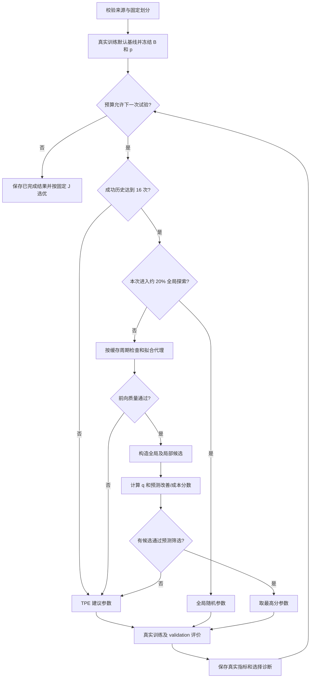

# RAC-HPO 算法详解

日期：2026-10-31。对应当前实现 rac-hpo-0.2.0。配套[用户手册](USER_MANUAL.md)。本文解释项目实际代码；原始架构总纲中的设想不自动视为已实现。

## 1. 算法究竟在优化什么

需要区分两层模型：

- 业务模型：LightGBM 等，输入日历、加工信号或传感器，输出能耗、寿命或故障类别。
- 搜索代理：ExtraTrees，输入一组超参数，预测业务模型在各工况上的验证误差和训练耗时。

HPO 的工作是选择超参数。每个 Trial 都要真实训练和验证业务模型，再把结果加入历史。代理只负责建议下一组参数，不能用代理预测替代最终真实成绩。当前没有 LLM。

例如 LightGBM 的学习率、叶子数、树深度控制模型复杂度。回归默认搜索六维：learning_rate、num_leaves、max_depth、min_child_samples、feature_fraction、lambda_l2。分类按模型使用各自搜索空间，不能直接套用回归范围。

数据始终分三份：train 拟合；validation 早停、选参和代理历史；test 封存，只有适用的显式最终评估流程才使用。反复搜索 validation 也会对其过拟合，因此需要独立最终评估，不能把验证成绩当真实部署性能。

## 2. 工况与误差

工况 g 必须由推理前可获得的元数据定义，例如 CNC 的切深、AI4I 的质量类型、Paderborn 的转速/载荷。不允许看见误差后临时分组，再把分组当独立证据。SECOM 没有已核验工况，只报告 overall。

回归对工况 g 计算：

$$E_g(\theta)=\frac{1}{n_g}\sum_{i\in g}|y_i-\hat y_i(\theta)|.$$

这是 MAE，越小越好，与目标同单位。钢铁为 kWh，CNC 为 cycles。

分类用：

$$BA_g=\frac{1}{K}\sum_{k=1}^{K}Recall_{g,k},\qquad E_g=1-BA_g.$$

BA 是 balanced accuracy。少量类别或缺失类别须结合评价输出的提示阅读，不能忽视每类样本数。分类误差不能标成 MAE。总体 BA 通常也不等于按工况样本占比加权的 BA，因为各工况类别比例可以不同。

## 3. 固定目标 J

搜索开始前，先训练默认参数基线，冻结各工况基线误差 B_g 和验证样本占比 p_g。候选的归一化误差为：

$$r_g(\theta)=\frac{E_g(\theta)}{B_g+\epsilon},\qquad p_g=\frac{n_g}{\sum_h n_h}.$$

最终固定目标：

$$J(\theta)=(1-\alpha)\sum_g p_g r_g(\theta)+\alpha\max_g r_g(\theta).$$

默认 alpha=0.3，epsilon=1e-8。第一项重视整体，第二项惩罚相对于自身基线最弱的工况。J 无量纲，越小越好；基线通常接近 1，分母含 epsilon，因此不保证严格等于 1。基线接近零时比值会敏感，记录会给出 near-zero 提示。

J 不会随搜索关注权重 q 改变。p 是冻结的评价权重，q 是后面用于挑选候选的关注权重，二者职责不同。不同数据、模型基线或划分下的 J 不能直接排名。

### 一个算得出的例子

假设两工况基线 MAE 都为 10，验证占比为 0.8/0.2。忽略极小的 epsilon：

| 候选 | 两工况 MAE | 总体 MAE | 误差比 | J |
| --- | --- | ---: | --- | ---: |
| A | 5、15 | 7.0 | 0.5、1.5 | 0.7×0.7+0.3×1.5=0.94 |
| B | 8、8 | 8.0 | 0.8、0.8 | 0.7×0.8+0.3×0.8=0.80 |

A 平均误差更低，但最弱工况比基线更差。J 会选择 B。这是目标的明确取舍，并不意味着 B 在所有指标上都更好。

## 4. 搜索方法的区别

| 方法 | 下一组参数如何产生 | 原回归选优目标 | 工业分类选优目标 |
| --- | --- | --- | --- |
| Random | 随机抽样 | 总体 MAE | 固定 J |
| Grid | 每维三档粗网格，固定顺序遍历 | 总体 MAE | 未接入 |
| Successive Halving | 随机候选，按迭代验证 MAE 跨候选分层剪枝 | 总体 MAE | 未接入 |
| Hyperband | 随机候选，多个资源 bracket 分层剪枝 | 总体 MAE | 未接入 |
| TPE | Optuna 根据好/差历史的参数分布建议参数 | 总体 MAE | 固定 J |
| 固定鲁棒 TPE | TPE，评分换为 J | 固定 J | 当前无此独立入口 |
| RAC-HPO | TPE 暖启动、全局探索、代理筛选与改善/成本排序 | 固定 J | 固定 J |

资源剪枝与单模型早停分别工作。默认从10轮开始、缩减系数3、上限等于模型树数；剪枝试验只保留中间误差与资源，不作为完整模型参加选优。Grid 不是连续空间穷举，短预算可能只覆盖少数维度。实现与本机实验见 [对齐记录](SUMMARY_ALIGNMENT.md)。

TPE 可直观理解为：观察哪些参数更常出现在较好的试验里，再偏向这些区域采样，同时保留探索。RAC 增加分工况代理、可信薄弱工况关注和成本考虑。

要研究“候选策略本身是否更好”，应对齐目标、模型、划分、空间、种子和资源。旧回归普通 TPE 与 RAC 目标不同，对照中不能把全部差异归因于代理策略。分类三方法已统一 J，但仍需核对完整公平比较条件。

## 5. RAC-HPO 的完整流程

默认基线不算 16 次成功历史。失败 Trial 不构成成功代理历史，所以“运行了 16 次”不保证马上启用代理。全局探索比例是每次决策概率，有限次实验不保证刚好占 20%。

### 5.1 代理学什么

将数值超参数缩放到 [0,1]，对数参数先取对数。ExtraTrees 学习每个工况的归一化误差；另一代理学习 log(训练耗时)，预测后还原正数成本。默认 48 棵树，使用已有成功试验。

每新增 4 个成功试验重新拟合，缓存最多落后 3 次成功试验。这样减少每次选择都重新训练代理的开销。日志记录代理历史大小、缓存年龄和选择耗时。

### 5.2 先检查代理是否有用

按历史顺序，用较早的试验预测最近 5 个位置；每个位置只用它前面的历史，不随机打散。默认要求：

- 归一化预测绝对误差不超过“前缀均值预测”误差的 1.25 倍；
- 对预测与真实 J 的 Spearman 排序相关不为负，且相关值有效。

不通过就回退 TPE。此检查检验搜索历史上的短期预测能力，不是业务数据的最终测试，也不是统计可靠性认证。

### 5.3 关注哪些薄弱工况

以当前 J 最优的成功试验为参照。若某工况有至少 5 个真实独立单元，且分组记录完整，才计算关注度。令 n_g 为独立单元数，参考误差比为各工况误差比的 p 加权平均：

$$s_g=\frac{n_g}{n_g+5},\qquad \tilde r_g=s_g r_g+(1-s_g)\sum_h p_h r_h.$$

对独立单元误差做 200 次分组 bootstrap，近似估计 P_g=Pr(r_g>1)，再计算：

$$q_g=\operatorname{clip}\big(\max(0,\tilde r_g-1)P_g,\ 0,\ 0.5\big).$$

样本少就向参考值收缩，证据不足直接 q=0。日期块、同一轴承的多个窗口不能冒充独立机床或独立轴承。

当前 CNC 每工况只有两把验证刀具，Paderborn 每工况只有三把验证轴承，均不满足默认门槛。q=0 不会关闭整个 RAC：分工况固定 J、代理、成本排序和探索仍可运行，但不能宣称可信关注分支已得到实证验证。

### 5.4 候选从哪里来

默认每次构造 128 个候选。一半在全局空间抽样，一半围绕历史 J 最好的 5 次参数做局部扰动；局部扰动在归一化空间的标准差为 0.15，越界截断，整数参数还原取整。

代理预测各工况误差与成本。先排除已完成过的参数组合，并排除预测总体误差高于默认基线 1.1 倍的候选。这里参照默认基线，不是当前最优试验。分类适配中的此项为预测加权工况 balanced error，不等同于总体 balanced error。预测筛选不保证真实训练后也满足该限制；所有候选均被排除时回退 TPE。

### 5.5 怎样给候选打分

对树成员预测加入配对的、中心化的前向残差重采样，得到搜索用预测样本。设当前真实最优目标为 J*，工况误差比为 r*_g：

$$EI_J(\theta)\approx \frac1M\sum_{m=1}^{M}\max(J^*-J^{(m)}(\theta),0),$$

$$EI_g(\theta)\approx \frac1M\sum_{m=1}^{M}\max(r^*_g-r_g^{(m)}(\theta),0).$$

候选分数：

$$A(\theta)=\frac{EI_J(\theta)+\beta\sum_g q_g EI_g(\theta)}{(\hat c(\theta)+t_0)^\gamma}.$$

默认 beta=0.5、gamma=0.5、t0=0.01 秒。分子衡量整体目标改善与有证据的薄弱工况改善；分母适度偏好低训练成本。gamma=0.5 表示除以成本平方根，不是直接除以秒数。

例如两个候选的分子均为 0.1，预测训练时间分别为 1 秒和 4 秒，则分数约为 0.0995 和 0.0499，会优先选较快者。这里只是公式示例，不是真实实验成绩。

最后选最高分参数进行真实训练，再计算实际 J 和误差。代理选择开销也计入搜索预算。q 只影响选哪组参数，真实评价始终使用第 3 节的固定 J。

## 6. 搜索、漂移监测与门禁的关系

三者分别回答不同问题：

- 搜索：在固定 train/validation 下，下一组超参数是什么？
- 监测：回放数据的质量、分布或有标签误差是否发生变化？
- 门禁：冻结候选是否满足相对于冠军的固定工程阈值？

CNC 闭环中，分布变化本身不证明误差退化。有标签整刀误差达到触发条件才形成提案；门禁仍独立检查总体与各工况。搜索 J 变好并不保证门禁通过。一次门禁也不证明跨机床泛化或统计可靠性。该闭环为受控单轮离线工程流程，不是持续在线自主演化算法。

## 7. 已有实验能说明什么

以下是已有报告中的验证成绩，未在本次文档任务重跑：

| 对照 | 结果 | 可以得出的结论 |
| --- | --- | --- |
| CNC，三种子、各 10 秒 | RAC 平均 J=0.7370、MAE=23.0989 cycles；普通 TPE 为 0.7396、22.8992 | J 略好但平均 MAE 略差，不能说所有指标领先 |
| AI4I，三种子、各 24 次 | RAC 平均 J=0.9908；TPE=0.9912 | 差异很小，而且数据为合成基准 |
| SECOM，同协议 | 三方法 BA 均为 0.5，故障召回为 0 | 当前模型未识别验证故障；不能证明 RAC 收益 |
| Paderborn 小子集，同协议 | Random 平均 J=0.6792；RAC/TPE=0.6930 | 本次 Random 较好，样本太小不能作普遍排序 |

依据：[阶段 2/3 报告](PHASE_2_3_REPORT.md)、[工业训练报告](INDUSTRIAL_TRAINING_REPORT.md)。不同数据行之间不可直接比较 J。

树离散度、前向残差重采样和分组 bootstrap 都是未校准近似，不能写成“95% 可靠保证”。接下来需要更多独立刀具/轴承、外部工况、更多种子，以及去掉成本项、代理和 q 项的消融，才能判断各组成部分带来的收益。

## 8. 从哪里看实现与诊断

| 内容 | 源码位置（相对工程根目录） |
| --- | --- |
| 固定 J 唯一定义 | `src/rac_hpo/domain/metrics.py` |
| RAC 流程与默认参数 | `src/rac_hpo/optimization/rac_hpo/search.py` |
| 超参数编码、代理与前向检查 | `src/rac_hpo/optimization/rac_hpo/surrogate.py` |
| 可信工况关注 q | `src/rac_hpo/optimization/rac_hpo/regime_priority.py` |
| 改善/成本公式 | `src/rac_hpo/optimization/rac_hpo/acquisition.py` |
| 分类误差适配与同目标搜索 | `src/rac_hpo/optimization/classification.py` |

读取每次决策的 method、reason、forward_validation、regime_priorities、surrogate_age_trials、预测成本和选择耗时，才能知道这次究竟是暖启动、全局探索、代理采集还是回退。算法名为 RAC-HPO，不代表每个 Trial 都由代理产生。
