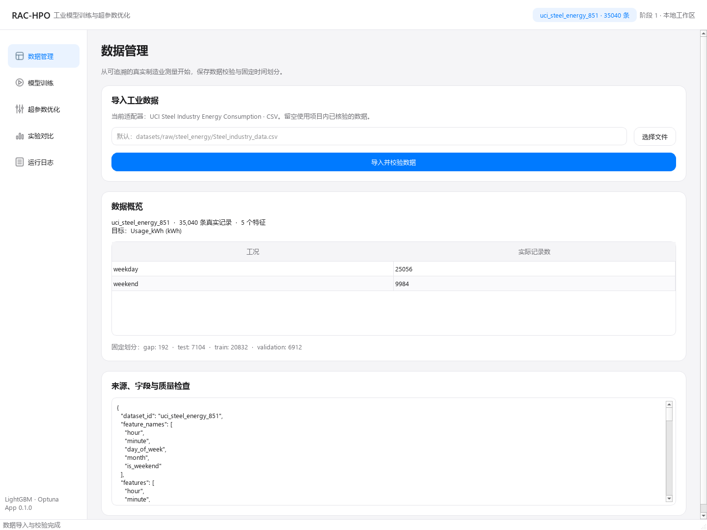
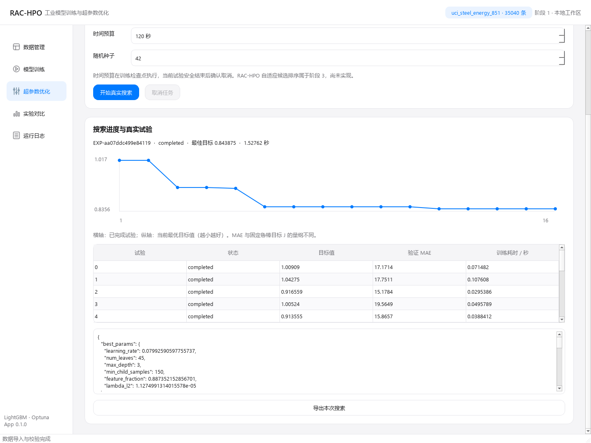

# RAC-HPO 阶段 0 / 阶段 1 实际交付报告

日期：2026-10-30，UTC+08:00。App 0.1.0 / Algorithm baseline-1.0 / Config 与 DB Schema 1。

## 1. 完成情况与工程范围

阶段 0 与阶段 1 已完成。本次从空工作目录建立独立工程，先检查后实施，没有可复用本地源码；未修改 Astrspire 或其他项目。GitHub 已作同名仓库只读检索，未获得可复用同名仓库；没有初始化远端、提交、推送或发布。

实际目录：`F:\A_LIU_Astrspire\A_competition\工业制造场景下的模型训练与超参数优化系统`。目录当前不是 Git 仓库，实验提交字段明确为 `unversioned`，另保存源代码 SHA-256，未伪造提交号。

阶段 0：建立 Python 虚拟环境、锁定依赖、src 结构、配置验证、测试入口、CLI / GUI 入口和维护文档。初始环境 / 配置 / 持久化 / 中文目录启动检查 10 项通过；最终检查覆盖全部实现。

阶段 1：真实数据接入、无随机时间泄漏的固定划分、LightGBM 基线、Random / TPE / 固定鲁棒目标、分工况指标、SQLite、真实模型与结果导出，以及白色 GUI 基础闭环均已实现。算法可脱离 GUI 独立运行。

## 2. 环境与依赖

本项目内 `.python` / `.venv`，CPython **3.11.15**，64 位 Windows。NumPy 2.2.6、pandas 2.3.3、SciPy 1.16.3、scikit-learn 1.7.2、LightGBM 4.6.0、Optuna 4.5.0、PySide6 6.9.3、matplotlib 3.10.7、pydantic 2.12.3、PyYAML 6.0.3、pytest 8.4.2。

`uv.lock` 固定运行依赖与哈希；每次正式实验另保存完整安装版本、环境和锁文件。`uv pip check` 检查 43 包兼容通过；`uv sync --frozen --offline --extra test` 检查 43 包通过。

## 3. 真实数据核验

来源：[UCI Steel Industry Energy Consumption](https://archive.ics.uci.edu/dataset/851/steel+industry+energy+consumption)，[DOI 10.24432/C52G8C](https://doi.org/10.24432/C52G8C)，许可 [CC BY 4.0](https://creativecommons.org/licenses/by/4.0/legalcode)。官方来源称数据来自韩国光阳 DAEWOO Steel Co. Ltd。

文件：`datasets/raw/steel_energy/Steel_industry_data.csv`，SHA-256：

```text
9b1cee6f9cb9cd9df2b95814ca90a9a2ff15b7f5f1fba0fae3c643e82072eacc
```

实际核验 **35,040 行 / 35,040 唯一时间 / 365 日期 / 每日 96 行**；2018-01-01 00:00 至 2018-12-31 23:45；没有空字段、重复时间或负目标。真实 CSV 的 11 列及许可引用记录于 [SOURCES.md](../datasets/SOURCES.md)。官方分类任务的标签是 Load Type；本工程明确改作 Usage_kWh 回归，不称为复现官方分类任务。CO2 官方单位描述与列名存在歧义，本轮不使用。

预测目标：`Usage_kWh`，单位 kWh。仅使用预测前已知的 `hour`、`minute`、`day_of_week`、`month`、`is_weekend`。排除 Load_Type、同时刻无功电量、功率因数、CO2 等未证明预测时可获得的特征。工况预先固定为 weekday / weekend。

日期组表示相关时间块，**不是已核验的独立生产批次、机床或刀具**。指标契约中的 independent_groups 在此适配器下只是日期块数，可靠性标记仅描述性，不是独立批次推断或已校准置信区间。非官方字节一致文件会标记 user_supplied / license unknown，不继承 UCI 许可声明。

## 4. 固定划分与测试隔离

按真实时间稳定排序，保留原始行映射；同一日期末尾的 00:00 行按提供的日期解释，不擅自移至次日。约 60/20/20 的整日时间划分，在两个边界各排除 1 天。

| 划分 | 日期 | 行数 | 日期块数 | 工作日行 / 周末行 |
|---|---|---:|---:|---:|
| train | 01-01 至 08-05 | 20,832 | 217 | 14,880 / 5,952 |
| validation | 08-07 至 10-17 | 6,912 | 72 | 4,992 / 1,920 |
| test | 10-19 至 12-31 | 7,104 | 74 | 4,992 / 2,112 |
| gap | 08-06、10-18 | 192 | 2 | 不参与训练或评价 |

完整索引清单：`datasets/manifests/steel_calendar_v1_9b1cee6f9cb9.json`。预处理只有固定日历派生，没有在全量数据上拟合填补、缩放或编码统计量。

正式基线与搜索只用 train / validation，**正式全量实验的 test 保持封存，没有最终测试成绩**。`finalize` 的一次性测试协议已在真实测量数据前 90 天的独立测试夹具上验证：固定参数和验证早停轮数，train+validation 重训后测试、重复调用拒绝、导出与数据库快照一致；这些工程测试指标不作为正式工业结果报告。

## 5. 真实训练命令、结果与复现

LightGBM 的六项基线模型参数为 learning_rate=0.1、num_leaves=31、max_depth=-1、min_child_samples=20、feature_fraction=1、lambda_l2=0。统一显式预算为最多 300 棵树、30 轮早停、4 线程、seed=42；这不是完全不作配置的库默认运行。

```powershell
.venv\Scripts\python.exe -m rac_hpo fetch
.venv\Scripts\python.exe -m rac_hpo import
.venv\Scripts\python.exe -m rac_hpo train --seed 42 --estimators 300
.venv\Scripts\python.exe -m rac_hpo optimize --algorithm random --seed 42 --estimators 300 --max-trials 16 --timeout 120
.venv\Scripts\python.exe -m rac_hpo optimize --algorithm tpe --seed 42 --estimators 300 --max-trials 16 --timeout 120
.venv\Scripts\python.exe -m rac_hpo optimize --algorithm tpe_robust --seed 42 --estimators 300 --max-trials 16 --timeout 120
```

上述四组命令由 `scripts/run_benchmarks.py --max-trials 16 --timeout 120` 实际执行两轮。第二轮全部最佳参数及验证指标与第一轮逐值一致；耗时按实际重新记录，不要求一致。每轮四组内部代码指纹一致；第二轮指纹为 `f5263e265f6e9a4054dea1ed053ba30e9e78c97e42aebb427c94a30b24c7adb4`。

| 方法 | 第二轮实验 ID | 验证总体 MAE / kWh | 工作日 MAE | 周末 MAE | 固定 J |
|---|---|---:|---:|---:|---:|
| LightGBM 基线 | EXP-9092a415b8724763 | 20.656475 | 25.557399 | 7.914071 | 1.000000 |
| Random | EXP-1c871e0e93bf4d71 | 13.504241 | 15.327054 | 8.764927 | 0.850790 |
| Optuna TPE | EXP-6777c4f266774f8b | 13.191678 | 15.136409 | 8.135377 | 0.807687 |
| 固定鲁棒目标 TPE | EXP-aa07ddc499e84119 | 13.512944 | 15.389246 | 8.634558 | 0.843875 |

每个搜索为 16 次真实试验，另有 trial -1 默认基线初始化。TPE 前 10 次为随机暖启动，后续 6 次进入 TPE 选参；已通过采样路径测试验证。固定 J 使用基线 B_weekday=25.5573988797、B_weekend=7.9140712690；权重 52/72 和 20/72，alpha=0.3、epsilon=1e-8，开始前固定并保存。基线 J 因 epsilon 略小于 1。

| 方法 | 基线训练 / 秒 | 搜索循环 / 秒 | 实验总耗时 / 秒 | 最佳轮数 |
|---|---:|---:|---:|---:|
| 基线 | 0.040843 | 0 | 0.565659 | 31 |
| Random | 0.044761 | 1.396202 | 1.970943 | 40 |
| TPE | 0.049522 | 1.173069 | 1.787325 | 15 |
| 鲁棒 TPE | 0.045825 | 0.962056 | 1.527615 | 32 |

以上是本机观测耗时，不是资源隔离条件下的正式性能研究。总耗时包括配置 / 持久化 / 绘图等工作，CLI 进程启动耗时另保存在 benchmark JSON。120 秒是上限，本轮由 16 次上限先停止；这不是填满相同时间预算的公平性证明。没有启用剪枝或多保真。

普通 TPE 此次总体 MAE 和 J 均优于鲁棒 TPE；三种搜索的周末 MAE 仍高于基线。只能说明此数据、此种子、此空间下的实测表现，不表述为鲁棒策略获胜或 RAC-HPO 领先。

TPE 最佳参数：

```json
{"learning_rate":0.1915321805725572,"num_leaves":42,"max_depth":3,"min_child_samples":69,"feature_fraction":0.8329314657216306,"lambda_l2":1.0805775981313428}
```

结果与命令逐项保存在 `workspace/verification/benchmark-EXP-9092a415b8724763.json`，原始 CLI JSON / stderr 同目录。实验详情位于 `workspace/experiments/<ID>/`，SQLite 位于 `workspace/database/experiments.sqlite3`。已实际执行新 TPE 实验的 CLI export，输出路径见 `workspace/verification/cli-export.json`。

## 6. GUI 与真实后端

顶部工具栏、窄导航和五页卡片布局；设计 token 集中在 theme.py，使用 #F5F5F7 / #FFFFFF / #007AFF 等规范颜色。字体使用系统已安装 Segoe UI / 微软雅黑，没有分发 Apple 字体。

- 数据管理：选择 CSV、真实导入校验、来源、字段、工况与固定划分。
- 模型训练：真实基线启动、取消确认、原始指标、导出。
- 超参数优化：Random / TPE / 鲁棒 TPE 的实际预算、试验表、收敛、最佳参数与导出。
- 实验对比：真实历史记录、总体与分工况指标、J、耗时和详情。
- 运行日志：真实进度与异常、筛选、复制、导出当前显示日志。

GUI 只调用 ApplicationService，训练与搜索通过 spawn 独立进程执行；Qt 主线程轮询队列，取消需等待实际后端确认，已完成记录保留。没有模拟演示结果或 RAC-HPO 可运行按钮。

截图为真实 Qt 窗口：





另有 training / comparison / logs 同名前缀截图。截图和自动化通过 Qt offscreen 完成；未进行人工原生桌面点击、长时间运行、高 DPI 多屏或全部窗口尺寸验收。

## 7. 自动化测试与实际修复

最终命令：

```powershell
.venv\Scripts\python.exe -m pytest --basetemp .cache\pytest-acceptance-final --junitxml workspace\verification\pytest-acceptance-final.xml -q
```

实际结果：**97 passed in 23.41s**。输出：`workspace/verification/pytest-acceptance-final.log`，JUnit：同名 `.xml`。

覆盖：数据 / 来源 / 划分 / 工况 / 非法字段；固定 J 和近零基线；合法空间与预算；真实 LightGBM 和最佳模型重载；Random / TPE 可复现与 TPE 暖启动；失败与取消；SQLite / 原子文件 / 导出；核心层无 Qt / 数据库依赖；真实 GUI 后台导入、训练、搜索、错误、取消、字体与进程退出。

开发过程中实际出现过失败，均未计为通过：

- 系统无 py 命令，uv 默认 C 盘缓存拒绝访问，改为项目内环境。
- 官方包站下载非常慢，改用镜像下载，但使用官方 uv.lock 中的 SHA-256 逐包校验。一次 uv pip sync 参数写法错误已更正。
- 系统 PowerShell TLS 下载器认证失败，改用 Python urllib 正常 TLS 下载官方数据，没有关闭证书校验。
- Python 3.11 locale 读取中文 editable 路径失败，改用 ASCII 路径转义；CLI JSON 另统一 UTF-8。
- 非官方导入误继承来源 / 许可、清单跨路径冲突 / 并发覆盖、runner 第二参不一致、空基线与非法深度空间、首次预算耗尽误报成功，均补测试后修复。
- GUI 队列结束竞争、默认基线 MAE 混入 J 图表 / 表格、取消确认、离屏字体缺失已复现并修复。
- 中文路径模型原生文件加载失败，通过 Python UTF-8 文本加载解决；SQLite 连接关闭和最终评估快照遗漏也已先复现再修复。

单元测试中的构造输入只用于规则边界，不作为工业实验成果。正式报告所有指标均来自原始 UCI 测量和真实训练。

## 8. 新增 / 修改文件

本目录原为空，以下均为本轮新增；依赖环境、原始数据、历史实验和缓存单独保存在上述目录。

- 根目录：AGENTS.md、ARCHITECTURE.md、README.md、CHANGELOG.md、PLAN.md、pyproject.toml、uv.lock、.gitignore、main.py、Setup.cmd、Run-GUI.cmd。
- configs/default.yaml。
- src/rac_hpo：__init__.py、__main__.py、_io.py。
- domain：schemas.py、metrics.py、__init__.py。
- data：loader.py、validator.py、splitter.py、__init__.py。
- training：lightgbm_trainer.py、model_export.py、__init__.py。
- optimization：base.py、robust_objective.py、__init__.py。Random / TPE 复用一个 ask/tell 循环，没有创建重复优化模块。
- evaluation：evaluator.py、__init__.py。
- application：experiment_service.py、__init__.py。统一编排，不创建没有职责的空服务。
- infrastructure：config_loader.py、database.py、artifacts.py、__init__.py。
- interfaces：cli.py、__init__.py；gui：main_window.py、theme.py、workers.py、widgets.py、__init__.py；pages：data_page.py、train_page.py、optimize_page.py、compare_page.py、logs_page.py、__init__.py。
- scripts：configure_environment.py、download_steel.py、verify_environment.py、run_benchmarks.py。
- tests/unit：test_data.py、test_metrics.py、test_optimization.py、test_config_persistence.py；tests/integration：test_pipeline.py、test_gui.py；tests/regression：test_windows_startup.py。
- datasets/SOURCES.md；docs/RAC-HPO_Implementation_Architecture_v1.md（原文保存）；本报告、docs/references/uci-steel-source.json 官方页面核验快照及 docs/images 下五张 PNG。

临时测试夹具、截图脚本和排查文件在验收后清理；项目环境、可复现依赖缓存、真实数据、固定清单及所有历史实验保留。

## 9. 未实现事项与下一步

阶段 2 先核验含真实切削条件、机床 / 刀具 / 加工运行标识的数据；明确独立单元与相关性后，完善工况可靠性、不确定性、小样本处理及固定鲁棒目标对照。当前工作日 / 周末适合验证管线，不能替代完整制造工况研究。

阶段 3 才实施 ExtraTrees 工况代理、前向质量验证、有界工况优先级、改善 / 成本候选排序与回退。阶段 4 再做同时间预算、多随机种子、多个真实数据集与消融；阶段 5 再开展长期稳定性、迁移与发布。当前未验证真实独立批次泛化、RAC-HPO 优势、生产部署或 EXE 打包。

API 核验参考：[LightGBM 4.6.0 Regressor](https://lightgbm.readthedocs.io/en/v4.6.0/pythonapi/lightgbm.LGBMRegressor.html)、[早停](https://lightgbm.readthedocs.io/en/v4.6.0/pythonapi/lightgbm.early_stopping.html)、[Optuna 4.5.0 ask/tell](https://optuna.readthedocs.io/en/v4.5.0/tutorial/20_recipes/009_ask_and_tell.html)、[TPE](https://optuna.readthedocs.io/en/v4.5.0/reference/samplers/generated/optuna.samplers.TPESampler.html)。
