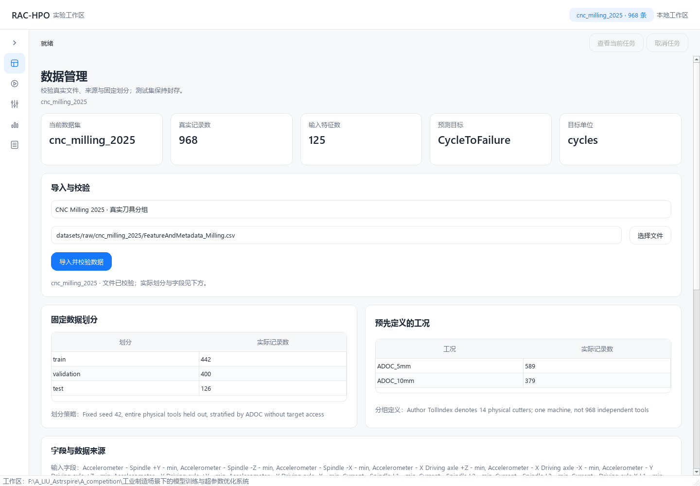
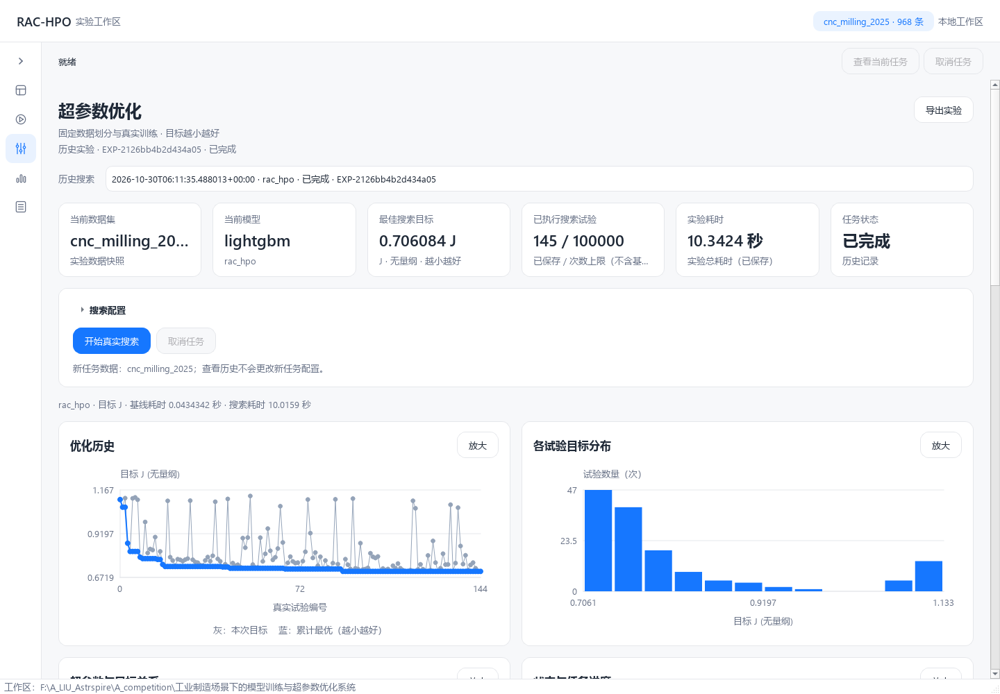
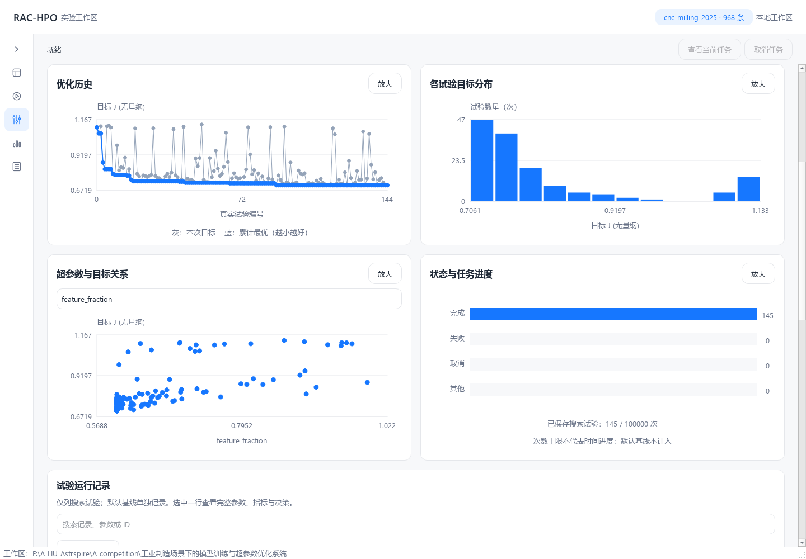

# RAC-HPO 阶段 2、3 交付报告

日期：2026-10-30。当前 App 0.3.0，RAC 算法 rac-hpo-0.2.0，Config / DB Schema 1。复用原有模块化单体、LightGBM、Optuna、应用服务、SQLite 与 PySide6；没有迁移数据库、覆盖历史实验或修改其他项目。

## 实际完成与边界

阶段 2 已完成真实 CNC 数据接入、物理刀具分组检查、先验切深工况、原始/归一化指标、小样本处理，以及普通 TPE 与固定鲁棒 TPE 的真实对照。阶段 3 已完成 ExtraTrees 性能/成本代理、前向验证、有界可信关注、全局探索、改善/成本候选排序、TPE 回退及真实 GUI/CLI 接口。

阶段 2 的检查为 113 项通过；阶段 3 首轮为 136 项通过；随后与已有工作区 UI 整合的当前完整回归为 **175 passed，0 failures，0 errors，0 skipped**。三种子同预算试跑验证了完整搜索链路，但不是阶段 4 的全面算法证明。当前数据每个验证工况只有两把刀具，可信工况权重 q=0，因此不能声称真实实验已证明可信加权分支的收益。

## 公开数据核验

实际训练使用 [Piecuch 与 Żabiński 的 CNC Milling Process Dataset](https://doi.org/10.6084/m9.figshare.28589216.v1)，研究说明见 [Scientific Data 12, 650 (2025)](https://www.nature.com/articles/s41597-025-04923-y)。[Figshare 数据元数据](https://api.figshare.com/v2/articles/28589216) 明确数据许可为 CC BY 4.0；本地保存 [元数据快照](references/cnc-milling-figshare-metadata.json)，不以论文许可替代数据许可。

下载作者发布的 [FeatureAndMetadata_Milling.csv](https://ndownloader.figshare.com/files/52968974)，没有下载约 25.35 GB 的原始信号包，也没有声称独立复算作者特征。

| 核验项 | 实际值 |
|---|---|
| 本地文件 | `datasets/raw/cnc_milling_2025/FeatureAndMetadata_Milling.csv` |
| 文件大小 | 1,797,280 bytes |
| 发布者 MD5，已匹配 | `cbcad3f9631e0be6c4f71ff27749108c` |
| SHA-256 | `e125471f983e98ae326e2c47e15f633bb30738e285b9ad6e54b5e364d4d66dbc` |
| 测量规模 | 968 个周期、14 把物理刀具、单机床、131 列 |
| 输入 | 作者 120 个信号聚合特征 + 5 项工艺元数据，共 125 项 |
| 目标与时点 | 观测当前周期信号后估计 CycleToFailure，单位 cycles |
| 工况 | 推理前已知的 ADOC=5 mm / 10 mm，各 7 把刀具 |

源 CSV 使用分号，第二行才是实际表头，部分元数据为小数逗号；适配器按实际文件解析并严格检查字段、缺失与分组。排除 `FileName`、`NumberOfCycle`、`SampleIndex`、`TollIndex` 和两个未来寿命字段。保留仅一个周期即失效的刀具 11，没有根据目标或误差删除异常样本。

划分使用固定 seed=42，仅按工具身份和切深分层；同把刀具的全部周期只在一个集合：

| 集合 | 刀具数 / 周期数 | TollIndex |
|---|---|---|
| train | 8 / 442 | 10、7、103、11、2、6、105、4 |
| validation | 4 / 400 | 5、101、9、8 |
| test，封存 | 2 / 126 | 3、102 |

验证集 ADOC_10mm 有 135 行、ADOC_5mm 有 265 行，每工况均只有两把工具。默认至少五个独立单元，故输出 `insufficient_independent_groups`、空区间和 q=0。周期行数不当作独立刀具数；物理刀具分组也不等于跨工厂或跨机床复制。

另外从 [NASA 官方 PCoE 仓库](https://www.nasa.gov/intelligent-systems-division/discovery-and-systems-health/pcoe/pcoe-data-set-repository/) 的现行链接下载了 Milling：14,731,306 bytes，SHA-256 `bdba8d52ec1a1baab24c2be58480e6ac62508c8cc1f8219f47ebde8fc9ebc474`。MAT 实查 167 条记录、146 个 VB 标签、16 个 case；case 是否等于物理工具尚未核验，未用于训练。保留 NASA / BEST Lab 归属，不擅自标记 CC BY 或第三方材料均属公共领域。[结构快照](references/nasa-milling-file-inventory.json) 和 [全部候选来源](../datasets/SOURCES.md) 已保存。

下载/解析中实际遇到：NASA legacy 链接超时，改用官方页面的现行 S3 链接；Figshare 普通页面/API 在本机 HTTP 403，Firecrawl 读到公开元数据，原始文件下载与 MD5 核验成功；CNC Power 整包 HTTP 403，且含仿真内容，未用于成果。首次按普通逗号 CSV 解析 CNC 失败，核对真实文件后修正；这些失败没有被伪装成训练成功。

## 固定目标与真实基线

真实基线 `EXP-29473e1b82a649da`：验证 MAE **31.3078474553 cycles**。ADOC_10mm 的 B_g=16.3972959969，ADOC_5mm 的 B_g=38.9037887644；权重分别为 0.3375 / 0.6625。配置固定 alpha=0.3、epsilon=1e-8：

`R_g = MAE_g / (B_g + epsilon)`；`J = 0.7 × sum(p_g × R_g) + 0.3 × max(R_g)`。

六维模型搜索空间、最多 300 棵树、30 轮早停、4 线程保持一致。每次搜索先重新运行默认基线并冻结 B_g；该次初始化计时单列，trial -1 不计入搜索次数。普通 TPE 选择总体 MAE 最小者，鲁棒 TPE 与 RAC 选择固定 J 最小者，同时保存原始指标。q 只影响候选关注，不修改最终 J。

## RAC-HPO 实现与限制

- 默认 16 次 TPE 暖启动；性能代理预测归一化分工况 MAE，成本代理预测对数训练耗时，均使用 ExtraTrees。
- 默认 48 棵树、128 个候选，一半全局、一半围绕前五个真实试验生成；独立保留 20% 全局探索概率。
- 使用历史前缀预测后续最后五个历史试验；代理 MAE 不高于前缀均值基线的 1.25 倍且排序相关不为负才通过。逐次记录前缀大小、误差、排序相关、树区间覆盖诊断。
- 预测抽样组合树离散度和配对前向残差重采样，属于未校准近似；覆盖率只作诊断。不能将其当成经过校准的概率保证。
- 可信关注要求真实独立单元充足，使用分组重采样、n/(n+5) 收缩与 q 上限 0.5；本数据该分支自然关闭。正权重的行为有规则测试，尚无充分工业实证。
- 候选分数 `(EI_J + 0.5 × sum(q_g × EI_g)) / (predicted_cost + 0.01)^0.5`；预测总体误差不超过默认基线的 1.1 倍才进入候选排序。这是预测筛选，不能保证真实总体误差上限。
- 历史不足、前向质量不合格、代理异常或候选不合格时明确回退；同一 Optuna/LightGBM runner 执行真实训练，保留取消、预算及错误状态。
- 算法 0.2.0 默认每新增四个完成试验重拟合；代理最多落后三次，保存 `surrogate_fit_history` 和 `surrogate_age_trials`。优先级、候选与当前最优仍按当前历史计算。

## 同预算真实试跑

三个 seed=42/71/103、每算法搜索墙钟预算 10 秒、次数上限 100000；预算包含候选选择开销，基线初始化单列。已开始的试验可完成，允许少量超时并单独记录。固定工具划分不随搜索 seed 改变；没有读取测试集来选参或评判方法。

最终批次 [完整账本](../workspace/verification/cnc-budget-2026-10-30T061041477295+0000.json) 中九次实验全部 completed，运行代码指纹一致：`cfdf0a64a82a2fad01c1c8dccec6159f27ded76fc9596e3fb095afaf5f4c927a`。当前 UI 后续调整另由最终回归验证；不改写历史指纹。

| seed | 方法 | 实验 ID | 完成试验数 | 验证 MAE（cycles） | 固定 J |
|---|---|---|---:|---:|---:|
| 42 | TPE | EXP-444ca1c540724fc8 | 180 | 23.409947 | 0.763455 |
| 42 | 鲁棒 TPE | EXP-dc4d4365c5d5474a | 187 | 23.460194 | 0.774774 |
| 42 | RAC-HPO | EXP-22037867c8584a0d | 155 | 23.868106 | 0.765639 |
| 71 | TPE | EXP-f7a78286a0644191 | 198 | 22.161990 | 0.704275 |
| 71 | 鲁棒 TPE | EXP-55c80c549a0e4bb4 | 191 | 22.443812 | 0.711336 |
| 71 | RAC-HPO | EXP-2126bb4b2d434a05 | 145 | 22.203128 | 0.706084 |
| 103 | TPE | EXP-4742bb11713a4023 | 194 | 23.125750 | 0.751016 |
| 103 | 鲁棒 TPE | EXP-d0ec1af05d444216 | 164 | 24.444784 | 0.776857 |
| 103 | RAC-HPO | EXP-83e8f3a3d784481d | 148 | 23.225607 | 0.739321 |

| 三种子算术均值 | MAE（cycles） | J | 完成试验数 |
|---|---:|---:|---:|
| TPE | 22.899229 | 0.739582 | 190.67 |
| 鲁棒 TPE | 23.449597 | 0.754322 | 180.67 |
| RAC-HPO | 23.098947 | 0.737015 | 149.33 |

RAC 平均 J 比鲁棒 TPE 低约 2.29%，比普通 TPE 低约 0.35%；总体 MAE 比普通 TPE **高约 0.87%**。seed 42、71 的 J 也未胜过普通 TPE。三个种子和四把验证工具不足以支持显著性或普遍领先结论；反复自适应使用验证集仍有选择偏差风险，正式外部/封存测试应在预先确定研究方案后开展。

RAC 各工况实际误差及回退：

| seed | ADOC_10mm MAE | ADOC_5mm MAE | 最差归一化误差 | RAC 排序 / 全局 / TPE 回退 |
|---|---:|---:|---:|---|
| 42 | 12.623589 | 29.596445 | 0.769858 | 98 / 34 / 23 |
| 71 | 10.924612 | 27.948788 | 0.718408 | 96 / 28 / 21 |
| 103 | 11.591155 | 29.152593 | 0.749351 | 93 / 29 / 26 |

各次回退含 16 次暖启动及 7/5/10 次代理质量不合格。ADOC_5mm 的原始 MAE 始终更大，但 seed 42 的最差归一化误差来自 ADOC_10mm；原始与归一化薄弱工况不可混淆。

### 代理缓存优化的实际代价

保留 [逐次拟合旧账本](../workspace/verification/cnc-budget-2026-10-30T060700442347+0000.json) 和 [自动汇总](../workspace/verification/phase3-delivery-audit.json)。在相同三种子及 10 秒预算下：

| RAC 版本 | 平均候选选择耗时 | 平均试验数 | 平均 J |
|---|---:|---:|---:|
| 0.1.0，每次拟合 | 5.2050 s | 98.67 | 0.735944 |
| 0.2.0，每四次拟合 | 3.2885 s | 149.33 | 0.737015 |

选择耗时下降约 36.8%，试验数增加约 51.4%，但平均 J 略差约 0.15%。这是本机依次运行的小规模工程比较，墙钟预算受负载影响，不构成严格消融或统计证明；保留两批全部实际结果，不只展示较好版本。

## 测试、失败与导出

最终命令：

```powershell
.venv\Scripts\python.exe -m pytest --basetemp .cache\pytest-delivery --junitxml workspace\verification\pytest-delivery.xml -q
.venv\Scripts\python.exe -m rac_hpo export EXP-2126bb4b2d434a05
```

最终 **175 passed in 99.23s**；[完整日志](../workspace/verification/pytest-delivery.log)、[JUnit](../workspace/verification/pytest-delivery.xml)。唯一警告为旧 `.cache/pytest-state` 下缓存目录权限拒绝，不涉及测试断言失败；另用新项目内缓存目录执行收集检查，175 项收集成功、无缓存警告，记录见 [缓存检查](../workspace/verification/pytest-cache-check.log)。没有据此宣称重跑后的全量无警告。

阶段记录：[阶段 2 测试](../workspace/verification/pytest-phase2-final.xml)、[阶段 3 首轮测试](../workspace/verification/pytest-phase3.xml)。覆盖真实 CNC 划分/排除字段、独立单元与区间边界、唯一 J 公式、代理前向门槛、成本与 q 对候选排序的影响、暖启动/质量/异常回退、缓存年龄、真实 24 次 RAC 搜索、封存测试访问拦截、GUI 后台搜索/取消/导出及既有钢铁流程。规则测试的构造输入不作工业训练成果。

曾有真实初次搜索 `EXP-4277eee90ee54a98` 因 Windows 原子替换时短暂锁定而失败，保留 failed 记录，不计入正式均值。增加失败回归后，仅对 WinError 5/32/33 有限退避重试，永久失败仍抛出且旧内容保留。修复后 `EXP-a4abbd9a177a4f2a` 真实完成 40 次，J=0.8013916401。树均值抽样导致改善全零、重复拟合开销、导出误标 kWh 等也先用失败回归复现再修复。

操作中还出现工具启动器 `setup refresh` 错误，改用已授权的工程命令执行通道完成后续读写；另有核对脚本读取了不存在的 CLI/旧测试日志/导出模块路径，随后改按实际文件查验，未作为成功检查。所有正式检查范围以保存的日志为准。

真实导出：[EXP-2126bb4b2d434a05](../workspace/exports/EXP-2126bb4b2d434a05-c91a5ca6/report.md)，包含模型、JSON、CSV、PNG、manifest、配置、固定目标、环境与 uv.lock。报告单位核验为 cycles；命令输出见 [导出记录](../workspace/verification/phase3-export.json)。本轮未调用 CNC finalize，未生成测试集分数。

## 程序、截图与修改文件

双击工程根目录 `Run-GUI.cmd` 可打开实际程序。数据管理选择 CNC Milling 2025 后导入；优化页选择 RAC-HPO，建议至少 32–48 次以越过 16 次暖启动。每次试验详情可查看实际候选决策和代理诊断。训练/搜索核心不导入 Qt/SQLite，CLI 与 GUI 通过同一应用服务执行。

交付时已通过 Explorer 打开实际桌面窗口，进程 37452、窗口句柄 3214012、Responding=true；这是核验时状态，不保证以后进程持续存在。[窗口记录](../workspace/verification/phase3-live-window.json)。

以下截图使用当前真实 Qt 窗口加载已保存的 CNC 基线及 `EXP-2126bb4b2d434a05`，没有构造训练曲线或结果：[截图记录](../workspace/verification/phase3-screenshots.json)。







阶段 2、3 涉及的主要实现文件：

- 数据：`src/rac_hpo/data/cnc_milling.py`、`data/registry.py`；复用原 `data/loader.py` 的钢铁数据契约。
- 评分/训练：`domain/metrics.py`、`evaluation/evaluator.py`、`evaluation/uncertainty.py`、`training/lightgbm_trainer.py`。
- 搜索：`optimization/base.py` 及 `optimization/rac_hpo/{__init__,surrogate,regime_priority,acquisition,search}.py`。
- 应用/持久化：`application/experiment_service.py`、`infrastructure/config_loader.py`、`infrastructure/artifacts.py`、`_io.py`；导出复用应用服务，未改数据库 schema。
- 入口/展示：`interfaces/cli.py`、`interfaces/gui/main_window.py`、`interfaces/gui/pages/{data_page,optimize_page,compare_page}.py`；后续工作区组件/界面改动详见 [UI 报告](UI_REFACTOR_REPORT.md)，已纳入最终 175 项回归。
- 运行：`scripts/run_cnc_benchmarks.py`、`src/rac_hpo/__init__.py`、`pyproject.toml`、`uv.lock`、`.gitignore`。
- 检查：`tests/unit/{test_cnc_data,test_uncertainty,test_rac_hpo,test_metrics,test_config_persistence}.py`、`tests/integration/{test_cnc_pipeline,test_gui}.py`、`tests/regression/test_atomic_retry.py`，并运行现有全套回归。
- 维护：`AGENTS.md`、`ARCHITECTURE.md`、`README.md`、`CHANGELOG.md`、`PLAN.md`、`datasets/SOURCES.md`、本报告、来源快照及真实截图。原阶段报告与实验历史保留。

临时研究目录 `.firecrawl` 已在必要元数据归档后删除，截图/汇总/文档核对辅助脚本和本次最终测试夹具已删除。九个较早的 `.cache/pytest-*` 目录删除时遇到 Windows 权限拒绝，仍保留，未更改其权限；逐项结果见 [清理记录](../workspace/verification/phase3-cleanup.json)。保留真实数据、所有实验、测试日志、依赖缓存与运行环境。[文档链接检查](../workspace/verification/phase3-doc-links.json) 未发现失效本地引用。

## 下一步

阶段 4 优先寻找更多真实独立刀具/加工运行与外部机床数据，先确认许可与输入时点，再冻结验证方案。扩大多种子与公平总资源预算对照，增加可信权重、代理、成本与缓存消融，检验不确定性校准和真实总体退化率。当前仅四把验证刀具，不宜据此提高模型复杂度或承诺生产泛化。阶段 5 安装包、长期运行与发布尚未实施。
